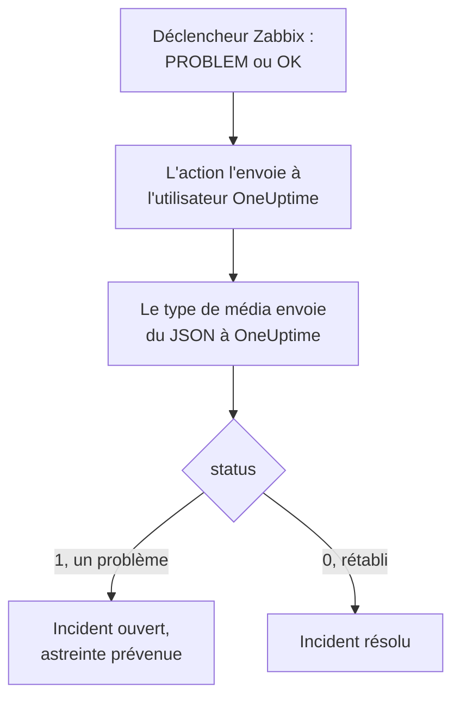

# Zabbix

Envoyez les problèmes [Zabbix](https://www.zabbix.com) à OneUptime, pour que chaque problème devienne un incident qui prévient votre équipe d'astreinte et soit résolu quand Zabbix se rétablit. Zabbix envoie chaque problème par un type de média webhook, il n'y a donc rien à installer d'un côté comme de l'autre.

:::cards
- [Choisir comment OneUptime reçoit les problèmes](#choisir-comment-oneuptime-reçoit-les-problèmes): Un moniteur de requêtes entrantes, ou un workflow à vous.
- [Recevoir les problèmes avec un moniteur](#recevoir-les-problèmes-avec-un-moniteur): Un incident par problème, résolu au rétablissement.
- [Configurer Zabbix](#configurer-zabbix): Un type de média, un utilisateur et une action.
- [Dépannage](#dépannage): Quand les problèmes n'arrivent pas, ou que les incidents restent ouverts.
:::

## Fonctionnement



Zabbix envoie un problème à un utilisateur, par les médias de cet utilisateur. Ici, le média est un type de média webhook nommé **OneUptime** : son script envoie un petit document JSON à OneUptime, avec l'ID d'événement du problème, son nom, l'hôte, la sévérité et le statut. Le statut vaut `1` pour un problème et `0` pour son rétablissement.

## Avant de commencer

- Un serveur Zabbix que vous administrez. Ce guide est écrit pour Zabbix 6.0 LTS et 7.0 LTS. Les types de média webhook fonctionnent de la même façon depuis Zabbix 5.0.
- Un serveur Zabbix qui peut joindre votre OneUptime en HTTPS.
- Dans OneUptime, le droit de créer des moniteurs, ou des workflows si vous prenez cette voie.

## Choisir comment OneUptime reçoit les problèmes

Configurez d'abord OneUptime : il vous donne l'URL à laquelle Zabbix envoie.

| Façon | Utilisez-la quand |
| --- | --- |
| Un moniteur de requêtes entrantes (recommandé) | Vous voulez que chaque problème Zabbix devienne un incident qui prévient l'astreinte et soit résolu quand Zabbix se rétablit. Il n'y a rien à construire. |
| Un workflow avec un déclencheur Webhook | Il vous faut une logique propre : filtrer les problèmes, les remanier ou appeler d'abord d'autres systèmes. Un workflow ne résout pas l'incident au rétablissement de lui-même. |

Les deux reçoivent le même JSON du même type de média, vous pouvez donc commencer par l'un et changer plus tard en modifiant une URL dans Zabbix.

## Recevoir les problèmes avec un moniteur

Un [moniteur de requêtes entrantes](/docs/monitor/incoming-request-monitor) vous donne une URL, et ses critères décident de ce que fait chaque requête.

:::steps
### Créer le moniteur

Allez dans **Moniteurs** et cliquez sur **Créer un moniteur**. Choisissez **Requête entrante** sous **Type de moniteur**, nommez-le `Zabbix` et cliquez sur **Suivant**.

### Déclarer un incident pour chaque problème

À l'étape **Critères**, ouvrez le premier critère, celui qui marque le moniteur hors ligne. Réglez son filtre sur **Corps de la requête**, **Contient**, `"status":"1"`. Ce critère déclare déjà un incident quand son filtre correspond. Remplissez l'incident :

- **Titre de l'incident** : `Zabbix: {{requestBody.name}} on {{requestBody.host}}`.
- **Gravité** : la gravité d'incident que doivent avoir les problèmes Zabbix.
- **Politiques d'astreinte**, sous **Astreinte** : les politiques à prévenir.
- **Résoudre automatiquement l'incident**, sous **Plus de champs** : laissez-le activé, comme au départ. Sans lui, les rétablissements sont ignorés et les incidents restent ouverts.

### Ouvrir un incident par problème

Dans le même critère, ouvrez **Paramètres** et activez **Regrouper les incidents et alertes par un champ de la charge utile**. Remplissez-le comme ci-dessous, pour que chaque problème ait son propre incident et que son rétablissement le résolve :

| Champ | Valeur |
| --- | --- |
| **Ouvrir un incident distinct pour chaque…** | `requestBody.event_id` |
| **Champ qui signale le rétablissement** | `requestBody.status` |
| **Value that means recovered** | `0` |

### Remettre le moniteur en ligne

Ouvrez le second critère, celui qui marque le moniteur en ligne, et réglez son filtre sur **Corps de la requête**, **Contient**, `"status":"0"`.

### Copier l'URL

Cliquez sur **Créer un moniteur**. La page **Vue d'ensemble** du moniteur affiche son **URL de heartbeat**. Copiez-la pour Zabbix :

```text
https://oneuptime.com/heartbeat/<secret key>
```

Une installation auto-hébergée a son propre hôte à la place de `oneuptime.com`.
:::

Le moniteur lit le JSON de la requête tel qu'il est écrit : `"status":"1"`, sans espaces. Voir [Recevoir des alertes d'un autre système](/docs/monitor/incoming-request-monitor#recevoir-les-alertes-dun-autre-système) pour ce que fait chaque paramètre.

## Recevoir les problèmes avec un workflow

Utilisez un [workflow](/docs/workflows/index) quand il vous faut vos propres étapes entre Zabbix et l'incident.

:::steps
### Créer le workflow

Allez dans **Flux de travail**, cliquez sur **Créer un flux de travail**, puis sur **Partir de zéro**. Nommez-le `Zabbix problems` et cliquez sur **Créer un flux de travail**.

### Ajouter le déclencheur Webhook

Cliquez sur le bloc en pointillés **Choisissez ce qui démarre ce flux de travail** et choisissez **Webhook**. Cliquez sur le déclencheur, puis sur **Copier l'URL**, et gardez l'URL pour Zabbix.

### Vérifier qu'il s'agit d'un problème

Cliquez sur **Ajouter un composant**, ajoutez un bloc **If / Else** et reliez-y le point **Out** du déclencheur. Réglez **Value to check** sur `{{local.components.webhook-1.returnValues.request-body.status}}`, **Comparison** sur **is equal to** et **Compare with** sur `1`.

### Déclarer l'incident

Ajoutez un bloc **Create One Incident** et reliez-y le côté **Yes** du bloc **If / Else**. Dans **Incident Template**, choisissez un modèle qui fixe la gravité et les politiques d'astreinte à prévenir (voir [Modèles d'incident](/docs/incidents/settings#modèles-dincident)). Dans **JSON Object**, indiquez ce qui vient de Zabbix :

```json
{
  "title": "Zabbix: {{local.components.webhook-1.returnValues.request-body.name}}",
  "description": "Host: {{local.components.webhook-1.returnValues.request-body.host}}\nSeverity: {{local.components.webhook-1.returnValues.request-body.severity}}\nZabbix event: {{local.components.webhook-1.returnValues.request-body.event_id}}"
}
```

Sans modèle, **JSON Object** doit aussi contenir `incidentSeverityId`, l'ID de l'une des gravités d'incident du projet.

### L'activer

Activez **Activé** en haut du **Constructeur**. Un workflow désactivé répond à Zabbix par `400`.
:::

Un rétablissement prend le côté **No** du bloc **If / Else**, où rien n'est relié, l'exécution s'arrête donc là. Pour résoudre les incidents au rétablissement, utilisez le moniteur.

## Configurer Zabbix

Zabbix a besoin de trois choses : un type de média qui envoie à OneUptime, un utilisateur à qui l'envoyer, et une action qui envoie les problèmes à cet utilisateur.

:::steps
### Créer le type de média OneUptime

1. Allez dans **Alerts → Media types**, ou **Administration → Media types** sous Zabbix 6.0, et cliquez sur **Create media type**.
2. Réglez **Name** sur `OneUptime` et **Type** sur **Webhook**.
3. Ajoutez ces **Parameters**. Chacun reporte une [macro](https://www.zabbix.com/documentation/current/en/manual/appendix/macros/supported_by_location) Zabbix dans la requête :

   | Nom | Valeur |
   | --- | --- |
   | `url` | `{ALERT.SENDTO}` |
   | `event_id` | `{EVENT.ID}` |
   | `event_name` | `{EVENT.NAME}` |
   | `event_value` | `{EVENT.VALUE}` |
   | `event_severity` | `{EVENT.SEVERITY}` |
   | `host` | `{HOST.NAME}` |
   | `event_date` | `{EVENT.DATE}` |
   | `event_time` | `{EVENT.TIME}` |

4. Collez ceci dans **Script** :

   ```javascript
   var params = JSON.parse(value);
   var request = new HttpRequest();
   request.addHeader("Content-Type: application/json");

   var payload = {
     source: "zabbix",
     event_id: params.event_id,
     name: params.event_name,
     host: params.host,
     severity: params.event_severity,
     // "1" for a problem, "0" for its recovery.
     status: params.event_value,
     date: params.event_date,
     time: params.event_time,
   };

   var response = request.post(params.url, JSON.stringify(payload));

   if (request.getStatus() < 200 || request.getStatus() >= 300) {
     throw (
       "OneUptime responded with HTTP " + request.getStatus() + ": " + response
     );
   }

   return "OK";
   ```

5. Dans l'onglet **Message templates**, ajoutez un modèle pour **Problem** et un pour **Problem recovery**. Laissez leur texte vide : le script construit la requête. Zabbix n'utilise un type de média que pour les types d'événement dont il a un modèle.
6. Cliquez sur **Add**.

### Créer un utilisateur qui reçoit les problèmes

1. Allez dans **Users → Users**, ou **Administration → Users** sous Zabbix 6.0, et cliquez sur **Create user**. Nommez-le `OneUptime`, et donnez-lui un groupe d'utilisateurs et un rôle qui peut recevoir des notifications, par exemple **User role**.
2. Dans l'onglet **Media**, cliquez sur **Add**. Réglez **Type** sur `OneUptime`, et **Send to** sur l'URL copiée depuis OneUptime. Laissez **When active** et les sévérités tels quels, ou décochez les sévérités que OneUptime ne doit pas recevoir.
3. Cliquez sur **Add**, puis de nouveau sur **Add** pour enregistrer l'utilisateur.

### Envoyer les problèmes à OneUptime avec une action

1. Allez dans **Alerts → Actions → Trigger actions**, ou **Configuration → Actions** sous Zabbix 6.0, et cliquez sur **Create action**. Nommez-la `Notify OneUptime`.
2. Sous **Conditions**, restreignez-la si vous le souhaitez, par exemple avec **Trigger severity is greater than or equals Warning**. Sans conditions, chaque problème est envoyé.
3. Dans l'onglet **Operations**, ajoutez une opération qui envoie à l'utilisateur `OneUptime` par le type de média `OneUptime`.
4. Ajoutez la même opération sous **Recovery operations**, pour que les rétablissements soient aussi envoyés.
5. Cliquez sur **Add**, et vérifiez que l'action est activée.
:::

## Le tester

1. Dans Zabbix, ouvrez **Alerts → Media types** et cliquez sur **Test** à côté de `OneUptime`. Saisissez l'URL copiée et des valeurs d'exemple, comme `event_id` `12345`, `event_name` `Test problem`, `host` `web-1` et `event_value` `1`. Cliquez sur **Test** : Zabbix affiche la réponse du script, `OK`, ou l'erreur qu'il a levée.
2. Dans OneUptime, ouvrez le moniteur et vérifiez qu'un incident s'est ouvert, ou ouvrez **Journaux → Exécutions** du workflow et vérifiez l'exécution.
3. Testez de nouveau avec `event_value` `0` et le même `event_id`. Avec le moniteur, l'incident est résolu.

Laissez ensuite un vrai déclencheur se produire, par exemple en abaissant un seuil un instant, et regardez le problème arriver.

## Faire correspondre les sévérités Zabbix

Zabbix envoie sa sévérité sous forme de texte : `Not classified`, `Information`, `Warning`, `Average`, `High` ou `Disaster`.

- **Avec le moniteur**, cliquez sur **Ajouter un critère** pour chaque groupe de sévérités, et faites glisser le nouveau critère au-dessus du premier : les critères sont vérifiés à partir du haut, et le premier qui correspond décide. Donnez à chacun deux filtres, `"status":"1"` et une sévérité comme `"severity":"Disaster"`, avec **Condition de correspondance** sur **Tous**. Donnez à chacun un incident avec sa propre **Gravité** et **Résoudre automatiquement l'incident**, et les mêmes paramètres de regroupement.
- **Avec le workflow**, ajoutez un bloc [Switch / Case](/docs/workflows/components#switch-case) sur `{{local.components.webhook-1.returnValues.request-body.severity}}`, avec un cas par sévérité, et un bloc **Create One Incident**, avec son propre modèle, après chaque cas.

## Dépannage

:::details Rien n'arrive dans OneUptime
- Dans Zabbix, ouvrez **Reports → Action log** et vérifiez que l'action a envoyé le problème, et ce qui est revenu.
- Depuis le serveur Zabbix, envoyez vous-même une requête : `curl -i -X POST <url> -H 'Content-Type: application/json' -d '{"status":"1","event_id":"1","name":"Test","host":"test"}'`.
- Le moniteur répond `200` immédiatement, avant de vérifier quoi que ce soit, même avec une clé secrète erronée. Consultez la chronologie du moniteur pour voir si les requêtes arrivent.
- Un workflow désactivé répond `400`. Activez **Activé** en haut de son **Constructeur**.
:::

:::details Zabbix signale une erreur de script
Ouvrez le type de média et utilisez **Test** : Zabbix affiche le résultat du script ou l'erreur qu'il a levée. Une réponse de OneUptime hors `2xx` est levée par le script avec son statut, vérifiez donc d'abord l'URL.
:::

:::details Les incidents s'ouvrent mais ne sont jamais résolus
- L'action a besoin de **Recovery operations**, sinon Zabbix n'envoie jamais le rétablissement.
- L'incident du critère a besoin de **Résoudre automatiquement l'incident**, sous **Plus de champs**.
- **Champ qui signale le rétablissement** doit valoir `requestBody.status`, et **Value that means recovered** exactement `0`.
- Un workflow ne résout pas les incidents au rétablissement. Utilisez le moniteur.
:::

:::details L'incident affiche une référence au lieu d'une valeur
Une référence à un champ que la requête n'a pas est laissée telle qu'elle est écrite, accolades comprises, au lieu d'être vidée. Vérifiez que Zabbix envoie `Content-Type: application/json`, et que les noms de champ que vous utilisez (`name`, `host`, `severity`, `status`, `event_id`) correspondent à la charge utile du script. Pour un workflow, ouvrez l'exécution dans **Journaux → Exécutions** et comparez avec ce que le déclencheur a reçu. Voir [Pièges](/docs/workflows/variables#pièges).
:::

:::details Chaque problème arrive deux fois
L'action a probablement deux opérations qui envoient au même utilisateur, par exemple une première étape et une étape d'escalade. Vérifiez les **Operations** de l'action.
:::

## Sécurité

- **Traitez l'URL comme un mot de passe.** Quiconque la possède peut ouvrir des incidents. Si elle fuit, réinitialisez-la : **Réinitialiser la clé secrète des requêtes entrantes** sur la page **Paramètres** du moniteur, ou **Réinitialiser l'URL** dans le déclencheur **Webhook** du workflow. Mettez ensuite à jour **Send to** dans les médias de l'utilisateur Zabbix.
- **N'envoyez que ce qui mérite un incident.** Utilisez les conditions de l'action, ou les sévérités du média de l'utilisateur, pour garder dans Zabbix les problèmes de faible sévérité.
- **Auto-hébergé ?** Laissez votre serveur Zabbix joindre votre OneUptime en HTTPS à travers votre pare-feu.

## Étapes suivantes

:::cards
- [Surveillance des requêtes entrantes](/docs/monitor/incoming-request-monitor): Chaque paramètre du moniteur qui reçoit les problèmes Zabbix.
- [Règles d'escalade](/docs/on-call/escalation-rules): Décider qui une politique d'astreinte prévient, et quand.
- [Déclencheurs de workflow](/docs/workflows/triggers#webhook): Comment fonctionne l'URL de webhook d'un workflow.
- [Présentation des intégrations](/docs/integrations/index): Les autres outils que vous pouvez connecter.
:::
