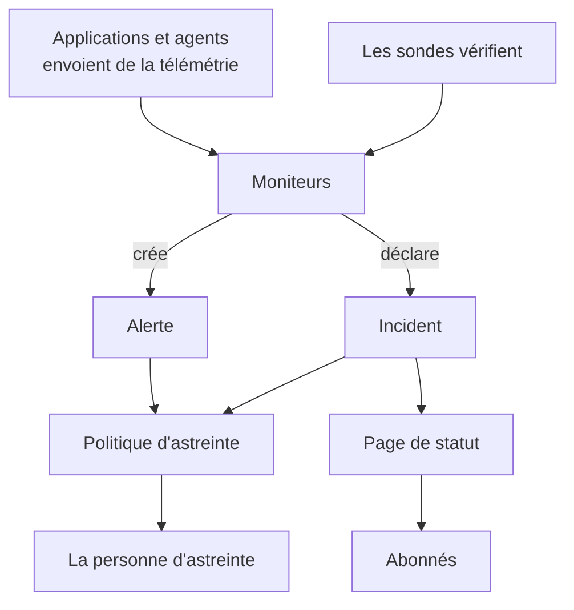
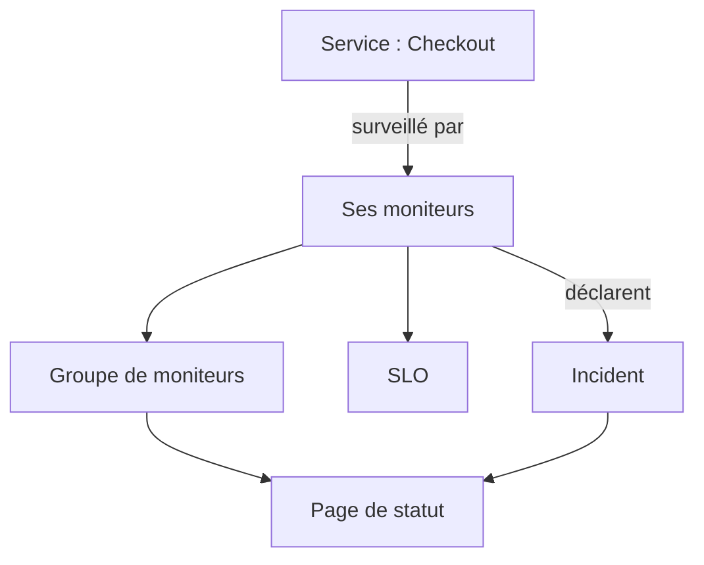

# Concepts clés

OneUptime compte de nombreux produits, mais ils reposent sur une poignée d'idées : les projets, les moniteurs, les incidents et les alertes, l'astreinte, les pages de statut et la télémétrie. Autour d'elles se trouvent ce que vous surveillez, ce que vous installez et les règles qui agissent pour vous. Cette page explique chacune en quelques phrases, montre comment elles s'articulent et renvoie vers les pages qui les traitent en détail. Lisez-la une fois, et toutes les autres pages de la documentation se liront plus facilement. Pour un mot à la fois, consultez le [Glossaire](/docs/introduction/glossary) ; pour choisir entre deux choses qui se ressemblent, consultez [Lequel choisir ?](/docs/introduction/which-one).

:::cards
- [Projets et personnes](#projets-et-personnes): Où tout se trouve, et qui peut faire quoi.
- [Moniteurs et sondes](#moniteurs-et-sondes): Comment OneUptime remarque que quelque chose ne va pas.
- [Incidents et alertes](#incidents-et-alertes): L'élément à partir duquel votre équipe travaille.
- [Astreinte](#astreinte): Qui est alerté, comment, et qui vient ensuite.
:::

## Comment les éléments s'articulent

Un problème traverse OneUptime dans un seul sens. Les sondes et votre propre télémétrie alimentent les moniteurs. Les critères d'un moniteur décident quand quelque chose ne va pas et de ce qu'il faut ouvrir : un incident, une alerte, ou les deux. Les politiques d'astreinte alertent des personnes à leur sujet, et les pages de statut informent vos clients des incidents.

## Projets et personnes

Un **projet** contient tout : moniteurs, incidents, politiques d'astreinte, pages de statut, télémétrie et paramètres. La plupart des entreprises en ont besoin d'un seul, certaines en tiennent un par environnement ou par activité. Rien de ce que vous créez dans un projet n'est visible dans un autre.

Votre **compte** est distinct de vos projets. Un compte, avec une adresse e-mail et un mot de passe, peut appartenir à autant de projets que vous voulez ; passez de l'un à l'autre avec le sélecteur de projet en haut à gauche. Consultez [Votre compte](/docs/introduction/your-account).

Les personnes font partie d'un projet par l'intermédiaire d'**équipes**, et les autorisations d'une équipe décident de ce que ses membres peuvent faire. Chaque nouveau projet commence avec trois équipes : Owners, dont vous faites partie, Admin et Members. Sur OneUptime Cloud, chaque projet a son propre forfait.

:::cards
- [Utilisateurs, équipes et autorisations](/docs/permissions/index): Inviter des personnes et décider de ce qu'elles peuvent faire.
:::

## Moniteurs et sondes

Un **moniteur** vérifie une chose que vous exploitez et décide si elle fonctionne. La plupart des moniteurs sont vérifiés par des **sondes** : des machines qui exécutent la vérification selon un calendrier, par exemple en demandant une page, en appelant une API, en envoyant un ping à un hôte ou en interrogeant une base de données. OneUptime Cloud exécute des sondes dans plusieurs régions, une installation auto-hébergée exécute les siennes, et vous pouvez ajouter des sondes personnalisées dans votre réseau. D'autres moniteurs lisent plutôt ce que vous envoyez : la télémétrie de vos applications, ou les données qu'un agent remonte depuis vos serveurs, vos clusters Kubernetes et le reste de votre infrastructure.

Les **critères** d'un moniteur décident de ce que signifie chaque résultat. Ils sont examinés dans l'ordre, et le premier qui correspond peut changer l'état du moniteur, déclarer un incident, créer une alerte, ou les trois. Chaque nouveau projet a trois états de moniteur : **Opérationnel**, **Dégradé** et **Hors ligne**.

:::cards
- [Créer un moniteur](/docs/monitor/create-monitor): Choisir un type, dire quoi vérifier, et à quelle fréquence.
- [Sondes personnalisées](/docs/probe/custom-probe): Vérifier ce que seul votre propre réseau peut atteindre.
:::

## Ce que vous surveillez

Un moniteur vérifie une seule chose. Autour de vos moniteurs, OneUptime tient un registre de ce que vous exploitez, et vous retrouvez ces enregistrements dans le menu :

- Un **groupe de moniteurs** réunit plusieurs moniteurs en un seul statut, pour qu'une page de statut puisse afficher sur une seule ligne quelque chose fait de nombreuses parties, comme Checkout.
- Un **service** est une application ou un microservice que vous exploitez. OneUptime l'ajoute dès que sa télémétrie arrive pour la première fois, et réunit ses journaux, traces, métriques, exceptions et incidents sur une seule page.
- Les **Hôtes**, les clusters **Kubernetes** et le reste de l'**Infrastructure** sont les machines et les plateformes que vous exploitez, alimentées par les agents que vous installez.
- L'**Inventaire** est une liste unique de tout cela : services, hôtes, clusters, appareils, ressources cloud, et même ce qui n'envoie aucune télémétrie.

Ils se rejoignent là où un problème apparaît. Les moniteurs d'un service peuvent se regrouper dans un groupe de moniteurs, un SLO les mesure, et quand l'un d'eux échoue, il déclare un incident. L'incident cite le service parmi les ressources qu'il touche, et la page de statut affiche le groupe et l'incident.

:::cards
- [Groupes de moniteurs](/docs/monitor/monitor-groups): Réunir plusieurs moniteurs en un seul statut.
- [Services](/docs/telemetry/services): Chaque application que vous exploitez, chacune sur sa propre page.
- [Vue d'ensemble de l'inventaire](/docs/inventory/overview): Tout ce que OneUptime sait de votre parc.
:::

## Objectifs de fiabilité

Un **SLO** (objectif de niveau de service) est un objectif de fiabilité pour ce que vous surveillez, par exemple disponible 99,9 % du temps sur 30 jours. OneUptime le mesure à partir de ses moniteurs toutes les 5 minutes. Le temps d'indisponibilité que permet l'objectif est son budget d'erreur : s'il en reste beaucoup, vous pouvez prendre des risques, et s'il en reste peu, vous ralentissez et investissez dans la stabilité.

:::cards
- [Vue d'ensemble des SLO](/docs/slo/introduction): Fixer un objectif, et voir ce qu'il reste du budget.
:::

## Incidents et alertes

Tous deux consignent un problème, et tous deux peuvent alerter la personne d'astreinte. Ce qui les distingue, c'est qui le problème touche.

| | Incident | Alerte |
| --- | --- | --- |
| **Ce que c'est** | Un problème qui touche vos utilisateurs, comme une panne ou un ralentissement | Un problème que votre équipe doit examiner avant que les utilisateurs ne soient touchés |
| **Sur les pages de statut** | Peut apparaître, et prévient les abonnés | Jamais |
| **États de départ** | **Identifié**, **Pris en compte**, **Résolu** | **Identifié**, **Pris en compte**, **Résolu** |
| **Gravités de départ** | Critical Incident, Major Incident, Minor Incident | **Élevé**, **Faible** |

Le prendre en compte indique que quelqu'un s'en occupe, et empêche ses politiques d'astreinte d'alerter le niveau suivant. Le résoudre le clôt. Vous pouvez ajouter vos propres états et gravités, et lier des alertes à l'incident dont elles faisaient partie.

Un **épisode** regroupe des incidents liés, ou des alertes liées, pour que votre équipe les traite comme un seul. Des règles de regroupement décident de ce qui va ensemble.

:::cards
- [Vue d'ensemble des incidents](/docs/incidents/index): Comment les incidents sont déclarés, traités et résolus.
- [Vue d'ensemble des alertes](/docs/alerts/index): D'où viennent les alertes, et comment les épisodes les regroupent.
- [Alertes liées](/docs/incidents/linked-alerts): Rattacher les alertes déclenchées par une panne à son incident.
:::

## Astreinte

Une **politique d'astreinte** décide de qui est alerté pour un incident ou une alerte, et de qui vient ensuite si personne ne répond. Ses **règles d'escalade** sont ses niveaux : chacune alerte ses personnes, puis attend que quelqu'un prenne en compte avant que le niveau suivant soit alerté. Un niveau peut alerter des personnes, des équipes ou un **planning d'astreinte**, une rotation qui sait à tout moment qui est d'astreinte.

Chaque personne décide de la façon dont on la joint. Dans les **Paramètres utilisateur**, chacun conserve les moyens par lesquels OneUptime peut le joindre, comme l'e-mail, le SMS, les appels, les notifications push, Slack ou Microsoft Teams, et ceux à utiliser quand il est alerté.

:::cards
- [Vue d'ensemble de l'astreinte](/docs/on-call/index): Comment une alerte parvient à quelqu'un, et où se trouve chaque élément.
- [Règles d'escalade](/docs/on-call/escalation-rules): Alerter niveau par niveau jusqu'à ce que quelqu'un réponde.
- [Plannings d'astreinte](/docs/on-call/schedules): Rotations, couches et passations.
- [Comment OneUptime vous joint](/docs/notifications/index): Les méthodes, règles et paramètres qui décident comment chacun est joint.
:::

## Pages de statut et maintenance

Une **page de statut** montre à vos clients si vos services fonctionnent. Vous choisissez les moniteurs qu'elle affiche, sous des noms que vos clients comprennent. Tant qu'un incident sur l'un de ces moniteurs est actif, la page l'affiche, et ses **abonnés** sont prévenus par e-mail, SMS, Slack, Microsoft Teams ou webhook. Une page de statut peut être publique, ou privée pour les personnes que vous y admettez.

La **maintenance planifiée** annonce à l'avance des travaux prévus. Un événement passe par **Planifié**, **En cours**, **Terminé** et **Achevé**, et les pages de statut sur lesquelles vous l'affichez en informent les visiteurs et les abonnés.

:::cards
- [Vue d'ensemble des pages de statut](/docs/status-pages/index): Créer une page de statut et décider de ce qu'elle affiche.
- [Abonnés et annonces](/docs/status-pages/subscribers): Qui est prévenu, et quand.
- [Vue d'ensemble de la maintenance planifiée](/docs/scheduled-maintenance/index): Comment se déroule un événement, et ce qu'il met en pause.
:::

## Télémétrie

La **télémétrie** est ce que vos systèmes envoient à OneUptime : journaux, métriques, traces, exceptions et profils. Les applications l'envoient avec OpenTelemetry, et les agents de OneUptime l'envoient depuis des hôtes, des clusters Kubernetes, des hôtes Docker et le reste de votre infrastructure. Chaque émetteur utilise une **clé d'ingestion**, créée sous **Paramètres du projet → Télémétrie & APM → Clés d'ingestion**. Vous recherchez la télémétrie, la représentez sur des tableaux de bord et la surveillez avec des moniteurs de télémétrie, qui déclenchent des incidents et des alertes comme n'importe quel autre moniteur. Dans le menu, **Journaux**, **Métriques**, **Traces**, **Profils** et **Exceptions** ouvrent chacun un type de données ; **IA / LLM** suit les conversations de votre IA, **Observabilité des données** surveille les tables de vos bases de données, et **Topologie** montre comment tout cela s'articule.

:::cards
- [OpenTelemetry](/docs/telemetry/open-telemetry): Envoyer les journaux, les métriques et les traces de vos applications.
- [Surveillance des journaux](/docs/monitor/logs-monitor): Être prévenu quand un motif apparaît dans vos journaux.
:::

## Sécurité

Les **Événements de sécurité** conservent les événements de sécurité issus de vos journaux, de vos outils de sécurité et de tout ce que vous envoyez d'autre. Leurs règles de détection transforment ce qu'elles trouvent en dossiers de sécurité, que votre équipe traite dans une file et auxquels répondent les playbooks. La **Sécurité des données** trouve les données sensibles dans vos buckets, vos bases de données et votre télémétrie, et ce qui ne va pas dans leur conservation.

:::cards
- [Bien démarrer avec la sécurité](/docs/telemetry/security-getting-started): Trouver des menaces dans les données que vous avez déjà.
- [Vue d'ensemble de Sécurité des données](/docs/data-security/index): Trouver vos données sensibles, et corriger leur conservation.
:::

## Ce que vous installez, et les clés

L'essentiel de OneUptime ne nécessite aucune installation. Vous n'installez quelque chose que pour atteindre ce que OneUptime ne voit pas de l'extérieur, et chaque élément se connecte en sortie à OneUptime avec une clé :

- Une sonde personnalisée exécute les vérifications des moniteurs dans votre réseau, avec son propre ID de sonde et sa propre clé.
- L'**OpenTelemetry Collector**, l'agent Kubernetes et l'agent Docker envoient la télémétrie avec une **clé d'ingestion**. L'agent d'infrastructure derrière un moniteur Serveur / VM envoie avec la clé secrète de ce moniteur.
- Un **Agent Runbook** exécute les étapes de runbook dans votre infrastructure, avec son propre ID d'agent Runbook et sa propre clé.

Une clé d'ingestion ne fait qu'envoyer de la télémétrie. Une **clé API** est l'autre type : elle permet à un script, à la CLI, à Terraform ou à un assistant IA de lire et de modifier votre projet, avec les autorisations que vous lui donnez. Aucune ne fonctionne à la place de l'autre.

:::cards
- [Lequel choisir ?](/docs/introduction/which-one#sonde-agent-collecteur-ou-agent-runbook): Quoi installer, et la clé que chacun utilise.
- [Clés d'ingestion](/docs/telemetry/ingestion-keys): Créer, restreindre et renouveler les clés qui envoient la télémétrie.
:::

## Automatisation et IA

- Les **Flux de travail** exécutent des actions quand quelque chose se produit, comme publier un message dans Slack quand un incident est déclaré.
- Les **Runbooks** transforment une procédure d'intervention en étapes que votre équipe peut exécuter, à la main ou automatiquement.
- **OneUptime AI** enquête sur les nouveaux incidents et les nouvelles alertes et publie ce qu'elle a trouvé dans leur chronologie, et **Demander à l'IA** répond aux questions sur votre projet. Un nouveau projet démarre avec l'IA activée ; l'interrupteur **Activer l'IA** sous **Paramètres du projet → IA → Fonctionnalités IA** la désactive entièrement.

:::cards
- [Présentation des workflows](/docs/workflows/index): Automatiser des actions avec des déclencheurs et des composants.
- [AI SRE](/docs/ai/ai-sre): Comment OneUptime AI enquête sur les incidents et les alertes.
:::

## Étiquettes et propriétaires

Les **étiquettes** sont des mots-clés que vous posez sur les moniteurs, les incidents, les pages de statut et la plupart des autres ressources, pour les filtrer et les regrouper. Les autorisations d'une équipe peuvent être limitées aux ressources portant certaines étiquettes. Les **propriétaires** sont les personnes et les équipes responsables d'une ressource : ils sont prévenus quand il lui arrive quelque chose. Les règles d'étiquettes et de propriétaires ajoutent pour vous des étiquettes et des propriétaires aux nouvelles ressources.

:::cards
- [Règles d'étiquettes et de propriétaires](/docs/configuration/label-and-owner-rules): Étiqueter les nouvelles ressources et leur donner des propriétaires automatiquement.
:::

## Les types de règles

Beaucoup de choses dans OneUptime s'appellent une règle. Chacune prend une décision pour vous quand quelque chose de nouveau arrive, et elles se répartissent en quelques familles. La plupart se trouvent sous **Règles** dans les menus latéraux des **Incidents** et des **Alertes**.

| Ce qu'elles décident | Règles |
| --- | --- |
| Qui est alerté | Les **Règles d'astreinte** choisissent les politiques d'astreinte qu'exécute un nouvel incident ou une nouvelle alerte, et les **Règles d'escalade** d'une politique alertent niveau par niveau |
| À qui il appartient, et comment il est étiqueté | **Règles de propriétaire**, **Règles d'étiquettes** et **Règles de confidentialité** |
| Ce qui va ensemble | Les **Règles de regroupement** ouvrent des épisodes et y ajoutent des éléments |
| Ce qui s'exécute dessus | Les **Règles de runbook** lancent des runbooks, et les **Règles IA** décident de ce que OneUptime AI examine et corrige |
| Quand relancer | Les **Règles SLA** suivent les délais de réponse et de résolution, et les **Règles de rappel** relancent les propriétaires tant que c'est ouvert |

Les règles propres à un moniteur sont ses critères. Les règles d'astreinte sous **Paramètres utilisateur** sont encore autre chose : propres à chaque personne, elles décident comment une alerte parvient à cette personne.

:::cards
- [Paramètres et automatisation des incidents](/docs/incidents/settings#les-règles-qui-sexécutent-à-la-création-dun-incident): Les règles qui s'exécutent quand un incident est créé, dans l'ordre.
- [Comment me joindre](/docs/notifications/on-call-rules): Comment une alerte vous parvient.
:::

## Étapes suivantes

:::cards
- [Démarrage rapide](/docs/introduction/quickstart): Mettre ces idées en pratique en quinze minutes.
- [Glossaire](/docs/introduction/glossary): Chaque mot qu'utilise OneUptime, en une phrase ou deux.
- [Lequel choisir ?](/docs/introduction/which-one): Incident ou alerte, workflow ou runbook, et les autres sosies.
- [Vue d'ensemble des incidents](/docs/incidents/index): Ce qui se passe après qu'un moniteur déclare un incident.
:::
