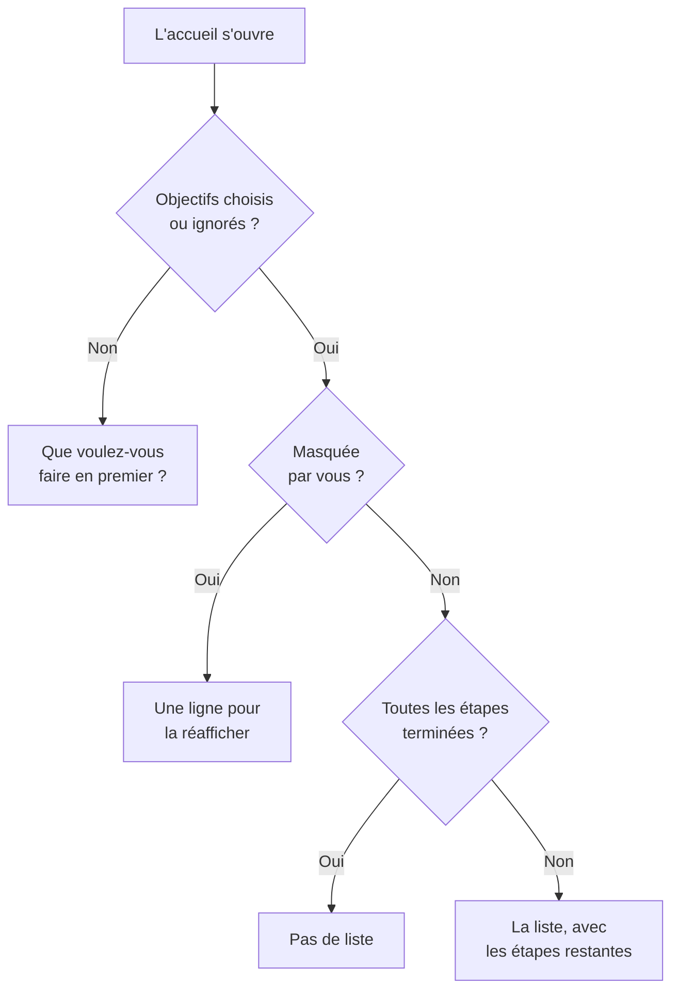

# Page d'accueil et raccourcis

L'accueil est la première page que vous voyez dans un projet. Il vous dit d'un coup d'œil si quelque chose demande votre attention en ce moment, et guide un nouveau projet dans sa première configuration. Cette page explique ce que montre l'accueil, comment trouver n'importe quel produit, page ou action dans le tableau de bord, et les raccourcis clavier qui vous évitent des allers-retours dans les menus.

:::cards
- [Ce que montre l'accueil](#ce-que-montre-laccueil): Si quelque chose ne va pas, ce qui demande votre attention, ce que contient le projet et tous les produits.
- [Se repérer](#se-repérer): Le menu Produits et les barres en haut de chaque page.
- [Rechercher](#rechercher-une-page-un-paramètre-ou-une-action): Trouver n'importe quelle page, paramètre ou action en tapant son nom.
- [Raccourcis clavier](#raccourcis-clavier): Aller à l'accueil, aux moniteurs ou aux incidents en deux touches.
:::

## Ce que montre l'accueil

Ouvrez **Accueil** dans la barre du haut, ou appuyez sur `g` puis `h` depuis n'importe où. L'accueil est la vue d'ensemble de votre projet, une seule page sans menu latéral. De haut en bas, il affiche :

1. Un champ de recherche, avec **Déclarer un incident** et **Créer** à côté.
2. Une ligne qui dit si quelque chose ne va pas, au-dessus de cinq nombres qui comptent ce qui demande de l'attention.
3. **Bienvenue sur OneUptime 👋**, une liste de vérification pour un nouveau projet, jusqu'à ce qu'elle soit terminée.
4. **Attention requise**, chaque problème ouvert en ce moment, par son nom.
5. **Votre projet**, ce qui compose le projet, et **Maintenance à venir** quand une maintenance est planifiée.
6. **Explorer OneUptime**, tous les produits, une catégorie à la fois.

### Rechercher et créer

Le champ de recherche ouvre la recherche, comme `Mod` + `K` : tapez le nom de n'importe quelle page, d'un moniteur, d'un incident, d'une alerte, d'une page de statut ou d'une politique d'astreinte. Consultez la section [Rechercher](#rechercher-une-page-un-paramètre-ou-une-action). **Déclarer un incident** ouvre le formulaire de déclaration d'un incident. **Créer** propose **Créer un moniteur**, **Planifier une maintenance** et **Créer une annonce**. Chacun n'est affiché qu'aux personnes autorisées à l'utiliser.

### Le titre

La ligne du haut nomme ce qui est ouvert de plus urgent, dans une couleur assortie :

| Quand | L'accueil affiche |
| --- | --- |
| Un incident est ouvert | Combien d'incidents sont actifs, en rouge |
| Aucun incident n'est ouvert, mais il y a des alertes ouvertes, des moniteurs non opérationnels ou des SLO à risque | Combien de problèmes demandent de l'attention, en orange |
| Aucun problème, et une maintenance est en cours | Combien d'événements de maintenance sont en cours |
| Des moniteurs fonctionnent et rien n'est ouvert | **Tous les systèmes sont opérationnels** |
| Le projet n'a pas encore de moniteur | **Rien n'est encore surveillé** |

À côté, l'accueil indique quand il a chargé le projet pour la dernière fois, et **Actualiser** le recharge. Quand vous revenez sur un onglet de l'accueil après une minute ou plus, il s'actualise tout seul.

Tant que rien n'est encore surveillé, la ligne se termine par le bouton **Créez votre premier moniteur**, qui ouvre la configuration guidée **Savoir quand mon site web ou mon API est en panne**. Seules les personnes autorisées à créer des moniteurs le voient.

### Les cinq nombres

Chaque nombre compte quelque chose, dit si cela demande votre attention, et ouvre la liste qui se cache derrière lui, dans le produit auquel elle appartient.

| Nombre | Ce qu'il compte | Quand le nombre est zéro | Ouvre |
| --- | --- | --- | --- |
| **Incidents actifs** | Les incidents qui ne sont pas résolus | **Tout va bien** | **Incidents → Incidents actifs** |
| **Alertes actives** | Les alertes qui ne sont pas résolues | **Tout va bien** | **Alertes → Alertes actives** |
| **Moniteurs non opérationnels** | Les moniteurs dont l'état n'est pas un état opérationnel. Les moniteurs archivés, et ceux dont la surveillance est désactivée, ne comptent pas. | **Tous opérationnels** | **Moniteurs → Non opérationnel** |
| **Maintenance en cours** | Les événements de maintenance en cours | **Aucune en cours** | **Maintenance planifiée → Événements de maintenance en cours** |
| **SLO à risque** | Les SLO activés qui sont à risque ou ont épuisé leur budget d'erreur | **Budgets sains** | **SLOs** |

Un nombre supérieur à zéro affiche **Attention requise**, ou **En cours** et **Budget qui s'épuise** pour la maintenance et les SLO. Tant qu'un SLO est à risque, **SLO à risque** ouvre la liste **SLOs** filtrée sur ces SLO. Un projet sans moniteur voit **Aucun moniteur pour l'instant**, et un projet sans SLO voit **Aucun SLO pour l'instant** : un projet vide n'est pas un projet en bonne santé. Ces deux-là ouvrent alors les listes **Moniteurs** et **SLOs**, où vous en créez un.

### La liste de bienvenue

La première fois qu'un propriétaire ou un administrateur du projet ouvre l'accueil d'un nouveau projet, la carte demande **Que voulez-vous faire en premier ?** Cochez un ou plusieurs objectifs, par exemple **Savoir quand mon site web ou mon API est en panne** ou **Je regarde simplement**, puis cliquez sur **Continuer** : la liste contient alors les étapes dont ces objectifs ont besoin. **Ignorer** donne les quatre étapes que reçoit tout projet. Pour répondre à nouveau plus tard, cliquez sur **Modifier** dans la liste. Un projet qui utilise déjà des moniteurs, de la télémétrie ou l'astreinte n'est pas interrogé.

Chaque étape se coche d'elle-même quand la chose fonctionne, pas quand un enregistrement existe, et toutes les personnes qui configurent le projet voient la même liste, sur chaque appareil :

| Étape | Terminée quand | Ouvre |
| --- | --- | --- |
| **Importer depuis votre outil actuel** | Une importation depuis un autre outil se termine. | **Importer depuis un autre outil** |
| **Créez votre premier moniteur** | Sa première vérification arrive. | La configuration guidée **Savoir quand mon site web ou mon API est en panne**, ou la liste **Moniteurs** pour quelqu'un qui ne peut pas créer de moniteurs. |
| **Connecter un serveur ou un cluster** | Ses premières métriques arrivent. | **Hôtes** |
| **Envoyer vos premiers logs, métriques ou traces** | Les premiers logs, métriques, traces, exceptions ou profils du projet arrivent. | La configuration guidée **Envoyer des journaux, des métriques et des traces, puis être alerté** |
| **Configurez une politique d'astreinte** | Une alerte de test est acquittée, une alerte joint quelqu'un, ou une règle d'astreinte exécute une politique qui peut joindre quelqu'un. | La configuration guidée **Alerter la bonne personne quand quelque chose tombe en panne** |
| **Publiez une page de statut** | Une page de statut affiche un moniteur. | La configuration guidée **Publiez une page de statut**, ou la liste **Pages de statut** pour quelqu'un qui ne peut pas créer de pages de statut. |
| **Invitez votre équipe** | Quelqu'un accepte votre invitation. | **Utilisateurs** |

L'étape à faire en premier est marquée **Étape suivante**. Avec l'offre Free d'OneUptime Cloud, qui comprend une personne, **Invitez votre équipe** indique qu'il faut l'offre Growth, et ouvre **Facturation**. Sur un serveur auto-hébergé qui ne peut pas encore envoyer d'e-mails, les administrateurs du serveur voient d'abord **Ce serveur ne peut pas encore envoyer d'e-mails** ; cela ouvre le tableau de bord admin.

Une configuration guidée fait tout le travail sur une seule page, étape par étape, et se termine par ce qu'elle a configuré et ce qu'il faut faire ensuite. Pour en rouvrir une plus tard, recherchez son nom.

Sous les étapes, **Comment fonctionne OneUptime** montre les quatre produits essentiels dans l'ordre où un problème les traverse : **Moniteurs**, **Incidents et alertes**, **Astreinte** et **Pages de statut**. Cliquez sur l'un d'eux pour l'ouvrir. En dessous, il indique ce qui alimente cette boucle, la télémétrie et l'infrastructure, avec des liens vers [Concepts clés](/docs/introduction/core-concepts) et [Glossaire](/docs/introduction/glossary).

La liste disparaît pour tout le monde une fois chaque étape terminée. Pour la masquer plus tôt, cliquez sur **Masquer** : elle n'est masquée que pour vous, sur chaque appareil, et une ligne reste avec **Afficher** et **Comment fonctionne OneUptime**. Les personnes invitées dans le projet comme membres ne voient pas la liste. **Comment fonctionne OneUptime** reste à un clic, dans n'importe quel projet : ouvrez-le depuis **Aide**, ou avec le bouton à côté de **Explorer OneUptime**.

### Attention requise

**Attention requise** liste par leur nom ce que les nombres comptent : les incidents ouverts, les alertes ouvertes, les moniteurs non opérationnels, les SLO à risque et les maintenances en cours, les plus urgents d'abord. Chaque ligne affiche sa gravité ou son état, indique quand un incident ou une alerte a commencé et quand une maintenance se termine, et ouvre l'élément. Chaque type en montre jusqu'à cinq, avec **Tout afficher** pour le reste, qui ouvre la même liste que son nombre. Quand rien n'est ouvert, la section affiche **Rien ne nécessite votre attention**.

### Santé de la configuration

Quand quelque chose dans la configuration du projet empêcherait de prévenir les bonnes personnes, **Attention requise** se termine par **Configuration** : le nombre de points à examiner. Cette ligne ouvre **Santé de la configuration**, qui liste ce qui est mal configuré, le plus grave d'abord, sous **Les alertes n'arriveront pas**, **À corriger** et **Suggestions** : un moniteur qui n'alerte personne, une politique d'astreinte que rien ne déclenche, une personne qu'on ne peut pas alerter, les SMS désactivés, un planning d'astreinte où personne n'est de garde, une page de statut qui n'affiche aucun moniteur. Chaque constat dit en une phrase ce qui ne va pas, avec le bouton qui ouvre sa correction, et les constats d'un moniteur sont les ruptures que nomme sa carte **Quand il tombe en panne**. Un constat que votre équipe laisse tel quel exprès peut être masqué avec une raison, pour tout le monde, puis restauré depuis **Ignoré**. La recherche trouve la page sous le nom **Santé de la configuration**, et Demander à l'IA répond à « Ma configuration est-elle correcte ? » à partir d'elle.

### Votre projet

**Votre projet** compte les **Moniteurs**, les **Pages de statut**, les **Politiques d'astreinte**, les **SLOs**, les **Services**, les **Tableaux de bord** et les **Flux de travail** du projet, sans les éléments archivés. Chaque ligne ouvre sa liste. Un type dont le projet n'a encore aucun élément affiche **Configurer** au lieu d'un nombre.

**Maintenance à venir** liste les trois prochaines fenêtres de maintenance planifiée, la plus proche d'abord. Elle n'apparaît pas quand rien n'est planifié.

### Explorer OneUptime

**Explorer OneUptime** présente les produits du menu **Produits** une catégorie à la fois, en commençant par les essentiels. Chaque produit indique à quoi il sert et s'ouvre quand vous cliquez dessus. Les produits que votre projet masque n'y figurent pas.

## Se repérer

Tout dans OneUptime se trouve sous **Produits** dans la barre du haut. Le menu présente ses groupes comme les lignes d'une seule liste, et s'ouvre toujours avec le premier d'entre eux, les essentiels, déplié : Moniteurs, Incidents, Alertes, Astreinte, Pages de statut, Maintenance planifiée et SLO. Chaque autre groupe (Observabilité, Sécurité, IA, Code, Ressources, Infrastructure, Cloud, Tableaux de bord et automatisation et Paramètres) est replié en une ligne de la même liste. Chaque ligne nomme les produits du groupe et indique leur nombre. Cliquez sur une ligne pour la déplier ou la replier, ou atteignez-la avec les flèches et appuyez sur **Entrée**.

- **La recherche trouve tout.** Tapez dans le champ de recherche du menu pour trouver n'importe quel produit par son nom, par ce qu'il fait, ou par un mot familier comme `k8s` ou `RUM`. La recherche regarde aussi dans les groupes repliés.
- **Vous partez de là où vous êtes.** Le groupe de la page sur laquelle vous êtes se déplie tout seul, et les produits que vous avez ouverts récemment sont listés en haut.
- **Vos choix restent.** Le menu retient, dans votre navigateur, quels autres groupes vous avez dépliés ou repliés. Les essentiels sont de nouveau dépliés chaque fois que vous ouvrez le menu, même si vous les aviez repliés.
- **Sur un téléphone**, le bouton du menu liste les produits de la même façon : les essentiels dépliés en haut, et chaque autre groupe sous la forme d'une ligne qui s'ouvre d'un toucher.
- **Les produits que le projet n'utilise pas.** Un propriétaire ou un administrateur du projet peut les masquer dans **Paramètres du projet → Basique → Produits**. Un produit masqué passe sous **Plus de produits**, la dernière ligne du menu : la recherche le trouve toujours, ses pages fonctionnent et ses données continuent d'arriver. Quand l'un d'eux commence à recevoir des données, l'accueil le signale aux personnes qui peuvent le réafficher.
- **Épingler.** Gardez un produit dans la barre supérieure, à côté d'**Accueil** et de **Produits** : appuyez sur l'épingle de sa carte dans le menu, ou sur **Épingler** à côté du titre de sa page. Vous pouvez en épingler cinq, et ils vous suivent dans chaque navigateur. Sur un téléphone, vos produits épinglés viennent en premier dans le menu.
- **Ce qui est utilisé.** Dans chaque groupe sauf les essentiels et les paramètres, les produits que votre projet utilise viennent en premier, et celui que vous n'avez pas encore configuré indique **Non configuré**. Sur OneUptime Cloud, un produit que votre offre n'inclut pas nomme l'offre qui l'inclut.

### Les barres du haut

Deux barres traversent le haut de chaque page.

| Où | Ce qu'il y a |
| --- | --- |
| En haut à gauche | Le sélecteur de projet : passer à un autre de vos projets, ou en créer un nouveau. |
| En haut à droite | **Rechercher** et **Demander à l'IA**, la cloche de notifications avec ce qui vous attend (incidents et alertes actifs, politiques d'astreinte dont vous êtes de garde, invitations en attente), **Aide**, et votre photo, qui ouvre le menu de votre [compte](/docs/introduction/your-account). |
| En dessous | **Accueil** et **Produits** à gauche, **Paramètres utilisateur** à droite : comment OneUptime vous joint dans ce projet. |

**Aide** commence par ce qui aide à apprendre : **Démarrage rapide**, **Comment fonctionne OneUptime**, **Glossaire** et cette documentation (**Documentation**). En dessous viennent la liste **Raccourcis clavier** et le support par e-mail et sur Slack. Sur une tablette ou dans une fenêtre étroite, **Demander à l'IA** disparaît pour gagner de la place : vous le trouvez parmi les actions de **Rechercher**. Sur un téléphone, **Rechercher** et **Aide** passent dans la liste du bouton de menu, tout en haut et tout en bas ; la cloche et votre photo restent.

Un mot souligné de pointillés, comme **Sondes** dans le formulaire d'un nouveau moniteur, dit ce qu'il signifie quand vous le survolez, l'atteignez avec Tab ou le touchez. Son lien **Lire la suite** ouvre le mot dans le [Glossaire](/docs/introduction/glossary).

### Pages et listes

Au-dessus du titre de chaque page, un fil comme *Projet › Docker › Paramètres › Règles de propriétaire* indique où se trouve la page. Chaque étape avant la dernière ouvre sa page.

- **Les listes se tiennent à jour d'elles-mêmes.** Quand un incident ou une alerte est créé, pris en compte ou résolu n'importe où, les listes d'incidents, d'alertes et d'épisodes l'affichent en quelques secondes, sans actualiser. Tant que vous êtes au milieu de quelque chose sur une liste, par exemple des lignes cochées ou une boîte de dialogue ouverte, elle attend et se met à jour quand vous avez terminé.
- **Sur un téléphone, les puces de filtre se replient** derrière **Filtre**, pour que la liste commence plus haut. Les puces que vous avez définies restent visibles, avec **Tout effacer**. Appuyez sur **Filtre** pour voir toutes les puces, et à nouveau pour les replier.
- L'option **Colonnes** du menu **⋯** d'une liste choisit les colonnes que la liste affiche et leur ordre, et les garde pour vous dans ce navigateur. Un propriétaire ou un administrateur du projet peut aussi y cocher **Afficher ces colonnes pour tout le monde dans ce projet** : quiconque n'a pas choisi ses propres colonnes pour cette liste les voit, et **Réinitialiser aux valeurs par défaut du projet** remet les vôtres sur celles-ci.
- L'option **Lignes compactes**, dans le même menu, affiche les lignes de chaque liste moins hautes, si bien qu'une longue liste en montre environ un cinquième de plus. Ce choix est gardé dans ce navigateur.
- **Sur un téléphone, ou dans une carte trop étroite pour ses lignes, une liste s'affiche en cartes, une par ligne.** Le bandeau au-dessus indique leur ordre, par exemple **Trié par Nom** : appuyez dessus pour choisir la colonne de tri, et **Croissant** ou **Décroissant**.
- **Les pages d'un incident commencent par son numéro.** Son titre, son étape dans le fil et l'onglet du navigateur affichent `INC-42 Checkout is down`, de même que les boîtes de dialogue qui le nomment, si bien que les incidents qui partagent un titre se distinguent. Les alertes, les événements de maintenance et les épisodes font de même.

## Rechercher une page, un paramètre ou une action

Appuyez sur **Cmd+K** (Mac) ou **Ctrl+K** (Windows et Linux), ou cliquez sur l'icône de recherche dans la barre du haut, et commencez à taper. La recherche trouve :

- **Chaque page des menus**, sous le nom que le menu lui donne : Clés API, Zone de danger, Plannings d'astreinte, Gravité de l'incident, vos propres Méthodes de notification. Chaque résultat indique où il se trouve, par exemple *Paramètres du projet › Avancé*, si bien que les pages qui portent le même nom (Champs personnalisés dans Incidents, Alertes et Moniteurs) se distinguent facilement.
- **Les paramètres d'une page**, sous le nom qu'affiche leur carte ou leur interrupteur : *Exiger le SSO pour la connexion* trouve SSO, et *Configurations SMTP personnalisées* trouve Canaux de notification. Tapez le nom en anglais ou dans votre langue.
- **Actions**, d'après ce que vous voulez faire : Déclarer un incident, Créer un moniteur, ou Supprimer le projet, qui ouvre la Zone de danger. Une action qui modifie quelque chose n'est proposée qu'aux personnes autorisées à la faire.
- **Vos moniteurs, incidents, alertes, pages de statut et politiques d'astreinte**, par leur nom, et les incidents et les alertes aussi par leur numéro, comme `INC-42`. Chaque résultat d'incident ou d'alerte commence par son numéro, si bien que deux du même titre se distinguent.
- **La documentation**, dans un groupe *Documentation* sous tout le reste : les pages et les sections dont les mots correspondent à ce que vous tapez, dans votre langue, même avec une faute de frappe. Chacune s'ouvre dans un nouvel onglet, pour que vous gardiez votre place.

La recherche lit ce que vous tapez comme vous l'entendez :

- La casse, les accents, les espaces et les traits d'union ne comptent pas : *on-call*, *on call* et *oncall* trouvent les mêmes pages, et les mots peuvent venir dans n'importe quel ordre.
- Elle connaît d'autres mots pour de nombreuses pages, en anglais : *pager* ou *escalation* pour Politiques d'astreinte, *rota* pour Plannings d'astreinte, *2fa* pour l'authentification à deux facteurs, *delete project* pour la Zone de danger.
- Ajoutez le nom du produit pour affiner une recherche : *incident custom fields* trouve la page Champs personnalisés des incidents.
- Une petite faute de frappe, comme *incidnet*, trouve quand même ce que vous vouliez quand rien ne correspond tel quel.

Avec le champ de recherche vide, la recherche liste les pages ouvertes récemment, les actions et les produits.

## Raccourcis clavier

Appuyez sur `?` n'importe où dans le tableau de bord pour voir tous les raccourcis, ou ouvrez **Aide** et choisissez **Raccourcis clavier**. Sur un Mac, `Mod` est la touche Commande ; sous Windows et Linux, c'est Ctrl.

| Touches | Ce qu'elles font |
| --- | --- |
| `Mod` + `K` | Ouvrir la palette de commandes : rechercher n'importe quelle page, paramètre ou action. |
| `Mod` + `I` | Demander à l'IA au sujet de ce que vous regardez. |
| `/` | Rechercher dans la liste de cette page. |
| `?` | Afficher les raccourcis clavier. |
| `Esc` | Fermer une boîte de dialogue ou un panneau. |

### Aller à un produit

Appuyez sur `g`, puis sur une lettre, pour aller directement à un produit. Appuyez sur la lettre dans les 1,5 secondes qui suivent `g`.

| Touches | Va à |
| --- | --- |
| `g` puis `h` | Accueil |
| `g` puis `m` | Moniteurs |
| `g` puis `i` | Incidents |
| `g` puis `a` | Alertes |
| `g` puis `o` | Astreinte |
| `g` puis `s` | Pages de statut |
| `g` puis `e` | Maintenance planifiée |
| `g` puis `d` | Tableaux de bord |
| `g` puis `l` | Journaux |
| `g` puis `t` | Traces |

Les raccourcis ne vous gênent pas. `?`, `/` et `g` ne font rien pendant que vous tapez dans un champ, et rien ne vous fait quitter la page tant qu'une boîte de dialogue est ouverte : une touche accidentelle ne peut pas vous faire perdre un formulaire à moitié rempli. Tout autre produit est à une recherche de vous avec `Mod` + `K`.

## Étapes suivantes

:::cards
- [Démarrage rapide](/docs/introduction/quickstart): Suivre la liste de bienvenue, étape par étape.
- [Votre compte](/docs/introduction/your-account): Votre profil, la sécurité de votre connexion, la langue et le thème.
- [Demander à l'IA](/docs/ai/ask-ai): Ce que l'IA peut vous répondre et faire pour vous.
- [Concepts clés](/docs/introduction/core-concepts): Ce que sont les moniteurs, les incidents, les alertes et l'astreinte.
:::
