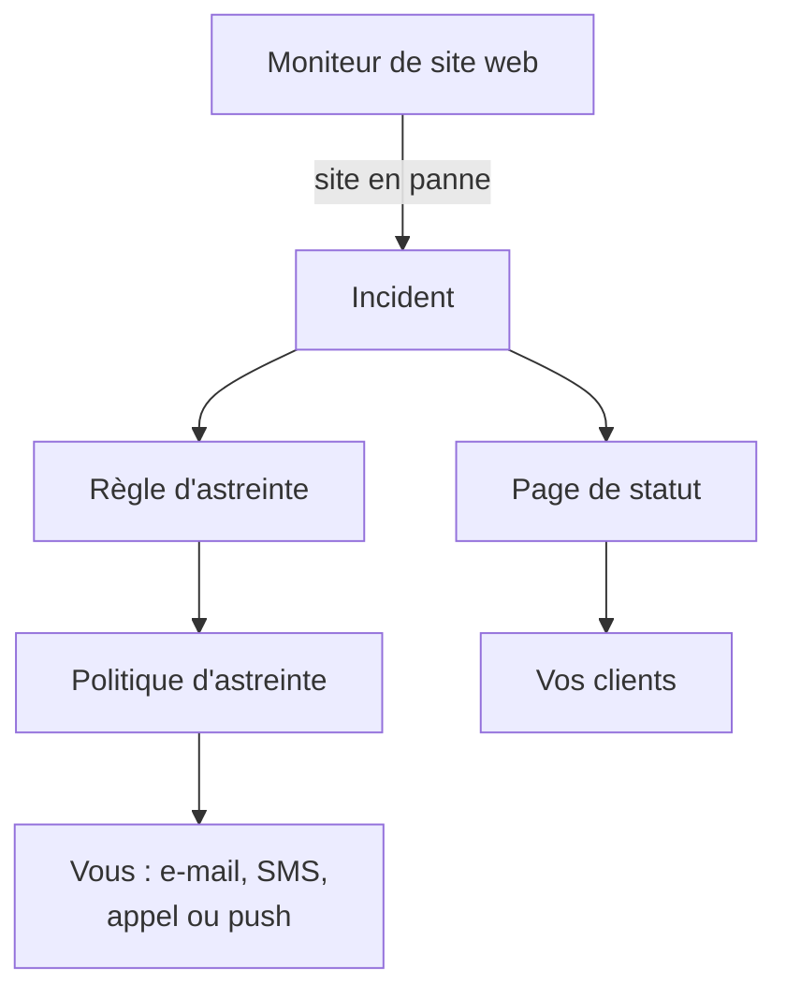

# Démarrage rapide

Ce guide vous mène d'un nouveau compte à une configuration qui fonctionne en une quinzaine de minutes : un moniteur qui vérifie votre site web toutes les cinq minutes, une politique d'astreinte qui vous alerte quand le site tombe, et une page de statut qui informe vos clients. Il suit la liste de vérification **Bienvenue sur OneUptime 👋** de la page d'accueil de votre projet, et les configurations guidées qu'ouvrent ses étapes.

Vous venez d'un autre outil ? [Importez votre configuration](/docs/introduction/getting-started#venir-dun-autre-outil) d'abord : vos moniteurs, vos plannings d'astreinte et vos pages de statut vous suivent.

## Avant de commencer

- **Un compte.** Sur OneUptime Cloud, inscrivez-vous sur [oneuptime.com](https://oneuptime.com/accounts/register) et ouvrez le lien de l'e-mail que vous recevez. Sur votre propre installation, ouvrez-la dans votre navigateur et inscrivez-vous : le premier compte devient l'administrateur principal. Pour en installer une, consultez [Docker Compose](/docs/installation/docker-compose).
- **Un site web à surveiller.** N'importe quelle adresse qui répond en HTTP ou HTTPS, comme la page d'accueil de votre entreprise.

## Créer un projet

Dans OneUptime, tout se trouve dans un projet : vos moniteurs, incidents, politiques d'astreinte, pages de statut et les personnes qui y travaillent.

:::steps
### Commencer un nouveau projet

À votre première connexion, OneUptime affiche **Aucun projet**. Cliquez sur **Créer un nouveau projet**. Si quelqu'un vous a déjà invité dans un projet, acceptez plutôt l'invitation sur la même page.

### Lui donner un nom

Saisissez un **Nom du projet**, par exemple le nom de votre entreprise. Sur OneUptime Cloud, choisissez aussi un forfait juste en dessous : Free est déjà sélectionné, et les forfaits payants commencent par un essai gratuit.

### Le créer

Cliquez sur **Créer un projet**. La page d'accueil de votre projet s'ouvre, avec la liste de vérification **Bienvenue sur OneUptime 👋** en haut. Il demande d'abord **Que voulez-vous faire en premier ?** : cochez **Savoir quand mon site web ou mon API est en panne**, **Alerter la bonne personne quand quelque chose tombe en panne** et **Informer mes clients avec une page de statut**, puis cliquez sur **Continuer**.
:::

## Surveiller votre site web

:::steps
### Ouvrir la configuration du site web

Dans la liste de vérification, cliquez sur **Créez votre premier moniteur**. Cela ouvre la configuration guidée **Savoir quand mon site web ou mon API est en panne**, qui vérifie votre site, choisit qui est prévenu et envoie un test, sur une seule page. Une personne qui ne peut pas créer de moniteurs obtient plutôt la liste **Moniteurs**.

### Saisir l'adresse

Sous **Que devons-nous vérifier ?**, saisissez l'adresse complète de votre site dans **Adresse du site web ou de l'API**, par exemple `https://example.com`, et cliquez sur **Lancer la vérification**. Les sondes la vérifient aussitôt, puis toutes les 5 minutes : quand le site ne répond pas, ou répond par une erreur, le moniteur passe **Hors ligne** et déclare un incident. Cliquez sur **Continuer**.

Avec le forfait Free de OneUptime Cloud, les moniteurs sont facturés à l'usage, donc le projet a besoin d'un moyen de paiement avant de pouvoir vérifier votre site : sans moyen de paiement, l'étape vous demande d'[ajouter un moyen de paiement](/docs/configuration/billing#moyens-de-paiement).

### Choisir qui est prévenu

Sous **Qui faut-il prévenir ?**, vous êtes déjà dans **Qui est alerté**. Cliquez sur **Enregistrer et continuer** : cela crée `Default on-call policy`, qui vous alerte pour chaque nouvel incident et chaque nouvelle alerte du projet, par e-mail pour commencer. Pour alerter aussi des membres de l'équipe qui font déjà partie du projet, cliquez d'abord sur **Ajouter des membres de l'équipe**.

### Vous envoyer un test

Sous **Envoyer un test**, cliquez sur **M'envoyer un appel de test**, choisissez une **Gravité** et cliquez sur **Envoyer l'appel de test**. Ouvrez le lien de l'e-mail, qui indique TEST, et prenez l'appel en compte à cet endroit. Cliquez ensuite sur **Terminé** dans la boîte de dialogue, puis sur **Continuer** : la configuration se termine sur un résumé de ce qu'elle a mis en place.
:::

Pour régler vous-même chaque option, ou pour vérifier autre chose qu'un site web, ouvrez **Moniteurs** depuis le menu **Produits** et cliquez sur **Créer un moniteur**. [Créer un moniteur](/docs/monitor/create-monitor) décrit le formulaire et chaque type de moniteur.

Pour vérifier aussi une API, et savoir quoi faire quand la première vérification ne revient jamais, suivez [Savoir quand votre site web ou votre API tombe](/docs/guides/website-down).

## Être alerté en cas de panne

La configuration du site web a déjà créé `Default on-call policy`, qui vous alerte par e-mail pour chaque nouvel incident et chaque nouvelle alerte ; la liste de vérification coche donc **Configurez une politique d'astreinte** comme terminée. Sa configuration guidée ajoute tout de même votre téléphone, les personnes alertées avec vous et ce qui se passe quand personne ne répond.

:::steps
### Ouvrir la configuration de l'astreinte

Appuyez sur `Ctrl+K` (`Cmd+K` sur un Mac), tapez `get paged` et choisissez **Alerter la bonne personne quand quelque chose tombe en panne**. Tant que la liste de vérification n'a pas coché **Configurez une politique d'astreinte**, cette étape ouvre la même configuration guidée.

### Choisir comment vous êtes joint

Sous **Comment devons-nous vous joindre ?**, votre e-mail de connexion est déjà listé. Pour les notifications push, installez l'application OneUptime On-Call depuis l'App Store ou Google Play, connectez-vous et cliquez sur **Revérifier**. Pour recevoir aussi des SMS et des appels, cliquez sur **Activer les SMS et les appels**, saisissez votre numéro dans **Votre numéro de téléphone** et cliquez sur **M'envoyer un code par SMS** : sur OneUptime Cloud, les SMS et les appels sont payés sur le solde du projet, donc l'étape vous demande d'abord d'en ajouter. Cliquez sur **Continuer**.

### Choisir qui d'autre est alerté

Sous **Qui d'autre est d'astreinte ?**, gardez `Default on-call policy` sous **Politique d'astreinte**. Pour alerter des membres de l'équipe avec vous, ajoutez-les sous **Ajouter à la première règle d'escalade**. Cliquez sur **Enregistrer et continuer**.

### Décider de ce qui se passe si personne ne répond

Sous **Et si personne ne répond ?**, choisissez **Alerter à nouveau les mêmes personnes** tant que vous êtes la seule personne du projet. Une fois des membres de l'équipe arrivés, **Alerter quelqu'un d'autre** alerte la personne que vous choisissez sous **Alertés ensuite**. Sur OneUptime Cloud, seuls les forfaits payants proposent ce choix. Cliquez sur **Enregistrer et continuer**.

### Envoyer un appel de test

Sous **Envoyer un appel de test**, cliquez sur **Tester cette politique**, choisissez une **Gravité** et cliquez sur **Envoyer l'appel de test**. Prenez l'appel en compte depuis l'e-mail, le SMS ou l'appel téléphonique, puis cliquez sur **Terminé** dans la boîte de dialogue, et sur **Continuer**. La configuration se termine sur **L'alerte est configurée**.
:::

> [!NOTE]
> Les SMS et les appels téléphoniques sont désactivés dans un nouveau projet. Un propriétaire du projet, un Billing Admin ou une personne disposant de Manage Billing les active dans la carte **Canaux de notification**, sous **Paramètres du projet → Notifications → Canaux de notification**.

Deux règles d'astreinte déclenchent la politique : une pour chaque nouvel incident et une pour chaque nouvelle alerte. Pour voir la première, ouvrez **Incidents** depuis le menu **Produits**, dépliez **Règles** dans le menu latéral et choisissez **Règles d'astreinte** : elle correspond à **Tous les incidents**. Pour ne déclencher la politique que pour certains incidents, comme les critiques, modifiez la règle à cet endroit, ou cliquez sur **Créer : Règle d'astreinte des incidents** pour ajouter la vôtre.

Pour construire plutôt une politique champ par champ, ouvrez **Astreinte** depuis le menu **Produits** et cliquez sur **Créer : Politique d'astreinte**. Pour plus de niveaux, des rotations et le délai d'attente de chaque niveau, consultez [Règles d'escalade](/docs/on-call/escalation-rules) et [Plannings d'astreinte](/docs/on-call/schedules).

Pour chaque écran de la configuration, et quoi faire quand un appel n'arrive pas, suivez [Être alerté par appel, SMS ou push](/docs/guides/paging).

## Publier une page de statut

:::steps
### Ouvrir la configuration de la page de statut

Dans la liste de vérification, cliquez sur **Publiez une page de statut**. Cela ouvre la configuration guidée **Publiez une page de statut**, qui nomme la page, y place votre moniteur et montre ce que voient vos clients. Une personne qui ne peut pas créer de pages de statut obtient plutôt la liste **Pages de statut**. Le résumé de la configuration du site web ouvre la même configuration, sous le nom **L'afficher sur une page de statut**.

### La nommer et choisir votre moniteur

Sous **Nommez-la et choisissez ce qu'elle affiche**, gardez le **Nom de la page de statut** proposé ou saisissez le vôtre. Sous **Ce qu'elle affiche**, cochez votre moniteur de site web, et cliquez sur **Créer la page de statut**. Dès cet instant, la page est publique à son lien : toute personne disposant de son adresse peut l'ouvrir.

### Ouvrir la page

Sous **Voici ce que voient vos clients**, ouvrez l'adresse affichée sous **Lien public** : votre site web y apparaît comme opérationnel. De retour dans la configuration, cliquez sur **C'est bon**. La configuration se termine sur un résumé de ce qu'il faut faire ensuite.
:::

Pour créer plutôt une page à la main, ouvrez **Pages de statut** depuis le menu **Produits** et cliquez sur **Créer une page de statut**, puis ajoutez votre moniteur avec **Ajouter des moniteurs** sur sa **Vue d'ensemble**. Pour donner à la page votre propre logo et vos couleurs, consultez [Personnalisation et domaines de la page de statut](/docs/status-pages/branding-and-domains).

Pour placer la page de statut sur votre propre domaine, en HTTPS, suivez [Publier une page de statut](/docs/guides/status-page).

## Inviter votre équipe

Dans la liste de vérification, cliquez sur **Invitez votre équipe**, ou ouvrez **Utilisateurs** depuis le menu **Produits**, sous **Paramètres**. Cliquez sur **Inviter un utilisateur**, saisissez son **E-mail** et choisissez une **Équipe** : l'équipe des membres est choisie au départ. Cliquez sur **Inviter**. OneUptime lui envoie l'invitation par e-mail, et l'équipe décide de ce que la personne peut faire. Consultez [Utilisateurs, équipes et autorisations](/docs/permissions/index).

## L'essayer

Déclarez un incident de test pour voir toute la chaîne fonctionner.

:::steps
### Déclarer un incident de test

Ouvrez **Incidents** et cliquez sur **Déclarer un incident**. Saisissez un **Titre**, par exemple `Test incident`, choisissez une **Gravité de l'incident** et cliquez sur **Suivant**. Sous **Moniteurs**, choisissez votre moniteur de site web, pour que l'incident apparaisse sur votre page de statut. Cliquez sur **Suivant** jusqu'au récapitulatif, puis sur **Déclarer un incident**.

### Observer ce qui se passe

En une minute ou deux, votre politique d'astreinte vous alerte, et l'incident apparaît sur votre page de statut.

### Le résoudre

Sur la page de l'incident, cliquez sur **Résoudre**. Les alertes s'arrêtent, et l'incident quitte votre page de statut.
:::

> [!WARNING]
> Toute personne qui ouvre votre page de statut voit l'incident de test jusqu'à ce que vous le résolviez. Faites le test avant de partager l'adresse de la page.

## Dépannage

:::details Je n'ai pas été alerté
Ouvrez l'incident et choisissez **Exécutions d'astreinte** dans son menu latéral : vous y voyez si votre politique s'est exécutée et qui elle a alerté. Si elle ne s'est pas exécutée, vérifiez que votre règle d'astreinte est activée et qu'elle désigne la politique. Si elle s'est exécutée, vérifiez que vos méthodes sous **Paramètres utilisateur → Méthodes de notification** sont vérifiées.
:::

:::details L'incident n'apparaît pas sur ma page de statut
Une page de statut affiche un incident quand l'un des moniteurs de l'incident figure sur la page. Vérifiez que l'incident indique votre moniteur dans ses ressources affectées, et que le moniteur figure sur la page de statut.
:::

:::details Le moniteur indique hors ligne, mais mon site fonctionne
Ouvrez le moniteur et regardez ce que les sondes ont reçu. Consultez la section de dépannage de [Surveillance de site web](/docs/monitor/website-monitor).
:::

## Étapes suivantes

:::cards
- [Concepts clés](/docs/introduction/core-concepts): Les idées derrière ce que vous venez de configurer.
- [Glossaire](/docs/introduction/glossary): Chaque mot rencontré en chemin, en une phrase ou deux.
- [Plannings d'astreinte](/docs/on-call/schedules): Partager l'astreinte avec votre équipe.
- [Personnalisation et domaines de la page de statut](/docs/status-pages/branding-and-domains): Faire de la page de statut la vôtre.
- [OpenTelemetry](/docs/telemetry/open-telemetry): Envoyer les journaux, les métriques et les traces de vos applications.
:::
