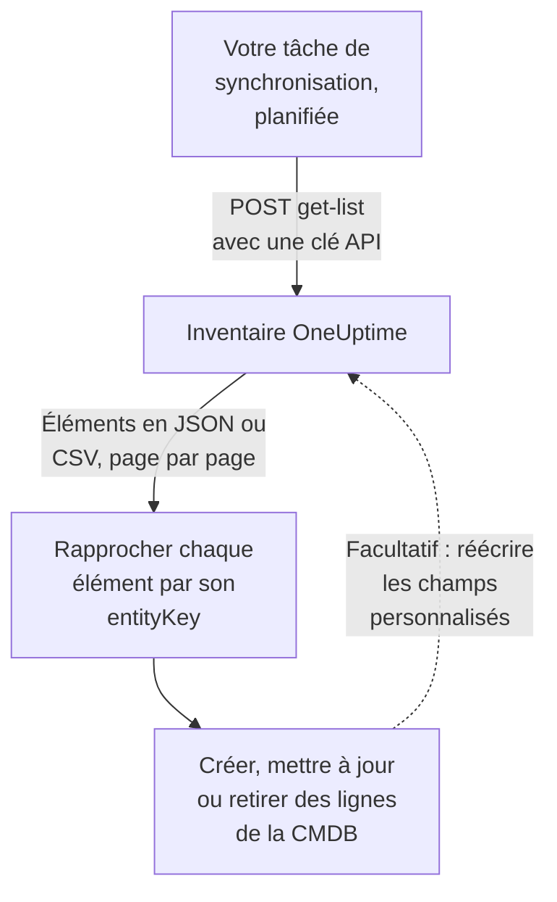

# Exporter vers une CMDB

Si vous exploitez déjà une CMDB ou un registre d'actifs, OneUptime ne cherche pas à le remplacer. Ce qu'il a et qui manque généralement à une CMDB, c'est une image de ce qui tourne réellement, tenue à jour sans que personne ne l'entretienne : découverte à partir de la télémétrie et des sondes qui surveillent déjà votre réseau et vos comptes cloud. Cette page est la recette pour faire entrer cette image dans votre propre système de référence.

:::cards
- [Comment fonctionne une synchronisation](#comment-fonctionne-une-synchronisation): Une tâche planifiée qui lit la liste et rapproche sur une clé stable.
- [Récupérer le catalogue](#récupérer-le-catalogue): La requête, page par page, en JSON ou en CSV.
- [Détails de l'actif](#détails-de-lactif): Les mêmes faits et les mêmes clés pour les hôtes et les équipements réseau.
- [Réécrire](#réécrire): Envoyer vos étiquettes d'actifs dans OneUptime, et ajouter ce qu'il ne peut pas voir.
:::

## Comment fonctionne une synchronisation

Une synchronisation est une tâche que vous exécutez selon un planning. Elle lit la liste de l'inventaire par l'API REST avec une clé API, rapproche chaque élément d'une ligne de votre CMDB par sa clé d'identité, et crée, met à jour ou retire des lignes en conséquence. Elle peut aussi réécrire des valeurs dans les champs personnalisés des éléments.



## Ce que vous pouvez récupérer

Trois ressources REST, chacune avec les points de terminaison standard de l'[API OneUptime](/docs/api-reference/api-reference) :

| Ressource | Point de terminaison | Ce qu'elle contient |
| --- | --- | --- |
| Élément d'inventaire | `/api/inventory-item` | Une ligne par chose du parc |
| Définitions de champs personnalisés | `/api/inventory-item-custom-field` | Le vocabulaire de champs propre à votre projet |
| Relations | `/api/inventory-item-relationship` | Les liens orientés entre les éléments |

Les colonnes utiles d'un élément d'inventaire :

| Colonne | Signification |
| --- | --- |
| `_id` | L'ID de OneUptime : utilisez-le comme référence externe |
| `entityType` | `host`, `k8s.pod`, `network.device`, `appliance`, … |
| `entityKey` | Un hachage d'identité stable. Il survit aux renommages, c'est donc la meilleure clé de rapprochement |
| `displayName` | Le nom que lisent les personnes |
| `source` | `discovered`, `inventory` ou `manual` |
| `description` | Texte libre |
| `identifyingAttributes` | Les attributs qui font de l'élément ce qu'il est, et qui ne changent jamais |
| `descriptiveAttributes` | Tout le reste de ce qui a été observé sur lui : voir [Détails de l'actif](#détails-de-lactif), [Attributs d'actif des hôtes](#attributs-dactif-des-hôtes) et [Attributs d'actif des équipements réseau](#attributs-dactif-des-équipements-réseau) plus bas |
| `customFields` | Vos propres champs, indexés par nom de champ |
| `resourceType` / `resourceId` | Un pointeur vers l'enregistrement OneUptime plus riche, s'il en existe un |
| `firstSeenAt` / `lastSeenAt` | Quand il a été observé pour la première et la dernière fois |
| `isArchived` | S'il a été retiré de la liste active |

## Avant de commencer

Une synchronisation a besoin d'une clé API autorisée à lire l'inventaire. Sur OneUptime Cloud, les clés API nécessitent l'offre **Growth** ou supérieure.

:::steps
### Créer une clé API

Ouvrez **Paramètres du projet → Avancé → Clés API** et cliquez sur **Créer : Clé API**. Donnez-lui un **Nom**, et sous **Accès** choisissez **Lecteur** pour tout lire dans le projet, ou **Choisir les autorisations plus tard** pour ne lui donner que ce dont une synchronisation a besoin.

### Ne lui donner que le nécessaire

Un export en lecture seule n'a besoin que d'une autorisation, **Read Telemetry Service** : l'inventaire partage les autorisations de télémétrie au lieu d'avoir les siennes. Sur la page de la clé, cliquez sur **Ajouter une permission** et choisissez-la. Pour réécrire des valeurs, ajoutez aussi **Edit Telemetry Service**.

### Copier la clé

Copiez la **Clé API** depuis la page de la clé, et mettez-la à disposition de votre tâche :

```bash
export ONEUPTIME_API_KEY="your-api-key"
```
:::

La clé est envoyée dans l'en-tête `ApiKey` de chaque requête, et elle lit l'inventaire de son propre projet, donc une requête ne nomme aucun projet.

## Récupérer le catalogue

Envoyez un `POST` au point de terminaison de liste avec les colonnes voulues. `select` est obligatoire : l'API ne renvoie que ce que vous demandez.

```bash
curl -X POST 'https://oneuptime.com/api/inventory-item/get-list' \
  -H "ApiKey: $ONEUPTIME_API_KEY" \
  -H 'Content-Type: application/json' \
  -d '{
    "query": { "isArchived": false },
    "select": {
      "_id": true,
      "entityType": true,
      "entityKey": true,
      "displayName": true,
      "source": true,
      "customFields": true,
      "descriptiveAttributes": true,
      "lastSeenAt": true
    },
    "sort": { "displayName": "ASC" },
    "limit": 100,
    "skip": 0
  }'
```

Sur une installation auto-hébergée, utilisez votre propre adresse OneUptime à la place de `https://oneuptime.com`. La réponse est `{ "data": [...], "count": ... }`, où `count` indique combien d'éléments correspondent au total. Parcourez les pages en augmentant `skip` de votre `limit` jusqu'à les avoir tous ; `limit` va jusqu'à 10 000. Les dates et les identifiants autres que `_id` reviennent enveloppés, sous la forme `{ "_type": "DateTime", "value": "..." }` et `{ "_type": "ObjectID", "value": "..." }` : lisez-les dans `value`.

### Seulement les équipements réseau

Restreignez la liste par `entityType` :

```bash
curl -X POST 'https://oneuptime.com/api/inventory-item/get-list' \
  -H "ApiKey: $ONEUPTIME_API_KEY" \
  -H 'Content-Type: application/json' \
  -d '{
    "query": { "entityType": "network.device", "isArchived": false },
    "select": { "_id": true, "entityKey": true, "displayName": true, "customFields": true },
    "limit": 100,
    "skip": 0
  }'
```

Les `descriptiveAttributes` de chaque équipement réseau portent son nom d'hôte, son adresse IP, son numéro de série, son adresse MAC, sa marque, son modèle, son firmware, son système d'exploitation, son rôle, son site et son emplacement : voir [Attributs d'actif des équipements réseau](#attributs-dactif-des-équipements-réseau) plus bas. Ce que la sonde sait d'autre, comme les interfaces et les voisins, se trouve sur l'enregistrement Network Device lui-même : suivez `resourceId` vers `/api/network-device/:id/get-item`, ou récupérez directement `/api/network-device/get-list`.

### En CSV

Tout point de terminaison de liste répond en CSV au lieu de JSON avec `?output-type=csv` :

```bash
curl -X POST 'https://oneuptime.com/api/inventory-item/get-list?output-type=csv' \
  -H "ApiKey: $ONEUPTIME_API_KEY" \
  -H 'Content-Type: application/json' \
  -d '{ "query": {}, "select": { "displayName": true, "entityType": true, "customFields": true }, "limit": 500, "skip": 0 }' \
  -o inventory.csv
```

La liste **Tous les éléments** du tableau de bord s'exporte de la même façon, avec les colonnes de champs personnalisés que vous avez activées. Chaque [détail d'actif](#détails-de-lactif) y est aussi une colonne : **Nom d'hôte**, **Adresse IP**, **Numéro de série**, **Modèle** et les autres sont masquées au départ, donc activez-les depuis le sélecteur de colonnes, et l'export contient une colonne par fait, qu'une ligne soit un hôte ou un équipement réseau.

## Détails de l'actif

Les hôtes et les équipements réseau sont décrits par les mêmes faits, stockés sous les mêmes clés. Une colonne de la CMDB contient le numéro de série, qu'une ligne soit un serveur ou un commutateur, et la carte **Détails de l’actif** d'un élément dans le tableau de bord montre chaque fait dans le même ordre pour les deux. Un fait que rien n'a signalé indique **Inconnu** au lieu d'être omis, pour qu'un manque soit visible.

| Fait | Clé | Sur un hôte | Sur un équipement réseau |
| --- | --- | --- | --- |
| Nom d'hôte | `host.name` | Le nom de l'hôte. C'est l'identité de l'hôte, il figure donc dans `identifyingAttributes` | Le nom propre de l'équipement : son `sysName` SNMP, sinon le nom NetBIOS ou DNS trouvé par la découverte. Jamais son adresse IP |
| Adresse IP | `host.ip` | Chaque adresse que le collecteur déclare | L'adresse que OneUptime interroge, quand c'est une adresse IP, sinon l'adresse en laquelle sa sonde a résolu ce nom DNS |
| Adresse MAC | `host.mac` | Détectée | Saisie sur l'équipement, ou apprise dans la table ARP d'un routeur parcouru |
| Numéro de série | `host.serial_number` | Apposé | ENTITY-MIB |
| Fabricant | `device.manufacturer` | Apposé | ENTITY-MIB, sinon ce que nomment `sysDescr` ou `sysObjectID` |
| Modèle | `device.model.name` | Apposé | ENTITY-MIB, sinon ce que nomme `sysDescr` |
| Version du micrologiciel | `device.firmware.version` | Apposée | ENTITY-MIB, sinon ce que nomme `sysDescr` |
| Système d'exploitation | `os.name` | `os.description` (ou `os.type`) | Ce que nomme `sysDescr` : Cisco IOS, Junos OS, Arista EOS, Linux |
| Version de l'OS | `os.version` | Détectée | ENTITY-MIB, sinon ce que nomme `sysDescr` |
| Type d'appareil | `device.type` | Apposé. Sinon la carte le classe d'après son système d'exploitation et son nom (Serveur, Pare-feu, ...) | Son rôle : celui que vous avez attribué, sinon celui sous lequel la carte de topologie le dessine |
| Emplacement | `device.location` | Apposé. Sinon la carte montre sa zone cloud | `sysLocation`. La carte montre d'abord son site |

Le [tableau des hôtes](#attributs-dactif-des-hôtes) et le [tableau des équipements réseau](#attributs-dactif-des-équipements-réseau) ci-dessous indiquent en détail d'où vient chaque valeur.

## Attributs d'actif des hôtes

`descriptiveAttributes` sur un hôte porte les faits d'actif qu'une ligne de CMDB attend habituellement, indexés par leur nom d'attribut OpenTelemetry :

| Champ | Clé | Collecté par défaut ? |
| --- | --- | --- |
| Adresses IP | `host.ip` | Oui : séparées par des virgules quand la machine en a plusieurs |
| Adresses MAC | `host.mac` | Oui : séparées par des virgules, une par interface active, sous la forme `AC-DE-48-23-45-67` |
| Architecture | `host.arch` | Oui |
| ID de la machine | `host.id` | Oui : le GUID de la machine sous Windows, `/etc/machine-id` sous Linux |
| Système d'exploitation | `os.type`, `os.description`, `os.version` | Oui |
| Emplacement cloud | `cloud.provider`, `cloud.region`, `cloud.availability_zone` | Seulement avec un détecteur cloud |
| Numéro de série | `host.serial_number` | Demande une étape de configuration |
| Marque | `device.manufacturer` | Demande une étape de configuration |
| Modèle | `device.model.name` | Demande une étape de configuration |
| Version du firmware (BIOS ou UEFI) | `device.firmware.version` | Demande une étape de configuration |
| Nom du système d'exploitation | `os.name` | Seulement depuis les SDK qui le déclarent : sinon `os.description` nomme le système |
| Type d'appareil | `device.type` | Facultatif : apposez-le de la même façon (`Hypervisor`, `Workstation`) |
| Emplacement | `device.location` | Facultatif : apposez-le de la même façon (`Frankfurt DC, Rack B4`) |

Tout ce qui est marqué Oui vient du processeur `resourcedetection` du collecteur, et figure déjà dans la configuration que OneUptime génère pour vous.

Les clés `cloud.*` nécessitent un détecteur cloud dans ce processeur : `detectors: [system, env, ec2]`, ou `gcp` ou `azure` pour les autres. La configuration fournie n'exécute que `[system, env]`, donc ces trois clés restent vides tant que vous n'en ajoutez pas un.

Le numéro de série, la marque, le modèle et le firmware n'ont pas de détecteur de ressource : ils résident dans le firmware de la machine, lus par WMI sous Windows et par DMI sous Linux, et sont donc apposés une fois sur la ressource, au provisionnement de la machine. Un type d'appareil ou un emplacement que vous voulez sur la ligne s'appose de la même façon. [Attributs d'inventaire](/docs/telemetry/host-otel-collector#attributs-dinventaire-ip-mac-numéro-de-série-fabricant-modèle-firmware) donne l'extrait exact pour chaque système d'exploitation. `host.manufacturer`, `host.model.name`, `host.firmware.version` et `host.bios.version` sont acceptés comme autres graphies et stockés sous les clés `device.*` (et `device.serial_number` sous `host.serial_number`), si bien qu'une synchronisation ne lit jamais qu'une clé par fait.

`host.id` mérite un coup d'œil comme clé de rapprochement si votre CMDB s'appuie déjà sur un identifiant matériel : contrairement à `entityKey`, c'est l'ID propre de la machine, qui correspond donc à ce qu'un outil de gestion des terminaux déclare pour la même machine.

Les attributs s'ajoutent sans jamais être vidés : un attribut qui n'est plus déclaré reste sur la ligne, si bien qu'une valeur déjà lue par votre synchronisation ne disparaît jamais en silence.

## Attributs d'actif des équipements réseau

Un équipement réseau (`entityType: network.device`) est répliqué depuis son enregistrement Network Device, et ses `descriptiveAttributes` utilisent les mêmes clés qu'un hôte pour les mêmes faits, si bien qu'une colonne de la CMDB contient le numéro de série que la ligne soit un serveur ou un commutateur :

| Champ | Clé | D'où il vient |
| --- | --- | --- |
| Nom d'hôte | `host.name` | Le nom propre de l'équipement : son `sysName` SNMP, sinon le nom NetBIOS ou DNS inverse trouvé par la découverte. Absent quand seule son adresse IP le nomme |
| Adresse IP | `host.ip` | L'adresse que OneUptime interroge, quand c'est une adresse IP. Pour un équipement interrogé par un nom DNS, l'adresse en laquelle sa sonde a résolu ce nom la dernière fois |
| Nom DNS | `net.device.dns_name` | Le nom DNS inverse trouvé à la découverte, ou le nom DNS que OneUptime interroge |
| Adresse MAC | `host.mac` | Saisie sur l'équipement, ou apprise dans la table ARP d'un routeur parcouru |
| Marque | `device.manufacturer` | ENTITY-MIB `entPhysicalMfgName`, sinon le fabricant que nomme `sysDescr`, sinon le fournisseur du `sysObjectID` |
| Modèle | `device.model.name` | ENTITY-MIB `entPhysicalModelName`, sinon le modèle que nomme `sysDescr` |
| Numéro de série | `host.serial_number` | ENTITY-MIB `entPhysicalSerialNum` |
| Version du micrologiciel | `device.firmware.version` | ENTITY-MIB `entPhysicalFirmwareRev`, sinon le micrologiciel que nomme `sysDescr` sur les appareils Ubiquiti, HPE et Aruba |
| Système d'exploitation | `os.name` | Le système d'exploitation que nomme `sysDescr` |
| Version du logiciel ou du système | `os.version` | ENTITY-MIB `entPhysicalSoftwareRev`, sinon la version que nomme `sysDescr` |
| Description du système | `os.description` | `sysDescr` |
| Type d'appareil | `device.type` | Le rôle que vous avez attribué à l'équipement, sinon le rôle sous lequel la carte de topologie le classe, avec le nom que votre projet lui donne |
| Emplacement | `device.location` | `sysLocation`, sauf s'il s'agit de la valeur par défaut d'un agent, comme « Sitting on the Dock of the Bay » de Net-SNMP |
| Site | `oneuptime.site.name` | Le Network Site auquel l'équipement est rattaché |
| Adresse interrogée | `net.device.hostname` | L'adresse que OneUptime interroge : une adresse IP ou un nom DNS. Conservée pour les synchronisations écrites avant l'existence de `host.name` et `host.ip` |

Les lignes ENTITY-MIB se remplissent après le premier parcours SNMP de l'équipement. Un équipement qui n'est pas parcouru, parce qu'il est surveillé seulement par ping ou pas encore interrogé, obtient tout de même son nom, sa marque, son système d'exploitation et son emplacement à partir de ce que la dernière analyse de découverte de son adresse a lu par SNMP, et son adresse MAC à partir de la table ARP d'un routeur parcouru. Un équipement qui n'implémente pas ENTITY-MIB n'a ni numéro de série ni firmware à déclarer. Son `sysDescr` nomme tout de même le modèle et le système d'exploitation pour de nombreuses plateformes : un Cisco Meraki MX déclare `Meraki MX85`, ce qui renseigne la marque et le modèle. Une plateforme dont le `sysDescr` n'a pas de forme connue n'ajoute rien, plutôt qu'une supposition.

Une valeur enregistrée sur l'équipement, saisie ou définie par l'API, n'est jamais remplacée par ce que lit la découverte. Entre une valeur lue par le propre parcours de l'équipement et une valeur lue par une analyse, la plus récente est utilisée. Ce qu'une analyse a lu n'est utilisé que si l'analyse a trouvé la même machine à l'adresse : quand le nom système, le `sysObjectID` ou le nom NetBIOS qu'elle a lu contredit celui de l'équipement, rien de ce qu'elle y a lu n'est utilisé. La carte **Détails de l’actif** de l'élément indique d'où vient chaque valeur et quand.

Le nom d'hôte n'est jamais l'adresse IP. Un équipement que seule son adresse nomme a `host.ip` et pas de `host.name`. Dès que son parcours SNMP déclare un nom de système, `host.name` suit au passage suivant.

Ces valeurs sont copiées depuis l'enregistrement Network Device toutes les quinze minutes, et elles **remplacent** les valeurs précédentes au lieu de s'y ajouter, si bien qu'une valeur effacée sur l'équipement (une adresse MAC retirée, par exemple) quitte aussi l'élément d'inventaire.

Il n'y a pas de version de *mise à niveau disponible* : SNMP n'a pas d'objet standard pour cela, donc OneUptime enregistre la version que l'équipement exécute.

## Rapprocher les éléments des lignes de la CMDB

Rapprochez sur `entityKey`, pas sur `displayName`. C'est un hachage des attributs d'identification de l'élément, il survit donc aux renommages et aux nouvelles étiquettes : un hôte réétiqueté garde la même clé alors que son nom affiché change. `_id` est tout aussi stable, et c'est la clé étrangère la plus simple si vous ne parlez jamais qu'à un seul projet.

Les dates de `customFields` sont des chaînes ISO-8601 en UTC, et l'export CSV les écrit sous cette forme plutôt que sous la forme plus lisible qu'affiche le tableau de bord, pour qu'elles s'importent sans surprise d'analyse.

## Garder les données à jour

Il n'y a pas de flux de changements. Interrogez le point de terminaison de liste à l'intervalle qui vous convient, et comparez sur `entityKey`. `lastSeenAt` indique quand un élément a été observé pour la dernière fois, ce qui est généralement le moyen le moins coûteux de repérer ce qui est devenu silencieux depuis votre dernière exécution.

Un élément qui disparaît entre deux exécutions a soit expiré (un élément découvert resté silencieux au-delà de sa fenêtre), soit vu son enregistrement d'origine supprimé. Un élément répliqué qui porte des valeurs de champs personnalisés est archivé plutôt que supprimé quand son enregistrement disparaît, donc interrogez avec `"isArchived": true` pour voir ce qui a été retiré sans perdre les données d'actif qui y sont rattachées.

## Réécrire

Les mêmes points de terminaison acceptent les écritures, si bien qu'une synchronisation peut pousser des valeurs dans `customFields` : par exemple l'étiquette d'actif que votre CMDB gère déjà, apposée sur l'élément OneUptime correspondant. La clé a besoin pour cela de **Edit Telemetry Service**.

Vous pouvez aussi ajouter des éléments pour des choses que OneUptime ne peut pas voir, avec `POST /api/inventory-item`, un `entityType` parmi `external.service`, `external.database` ou `appliance`, et un `displayName`. OneUptime calcule la clé d'identité pour vous, et ces éléments n'expirent jamais. La clé a besoin de **Create Telemetry Service** pour cela.

## Dépannage

:::details Chaque requête est refusée avec 402 Payment Required
Sur OneUptime Cloud, les clés API ne fonctionnent que tant que le projet est sur l'offre **Growth** ou supérieure. Rien n'est supprimé : la clé refonctionne telle quelle dès que le projet revient sur l'offre. Voir [Clés API et SCIM sous leur offre](/docs/api-reference/api-reference#clés-api-et-scim-sous-leur-offre).
:::

:::details Chaque requête répond 422 You do not have permissions
La clé n'a aucune autorisation qui lit l'inventaire. Une clé créée avec **Choisir les autorisations plus tard** ne peut rien faire tant qu'elle n'en a pas reçu : ajoutez **Read Telemetry Service** sur sa page, comme dans [Avant de commencer](#avant-de-commencer).
:::

:::details La liste revient sans les colonnes dont j'ai besoin
La liste ne renvoie que les colonnes que nomme `select`, plus `_id`. Ajoutez à `select` chaque colonne que vous lisez, `descriptiveAttributes` et `customFields` compris.
:::

:::details Un élément attendu est absent
Les éléments archivés sont omis quand vous envoyez `"isArchived": false`. Un élément découvert est retiré une fois resté silencieux au-delà de sa fenêtre, et un élément répliqué part avec son enregistrement. Demandez `"isArchived": true` pour voir les éléments archivés.
:::

## Prochaines étapes

:::cards
- [Vue d'ensemble de l'inventaire](/docs/inventory/overview): D'où viennent les éléments, et combien de temps chacun reste.
- [Champs personnalisés de l'inventaire](/docs/inventory/custom-fields): Définir les champs que votre synchronisation lit et écrit.
- [Référence de l'API OneUptime](/docs/api-reference/api-reference): Requêtes, codes d'état et règles que suit chaque écriture.
:::
