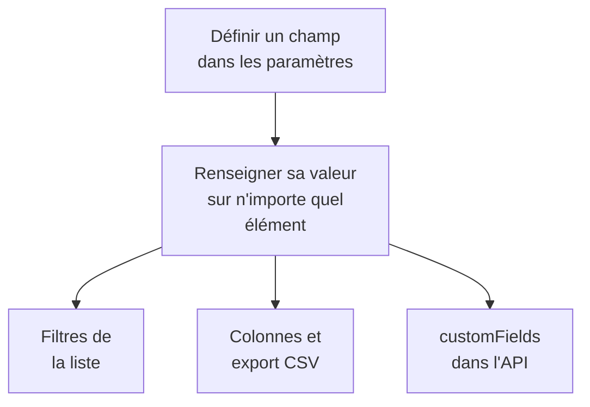

# Champs personnalisés de l'inventaire

OneUptime découvre ce qui compose votre parc. Les champs personnalisés notent ce qu'aucune surveillance ne peut lui apprendre : le numéro de série sur l'étiquette, la date de fin de garantie, l'équipe à qui appartient une chose, si elle est en service ou dans un tiroir de pièces détachées. Définissez les champs une fois pour le projet, puis remplissez-les sur chaque élément.

:::cards
- [Comment fonctionnent les champs personnalisés](#comment-fonctionnent-les-champs-personnalisés): Un vocabulaire, sur chaque élément, quelle que soit sa source.
- [Définir les champs](#définir-les-champs): Créer un champ, choisir son type, lister les options d'une liste déroulante.
- [Filtrer la liste](#filtrer-la-liste): Trouver ce qui expire le trimestre prochain en deux clics.
- [Remarques et limites](#remarques-et-limites): Renommages, doublons, dates et champs supprimés.
:::

## Comment fonctionnent les champs personnalisés

Un champ est défini une fois pour le projet, et chaque élément peut porter une valeur pour lui : ceux que OneUptime a découverts, ceux qu'il réplique et ceux que vous avez ajoutés à la main. Un champ devient un filtre au-dessus de la liste, une colonne facultative et une colonne de l'export CSV. L'API lit et écrit les mêmes valeurs, sous `customFields` de chaque élément.

> [!NOTE]
> Sur OneUptime Cloud, les champs personnalisés font partie de l'offre **Growth** et au-delà. En dessous, les champs ne peuvent être ni définis, ni listés, ni modifiés : l'API répond `402 Payment Required`, et la liste n'affiche ni filtres ni colonnes de champs personnalisés.

## Définir les champs

:::steps
### Ouvrir la page des champs personnalisés

Allez dans **Produits → Ressources → Inventaire**, ouvrez **Paramètres** dans le menu latéral, puis **Champs personnalisés**.

### Créer un champ

Cliquez sur **Créer : Champ personnalisé des éléments d'inventaire**. Donnez-lui un **Nom du champ**, une **Description du champ** facultative et un **Type de champ** choisi dans le tableau ci-dessous.

### Lister les options d'une liste déroulante

Pour un type liste déroulante, ajoutez ses options sous **Options de la liste déroulante**. Chaque option peut porter une couleur, utilisée de la même façon dans la cellule du tableau et dans le filtre : choisissez l'une des couleurs nommées, **Aucune couleur**, ou **Couleur personnalisée** pour un code couleur exact. Faites glisser une option par sa poignée pour changer sa place dans la liste.
:::

| Type | À utiliser pour |
| --- | --- |
| **Texte** | Numéro de série, étiquette d'actif, position dans la baie, numéro de bon de commande |
| **Nombre** | Coût, unité de baie, nombre de ports |
| **Booléen** | Sous support, dans le périmètre PCI |
| **Liste déroulante (choix unique)** | Statut de cycle de vie, environnement, criticité : une réponse dans une liste fixe |
| **Liste déroulante (choix multiple)** | Périmètres de conformité, tags : plusieurs réponses dans une liste fixe |
| **Date** | Date d'achat, fin de garantie, date de fin de vie |
| **Date et heure** | Dernier audit le, mis hors service le |
| **Texte long** | Instructions d'accès, notes : plusieurs lignes de texte brut |
| **Texte enrichi (Markdown)** | Notes avec mise en forme et liens, rédigées dans l'éditeur Markdown |
| **Fichier** | Un certificat de garantie, un bon de commande signé, une photo de l'étiquette de la baie : un fichier |
| **Plusieurs fichiers** | Manuels, factures et photos : jusqu'à 10 fichiers |

## Un vocabulaire d'actifs pas à pas

Un registre d'actifs matériels classique se transpose directement sur ces champs :

| Nom du champ | Type | Exemple |
| --- | --- | --- |
| `Serial Number` | Texte | `FDO24160ABC` |
| `Asset Tag` | Texte | `IT-004821` |
| `Purchase Date` | Date | 2024-03-11 |
| `Warranty Expiry` | Date | 2027-03-10 |
| `Lifecycle Status` | Liste déroulante | En service, Pièce de rechange, En réparation, Retiré |
| `Assigned Site` | Liste déroulante | Centre de données de Londres, Centre de données de Francfort, Siège |
| `Owner Team` | Liste déroulante | Réseau, Plateforme, Sécurité |
| `Cost Centre` | Texte | `CC-4410` |

Renseignez les valeurs sur la page **Champs personnalisés** d'un élément. N'importe quel élément les accepte, quelle que soit sa source : les commutateurs découverts par OneUptime et les équipements réseau qu'il réplique portent ainsi le même vocabulaire d'actifs que les appliances que vous avez ajoutées à la main.

## Filtrer la liste

Chaque champ personnalisé devient un filtre au-dessus de la liste **Tous les éléments**, et le filtre propose les comparaisons adaptées à son type :

| Type de champ | Comparaisons |
| --- | --- |
| **Texte**, **Texte long**, **Texte enrichi (Markdown)** | est, n'est pas, contient, ne contient pas, commence par, se termine par, est vide, n'est pas vide |
| **Nombre** | est, n'est pas, est supérieur à, est supérieur ou égal à, est inférieur à, est inférieur ou égal à, est vide, n'est pas vide |
| **Booléen**, **Liste déroulante (choix unique)**, **Liste déroulante (choix multiple)** | est, n'est pas, est vide, n'est pas vide |
| **Date**, **Date et heure** | est, est avant, est après, est entre, est vide, n'est pas vide |
| **Fichier**, **Plusieurs fichiers** | est |

Une puce **Fichier** ou **Plusieurs fichiers** ne demande qu'une chose : si le champ **Contient des fichiers** ou n'en a **Aucun fichier**.

Les filtres se combinent avec ET, donc « Warranty Expiry est avant 2026-10-01 ET Lifecycle Status est En service » est une seule vue de la liste. C'est précisément la question à laquelle un registre d'actifs répond, et la raison d'utiliser les types date plutôt qu'une date dans un champ texte : un champ texte stocke volontiers `2026-10-01`, puis ne sait pas dire ce qui expire le trimestre prochain.

Les colonnes de champs personnalisés sont masquées au départ : activez-les depuis le sélecteur de colonnes. Elles ne peuvent pas être triées, car les valeurs sont regroupées dans une seule colonne JSON que la liste ne sait pas ordonner.

## Remarques et limites

- Les valeurs sont stockées sur chaque élément sous le nom du champ. Renommer un champ ne déplace pas les valeurs déjà stockées sous l'ancien nom. Les champs personnalisés des incidents font exception : en renommer un déplace ses valeurs (voir [Renommer un champ](/docs/incidents/settings#renommer-un-champ)).
- Les options d'une liste déroulante peuvent être ajoutées, renommées, réordonnées par glisser-déposer et retirées après que des éléments ont des valeurs. Renommer une option la met à jour sur chaque élément qui l'a ; une option retirée reste sur les éléments qui l'ont, affichée comme n'étant plus une option, sauf si vous leur en choisissez une autre (voir [Modifier les options d'une liste déroulante](/docs/incidents/settings#modifier-les-options-dune-liste-déroulante)).
- Rien ne rend une valeur unique. Deux éléments peuvent porter le même numéro de série, et rien ne vous en empêche.
- Les dates sont stockées sous forme d'horodatages ISO-8601 en UTC et affichées dans votre propre fuseau horaire.
- Supprimer un champ le retire de la liste et de la barre de filtres. Les valeurs déjà écrites restent sur les éléments.
- Un champ **Fichier** ou **Plusieurs fichiers** prend des fichiers de 10 Mo au plus chacun, des types listés dans [Champs de fichier](/docs/incidents/settings#champs-de-fichier), envoyés dans le projet. Seule une personne qui peut voir l'élément peut les télécharger, et un fichier est supprimé dès que plus rien ne le garde.

## Prochaines étapes

:::cards
- [Vue d'ensemble de l'inventaire](/docs/inventory/overview): D'où viennent les éléments, et ce que montre chaque page.
- [Exporter vers une CMDB](/docs/inventory/cmdb-sync): Importer les éléments et leurs champs personnalisés dans un autre système.
- [Champs personnalisés des incidents](/docs/incidents/settings#champs-personnalisés): Les mêmes types de champs sur les incidents, avec quelques extras.
:::
