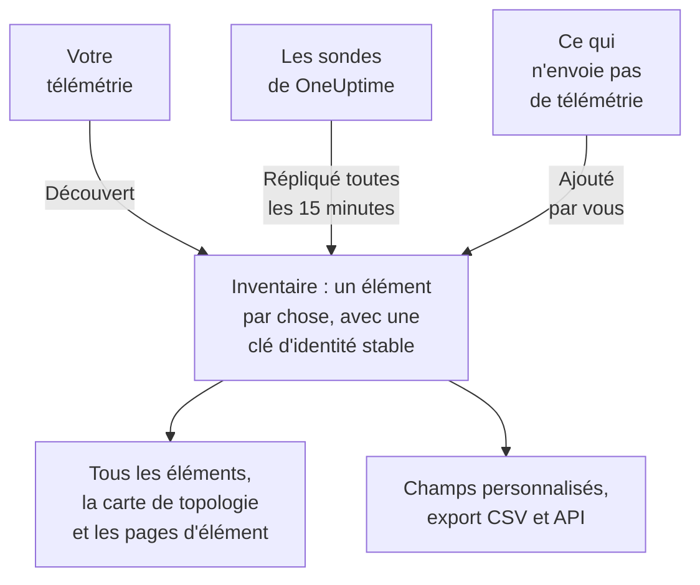

# Vue d'ensemble de l'inventaire

L'inventaire est une liste unique de tout ce que OneUptime sait de votre parc : services, hôtes, objets Kubernetes, machines virtuelles, équipements réseau, ressources cloud, appareils IoT, fonctions serverless, et même ce qui n'envoie aucune télémétrie. L'essentiel se remplit tout seul à partir de ce que OneUptime surveille déjà. Vous ajoutez ce que la surveillance ne peut pas lui dire : à quoi sert une chose, à qui elle appartient, quand sa garantie expire.

:::cards
- [Comment les éléments arrivent dans l'inventaire](#comment-les-éléments-arrivent-dans-linventaire): Découverts, répliqués ou ajoutés par vous.
- [S'y retrouver](#sy-retrouver): Les pages de l'inventaire et les pages propres à chaque élément.
- [Ajouter quelque chose à la main](#ajouter-quelque-chose-à-la-main): Une API tierce, une base de données externe ou une appliance.
- [Archiver plutôt que supprimer](#archiver-plutôt-que-supprimer): La façon de ranger la liste qui tient dans le temps.
:::

## Comment les éléments arrivent dans l'inventaire

OneUptime surveille déjà votre parc, donc le catalogue se construit à partir de ce qu'il observe plutôt que de ce que quelqu'un a pensé à saisir. Chaque élément a une source, et la source décide à qui appartient l'élément : si vous pouvez le modifier, et s'il peut disparaître de lui-même.

| Source | Dans l'API | D'où elle vient | Combien de temps elle reste |
| --- | --- | --- | --- |
| **Découvert** | `discovered` | Les attributs de ressource OpenTelemetry, lus à l'arrivée de la télémétrie : un service, un hôte, un objet Kubernetes ou une machine virtuelle qui envoie de la télémétrie. | Réenregistré à chaque lot. Retiré une fois resté silencieux plus longtemps que la fenêtre de son type (voir plus bas). |
| **Répliqué** | `inventory` | Un enregistrement qu'une sonde de OneUptime tient à jour : équipements réseau, ressources cloud, appareils IoT, fonctions serverless, applications RUM, hôtes Docker et hôtes Podman. Copié toutes les 15 minutes. | Aussi longtemps que son enregistrement. Supprimez l'enregistrement, et l'élément part avec lui. |
| **Ajouté par vous** | `manual` | Ajouté par vous, pour quelque chose que OneUptime ne peut pas voir : une API tierce, une base de données gérée par un fournisseur, une appliance dans une baie. | Jusqu'à ce que vous le supprimiez. Rien ne le fait expirer. |

Un élément découvert ou répliqué ne peut pas être renommé ni changer de type : sa source écraserait la modification à son prochain passage. La page **Paramètres** de l'élément indique où faire plutôt une modification durable. Ce que vous pouvez toujours ajouter à n'importe quel élément, quelle que soit sa source, ce sont des valeurs de champs personnalisés : voir [Champs personnalisés de l'inventaire](/docs/inventory/custom-fields).

### Combien de temps reste un élément silencieux

Un élément découvert a un battement de cœur. Chaque fois que de la télémétrie arrive pour lui, son heure de dernière observation avance, et la colonne **Statut** de la liste indique à quel point elle est récente. Les éléments répliqués et ceux que vous avez ajoutés n'ont pas de battement de cœur, donc leur statut reste vide plutôt que d'alarmer.

| Statut | Ce que cela signifie |
| --- | --- |
| **En direct** | Vu au cours des 30 dernières minutes. |
| **Recent** | Vu au cours de la dernière journée. |
| **Stale** | Pas vu depuis plus d'une journée. La page **Devenu silencieux** les liste. |

Toutes les trois heures, OneUptime retire les éléments découverts restés silencieux plus longtemps que la fenêtre de leur type, archivés compris, et leurs valeurs de champs personnalisés partent avec eux. Les éléments répliqués et ceux que vous avez ajoutés ne sont jamais retirés de cette façon.

| Type d'élément | Retiré après ce délai sans télémétrie |
| --- | --- |
| Pods, déploiements, invités Proxmox et machines virtuelles VMware | 1 jour |
| Nœuds et espaces de noms Kubernetes, nœuds Proxmox, hôtes, clusters et datastores VMware, ainsi que les bases de données et services distants que vos traces appellent | 7 jours |
| Services, hôtes, clusters Kubernetes, Proxmox et Ceph, baies de stockage, vCenters et clusters Docker Swarm | 30 jours |

Une relation que OneUptime a découverte est retirée dès qu'elle n'a pas été revue pendant 30 jours.

## S'y retrouver

Ouvrez **Produits → Ressources → Inventaire**. Son menu latéral contient ces pages. **Par source**, **Paramètres**, **Aide** et **Avancé** sont repliés au départ : cliquez sur le titre d'une section pour l'ouvrir.

| Page | Ce que vous y trouvez |
| --- | --- |
| **Vue d'ensemble** | Combien d'éléments vous avez, ce qu'ils sont, combien sont devenus silencieux, et ce qui a été ajouté le plus récemment. |
| **Tous les éléments** | Chaque élément. Cherchez par nom, description ou clé d'identité, filtrez la liste par type, source, statut ou champ personnalisé, et ajoutez un élément à la main. |
| **Topology Map** | Comment les éléments sont reliés : les services, ce qu'ils appellent, et les hôtes, pods et équipements sur lesquels ils tournent. |
| **Devenu silencieux** | Les éléments découverts qui n'ont pas envoyé de télémétrie depuis plus d'une journée. |
| **Par source** | Les éléments d'une source : **Découvert**, **Répliqué** ou **Ajouté par vous**. |
| **Paramètres → Champs personnalisés** | Les champs que votre projet tient sur chaque élément. |
| **Aide → Documentation** | Un court guide de l'inventaire, avec les types d'éléments qu'il reconnaît. |
| **Avancé → Archivé** | Les éléments que vous avez archivés. Désarchivez-les d'ici. |

Ouvrez un élément : son propre menu latéral contient sa **Vue d'ensemble** (son type, sa source et son statut, et chaque attribut observé sur lui), ses **Connexions** et ses **Champs personnalisés** ; ses **Journaux**, **Traces**, **Métriques**, **Profils de performance** et **Exceptions** ; et ses **Incidents**, **Alertes** et **Maintenance planifiée**. Sous **Avancé** se trouvent ses **Paramètres**, ses **Journaux d'audit** et **Supprimer l'élément**. Les pages de télémétrie montrent ce que l'élément lui-même a envoyé. Les incidents, alertes et événements de maintenance sont ceux du service, de l'hôte ou du cluster Kubernetes que l'élément représente ; sur tout autre élément, ces pages indiquent quelle ressource consulter à la place.

### Détails de l'actif

Un hôte ou un équipement réseau a une carte **Détails de l’actif** qui décrit les deux de la même façon : nom d'hôte, adresse IP, adresse MAC, numéro de série, fabricant, modèle, version du firmware, système d'exploitation, version du système d'exploitation, type d'appareil et emplacement. Un fait que rien n'a signalé indique **Inconnu**, et la carte explique comment les inconnus se remplissent.

- Les faits d'un hôte viennent des attributs de ressource de sa télémétrie : ses adresses IP et MAC, son architecture et son système d'exploitation d'emblée, et son numéro de série, sa marque, son modèle et son firmware une fois que vous les y apposez.
- Les faits d'un équipement réseau viennent de son interrogation SNMP, de son rôle et de son site. Ce que son interrogation n'a pas lu vient de la découverte : la dernière analyse de son adresse, la table ARP d'un routeur ou la résolution DNS de sa sonde. Un équipement sans ENTITY-MIB, comme un Meraki MX, obtient tout de même sa marque et son modèle à partir de sa description système. Son adresse IP n'est jamais affichée comme son nom d'hôte.

La carte indique d'où vient chaque fait et quand. La source que partagent la plupart des faits, comme le collecteur d'un hôte, la propre interrogation SNMP d'un équipement réseau ou l'analyse de découverte qui l'a lu, est nommée une seule fois, sous les faits. Toute autre source, comme la table ARP d'un routeur ou une valeur enregistrée sur l'équipement, est nommée sous son fait. Une valeur enregistrée sur un équipement réseau n'est jamais remplacée par ce que lit la découverte, et quand les deux diffèrent, la carte montre les deux.

Les mêmes faits sont des colonnes de la liste **Tous les éléments**, masquées jusqu'à ce que vous les activiez, et ils entrent dans son export CSV. [Exporter vers une CMDB](/docs/inventory/cmdb-sync#détails-de-lactif) liste leurs clés.

### Connexions

La page **Connexions** d'un élément liste ses voisins dans les deux sens, regroupés en **Appels**, **Appelé par**, **Runs on** et **Related**. Chaque groupe affiche son total (un groupe de plus de 100 000 connexions affiche « 100 000+ »), et **Afficher plus** parcourt le reste, si bien qu'un cluster, un espace de noms ou un nœud très chargé montre chaque connexion plutôt que les premières seulement. La page n'est limitée à aucune plage de temps : elle inclut les relations ajoutées à la main par l'API et les voisins archivés. Un voisin qui n'est plus dans l'inventaire est affiché par sa clé.

## Ajouter quelque chose à la main

Ajoutez un élément pour quelque chose que OneUptime ne verra jamais de lui-même, afin qu'une dépendance aboutisse à quelque chose de réel et que la chose puisse porter vos champs personnalisés.

:::steps
### Ouvrir Tous les éléments

Allez dans **Produits → Ressources → Inventaire**, puis **Tous les éléments**.

### Ajouter l'élément

Cliquez sur **Ajouter : Élément**. Choisissez son **Type**, donnez-lui un **Nom**, et éventuellement une **Description**. Le nom et le type forment ensemble l'identité de l'élément, donc deux éléments du même type ne peuvent pas porter le même nom.

### Remplir ses champs personnalisés

Ouvrez le nouvel élément. Sa source indique **Ajouté par vous**, et sa page **Champs personnalisés** accueille les valeurs que votre projet suit.
:::

Vous pouvez ajouter trois types à la main :

- `external.service` (**Service externe**) : une API tierce ou une dépendance logicielle en tant que service.
- `external.database` (**Base de données externe**) : une base de données qui n'est pas un serveur que OneUptime peut modéliser. Un serveur de base de données, auto-hébergé ou géré, de PostgreSQL à Snowflake, se crée plutôt sous **Bases de données → Créer : Base de données** ([Bases de données](/docs/telemetry/databases)) : cet enregistrement rejoint les traces, les conteneurs et les métriques du moteur qui nomment la même adresse, ce que ne fait jamais un élément d'inventaire, et ajouter le même serveur des deux façons laisse deux enregistrements non liés.
- `appliance` (**Appliance**) : du matériel ou un logiciel sans agent.

Cette restriction évite les doublons. Un élément créé à la main d'un type que OneUptime peut observer, comme un hôte, serait identifié par le nom que vous avez saisi, tandis que l'élément découvert pour la même machine l'est par les attributs qu'elle déclare. Les deux ne se rejoindraient jamais, et le même hôte figurerait deux fois dans votre liste, pour de bon.

## Archiver plutôt que supprimer

L'archivage retire un élément de la liste tout en lui laissant son identité, son historique et ses valeurs de champs personnalisés. Il dit : j'ai vu ceci, et je ne le veux pas dans ma liste. Un élément archivé continue de collecter de la télémétrie.

| Source | Archiver | Supprimer |
| --- | --- | --- |
| **Découvert** | Reste archivé. | Revient avec le prochain lot de sa télémétrie. |
| **Répliqué** | Reste archivé. | Revient avec la prochaine copie. Supprimez plutôt l'enregistrement d'origine. |
| **Ajouté par vous** | Reste archivé. | Disparaît pour de bon. |

Pour archiver des éléments, sélectionnez-les dans **Tous les éléments** et archivez-les en une fois, ou ouvrez un élément et utilisez la carte **Archiver** de sa page **Paramètres**. Les éléments archivés se trouvent sous **Inventaire → Avancé → Archivé**, où vous pouvez les sélectionner et les désarchiver.

> [!NOTE]
> Quand un équipement répliqué est retiré de son enregistrement d'origine, OneUptime retire aussi son élément, sauf si l'élément porte des valeurs de champs personnalisés que vous avez saisies. Ces valeurs sont la seule copie et il n'y a pas d'annulation, donc l'élément est archivé au lieu d'être supprimé. Vous le trouverez sous **Avancé → Archivé** avec tout ce que vous avez saisi.

## Relations et topologie

OneUptime relie les éléments par des relations orientées à mesure qu'il les observe. **Inventaire → Topology Map** les dessine, et la page **Connexions** d'un élément liste les siennes. Voir [Topologie](/docs/telemetry/topology).

| Relation | Par exemple |
| --- | --- |
| `runs-on` | Un pod tourne sur un nœud ; une machine virtuelle tourne sur son hôte. |
| `member-of` | Un pod, un nœud ou un espace de noms est membre d'un cluster. |
| `hosted-on` | Un service est hébergé sur un hôte. |
| `part-of` | Un pod fait partie de son déploiement. |
| `depends-on` | Un service en appelle un autre, d'après les spans qui passent de l'un à l'autre. |

## Prochaines étapes

:::cards
- [Champs personnalisés de l'inventaire](/docs/inventory/custom-fields): Suivre numéros de série, dates de garantie, propriétaires et statut de cycle de vie.
- [Exporter vers une CMDB](/docs/inventory/cmdb-sync): Importer le catalogue dans votre propre système de référence.
- [Bases de données](/docs/telemetry/databases): Surveiller les serveurs de bases de données qu'utilisent vos services.
:::
