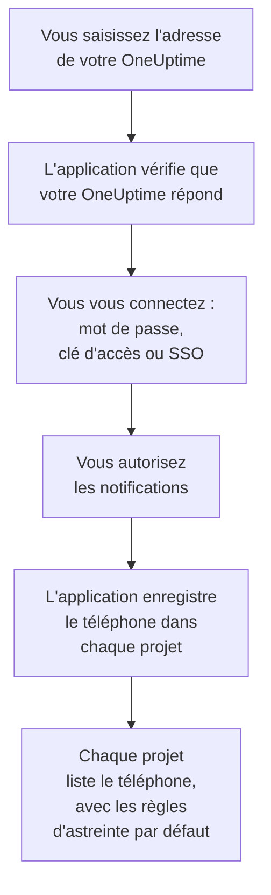
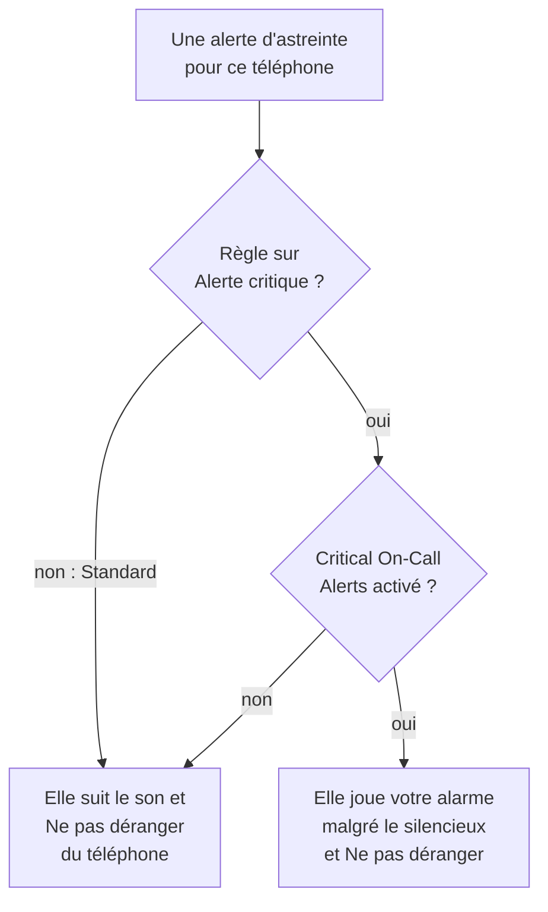

# Installation Android

Installez **OneUptime On-Call** sur un téléphone ou une tablette Android, connectez-la à votre OneUptime et connectez-vous. Envoyez-vous ensuite une notification de test, et laissez les alertes d'astreinte urgentes sonner malgré le mode silencieux et Ne pas déranger.

:::cards
- [Installer l'application](#installer-lapplication): Depuis Google Play, ou l'APK sur un téléphone qui n'a pas Google Play.
- [Se connecter](#se-connecter): L'adresse de votre OneUptime, puis votre compte.
- [Vérifier que les alertes atteignent le téléphone](#vérifier-que-les-alertes-atteignent-le-téléphone): Trouver le téléphone dans le tableau de bord et le tester.
- [Sonner malgré le mode silencieux](#sonner-malgré-le-mode-silencieux): Les alertes critiques et le son d'alarme.
- [Dépannage](#dépannage): Problèmes de connexion, de notifications et d'installation.
:::

## Avant de commencer

- Un téléphone ou une tablette sous Android 7.0 ou version ultérieure.
- Un compte dans un projet OneUptime. Pour être alerté, vous devez aussi être d'astreinte : voir [Règles d'escalade](/docs/on-call/escalation-rules).
- L'adresse de votre OneUptime : `https://oneuptime.com` sur OneUptime Cloud, ou la vôtre, par exemple `https://oneuptime.example.com`. L'application se connecte uniquement en HTTPS.

## Installer l'application

:::tabs
@tab Google Play
1. Sur le téléphone, ouvrez [OneUptime On-Call sur Google Play](https://play.google.com/store/apps/details?id=com.oneuptime.oncall), ou cherchez OneUptime On-Call dans Google Play.
2. Appuyez sur **Installer**, puis sur **Ouvrir**.

Google Play tient l'application à jour.
@tab APK
Pour un téléphone sans Google Play. L'APK est compilé à partir du même code pour chaque version de OneUptime et joint à la version sur GitHub.

1. Sur le téléphone, ouvrez [l'APK le plus récent](https://github.com/OneUptime/oneuptime/releases/latest/download/oneuptime-on-call-android-app.apk).
2. Ouvrez le fichier téléchargé. Si Android le demande, autorisez votre navigateur à installer des applications inconnues, puis appuyez sur **Installer**.
3. Ouvrez OneUptime On-Call depuis vos applications.

Un APK ne se met pas à jour tout seul : installez de temps en temps le plus récent par-dessus. Votre connexion et vos réglages sont conservés.
:::

## Se connecter

:::steps
### Saisir l'adresse de votre OneUptime
Ouvrez l'application. Sur **Connect your workspace**, gardez `https://oneuptime.com` pour OneUptime Cloud, ou saisissez l'adresse de votre propre OneUptime, puis appuyez sur **Connect**. L'application continue dès que `https://<your-oneuptime>/api/status` répond.

### Vous connecter à votre compte
Utilisez la méthode de connexion de votre compte :

- Votre e-mail et votre mot de passe, puis **Sign In**. **Forgot password?** vous envoie par e-mail un lien pour en définir un nouveau.
- **Sign in with a passkey**, une fois que vous en avez ajouté une dans le tableau de bord : voir [Ajouter une clé d'accès](/docs/introduction/your-account#ajouter-une-clé-daccès). Votre navigateur s'ouvre pour la confirmer, puis vous ramène.
- **Sign in with SSO**, si votre organisation utilise l'authentification unique. Choisissez votre fournisseur, ou saisissez votre e-mail professionnel et appuyez sur **Continue**. Un navigateur sécurisé s'ouvre, et vous revenez dans l'application une fois connecté.

Si l'authentification à deux facteurs est activée, saisissez le code à six chiffres de votre application d'authentification, ou l'un de vos codes de secours. Une clé de sécurité ne peut pas être utilisée dans l'application. Si votre administrateur exige l'authentification à deux facteurs et que vous ne l'avez pas encore configurée, l'application configure d'abord avec vous une application d'authentification.

### Autoriser les notifications
Quand Android demande si OneUptime On-Call peut envoyer des notifications, appuyez sur **Autoriser**. Android 13 et versions ultérieures le demandent ; les versions antérieures les autorisent tant que vous ne les désactivez pas.

L'application enregistre ensuite le téléphone dans chacun de vos projets. Chaque projet le liste parmi vos appareils push, avec les règles d'astreinte par défaut, pour que vos alertes lui parviennent désormais.
:::

L'application affiche un projet à la fois : appuyez sur le nom du projet en haut d'un écran pour en changer. Un projet qui exige l'authentification unique est marqué **SSO Required** sous **Settings → Manage Projects** jusqu'à ce que vous y appuyiez sur **Authenticate with SSO**.

## Vérifier que les alertes atteignent le téléphone

:::steps
### Trouver le téléphone dans le tableau de bord
Dans le tableau de bord, ouvrez **Paramètres utilisateur → Méthodes de notification** et l'onglet **Push Notifications**. Le téléphone figure sous **Appareils de notification push**, avec son nom de modèle. Chaque projet tient sa propre liste.

### Envoyer un test
Cliquez sur **Notification de test** sur la ligne du téléphone. Une notification arrive sur le téléphone ; appuyez dessus pour ouvrir l'application.
:::

Vos règles d'astreinte décident quelles alertes vont au téléphone, et en combien de temps : voir **Paramètres utilisateur → Règles d'astreinte**. Un nouveau téléphone reçoit les mêmes règles par défaut que toute autre méthode que vous ajoutez.

## Sonner malgré le mode silencieux

Par défaut, une alerte d'astreinte suit les réglages sonores du téléphone : un téléphone en sourdine reste silencieux, et Ne pas déranger retient l'alerte. Les alertes critiques font sonner les alertes d'astreinte malgré les deux. Elles sont désactivées tant que vous ne les activez pas, téléphone par téléphone.

:::steps
### Activer Critical On-Call Alerts
Dans l'application, ouvrez **Settings** et activez **Critical On-Call Alerts** sous **Notifications**.

### Autoriser l'accès à Ne pas déranger
Android ouvre sa liste **Accès à « Ne pas déranger »**. Activez l'accès pour OneUptime On-Call, puis revenez à l'application : elle vérifie l'accès et indique sous l'interrupteur si les alertes sonneront.

### Choisir un son d'alarme
Appuyez sur **Alarm sound** sous l'interrupteur. En plus du son du téléphone, elle propose Klaxon, Siren, Digital alarm, Smoke alarm et Rising alarm, qui commence doucement et monte. Appuyez sur lecture à côté d'un son pour l'écouter. Une alerte critique joue au volume d'alarme du téléphone : gardez-le donc élevé.
:::

Seules les alertes d'astreinte sonnent malgré tout, et seulement celles des règles d'astreinte réglées sur **Alerte critique**, la valeur par défaut. Une règle sur **Standard** suit les réglages du téléphone quoi qu'indique l'interrupteur : vous pouvez ainsi être réveillé pour un incident critique et alerté discrètement pour un incident mineur. Envoyez une **Notification de test** téléphone en sourdine pour entendre ce que fera une alerte.

## Éviter que les alertes arrivent en retard

OneUptime envoie les alertes d'astreinte en priorité haute, qu'Android livre même à un téléphone inactif depuis des heures. Un téléphone qui restreint l'utilisation de la batterie par l'application peut tout de même les retenir :

- Ouvrez **Paramètres → Applications → OneUptime On-Call → Batterie** et choisissez **Sans restriction**. Certains téléphones l'appellent **Utilisation de la batterie par l'appli**.
- Vérifiez que les notifications de l'application sont activées, sous **Paramètres → Applications → OneUptime On-Call → Notifications**.
- Excluez OneUptime On-Call de toute liste d'économie de batterie ou d'applications en veille que tient votre téléphone.

## Verrouiller l'application

Activez **Biometrics Login** sous **Settings** dans l'application, et elle vous demande votre empreinte, votre visage ou le verrouillage d'écran du téléphone à chaque démarrage. L'interrupteur apparaît une fois qu'un déverrouillage par empreinte ou par visage est configuré sur le téléphone. **Appearance**, sur le même écran, choisit l'apparence claire ou sombre, ou suit le téléphone.

## Mettre à jour, se déconnecter ou désinstaller

- **Mettre à jour.** Google Play met l'application à jour. Pour l'APK, installez le plus récent par-dessus. La version de l'application figure en bas de son écran **Settings**.
- **Se déconnecter.** **Settings → Log Out** vous déconnecte et retire le téléphone de vos appareils push dans chaque projet, avec ses règles d'astreinte. Si vous vous reconnectez, il revient avec les règles par défaut.
- **Désinstaller.** Supprimez l'application comme toute autre. Si vous étiez encore connecté, le téléphone reste dans votre liste jusqu'à ce qu'un push vers lui échoue : OneUptime le marque alors **Ne reçoit pas de notifications**. Supprimez cette entrée avec **Supprimer** : si vous réinstallez l'application et vous connectez, le téléphone est ajouté comme nouvelle entrée, avec les règles par défaut.

## Dépannage

:::details « Could not connect to the server »
L'application n'a pas pu joindre `https://<your-oneuptime>/api/status`. Vérifiez l'adresse, y compris `https://`. Si votre OneUptime est sur un réseau privé, connectez d'abord le téléphone à ce réseau, par votre VPN par exemple. Ouvrez cette adresse dans le navigateur du téléphone : elle affiche `{"status":"ok"}` quand le téléphone peut joindre OneUptime.
:::

:::details Aucune notification n'arrive
- Vérifiez dans les paramètres d'Android que les notifications sont activées pour l'application, et que Ne pas déranger est désactivé ou les alertes critiques activées.
- Vérifiez que le téléphone figure sous **Push Notifications** dans **Paramètres utilisateur → Méthodes de notification**, et envoyez-lui une **Notification de test**.
- Si le téléphone est marqué **Ne reçoit pas de notifications**, ouvrez l'application en étant connecté. Elle enregistre à nouveau le téléphone ; voir [Quand un téléphone doit se réenregistrer](/docs/mobile-desktop-apps/faq-troubleshooting#quand-un-téléphone-doit-se-réenregistrer).
- Vérifiez vos règles d'astreinte sous **Paramètres utilisateur → Règles d'astreinte**.
- Sur un OneUptime auto-hébergé, vérifiez que votre serveur joint son relais push : voir [Notifications push](/docs/self-hosted/push-notifications#accès-réseau).
:::

:::details Les alertes critiques restent muettes en Ne pas déranger
Ouvrez **Settings** dans l'application : la ligne sous **Critical On-Call Alerts** indique ce qui manque. Le plus souvent, l'accès à Ne pas déranger n'a pas été autorisé : autorisez-le sous **Paramètres → Notifications → Accès à « Ne pas déranger »**, puis revenez à l'application. Si vous avez choisi un son d'alarme, le canal de notification de ce son doit lui aussi pouvoir outrepasser Ne pas déranger.
:::

:::details « Application non installée » quand vous installez l'APK
OneUptime On-Call est déjà sur le téléphone depuis une autre source, comme Google Play, et Android n'installe pas l'une par-dessus l'autre. Désinstallez-la, installez l'APK et reconnectez-vous.
:::

:::details Pas d'interrupteur Biometrics Login
L'interrupteur apparaît une fois qu'un déverrouillage par empreinte ou par visage est configuré dans les paramètres d'Android.
:::

## Étapes suivantes

:::cards
- [FAQ et dépannage](/docs/mobile-desktop-apps/faq-troubleshooting): Que faire quand un téléphone ne reçoit plus d'alertes.
- [Installation iOS](/docs/mobile-desktop-apps/ios-installation): La même application sur un iPhone ou un iPad.
- [Règles d'escalade](/docs/on-call/escalation-rules): Décider qui est alerté, et quand.
- [Notifications push](/docs/self-hosted/push-notifications): Comment un OneUptime auto-hébergé envoie les alertes aux téléphones.
:::
