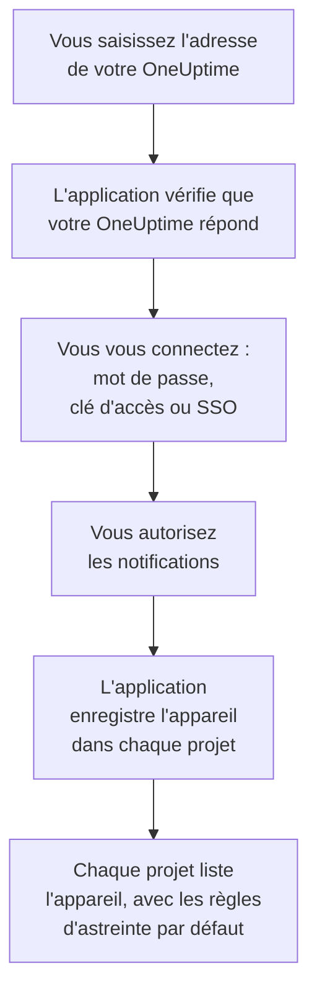

# Installation iOS

Installez **OneUptime On-Call** depuis l'App Store sur un iPhone ou un iPad, connectez-la à votre OneUptime et connectez-vous. Envoyez-vous ensuite une notification de test, et laissez les alertes d'astreinte urgentes sonner malgré le mode silencieux et les modes de concentration.

:::cards
- [Installer l'application](#installer-lapplication): Depuis l'App Store.
- [Se connecter](#se-connecter): L'adresse de votre OneUptime, puis votre compte.
- [Vérifier que les alertes atteignent l'appareil](#vérifier-que-les-alertes-atteignent-lappareil): Le trouver dans le tableau de bord et le tester.
- [Sonner malgré le mode silencieux](#sonner-malgré-le-mode-silencieux): Les alertes critiques, le son d'alarme et son volume.
- [Dépannage](#dépannage): Problèmes de connexion, de notifications et d'alertes critiques.
:::

## Avant de commencer

- Un iPhone ou un iPad sous iOS 16.4 ou version ultérieure, ou iPadOS 16.4 ou version ultérieure.
- Un compte dans un projet OneUptime. Pour être alerté, vous devez aussi être d'astreinte : voir [Règles d'escalade](/docs/on-call/escalation-rules).
- L'adresse de votre OneUptime : `https://oneuptime.com` sur OneUptime Cloud, ou la vôtre, par exemple `https://oneuptime.example.com`. L'application se connecte uniquement en HTTPS.

## Installer l'application

1. Sur l'iPhone ou l'iPad, ouvrez [OneUptime On-Call sur l'App Store](https://apps.apple.com/us/app/oneuptime-on-call/id6759615391), ou cherchez OneUptime On-Call dans l'App Store.
2. Touchez **Obtenir**, puis confirmez avec Face ID, Touch ID ou le mot de passe de votre compte Apple.
3. Touchez **Ouvrir**, ou ouvrez OneUptime On-Call depuis l'écran d'accueil.

L'App Store tient l'application à jour tant que **Mises à jour des apps** est activé, sous **Réglages → App Store**.

## Se connecter



:::steps
### Saisir l'adresse de votre OneUptime
Ouvrez l'application. Sur **Connect your workspace**, gardez `https://oneuptime.com` pour OneUptime Cloud, ou saisissez l'adresse de votre propre OneUptime, puis touchez **Connect**. L'application continue dès que `https://<your-oneuptime>/api/status` répond.

### Vous connecter à votre compte
Utilisez la méthode de connexion de votre compte :

- Votre e-mail et votre mot de passe, puis **Sign In**. **Forgot password?** vous envoie par e-mail un lien pour en définir un nouveau.
- **Sign in with SSO**, si votre organisation utilise l'authentification unique. Choisissez votre fournisseur, ou saisissez votre e-mail professionnel et touchez **Continue**. Un navigateur sécurisé s'ouvre, et vous revenez dans l'application une fois connecté.
- **Sign in with a passkey**, une fois que vous en avez ajouté une dans le tableau de bord : voir [Ajouter une clé d'accès](/docs/introduction/your-account#ajouter-une-clé-daccès). Une fenêtre de navigateur s'ouvre pour la confirmer, puis vous ramène.

Si l'authentification à deux facteurs est activée, saisissez le code à six chiffres de votre application d'authentification, ou l'un de vos codes de secours. Une clé de sécurité ne peut pas être utilisée dans l'application. Si votre administrateur exige l'authentification à deux facteurs et que vous ne l'avez pas encore configurée, l'application configure d'abord avec vous une application d'authentification.

### Autoriser les notifications
Quand iOS demande si OneUptime On-Call peut vous envoyer des notifications, touchez **Autoriser**.

L'application enregistre ensuite l'iPhone ou l'iPad dans chacun de vos projets. Chaque projet le liste parmi vos appareils push, avec les règles d'astreinte par défaut, pour que vos alertes lui parviennent désormais.
:::

L'application affiche un projet à la fois : touchez le nom du projet en haut d'un écran pour en changer. Un projet qui exige l'authentification unique est marqué **SSO Required** sous **Settings → Manage Projects** jusqu'à ce que vous y touchiez **Authenticate with SSO**.

## Vérifier que les alertes atteignent l'appareil

:::steps
### Trouver l'appareil dans le tableau de bord
Dans le tableau de bord, ouvrez **Paramètres utilisateur → Méthodes de notification** et l'onglet **Push Notifications**. L'iPhone ou l'iPad figure sous **Appareils de notification push**, avec son nom de modèle. Chaque projet tient sa propre liste.

### Envoyer un test
Cliquez sur **Notification de test** sur la ligne de l'appareil. Une notification arrive sur l'appareil ; touchez-la pour ouvrir l'application.
:::

Vos règles d'astreinte décident quelles alertes vont à l'appareil, et en combien de temps : voir **Paramètres utilisateur → Règles d'astreinte**. Un nouvel appareil reçoit les mêmes règles par défaut que toute autre méthode que vous ajoutez.

## Sonner malgré le mode silencieux

Par défaut, une alerte d'astreinte suit les réglages sonores de l'appareil : le mode silencieux la rend muette, et un mode de concentration comme Ne pas déranger la retient. Les alertes critiques font sonner les alertes d'astreinte malgré les deux. Elles sont désactivées tant que vous ne les activez pas, appareil par appareil.

```mermaid title="Si une alerte d'astreinte sonne malgré tout sur un iPhone ou un iPad"
flowchart TB
    Page["Une alerte d'astreinte<br/>pour cet appareil"]
    Rule{"Règle sur<br/>Alerte critique ?"}
    Device{"Critical On-Call<br/>Alerts activé ?"}
    Quiet["Elle suit le son et la<br/>concentration de<br/>l'appareil"]
    Loud["Elle joue votre alarme,<br/>à votre volume, malgré<br/>le silencieux et la<br/>concentration"]
    Page --> Rule
    Rule -->|"non : Standard"| Quiet
    Rule -->|"oui"| Device
    Device -->|"non"| Quiet
    Device -->|"oui"| Loud
```

:::steps
### Activer Critical On-Call Alerts
Dans l'application, ouvrez **Settings** et activez **Critical On-Call Alerts** sous **Notifications**.

### Autoriser les alertes critiques
Quand iOS demande si OneUptime On-Call peut envoyer des alertes critiques, touchez **Autoriser**. iOS ajoute alors un interrupteur **Alertes critiques** pour l'application sous **Réglages → Notifications → OneUptime On-Call**, où vous pourrez changer d'avis plus tard. La ligne sous l'interrupteur de l'application indique si les alertes sonneront.

### Choisir un son d'alarme et son volume
Touchez **Alarm sound** sous l'interrupteur. En plus du son d'alerte critique de l'appareil, elle propose Klaxon, Siren, Digital alarm, Smoke alarm et Rising alarm, qui commence doucement et monte. Touchez lecture à côté d'un son pour l'écouter. Choisissez ensuite le volume auquel une alerte sonne : 25 %, 50 %, 75 % ou 100 %, la valeur par défaut.
:::

Seules les alertes d'astreinte sonnent malgré tout, et seulement celles des règles d'astreinte réglées sur **Alerte critique**, la valeur par défaut. Une règle sur **Standard** suit les réglages de l'appareil quoi qu'indique l'interrupteur : vous pouvez ainsi être réveillé pour un incident critique et alerté discrètement pour un incident mineur. Envoyez une **Notification de test** appareil en silencieux pour entendre ce que fera une alerte. L'aperçu de l'écran **Alarm sound** joue au volume de la sonnerie, et pas du tout en silencieux ; une vraie alerte sonne malgré le mode silencieux au volume que vous avez choisi.

> [!NOTE]
> Les alertes critiques demandent OneUptime On-Call 1.5.0 ou version ultérieure depuis l'App Store. Les versions antérieures ont été compilées sans l'autorisation d'Apple pour les alertes critiques : iOS ne leur a donc jamais proposé l'interrupteur.

## Éviter que les alertes soient retenues

Sans alertes critiques, un mode de concentration ou un résumé peuvent retenir les alertes :

- **Concentration.** Ajoutez OneUptime On-Call aux apps que chaque mode de concentration autorise, sous **Réglages → Concentration**.
- **Résumé programmé.** Laissez OneUptime On-Call en dehors, sous **Réglages → Notifications → Résumé programmé** : une notification du résumé attend le prochain horaire du résumé.
- **Notifications.** Gardez **Autoriser les notifications** activé, sous **Réglages → Notifications → OneUptime On-Call**.

## Verrouiller l'application

Activez **Biometrics Login** sous **Settings** dans l'application, et elle vous demande Face ID, Touch ID ou votre code à chaque démarrage. L'interrupteur apparaît une fois Face ID ou Touch ID configuré sur l'appareil. **Appearance**, sur le même écran, choisit l'apparence claire ou sombre, ou suit l'appareil.

## Mettre à jour, se déconnecter ou supprimer l'application

- **Mettre à jour.** L'App Store met l'application à jour ; vous pouvez aussi la mettre à jour depuis votre compte dans l'App Store. La version de l'application figure en bas de son écran **Settings**.
- **Se déconnecter.** **Settings → Log Out** vous déconnecte et retire l'appareil de vos appareils push dans chaque projet, avec ses règles d'astreinte. Si vous vous reconnectez, il revient avec les règles par défaut.
- **Supprimer.** Maintenez le doigt sur l'icône de l'application, puis touchez **Supprimer l'app** et confirmez avec **Supprimer**. Si vous étiez encore connecté, l'appareil reste dans votre liste jusqu'à ce qu'un push vers lui échoue : OneUptime le marque alors **Ne reçoit pas de notifications**. Si vous réinstallez l'application et vous connectez, cette entrée revient généralement, avec ses règles ; si vous n'utilisez plus l'appareil, supprimez l'entrée avec **Supprimer**.

## Dépannage

:::details « Could not connect to the server »
L'application n'a pas pu joindre `https://<your-oneuptime>/api/status`. Vérifiez l'adresse, y compris `https://`. Si votre OneUptime est sur un réseau privé, connectez d'abord l'appareil à ce réseau, par votre VPN par exemple. Ouvrez cette adresse dans Safari sur l'appareil : elle affiche `{"status":"ok"}` quand l'appareil peut joindre OneUptime.
:::

:::details Aucune notification n'arrive
- Vérifiez que **Autoriser les notifications** est activé sous **Réglages → Notifications → OneUptime On-Call**, et qu'aucun mode de concentration ne retient les alertes.
- Vérifiez que l'appareil figure sous **Push Notifications** dans **Paramètres utilisateur → Méthodes de notification**, et envoyez-lui une **Notification de test**.
- Si l'appareil est marqué **Ne reçoit pas de notifications**, ouvrez l'application en étant connecté. Elle enregistre à nouveau l'appareil ; voir [Quand un téléphone doit se réenregistrer](/docs/mobile-desktop-apps/faq-troubleshooting#quand-un-téléphone-doit-se-réenregistrer).
- Vérifiez vos règles d'astreinte sous **Paramètres utilisateur → Règles d'astreinte**.
- Sur un OneUptime auto-hébergé, vérifiez que votre serveur joint son relais push : voir [Notifications push](/docs/self-hosted/push-notifications#accès-réseau).
:::

:::details Pas d'interrupteur Alertes critiques dans les Réglages d'iOS
Activez d'abord **Critical On-Call Alerts** dans l'application : iOS n'ajoute son interrupteur qu'après que l'application a demandé les alertes critiques. Si l'application indique que cette version ne peut pas recevoir d'alertes critiques, mettez à jour OneUptime On-Call depuis l'App Store.
:::

:::details Les alertes critiques restent muettes
Ouvrez **Settings** dans l'application : la ligne sous **Critical On-Call Alerts** indique ce qui manque. Vérifiez que **Alertes critiques** est activé sous **Réglages → Notifications → OneUptime On-Call**, et que le volume de l'écran **Alarm sound** de l'application n'est pas trop bas.
:::

:::details Pas d'interrupteur Biometrics Login
L'interrupteur apparaît une fois Face ID ou Touch ID configuré sous **Réglages → Face ID et code** ou **Réglages → Touch ID et code**.
:::

## Étapes suivantes

:::cards
- [FAQ et dépannage](/docs/mobile-desktop-apps/faq-troubleshooting): Que faire quand un téléphone ne reçoit plus d'alertes.
- [Installation Android](/docs/mobile-desktop-apps/android-installation): La même application sur Android.
- [Règles d'escalade](/docs/on-call/escalation-rules): Décider qui est alerté, et quand.
- [Notifications push](/docs/self-hosted/push-notifications): Comment un OneUptime auto-hébergé envoie les alertes aux téléphones.
:::
