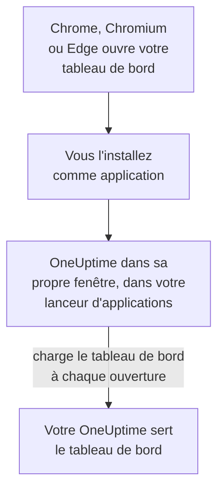

# Installation Linux

Le tableau de bord OneUptime s'installe sous Linux comme une application, depuis Google Chrome, Chromium ou Microsoft Edge. Il s'ouvre dans sa propre fenêtre, avec sa propre entrée dans le lanceur d'applications de votre bureau, et peut afficher des notifications. Il n'y a rien à télécharger : l'application est le tableau de bord de votre OneUptime, et elle est à jour dès que votre OneUptime l'est.

:::cards
- [Installer l'application](#installer-lapplication): Depuis Chrome, Chromium ou Edge.
- [L'ouvrir depuis votre lanceur](#louvrir-depuis-votre-lanceur): Comme toute autre application de bureau.
- [Recevoir des notifications sur cet ordinateur](#recevoir-des-notifications-sur-cet-ordinateur): Enregistrer le navigateur pour les notifications push.
- [Dépannage](#dépannage): Pas d'icône d'installation, pas de notifications, pas d'entrée dans le lanceur.
:::

## Comment fonctionne l'application de bureau

L'application installée partage la connexion, les réglages et l'autorisation de notifications de son navigateur. Fermez le navigateur, et l'application continue de tourner dans sa propre fenêtre.

## Avant de commencer

- Un bureau Linux avec une version récente de Google Chrome, de Chromium ou de Microsoft Edge.
- L'adresse de votre OneUptime, en HTTPS : `https://oneuptime.com` sur OneUptime Cloud, ou la vôtre, par exemple `https://oneuptime.example.com`.
- Un compte avec lequel vous pouvez vous connecter au tableau de bord.

## Installer l'application

:::tabs
@tab Chrome
1. Ouvrez votre OneUptime dans Chrome ou Chromium et connectez-vous.
2. Sur n'importe quelle page du tableau de bord, cliquez sur l'icône d'installation à droite de la barre d'adresse, puis sur **Installer**. Ou ouvrez **⋮ → Caster, enregistrer et partager → Installer la page en tant qu'application…**.
3. Chrome ouvre OneUptime dans sa propre fenêtre et l'ajoute à votre lanceur d'applications.
@tab Edge
1. Ouvrez votre OneUptime dans Edge et connectez-vous.
2. Sur n'importe quelle page du tableau de bord, cliquez sur l'icône d'installation à droite de la barre d'adresse, puis sur **Installer**. Ou ouvrez **Paramètres et plus (…) → Plus d'outils → Applications → Installer ce site en tant qu'application**.
3. Edge ouvre OneUptime dans sa propre fenêtre et l'ajoute à votre lanceur d'applications.
:::

Installez depuis une page du tableau de bord, une fois connecté : la page de connexion n'est pas l'application.

## L'ouvrir depuis votre lanceur

Le navigateur ajoute une entrée de bureau pour l'application, un fichier `.desktop` dans `~/.local/share/applications`, pour que OneUptime apparaisse dans GNOME, KDE Plasma et les autres lanceurs. Épinglez-le là à votre dock ou à votre panneau, comme toute autre application.

## Recevoir des notifications sur cet ordinateur

L'application affiche des notifications par son navigateur, une fois que vous avez enregistré le navigateur pour les notifications push dans chaque projet dont vous voulez les recevoir.

:::steps
### Ouvrir vos appareils push
Dans l'application, ouvrez **Paramètres utilisateur → Méthodes de notification** et l'onglet **Push Notifications**.

### Enregistrer ce navigateur
Cliquez sur **Enregistrer l'appareil**, gardez la valeur proposée dans **Nom de l'appareil**, par exemple `Chrome on Linux`, ou modifiez-la, puis cliquez de nouveau sur **Enregistrer l'appareil**. Quand le navigateur demande si OneUptime peut afficher des notifications, choisissez **Autoriser**.

### Envoyer un test
Dans la boîte de dialogue **Browser Registered**, cliquez sur **Send Test Notification**. Votre bureau l'affiche par son service de notifications ; si rien n'apparaît, voir [Dépannage](#dépannage).
:::

Un navigateur ne peut pas sonner malgré le Ne pas déranger de votre bureau. Pour les alertes qui doivent vous réveiller, utilisez l'application mobile avec les alertes critiques : voir [Installation Android](/docs/mobile-desktop-apps/android-installation#sonner-malgré-le-mode-silencieux).

Sur un OneUptime auto-hébergé, les notifications du navigateur demandent les clés VAPID du serveur : voir [Notifications push](/docs/self-hosted/push-notifications#configuration-auto-hébergée).

## Mises à jour

Il n'y a rien à mettre à jour. L'application charge le tableau de bord depuis votre OneUptime à chaque ouverture : elle change donc quand votre OneUptime est mis à jour. Si une fenêtre est ouverte depuis la mise à jour, rechargez-la avec Ctrl+R.

## Désinstaller

:::tabs
@tab Chrome
Dans la fenêtre de l'application, ouvrez le menu **⋮**, choisissez l'élément qui désinstalle l'application, puis **Supprimer**.
@tab Edge
Ouvrez `edge://apps` dans Edge, choisissez **Détails** sur OneUptime, puis **Désinstaller**.
:::

Désinstaller l'application ne désenregistre pas son navigateur : il reçoit toujours des notifications. Pour les arrêter, supprimez le navigateur sous **Paramètres utilisateur → Méthodes de notification**, dans l'onglet **Push Notifications**, avec **Supprimer**.

## Dépannage

:::details Pas d'icône d'installation dans la barre d'adresse
Ouvrez une page du tableau de bord une fois connecté, pas la page de connexion, et vérifiez que l'adresse commence par `https://` : les navigateurs n'installent des applications que depuis des sites sécurisés. Si l'icône n'apparaît toujours pas, utilisez le menu du navigateur comme ci-dessus. D'autres navigateurs n'installent pas forcément des sites comme applications ; utilisez Chrome, Chromium ou Edge.
:::

:::details Aucune notification n'apparaît
- Dans **Paramètres utilisateur → Méthodes de notification**, onglet **Push Notifications**, vérifiez que ce navigateur est listé, et envoyez-lui une **Notification de test**.
- Vérifiez que le Ne pas déranger de votre bureau est désactivé et que ses réglages de notification autorisent le navigateur.
- Si le navigateur bloque les notifications pour OneUptime, cliquez sur l'icône à gauche de la barre d'adresse, autorisez les notifications pour le site, et enregistrez à nouveau le navigateur.
- Sur un OneUptime auto-hébergé, la boîte de dialogue **Enregistrer l'appareil** indique quand le serveur n'a pas de clés VAPID.
:::

:::details L'application manque dans le lanceur
Ouvrez-la plutôt depuis le navigateur : `chrome://apps` dans Chrome ou Chromium, `edge://apps` dans Edge. Un lanceur qui ne lit les entrées de bureau qu'à l'ouverture de session l'affiche après une déconnexion et une reconnexion.
:::

## Étapes suivantes

:::cards
- [Installation Android](/docs/mobile-desktop-apps/android-installation): Être alerté sur votre téléphone, avec les alertes critiques.
- [Installation Windows](/docs/mobile-desktop-apps/windows-installation): La même application sous Windows.
- [FAQ et dépannage](/docs/mobile-desktop-apps/faq-troubleshooting): Réponses sur les deux applications.
- [Votre compte](/docs/introduction/your-account): Comment OneUptime vous joint dans chaque projet.
:::
