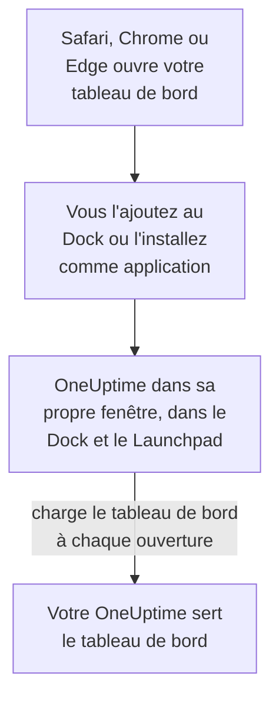

# Installation macOS

Le tableau de bord OneUptime s'installe sur un Mac comme une application : ajoutez-le au Dock depuis Safari, ou installez-le depuis Google Chrome ou Microsoft Edge. Il s'ouvre dans sa propre fenêtre, avec sa propre icône dans le Dock et le Launchpad, et peut afficher des notifications. Il n'y a rien à télécharger : l'application est le tableau de bord de votre OneUptime, et elle est à jour dès que votre OneUptime l'est.

:::cards
- [Installer l'application](#installer-lapplication): Depuis Safari, Chrome ou Edge.
- [La garder dans le Dock](#la-garder-dans-le-dock): L'ouvrir en un clic, ou à l'ouverture de session.
- [Recevoir des notifications sur ce Mac](#recevoir-des-notifications-sur-ce-mac): Enregistrer l'application pour les notifications push.
- [Dépannage](#dépannage): Pas d'Ajouter au Dock, pas de notifications, nouvelle connexion.
:::

## Comment fonctionne l'application de bureau

Une app web Safari garde sa propre connexion, ses cookies et ses réglages, à part de Safari. Une application installée depuis Chrome ou Edge les partage avec ce navigateur.

## Avant de commencer

- macOS Sonoma 14 ou version ultérieure pour Safari. Chrome et Edge installent des applications sur tout macOS où ils fonctionnent.
- L'adresse de votre OneUptime, en HTTPS : `https://oneuptime.com` sur OneUptime Cloud, ou la vôtre, par exemple `https://oneuptime.example.com`.
- Un compte avec lequel vous pouvez vous connecter au tableau de bord.

## Installer l'application

:::tabs
@tab Safari
1. Ouvrez votre OneUptime dans Safari et connectez-vous.
2. Sur n'importe quelle page du tableau de bord, choisissez **Fichier → Ajouter au Dock**, ou cliquez sur le bouton de partage de la barre d'outils, puis sur **Ajouter au Dock**.
3. Gardez le nom ou modifiez-le, puis cliquez sur **Ajouter**.
4. Ouvrez OneUptime depuis le Dock et connectez-vous une fois de plus : l'app web ne partage pas la connexion de Safari.
@tab Chrome
1. Ouvrez votre OneUptime dans Chrome et connectez-vous.
2. Sur n'importe quelle page du tableau de bord, cliquez sur l'icône d'installation à droite de la barre d'adresse, puis sur **Installer**. Ou ouvrez **⋮ → Caster, enregistrer et partager → Installer la page en tant qu'application…**.
3. Chrome ouvre OneUptime dans sa propre fenêtre et l'ajoute au Launchpad.
@tab Edge
1. Ouvrez votre OneUptime dans Edge et connectez-vous.
2. Sur n'importe quelle page du tableau de bord, cliquez sur l'icône d'installation à droite de la barre d'adresse, puis sur **Installer**. Ou ouvrez **Paramètres et plus (…) → Plus d'outils → Applications → Installer ce site en tant qu'application**.
3. Edge ouvre OneUptime dans sa propre fenêtre et l'ajoute au Launchpad.
:::

Installez depuis une page du tableau de bord, une fois connecté : la page de connexion n'est pas l'application. Safari enregistre l'app web dans le dossier Applications de votre dossier de départ.

## La garder dans le Dock

- **Dock.** Application ouverte, cliquez sur son icône du Dock en maintenant la touche Contrôle et choisissez **Options → Garder dans le Dock**. Une app web Safari est déjà dans le Dock.
- **Ouvrir à l'ouverture de session.** Cliquez sur l'icône du Dock en maintenant la touche Contrôle et choisissez **Options → Ouvrir avec la session**.
- **Spotlight.** Appuyez sur Commande-Espace et tapez OneUptime.

## Recevoir des notifications sur ce Mac

L'application affiche des notifications une fois que vous l'avez enregistrée pour les notifications push, dans chaque projet dont vous voulez les recevoir. Enregistrez l'app web Safari depuis l'intérieur de l'app web : c'est un navigateur à part entière. Une application installée depuis Chrome ou Edge est enregistrée avec son navigateur.

:::steps
### Ouvrir vos appareils push
Dans l'application, ouvrez **Paramètres utilisateur → Méthodes de notification** et l'onglet **Push Notifications**.

### Enregistrer cette application
Cliquez sur **Enregistrer l'appareil**, gardez la valeur proposée dans **Nom de l'appareil**, par exemple `Safari on macOS`, ou modifiez-la, puis cliquez de nouveau sur **Enregistrer l'appareil**. Quand macOS ou le navigateur demande si OneUptime peut envoyer des notifications, choisissez **Autoriser**.

### Envoyer un test
Dans la boîte de dialogue **Browser Registered**, cliquez sur **Send Test Notification**. Si rien n'apparaît, regardez les réglages de notification du Mac : voir [Dépannage](#dépannage).
:::

Un navigateur ne peut pas sonner malgré un mode de concentration comme Ne pas déranger. Pour les alertes qui doivent vous réveiller, utilisez l'application mobile avec les alertes critiques : voir [Installation iOS](/docs/mobile-desktop-apps/ios-installation#sonner-malgré-le-mode-silencieux).

Sur un OneUptime auto-hébergé, les notifications du navigateur demandent les clés VAPID du serveur : voir [Notifications push](/docs/self-hosted/push-notifications#configuration-auto-hébergée).

## Mises à jour

Il n'y a rien à mettre à jour. L'application charge le tableau de bord depuis votre OneUptime à chaque ouverture : elle change donc quand votre OneUptime est mis à jour. Si une fenêtre est ouverte depuis la mise à jour, rechargez-la avec Commande-R.

## Désinstaller

:::tabs
@tab Safari
Dans le Finder, ouvrez votre dossier de départ, puis son dossier Applications, et faites glisser OneUptime dans la corbeille.
@tab Chrome
Dans la fenêtre de l'application, ouvrez le menu **⋮**, choisissez l'élément qui désinstalle l'application, puis **Supprimer**.
@tab Edge
Ouvrez `edge://apps` dans Edge, choisissez **Détails** sur OneUptime, puis **Désinstaller**.
:::

Désinstaller l'application ne la désenregistre pas : son navigateur reçoit toujours des notifications. Pour les arrêter, supprimez-la sous **Paramètres utilisateur → Méthodes de notification**, dans l'onglet **Push Notifications**, avec **Supprimer**.

## Dépannage

:::details Pas d'Ajouter au Dock dans Safari
Safari ajoute des apps web au Dock à partir de macOS Sonoma 14. Mettez macOS à jour, ou installez plutôt l'application depuis Chrome ou Edge.
:::

:::details Aucune notification n'apparaît
- Dans **Paramètres utilisateur → Méthodes de notification**, onglet **Push Notifications**, vérifiez que l'application ou son navigateur est listé, et envoyez-lui une **Notification de test**.
- Sur le Mac, ouvrez **Réglages Système → Notifications** et vérifiez que OneUptime, ou le navigateur depuis lequel il a été installé, peut envoyer des notifications, et qu'aucun mode de concentration ne les retient.
- Si le navigateur bloque les notifications pour OneUptime, autorisez-les dans ses réglages pour le site, puis enregistrez à nouveau.
- Sur un OneUptime auto-hébergé, la boîte de dialogue **Enregistrer l'appareil** indique quand le serveur n'a pas de clés VAPID.
:::

:::details L'application vous demande de vous reconnecter
Une app web Safari garde sa propre connexion : connectez-vous dans l'application. Une application installée depuis Chrome ou Edge partage la connexion de son navigateur : se déconnecter dans le navigateur, ou effacer ses cookies, la déconnecte aussi.
:::

## Étapes suivantes

:::cards
- [Installation iOS](/docs/mobile-desktop-apps/ios-installation): Être alerté sur votre iPhone, avec les alertes critiques.
- [Installation Windows](/docs/mobile-desktop-apps/windows-installation): La même application sous Windows.
- [FAQ et dépannage](/docs/mobile-desktop-apps/faq-troubleshooting): Réponses sur les deux applications.
- [Votre compte](/docs/introduction/your-account): Comment OneUptime vous joint dans chaque projet.
:::
