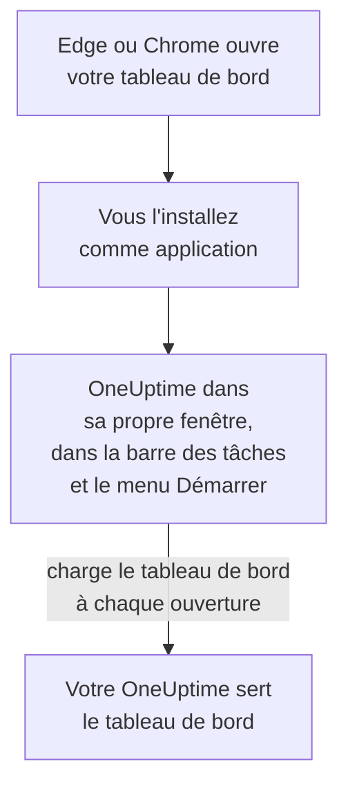

# Installation Windows

Le tableau de bord OneUptime s'installe sous Windows comme une application, depuis Microsoft Edge ou Google Chrome. Il s'ouvre dans sa propre fenêtre, avec sa propre icône dans la barre des tâches et le menu Démarrer, et peut afficher des notifications. Il n'y a rien à télécharger : l'application est le tableau de bord de votre OneUptime, et elle est à jour dès que votre OneUptime l'est.

:::cards
- [Installer l'application](#installer-lapplication): Depuis Edge ou Chrome, en quelques clics.
- [L'épingler et la lancer avec Windows](#lépingler-et-la-lancer-avec-windows): La garder à un clic.
- [Recevoir des notifications sur cet ordinateur](#recevoir-des-notifications-sur-cet-ordinateur): Enregistrer le navigateur pour les notifications push.
- [Dépannage](#dépannage): Pas d'icône d'installation, pas de notifications, nouvelle connexion.
:::

## Comment fonctionne l'application de bureau

L'application installée partage la connexion, les réglages et l'autorisation de notifications de son navigateur. Fermez le navigateur, et l'application continue de tourner dans sa propre fenêtre.

## Avant de commencer

- Windows 10 ou Windows 11, avec une version récente de Microsoft Edge ou de Google Chrome.
- L'adresse de votre OneUptime, en HTTPS : `https://oneuptime.com` sur OneUptime Cloud, ou la vôtre, par exemple `https://oneuptime.example.com`.
- Un compte avec lequel vous pouvez vous connecter au tableau de bord.

## Installer l'application

:::tabs
@tab Edge
1. Ouvrez votre OneUptime dans Edge et connectez-vous.
2. Sur n'importe quelle page du tableau de bord, cliquez sur l'icône d'installation à droite de la barre d'adresse, puis sur **Installer**. Ou ouvrez **Paramètres et plus (…) → Plus d'outils → Applications → Installer ce site en tant qu'application**.
3. Edge ouvre OneUptime dans sa propre fenêtre, et peut proposer de l'épingler à la barre des tâches ou à Démarrer.
@tab Chrome
1. Ouvrez votre OneUptime dans Chrome et connectez-vous.
2. Sur n'importe quelle page du tableau de bord, cliquez sur l'icône d'installation à droite de la barre d'adresse, puis sur **Installer**. Ou ouvrez **⋮ → Caster, enregistrer et partager → Installer la page en tant qu'application…**.
3. Chrome ouvre OneUptime dans sa propre fenêtre et l'ajoute au menu Démarrer.
:::

Installez depuis une page du tableau de bord, une fois connecté : la page de connexion n'est pas l'application. Cherchez OneUptime dans le menu Démarrer pour l'ouvrir plus tard.

## L'épingler et la lancer avec Windows

- **Barre des tâches.** Application ouverte, faites un clic droit sur son icône dans la barre des tâches et choisissez **Épingler à la barre des tâches**.
- **Lancer avec Windows.** Dans Edge, ouvrez `edge://apps`, choisissez **Détails** sur OneUptime et activez **Démarrage automatique à la connexion de l'appareil**. La même page épingle l'application à la barre des tâches ou à Démarrer, ou crée un raccourci sur le bureau.

## Recevoir des notifications sur cet ordinateur

L'application affiche des notifications par son navigateur, une fois que vous avez enregistré le navigateur pour les notifications push dans chaque projet dont vous voulez les recevoir.

:::steps
### Ouvrir vos appareils push
Dans l'application, ouvrez **Paramètres utilisateur → Méthodes de notification** et l'onglet **Push Notifications**.

### Enregistrer ce navigateur
Cliquez sur **Enregistrer l'appareil**, gardez la valeur proposée dans **Nom de l'appareil**, par exemple `Edge on Windows`, ou modifiez-la, puis cliquez de nouveau sur **Enregistrer l'appareil**. Quand le navigateur demande si OneUptime peut afficher des notifications, choisissez **Autoriser**.

### Envoyer un test
Dans la boîte de dialogue **Browser Registered**, cliquez sur **Send Test Notification**. Si rien n'apparaît, regardez les réglages de notification de Windows : voir [Dépannage](#dépannage).
:::

Un navigateur ne sonne pas plus fort que Windows ne le permet : il ne peut pas outrepasser Ne pas déranger. Pour les alertes qui doivent vous réveiller, utilisez l'application mobile avec les alertes critiques : voir [Installation Android](/docs/mobile-desktop-apps/android-installation#sonner-malgré-le-mode-silencieux) ou [Installation iOS](/docs/mobile-desktop-apps/ios-installation#sonner-malgré-le-mode-silencieux).

Sur un OneUptime auto-hébergé, les notifications du navigateur demandent les clés VAPID du serveur : voir [Notifications push](/docs/self-hosted/push-notifications#configuration-auto-hébergée).

## Mises à jour

Il n'y a rien à mettre à jour. L'application charge le tableau de bord depuis votre OneUptime à chaque ouverture : elle change donc quand votre OneUptime est mis à jour. Si une fenêtre est ouverte depuis la mise à jour, rechargez-la avec Ctrl+R.

## Désinstaller

:::tabs
@tab Edge
Ouvrez `edge://apps`, choisissez **Détails** sur OneUptime, puis **Désinstaller**.
@tab Chrome
Dans la fenêtre de l'application, ouvrez le menu **⋮**, choisissez l'élément qui désinstalle l'application, puis **Supprimer**.
:::

Windows liste aussi l'application sous **Paramètres → Applications → Applications installées**, où **Désinstaller** la supprime également.

Désinstaller l'application ne désenregistre pas son navigateur : il reçoit toujours des notifications. Pour les arrêter, supprimez le navigateur sous **Paramètres utilisateur → Méthodes de notification**, dans l'onglet **Push Notifications**, avec **Supprimer**.

## Dépannage

:::details Pas d'icône d'installation dans la barre d'adresse
Ouvrez une page du tableau de bord une fois connecté, pas la page de connexion, et vérifiez que l'adresse commence par `https://` : les navigateurs n'installent des applications que depuis des sites sécurisés. Si l'icône n'apparaît toujours pas, utilisez le menu du navigateur comme ci-dessus. D'autres navigateurs n'installent pas forcément des sites comme applications ; utilisez Edge ou Chrome.
:::

:::details Aucune notification n'apparaît
- Dans **Paramètres utilisateur → Méthodes de notification**, onglet **Push Notifications**, vérifiez que ce navigateur est listé, et envoyez-lui une **Notification de test**.
- Dans Windows, ouvrez **Paramètres → Système → Notifications** : les notifications doivent être activées, pour le navigateur aussi, et Ne pas déranger désactivé. Windows 10 nomme la page « Notifications et actions ».
- Si le navigateur bloque les notifications pour OneUptime, cliquez sur l'icône à gauche de la barre d'adresse, autorisez les notifications pour le site, et enregistrez à nouveau le navigateur.
- Sur un OneUptime auto-hébergé, la boîte de dialogue **Enregistrer l'appareil** indique quand le serveur n'a pas de clés VAPID.
:::

:::details L'application vous demande de vous reconnecter
L'application partage la connexion de son navigateur. Se déconnecter dans le navigateur, ou effacer ses cookies, déconnecte aussi l'application.
:::

## Étapes suivantes

:::cards
- [Installation macOS](/docs/mobile-desktop-apps/macos-installation): La même application sur un Mac.
- [Installation Android](/docs/mobile-desktop-apps/android-installation): Être alerté sur votre téléphone.
- [FAQ et dépannage](/docs/mobile-desktop-apps/faq-troubleshooting): Réponses sur les deux applications.
- [Votre compte](/docs/introduction/your-account): Comment OneUptime vous joint dans chaque projet.
:::
