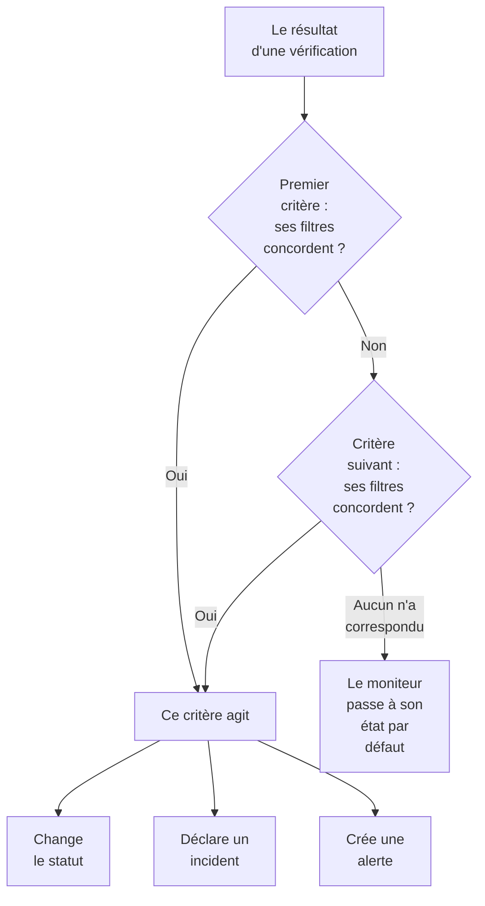
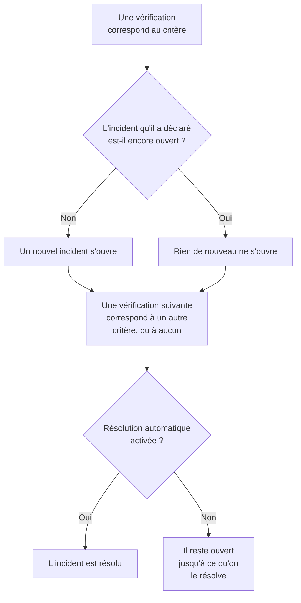

# Critères et statuts des moniteurs

Les critères d'un moniteur décident de ce que signifie chaque vérification : si le moniteur est disponible ou en panne, et si OneUptime déclare un incident ou crée une alerte. Les statuts sont la liste, propre à votre projet, de ce qu'un moniteur peut être, de **Opérationnel** à **Hors ligne**. Cette page explique les deux pour chaque type de moniteur ; la page de chaque type liste les filtres qu'il propose.

:::cards
- [Comment les critères décident](#comment-les-critères-décident): De haut en bas, et la première correspondance l'emporte.
- [Ce que contient un critère](#ce-que-contient-un-critère): Des filtres, une condition de correspondance, des actions et des paramètres.
- [Modifier les critères d'un moniteur](#modifier-les-critères-dun-moniteur): Modifier, ajouter, réordonner et tester des critères.
- [Statuts de moniteur](#statuts-de-moniteur): Les statuts intégrés, et vos propres statuts.
:::

## Comment les critères décident

À chaque vérification d'un moniteur, ses critères jugent le résultat du haut de la liste vers le bas. Le premier critère dont les filtres correspondent décide de ce qui se passe, et les critères en dessous ne sont pas examinés pour cette vérification. Si aucun ne correspond, le moniteur passe à son **État du moniteur par défaut**.

L'ordre fait partie de la règle. Un nouveau moniteur liste ses critères du pire au meilleur : hors ligne, puis un avertissement quand son type en a un (un certificat ou un domaine qui expire bientôt), puis en ligne. Un critère sain et large, comme **Is Online** réglé sur **Vrai**, correspond à presque toutes les vérifications ; il vient donc en dernier : placé au-dessus des autres, il correspondrait le premier à chaque fois et les autres n'agiraient jamais.

Un critère qui correspond sans changer de statut décide quand même de la vérification : le moniteur garde son statut, et les critères en dessous attendent la vérification suivante. L'**État du moniteur par défaut** ne s'applique que si aucun critère ne correspond. Pour un nouveau moniteur, c'est **Opérationnel** ; modifiez-le sous **Plus de champs**, sous les critères.

> [!NOTE]
> Un moniteur qui ouvre un incident ou une alerte par hôte, conteneur, disque ou interface juge tous les critères à chaque vérification, de sorte que deux hôtes peuvent correspondre à deux critères différents en même temps. C'est le cas d'un moniteur dont la requête a un **Regrouper par**, comme un moniteur de métriques ou de journaux, ou d'un critère qui indique `*` pour chaque disque ou interface. Un moniteur de requêtes entrantes qui regroupe les incidents par un champ de la charge utile s'arrête quand même à la première correspondance.

## Ce que contient un critère

Ouvrez un critère : il a un nom et trois sections, chacune se repliant en un résumé d'une ligne.

| Partie | Ce qu'elle contient |
| --- | --- |
| **Nom des critères** | Le nom dans la liste des critères, et dans la cause racine de chaque incident et alerte que le critère ouvre. **Ajouter un critère** nomme un nouveau critère d'après ses filtres, et le nom les suit jusqu'à ce que vous en saisissiez un vous-même. |
| **Filtres** | Ce que la vérification doit montrer, sous forme d'un ou plusieurs filtres. Les moniteurs Kubernetes et de métriques les appellent **Règles d'alerte**. |
| **Actions** | Ce qui se passe quand les filtres correspondent : changer le statut, créer une alerte, déclarer un incident, ou toute combinaison. |
| **Paramètres** | **Activer ce critère**, une **Description** facultative et, sur les moniteurs de requêtes entrantes, **Regrouper les incidents et alertes par un champ de la charge utile**. |

### Filtres

Un filtre lit une donnée de la vérification et la compare : un **Type de filtre** (ce qui est lu, comme **Code de statut de la réponse**), une **Condition de filtre** (comment comparer, comme **Supérieur à**) et une **Valeur**. Les moniteurs qui comparent des métriques, comme les moniteurs Kubernetes et de métriques, demandent plutôt une **Condition** et un **Seuil**. Chaque type de moniteur propose ses propres types de filtre, listés sur sa page, par exemple [Surveillance de site web](/docs/monitor/website-monitor#critères-de-surveillance).

À partir de deux filtres, la **Condition de correspondance** apparaît en dessous : **Tous** signifie que chaque filtre doit correspondre, **Au moins un** qu'un seul suffit. Un nouveau critère commence sur **Tous**.

Les filtres qui mesurent chaque vérification, comme **Is Online**, **Code de statut de la réponse** et **Temps de réponse (en ms)**, proposent **Évaluer ce critère sur une période donnée**. Il juge une fenêtre de vérifications récentes au lieu de la dernière seule, et commence sur les 5 dernières minutes avec **All Values**, qui ne correspond qu'une fois que chaque vérification de la fenêtre a correspondu. Voir [Évaluer sur une période](/docs/monitor/website-monitor#évaluer-sur-une-période).

### Actions

Chaque action est un interrupteur sous **Actions** :

| Interrupteur | Ce qu'il fait |
| --- | --- |
| **Lorsque les filtres correspondent, modifier le statut du moniteur.** | Fait passer le moniteur au statut choisi dans **Modifier le statut du moniteur en**. |
| **Lorsque les filtres correspondent, créer une alerte.** | Crée les alertes configurées sous **Créer une alerte**. Une alerte prévient votre équipe et n'apparaît jamais sur une page de statut. |
| **Lorsque les filtres correspondent, déclarer un incident.** | Déclare les incidents configurés sous **Créer un incident**. Vos pages de statut peuvent les afficher. |

Un incident ou une alerte demande un titre, une **Gravité** et, repliés, une description, des propriétaires, des libellés et des politiques d'astreinte. Les titres et les descriptions peuvent contenir des valeurs issues de la vérification, comme `{{monitorName}}` : voir [Modèles d'incident et d'alerte](/docs/monitor/incident-alert-templating). Pour alerter quelqu'un quand le critère correspond, choisissez une politique sous **Astreinte** : voir [Politiques d'astreinte](/docs/on-call/policies).

### Paramètres

**Activer ce critère** est activé pour tout nouveau critère. Désactivez-le pour garder un critère sans l'utiliser : il est ignoré à chaque vérification, ne change aucun statut, n'ouvre rien, et son en-tête affiche **Désactivé**.

**Regrouper les incidents et alertes par un champ de la charge utile** ouvre un incident par valeur trouvée dans une requête entrante, de sorte qu'une seule adresse de webhook peut garder plusieurs incidents ouverts. Voir [Activer le regroupement des incidents](/docs/monitor/incoming-request-monitor#activer-le-regroupement-dincidents).

## Quand les incidents et les alertes s'ouvrent et se ferment

Un critère qui déclare des incidents en ouvre un quand il correspond. Une fois le moniteur rétabli, l'incident se ferme de lui-même si le critère le prévoit.

- **Un à la fois.** Tant qu'un incident déclaré par un critère est encore ouvert, le même critère qui correspond à nouveau n'en déclare pas d'autre. Les alertes fonctionnent de la même façon. Un moniteur qui regroupe par hôte ou par champ de la charge utile en garde un ouvert par hôte ou par valeur, et un critère de moniteur d'e-mails entrants avec **Ouvrir un nouvel incident pour chaque e-mail** en ouvre un par e-mail.
- **La fermeture.** Lors d'une vérification suivante où un autre critère correspond, ou aucun, un incident dont le critère a **Résoudre automatiquement l'incident** activé est résolu, de même qu'une alerte avec **Résoudre automatiquement l'alerte**. Les deux se trouvent sous **Plus de champs** dans l'incident ou l'alerte, et les critères avec lesquels démarre un nouveau moniteur les ont activés.
- **Plusieurs sondes.** Un moniteur vérifié par plus d'une sonde ne change que lorsque ses sondes sont d'accord. Voir [Comment les critères sont évalués](/docs/monitor/create-monitor#comment-les-critères-sont-évalués).
- **Un moniteur parent en panne.** Sur la page **Configuration → Dépendances** d'un moniteur, **Dépend des moniteurs** nomme les moniteurs dont il dépend. Tant que l'un d'eux est dans un statut listé dans **Suppress When Parent Status Is** (n'importe quel statut hors ligne, si ce champ reste vide), le moniteur n'ouvre ni incident ni alerte. Son statut change toujours, et ce qui est ouvert se résout toujours.
- **La maintenance planifiée.** Un moniteur pris dans un événement de maintenance en cours n'est pas vérifié, donc ses critères ne s'exécutent pas. Voir [Vue d'ensemble de la maintenance planifiée](/docs/scheduled-maintenance/index).

Pour voir comment une vérification a été jugée, ouvrez la **Vue d'ensemble** du moniteur : la carte **Résumé du moniteur** montre quel critère a correspondu et ce que chacun a fait, y compris un incident ignoré parce qu'un autre était déjà ouvert.

## Modifier les critères d'un moniteur

:::steps
### Ouvrir la page des critères

Allez dans **Moniteurs** et ouvrez le moniteur. Dépliez **Configuration** dans son menu latéral et cliquez sur **Critères**. La carte **Critères de surveillance** montre chaque critère, ce qu'il vérifie et ce qu'il fait.

### Cliquer sur Modifier les critères de surveillance

L'éditeur affiche chaque critère déplié. Cliquez sur l'en-tête d'un critère pour le replier sur une ligne : son nom, son nombre de filtres et ce qu'il fait.

### Ajouter, modifier ou réordonner des critères

**Ajouter un critère** en ajoute un en bas, déplié et nommé d'après son filtre. Faites glisser un critère par la poignée à sa gauche pour le déplacer : la première correspondance l'emporte, placez donc le pire cas en premier. **Supprimer le critère** en retire un ; un moniteur garde au moins un critère.

### Enregistrer les critères

Cliquez sur **Enregistrer les modifications**. La vérification suivante est jugée selon les nouveaux critères.

### Tester le moniteur

Sur un moniteur vérifié par des sondes, cliquez sur **Tester le moniteur** sur la carte, choisissez une sonde sous **Sélectionner la sonde** et cliquez sur **Exécuter le test**. **Résultat du test du moniteur** montre ce que la vérification a trouvé.
:::

Un moniteur manuel n'a pas de critères : vous définissez son statut vous-même. Voir [Mettre à jour le statut](/docs/monitor/manual-monitor#mettre-à-jour-létat).

## Statuts de moniteur

Un moniteur est toujours dans l'un des statuts de votre projet. Un nouveau projet en a trois, du plus sain au pire :

| Statut | Place | Couleur | Ce que OneUptime en fait |
| --- | --- | --- | --- |
| **Opérationnel** | 1 | Vert | Les nouveaux moniteurs commencent dans ce statut, et c'est l'**État du moniteur par défaut** d'un nouveau moniteur. Intégré. |
| **Dégradé** | 2 | Jaune | Rien de lui-même : c'est un de vos critères qui y place un moniteur. |
| **Hors ligne** | 3 | Rouge | Le critère hors ligne d'un nouveau moniteur l'y place, et OneUptime considère un moniteur dans ce statut comme en panne. Intégré. |

La liste est un ordre. Là où des moniteurs sont affichés ensemble, le statut le plus bas dans la liste l'emporte : un groupe de moniteurs, un groupe de page de statut et le statut global d'une page de statut affichent chacun le pire statut de leurs moniteurs.

### Où un statut compte

| Où | Ce que le statut décide |
| --- | --- |
| La liste **Moniteurs** | Le statut actuel de chaque moniteur. **Non opérationnel** liste les moniteurs dans n'importe quel statut sauf l'opérationnel, avec un compteur rouge à côté. |
| Pages de statut | La couleur de chaque ligne, et sa disponibilité : seuls les statuts de **Compte comme indisponibilité** de la page comptent contre elle. Une nouvelle page de statut commence avec tous les statuts sauf l'opérationnel. Voir [Choisir ce qui s'affiche sur la page](/docs/status-pages/index#choisir-ce-qui-saffiche-sur-la-page). |
| Groupes de moniteurs | Le statut du groupe : le pire de ses moniteurs. Voir [Groupes de moniteurs](/docs/monitor/monitor-groups). |
| SLO | L'indisponibilité qu'un SLO compte, d'après sa propre liste de statuts. Voir [Quels statuts comptent comme indisponibilité](/docs/slo/introduction#quels-statuts-comptent-comme-indisponibilité). |
| Dépendances | Si un moniteur parent retient les incidents et alertes de ses moniteurs dépendants : par défaut, tant qu'il est dans un statut hors ligne. |

Un statut que vous ajoutez plus tard n'est pas ajouté à la liste **Compte comme indisponibilité** d'une page de statut existante : ajoutez-le vous-même.

### Ajouter votre propre statut

:::steps
### Ouvrir Statut du moniteur

Allez dans **Moniteurs → Paramètres → Statut du moniteur**. **Paramètres** est replié dans le menu latéral : dépliez-le d'abord. La carte **Statuts de moniteur** liste les statuts du plus sain au pire.

### Créer le statut

Cliquez sur **Créer : Statut du moniteur** et renseignez **Nom**, **Description** et **Couleur**. Le nouveau statut se place juste au-dessus du statut hors ligne, pour qu'une panne reste le pire.

### Le mettre à sa place

Faites glisser le statut par sa poignée. Un statut plus bas dans la liste est considéré comme pire que tous les statuts au-dessus.

### L'utiliser dans un critère

Un statut ne fait rien tant qu'aucun critère n'y place de moniteurs. Choisissez-le dans **Modifier le statut du moniteur en** sur le critère qui doit le définir.
:::

Les statuts opérationnel et hors ligne sont marqués **Intégré** : vous pouvez les renommer et changer leur couleur, mais pas les supprimer. Sur OneUptime Cloud, créer ou modifier un statut nécessite le plan Growth. Gérer les statuts demande le rôle Project Owner, Project Admin ou Monitor Admin, ou un rôle personnalisé avec l'autorisation de statut de moniteur correspondante.

### La chronologie des statuts

Chaque changement de statut est conservé dans la **Chronologie de statut** du moniteur : quand il a commencé, combien de temps il a duré, et **Voir la cause** pour le critère qui l'a défini. **Créer : Événement de statut du moniteur** ajoute un statut à la main. Sur un moniteur vérifié par des sondes, la vérification suivante qui correspond à un critère avec un statut redéfinit ce statut.

Un changement de statut ne notifie les propriétaires du moniteur que s'ils ont activé **Statut du moniteur modifié** dans leurs paramètres de notification : c'est désactivé au départ. Un moniteur qui revient à son **État du moniteur par défaut** parce qu'aucun critère n'a correspondu ne notifie personne. Voir [Ce qui est activé pour un nouveau membre](/docs/notifications/notification-settings#ce-qui-est-activé-pour-un-nouveau-membre).

## Archiver un statut de moniteur

Archivez un statut que votre équipe ne doit plus utiliser, au lieu de le supprimer. L'archivage ne modifie aucun moniteur : un moniteur avec ce statut le garde jusqu'à ce que son statut change, et sa chronologie de statuts l'affiche toujours.

- **Archiver** se trouve dans le menu **⋯** de la ligne. Il demande d'abord confirmation et liste les critères de moniteur, modèles et pages de statut configurés pour utiliser le statut : ils continuent à l'utiliser tant que vous ne les modifiez pas.
- **Personne ne peut plus le choisir.** Un critère, le menu de statut d'un moniteur, le statut de moniteur d'un incident ou d'un événement de maintenance et les statuts d'indisponibilité d'une page de statut l'excluent. L'API, Terraform et MCP le refusent.
- **Les statuts archivés sont listés à part**, dans la section repliée **Statuts de moniteur archivés** sous le tableau. **Désarchiver** en remet un tel qu'il était.
- **Les statuts intégrés ne peuvent pas être archivés.** Les nouveaux moniteurs commencent avec le statut opérationnel, et OneUptime considère qu'un moniteur avec le statut hors ligne est hors service. Leur **Archiver** est verrouillé, avec la raison.

## Dépannage

:::details Le site est en panne, mais le moniteur reste opérationnel
Un critère plus haut dans la liste a correspondu en premier. Ouvrez **Configuration → Critères** et vérifiez l'ordre : le critère sain vient en dernier. Vérifiez aussi que le critère hors ligne a **Activer ce critère** activé, et que son action **Lorsque les filtres correspondent, modifier le statut du moniteur.** est activée avec un statut choisi.
:::

:::details Aucun incident ne s'est ouvert quand le moniteur est tombé
Vérifiez le critère qui a correspondu : **Lorsque les filtres correspondent, déclarer un incident.** doit être activé. Un incident n'est pas déclaré tant que l'incident du même critère est encore ouvert, tant qu'un moniteur parent de **Dépend des moniteurs** est en panne, ou tant que le moniteur est en maintenance planifiée. La carte **Résumé du moniteur** de la **Vue d'ensemble** du moniteur indique lequel.
:::

:::details L'incident reste ouvert après le rétablissement du moniteur
Ouvrez le critère de l'incident et dépliez **Plus de champs** dans son incident : **Résoudre automatiquement l'incident** doit être activé. Un incident issu d'un critère que vous avez supprimé depuis n'est pas résolu par le moniteur : résolvez-le à la main.
:::

:::details Le bouton de suppression de Hors ligne est verrouillé
**Opérationnel** et **Hors ligne** sont intégrés : OneUptime y place des moniteurs, ils peuvent donc être renommés mais pas supprimés. Supprimez plutôt l'un de vos propres statuts, ou renommez le statut intégré.
:::

## Étapes suivantes

:::cards
- [Créer un moniteur](/docs/monitor/create-monitor): Les trois étapes d'un nouveau moniteur.
- [Modèles d'incident et d'alerte](/docs/monitor/incident-alert-templating): Insérer des valeurs de la vérification dans les titres et descriptions.
- [Groupes de moniteurs](/docs/monitor/monitor-groups): Regrouper plusieurs moniteurs en un seul statut.
- [Vue d'ensemble des incidents](/docs/incidents/index): Ce qui se passe après qu'un critère a déclaré un incident.
:::
