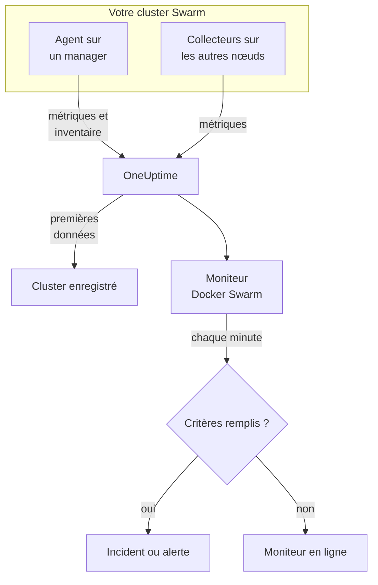

# Surveillance Docker Swarm

Un moniteur Docker Swarm surveille les conteneurs derrière les tâches de service d'un cluster Swarm et vous prévient quand une tâche redémarre, chauffe ou manque de mémoire. Il lit les métriques de conteneurs qu'envoie l'agent Docker Swarm de OneUptime, si bien que rien n'est sondé depuis l'extérieur : installez l'agent, puis créez le moniteur à partir d'un modèle ou de votre propre requête.

À partir de la version 0.161.3 de ses fichiers, l'agent envoie aussi chaque minute l'état du swarm lui-même, si bien qu'un moniteur peut surveiller les nœuds et les services eux-mêmes : un nœud qui n'est pas prêt, ou un service qui exécute moins de réplicas qu'il n'en veut.

:::cards
- [Créer le moniteur](#créer-un-moniteur-docker-swarm): Six étapes dans le tableau de bord.
- [Modèles](#modèles-dalerte-prêts-à-lemploi): Sept alertes prêtes à l'emploi, un incident par nœud, service ou tâche.
- [Métriques](#métriques-collectées): Les métriques de conteneurs sur lesquelles vous pouvez alerter.
- [Filtres](#paramètres-du-moniteur): Restreindre un moniteur à un service, une tâche ou une image.
:::

## Fonctionnement

L'agent Docker Swarm de OneUptime s'exécute sur un nœud manager. Son collecteur lit les statistiques des conteneurs auprès du démon Docker de ce nœud toutes les 30 secondes, marque chaque lot du nom du cluster, `docker.swarm.cluster.name`, et les métriques de chaque tâche de son service et de son nœud. Un petit collecteur d'inventaire à ses côtés lit les nœuds, services et tâches du cluster via l'API Swarm toutes les 5 minutes. Les premières données enregistrent le cluster dans OneUptime.

Chaque minute, le collecteur d'inventaire lit aussi auprès du manager si chaque nœud est prêt et combien de réplicas chaque service veut et exécute, et les envoie sous forme de métriques. C'est ainsi que **Node Not Ready** et **Service Replicas Mismatch** apprennent qu'un nœud ou un service a un problème en une ou deux minutes, et non en cinq.

Le collecteur ne voit que les conteneurs du nœud sur lequel il tourne. Pour obtenir les métriques de chaque nœud, exécutez le collecteur sur chaque nœud avec le même `DOCKER_SWARM_CLUSTER_NAME`.

Un moniteur Docker Swarm est lié à un cluster. Chaque minute, il exécute sa requête sur les métriques des conteneurs de ce cluster et compare le résultat à ses critères.

## Avant de commencer

- **Installez l'agent Docker Swarm** sur un nœud manager. Le [guide de l'agent Docker Swarm](/docs/telemetry/docker-swarm) couvre son installation et sa mise à jour, ainsi que l'exécution du collecteur sur les autres nœuds.
- **Vérifiez que le cluster est enregistré.** Il apparaît sous **Produits → Infrastructure → Docker Swarm → Tous les clusters**, nommé d'après le `DOCKER_SWARM_CLUSTER_NAME` de l'agent, dès l'arrivée de ses premières données.

## Créer un moniteur Docker Swarm

:::steps
### Commencer un nouveau moniteur

Allez dans **Moniteurs** et cliquez sur **Créer un moniteur**.

### Choisir Docker Swarm

Sous **Type de moniteur**, cliquez sur **Plus de types de moniteurs** et choisissez **Docker Swarm** sous **Infrastructure**, ou tapez `swarm` dans le champ de recherche. Saisissez un **Nom** – il est utilisé dans les titres des incidents et des alertes – et cliquez sur **Suivant**.

### Choisir le cluster

Sous **Configuration du moniteur Docker Swarm**, choisissez le cluster dans **Cluster Docker Swarm**. Chaque cluster qui a envoyé des données figure dans la liste. Une fois le choix fait, une ligne sous le champ indique si des données arrivent. **Ajouter un cluster Docker Swarm** ouvre des étapes de configuration avec vos clés déjà renseignées, qui attendent les premières données.

### Choisir ce qu'il faut surveiller

Un nouveau moniteur démarre sur **Cluster Stopped Reporting**, sous **Sur quoi alerter**. Pour surveiller autre chose :

- **Modifier** – choisissez un autre [modèle](#modèles-dalerte-prêts-à-lemploi). Il définit la métrique, l'agrégation, la plage temporelle et les seuils, et remplace les critères plus bas par les siens. Vous pouvez toujours changer la **Plage temporelle**.
- **Custom Metric** (sous **Plus de champs**) – choisissez une métrique dans **Métrique Docker Swarm**, puis définissez l'**Agrégation** et la **Plage temporelle**. Les [filtres](#paramètres-du-moniteur) la restreignent à certaines tâches.
- **Avancé** (sous **Plus de champs**) – construisez vous-même des requêtes et des formules sous **Sélectionner les métriques**. Utilisez **Regrouper par** `resource.container.name` pour juger chaque tâche séparément.

### Vérifier les critères

Ouvrez chaque critère sous **Critères** et vérifiez sa **Métrique**, son **Agrégation**, sa **Condition** et son **Seuil**. Un modèle les remplit. Avec **Custom Metric** ou **Avancé**, le moniteur commence avec les [critères par défaut](#critères-par-défaut), qui ne remarquent qu'une métrique qui n'envoie plus de données ; définissez donc votre propre seuil.

### Créer le moniteur

Cliquez sur **Créer un moniteur**. OneUptime ouvre la page du moniteur et l'évalue chaque minute. Les incidents et alertes qu'il déclenche sont aussi listés sur les pages **Incidents** et **Alertes** du cluster.
:::

> [!TIP]
> Pour configurer plusieurs modèles à la fois, ouvrez le cluster depuis **Produits → Infrastructure → Docker Swarm** et allez dans **Recommandations**. Choisissez les modèles voulus, choisissez qui est alerté, et OneUptime crée un moniteur par modèle.

## Paramètres du moniteur

| Champ | Onglet | Ce qu'il fait |
| --- | --- | --- |
| **Cluster Docker Swarm** | Tous | Obligatoire. Limite chaque requête à `resource.docker.swarm.cluster.name`. Les métriques d'une tâche portent `container.runtime=docker` comme celles d'un hôte Docker, et l'agent n'appose jamais `host.name` : le moniteur ne filtre donc sur aucun des deux. |
| **Nom du service** | Custom Metric, Avancé | Facultatif. Correspondance exacte sur `resource.docker.swarm.service.name`, le service tel que le nomme `docker service ls`, par exemple `web` (`<stack>_web` dans une stack). |
| **Nom du nœud** | Custom Metric, Avancé | Facultatif. Correspondance exacte sur `resource.docker.swarm.node.name`, le nom d'hôte du nœud tel que l'affiche `docker node ls`, par exemple `swarm-node-1`. L'agent de ce nœud l'appose à partir de `DOCKER_SWARM_NODE_NAME`. |
| **Nom du conteneur** | Custom Metric, Avancé | Facultatif. Correspondance exacte sur `resource.container.name`. Le conteneur d'une tâche s'appelle `<service>.<slot>.<taskid>`, par exemple `web.1.abc123`. |
| **Image du conteneur** | Custom Metric, Avancé | Facultatif. Correspond à `resource.container.image.name`, avec ou sans le digest que Swarm épingle à l'image : `nginx:latest` correspond aussi à `nginx:latest@sha256:…`, un digest que vous saisissez est ignoré, et un nom sans tag signifie `:latest`. |
| **Métrique Docker Swarm** | Custom Metric | Une métrique du [catalogue](#métriques-collectées). |
| **Agrégation** | Custom Metric | Comment les mesures sont combinées : **Moyenne**, **Maximum**, **Minimum**, **Somme** ou **Comptage**. Commence à l'agrégation habituelle de la métrique. |
| **Plage temporelle** | Tous | La fenêtre glissante que lit la requête, de **Past 1 Minute** à **Past 365 Days**. Un nouveau moniteur commence à **Past 1 Minute** ; les modèles définissent la leur. |
| **Sélectionner les métriques** | Avancé | Le constructeur de requêtes : **Métrique**, **Agréger par**, **Filtrer par attributs**, **Regrouper par**, plus **Ajouter une métrique** et **Ajouter une formule** pour combiner des requêtes. |

> [!NOTE]
> **Nom du service** et **Nom du nœud** nécessitent les fichiers de l'agent à partir de la version 0.161.2 : les plus anciens n'envoient ni le service ni le nœud. [Mettez à jour l'agent](/docs/telemetry/docker-swarm#mettre-à-jour-lagent) sur chaque nœud où il tourne.

## Modèles d'alerte prêts à l'emploi

La liste **Sur quoi alerter** propose sept modèles. Chacun construit un moniteur complet : une requête, un critère qui se déclenche et un autre qui rétablit. **Node Not Ready** regroupe sa requête par nœud, `resource.docker.swarm.node.name`, **Service Replicas Mismatch** par service, `resource.docker.swarm.service.name`, et les modèles de tâche par `resource.container.name`, si bien que chaque nœud, service ou tâche est jugé à part et obtient son propre incident et sa propre alerte, dont la cause racine liste ceux qui sont touchés et leurs valeurs. Les seuils sont des points de départ que vous pouvez modifier.

Les modèles de tâche ne lisent en outre que les tâches de Swarm : un conteneur démarré autrement sur un nœud, dont celui de l'agent lui-même, est laissé de côté. Une requête **Custom Metric** ou **Avancé** lit chaque conteneur que l'agent signale ; le filtre **Nom du service** la restreint aux tâches d'un seul service.

Sauf indication contraire dans le tableau, un critère ne se déclenche que si la condition est remplie à chaque minute de sa fenêtre, et il se rétablit 10 % au-delà du seuil pour qu'une valeur qui oscille autour de la limite ne bascule pas sans cesse.

| Modèle | Gravité | Surveille | Se déclenche quand | Se rétablit quand |
| --- | --- | --- | --- | --- |
| Cluster Stopped Reporting | Critique | `container.memory.percent`, Count sur tous les conteneurs du cluster, 10 dernières minutes | Aucune donnée pendant toute la fenêtre | Des données arrivent de nouveau |
| Node Not Ready | Critique | `docker.swarm.node.ready`, Min par `resource.docker.swarm.node.name`, 5 dernières minutes | Sous 1 | À 1 |
| Service Replicas Mismatch | Avertissement | `docker.swarm.service.replicas.desired` − `docker.swarm.service.replicas.running` (les deux en Avg) par `resource.docker.swarm.service.name`, 15 dernières minutes | Au-dessus de 0 | À 0 ou moins |
| Task Down (Low Uptime) | Critique | `container.uptime`, Min par tâche, dernière 1 minute | Une valeur quelconque est sous 60 secondes | Chaque valeur est à 66 secondes ou plus |
| High Task CPU Usage | Avertissement | `container.cpu.utilization`, Avg par tâche, 5 dernières minutes | Au-dessus de 80 (% d'un cœur) | À 72 ou moins |
| High Task Memory Usage | Avertissement | `container.memory.percent`, Avg par tâche, 5 dernières minutes | Au-dessus de 85 % | À 76,5 % ou moins |
| High Task Process Count | Avertissement | `container.pids.count`, Max par tâche, 5 dernières minutes | Au-dessus de 2000 | À 1800 ou moins |

**Gravité** est le libellé qu'affiche le sélecteur. L'incident et l'alerte qu'un modèle crée commencent avec la gravité d'incident et d'alerte la plus élevée de votre projet ; changez-les dans les critères.

> [!NOTE]
> **Cluster Stopped Reporting** se déclenche quand rien n'arrive du cluster pendant dix minutes : les nœuds qui exécutent l'agent sont en panne, ou l'agent s'est arrêté, a perdu sa connexion à OneUptime ou a vu son jeton révoqué. Il se résout dès que les données reviennent. Quand les données cessent d'arriver, les autres modèles n'ont plus rien à comparer et gardent leur dernier état ; c'est donc lui qui vous prévient. Un nœud sans tâche envoie quand même des données, car l'agent s'exécute lui-même comme conteneur et remonte les siennes.

> [!NOTE]
> **Task Down (Low Uptime)** se déclenche sur une seule mesure récente, car un redémarrage est un événement, pas un niveau. Swarm donne à une tâche de remplacement un nouveau conteneur, donc une nouvelle série ; c'est pourquoi le modèle cherche une durée de fonctionnement inférieure à une minute plutôt qu'un 0. Un déploiement ou une montée en charge le déclenche aussi, et il se rétablit une fois que les nouvelles tâches dépassent une minute de fonctionnement. Une tâche qui meurt sans être remplacée n'envoie rien et n'est donc pas détectée.

> [!NOTE]
> **Node Not Ready** et **Service Replicas Mismatch** lisent les séries que le collecteur d'inventaire de l'agent envoie depuis un manager, à partir de la version 0.161.3 de ses fichiers. Un agent plus ancien n'envoie ni l'une ni l'autre, si bien que les deux modèles n'ont rien à lire et ne se déclenchent jamais : [mettez à jour l'agent](/docs/telemetry/docker-swarm#mettre-à-jour-lagent) ; un signe à côté de sa version dans la vue d'ensemble du cluster indique quand il est en retard. Service Replicas Mismatch attend quinze minutes, pour qu'une mise à jour progressive, qui remplace les tâches d'un service quelques-unes à la fois, ne déclenche pas d'alerte. Un service de type job exécute ses tâches jusqu'au bout, n'a pas de réplicas qui pourraient manquer, et il est laissé de côté.

## Métriques collectées

Le collecteur de l'agent utilise le récepteur OpenTelemetry `docker_stats` ; les métriques sont donc les métriques de conteneurs standard, une série par conteneur de tâche. Il n'existe pas de métriques `docker_swarm_*` : les nœuds, services et tâches sont suivis comme inventaire, sur les pages **Services**, **Tâches**, **Nœuds** et apparentées du cluster.

À côté d'elles, à partir de la version 0.161.3 de ses fichiers, le collecteur d'inventaire de l'agent envoie chaque minute l'état du swarm lui-même : les trois métriques sous [Swarm](#swarm).

### CPU

| Métrique | Unité | Description |
| --- | --- | --- |
| `container.cpu.utilization` | % | CPU utilisé par le conteneur d'une tâche sur chaque intervalle de 30 secondes, où 100 % correspond à un cœur de CPU complet. |

### Mémoire

| Métrique | Unité | Description |
| --- | --- | --- |
| `container.memory.usage.total` | bytes | Mémoire utilisée par le conteneur d'une tâche. |
| `container.memory.percent` | % | Mémoire utilisée en pourcentage de la limite du conteneur, ou de la mémoire totale du nœud quand le service ne fixe pas de limite. |

### Réseau

| Métrique | Unité | Description |
| --- | --- | --- |
| `container.network.io.usage.rx_bytes` | bytes | Octets reçus par le conteneur d'une tâche. Un compteur sur toute la durée de vie. |
| `container.network.io.usage.tx_bytes` | bytes | Octets envoyés par le conteneur d'une tâche. Un compteur sur toute la durée de vie. |

### Conteneur

| Métrique | Unité | Description |
| --- | --- | --- |
| `container.pids.count` | count | Tâches dans le conteneur d'une tâche : le contrôleur pids du cgroup compte les threads aussi bien que les processus. Une hausse soudaine peut signaler une fork bomb ou une fuite de threads. |
| `container.uptime` | secondes | Depuis combien de temps le conteneur d'une tâche tourne. Une tâche replanifiée ou redémarrée démarre un nouveau conteneur à 0. |

Chaque série porte l'identité du conteneur comme attributs de ressource : `resource.container.name` (`<service>.<slot>.<taskid>`), `resource.container.image.name`, `resource.docker.swarm.service.name`, `resource.docker.swarm.node.id`, `resource.docker.swarm.node.name` (quand l'agent connaît le nom du nœud) et `resource.docker.swarm.cluster.name`.

### Swarm

| Métrique | Unité | Description |
| --- | --- | --- |
| `docker.swarm.node.ready` | — | Si un nœud est prêt, tel que les managers le voient : 1 tant qu'il l'est, 0 tant qu'il est arrêté, déconnecté ou inconnu. Une série par nœud. |
| `docker.swarm.service.replicas.desired` | count | Les tâches qu'un service répliqué ou global veut exécuter : ses réplicas, ou pour un service global les nœuds sur lesquels il doit tourner. Une série par service. |
| `docker.swarm.service.replicas.running` | count | Les tâches du service qui sont en cours d'exécution. En dessous du nombre voulu, le service manque de réplicas. |

La série d'un nœud porte `resource.docker.swarm.node.name`, `resource.docker.swarm.node.id` et `resource.docker.swarm.node.role` ; celle d'un service porte `resource.docker.swarm.service.name`, `resource.docker.swarm.service.mode` et, dans une stack, `resource.docker.swarm.stack.namespace`. Les deux portent `resource.docker.swarm.cluster.name`.

## Critères de surveillance

Un critère compare l'une des requêtes ou formules du moniteur à un seuil. Les critères d'un moniteur Docker Swarm n'ont pas de **Type de filtre** : chaque règle vérifie la valeur de la métrique, avec ces champs.

| Champ | Ce qu'il fait |
| --- | --- |
| **Métrique** | La requête ou la formule à vérifier, par son nom de variable. |
| **Agrégation** | Comment les valeurs de la fenêtre deviennent une seule réponse : **Moyenne**, **Somme**, **Valeur maximale**, **Valeur minimale**, **Toutes les valeurs** (chaque valeur doit correspondre, sur toute la fenêtre) ou **Au moins une valeur** (une seule suffit). |
| **Condition** | **Supérieur à**, **Inférieur à**, **Supérieur ou égal à**, **Inférieur ou égal à** ou **Égal à** – ou une condition d'anomalie : **Anormalement élevé**, **Anormalement bas** ou **Anormal**. **Aucune donnée** est vraie quand la requête n'a rien renvoyé dans la fenêtre, **Données reçues** quand elle a renvoyé quelque chose. **Devrait dépasser** et **Devrait passer sous** correspondent quand la tendance de la métrique sur la fenêtre aura franchi le seuil à la fin de **Horizon**. |
| **Seuil** | La valeur de comparaison. Une liste d'unités se trouve à côté quand la métrique a une unité. Non affiché pour les conditions d'anomalie. |
| **Sensibilité** | Conditions d'anomalie uniquement. **Faible** (4σ), **Moyen** (3σ, la valeur par défaut) ou **Élevé** (2σ). |
| **Fenêtre de référence** | Conditions d'anomalie uniquement. 14 jours (la valeur par défaut), 28, 60 ou 90 jours d'historique. |
| **En l'absence de données** | Sous **Plus de champs**. Ce qui se passe quand la fenêtre n'a aucune mesure : **Ignore** (par défaut), **Treat As Zero** ou **Déclencheur**. |

Les conditions d'anomalie comparent chaque valeur à la même heure de la semaine dans la référence. Elles restent dans un état « Learning », et ne déclenchent rien, tant que la fenêtre de référence ne contient pas assez d'historique. Ce moniteur filtre ses requêtes par attributs, donc chaque requête, et chaque série d'une requête regroupée, est comparée à son propre historique, aussi loin que vos métriques sont conservées. Si c'est moins de deux semaines, une somme, un décompte ou une requête sur un histogramme reste dans cet état pour de bon, et tout le reste est comparé à toutes les séries de la métrique. Un centile d'un histogramme reste toujours dans cet état.

Chaque critère indique aussi quoi faire quand il correspond : changer le statut du moniteur, créer une alerte ou déclarer un incident. Les critères sont vérifiés de haut en bas, et le premier qui correspond l'emporte.

### Critères par défaut

Un moniteur que vous ne créez pas à partir d'un modèle commence avec deux critères :

| Ordre | Critère | Correspond quand | Ensuite |
| --- | --- | --- | --- |
| 1 | Check if _monitor name_ is offline | La première requête n'a aucune donnée sur toute la fenêtre | Marque le moniteur **Hors ligne** et déclare l'incident « _monitor name_ is offline », qui se résout de lui-même quand le moniteur se rétablit. |
| 2 | Check if _monitor name_ is online | La première requête a des données | Marque le moniteur **Opérationnel**. |

> [!IMPORTANT]
> Une valeur de `0` est une donnée : une métrique souvent nulle, comme les redémarrages ou les erreurs, ne met pas le moniteur hors ligne. Pour être alerté sur une valeur, partez d'un modèle ou ajoutez un critère avec un seuil. Quand aucune donnée n'arrive et qu'aucun critère ne correspond, le moniteur garde son statut et les incidents ouverts restent ouverts : le silence n'est pas un rétablissement. Le temps où OneUptime lui-même ne recevait rien ne compte jamais comme une absence de données : une vérification dont la fenêtre en contient attend, comme l'explique [Quand OneUptime ne reçoit pas de données](/docs/monitor/when-oneuptime-is-not-receiving).

## Dépannage

:::details Le cluster n'est pas dans la liste Cluster Docker Swarm
Les clusters s'enregistrent eux-mêmes à partir des données de l'agent. Vérifiez que l'agent tourne sur un nœud manager, que `DOCKER_SWARM_CLUSTER_NAME` est défini et que le cluster figure sous **Produits → Infrastructure → Docker Swarm → Tous les clusters**. Le [guide de l'agent Docker Swarm](/docs/telemetry/docker-swarm) contient les vérifications à exécuter sur le nœud.
:::

:::details Seules certaines tâches ont des métriques
Le collecteur lit le démon Docker du nœud sur lequel il tourne, il ne voit donc que les tâches de ce nœud. Exécutez le collecteur sur chaque nœud avec le même `DOCKER_SWARM_CLUSTER_NAME`.
:::

:::details Un moniteur filtré par service ou par nœud ne trouve aucune donnée
**Nom du service** et **Nom du nœud** correspondent à `resource.docker.swarm.service.name` et `resource.docker.swarm.node.name`, que l'agent envoie à partir de la version 0.161.2 de ses fichiers : [mettez-le à jour](/docs/telemetry/docker-swarm#mettre-à-jour-lagent). Le nom du nœud vient de `DOCKER_SWARM_NODE_NAME` dans le `.env` de chaque nœud, que le script d'installation écrit ; sur un nœud configuré autrement, ajoutez-le à ce fichier.
:::

:::details Toutes les tâches apparaissent comme une seule série
Regroupez par l'attribut de ressource, `resource.container.name`, comme le font les modèles. Le simple `container.name` ne correspond à rien, si bien que toutes les tâches fusionnent en une seule série au nom vide.
:::

:::details Node Not Ready ou Service Replicas Mismatch ne se déclenche jamais
Les deux lisent les séries que le collecteur d'inventaire de l'agent envoie à partir de la version 0.161.3 de ses fichiers, et seulement depuis un manager : [mettez à jour l'agent](/docs/telemetry/docker-swarm#mettre-à-jour-lagent), et vérifiez que le collecteur d'inventaire tourne sur un manager (`docker node ls` doit y réussir). La page **Métriques** du cluster montre si `docker.swarm.node.ready` arrive.
:::

## Étapes suivantes

:::cards
- [Agent Docker Swarm](/docs/telemetry/docker-swarm): Installer et mettre à jour l'agent que lit ce moniteur.
- [Surveillance Docker](/docs/monitor/docker-monitor): Surveiller les conteneurs d'un seul hôte Docker.
- [Vue d'ensemble des incidents](/docs/incidents/index): Ce qui se passe après qu'un critère a déclaré un incident.
- [Plannings d'astreinte](/docs/on-call/schedules): Décider qui est alerté quand une tâche tombe en panne.
:::
