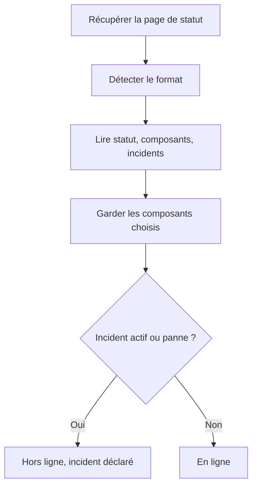

# Surveillance de page de statut externe

Un moniteur de page de statut externe surveille la page de statut publique d'un service dont vous dépendez — AWS, GCP, Azure, GitHub, OpenAI, Anthropic et bien d'autres — et vous alerte quand ce fournisseur signale une panne ou des performances dégradées. Utilisez-le pour apprendre l'existence de problèmes en amont dès que le fournisseur les signale, et pour les distinguer des vôtres.

Il lit aussi les pages de statut créées avec OneUptime, ressource par ressource, et distingue une maintenance planifiée d'une panne : surveillez le projet d'une autre équipe, ou un fournisseur dont la page de statut tourne sur OneUptime.

:::cards
- [Créer le moniteur](#créer-un-moniteur-de-page-de-statut-externe): Coller l'URL d'une page de statut et choisir quoi surveiller.
- [Choisir les composants](#composants): Surveiller seulement les composants dont vous dépendez.
- [Critères](#critères-de-surveillance): Ce qui compte comme une panne, d'emblée.
- [Pages de statut OneUptime](#pages-de-statut-oneuptime): Les ressources d'un autre projet, et sa maintenance.
- [Pages de statut populaires](#url-de-pages-de-statut-populaires): Les URL des services dont dépendent la plupart des équipes.
:::

## Fonctionnement

À chaque vérification, une sonde récupère la page de statut, détermine son format, et lit le statut global, les composants et les incidents actifs. Si vous avez choisi des composants, ou un groupe de composants, seuls ceux-ci comptent. Les critères décident ensuite si le moniteur est en ligne ou hors ligne.

Vous pouvez l'utiliser pour :

- Surveiller la disponibilité des services tiers dont dépend votre application
- Être alerté quand des fournisseurs en amont subissent des pannes
- Suivre le statut de chaque composant
- Surveiller seulement les composants dont vous dépendez (p. ex. Git Operations et Pull Requests de GitHub, ou le groupe "APIs" d'OpenAI), pour que des incidents sans rapport ailleurs sur la page ne déclenchent pas votre moniteur
- Détecter des performances dégradées avant qu'elles n'affectent vos utilisateurs
- Rapprocher vos propres incidents des problèmes des fournisseurs en amont

## Fournisseurs pris en charge

| Fournisseur | Description |
| ------------------------ | ---------------------------------------------------------------------- |
| **Auto** (par défaut) | Détecte automatiquement le format de la page de statut |
| **Atlassian Statuspage** | Pages de statut propulsées par Atlassian Statuspage (API JSON) |
| **incident.io** | Pages de statut propulsées par incident.io (p. ex. `https://status.openai.com`) |
| **OneUptime Status Page** | Pages de statut créées avec OneUptime : le statut de chaque ressource, et ce qui est en maintenance |
| **RSS** | Pages de statut qui fournissent un flux RSS |
| **Atom** | Pages de statut qui fournissent un flux Atom |

### Détection automatique

Avec **Auto**, OneUptime détecte automatiquement le format de la page de statut, dans cet ordre :

1. D'abord, il essaie l'API de page de statut d'incident.io (`/proxy/<host>`).
2. Ensuite, il essaie l'API JSON d'Atlassian Statuspage (`/api/v2/status.json`, `/api/v2/components.json` et `/api/v2/incidents/unresolved.json`).
3. Puis il demande le résumé d'une page de statut OneUptime (`/status-page-api/summary/<page>`).
4. Si celles-ci échouent, il tente de lire la page comme un flux RSS ou Atom.
5. En dernier recours, il effectue une simple vérification d'accessibilité HTTP.

> [!NOTE]
> incident.io est vérifié en premier parce que certaines pages de statut incident.io (comme `https://status.openai.com`) exposent aussi un point de terminaison limité compatible Atlassian, qui omet les groupes de composants et les incidents actifs. Vérifier incident.io d'abord garantit l'utilisation des données plus riches, qui connaissent les groupes.

La vérification d'accessibilité est aussi le recours quand un fournisseur choisi explicitement échoue. Elle indique seulement si la page répond — en ligne sur une réponse `2xx` ou `3xx` — et ne rapporte ni composants ni incidents.

## Créer un moniteur de page de statut externe

:::steps
### Commencer un nouveau moniteur

Allez dans **Moniteurs** et cliquez sur **Créer un moniteur**. Sous **Type de moniteur**, cliquez sur **Plus de types de moniteurs** et choisissez **Page de statut externe** sous **Basic Monitoring**, ou tapez `statuspage` dans le champ de recherche. Saisissez un **Nom**, puis cliquez sur **Suivant**.

### Saisir l'URL de la page de statut

Saisissez l'**URL de la page de statut**. Laissez le **Fournisseur** sur **Auto** sauf si vous connaissez le format.

### Choisir les composants, si nécessaire

Ouvrez **Composants** et choisissez dans la liste de la page les composants dont vous dépendez, comme `Git Operations` et `Pull Requests` sur celle de GitHub ; laissez le champ vide pour surveiller toute la page. Pour surveiller plutôt un groupe, ouvrez **Plus de champs** et saisissez un **Filtre de groupe de composants**, comme `APIs`.

### Le tester

Cliquez sur **Tester le moniteur** pour récupérer la page une fois, et vérifiez le fournisseur, les composants et les incidents trouvés.

### Passer en revue les critères

L'étape des critères commence avec [les critères par défaut](#critères-par-défaut), qui marquent le moniteur hors ligne quand le fournisseur signale un incident actif ou une panne dans le périmètre. Modifiez-les si besoin, puis cliquez sur **Suivant**.

### Choisir les sondes et créer

Sélectionnez les **Sondes** et un **Intervalle de surveillance** — il commence à **Toutes les 5 minutes** — puis cliquez sur **Créer un moniteur**.
:::

## Options de configuration

| Option | Ce qu'il faut saisir | Par défaut |
| --- | --- | --- |
| **URL de la page de statut** | L'URL de la page de statut. Pour les sites propulsés par Atlassian Statuspage et incident.io, c'est généralement l'URL racine (p. ex. `https://status.example.com`). Pour les flux RSS/Atom, saisissez directement l'URL du flux. | — |
| **Fournisseur** | **Auto** pour détecter le format, ou **Atlassian Statuspage**, **incident.io**, **OneUptime Status Page**, **RSS** ou **Atom** si vous le connaissez. | **Auto** |
| **Composants** | Les composants à surveiller, choisis dans la liste de la page ou saisis. | Toute la page |
| **Filtre de groupe de composants** | Le groupe auquel limiter le moniteur. Sous **Plus de champs**. | Tous les groupes |
| **Délai d'expiration (ms)** | Le temps maximal d'attente de la page de statut. Sous **Plus de champs**. | `10000` (10 secondes) |
| **Tentatives** | Combien de fois réessayer, à une seconde d'intervalle, après l'échec de la première tentative ; `0` signifie une seule tentative. Sous **Plus de champs**. | `3` (jusqu'à 4 tentatives) |

### Composants

Choisissez les composants dont vous dépendez, et le moniteur ne surveille qu'eux : **External Status Page Component Status** ne compare que leurs statuts, le statut global est le pire des leurs, et **External Status Page Active Incidents** ne compte que les incidents qui touchent au moins l'un d'eux. Cela reste une seule vérification de la page, quel que soit le nombre choisi.

Quand vous ouvrez **Composants**, votre navigateur lit la liste de la page sur une Atlassian Statuspage, une page incident.io ou une page de statut OneUptime, et l'affiche dans les groupes de la page ; chaque composant qui n'est pas opérationnel dit où il en est. Un nom choisi surveille le composant qui porte exactement ce nom, sans tenir compte de la casse : `Copilot` sur la page de GitHub n'est pas `Copilot AI Model Providers`.

Quand la liste ne peut pas être lue (une page interne, une page qui ne partage pas sa liste avec votre navigateur, un flux RSS ou Atom), saisissez un nom et appuyez sur Entrée. Un `*` remplace n'importe quel texte : `*us-east-1*` surveille chaque composant dont le nom contient `us-east-1`. Sur un flux RSS ou Atom, un élément compte quand son titre contient l'un des noms.

Un incident qui ne nomme aucun composant n'est pas compté tant que vous surveillez des composants choisis : rien ne dit qu'il les touche. Sans rien de choisi, le moniteur surveille toute la page, et chaque incident compte.

Un moniteur enregistré avec l'ancien Filtre par nom de composant continue de surveiller ce qu'il surveillait : le filtre apparaît dans **Composants** sous la forme de ce nom entre étoiles, comme `*API*`, qui correspond à chaque composant dont le nom le contient.

> [!WARNING]
> Un nom qui ne correspond à rien ne surveille rien, et a l'air sain. **Composants** et **Tester le moniteur** nomment tous deux les composants choisis que la page ne liste pas.

### Filtre de groupe de composants

Si la page de statut organise ses composants en groupes, vous pouvez limiter le moniteur à un seul groupe. Par exemple, sur `https://status.openai.com`, saisir `APIs` limite le moniteur aux services d'API d'OpenAI.

Quand un groupe de composants est défini, le **nombre d'incidents actifs** et le **statut global** sont calculés uniquement à partir des composants de ce groupe — un incident touchant un groupe sans rapport (par exemple ChatGPT) ne déclenchera pas un moniteur limité au groupe "APIs". Si des composants sont aussi choisis, seuls les composants choisis du groupe comptent.

Le filtrage par groupe de composants est pris en charge pour les fournisseurs **Atlassian Statuspage**, **incident.io** et **OneUptime Status Page**. Les flux RSS et Atom n'exposent pas de groupes de composants.

## Critères de surveillance

Vous pouvez configurer des critères pour décider quand le service externe est considéré comme en ligne ou hors ligne, en fonction de :

| Type de filtre | Ce qu'il vérifie | Conditions de filtre |
| --- | --- | --- |
| **External Status Page Is Online** | Si la page de statut est accessible et renvoie des données de statut | Vrai ou Faux |
| **External Status Page Overall Status** | Le statut global indiqué par la page | Égal à, Différent de, Contient, Ne contient pas, Commence par, Se termine par |
| **External Status Page Component Status** | Le statut de chaque composant du périmètre (les composants choisis, ou ceux du groupe, s'ils sont définis) : Opérationnel, Under Maintenance, Performances dégradées, Partial Outage, Panne majeure ou Panne totale | Égal à, Différent de, Contient, Ne contient pas, Commence par, Se termine par |
| **External Status Page Active Incidents** | Le nombre d'incidents actuellement actifs signalés sur la page de statut (seulement ceux qui touchent un composant du périmètre, quand des composants ou un groupe sont choisis) | Égal à, Différent de, et les comparaisons numériques |
| **External Status Page Response Time (in ms)** | Le temps nécessaire pour récupérer les données de la page de statut | Supérieur à, Inférieur à, Supérieur ou égal à, Inférieur ou égal à |

Le statut global est ce que dit la page : ses valeurs varient donc selon le fournisseur. Une Atlassian Statuspage rapporte sa propre description, comme `All Systems Operational` ; une page de statut OneUptime, le pire statut parmi ses composants dans le périmètre, comme `under_maintenance` ; un flux rapporte `operational` ou `degraded_performance` ; la vérification d'accessibilité rapporte `reachable` ou `unreachable`. Avec des composants ou un groupe choisis, c'est le pire statut parmi eux, sur toute page. Ces comparaisons sont sensibles à la casse. Le résumé du moniteur affiche le statut global en mots et en couleur, comme celui de chaque composant (`under_maintenance` s'affiche **Under Maintenance**), tandis que les critères comparent la valeur rapportée par la page. Pour alerter sur les pannes, **External Status Page Active Incidents** et **External Status Page Component Status** sont généralement plus fiables.

Sur un flux RSS ou Atom, les éléments des dernières 24 heures comptent comme incidents actifs : un élément RSS selon sa date de publication, une entrée Atom selon sa date de mise à jour. Un élément daté dans le futur ne compte qu'à partir de sa date.

### Critères par défaut

Par défaut, OneUptime crée des critères fondés sur ce qui compte vraiment pour une page de statut — ses incidents actifs et la santé de ses composants, plutôt que la simple accessibilité :

| Critère | Filtres | Effet |
| --- | --- | --- |
| Hors ligne | **Au moins un** parmi : la page n'est pas en ligne ; il y a au moins un incident actif dans le périmètre ; un composant du périmètre signale Performances dégradées, Partial Outage, Panne majeure ou Panne totale | Marque le moniteur hors ligne et déclare un incident, qui se résout de lui-même quand le critère cesse de correspondre |
| En ligne | **Tous** parmi : la page est en ligne ; il n'y a aucun incident actif dans le périmètre | Marque le moniteur en ligne |

Comme le nombre d'incidents actifs et les statuts des composants respectent les composants et le groupe choisis, ces critères par défaut ne ciblent automatiquement que les composants qui vous intéressent.

## Pages de statut OneUptime

Choisissez **OneUptime Status Page** comme fournisseur, ou laissez **Auto**, pour surveiller une page de statut créée avec OneUptime : le projet d'une autre équipe, ou la page d'un fournisseur sur OneUptime Cloud ou sur un OneUptime auto-hébergé. Saisissez l'adresse propre de la page dans **URL de la page de statut** : son domaine, comme `https://status.example.com`, ou `https://oneuptime.com/status-page/<status-page-id>` pour une page qui n'en a pas.

Le moniteur lit le résumé de la page, `/status-page-api/summary/<page>` (voir [Lire le résumé](/docs/status-pages/public-api#lire-le-résumé)) : seulement ce que la page montre à ses visiteurs, et rien d'autre de l'autre projet. Chaque ressource de la page, un moniteur ou un groupe de moniteurs, est un composant, sous le nom que la page lui donne, dans le groupe de la page ; un groupe placé dans un autre s'écrit `Core / Databases`. Choisissez des ressources dans **Composants**, ou surveillez un groupe avec **Filtre de groupe de composants**.

Le statut d'un composant est la valeur que représente son statut sur la page, si bien que les critères de statut de composant fonctionnent comme sur n'importe quelle page de statut :

| Sur la page | Statut du composant |
| --- | --- |
| Le statut opérationnel du projet | `operational` |
| Un statut nommé `Degraded` | `degraded_performance` |
| Un statut nommé `Offline`, `Down` ou `Major Outage` | `major_outage` |
| Un statut nommé `Partial Outage` | `partial_outage` |
| Un statut nommé `Full Outage` | `full_outage` |
| Un statut nommé `Maintenance` | `under_maintenance` |
| Tout autre statut | `degraded_performance` |
| Un statut que la page masque, avec **Show current status** désactivé | `unknown` |

Tant qu'un événement de maintenance planifiée en cours touche une ressource, parce qu'il nomme l'un de ses moniteurs ou un moniteur de son groupe de moniteurs, le composant est `under_maintenance`, quel que soit le statut de ses moniteurs : un moniteur n'est pas vérifié tant qu'un événement le retient. Un événement encore à venir, ou terminé, ne change rien. Les incidents actifs de la page comptent pour les ressources qu'ils touchent.

Les [critères par défaut](#critères-par-défaut) ne prennent jamais une maintenance pour une panne : le moniteur reste en ligne pendant les travaux planifiés de l'autre projet.

### Afficher la maintenance de l'autre projet sur votre moniteur

:::steps
### Ajouter le critère

Dans les critères du moniteur, cliquez sur **Ajouter un critère**. Donnez-lui le filtre **External Status Page Component Status**, **Égal à**, **Under Maintenance**, et choisissez votre statut de maintenance dans **Modifier le statut du moniteur en**.

### Le placer tout en haut

Faites glisser le nouveau critère au-dessus des autres : le premier critère qui correspond l'emporte.

### Le vérifier avec Tester le moniteur

Cliquez sur **Tester le moniteur** pendant qu'une maintenance est en cours dans l'autre projet : le composant qu'elle touche affiche **Under Maintenance**.
:::

### Ce qu'une page de statut OneUptime laisse lire au moniteur

Une page que tout le monde peut ouvrir est lue comme ses visiteurs la voient. Une page privée, qui demande une connexion, le SSO ou un mot de passe, ne peut pas être lue : avec **OneUptime Status Page** choisi, la vérification échoue et le dit. Une page avec une liste d'adresses IP autorisées doit laisser entrer l'adresse de la sonde : surveillez-la depuis une sonde à l'intérieur de ce réseau.

## Variables de modèle

Quand vous créez des incidents ou des alertes à partir de moniteurs de page de statut externe, vous pouvez utiliser ces variables dans les titres, les descriptions et les notes de remédiation (voir [Modèles d'incident et d'alerte](/docs/monitor/incident-alert-templating)) :

| Variable | Description |
| ------------------------- | ------------------------------------------------------------------------------- |
| `{{isOnline}}`            | Si la page de statut est en ligne (true/false) |
| `{{responseTimeInMs}}`    | Temps de réponse en millisecondes |
| `{{failureCause}}`        | Cause de l'échec, le cas échéant |
| `{{overallStatus}}`       | La valeur de l'indicateur de statut global |
| `{{activeIncidentCount}}` | Nombre d'incidents actifs (des composants qu'il surveille, s'il en a choisi) |
| `{{componentStatuses}}`   | Tableau JSON des statuts de composants (`name`, `status`, `description`, `groupName`) |
| `{{provider}}`            | Fournisseur détecté (Atlassian Statuspage, incident.io, OneUptime Status Page, RSS, Atom) ; vide après une vérification d'accessibilité |
| `{{componentGroup}}`      | Groupe de composants auquel le moniteur est limité, le cas échéant |
| `{{componentName}}`       | Les composants que le moniteur surveille, séparés par des virgules, s'il en a choisi |

## URL de pages de statut populaires

Voici une liste de pages de statut de services populaires. Beaucoup utilisent Atlassian Statuspage ou incident.io, donc le fournisseur **Auto** les détecte automatiquement. Une page construite sur aucun des deux, et qui n'est pas un flux, ne reçoit que la vérification d'accessibilité — pour celles-ci, surveillez plutôt le flux RSS ou Atom du fournisseur, s'il en publie un.

| Service | URL de la page de statut |
| ---------------------------- | --------------------------------------------- |
| AWS                          | `https://health.aws.amazon.com/health/status` |
| Google Cloud Platform        | `https://status.cloud.google.com`             |
| Microsoft Azure              | `https://status.azure.com`                    |
| GitHub                       | `https://www.githubstatus.com`                |
| OpenAI                       | `https://status.openai.com`                   |
| Anthropic                    | `https://status.anthropic.com`                |
| Cloudflare                   | `https://www.cloudflarestatus.com`            |
| Datadog                      | `https://status.datadoghq.com`                |
| PagerDuty                    | `https://status.pagerduty.com`                |
| Twilio                       | `https://status.twilio.com`                   |
| Stripe                       | `https://status.stripe.com`                   |
| Slack                        | `https://status.slack.com`                    |
| Atlassian (Jira, Confluence) | `https://status.atlassian.com`                |
| Vercel                       | `https://www.vercel-status.com`               |
| Netlify                      | `https://www.netlifystatus.com`               |
| DigitalOcean                 | `https://status.digitalocean.com`             |
| Heroku                       | `https://status.heroku.com`                   |
| MongoDB Atlas                | `https://status.cloud.mongodb.com`            |
| Fastly                       | `https://status.fastly.com`                   |
| New Relic                    | `https://status.newrelic.com`                 |
| Sentry                       | `https://status.sentry.io`                    |
| CircleCI                     | `https://status.circleci.com`                 |

## Bonnes pratiques

- **Utilisez le fournisseur Auto**, sauf si vous connaissez le format exact — la détection automatique fonctionne bien pour la plupart des pages de statut.
- **Choisissez les composants dont vous dépendez** (p. ex. Git Operations et Pull Requests de GitHub), pour que les incidents sans rapport ne fassent pas de bruit.
- **Surveillez un groupe entier** quand vous dépendez de tout le groupe (p. ex. les "APIs" d'OpenAI), pour que les composants qui s'y ajoutent plus tard soient aussi surveillés.
- **Combinez avec vos propres moniteurs** — associez les moniteurs de page de statut externe à vos propres moniteurs d'API et de site web. Quand les deux tombent en même temps, la page de statut en amont vous oriente plus vite vers la cause racine.

## Dépannage

:::details Le moniteur est hors ligne, mais l'incident concerne une partie du service que je n'utilise pas
Choisissez les composants dont vous dépendez dans **Composants**, ou un groupe dans **Filtre de groupe de composants**. Le nombre d'incidents actifs et les statuts des composants ne comptent alors qu'eux ; un incident qui ne nomme aucun composant n'est pas compté.
:::

:::details Le moniteur ne passe jamais hors ligne, même pendant une panne
Un nom choisi ne correspond peut-être à rien sur la page, ce qui a l'air sain, ou la page ne reçoit que la vérification d'accessibilité. Lancez **Tester le moniteur** : il montre le fournisseur et les composants trouvés, et nomme chaque composant choisi que la page ne liste pas.
:::

:::details Auto choisit le mauvais format, ou ne trouve aucun composant
Réglez le **Fournisseur** sur celui que vous savez utilisé par la page. Pour un flux RSS ou Atom, saisissez l'URL du flux lui-même plutôt que celle de la page de statut.
:::

:::details La liste de Composants ne se charge pas
Votre navigateur lit la liste directement sur la page de statut. Une page interne que votre navigateur ne peut pas joindre, une page qui ne partage pas sa liste avec d'autres sites, et un flux RSS ou Atom n'offrent aucune liste où choisir : saisissez le nom de chaque composant tel que la page l'affiche, et appuyez sur Entrée. Les sondes lisent la page comme avant.
:::

:::details Une page de statut OneUptime n'affiche aucun composant
Choisissez **OneUptime Status Page** comme **Fournisseur** et cliquez sur **Tester le moniteur** : le résultat indique si la page est privée, ou si sa liste d'adresses IP autorisées tient la sonde à l'écart. Un OneUptime auto-hébergé qui n'a pas été mis à jour depuis un moment ne sert pas encore de résumé : en attendant, la page reçoit la vérification d'accessibilité, ou est lue comme un flux.
:::

:::details Une page de statut interne est injoignable
Une sonde refuse les adresses de réseau privé, sauf si elle est autorisée à les atteindre. Définissez `PROBE_ALLOW_PRIVATE_NETWORK_MONITORS=true` sur une sonde de votre réseau — voir [Accès au réseau privé](/docs/self-hosted/private-network-access).
:::

## Prochaines étapes

:::cards
- [Modèles d'incident et d'alerte](/docs/monitor/incident-alert-templating): Mettre le statut du fournisseur dans vos titres d'incident.
- [Surveillance d'API](/docs/monitor/api-monitor): Vérifier vos propres points de terminaison à côté du statut de votre fournisseur.
- [Créer un moniteur](/docs/monitor/create-monitor): Les étapes communes à tous les types de moniteurs.
:::
