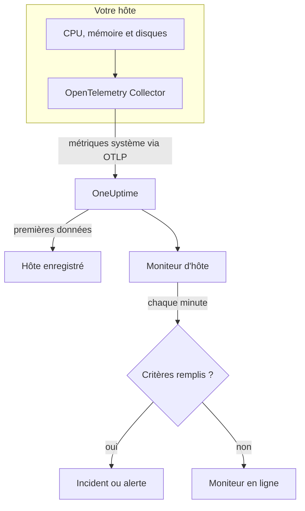

# Surveillance des hôtes

Un moniteur d'hôte surveille une machine – son CPU, sa mémoire, ses disques, sa charge et ses processus – et vous prévient quand elle est saturée ou se remplit. Il lit les métriques OpenTelemetry `system.*` qu'un OpenTelemetry Collector envoie depuis l'hôte, les mêmes données que montre le produit **Hôtes**, si bien que rien n'est sondé depuis l'extérieur.

:::cards
- [Créer le moniteur](#créer-un-moniteur-dhôte): Six étapes dans le tableau de bord.
- [Modèles](#modèles-dalerte-prêts-à-lemploi): Dix alertes prêtes à l'emploi pour un hôte devenu silencieux ou redémarré, le CPU, la mémoire, le swap, le disque, les inodes, la charge, les processus et les unités systemd en échec.
- [Métriques](#métriques-collectées): Les métriques d'hôte sur lesquelles vous pouvez alerter, et leurs unités.
- [Hôte ou Serveur / VM ?](#moniteur-dhôte-ou-moniteur-serveur-vm): Lequel des deux moniteurs de machines utiliser.
- [Plusieurs disques](#hôtes-avec-plusieurs-disques): Un moniteur pour tous les disques, un incident par disque.
:::

## Fonctionnement

Un OpenTelemetry Collector s'exécute sur l'hôte avec le récepteur `hostmetrics`. Toutes les 30 secondes, il lit les chiffres de CPU, de mémoire, de disque, de réseau, de charge et de processus de l'hôte et les envoie à OneUptime via OTLP. Les premières données d'un hôte l'enregistrent sous **Hôtes**.

Un moniteur d'hôte est lié à un hôte. Chaque minute, il exécute sa requête sur les métriques de cet hôte et compare le résultat à ses critères.

### Moniteur d'hôte ou moniteur Serveur / VM ?

OneUptime a deux moniteurs pour les machines. Ils peuvent fonctionner sur le même hôte.

| | Moniteur d'hôte | Moniteur Serveur / VM |
| --- | --- | --- |
| **Agent** | Un OpenTelemetry Collector avec le récepteur `hostmetrics` | L'agent d'infrastructure OneUptime |
| **Données** | Les métriques OpenTelemetry `system.*` et `process.*`, les mêmes que tracent les pages **Hôtes** | Un rapport d'état que l'agent envoie au moniteur |
| **Critères** | Seuils ou détection d'anomalies sur n'importe quelle requête de métrique ou formule | Des vérifications intégrées comme l'utilisation du CPU, de la mémoire et du disque |
| **Configuration** | Installer le collecteur ; l'hôte s'enregistre lui-même | Créer le moniteur, puis donner sa clé secrète à l'agent |

Utilisez le moniteur d'hôte quand l'hôte envoie déjà des données OpenTelemetry, ou quand vous voulez des journaux et des métriques plus riches depuis le même collecteur. Voir [Surveillance de serveur / VM](/docs/monitor/server-monitor) pour l'autre.

## Avant de commencer

- **Exécutez un OpenTelemetry Collector sur l'hôte** avec le récepteur `hostmetrics`. Le plus rapide est [Hôtes](/docs/telemetry/hosts) : une commande installe le collecteur, et OneUptime le configure. [Collecteur OpenTelemetry sur l'hôte](/docs/telemetry/host-otel-collector) couvre Linux, macOS et Windows, et **Produits → Infrastructure → Hôtes → Documentation** fournit une configuration prête à l'emploi.
- **Activez les métriques d'utilisation.** `system.cpu.utilization`, `system.memory.utilization` et `system.filesystem.utilization` sont facultatives dans le récepteur, et les modèles de CPU, de mémoire et de système de fichiers en ont besoin. La configuration du tableau de bord les active.
- **Vérifiez que l'hôte est enregistré.** Il apparaît sous **Produits → Infrastructure → Hôtes → Tous les hôtes**, nommé d'après son `host.name`, dès l'arrivée de ses premières données.

## Créer un moniteur d'hôte

:::steps
### Commencer un nouveau moniteur

Allez dans **Moniteurs** et cliquez sur **Créer un moniteur**.

### Choisir Hôte

Sous **Type de moniteur**, cliquez sur **Plus de types de moniteurs** et choisissez **Hôte** sous **Infrastructure**. Saisissez un **Nom** – il est utilisé dans les titres des incidents et des alertes – et cliquez sur **Suivant**.

### Choisir l'hôte

Sous **Configuration du moniteur d'hôte**, choisissez la machine dans **Hôte**. Chaque hôte qui a envoyé des données figure dans la liste. Une fois le choix fait, une ligne sous le champ indique si des données arrivent. **Ajouter un hôte** ouvre des étapes de configuration avec vos clés déjà renseignées, qui attendent les premières données.

### Choisir ce qu'il faut surveiller

Un nouveau moniteur démarre sur **Host Stopped Reporting**, sous **Sur quoi alerter**. Pour surveiller autre chose :

- **Modifier** – choisissez un autre [modèle](#modèles-dalerte-prêts-à-lemploi). Il définit la métrique, l'agrégation, la plage temporelle et les seuils, et remplace les critères plus bas par les siens. Vous pouvez toujours changer la **Plage temporelle**.
- **Custom Metric** (sous **Plus de champs**) – choisissez une métrique dans **Métrique d'hôte**, puis définissez l'**Agrégation** et la **Plage temporelle**.
- **Avancé** (sous **Plus de champs**) – construisez vous-même des requêtes et des formules sous **Sélectionner les métriques**, par exemple un filtre sur `state` ou un regroupement par `mountpoint`.

### Vérifier les critères

Ouvrez chaque critère sous **Critères** et vérifiez sa **Métrique**, son **Agrégation**, sa **Condition** et son **Seuil**. Un modèle les remplit. Avec **Custom Metric** ou **Avancé**, le moniteur commence avec les [critères par défaut](#critères-par-défaut), qui ne remarquent qu'une métrique qui n'envoie plus de données ; définissez donc votre propre seuil.

### Créer le moniteur

Cliquez sur **Créer un moniteur**. OneUptime ouvre la page du moniteur et l'évalue chaque minute. Les incidents et alertes qu'il déclenche sont aussi listés sur les pages **Incidents** et **Alertes** de l'hôte.
:::

> [!TIP]
> Pour configurer plusieurs modèles à la fois, ouvrez l'hôte depuis **Produits → Infrastructure → Hôtes** et allez dans **Recommandations**. Choisissez les modèles voulus, choisissez qui est alerté, et OneUptime crée un moniteur par modèle.

## Paramètres du moniteur

| Champ | Onglet | Ce qu'il fait |
| --- | --- | --- |
| **Hôte** | Tous | Obligatoire. Limite chaque requête au `resource.host.name` de l'hôte. |
| **Métrique d'hôte** | Custom Metric | Une métrique du [catalogue](#métriques-collectées), regroupée en CPU, mémoire, disque, réseau, charge et processus. |
| **Agrégation** | Custom Metric | Comment les mesures sont combinées : **Moyenne**, **Maximum**, **Minimum**, **Somme** ou **Comptage**. Commence à l'agrégation habituelle de la métrique. |
| **Plage temporelle** | Tous | La fenêtre glissante que lit la requête, de **Past 1 Minute** à **Past 365 Days**. Un nouveau moniteur commence à **Past 1 Minute** ; les modèles définissent la leur. |
| **Sélectionner les métriques** | Avancé | Le constructeur de requêtes : **Métrique**, **Agréger par**, **Filtrer par attributs**, **Regrouper par**, plus **Ajouter une métrique** et **Ajouter une formule** pour combiner des requêtes. |

## Modèles d'alerte prêts à l'emploi

La liste de **Sur quoi alerter** propose dix modèles. Chacun construit un moniteur complet : une requête, un critère qui se déclenche et un autre qui rétablit. Les seuils sont des points de départ que vous pouvez modifier.

Un critère ne se déclenche que si la condition est remplie à chaque minute de sa fenêtre, et il se rétablit 10 % au-delà du seuil pour qu'une valeur qui oscille autour de la limite ne bascule pas sans cesse.

| Modèle | Gravité | Surveille | Se déclenche quand | Se rétablit quand |
| --- | --- | --- | --- | --- |
| Host Stopped Reporting | Critique | `system.memory.usage`, Count, 10 dernières minutes | Aucune donnée pendant toute la fenêtre | Des données arrivent de nouveau |
| Host Restarted | Avertissement | `system.uptime`, Min, 5 dernières minutes | Une valeur est sous 600 (dix minutes) | Chaque valeur est à 660 ou plus |
| High CPU Utilization | Avertissement | `system.cpu.utilization` pour les états `user` et `system`, additionnés et affichés en pourcentage, 5 dernières minutes | Au-dessus de 80 % | À 72 % ou moins |
| High Memory Utilization | Avertissement | `system.memory.utilization` pour l'état `used`, en pourcentage, 5 dernières minutes | Au-dessus de 85 % | À 76,5 % ou moins |
| High Swap Usage | Avertissement | `system.paging.usage` pour les états `used` et `free`, utilisé divisé par utilisé plus libre, en pourcentage, 5 dernières minutes | Au-dessus de 80 % | À 72 % ou moins |
| High Filesystem Usage | Critique | `system.filesystem.utilization`, Max par `mountpoint` et `device`, en pourcentage, 5 dernières minutes | Au-dessus de 90 % | À 81 % ou moins |
| Running Out of Inodes | Critique | `system.filesystem.inodes.usage` pour les états `used` et `free`, utilisé divisé par utilisé plus libre, par `mountpoint` et `device`, en pourcentage, 5 dernières minutes | Au-dessus de 90 % | À 81 % ou moins |
| High Load Average (1m) | Avertissement | `system.cpu.load_average.1m`, Avg, 5 dernières minutes | Au-dessus de 4 | À 3,6 ou moins |
| High Process Count | Avertissement | `system.processes.count`, Max, 5 dernières minutes | Au-dessus de 2000 | À 1800 ou moins |
| Systemd Unit Failed | Avertissement | `systemd.unit.state` avec `systemd.unit.active_state = failed`, Max par `resource.systemd.unit.name`, 5 dernières minutes | Au-dessus de 0 | À 0 ou moins |

**Gravité** est le libellé qu'affiche le sélecteur. L'incident et l'alerte qu'un modèle crée commencent avec la gravité d'incident et d'alerte la plus élevée de votre projet ; changez-les dans les critères.

- **Host Stopped Reporting** se déclenche quand rien n'arrive de l'hôte pendant dix minutes : la machine est en panne ou injoignable, ou son collecteur s'est arrêté, a perdu sa connexion à OneUptime ou a vu son jeton révoqué. Il se résout dès que les données reviennent. Quand les données cessent d'arriver, les autres modèles n'ont plus rien à comparer et gardent leur dernier état ; c'est donc lui qui vous prévient.
- **Host Restarted** se déclenche au premier rapport après un démarrage : l'hôte fonctionne depuis moins de dix minutes. Il lit `system.uptime` depuis le scraper `system` du collecteur, que les configurations par défaut de OneUptime activent, et se résout de lui-même environ un quart d'heure après le démarrage, quand chaque valeur de sa fenêtre de cinq minutes atteint au moins onze minutes. Un hôte en panne déclenche plutôt **Host Stopped Reporting**.
- **CPU** correspond au temps occupé (`user` plus `system`), le même chiffre que trace la **Vue d'ensemble** de l'hôte. L'attente d'E/S et le steal sont exclus.
- **Mémoire** exclut les tampons et le cache de pages, si bien qu'un hôte surtout rempli de cache ne le déclenche pas.
- **Swap** correspond au swap utilisé divisé par utilisé plus libre, sur tous les périphériques de swap, tel que `free` et `swapon` l'affichent. Un hôte sans swap n'en remonte aucun et ne se déclenche jamais.
- **Système de fichiers** ouvre un incident par montage. Les pseudo-systèmes de fichiers en lecture seule, comme les montages snap `squashfs` ou `devfs` sous macOS, sont toujours pleins à 100 % : les configurations de collecteur de OneUptime les laissent hors du scraper `filesystem` avec `exclude_fs_types`, et une configuration à vous a besoin de la même chose.
- **Inodes** ouvre un incident par montage, comme **Système de fichiers**. Quand un système de fichiers n'a plus d'inodes, plus rien ne peut y créer de fichier, quel que soit l'espace libre. Un système de fichiers sans table d'inodes propre, comme btrfs, n'en remonte aucun et ne se déclenche jamais.
- **Charge moyenne** est une longueur brute de file d'exécution, non divisée par le nombre de cœurs : 4 est une saturation sur un hôte à 2 cœurs et une routine sur un hôte à 32 cœurs, alors relevez-le sur les grands hôtes.
- **Nombre de processus** compare le plus grand état de processus (`running`, `sleeping`, …), pas le total de l'hôte, il ne correspondra donc pas à une liste de processus. Le scraper de processus remonte des données sous Linux, macOS et BSD, pas sous Windows.
- **Systemd Unit Failed** ouvre une alerte par service systemd à l'état `failed`, à partir du receiver `systemd` du collecteur, que la configuration par défaut de OneUptime lit sur les hôtes Linux avec systemd. Elle se résout quand l'unité tourne de nouveau, ou une fois que `systemctl reset-failed` l'efface.

## Appareils Android

Un hôte dont l'OS est Android, comme une borne ou un terminal de point de vente qui exécute l'[agent Android](/docs/telemetry/android-agent), se voit proposer ses propres modèles, qui lisent ce que l'agent envoie, avec Host Stopped Reporting, Host Restarted et High Memory Utilization. Les modèles qui portent sur ce qu'un appareil n'envoie jamais, comme le swap, les inodes, la charge ou les unités systemd, ne lui sont pas proposés.

| Modèle | Gravité | Surveille | Se déclenche quand | Se rétablit quand |
| --- | --- | --- | --- | --- |
| Device Unplugged | Avertissement | `android.battery.plugged`, Max, 10 dernières minutes | L'appareil fonctionne sur sa batterie pendant toute la fenêtre | Il est de nouveau sur secteur |
| Low Battery | Avertissement | `hw.battery.charge`, Min, en pourcentage, 5 dernières minutes | Sous 20 % | À 20 % ou plus |
| Device Overheating | Avertissement | `android.thermal.status`, Max, 5 dernières minutes | 3 (sévère) ou pire | Sous 3 |
| Restart Loop | Critique | `android.boot.recent_count`, Max, dernière heure | Une valeur est à 3 ou plus | Chaque valeur est sous 3 |
| Storage Nearly Full | Critique | `system.filesystem.utilization`, Max par `mountpoint`, en pourcentage, 5 dernières minutes | Au-dessus de 90 % | À 90 % ou moins |
| Security Patch Out of Date | Avertissement | `android.os.security_patch.age`, le nombre de jours écoulés depuis le niveau de correctif de sécurité de l'appareil, Min, dernière heure | Plus de 90 jours pendant toute la fenêtre | Une mesure de 90 jours ou moins, une fois l'appareil mis à jour |
| High CPU Utilization | Avertissement | `system.cpu.utilization` pour l'état `idle`, occupé calculé comme 1 moins inactif, en pourcentage, 5 dernières minutes | Au-dessus de 80 % | À 80 % ou moins |

High CPU Utilization est proposé dès que l'appareil signale son utilisation du processeur, ce qui, sous Android 8 et versions ultérieures, exige que l'agent soit le propriétaire de l'appareil. Une alerte d'un appareil Android commence par des commandes adb à lancer d'abord, comme `adb shell dumpsys battery`, `adb shell getprop sys.boot.reason` ou `adb shell getprop ro.build.version.security_patch`, plutôt que par les commandes shell d'un serveur.

## Métriques collectées

La liste **Métrique d'hôte** propose ces métriques. Chacune porte `resource.host.name`, par lequel le moniteur limite ses requêtes à un hôte. Choisi là, le CPU compte l'état `user`, l'utilisation de la mémoire et des systèmes de fichiers l'état `used`, et les systèmes de fichiers et les processus donnent une série par point de montage et par statut.

> [!IMPORTANT]
> Les métriques d'utilisation sont un ratio de 0 à 1, pas un pourcentage : utilisez `0.8` pour 80 % dans un seuil sur la métrique brute. Les modèles convertissent en pourcentage avec une formule, si bien que leurs seuils indiquent 80, 85 et 90.

### CPU

| Métrique | Unité | Description |
| --- | --- | --- |
| `system.cpu.utilization` | ratio | Part du temps CPU passée dans chaque `state` (`user`, `system`, `idle`, …). Filtrez sur `state` : une moyenne sur tous les états n'atteint jamais un seuil utile. |
| `process.cpu.utilization` | ratio | Utilisation du CPU de chaque processus de l'hôte. |

### Mémoire

| Métrique | Unité | Description |
| --- | --- | --- |
| `system.memory.utilization` | ratio | Part de la mémoire physique dans chaque `state` (`used`, `free`, `cached`, …). Filtrez sur `state = used` pour la mémoire utilisée. |
| `system.memory.usage` | bytes | Utilisation de la mémoire en octets. |

### Disque

| Métrique | Unité | Description |
| --- | --- | --- |
| `system.filesystem.utilization` | ratio | Part de la capacité de chaque système de fichiers utilisée, par `mountpoint` et `device`. |
| `system.filesystem.usage` | bytes | Utilisation du système de fichiers en octets. |

### Réseau

| Métrique | Unité | Description |
| --- | --- | --- |
| `system.network.io` | bytes | Octets reçus et envoyés. Un compteur sur toute la durée de vie. |

### Charge

| Métrique | Unité | Description |
| --- | --- | --- |
| `system.cpu.load_average.1m` | count | Charge moyenne de la dernière minute. |
| `system.cpu.load_average.5m` | count | Charge moyenne des 5 dernières minutes. |
| `system.cpu.load_average.15m` | count | Charge moyenne des 15 dernières minutes. |

### Processus

| Métrique | Unité | Description |
| --- | --- | --- |
| `system.processes.count` | count | Processus de l'hôte, une série par `status` de processus. |

Le constructeur de requêtes de **Avancé** liste chaque métrique que l'hôte envoie, pas seulement celles-ci.

## Critères de surveillance

Un critère compare l'une des requêtes ou formules du moniteur à un seuil. Les critères d'un moniteur d'hôte n'ont pas de **Type de filtre** : chaque règle vérifie la valeur de la métrique, avec ces champs.

| Champ | Ce qu'il fait |
| --- | --- |
| **Métrique** | La requête ou la formule à vérifier, par son nom de variable. |
| **Agrégation** | Comment les valeurs de la fenêtre deviennent une seule réponse : **Moyenne**, **Somme**, **Valeur maximale**, **Valeur minimale**, **Toutes les valeurs** (chaque valeur doit correspondre, sur toute la fenêtre) ou **Au moins une valeur** (une seule suffit). |
| **Condition** | **Supérieur à**, **Inférieur à**, **Supérieur ou égal à**, **Inférieur ou égal à** ou **Égal à** – ou une condition d'anomalie : **Anormalement élevé**, **Anormalement bas** ou **Anormal**. **Aucune donnée** est vraie quand la requête n'a rien renvoyé dans la fenêtre, **Données reçues** quand elle a renvoyé quelque chose. **Devrait dépasser** et **Devrait passer sous** correspondent quand la tendance de la métrique sur la fenêtre aura franchi le seuil à la fin de **Horizon**. |
| **Seuil** | La valeur de comparaison. Une liste d'unités se trouve à côté quand la métrique a une unité. Non affiché pour les conditions d'anomalie. |
| **Sensibilité** | Conditions d'anomalie uniquement. **Faible** (4σ), **Moyen** (3σ, la valeur par défaut) ou **Élevé** (2σ). |
| **Fenêtre de référence** | Conditions d'anomalie uniquement. 14 jours (la valeur par défaut), 28, 60 ou 90 jours d'historique. |
| **En l'absence de données** | Sous **Plus de champs**. Ce qui se passe quand la fenêtre n'a aucune mesure : **Ignore** (par défaut), **Treat As Zero** ou **Déclencheur**. |

Les conditions d'anomalie comparent chaque valeur à la même heure de la semaine dans la référence. Elles restent dans un état « Learning », et ne déclenchent rien, tant que la fenêtre de référence ne contient pas assez d'historique. Ce moniteur filtre ses requêtes par attributs, donc chaque requête, et chaque série d'une requête regroupée, est comparée à son propre historique, aussi loin que vos métriques sont conservées. Si c'est moins de deux semaines, une somme, un décompte ou une requête sur un histogramme reste dans cet état pour de bon, et tout le reste est comparé à toutes les séries de la métrique. Un centile d'un histogramme reste toujours dans cet état.

Chaque critère indique aussi quoi faire quand il correspond : changer le statut du moniteur, créer une alerte ou déclarer un incident. Les critères sont vérifiés de haut en bas, et le premier qui correspond l'emporte.

### Critères par défaut

Un moniteur que vous ne créez pas à partir d'un modèle commence avec deux critères :

| Ordre | Critère | Correspond quand | Ensuite |
| --- | --- | --- | --- |
| 1 | Vérifier si _nom du moniteur_ est hors ligne | La première requête n'a aucune donnée sur toute la fenêtre | Marque le moniteur **Hors ligne** et déclare l'incident « _nom du moniteur_ est hors ligne », qui se résout de lui-même quand le moniteur se rétablit. |
| 2 | Vérifier si _nom du moniteur_ est en ligne | La première requête a des données | Marque le moniteur **Opérationnel**. |

> [!IMPORTANT]
> Une valeur de `0` est une donnée : une métrique souvent nulle, comme les redémarrages ou les erreurs, ne met pas le moniteur hors ligne. Pour être alerté sur une valeur, partez d'un modèle ou ajoutez un critère avec un seuil. Quand aucune donnée n'arrive et qu'aucun critère ne correspond, le moniteur garde son statut et les incidents ouverts restent ouverts : le silence n'est pas un rétablissement. Le temps où OneUptime lui-même ne recevait rien ne compte jamais comme une absence de données : une vérification dont la fenêtre en contient attend, comme l'explique [Quand OneUptime ne reçoit pas de données](/docs/monitor/when-oneuptime-is-not-receiving).

## Hôtes avec plusieurs disques

Un seul moniteur d'hôte couvre chaque disque que l'hôte remonte. Les modèles High Filesystem Usage et Running Out of Inodes regroupent leur requête par `mountpoint` et `device`, si bien que le moniteur vérifie chaque disque séparément et ouvre un incident par disque : un deuxième disque qui se remplit n'est pas masqué par l'incident ouvert du premier.

| Où | Ce qui s'affiche pour chaque disque |
| --- | --- |
| La page **Métriques** du moniteur | Une ligne par disque, nommée d'après son `mountpoint` et son `device`. |
| **Journaux de surveillance** | La colonne **Observé** compte les séries que chaque vérification a lues : une par disque. |
| **Incidents** et **Alertes** | Un incident ou une alerte par disque, qui nomme le montage et le périphérique du disque. |
| La carte **Systèmes de fichiers** de l'hôte | Chaque disque que le collecteur remonte, quoi que surveillent vos moniteurs. |

Chaque critère est vérifié pour chaque disque :

- Tant que l'incident d'un disque est ouvert, le critère qui l'a ouvert n'en ouvre aucun autre pour ce disque. Un autre disque qui satisfait ce critère ouvre le sien.
- Un disque qui satisfait deux critères, comme l'un au-dessus de 98 % et l'autre au-dessus de 90 %, reçoit un seul incident, celui du premier des deux dans la liste. Placez le plus strict en premier.
- L'incident d'un disque se résout quand ce disque cesse de satisfaire le critère qui l'a ouvert, quoi que fassent les autres disques.
- Le moniteur a un seul statut, fixé par le premier critère de la liste que satisfait un disque quelconque. Quand aucun disque ne satisfait un critère qui se déclenche, un seul disque au seuil de rétablissement ou en dessous suffit au critère qui rétablit ; la marge de rétablissement de 10 % ne tient donc pas sur un hôte dont un disque n'est jamais près d'être plein.

Pour ne surveiller que certains disques, ouvrez **Avancé** et, dans la requête sous **Sélectionner les métriques**, ajoutez avec **Filtrer par attributs** un filtre sur `mountpoint` : **est l'un de** pour les disques à surveiller, ou **n'est aucun de** pour ceux à laisser de côté. Gardez le **Regrouper par**, et écrivez chaque disque comme le montre la carte **Systèmes de fichiers**, par exemple `C:` ou `/var`. Pour ne plus collecter un disque du tout, afin qu'il quitte aussi les pages de l'hôte, définissez `include_mount_points` ou `exclude_mount_points` sur le scraper `filesystem` du collecteur ([Métriques de l'hôte](/docs/telemetry/host-otel-collector#métriques-de-lhôte)).

## Dépannage

:::details L'hôte n'est pas dans la liste Hôte
Les hôtes s'enregistrent eux-mêmes à partir des données du collecteur, qui ont besoin d'un `host.name` et du type de système d'exploitation de l'hôte – tous deux fournis par le processeur `resourcedetection` du collecteur. Vérifiez que le collecteur tourne et que l'hôte figure sous **Produits → Infrastructure → Hôtes → Tous les hôtes**. [Collecteur OpenTelemetry sur l'hôte](/docs/telemetry/host-otel-collector) couvre la configuration.
:::

:::details Un seuil de CPU ou de mémoire ne se déclenche jamais
Les métriques d'utilisation sont des ratios qui plafonnent à `1.0`, donc un seuil saisi à la main de `80` n'est jamais franchi : utilisez `0.8`, ou partez d'un modèle, qui convertit en pourcentage. Filtrez aussi sur `state` – `user` et `system` pour le CPU, `used` pour la mémoire. Une moyenne sur tous les états reste autour de 1 divisé par le nombre d'états.
:::

:::details Des incidents se déclenchent pour le mauvais hôte
Le moniteur limite chaque requête au `resource.host.name` égal à l'hôte choisi. Les hôtes qui remontent le même `host.name` fusionnent en une seule série ; donnez donc à chaque hôte un nom unique.
:::

:::details High Filesystem Usage se déclenche pour un montage toujours plein
Les pseudo-systèmes de fichiers en lecture seule, comme les montages en boucle snap `squashfs` sous `/snap` ou `devfs` sous macOS, sont pleins à 100 % par conception et ne se rétablissent jamais. Les configurations que OneUptime exécute et fournit les excluent avec `exclude_fs_types` ; une configuration à vous, ou une Configuration du collecteur créée avant qu'elles ne le fassent, a besoin de la même chose : copiez-la depuis [Métriques de l'hôte](/docs/telemetry/host-otel-collector#métriques-de-lhôte). Excluez un autre montage toujours plein, comme un `.dmg` monté, avec `exclude_mount_points`.
:::

:::details High Filesystem Usage n'affiche qu'une série sur un hôte avec plusieurs disques
La requête n'a pas de **Regrouper par**. Chaque vérification ne lit alors que le disque le plus plein, et un seul incident vaut pour tous les disques : la page **Métriques** du moniteur trace une seule ligne, nommée d'après la requête, et la colonne **Observé** dans **Journaux de surveillance** compte des points de données au lieu de séries. Sur la page **Critères** du moniteur, cliquez sur **Modifier les critères**, ouvrez **Avancé** sous **Plus de champs** et, dans la requête sous **Sélectionner les métriques**, réglez **Regrouper par** sur `mountpoint` et `device`. Choisir de nouveau le modèle sous **Sur quoi alerter** le règle aussi, mais remplace vos critères par ceux du modèle. À la vérification suivante, chaque disque au-dessus du seuil ouvre son propre incident, et celui ouvert pour tout le moniteur se résout si son critère résout automatiquement les incidents.
:::

## Étapes suivantes

:::cards
- [Collecteur OpenTelemetry sur l'hôte](/docs/telemetry/host-otel-collector): Installer et configurer le collecteur que lit ce moniteur.
- [Surveillance de serveur / VM](/docs/monitor/server-monitor): Le moniteur de machines auquel un agent envoie ses rapports.
- [Surveillance des métriques](/docs/monitor/metrics-monitor): Alerter sur n'importe quelle métrique, à travers les hôtes et les services.
- [Vue d'ensemble des incidents](/docs/incidents/index): Ce qui se passe après qu'un critère a déclaré un incident.
:::
