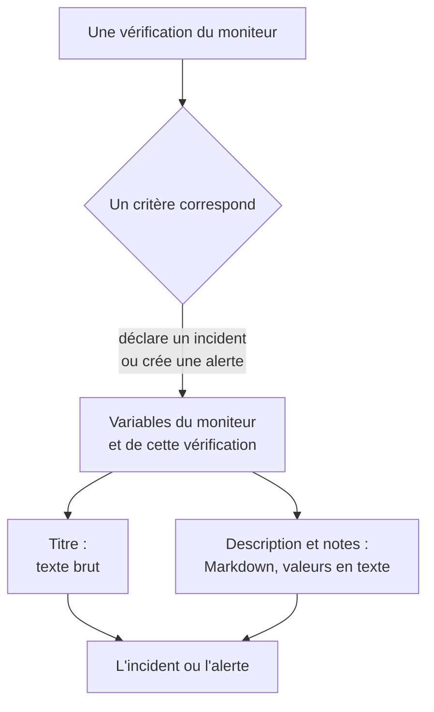

# Modèles d'incident et d'alerte

Lorsque les critères d'un moniteur déclarent un incident ou créent une alerte, ils en remplissent le titre, la description et les notes de remédiation à partir d'un modèle que vous écrivez. Placez-y des espaces réservés `{{variable}}`, comme `{{monitorName}}` ou `{{responseStatusCode}}`, et chaque incident dit ce qui s'est mal passé, avec les valeurs de la vérification qui l'a ouvert.

:::cards
- [Où écrire un modèle](#où-écrire-un-modèle): Le titre, la description et les notes de remédiation de l'incident ou de l'alerte d'un critère.
- [Utilisation de base](#utilisation-de-base): Espaces réservés, chemins dans les objets, et listes.
- [Variables de tous les moniteurs](#variables-de-tous-les-moniteurs): Le nom du moniteur, et la ressource en dépassement.
- [Variables par type de moniteur](#variables-par-type-de-moniteur): Ce que rapporte chaque type de vérification.
:::

## Fonctionnement des modèles

Un modèle est rempli une seule fois, lorsque le critère crée l'incident ou l'alerte. OneUptime rassemble les variables du moniteur et de la vérification qui a correspondu, place chaque valeur à l'endroit de son espace réservé, et enregistre le résultat. Modifier le modèle plus tard change les incidents et les alertes créés ensuite, pas ceux déjà ouverts.



- **Le titre est du texte brut.** Partout où il s'affiche, il se lit exactement tel que le modèle l'a rendu.
- **La description et les notes de remédiation sont en Markdown.** Le Markdown que vous écrivez est rendu, et chaque valeur envoyée par le système surveillé est placée en tant que texte, de sorte que rien en elle ne peut ajouter un lien, une image ou une mention. Voir [Valeurs dans les descriptions et les notes de remédiation](#valeurs-dans-les-descriptions-et-les-notes-de-remédiation).
- **Un moniteur groupé remplit chaque incident pour sa propre série.** Un moniteur qui ouvre un incident par hôte, pod ou appareil remplit chaque modèle avec les valeurs de cette série, et ajoute le nom de la série au titre lorsque votre modèle ne le mentionne pas déjà.

## Où écrire un modèle

:::steps
### Ouvrir les critères du moniteur

Allez dans **Moniteurs**, ouvrez le moniteur, puis cliquez sur **Critères** dans son menu latéral. Cliquez sur **Modifier les critères de surveillance**.

### Activer l'incident ou l'alerte

Dans un critère, sous **Actions**, activez **Lorsque les filtres correspondent, déclarer un incident.** ou **Lorsque les filtres correspondent, créer une alerte.** Le formulaire de l'incident ou de l'alerte s'ouvre en dessous.

### Écrire le titre

Saisissez le titre dans **Titre de l'incident** ou **Titre de l'alerte**, par exemple `{{monitorName}} is down`. **En savoir plus sur les modèles dynamiques**, juste à côté, ouvre **Variables de modèle dynamiques** : chaque variable du type de ce moniteur, avec ce qu'elle contient. Cliquez sur une variable pour la copier.

### Écrire la description et les notes de remédiation

Ouvrez **Description** pour **Description de l'incident** ou **Description de l'alerte**, et **Plus de champs** pour **Notes de remédiation**. Ces éditeurs proposent eux-mêmes les variables : **Variables de modèle** les liste sous l'éditeur, **Insérer une variable** dans sa barre d'outils ouvre la même liste, et taper `{{` l'ouvre à l'emplacement du curseur.

### Enregistrer les critères

Cliquez sur **Enregistrer les modifications**. Le prochain incident ou la prochaine alerte que crée ce critère utilise les nouveaux modèles.
:::

## Utilisation de base

Un espace réservé est le nom d'une variable entre doubles accolades. Lorsque l'incident est créé, OneUptime le remplace par la valeur de la variable, et laisse le texte qui l'entoure tel que vous l'avez écrit.

```text title="Title template"
{{monitorName}} returned {{responseStatusCode}} in {{responseTimeInMs}} ms
```

Si le moniteur s'appelle `Checkout API`, que le code de statut de la réponse est `502` et que la réponse a pris `842` millisecondes, l'incident s'intitule :

```text title="Title as created"
Checkout API returned 502 in 842 ms
```

### Chemins dans les objets et les listes

Une variable qui contient un objet ou une liste se lit avec un chemin, de la même façon que dans les [expressions JavaScript](/docs/monitor/javascript-expression) :

| Écrire | Pour lire | Exemple |
| --- | --- | --- |
| `{{object.field}}` | Un champ d'un objet, à n'importe quelle profondeur | `{{responseBody.error.message}}` |
| `{{list[0]}}` ou `{{list.0}}` | Un élément d'une liste, en comptant à partir de 0 | `{{diskMetrics[0].usagePercent}}` |
| `{{list[last]}}` | Le dernier élément d'une liste | `{{processes[last].name}}` |
| `{{object}}` | L'objet ou la liste entière, en JSON | `{{responseBody}}` |

Un nom de champ peut contenir un trait d'union, comme dans `{{responseHeaders.content-type}}`. Un index négatif, comme `[-1]`, ne lit rien : utilisez `[last]`.

### Lorsqu'une valeur manque

Un espace réservé dont le chemin ne mène nulle part reste dans le texte tel que vous l'avez écrit, accolades comprises : si la réponse n'a pas de champ `error`, `{{responseBody.error.id}}` apparaît tel quel dans le titre. Il en va de même pour une variable que cette vérification n'a pas rapportée, comme `failureCause` sur une vérification qui n'a pas échoué. Une valeur que la vérification a rapportée comme texte vide est remplacée par rien.

Pour écrire un modèle qui fonctionne que le moniteur soit groupé ou non, utilisez les variables de [ressource concernée](#ressource-concernée) : elles existent toujours, et sont vides lorsque le moniteur n'est pas groupé.

### Valeurs dans les descriptions et les notes de remédiation

Une description et des notes de remédiation sont en Markdown : elles s'affichent sur la page de l'incident ou de l'alerte, dans les e-mails, et dans ses canaux Slack et Microsoft Teams. Les valeurs qu'un modèle y place sont ce que le système surveillé a envoyé - un corps ou un en-tête de réponse, une requête ou un e-mail entrant, les labels d'un appareil ou d'une série -, donc chacune est placée en tant que texte. Elle se lit exactement telle qu'elle a été envoyée, où que le modèle la place, et un lien, une image, une balise HTML ou une mention Slack comme `<!channel>` qu'elle contient s'affiche comme texte au lieu d'agir. Une adresse web nue dans une valeur devient tout de même un lien, qui montre où il mène. Le Markdown que vous écrivez dans le modèle lui-même est rendu tel que vous l'avez écrit.

Une valeur peut avoir n'importe quelle taille - un corps de réponse ou un journal de plusieurs mégaoctets - et la notification part quand même avec elle. Chaque canal transporte ce qu'il accepte, et une description trop longue pour lui est coupée, à un saut de ligne s'il y en a un, et se termine par « … (truncated — see OneUptime for the full text) » :

- **E-mail** : chaque description, note ou cause racine transporte jusqu'à environ 256 Ko du texte de l'e-mail, et la note à la fin d'un texte plus long renvoie vers l'incident ou l'alerte. Un e-mail entier - son texte et ses captures d'écran - reste sous 3 Mo, ce que tout serveur de messagerie et Microsoft Graph acceptent : une capture d'écran qui ne tient pas à côté du texte est omise, avec une note à sa place.
- **La page de l'incident ou de l'alerte** affiche tout. Une description de plus de 128 Ko qui prendrait longtemps à mettre en page s'affiche en texte brut, ligne par ligne.
- **Slack** transporte au plus ce que Slack affiche d'un message (environ 30 000 caractères). **Microsoft Teams** transporte environ 40 000 caractères dans un message de l'application OneUptime, et environ 12 000 via un webhook entrant (abonnés des pages de statut, workflows) - mesurés au moment de l'envoi du message, donc un tableau compte pour le HTML qu'il devient.
- **SMS, appels téléphoniques, notifications push, WhatsApp et Telegram** transportent ce que leurs fournisseurs acceptent : voir [Comment les niveaux alertent les personnes](/docs/on-call/escalation-rules#comment-les-niveaux-alertent-les-personnes).

Chaque canal rend le texte en un temps qui croît avec sa longueur. Une partie qui prendrait bien plus longtemps à un moteur de rendu - une ligne de plus de 64 Ko, un long paragraphe de lignes simples, un paragraphe plein de `*`, `_` ou `[` qui ne se ferment jamais, des citations ou des listes imbriquées sur plus de seize niveaux, et sur la page de l'incident ou de l'alerte un tableau ou une liste de plus de mille lignes - se lit comme du texte brut là où elle se trouve, et le reste de la description est rendu normalement.

## Utilisation avancée

### Boucler sur une liste

`{{#each path}}` répète le texte jusqu'à `{{/each}}` une fois pour chaque élément de la liste située à `path` :

```text title="Loop syntax"
{{#each arrayPath}}
  ...text with {{field}} placeholders for each item...
{{/each}}
```

Dans la boucle :

- `{{field}}` et `{{field.nested}}` lisent l'élément courant. Un nom que l'élément n'a pas est cherché dans l'élément englobant, puis dans les variables de tout le modèle.
- `{{@index}}` est la position de l'élément, en comptant à partir de 0.
- `{{this}}` est l'élément lui-même, pour une liste de valeurs simples comme des chaînes.
- Une boucle sur un chemin qui n'est pas une liste, ou sur une liste vide, n'écrit rien.
- Les boucles s'imbriquent : un `{{#each}}` placé dans un autre lit la liste intérieure de chaque élément extérieur.

Par exemple, un [moniteur de requêtes entrantes](/docs/monitor/incoming-request-monitor) qui reçoit cette notification d'alerte :

```json title="Request body"
{
  "receiver": "payments",
  "alerts": [
    { "status": "firing", "labels": { "alertname": "HighLatency" } },
    { "status": "resolved", "labels": { "alertname": "DiskFull" } }
  ]
}
```

et qui a ce modèle de description :

```text title="Description template"
Alerts for {{requestBody.receiver}}:
{{#each requestBody.alerts}}
- {{@index}}: {{labels.alertname}} ({{status}})
{{/each}}
```

crée un incident dont la description se lit comme ci-dessous. Chaque élément garde les sauts de ligne qui l'entourent, donc une ligne vide sépare les éléments, et la description affiche toujours une seule liste :

```text title="Description as created"
Alerts for payments:

- 0: HighLatency (firing)

- 1: DiskFull (resolved)
```

### Valeurs d'un moniteur groupé

Un moniteur basé sur des métriques avec des attributs **Regrouper par** ouvre un incident par série, et la valeur de chaque attribut est une variable qui porte le nom de l'attribut. Regrouper par `host.name` donne `{{host.name}}`, et regrouper par `resource.k8s.pod.name` donne `{{resource.k8s.pod.name}}`. `{{seriesLabels}}` les contient toutes, sous forme d'objet.

Un [moniteur de journaux](/docs/monitor/logs-monitor) groupé fonctionne de la même façon : la valeur de chaque attribut de regroupement est une variable sous sa clé.

## Variables de tous les moniteurs

### Moniteur

| Variable | Ce qu'elle contient | Exemple |
| --- | --- | --- |
| `monitorName` | Le nom du moniteur. | `Checkout API` |
| `monitorId` | L'ID du moniteur. | `a0f78958-da0a-4775-9fd9-c9fc63d3456f` |
| `monitorType` | Le type du moniteur. | `Website`, `Synthetic Monitor` |

### Ressource concernée

Ces variables décrivent la série pour laquelle un moniteur groupé a ouvert l'incident : un pod, un conteneur, un hôte, un disque. Elles sont vides pour un moniteur non groupé, donc un modèle peut les utiliser sur n'importe quel moniteur.

| Variable | Ce qu'elle contient |
| --- | --- |
| `seriesResourceSuffix` | L'identité de la série, précédée d'un séparateur, à placer à la fin d'un titre. |
| `seriesResourceSummary` | La même identité sans le séparateur, à placer dans une phrase. |
| `seriesResourceBlock` | Chaque label de la série, sous forme de liste Markdown. Idéal dans une description. |
| `seriesDebugCommands` | Des commandes en lecture seule pour cette ressource précise, comme `kubectl` ou `docker`, sous forme de liste Markdown. |

## Variables par type de moniteur

### Moniteurs de sites web et d'API

| Variable | Ce qu'elle contient | Type |
| --- | --- | --- |
| `responseBody` | Le corps de la réponse : un objet lorsqu'il est en JSON, sinon le texte. | `JSON` ou `string` |
| `responseHeaders` | Les en-têtes de la réponse, par nom en minuscules. | `Dictionary<string>` |
| `responseStatusCode` | Le code de statut HTTP. | `number` |
| `responseTimeInMs` | Le temps de réponse, en millisecondes. | `number` |
| `isOnline` | Si le moniteur a considéré la réponse comme en ligne. | `boolean` |

### Moniteurs de requêtes entrantes

| Variable | Ce qu'elle contient | Type |
| --- | --- | --- |
| `requestBody` | Le corps de la requête : un objet lorsqu'il est en JSON. | `JSON` ou `string` |
| `requestHeaders` | Les en-têtes de la requête, par nom en minuscules. | `Dictionary<string>` |
| `requestMethod` | La méthode HTTP, comme `POST`. | `string` |
| `incomingRequestReceivedAt` | Le moment où la requête a été reçue, sous forme d'horodatage ISO 8601. | `string` |

Lorsque le critère a **Regrouper les incidents et alertes par un champ de la charge utile** activé, la clé de regroupement est elle aussi une variable, nommée d'après le **dernier segment** du chemin de regroupement : regrouper par `requestBody.alerts[*].labels.alertname` donne `{{alertname}}`, et regrouper par `requestBody.alerts[*].fingerprint` donne `{{fingerprint}}`. Le `requestBody` entier reste disponible à côté.

> [!NOTE]
> `[*]` ne fonctionne que dans les champs de chemin de regroupement. Dans un modèle, il ne lit rien, donc l'espace réservé reste tel qu'il est écrit. `{{requestBody.alerts[0].annotations.summary}}` lit toujours la première alerte de la charge utile, pas celle pour laquelle l'incident a été ouvert : utilisez la variable de regroupement et les champs partagés de la charge utile, comme `commonLabels` et `commonAnnotations`. Voir [Surveillance des requêtes entrantes](/docs/monitor/incoming-request-monitor).

### Moniteurs d'e-mails entrants

| Variable | Ce qu'elle contient | Type |
| --- | --- | --- |
| `emailSubject` | L'objet de l'e-mail. | `string` |
| `emailFrom` | L'adresse e-mail de l'expéditeur. | `string` |
| `emailTo` | Les destinataires de l'e-mail, avec l'adresse du moniteur lui-même masquée. | `string` |
| `emailBody` | Le corps de l'e-mail en texte brut. | `string` |
| `emailReceivedAt` | Le moment où l'e-mail a été reçu, sous forme d'horodatage ISO 8601 en UTC. | `string` |

Dans un titre, chacune est coupée à une ligne d'au plus 150 caractères. Les descriptions et les notes de remédiation reçoivent la valeur entière. Voir [Surveillance des e-mails entrants](/docs/monitor/incoming-email-monitor#variables-de-modèle).

### Moniteurs Ping, IP et Port

| Variable | Ce qu'elle contient | Type |
| --- | --- | --- |
| `isOnline` | Si la cible a répondu. | `boolean` |
| `responseTimeInMs` | Le temps de réponse, en millisecondes. Pour un port, la résolution DNS et la connexion TCP ensemble. | `number` |
| `failureCause` | La raison de l'échec de la vérification, le cas échéant. | `string` |
| `isTimeout` | Si la vérification a expiré. | `boolean` |

### Moniteurs NTP

| Variable | Ce qu'elle contient | Type |
| --- | --- | --- |
| `isOnline` | Si le serveur de temps a répondu à la requête de la sonde. | `boolean` |
| `isSynchronized` | S'il a répondu avec une strate de 1 à 15, sans l'alarme de seconde intercalaire et avec de vrais horodatages. | `boolean` |
| `stratum` | La strate signalée par le serveur : 1 pour un serveur primaire, 16 lorsqu'il n'est pas synchronisé, 0 pour un kiss-o'-death. | `number` |
| `clockOffsetInMs` | L'écart entre l'horloge du serveur et celle de la sonde, en millisecondes. Positif signifie que le serveur est en avance. | `number` |
| `referenceId` | Ce sur quoi le serveur se synchronise : une source comme `GPS` en strate 1, ou l'adresse de son serveur amont. | `string` |
| `leapIndicator` | 0 à 2 quand tout va bien, 3 quand le serveur indique que son horloge n'est pas synchronisée. | `number` |
| `kissCode` | Avec la strate 0, le code de quatre lettres que le serveur a envoyé à la place de l'heure, comme `RATE`. | `string` |
| `responseTimeInMs` | Le temps entre la requête et la réponse, en millisecondes. | `number` |
| `roundTripDelayInMs` | L'aller-retour réseau de l'échange, sans le temps de traitement propre du serveur. | `number` |
| `rootDelayInMs` | L'aller-retour entre le serveur et son horloge de référence, en millisecondes. | `number` |
| `rootDispersionInMs` | L'estimation, par le serveur lui-même, de son erreur maximale, en millisecondes. | `number` |
| `serverTime` | L'horloge du serveur lorsqu'il a envoyé la réponse, sous forme d'horodatage ISO 8601. | `string` |
| `referenceTime` | Le moment où l'horloge du serveur a été réglée ou corrigée pour la dernière fois, sous forme d'horodatage ISO 8601. | `string` |
| `serverAddress` | L'adresse à laquelle la requête a été envoyée. | `string` |
| `port` | Le port UDP auquel la requête a été envoyée. | `number` |
| `failureCause` | Pourquoi le serveur n'a pas répondu, ou pourquoi il n'est pas synchronisé. | `string` |
| `isTimeout` | Si le serveur n'a pas répondu à temps. | `boolean` |

### Moniteurs de certificats SSL

| Variable | Ce qu'elle contient | Type |
| --- | --- | --- |
| `isOnline` | Si la vérification du certificat a réussi. | `boolean` |
| `isSelfSigned` | Si le certificat est auto-signé. | `boolean` |
| `createdAt` | La date d'émission du certificat, sous forme d'horodatage ISO 8601. | `string` |
| `expiresAt` | La date d'expiration du certificat, sous forme d'horodatage ISO 8601. | `string` |
| `commonName` | Le nom commun (CN) du certificat. | `string` |
| `organizationalUnit` | Son unité d'organisation (OU). | `string` |
| `organization` | Son organisation (O). | `string` |
| `locality` | Sa localité (L). | `string` |
| `state` | Son État ou sa province (ST). | `string` |
| `country` | Son pays (C). | `string` |
| `serialNumber` | Son numéro de série. | `string` |
| `fingerprint` | Son empreinte SHA-1. | `string` |
| `fingerprint256` | Son empreinte SHA-256. | `string` |
| `failureCause` | La raison de l'échec de la vérification, le cas échéant. | `string` |

### Moniteurs DNS

| Variable | Ce qu'elle contient | Type |
| --- | --- | --- |
| `isOnline` | Si la requête a obtenu une réponse. | `boolean` |
| `responseTimeInMs` | Le temps de la requête, en millisecondes. | `number` |
| `isTimeout` | Si la requête a expiré. | `boolean` |
| `isDnssecValid` | Le résultat de la validation DNSSEC. | `boolean` |
| `records` | Les enregistrements renvoyés, chacun sous la forme `{type, value, ttl}`. | `Array<Object>` |
| `recordValues` | Uniquement les valeurs des enregistrements. | `Array<string>` |
| `failureCause` | La raison de l'échec de la requête, le cas échéant. | `string` |

### Moniteurs DNSSEC

| Variable | Ce qu'elle contient | Type |
| --- | --- | --- |
| `isOnline` | Si la vérification s'est terminée. | `boolean` |
| `domainName` | La zone vérifiée. | `string` |
| `isZoneSigned` | Si la zone a des enregistrements DNSKEY. | `boolean` |
| `isParentDsPresent` | Si la zone parente a des enregistrements DS pour elle. | `boolean` |
| `isChainValid` | Si la chaîne de confiance est validée. | `boolean` |
| `resolverConsensusAd` | Si chaque résolveur a renvoyé le drapeau AD. | `boolean` |
| `isNameserverConsistent` | Si chaque serveur de noms faisant autorité a renvoyé le même numéro de série SOA. | `boolean` |
| `earliestSignatureExpiration` | Le moment où la première signature RRSIG expire, sous forme d'horodatage ISO 8601. | `string` |
| `daysUntilSignatureExpiry` | Le nombre de jours avant l'expiration de cette signature. | `number` |
| `dnskeyCount` | Le nombre d'enregistrements DNSKEY. | `number` |
| `dsRecordCount` | Le nombre d'enregistrements DS chez le parent. | `number` |
| `rrsigCount` | Le nombre d'enregistrements RRSIG vus. | `number` |
| `responseTimeInMs` | La durée de la vérification, en millisecondes. | `number` |
| `failureCause` | La raison de l'échec de la vérification, le cas échéant. | `string` |

### Moniteurs de domaines

| Variable | Ce qu'elle contient | Type |
| --- | --- | --- |
| `isOnline` | Si la recherche d'enregistrement a réussi. | `boolean` |
| `domainName` | Le domaine recherché. | `string` |
| `lookupMethod` | Le protocole qui a répondu : RDAP ou WHOIS. | `string` |
| `registrar` | Le bureau d'enregistrement. | `string` |
| `createdDate` | La date d'enregistrement du domaine. | `string` |
| `updatedDate` | La date de dernière modification de l'enregistrement. | `string` |
| `expiresDate` | La date d'expiration de l'enregistrement. | `string` |
| `nameServers` | Les serveurs de noms du domaine. | `Array<string>` |
| `domainStatus` | Les codes de statut du registre, comme `clientTransferProhibited`. | `Array<string>` |
| `dnssec` | Le statut DNSSEC du registre. | `string` |
| `responseTimeInMs` | La durée de la recherche, en millisecondes. | `number` |
| `failureCause` | La raison de l'échec de la recherche, le cas échéant. | `string` |

### Moniteurs de serveurs / VM

| Variable | Ce qu'elle contient | Type |
| --- | --- | --- |
| `hostname` | Le nom d'hôte du serveur. | `string` |
| `requestReceivedAt` | Le moment où le rapport du serveur a été reçu, sous forme d'horodatage ISO 8601. | `string` |
| `cpuUsagePercent` | Le CPU utilisé, de 0 à 100. | `number` |
| `cpuCores` | Le nombre de cœurs CPU. | `number` |
| `memoryUsagePercent` | La mémoire utilisée, de 0 à 100. | `number` |
| `memoryFreePercent` | La mémoire libre, de 0 à 100. | `number` |
| `memoryTotalBytes` | La mémoire totale, en octets. | `number` |
| `diskMetrics` | Une entrée par disque monté. | `Array<Object>` |
| `diskMetrics[].diskPath` | Le point de montage du disque. | `string` |
| `diskMetrics[].usagePercent` | L'espace utilisé sur le disque, de 0 à 100. | `number` |
| `diskMetrics[].freePercent` | L'espace libre sur le disque, de 0 à 100. | `number` |
| `diskMetrics[].totalBytes` | La taille du disque, en octets. | `number` |
| `processes` | Les processus en cours d'exécution signalés par l'agent. | `Array<Object>` |
| `processes[].pid` | L'ID du processus. | `number` |
| `processes[].name` | Le nom du processus. | `string` |
| `processes[].command` | La commande avec laquelle le processus a été lancé. | `string` |
| `failureCause` | La raison de l'échec de la vérification, le cas échéant. | `string` |

### Moniteurs synthétiques

Un moniteur synthétique exécute son script une fois pour chaque navigateur et chaque taille d'écran qu'il est configuré pour utiliser, comme Chromium sur un écran de bureau et Firefox sur un écran mobile. `syntheticResponses` contient une entrée par exécution : lisez une exécution par sa position, comme dans `{{syntheticResponses[0].browserType}}`, ou toutes les exécutions avec `{{#each syntheticResponses}}`.

| Variable | Ce qu'elle contient | Type |
| --- | --- | --- |
| `failureCause` | La raison de l'échec de la vérification, le cas échéant. | `string` |
| `syntheticResponses` | Une entrée par navigateur et par taille d'écran sur lesquels le script s'est exécuté. | `Array<Object>` |
| `syntheticResponses[].executionTimeInMs` | La durée de l'exécution, en millisecondes. | `number` |
| `syntheticResponses[].result` | Ce que le script a renvoyé. | `string`, `number`, `boolean` ou `JSON` |
| `syntheticResponses[].scriptError` | L'erreur sur laquelle l'exécution s'est terminée, le cas échéant. | `string` |
| `syntheticResponses[].logMessages` | Ce que l'exécution a journalisé. | `Array<string>` |
| `syntheticResponses[].screenshots` | Les captures d'écran prises par l'exécution, par nom, chacune en texte base64. Voir [Afficher une capture d'écran](#afficher-une-capture-décran). | `Object` |
| `syntheticResponses[].browserType` | Le navigateur de l'exécution. | `string` |
| `syntheticResponses[].screenSizeType` | La taille d'écran de l'exécution. | `string` |

#### Afficher une capture d'écran

Chaque entrée de `screenshots` est une capture d'écran prise par le script, sous le nom que le script lui a donné (`screenshots["login-page"] = await page.screenshot()`), en texte base64. Pour en afficher une dans la description ou les notes de remédiation d'un incident ou d'une alerte, écrivez une image autour :

```text title="Description template"
{{syntheticResponses[0].scriptError}}


```

La capture d'écran apparaît alors sur la page de l'incident ou de l'alerte, sur les pages de statut qui affichent l'incident, dans les notifications par e-mail qui en parlent, et dans les messages Slack et Microsoft Teams qui en parlent. Dans un e-mail, elle est jointe et affichée dans le corps, ce que Gmail, Outlook et Apple Mail affichent tous, de sorte que la personne d'astreinte voit à quoi ressemblait la page sans ouvrir OneUptime.

- Les captures d'écran PNG, JPEG, GIF et WebP sont affichées. `image/png` fonctionne aussi pour une capture JPEG (`page.screenshot({ type: "jpeg" })`).
- Un e-mail transporte au plus 2 Mo d'images, et au plus 20 images. Une image qui ne tient pas est remplacée par une note avec son texte alternatif, donc donnez un texte alternatif à chaque image. Une capture JPEG est bien plus petite qu'une capture PNG, et une seule capture de l'exécution en échec en dit généralement plus que toutes les captures de toutes les exécutions.
- Dans Slack et Microsoft Teams, la capture d'écran s'affiche là où la description la place : une image seule sur sa ligne prend la place de cette ligne, et une image au milieu d'une phrase, d'une liste ou d'un tableau y laisse son texte alternatif et s'affiche après. Slack affiche les captures PNG, JPEG et GIF, au plus 10 et 10 Mo par message ; l'application OneUptime téléverse chacune dans votre espace de travail Slack, de façon privée, et l'affiche dans le message. Teams affiche les captures PNG, JPEG et GIF d'au plus 1 Mo chacune dans la carte du message, au plus 10 et 2 Mo par message.
- Le téléversement vers Slack nécessite la permission `files:write` de l'application. Si votre espace de travail a connecté Slack avant que OneUptime ne la demande, reconnectez Slack dans **Paramètres du projet → Espace de travail → Slack** (sur un serveur auto-hébergé, ajoutez d'abord la permission à votre application Slack - voir [Intégration Slack](/docs/self-hosted/slack-integration#images-dans-les-messages)).
- Une capture d'écran qu'un chat ne peut pas afficher - un WebP, une capture au-delà de ces limites, une capture que Slack ou Teams refuse, ou toute capture dans un message envoyé via un webhook entrant - s'affiche sous la forme de son texte alternatif, ou « [image] » lorsqu'elle n'en a pas, donc donnez un texte alternatif à chaque image. Le base64 de l'image n'atteint jamais le chat.
- Seule une image que vous écrivez dans le modèle est affichée. Une image dans une valeur que la page ou le script surveillé a rapportée - un message d'erreur, une ligne de journal - s'affiche toujours comme texte (voir [Valeurs dans les descriptions et les notes de remédiation](#valeurs-dans-les-descriptions-et-les-notes-de-remédiation)).
- OneUptime AI lit le texte autour d'une capture d'écran, pas la capture. Ce qu'une investigation, un postmortem ou une note rédigés, l'étape IA d'un runbook ou l'étape IA d'un workflow donnent au modèle comporte une courte note à la place de l'image, comme `[image omitted: PNG, 340 KB]` : un modèle lit du texte, pas des images, et le base64 d'une capture représenterait des centaines de milliers de tokens à chaque appel. L'activité de l'investigation indique ce qui a été omis.

Pour afficher la capture de chaque exécution en échec, placez l'image dans une boucle. Ici, le script enregistre chaque capture sous `screenshots["failure"]` :

```text title="Description template"
### What the page looked like
{{#each syntheticResponses}}
**{{browserType}} / {{screenSizeType}}**: {{scriptError}}


{{/each}}
```

### Moniteurs de code JavaScript personnalisé

| Variable | Ce qu'elle contient | Type |
| --- | --- | --- |
| `result` | Ce que le script a renvoyé. Lisez un champ avec un chemin, comme dans `{{result.status}}`. | `string`, `number`, `boolean` ou `JSON` |
| `executionTimeInMs` | La durée d'exécution du script, en millisecondes. | `number` |
| `scriptError` | L'erreur sur laquelle le script s'est terminé, le cas échéant. | `string` |
| `logMessages` | Ce que le script a journalisé avec `console.log`. | `Array<string>` |
| `failureCause` | La raison de l'échec de la vérification, le cas échéant. | `string` |

### Moniteurs d'équipements réseau

| Variable | Ce qu'elle contient | Type |
| --- | --- | --- |
| `isOnline` | Si l'équipement est joignable, par ping **ou** SNMP. Défini à chaque interrogation. | `boolean` |
| `responseTimeInMs` | Le temps de réponse du **parcours** SNMP, en millisecondes. Jamais l'aller-retour du ping. | `number` |
| `failureCause` | La raison de l'échec du parcours SNMP, le cas échéant. | `string` |
| `isTimeout` | Si le parcours SNMP a expiré. | `boolean` |
| `oidResponses` | Les OID interrogés, chacun sous la forme `{oid, name, value, type}`. | `Array<Object>` |
| `{{OID_NAME}}` | La valeur d'un OID nommé, par son nom, comme dans `{{sysUpTime}}`. | `string` ou `number` |
| `sysName` | Le nom de l'équipement, issu du groupe système SNMP. | `string` |
| `sysDescr` | La description de l'équipement, issue du groupe système SNMP. | `string` |
| `sysObjectId` | L'OID d'entreprise enregistré du fabricant : l'empreinte de l'équipement. | `string` |
| `sysLocation` | L'emplacement de l'équipement, issu du groupe système SNMP. | `string` |
| `downInterfaces` | Les interfaces administrativement actives mais opérationnellement en panne, chacune sous la forme `{name, alias, interfaceIndex}`. Nécessite la surveillance des interfaces. | `Array<Object>` |
| `interfacesTotal` | Le nombre d'interfaces parcourues. | `number` |
| `interfacesUp` | Les interfaces administrativement et opérationnellement actives. | `number` |
| `interfacesDown` | Les interfaces administrativement actives mais opérationnellement en panne. | `number` |
| `interfaceWalkFailure` | L'erreur, lorsque le parcours des interfaces a échoué. | `string` |
| `tables` | Les tables SNMP de l'équipement, par clé : `rowCount`, `rows`, `unhealthyRowCount` et `unhealthyRows` de chacune, comme dans `{{tables.ipsec_tunnels.unhealthyRowCount}}`. | `Object` |
| `snmpTable` | La table SNMP concernée par une alerte par ligne. | `string` |
| `snmpTableRow` | La ligne concernée par une alerte par ligne : un tunnel, une radio, un voisin. | `string` |
| `trapOid` | L'OID du trap. Uniquement lorsqu'un trap SNMP a déclenché la vérification. | `string` |
| `trapSourceIp` | L'adresse d'où vient le trap. Uniquement lorsqu'un trap SNMP a déclenché la vérification. | `string` |
| `trapVarbinds` | Les varbinds du trap, chacun sous la forme `{oid, value}`. Uniquement lorsqu'un trap SNMP a déclenché la vérification. | `Array<Object>` |

Un équipement réseau reçoit un ping à chaque interrogation et n'est parcouru en SNMP que lorsqu'il a des identifiants, donc **`isOnline` est la seule variable ci-dessus que remplit un équipement en ping seul** : toutes les autres viennent du parcours SNMP et restent telles qu'écrites sans lui. Commencez par `{{isOnline}}` et le nom de l'équipement dans les modèles qui peuvent servir pour des équipements sans identifiants. Voir [Surveillance des équipements réseau](/docs/monitor/network-device-monitor#ce-que-fait-réellement-une-interrogation) pour ce que collecte chaque type d'interrogation.

### Moniteurs de santé de base de données

| Variable | Ce qu'elle contient | Type |
| --- | --- | --- |
| `isOnline` | Si la sonde a pu se connecter et exécuter la requête de base. Des métriques manquantes ne le rendent jamais faux. | `boolean` |
| `responseTimeInMs` | Le temps pour se connecter et exécuter la requête de base, en millisecondes. | `number` |
| `failureCause` | La raison de l'échec de la vérification, le cas échéant. | `string` |
| `connectionError` | L'erreur de connexion, sans identifiants ni chaîne de connexion. | `string` |
| `engineVersion` | La version signalée par le serveur de base de données. | `string` |
| `collectedGroups` | Les groupes de métriques qui ont produit des valeurs lors de cette vérification. | `Array<string>` |
| `unavailableGroups` | Les groupes qui n'ont pas pu être collectés, chacun sous la forme `{group, reason, message, remediation}`. | `Array<Object>` |
| `collectionIssueSummary` | Une ligne sur chaque groupe indisponible, prête pour un titre. Vide lorsque tout a été collecté. | `string` |
| `metrics` | Les valeurs collectées, par nom de série. | `Object` |

Les noms de séries dans `metrics` contiennent des points, comme `oneuptime.monitor.database.connections.used.percent`, et un chemin lit chaque point comme une étape dans un objet, donc un modèle ne peut pas extraire une seule valeur de `metrics`. Placez `{{metrics}}` en entier, en JSON, ou utilisez `{{collectionIssueSummary}}`. Une métrique qui n'a pas été collectée est absente de `metrics`, et non égale à zéro. Pour agir sur une valeur, comparez-la dans le critère avec une [expression JavaScript](/docs/monitor/javascript-expression).

### Moniteurs de pages de statut externes

| Variable | Ce qu'elle contient | Type |
| --- | --- | --- |
| `overallStatus` | Le statut global de la page de statut, comme `major_outage`. | `string` |
| `activeIncidentCount` | Le nombre d'incidents ouverts sur la page de statut. | `number` |
| `componentStatuses` | Ses composants, chacun sous la forme `{name, status, description, groupName}`. | `Array<Object>` |
| `provider` | Le type de page de statut : Atlassian Statuspage, incident.io, RSS ou Atom. | `string` |
| `componentGroup` | Le groupe de composants que surveille le moniteur, s'il en surveille un. | `string` |
| `componentName` | Le composant que surveille le moniteur, s'il en surveille un. | `string` |
| `isOnline` | Si la page de statut a répondu. | `boolean` |
| `responseTimeInMs` | Le temps de réponse de la page de statut, en millisecondes. | `number` |
| `failureCause` | La raison de l'échec de la vérification, le cas échéant. | `string` |

### Moniteurs de métriques et d'infrastructure

Les moniteurs Metrics, Kubernetes, Docker, Host, Podman, Docker Swarm, Proxmox, VMware, Ceph, Storage Array et IoT Device ont une variable qui leur est propre :

| Variable | Ce qu'elle contient | Type |
| --- | --- | --- |
| `metricName` | Le nom de la métrique que lit la première requête du moniteur, comme `container.cpu.time`. | `string` |

Groupés, ils ont aussi la valeur de chaque attribut **Regrouper par**, et `seriesLabels` : voir [Valeurs d'un moniteur groupé](#valeurs-dun-moniteur-groupé). Les modèles du moniteur IoT Device regroupent par appareil : un moniteur créé à partir de l'un d'eux a donc aussi `{{device.id}}`.

### Autres types de moniteurs

Les moniteurs Logs, Traces, Exceptions, Security Events, AI / LLM et SQL Query n'ont pas de variables propres. Utilisez les [variables de tous les moniteurs](#variables-de-tous-les-moniteurs), et sur un moniteur Logs groupé les [valeurs de groupe](#valeurs-dun-moniteur-groupé).

## Exemples

### Une API lente

```text title="Title"
{{monitorName}} is slow: {{responseTimeInMs}} ms
```

```text title="Description"
### API error
Status: **{{responseStatusCode}}**
Latency: **{{responseTimeInMs}} ms**
Message: `{{responseBody.error.message}}`
```

### Un certificat sur le point d'expirer

```text title="Title"
Certificate for {{commonName}} expires {{expiresAt}}
```

### Un serveur qui manque de place

```text title="Description"
### {{hostname}}
CPU: **{{cpuUsagePercent}}%**
Memory: **{{memoryUsagePercent}}%**

**Disks:**
{{#each diskMetrics}}
- {{diskPath}}: {{usagePercent}}% used ({{freePercent}}% free)
{{/each}}

**Processes:**
{{#each processes}}
- [{{pid}}] {{name}}: {{command}}
{{/each}}
```

### Une vérification ping, IP ou port en échec

```text title="Description"
{{monitorName}} could not be reached: {{failureCause}}
Timed out: {{isTimeout}}
Response time: {{responseTimeInMs}} ms
```

### Chaque exécution d'un moniteur synthétique

```text title="Description"
### Synthetic monitor results
{{#each syntheticResponses}}
- **{{browserType}} / {{screenSizeType}}**: {{result}} in {{executionTimeInMs}} ms
  - Script error: {{scriptError}}
  - First log line: {{logMessages[0]}}
{{/each}}
```

### Une vérification par code personnalisé

```text title="Description"
The script ran for {{executionTimeInMs}} ms and returned {{result}}.
Last log line: {{logMessages[last]}}
```

### Un équipement réseau

Ces exemples supposent que l'équipement a des identifiants SNMP : sur un équipement en ping seul, tout sauf `{{isOnline}}` reste tel qu'écrit.

```text title="Title"
{{sysName}}: {{interfacesDown}} interfaces down
```

```text title="Description"
### {{sysName}} ({{sysLocation}})
Online: {{isOnline}}
SNMP walk: {{responseTimeInMs}} ms

{{#each downInterfaces}}
- {{name}} ({{alias}}) is down
{{/each}}
```

### Alertes Alertmanager ou Grafana

```text title="Title"
[{{requestBody.status}}] {{requestBody.receiver}}
```

```text title="Description"
### Alerts from {{requestBody.receiver}}
{{#each requestBody.alerts}}
**Alert {{@index}}**: {{labels.alertname}}
- Status: {{status}}
- Summary: {{annotations.summary}}
- Source: {{generatorURL}}
{{/each}}
```

## Dépannage

:::details Le titre affiche l'espace réservé, accolades comprises
Le chemin ne mène à aucune valeur dans cette vérification. Vérifiez le nom et la casse de la variable dans les tableaux ci-dessus, ou ouvrez **En savoir plus sur les modèles dynamiques** dans le critère : il liste les variables du type de ce moniteur. Un chemin dans le corps d'une réponse ou d'une requête doit correspondre au corps tel qu'il a été envoyé, et `[*]` ainsi que les index négatifs comme `[-1]` ne lisent rien : utilisez `[0]` ou `[last]`.
:::

:::details Une valeur s'affiche en JSON
Le chemin s'arrête sur un objet ou une liste, donc tout son contenu est placé en JSON. Ajoutez au chemin le champ voulu, comme dans `{{responseBody.error.message}}`, ou bouclez sur une liste avec `{{#each}}`.
:::

:::details Une boucle n'écrit rien
Le chemin après `#each` n'est pas une liste dans cette vérification, ou la liste est vide. Vérifiez le chemin par rapport à la charge utile, et que chaque `{{#each}}` a son `{{/each}}`.
:::

:::details Le Markdown d'une valeur s'affiche comme texte
C'est voulu : une valeur envoyée par le système surveillé est placée en tant que texte, de sorte qu'elle ne peut jamais ajouter un lien, une image ou une mention à la description. Écrivez plutôt la mise en forme dans le modèle, autour de la valeur. Voir [Valeurs dans les descriptions et les notes de remédiation](#valeurs-dans-les-descriptions-et-les-notes-de-remédiation).
:::

:::details Une capture d'écran ne s'affiche pas dans Slack, Microsoft Teams ou un e-mail
Vérifiez le format et la taille de l'image d'après [Afficher une capture d'écran](#afficher-une-capture-décran). Dans Slack, l'application OneUptime a besoin de la permission `files:write` : reconnectez Slack dans **Paramètres du projet → Espace de travail → Slack** si votre espace de travail l'a connecté avant que OneUptime ne la demande.
:::

## Étapes suivantes

:::cards
- [Expressions JavaScript](/docs/monitor/javascript-expression): Les mêmes espaces réservés, dans les conditions d'un critère.
- [Déclarer un incident](/docs/incidents/declaring-incidents): Ce qui se passe après qu'un critère en a déclaré un.
- [Surveillance synthétique](/docs/monitor/synthetic-monitor): Prendre les captures d'écran qu'une description peut afficher.
- [Surveillance des requêtes entrantes](/docs/monitor/incoming-request-monitor): Transformer des webhooks en incidents nommés d'après chaque alerte.
:::
