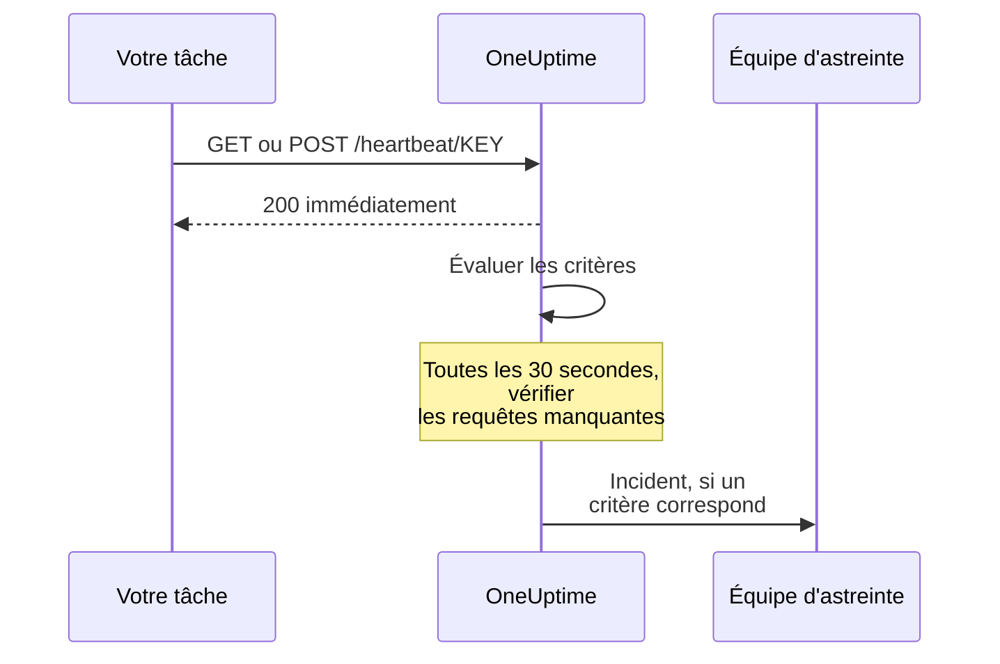

# Surveillance des requêtes entrantes

Un moniteur de requêtes entrantes vous donne une URL à laquelle d'autres systèmes envoient des requêtes HTTP. OneUptime évalue chaque requête selon vos critères, et peut changer le statut du moniteur, déclarer des incidents et appeler votre équipe d'astreinte.

Il couvre deux usages différents :

- **Surveillance par heartbeat** — une tâche cron, un worker ou un appareil appelle l'URL selon un calendrier, et OneUptime ouvre un incident quand les appels cessent d'arriver.
- **Recevoir les alertes d'un autre système** — Prometheus Alertmanager, Grafana ou tout ce qui sait envoyer du JSON en POST y pousse ses alertes, et OneUptime transforme chacune en incident avec escalade d'astreinte et résolution automatique au rétablissement.

Les deux utilisent le même type de moniteur. Ce qui les distingue, ce sont les critères que vous configurez.

:::cards
- [Créer le moniteur](#créer-un-moniteur-de-requêtes-entrantes): Obtenir une URL de heartbeat en quelques étapes.
- [Envoyer un heartbeat](#envoyer-un-heartbeat): Depuis curl, cron, Node.js, Python ou Go.
- [Alerter quand les appels cessent](#marquer-hors-ligne-sil-ny-a-pas-de-heartbeat-en-10-minutes-un-interrupteur-de-lhomme-mort): Faire du moniteur un interrupteur de l'homme mort.
- [Recevoir des alertes](#recevoir-les-alertes-dun-autre-système): Un incident par alerte Alertmanager ou Grafana.
- [S'abonner à SNS ou Event Grid](#sabonner-à-amazon-sns-ou-à-azure-event-grid): Confirmer l'abonnement en un clic.
:::

## Fonctionnement

Rien ne vérifie votre système depuis l'extérieur : votre système appelle l'URL du moniteur, OneUptime répond immédiatement, puis évalue la requête selon les critères du moniteur. Un critère qui vérifie les requêtes qui ont *cessé* d'arriver est aussi réévalué en arrière-plan toutes les 30 secondes, pour que le silence puisse lui aussi ouvrir un incident.



Utilisez-le pour :

- Surveiller les tâches cron et les tâches planifiées
- Vérifier que les workers d'arrière-plan tournent
- Surveiller des services derrière des pare-feu, injoignables depuis l'extérieur
- Recevoir les alertes de Prometheus Alertmanager, Grafana et d'autres systèmes d'alerte
- Suivre les signaux de heartbeat de tout système capable de parler HTTP

## Créer un moniteur de requêtes entrantes

:::steps
### Commencer un nouveau moniteur

Allez dans **Moniteurs** et cliquez sur **Créer un moniteur**.

### Choisir Requête entrante

Sous **Type de moniteur**, choisissez **Requête entrante** — c'est l'un des types courants affichés en haut. Saisissez un **Nom**, puis cliquez sur **Suivant**.

### Passer en revue les critères

L'étape **Critères** commence avec [les critères par défaut](#ce-que-vous-obtenez-demblée). Pour un heartbeat, cliquez sur **Ajouter un critère** et donnez au nouveau critère un filtre **Requête entrante** / **Non reçu dans le délai (minutes)** qui passe le statut à hors ligne et déclare un incident, avec **Résoudre automatiquement l'incident** activé. Faites-le ensuite glisser en haut de la liste — voir [Exemples de critères](#exemples-de-critères) pour savoir pourquoi.

### Créer le moniteur

Cliquez sur **Créer un moniteur**. Le moniteur s'ouvre sur sa page **Vue d'ensemble**, où la carte **Send the first heartbeat** affiche l'**URL de heartbeat** avec un bouton de copie et un exemple de commande `curl`.

### Envoyer la première requête

Configurez votre service pour qu'il envoie des requêtes à cette URL (voir [Envoyer un heartbeat](#envoyer-un-heartbeat)). Quand la première requête arrive, la carte laisse la place à l'historique du moniteur, et une carte **URL de heartbeat** affiche l'URL et l'heure de la dernière requête.
:::

> [!NOTE]
> L'URL contient la clé secrète du moniteur : seules les personnes qui peuvent modifier les moniteurs peuvent la voir. Vous la retrouvez à tout moment sur la page **Documentation** du moniteur, dans la section **Configuration** de son menu latéral.

## L'URL de requête

Votre moniteur a une URL unique dans ce format :

```text
https://oneuptime.com/heartbeat/YOUR_SECRET_KEY
```

Remplacez `https://oneuptime.com` par l'URL de votre instance OneUptime si vous l'auto-hébergez.

Envoyez des requêtes **GET** ou **POST** à cette URL. HEAD est accepté et traité comme GET ; PUT, PATCH et DELETE renvoient 404. La clé secrète dans le chemin est l'identifiant : aucun en-tête ni jeton n'est nécessaire, sauf si le projet [exige un secret à chaque requête](#exiger-un-secret-à-chaque-requête). Les chaînes de requête sont ignorées : envoyez ce que les critères doivent lire dans le corps ou les en-têtes.

> [!WARNING]
> Quiconque connaît cette URL peut marquer le moniteur comme sain : traitez-la donc comme un secret. Si elle fuit, ouvrez la page **Paramètres** du moniteur et cliquez sur **Réinitialiser la clé secrète des requêtes entrantes**, puis mettez à jour chaque expéditeur. La vue d'ensemble du moniteur montre la dernière requête telle que ses journaux la conservent : avec les secrets et les données personnelles masqués, et sans en-têtes ni corps quand **Conserver le contenu de la requête** est désactivé. Le masquage repère les noms et les motifs qu'il connaît, alors n'envoyez pas de clés d'API ni de jetons vers ce point de terminaison.

> [!IMPORTANT]
> OneUptime répond immédiatement `200` avec un objet JSON vide (`{}`) et traite la requête dans une file d'attente. Cette réponse est écrite avant toute validation : un `200` n'est donc **pas** la confirmation que la requête a été acceptée — une clé secrète erronée, un moniteur supprimé et un moniteur désactivé renvoient aussi `200`. Vérifiez la chronologie du moniteur pour confirmer que les requêtes arrivent. Un projet qui exige un secret à chaque requête répond `401` à une requête qui n'en a pas, et un service qui vérifie l'URL avant d'envoyer quoi que ce soit reçoit la réponse qu'il attend : voir [Services qui vérifient d'abord l'URL](#services-qui-vérifient-dabord-lurl).

### Envoyer un corps de requête

Si vous voulez atteindre des champs du corps — `{{requestBody.status}}` dans un titre d'incident, un chemin JSON dans le regroupement d'incidents, ou un critère d'expression JavaScript —, envoyez `Content-Type: application/json`. C'est le format que cette documentation suppose partout. Le corps doit être un objet ou un tableau JSON : un JSON mal formé, ou une valeur nue comme `"error"`, est refusé avec un `500`.

| Type de contenu | Ce que voient critères et modèles |
| --- | --- |
| `application/json` | Le JSON analysé. |
| `application/x-www-form-urlencoded` | Le formulaire analysé. Les clés entre crochets s'imbriquent (`alerts[0][status]=firing`), et chaque valeur est une chaîne. |
| `text/plain` | Le JSON analysé, quand le texte est un objet ou un tableau JSON : c'est ainsi qu'Amazon SNS envoie ses messages. Tout autre texte est le texte lui-même : `backup failed: error 42` met donc le moniteur hors ligne avec les critères par défaut. |
| `application/cloudevents+json`, ou un autre type `+json` | Le JSON analysé : c'est ainsi qu'Azure Event Grid envoie les CloudEvents. |
| Tout autre, ou aucun | Un corps vide (`{}`) : aucune référence à `requestBody` ne se résout donc, et un modèle la laisse telle quelle. |

Les corps jusqu'à 50 Mo sont acceptés ; un corps plus grand est refusé avec un `413`. Ne compressez pas le corps avec `Content-Encoding: gzip` : il ne serait pas stocké comme JSON, et les chemins vers son contenu ne se résoudraient pas.

### Envoyer un heartbeat

Chaque exemple envoie une requête. Remplacez `YOUR_SECRET_KEY` par la clé de l'URL de votre moniteur.

:::tabs
@tab curl
```bash
# Simple GET request
curl https://oneuptime.com/heartbeat/YOUR_SECRET_KEY

# POST request with a JSON body
curl -X POST https://oneuptime.com/heartbeat/YOUR_SECRET_KEY \
  -H "Content-Type: application/json" \
  -d '{"status": "healthy", "version": "1.2.3"}'
```
@tab Cron
```bash
# Send a heartbeat every 5 minutes
*/5 * * * * curl -fsS https://oneuptime.com/heartbeat/YOUR_SECRET_KEY > /dev/null

# Or ping only when the job succeeds, so a failed run counts as a missed heartbeat
0 2 * * * /usr/local/bin/backup.sh && curl -fsS https://oneuptime.com/heartbeat/YOUR_SECRET_KEY > /dev/null
```
@tab Node.js
```javascript title="heartbeat.mjs"
// Node.js 18 or later: fetch is built in. Run with `node heartbeat.mjs`.
const response = await fetch(
  "https://oneuptime.com/heartbeat/YOUR_SECRET_KEY",
  {
    method: "POST",
    headers: { "Content-Type": "application/json" },
    body: JSON.stringify({ status: "healthy", version: "1.2.3" }),
  },
);

console.log(response.status); // 200
```
@tab Python
```python title="heartbeat.py"
# Python 3, standard library only. Run with `python3 heartbeat.py`.
import json
import urllib.request

request = urllib.request.Request(
    "https://oneuptime.com/heartbeat/YOUR_SECRET_KEY",
    data=json.dumps({"status": "healthy", "version": "1.2.3"}).encode(),
    headers={"Content-Type": "application/json"},
    method="POST",
)

with urllib.request.urlopen(request, timeout=10) as response:
    print(response.status)  # 200
```
@tab Go
```go title="heartbeat.go"
// Run with `go run heartbeat.go`.
package main

import (
	"bytes"
	"fmt"
	"net/http"
)

func main() {
	body := []byte(`{"status": "healthy", "version": "1.2.3"}`)

	resp, err := http.Post(
		"https://oneuptime.com/heartbeat/YOUR_SECRET_KEY",
		"application/json",
		bytes.NewReader(body),
	)
	if err != nil {
		panic(err)
	}
	defer resp.Body.Close()

	fmt.Println(resp.StatusCode) // 200
}
```
@tab PowerShell
```powershell
# Windows PowerShell 5.1 or PowerShell 7
Invoke-RestMethod -Method Post `
  -Uri "https://oneuptime.com/heartbeat/YOUR_SECRET_KEY" `
  -ContentType "application/json" `
  -Body '{"status": "healthy", "version": "1.2.3"}'
```
:::

## Exiger un secret à chaque requête

Toute personne qui possède l'URL d'un moniteur peut lui envoyer des requêtes. Un Propriétaire du projet ou un Administrateur du projet peut faire exiger en plus, par chaque moniteur de requêtes entrantes du projet, l'un des secrets propres au projet, quelle que soit la personne qui a configuré le moniteur : activez **Exiger un secret à chaque requête**. Une requête sans secret est refusée avec `401` et le motif, avant de compter comme heartbeat, d'être conservée comme dernière requête du moniteur ou d'atteindre des critères. Une requête avec un secret poursuit vers les critères propres au moniteur, comme avant.

Les Propriétaires du projet et les Administrateurs du projet gèrent les secrets et l'interrupteur, tout comme un rôle personnalisé doté des permissions Create, Read, Edit et Delete Incoming Request Secret : Read montre les valeurs des secrets, et Edit active ou désactive aussi l'interrupteur.

:::steps
### Créer un secret

Allez dans **Moniteurs → Paramètres → Secrets de requête entrante** et créez un secret. Donnez-lui un nom et OneUptime génère la valeur ; copiez-la depuis la liste.

### L'envoyer depuis chaque expéditeur

Envoyez le secret dans l'en-tête `X-OneUptime-Secret`, ou comme jeton Bearer dans l'en-tête `Authorization`, selon ce que votre expéditeur sait définir. Un expéditeur qui ne peut pas définir d'en-tête lui-même peut à la place signer chaque requête avec le secret : voir [Signer les requêtes avec le secret](#signer-les-requêtes-avec-le-secret).

### Retrouver les expéditeurs oubliés

Dès que le projet a un secret, OneUptime vérifie chaque requête, sans encore en refuser aucune. **Requêtes sans secret**, sur la même page, liste chaque moniteur de requêtes entrantes qui a reçu une requête sans secret valide au cours des dernières 24 heures, et pourquoi : aucun secret n'a été envoyé, ou un mauvais. Corrigez ces expéditeurs. Un moniteur dont les expéditeurs sont corrigés affiche sous **Dernière avec secret** une heure postérieure à celle de **Dernière sans secret**, et quitte la liste dans les 24 heures.

### Activer l'exigence

Activez **Exiger un secret à chaque requête**. L'exigence ne peut pas être activée tant que le projet n'a aucun secret, afin qu'aucun expéditeur ne soit refusé par erreur. Avant qu'elle soit activée, une confirmation indique combien de moniteurs de requêtes entrantes ont reçu une requête sans secret valide au cours des dernières 24 heures, s'il y en a : leurs expéditeurs sont refusés dès lors.
:::

```bash
curl -X POST https://oneuptime.com/heartbeat/YOUR_SECRET_KEY \
  -H "X-OneUptime-Secret: YOUR_PROJECT_SECRET"

# Or as a bearer token
curl -X POST https://oneuptime.com/heartbeat/YOUR_SECRET_KEY \
  -H "Authorization: Bearer YOUR_PROJECT_SECRET"
```

OneUptime ne stocke jamais le secret : il retire l'en-tête de la requête et masque un jeton Bearer qui est l'un des secrets du projet avant de conserver quoi que ce soit.

Une adresse qui envoie à un moniteur plus de 10 secrets erronés différents en 15 minutes est ensuite refusée avec `429` pour tout secret qu'elle envoie, bon ou mauvais, jusqu'à l'heure qu'indique son en-tête `Retry-After`, 15 minutes au plus. Les expéditeurs à d'autres adresses ne sont pas touchés, et un expéditeur qui continue d'envoyer un ancien secret continue de recevoir le `401` qui dit ce qui ne va pas.

> [!TIP]
> Pour remplacer un secret sans refuser personne, créez-en un second, faites-y passer vos expéditeurs, puis supprimez l'ancien une fois que sa valeur **Dernière utilisation** ne change plus. N'importe quel secret du projet est accepté, sauf s'il est limité à d'autres moniteurs, et le dernier qui couvre un moniteur ne peut pas être supprimé tant que l'exigence est active.

### Signer les requêtes avec le secret

Un expéditeur peut signer chaque requête avec le secret au lieu de l'envoyer, ce qui est plus sûr : rien de secret ne circule, et une requête interceptée ne peut pas être renvoyée plus tard. Préférez-le partout où un expéditeur sait signer. OneUptime vérifie ces signatures, chacune un HMAC-SHA256 en hexadécimal avec le secret pour clé :

| Expéditeur | En-tête | Ce qui est signé |
| --- | --- | --- |
| Votre propre code | `X-OneUptime-Signature: t=<time>,v1=<signature>` | `<time>.<body>` |
| Webhooks GitHub | `X-Hub-Signature-256` | Le corps |
| Slack | `X-Slack-Signature`, avec `X-Slack-Request-Timestamp` | `v0:<time>:<body>` |
| Stripe | `Stripe-Signature` | `<time>.<body>` |

`<time>` est le moment où la requête a été signée, en secondes depuis 1970. Une signature à plus de 5 minutes de l'horloge de OneUptime est refusée, tout comme une requête signée envoyée une deuxième fois ; la signature de GitHub ne contient pas d'heure, donc OneUptime retient chacune pendant un jour. Pour GitHub, donnez au webhook l'un des secrets du projet comme secret. Slack et Stripe créent leur propre secret de signature : créez le secret du projet avec cette valeur, sous **Plus de champs**.

```bash
body='{"status":"healthy"}'
t=$(date +%s)
sig=$(printf '%s.%s' "$t" "$body" | openssl dgst -sha256 -hmac "YOUR_PROJECT_SECRET" | sed 's/^.* //')

curl -X POST https://oneuptime.com/heartbeat/YOUR_SECRET_KEY \
  -H "Content-Type: application/json" \
  -H "X-OneUptime-Signature: t=$t,v1=$sig" \
  -d "$body"
```

Un secret dans la chaîne de requête de l'URL n'est pas accepté : les proxys et les journaux d'accès conservent les URL entières, à côté de la clé propre du moniteur. L'ingress de requêtes entrantes d'une sonde transmet le corps d'une requête signée tel qu'il est arrivé, si bien que sa signature reste valable par ce chemin aussi.

### Limiter un secret à certains moniteurs

Un secret est accepté par chaque moniteur de requêtes entrantes du projet, sauf si vous le limitez, comme le fait un projet dont chaque locataire envoie son propre secret : sous **Plus de champs**, choisissez **Moniteurs spécifiques** ou **Moniteurs avec des étiquettes**. Tout autre moniteur le refuse avec `401`, comme il refuse un secret erroné, et **Requêtes sans secret** en donne la raison : **Secret non valable pour ce moniteur**. Tant que l'exigence est active, le projet garde au moins un secret qui couvre un moniteur.

## Critères de surveillance

Vous pouvez configurer des critères pour déterminer quand votre service est considéré comme en ligne, dégradé ou hors ligne. Chaque filtre de critère a un **Type de filtre** (ce qui est examiné), une **Condition de filtre** (comment comparer) et une **Valeur**.

### Ce que vous obtenez d'emblée

Un nouveau moniteur de requêtes entrantes est créé avec deux critères qui lisent le corps de la requête :

| Critère | Type de filtre | Condition de filtre | Valeur | Effet |
| -------- | ------------ | ---------------- | ------- | -------------------------------------------- |
| Hors ligne | Corps de la requête | Contient | `error` | Marque le moniteur hors ligne, ouvre un incident |
| En ligne | Corps de la requête | Ne contient pas | `error` | Marque le moniteur en ligne |

Cela convient au cas courant où l'expéditeur rapporte sa propre santé dans la charge utile : une requête dont le corps mentionne `error` met le moniteur hors ligne, et la requête suivante sans ce mot le remet en ligne et résout l'incident. Une requête sans corps du tout compte comme « ne contient pas `error` » : un simple appel de heartbeat garde donc le moniteur en ligne.

Remplacez la valeur par ce que votre expéditeur émet réellement (`"status":"firing"`, `FAILED`, etc.) — la correspondance est une recherche de sous-chaîne sensible à la casse sur tout le corps, clés comprises : `{"error":null}` correspond donc aussi à `error`.

> [!NOTE]
> Ces critères par défaut ne sont **pas** un interrupteur de l'homme mort : rien ici ne se déclenche quand les requêtes cessent d'arriver. Pour être alerté en cas de silence, ajoutez un critère **Requête entrante** / **Non reçu dans le délai (minutes)** comme décrit plus bas.

### Types de filtre disponibles

| Type de filtre | Vérifie | Remarques |
| --------------------- | ------------------------------------------------------ | -------------------------------------------------------------------------------------------- |
| Requête entrante | Si une requête a été reçue dans une fenêtre de temps | La seule vérification qui peut se déclencher quand rien n'arrive |
| Corps de la requête | Le corps de la requête | Correspondance de sous-chaîne. Les corps objets sont comparés en JSON compact |
| En-tête de la requête | Les noms des en-têtes de la requête | Correspondance exacte avec un nom d'en-tête entier, sans tenir compte de la casse |
| Valeur de l'en-tête de la requête | Les valeurs des en-têtes de la requête | Correspondance exacte avec une valeur d'en-tête entière, sans tenir compte de la casse |
| Expression JavaScript | Toute expression sur `requestBody` et `requestHeaders` | L'option la plus souple — voir [Expressions JavaScript](/docs/monitor/javascript-expression) |

### Conditions de filtre

Chaque type de filtre propose ses propres conditions :

| Type de filtre | Conditions |
| --- | --- |
| **Requête entrante** | **Reçu dans le délai (minutes)** — une requête a été reçue dans le nombre de minutes indiqué. **Non reçu dans le délai (minutes)** — aucune requête n'a été reçue dans le nombre de minutes indiqué. |
| **Corps de la requête**, **En-tête de la requête**, **Valeur de l'en-tête de la requête** | **Contient** et **Ne contient pas** |
| **Expression JavaScript** | **S'évalue à vrai** |

> [!NOTE]
> Les noms et valeurs d'en-tête sont comparés en minuscules, au nom ou à la valeur entière, pas à une sous-chaîne : `application/json` ne correspond pas à `application/json; charset=utf-8`. Seul **Corps de la requête** fait une recherche de sous-chaîne. Les en-têtes qu'ajoutent votre proxy ou l'équilibreur de charge de OneUptime (`x-forwarded-for`, `x-real-ip`) sont stockés aussi.

Les corps objets sont comparés en JSON compact, sans espaces : un filtre **Corps de la requête** / **Contient** doit donc s'écrire `"status":"firing"` — copier `"status": "firing"` depuis une charge utile mise en forme ne correspondra jamais.

### Exemples de critères

#### Marquer hors ligne s'il n'y a pas de heartbeat en 10 minutes (un interrupteur de l'homme mort)

| Champ | Valeur |
| --- | --- |
| **Type de filtre** | Requête entrante |
| **Condition de filtre** | Non reçu dans le délai (minutes) |
| **Valeur** | `10` |

#### Marquer dégradé selon le contenu du corps de la requête

| Champ | Valeur |
| --- | --- |
| **Type de filtre** | Corps de la requête |
| **Condition de filtre** | Contient |
| **Valeur** | `"status":"degraded"` |

> [!IMPORTANT]
> Placez l'interrupteur de l'homme mort **au-dessus** des critères par défaut. Les critères sont vérifiés depuis le haut, et le premier qui correspond décide. La vérification en arrière-plan relit la dernière requête : le critère en ligne par défaut — "Corps de la requête Ne contient pas `error`" — continue donc d'y correspondre, et un critère placé en dessous n'a jamais son tour. **Ajouter un critère** ajoute un critère en bas : faites-le remonter.

> [!WARNING]
> Un moniteur n'est réévalué en arrière-plan que si au moins un de ses critères vérifie **Requête entrante**. Un moniteur dont les critères ne vérifient que le corps de la requête, En-tête de la requête ou une expression JavaScript est évalué à l'arrivée d'une requête et jamais à un autre moment — il ne peut donc jamais passer hors ligne de lui-même. Si vous voulez une alarme sur heartbeat manquant, il vous faut un critère **Requête entrante**.

La vérification en arrière-plan compte des minutes entières et se déclenche une fois que *plus* que la valeur s'est écoulée : "Non reçu dans le délai (minutes): 10" se déclenche environ 11 minutes après la dernière requête (la vérification tourne toutes les 30 secondes). Un moniteur qui n'a jamais reçu de requête est traité comme si son heure de création était la dernière requête : le même critère sur un moniteur tout neuf se déclenche donc environ 11 minutes après sa création, même si l'expéditeur n'a jamais été branché. Seules comptent les minutes où OneUptime recevait : les minutes pendant lesquelles OneUptime lui-même redémarre, est mis à jour ou rattrape son retard ne comptent pas, comme l'explique [Quand OneUptime ne reçoit pas de données](/docs/monitor/when-oneuptime-is-not-receiving).

## Recevoir les alertes d'un autre système

Alertmanager, Grafana et les outils similaires envoient en POST un document JSON décrivant une ou plusieurs alertes. Par défaut, un critère ouvre **un** incident : une charge utile portant cinq alertes produirait un seul incident. Le regroupement d'incidents change cela : il extrait une valeur de la charge utile et ouvre un **incident distinct par valeur différente**, tous pouvant être ouverts en même temps.

```mermaid title="Regroupement d'incidents : un incident par alerte de la charge utile"
flowchart TB
    payload["Charge utile du webhook"] --> keys["Une clé par alerte"]
    keys --> state{"Alerte résolue ?"}
    state -->|Non| open["Ouvrir ou garder son incident"]
    state -->|Oui| resolve["Résoudre son incident"]
```

### Activer le regroupement d'incidents

:::steps
1. Ouvrez le critère et dépliez **Paramètres**.
2. Activez **Regrouper les incidents et alertes par un champ de la charge utile**.
3. Renseignez **Ouvrir un incident distinct pour chaque…**. Pour que chaque incident se résolve de lui-même, renseignez aussi le champ et la valeur sous **Auto-resolve each incident when…** (ci-dessous). Enregistrez ensuite le moniteur.
:::

| Champ | Exemple | Ce qu'il fait |
| ---------------------------------- | ---------------------------------------- | ---------------------------------------------------------------------- |
| Ouvrir un incident distinct pour chaque… | `requestBody.alerts[*].labels.alertname` | Le chemin dont les valeurs différentes séparent les incidents |
| Champ qui signale le rétablissement | `requestBody.alerts[*].status` | Le chemin vérifié pour décider qu'une alerte s'est rétablie |
| Value that means recovered | `resolved` | La valeur exacte qui marque le rétablissement |
| Incidents max par requête | `100` (par défaut) | Plafond de sécurité, pour qu'un champ à forte cardinalité ne puisse pas ouvrir des incidents sans limite |

Le regroupement appartient au critère dans lequel il est activé. Les autres critères du moniteur ne regroupent pas : quand l'un d'eux correspond à une requête, il ouvre son incident et son alerte comme il le ferait sur un moniteur dont aucun critère ne regroupe.

### Syntaxe des chemins

Les chemins doivent commencer par le préfixe littéral `requestBody.`. Un chemin sans lui — `alerts[*].labels.alertname` — ne trouve de valeur dans aucune requête. L'enveloppe `{{ }}` est facultative : `requestBody.status` et `{{requestBody.status}}` se comportent de la même façon.

- `[*]` se déploie sur un tableau — un incident par valeur **différente**. Deux éléments qui donnent la même valeur fusionnent en un seul incident, dont l'état (déclenché/résolu) est pris sur le **premier** élément correspondant. **Seul le premier `[*]` d'un chemin est un joker** ; `requestBody.groups[*].alerts[*].name` ne correspond à rien.
- `[0]` et `[last]` sélectionnent un seul élément, et peuvent suivre un `[*]`.
- Les valeurs objet et tableau, les chaînes vides et les valeurs nulles sont ignorées. `0` et `false` sont des clés valides.
- Le corps doit être un objet JSON ; une charge utile dont le niveau supérieur est un tableau n'est pas regroupée.

### Requêtes sans le champ

Une requête qui correspond à un critère regroupé mais n'a pas de valeur à son chemin — le champ est absent ou vide, contient un objet ou une liste, ou le corps n'est pas un objet JSON — ouvre quand même l'incident et l'alerte de ce critère : un seul pour tout le moniteur, comme le ferait le critère sans regroupement. Il en va de même d'un critère regroupé qui correspond parce que les requêtes ont cessé d'arriver. Un titre qui nomme la variable de regroupement, comme `{{alertname}}`, l'affiche telle qu'elle est écrite, puisqu'il n'y a aucune valeur à y mettre.

Cet incident se résout, si **Résoudre automatiquement l'incident** est activé, quand une requête suivante sans le champ signale son rétablissement, ou quand une requête suivante correspond à un autre critère. Un tel rétablissement n'ouvre rien de nouveau.

Quand certains éléments d'un tableau ont une valeur et d'autres non, chaque valeur ouvre son propre incident, et les éléments sans valeur n'ouvrent rien d'eux-mêmes.

La carte **Résumé du moniteur** de la **Vue d'ensemble** du moniteur montre ce que chaque requête a fait, y compris quand un critère l'a traitée pour tout le moniteur ou n'a rien ouvert de nouveau.

### La résolution est pilotée par les événements

Un webhook ne décrit que ce que contient cette charge utile : OneUptime ne résout donc jamais un incident parce que sa clé n'apparaît plus. Un incident n'est résolu que quand une charge utile indique explicitement que cette clé s'est rétablie. Deux conditions doivent être réunies :

1. **Champ qui signale le rétablissement** et **Value that means recovered** sont définis et correspondent à la charge utile. La comparaison est exacte et sensible à la casse — `Resolved` ne correspond pas à `resolved`.
2. L'incident du critère a **Résoudre automatiquement l'incident** activé, sous **Plus de champs** dans le formulaire d'incident. Sans cela, les événements de rétablissement correspondants sont ignorés et les incidents restent ouverts. (Il en va de même pour les alertes et **Résoudre automatiquement l'alerte**.) Le critère hors ligne par défaut l'a activé dès le départ ; un incident que vous ajoutez vous-même à un critère commence avec l'option désactivée.

Une alerte que vous ajoutez vous-même à un critère commence elle aussi avec **Résoudre automatiquement l'alerte** désactivé : un rétablissement laisse donc l'alerte ouverte tant que l'option n'est pas activée. **Auto-resolve each incident when…** indique quels incidents et alertes du critère un rétablissement résout, et nomme chacun de ceux qu'il laisserait ouverts, avec un bouton qui active l'option correspondante. La carte **Résumé du moniteur** de la **Vue d'ensemble** du moniteur nomme chaque incident et chaque alerte qu'un rétablissement a laissés ouverts, et pourquoi.

**Incidents max par requête** plafonne l'extraction, pas seulement la création. Les clés au-delà du plafond sont aussi invisibles pour le rétablissement : dans une charge utile portant plus de clés différentes que le plafond, une alerte qui signale `resolved` au-delà de celui-ci ne fermera pas son incident.

> [!NOTE]
> Quand un moniteur reçoit des requêtes plus vite que OneUptime ne les évalue, il évalue la plus récente et saute celles d'entre-deux : une rafale de webhooks peut donc laisser une alerte déclenchée ou résolue sans évaluation. Sur un serveur auto-hébergé, définir `INCOMING_REQUEST_INGEST_COALESCE_ENABLED=false` dans l'environnement de l'application OneUptime évalue chaque requête séparément.

> [!NOTE]
> Si **Champ qui signale le rétablissement** contient `[*]` mais pas **Ouvrir un incident distinct pour chaque…**, une requête n'est rétablie que lorsque chaque élément de ce tableau le dit. Avec `requestBody.alerts[*].status` et `resolved`, un incident regroupé par `requestBody.groupLabels.alertname` se résout dès que chaque alerte d'une requête est résolue, et reste ouvert tant qu'une alerte est encore déclenchée.

> [!WARNING]
> Un chemin de rétablissement sans `[*]` est évalué sur toute la charge utile : un `status: resolved` au niveau de la charge utile résout donc chaque clé de cette charge utile — y compris les alertes dont le propre statut est encore déclenché.

### Nommer les incidents

La clé de regroupement est exposée aux modèles d'incident et d'alerte sous la forme d'une variable nommée d'après le **dernier segment du chemin** :

| Chemin | Variable |
| ---------------------------------------- | ----------------- |
| `requestBody.alerts[*].labels.alertname` | `{{alertname}}`   |
| `requestBody.alerts[*].fingerprint`      | `{{fingerprint}}` |
| `requestBody.commonLabels.severity`      | `{{severity}}`    |

La charge utile complète est disponible à côté : un titre d'incident `{{alertname}}` et une description qui fait référence à `{{requestBody.commonAnnotations.summary}}` fonctionnent donc tous les deux. Voir [Modèles d'incident et d'alerte](/docs/monitor/incident-alert-templating).

> [!WARNING]
> Le nom de variable fait partie de l'identité qu'utilise OneUptime pour rattacher un événement de rétablissement à un incident ouvert. Changer le chemin de regroupement pour un autre dont le dernier segment diffère rend orphelins tous les incidents actuellement ouverts sous l'ancien chemin — ils ne peuvent plus être résolus automatiquement et doivent être fermés à la main.

`[*]` ne fonctionne **que** dans les deux champs de chemin de regroupement. Ailleurs, il ne se résout pas, et un espace réservé non résolu est affiché **tel quel** au lieu d'être vidé — un titre `{{requestBody.alerts[*].labels.alertname}}` s'affiche avec ses accolades. Un titre `{{requestBody.alerts[0].annotations.summary}}` se résout, mais lit toujours la première alerte de la charge utile, pas celle pour laquelle cet incident a été ouvert. Préférez la variable de regroupement plus les champs partagés `commonAnnotations` de la charge utile.

### Exemple complet

Pour une configuration Alertmanager complète, voir [Prometheus Alertmanager](/docs/integrations/prometheus-alertmanager). Pour Grafana, voir [Grafana](/docs/integrations/grafana).

## Services qui vérifient d'abord l'URL

Certains services vérifient un nouveau point de terminaison avant de lui envoyer quoi que ce soit : ils lui envoient une requête, et n'envoient rien tant qu'il ne répond pas comme ils l'attendent. OneUptime répond lui-même à ces vérifications : il suffit de coller l'**URL de heartbeat** du moniteur dans le service.

| Service | La vérification | Ce que OneUptime répond |
| --- | --- | --- |
| Azure Event Grid, schéma Event Grid | Un `SubscriptionValidationEvent` | Son `validationCode`, en `validationResponse` |
| Azure Event Grid, schéma CloudEvents | Une requête `OPTIONS` qui nomme son origine | `WebHook-Allowed-Origin`, avec cette origine |
| API Events de Slack | Une requête `url_verification` | Son `challenge` |
| Notifications de modification de Microsoft Graph | Un `POST` avec un `validationToken` | Le jeton, en `text/plain` |
| Event hooks d'Okta | Un `GET` avec `X-Okta-Verification-Challenge` | Le défi, en `verification` |

Une vérification n'obtient de réponse que sur l'URL propre d'un moniteur, et seulement quand la requête compte : dans un projet qui exige un secret à chaque requête, une vérification qui n'en envoie pas est refusée avec `401`, comme toute requête, et le service doit donc envoyer le secret dans un en-tête. La réponse contient ce que le service a envoyé pour qu'on le lui renvoie, et rien d'autre de la requête, et seulement si cela a la forme que le service lui donne.

Une vérification parvient au moniteur comme toute requête : ses critères l'évaluent et elle apparaît dans la **Vue d'ensemble** du moniteur ; la vérification CloudEvents reçoit sa réponse, sans plus. L'ingress de requêtes entrantes d'une sonde répond à une vérification comme à toute requête, avec `{}` : envoyez donc ces services vers l'URL propre de OneUptime.

## S'abonner à Amazon SNS ou à Azure Event Grid

Amazon SNS n'envoie rien à un nouveau point de terminaison tant que quelqu'un n'a pas confirmé l'abonnement, en ouvrant un lien qu'il y envoie. Azure Event Grid envoie aussi un tel lien, à un point de terminaison qui ne répond pas à sa vérification, et OneUptime y répond. Quand arrive un lien encore à ouvrir, la carte **Résumé du moniteur** de la **Vue d'ensemble** du moniteur indique ce qu'attend le service, la rubrique, et un bouton qui ouvre le lien dans un nouvel onglet.

| Service | La requête | Bouton | Durée de validité du lien |
| --- | --- | --- | --- |
| Amazon SNS | `SubscriptionConfirmation`, pour un nouvel abonnement HTTPS | **Confirmer l'abonnement** | Deux jours |
| Amazon SNS | `UnsubscribeConfirmation`, quand l'abonnement est supprimé | **Restaurer l'abonnement** | Deux jours |
| Azure Event Grid | `SubscriptionValidationEvent`, pour un nouvel abonnement aux événements par webhook | **Valider l'abonnement** | 10 minutes |

Le bouton reste affiché jusqu'à l'arrivée de la prochaine requête du moniteur, même après que vous avez ouvert le lien. Une fois le délai du lien écoulé, la carte indique à la place comment en obtenir un nouveau. Si des requêtes plus récentes sont arrivées, ouvrez **Journaux de surveillance** et cliquez sur **Voir le résumé** sur la ligne de la requête.

Le lien, et le jeton qu'il contient, sont conservés sans masquage partout où la requête est conservée : ses détails, ses journaux, et les incidents et alertes qu'elle ouvre. Le lien ne permet rien d'autre que de lancer les envois vers ce moniteur. Seul compte un lien vers l'adresse propre du service : tout autre lien est masqué comme d'habitude et n'a pas de bouton.

### Amazon SNS

:::steps
1. Dans la console Amazon SNS, ouvrez la rubrique et choisissez **Create subscription**. Choisissez `HTTPS` comme protocole, et collez l'**URL de heartbeat** du moniteur comme point de terminaison.
2. Ouvrez la **Vue d'ensemble** du moniteur, et cliquez sur **Confirmer l'abonnement** dans la carte **Résumé du moniteur**. Dans la console SNS, le statut de l'abonnement passe de **Pending confirmation** à confirmé.
:::

SNS envoie ses messages en JSON étiqueté `text/plain`, et le moniteur les lit comme du JSON : les critères, les modèles et le regroupement d'incidents peuvent donc utiliser leurs champs, comme `{{requestBody.Subject}}` et `{{requestBody.Message}}`. Le JSON propre d'une notification, comme celui d'une alarme CloudWatch, arrive sous forme de texte dans `Message`.

Si la carte indique que le lien ne peut plus être ouvert, sélectionnez l'abonnement dans la console SNS et choisissez **Request confirmation**. SNS supprime un abonnement qui n'est pas confirmé dans les 48 heures ; dans ce cas, recréez l'abonnement.

### Azure Event Grid

:::steps
1. Dans le portail Azure, ouvrez la ressource dont vous voulez les événements et ajoutez un abonnement aux événements. Choisissez **Event Grid Schema** ou **Cloud Event Schema v1.0** comme schéma d'événement, **Web Hook** comme type de point de terminaison, et l'**URL de heartbeat** du moniteur comme point de terminaison.
2. Créez l'abonnement aux événements. OneUptime répond à la vérification d'Event Grid : l'abonnement est donc validé dès sa création, et ses événements commencent à arriver.
:::

Event Grid valide un point de terminaison qui lui renvoie un code, ou dont le propriétaire ouvre le lien qu'il envoie. OneUptime renvoie le code : la carte **Résumé du moniteur** ne propose donc **Valider l'abonnement** que pour une validation à laquelle OneUptime n'a pas répondu, à ouvrir dans les 10 minutes. Le lien pointe vers Event Grid sur le port 553, qu'un pare-feu placé devant votre navigateur doit autoriser. Si 10 minutes passent avant, l'abonnement aux événements échoue : recréez-le.

## Bonnes pratiques

1. **Choisissez une fenêtre de temps adaptée** — Si votre tâche cron s'exécute toutes les 5 minutes, réglez le seuil "Non reçu dans le délai (minutes)" sur 10 à 15 minutes pour absorber les retards occasionnels, et placez ce critère en premier.
2. **Envoyez des données utiles** — Mettez des informations d'état dans le corps de la requête pour pouvoir définir des critères fins.
3. **Utilisez POST avec `Content-Type: application/json`** — tout ce qui lit le corps en dépend.
4. **Ne mélangez pas les deux usages sur un même moniteur** — un moniteur qui reçoit des alertes pilotées par les événements n'a pas de cadence régulière : un critère "Non reçu dans le délai (minutes)" y basculerait sans cesse. Utilisez un moniteur à part pour l'interrupteur de l'homme mort.
5. **Surveillez le surveillant** — Assurez-vous que le service qui envoie les requêtes gère correctement les erreurs, pour que les requêtes échouées ne passent pas inaperçues.

## Dépannage

:::details Mon expéditeur reçoit un 200, mais rien n'apparaît sur le moniteur
Le `200` est envoyé avant la validation de la requête : il ne prouve donc pas qu'elle a été acceptée. Vérifiez que la clé secrète de l'URL correspond à l'**URL de heartbeat** du moniteur, et que le moniteur n'est pas désactivé. Regardez ensuite la chronologie du moniteur pour voir si les requêtes arrivent.
:::

:::details Mon expéditeur reçoit un 401
Le projet exige un secret à chaque requête, et la requête n'en a envoyé aucun, ou un qui n'est pas celui du projet : la réponse précise lequel des deux. Envoyez l'un des secrets du projet dans l'en-tête `X-OneUptime-Secret` ou comme jeton Bearer, comme l'indique [Exiger un secret à chaque requête](#exiger-un-secret-à-chaque-requête). Une requête refusée n'atteint jamais le moniteur. Elle reçoit aussi un `401` avec l'un des secrets du projet limité à d'autres moniteurs, et pour une requête signée dont la signature date de plus de 5 minutes, a déjà été envoyée, ou a été faite avec un autre secret ou sur un corps modifié en chemin.
:::

:::details Mon expéditeur reçoit un 429
Son adresse a envoyé à un moniteur plus de 10 secrets ou signatures erronés différents en 15 minutes, donc chaque requête avec un secret qu'elle envoie à ce moniteur est refusée jusqu'à l'heure de son en-tête `Retry-After`. Un expéditeur qui signe avec un mauvais secret produit une nouvelle signature erronée à chaque fois et en arrive vite là : donnez-lui un secret que le moniteur accepte, comme l'indique [Exiger un secret à chaque requête](#exiger-un-secret-à-chaque-requête), et ses requêtes sont acceptées une fois le délai écoulé.
:::

:::details Le moniteur ne reçoit plus de requêtes depuis qu'un secret est exigé
Ses expéditeurs n'envoient aucun secret, ou un mauvais, donc chacune de leurs requêtes est refusée. Une ligne sous l'**URL de heartbeat** du moniteur indique quand la dernière requête refusée est arrivée, et **Requêtes sans secret** liste chaque moniteur qui en a reçu une au cours des dernières 24 heures, et pourquoi. Envoyez l'un des secrets du projet depuis ces expéditeurs, comme l'indique [Exiger un secret à chaque requête](#exiger-un-secret-à-chaque-requête).
:::

:::details Le moniteur ne passe jamais hors ligne quand les heartbeats cessent
Seul un critère **Requête entrante** (**Non reçu dans le délai (minutes)**) peut remarquer le silence. Ajoutez-en un s'il n'y en a pas, et faites-le glisser au-dessus des critères par défaut : le critère en ligne par défaut correspond à la dernière requête à chaque vérification en arrière-plan, et le premier critère qui correspond décide.
:::

:::details Un filtre Corps de la requête ne correspond jamais
Envoyez `Content-Type: application/json`, et écrivez la valeur en JSON compact — `"status":"firing"`, sans espace après les deux-points. Sans type de contenu JSON, formulaire ou `text/plain`, le corps est vide, et un filtre sur lui ne correspond jamais.
:::

:::details Un service indique que l'URL n'a pas répondu à sa vérification
Donnez au service l'**URL de heartbeat** du moniteur, sur OneUptime lui-même plutôt que sur une sonde. Si le projet exige un secret à chaque requête, la vérification est refusée avec `401`, sauf si le service envoie le secret. Demandez ensuite au service de vérifier l'URL à nouveau : elle reçoit une réponse aussitôt.
:::

:::details Un filtre En-tête de la requête ne correspond jamais
Les noms et valeurs d'en-tête sont comparés en entier. Donnez la valeur complète, comme `application/json; charset=utf-8`, plutôt qu'une partie.
:::

:::details Amazon SNS indique que l'abonnement est en attente de confirmation
Cliquez sur **Confirmer l'abonnement** dans la carte **Résumé du moniteur** de la **Vue d'ensemble** du moniteur. Si des requêtes plus récentes sont arrivées, ouvrez **Journaux de surveillance** et cliquez sur **Voir le résumé** sur la ligne de la confirmation. Quand **Conserver le contenu de la requête** est désactivé, le moniteur ne conserve aucun corps, donc aucun lien non plus : activez-le dans les **Paramètres** du moniteur, et la dernière requête s'affiche de nouveau avec son lien.
:::

:::details L'expéditeur reçoit un 500
La requête annonce `Content-Type: application/json` mais son corps n'est pas un objet ou un tableau JSON. Envoyez un JSON valide, ou un autre type de contenu.
:::

## Prochaines étapes

:::cards
- [Prometheus Alertmanager](/docs/integrations/prometheus-alertmanager): Une configuration complète d'alertes entrantes.
- [Grafana](/docs/integrations/grafana): La même chose pour les alertes Grafana.
- [Modèles d'incident et d'alerte](/docs/monitor/incident-alert-templating): Toutes les variables disponibles dans les titres et descriptions.
- [Expressions JavaScript](/docs/monitor/javascript-expression): Syntaxe des expressions et règles de guillemets.
:::
