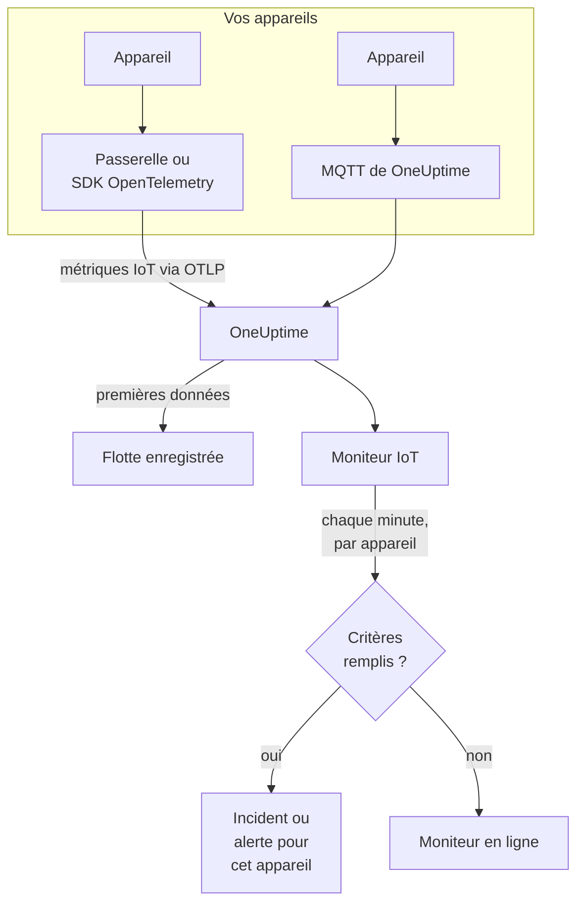

# Surveillance des appareils IoT

Un moniteur d'appareils IoT surveille une flotte d'appareils et vous prévient lorsqu'un appareil se déconnecte, que sa batterie faiblit, que son signal s'affaiblit, qu'il surchauffe ou que son CPU reste occupé. Il lit les métriques `iot_*` que vos appareils envoient à OneUptime, via OpenTelemetry ou MQTT, donc rien n'est vérifié de l'extérieur et aucune sonde n'intervient.

:::cards
- [Créer le moniteur](#créer-un-moniteur-dappareils-iot): Six étapes dans le tableau de bord.
- [Modèles](#modèles-dalerte-prédéfinis): Cinq alertes prêtes à l'emploi, un incident par appareil.
- [Détection hors ligne](#détection-hors-ligne): Comment un appareil mort ou silencieux est repéré.
- [Métriques](#métriques-collectées): Les séries `iot_*` que lit le moniteur.
:::

## Fonctionnement

Vos appareils, ou la passerelle avec laquelle ils communiquent, envoient leurs mesures à OneUptime : via OpenTelemetry, ou directement au point de terminaison MQTT de OneUptime. Chaque mesure porte le nom de la flotte, `iot.fleet.name`, et l'ID propre de l'appareil, `device.id`. Les premières données enregistrent la flotte.

Un moniteur d'appareils IoT est lié à une flotte. Chaque minute, il exécute sa requête sur les métriques de cette flotte et compare le résultat à ses critères. Les modèles regroupent par `device.id`, donc 30 capteurs hors ligne ouvrent 30 incidents, chacun nommant son appareil, et chacun se résout de lui-même lorsque son appareil se rétablit.



## Avant de commencer

- **Faites remonter les données de vos appareils.** Le [guide des appareils IoT](/docs/telemetry/iot-devices) montre comment envoyer des métriques avec un SDK ou un Collector OpenTelemetry, ou via MQTT.
- **Vérifiez que la flotte est enregistrée.** Elle apparaît sous **Produits → Infrastructure → IoT → Toutes les flottes**, sous le nom du `iot.fleet.name` qu'envoient les appareils.
- **Enregistrez les appareils que vous attendez**, dans le **Registre des appareils** de la flotte, pour être prévenu lorsque l'un d'eux devient silencieux : voir [Détection hors ligne](#détection-hors-ligne).

## Créer un moniteur d'appareils IoT

:::steps
### Commencer un nouveau moniteur

Allez dans **Moniteurs** et cliquez sur **Créer un moniteur**.

### Choisir Appareil IoT

Sous **Type de moniteur**, cliquez sur **Plus de types de moniteurs** et choisissez **Appareil IoT** sous **Infrastructure**, ou tapez `iot` dans le champ de recherche. Saisissez un **Nom** - il est utilisé dans les titres des incidents et des alertes - et cliquez sur **Suivant**.

### Choisir la flotte

Sous **Configuration du moniteur IoT**, choisissez la flotte dans **Flotte IoT**. Chaque flotte qui a envoyé des données figure dans la liste.

### Choisir ce qui est surveillé

Choisissez l'un des trois onglets :

- **Quick Setup** - cliquez sur un [modèle](#modèles-dalerte-prédéfinis). Il définit la métrique, l'agrégation, la plage temporelle, un regroupement sur `device.id` et les seuils, et remplace les critères ci-dessous par les siens. Vous pouvez toujours modifier la **Plage temporelle**.
- **Custom Metric** - choisissez une métrique dans **Métrique IoT**, puis définissez l'**Agrégation** et la **Plage temporelle**. Les [filtres](#paramètres-du-moniteur) la restreignent à un appareil ou à un type d'appareil. Une métrique personnalisée n'est pas regroupée : elle juge la flotte dans son ensemble.
- **Avancé** - construisez vous-même requêtes et formules sous **Sélectionner les métriques**, y compris sur vos propres noms de métriques, par exemple la mémoire utilisée en pourcentage de la taille mémoire d'un appareil. Utilisez **Regrouper par** `device.id` pour juger chaque appareil séparément.

### Vérifier les critères

Ouvrez chaque critère sous **Critères du moniteur** et vérifiez son **Select Metric Variable**, son **Agrégation**, sa **Condition** et son **Threshold**. Un modèle les remplit. Avec **Custom Metric** ou **Avancé**, le moniteur démarre avec les [critères par défaut](#critères-par-défaut), qui ne remarquent qu'une métrique tombant à zéro, donc définissez votre propre seuil.

### Créer le moniteur

Cliquez sur **Créer un moniteur**. OneUptime ouvre la page du moniteur et l'évalue chaque minute. Les incidents et alertes qu'il lève atteignent vos politiques d'astreinte, Slack, Microsoft Teams, l'e-mail, les SMS et les webhooks comme ceux de n'importe quel autre moniteur.
:::

> [!TIP]
> Pour configurer plusieurs modèles à la fois, ouvrez la flotte depuis **Produits → Infrastructure → IoT** et allez dans **Recommendations**. Choisissez les modèles voulus, indiquez qui est alerté, et OneUptime crée un moniteur par modèle.

## Paramètres du moniteur

| Champ | Onglet | Ce qu'il fait |
| --- | --- | --- |
| **Flotte IoT** | Tous | Obligatoire. Limite chaque requête à `resource.iot.fleet.name`. |
| **Portée de la ressource** | Custom Metric, Avancé | Facultatif. **Appareil** ou **Flotte** : une correspondance exacte sur l'attribut `iot.scope`. Choisir une métrique le règle sur **Appareil**. |
| **ID de l'appareil** | Custom Metric, Avancé | Facultatif. Un appareil, par son `device.id`, comme `sensor-001`. |
| **Type d'appareil** | Custom Metric, Avancé | Facultatif. Les appareils qui signalent ce `iot.device.type`, comme `sensor` ou `gateway`. |
| **Métrique IoT** | Custom Metric | Une métrique du [catalogue](#métriques-collectées). |
| **Agrégation** | Custom Metric | La façon dont les échantillons sont combinés : **Moyenne**, **Maximum**, **Minimum**, **Somme** ou **Comptage**. Commence à l'agrégation habituelle de la métrique. |
| **Plage temporelle** | Tous | La fenêtre glissante que lit la requête, de **Past 1 Minute** à **Past 365 Days**. Un nouveau moniteur commence à **Past 1 Minute** ; les modèles définissent la leur. |
| **Sélectionner les métriques** | Avancé | Le constructeur de requêtes : **Métrique**, **Agréger par**, **Filtrer par attributs**, **Regrouper par**, plus **Ajouter une métrique** et **Ajouter une formule** pour combiner des requêtes. |

Les filtres s'appliquent ensemble : avec un **ID de l'appareil** et un **Type d'appareil**, un appareil d'un autre type ne correspond à rien.

## Modèles d'alerte prédéfinis

**Quick Setup** propose 5 modèles. Chacun construit un moniteur complet : la requête de métrique, un regroupement sur `device.id`, un critère qui déclenche et un qui rétablit. Les seuils sont des points de départ que vous pouvez modifier.

Un critère ne déclenche que lorsque la condition est vraie pour chaque minute de sa fenêtre - sauf **Device Offline**, qui déclenche dès la première mesure inférieure à 1. Un critère de seuil se rétablit 10 % au-delà de son seuil, donc une valeur qui oscille autour de la ligne ne bascule pas sans cesse.

| Modèle | Catégorie | Gravité | Surveille | Déclenche quand | Se rétablit quand |
| --- | --- | --- | --- | --- | --- |
| Device Offline | Disponibilité | Critique | `iot_device_up`, Min par `device.id`, 30 dernières minutes | Une mesure est inférieure à 1, ou un appareil enregistré n'envoie rien pendant toute la fenêtre | De retour à 1 |
| Low Battery | Power | Warning | `iot_battery_percent`, Avg par `device.id`, 5 dernières minutes | Sous 20 % | À 22 % ou plus |
| Weak Signal | Connectivité | Warning | `iot_signal_strength_dbm`, Avg par `device.id`, 5 dernières minutes | Sous -100 dBm | À -90 dBm ou plus |
| High Temperature | Environnement | Critique | `iot_temperature_celsius`, Max par `device.id`, 5 dernières minutes | Au-dessus de 70 °C | À 63 °C ou moins |
| High CPU Usage | System | Warning | `iot_cpu_usage_ratio`, Avg par `device.id`, 5 dernières minutes | Au-dessus de 0.9 (90 % de son CPU) | À 0.81 ou moins |

La **Gravité** est le libellé qu'affiche le sélecteur. L'incident et l'alerte qu'un modèle crée commencent à la gravité d'incident et d'alerte la plus élevée de votre projet ; modifiez-les dans le critère.

- **Device Offline lit 30 minutes** pour qu'un appareil qui signale toutes les quelques minutes ne soit pas déclaré hors ligne entre deux rapports. Un appareil qui signale moins souvent qu'environ toutes les 15 minutes a besoin d'une fenêtre plus longue.
- **High Temperature utilise Max** à chaque minute, pour qu'une mesure chaude ne soit pas masquée par des mesures plus fraîches dans la même minute. Elle doit tout de même rester chaude pendant chaque minute de la fenêtre.
- **High CPU Usage compare un ratio :** `iot_cpu_usage_ratio` va de 0 à 1, donc 0.9 correspond à 90 %.

## Détection hors ligne

**Device Offline** se déclenche lorsqu'un appareil signale `iot_device_up = 0`. Un appareil mort ou silencieux le déclenche de trois façons :

| Comment | Ce qui se passe |
| --- | --- |
| **La passerelle le signale** | La passerelle ou le collecteur envoie `iot_device_up = 0` pour un appareil qu'il ne peut plus joindre. |
| **MQTT Last Will** | Un appareil connecté au point de terminaison MQTT de OneUptime enregistre un Last Will sur son topic `status`. Lorsque l'appareil meurt, le broker envoie `iot_device_up = 0` pour lui dès que la session tombe : pas d'interrogation, pas d'attente d'un rapport manqué. Voir [Envoyer des métriques via MQTT](/docs/telemetry/iot-devices#envoyer-des-métriques-via-mqtt). |
| **L'appareil est enregistré** | Un appareil du **Registre des appareils** de la flotte est attendu. Lorsqu'il n'envoie rien pendant toute la fenêtre, le moniteur le traite comme s'il signalait `0`, donc il obtient son propre incident, qui se résout de lui-même lorsque l'appareil signale à nouveau. |

Un appareil enregistré est aussi conservé comme hors ligne dans l'inventaire de la flotte, alors qu'un appareil non enregistré en est retiré après 15 minutes de silence. La détection du silence nécessite la politique d'absence de données **Treat As Zero** sur le critère `iot_device_up`, que possèdent les moniteurs Device Offline créés à partir du modèle. Un moniteur Device Offline créé avant l'existence de l'enregistrement des appareils doit la recevoir à la main, ou être recréé à partir du modèle.

> [!NOTE]
> Un appareil non enregistré qui devient silencieux, sans Last Will ni rapport de passerelle, cesse seulement d'envoyer des données, et un moniteur regroupé par appareil ne peut pas l'isoler. Enregistrez vos appareils, ou donnez à un appareil critique son propre moniteur (**Custom Metric**, avec son **ID de l'appareil**) et réglez **En l'absence de données** sur **Déclencheur**. La détection du silence nécessite aussi qu'au moins un autre appareil de la flotte continue de signaler : une flotte qui s'éteint complètement, lors d'une panne de passerelle par exemple, lève un seul incident pour le moniteur, et non un par appareil.

## Métriques collectées

Chaque série porte le label `device.id` de l'appareil, et les attributs `iot.scope`, `iot.device.type` et `iot.device.kind`.

| Métrique | Unité | Description |
| --- | --- | --- |
| `iot_device_up` | — | 1 lorsque l'appareil fonctionne, 0 lorsqu'il est en panne ou hors ligne. |
| `iot_battery_percent` | `%` | Charge restante de la batterie, de 0 à 100. Un niveau qui baisse signifie que l'appareil cessera bientôt de signaler. |
| `iot_signal_strength_dbm` | `dBm` | Puissance du signal sans fil. Plus proche de 0 est plus fort ; un signal faible précède les connexions perdues. |
| `iot_temperature_celsius` | `°C` | La température de l'appareil. Une mesure élevée peut signifier un matériel en surchauffe ou un problème dans son environnement. |
| `iot_cpu_usage_ratio` | `ratio` | Le CPU utilisé, de 0 à 1, où 1 signifie entièrement utilisé. |
| `iot_memory_usage_bytes` | `bytes` | La mémoire utilisée. Comparez-la à la taille mémoire de l'appareil pour voir la pression mémoire. |
| `iot_uptime_seconds` | `s` | Depuis combien de temps l'appareil fonctionne. Retombe à zéro lorsqu'il redémarre. |

## Critères de surveillance

Un critère compare l'une des requêtes ou formules du moniteur à un seuil. Les critères d'un moniteur d'appareils IoT proposent un seul **Type de filtre**, **Metric Value** : chaque règle vérifie la valeur de la métrique, avec ces champs.

| Champ | Ce qu'il fait |
| --- | --- |
| **Type de filtre** | Toujours **Metric Value**, la seule vérification que propose ce moniteur. |
| **Select Metric Variable** | La requête ou la formule à vérifier, par son nom de variable. |
| **Agrégation** | La façon dont les valeurs de la fenêtre deviennent une seule réponse : **Moyenne**, **Somme**, **Maximum Value**, **Minimum Value**, **All Values** (chaque valeur doit correspondre) ou **Any Value** (une seule suffit). |
| **Condition** | **Greater Than**, **Less Than**, **Greater Than Or Equal To**, **Less Than Or Equal To** ou **Equal To** — ou une condition d'anomalie : **Anomalously High**, **Anomalously Low** ou **Anomalous**. |
| **Threshold** | La valeur à laquelle comparer. Une liste d'unités se trouve à côté lorsque la métrique a une unité. Non affiché pour les conditions d'anomalie. |
| **Sensibilité** | Conditions d'anomalie uniquement. **Faible** (4σ), **Moyen** (3σ, la valeur par défaut) ou **Élevé** (2σ). |
| **Fenêtre de référence** | Conditions d'anomalie uniquement. 14 jours (la valeur par défaut), 28, 60 ou 90 jours d'historique. |
| **En l'absence de données** | Sous **Plus de champs**. Ce qui se passe lorsqu'une série n'a aucun échantillon dans la fenêtre : **Ignore** (la valeur par défaut) l'ignore, **Treat As Zero** la lit comme `0`, et **Déclencheur** fait correspondre le critère. |

Les conditions d'anomalie comparent chaque valeur à la même heure de la semaine dans la référence. Elles restent dans un état « Learning », et ne lèvent rien, tant que la fenêtre de référence ne contient pas assez d'historique.

### Critères par défaut

Un moniteur que vous ne construisez pas à partir d'un modèle commence avec deux critères :

| Ordre | Critère | Correspond quand | Ensuite |
| --- | --- | --- | --- |
| 1 | Check if _monitor name_ is offline | Une valeur quelconque de la première requête vaut `0` | Marque le moniteur **Hors ligne** et déclare l'incident « _monitor name_ is offline », qui se résout de lui-même lorsque le moniteur se rétablit. |
| 2 | Check if _monitor name_ is online | Une valeur quelconque est supérieure à `0` | Marque le moniteur **Opérationnel**. |

> [!IMPORTANT]
> Le silence ne correspond à aucun des deux critères : une flotte qui cesse d'envoyer des données laisse le moniteur dans son état. Pour être prévenu lorsque les données s'arrêtent, réglez **En l'absence de données** sur **Déclencheur** dans un critère. Une période pendant laquelle OneUptime lui-même ne recevait rien n'est jamais une absence de données : une vérification dont la fenêtre la contient attend plutôt, comme l'explique [Quand OneUptime ne reçoit pas de données](/docs/monitor/when-oneuptime-is-not-receiving).

## Terraform

Le [fournisseur Terraform de OneUptime](/docs/terraform/monitor-steps) porte la configuration d'une étape de moniteur d'appareils IoT dans l'attribut `iot_monitor` : le JSON brut de la configuration `iotMonitor` (`fleetIdentifier`, `resourceFilters`, `metricViewConfig`, `rollingTime`), écrit avec `jsonencode()` :

```hcl title="main.tf"
monitor_steps = [{
  iot_monitor = jsonencode({
    fleetIdentifier = "building-a-sensors"
    resourceFilters = {}
    rollingTime     = "Past 5 Minutes"
    metricViewConfig = {
      queryConfigs = [{
        metricAliasData = { metricVariable = "battery_percent", title = "Battery", description = "", legend = "" }
        metricQueryData = {
          filterData = {
            metricName     = "iot_battery_percent"
            attributes     = {}
            aggegationType = "Avg"
            aggregateBy    = {}
          }
          groupByAttributeKeys = ["device.id"]
        }
      }]
      formulaConfigs = []
    }
  })
  criteria = [ /* ... */ ]
}]
```

`fleetIdentifier` est le `iot.fleet.name` de la flotte, et non son ID OneUptime.

## Dépannage

:::details La flotte n'est pas dans la liste Flotte IoT
Les flottes s'enregistrent d'elles-mêmes à partir des données des appareils. Vérifiez que les appareils envoient `iot.fleet.name`, et suivez le [guide des appareils IoT](/docs/telemetry/iot-devices) pour confirmer que les données arrivent.
:::

:::details Un seul incident se déclenche pour toute la flotte au lieu d'un par appareil
La requête n'est pas regroupée. Les moniteurs **Custom Metric** jugent la flotte dans son ensemble ; utilisez un modèle, ou **Avancé** avec **Regrouper par** `device.id`.
:::

:::details Un appareil est mort mais Device Offline ne s'est pas déclenché
L'appareil n'a envoyé aucun Last Will et aucune passerelle ne l'a signalé, il est donc seulement devenu silencieux. Enregistrez-le dans le **Registre des appareils** de la flotte, et vérifiez que l'option **En l'absence de données** du critère `iot_device_up` est sur **Treat As Zero**. Voir [Détection hors ligne](#détection-hors-ligne).
:::

:::details Device Offline se déclenche pour des appareils qui vont bien
Ils signalent moins souvent que ne le couvre la fenêtre de 30 minutes, donc certaines fenêtres ne contiennent rien d'eux. Allongez la **Plage temporelle**, ou faites signaler les appareils plus souvent. Sur le point de terminaison MQTT WebSocket, gardez le keepalive MQTT sous 5 minutes : OneUptime ferme les connexions WebSocket inactives après 300 secondes, ce qui envoie le Last Will.
:::

:::details Un modèle n'affiche aucune donnée
Les modèles lisent exactement les noms de métriques `iot_*`, et regroupent par le label `device.id`. Comparez ce qu'envoient vos appareils, sur la page **Métriques** de la flotte, avec les [conventions de métriques](/docs/telemetry/iot-devices#conventions-de-métriques).
:::

## Étapes suivantes

:::cards
- [Appareils IoT](/docs/telemetry/iot-devices): Envoyer des métriques d'appareils via OpenTelemetry ou MQTT.
- [Surveillance des métriques](/docs/monitor/metrics-monitor): Alerter sur n'importe quelle métrique, pas seulement celles de l'IoT.
- [Modèles d'incident et d'alerte](/docs/monitor/incident-alert-templating): Mettre l'ID de l'appareil dans les titres des incidents.
:::
