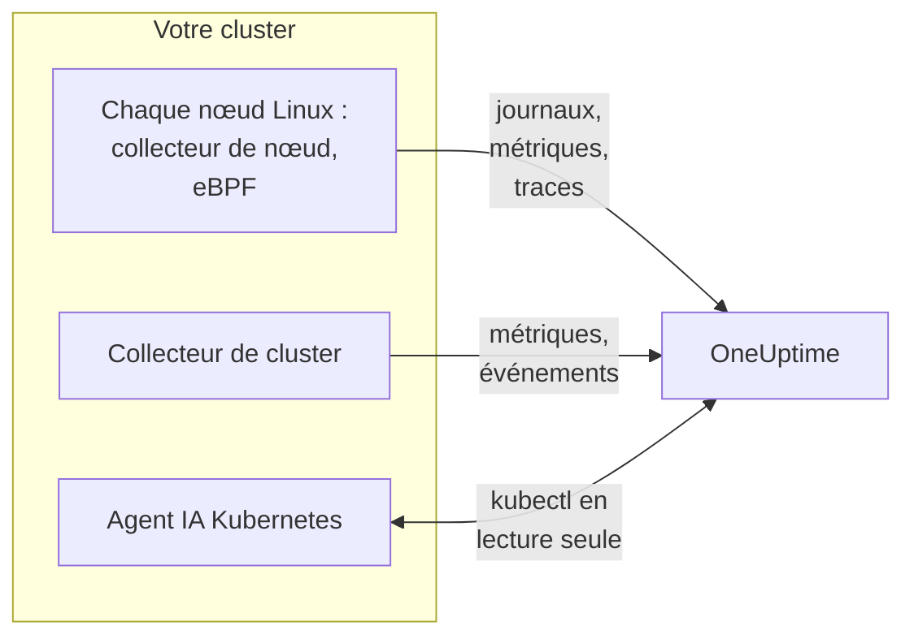

# Agent Kubernetes (installation Helm)

L'agent Kubernetes de OneUptime est un chart Helm qui collecte les métriques, les événements et les journaux de pods de votre cluster, les traces applicatives capturées avec eBPF et les métriques système de chaque nœud, et les envoie à OneUptime. Un seul `helm install` le met en place, sans aucune modification du code de vos applications. Les [moniteurs Kubernetes](/docs/monitor/kubernetes-monitor) alertent sur ce qu'il envoie.

:::cards
- [Installer l'agent](#installer-lagent): Quatre étapes avec Helm.
- [Choisir un preset](#choisir-un-preset): Clusters standard, GKE Autopilot ou EKS Fargate.
- [Options courantes](#options-courantes): Les réglages que la plupart des clusters modifient.
- [Dépannage](#dépannage): Un script de diagnostic, et les problèmes habituels.
:::

## Ce que le chart installe

Le chart exécute quelques workloads dans son propre namespace. Chacun envoie ce qu'il collecte à votre URL OneUptime via OTLP, avec la clé d'ingestion que vous lui donnez.



| Workload | Type | Ce qu'il fait | Actif par défaut |
| --- | --- | --- | --- |
| Collecteur de cluster | Deployment | Les métriques du cluster, les événements Kubernetes et les spécifications complètes des pods, nœuds et workloads, depuis l'API Kubernetes. | Oui |
| Collecteur de nœud | DaemonSet | Les journaux de pods depuis `/var/log/pods`, les métriques kubelet et cAdvisor, et les métriques système du nœud. | Oui |
| Instrumentation eBPF (OBI) | DaemonSet | Les traces HTTP, gRPC, SQL et Redis et les métriques de requêtes de chaque pod, et la carte des services. | Oui |
| Agent IA Kubernetes | Deployment | Permet à OneUptime AI d'exécuter `kubectl` en lecture seule pendant qu'il enquête sur un incident ou une alerte de ce cluster. | Oui |
| Lecteur de journaux | Deployment | Les journaux de pods via l'API Kubernetes, là où le collecteur de nœud ne peut pas les lire. | Avec les presets `gke-autopilot` et `eks-fargate` |
| Profileur eBPF | DaemonSet | Des flame graphs CPU continus de chaque processus. | Non |
| kube-state-metrics | Deployment | Les phases des pods, les raisons d'attente des conteneurs et les quotas de ressources. | Non |

Chaque image de l'agent ne fonctionne que sous Linux, donc chaque workload est épinglé aux nœuds Linux.

## Avant de commencer

- **Une clé d'ingestion.** Créez-en une dans OneUptime sous **Paramètres du projet → Télémétrie & APM → Clés d'ingestion**. L'agent l'envoie dans l'en-tête `x-oneuptime-token`, donc une clé d'API de projet ne fonctionne pas ici.
- **Helm 3** et un accès `kubectl` au cluster. Les mises à niveau utilisent `--reset-then-reuse-values`, qui nécessite Helm 3.14 ou une version ultérieure.
- **Un nom pour le cluster**, unique dans votre projet. Le chart refuse de s'installer sans nom : deux clusters portant le même nom apparaîtraient comme un seul.
- **Du HTTPS sortant** depuis le cluster vers votre URL OneUptime.

## Installer l'agent

:::steps
### Ajouter le dépôt Helm

```bash
helm repo add oneuptime https://helm-chart.oneuptime.com
helm repo update
```

### Installer le chart

Remplacez l'URL par votre URL OneUptime, et les deux espaces réservés par votre clé d'ingestion et le nom du cluster :

```bash
helm install oneuptime-agent oneuptime/kubernetes-agent \
  --namespace oneuptime-kubernetes-agent \
  --create-namespace \
  --set oneuptime.url=https://oneuptime.com \
  --set oneuptime.apiKey=<YOUR_API_KEY> \
  --set clusterName=<A_UNIQUE_NAME_FOR_THIS_CLUSTER>
```

Cela utilise le preset `standard`. Sur GKE Autopilot ou EKS Fargate, [choisissez plutôt leur preset](#choisir-un-preset).

### Vérifier que les pods tournent

```bash
kubectl get pods -n oneuptime-kubernetes-agent
```

Chaque pod devrait atteindre `Running` en une ou deux minutes.

### Trouver le cluster dans OneUptime

Ouvrez **Produits → Infrastructure → Kubernetes → Tous les clusters**. Le cluster apparaît sous son nom en quelques minutes, et ses nœuds, pods et workloads se remplissent.
:::

## Choisir un preset

Certaines plateformes Kubernetes ne permettent pas à un workload de monter un volume `hostPath` ni d'exécuter un DaemonSet, ce qu'utilise le collecteur de nœud. Le réglage `preset` choisit ce qui fonctionne sur la vôtre :

| Preset | À utiliser pour | Journaux de pods | Sur chaque nœud |
| --- | --- | --- | --- |
| `standard` (par défaut) | Autogéré, **EKS on EC2**, **GKE Standard**, **AKS**, minikube, kind, k3s | Le collecteur de nœud lit `/var/log/pods` | Métriques kubelet, cAdvisor et système |
| `gke-autopilot` | **GKE Autopilot** | Le lecteur de journaux les lit via l'API Kubernetes | Métriques kubelet et cAdvisor, sans `hostPath` |
| `eks-fargate` | **EKS Fargate** | Le lecteur de journaux les lit via l'API Kubernetes | Rien : Fargate n'exécute aucun DaemonSet |

En cas de doute, laissez `preset` vide pour obtenir `standard`. Si l'installation échoue avec une erreur Pod Security qui mentionne `hostPath`, réinstallez avec `gke-autopilot`, ou `eks-fargate` sur EKS Fargate.

GKE Autopilot et EKS Fargate refusent aussi les pods privilégiés, dont l'instrumentation eBPF et le profilage ont besoin, donc leurs presets laissent les deux de côté :

:::tabs
@tab Standard
```bash
helm install oneuptime-agent oneuptime/kubernetes-agent \
  --namespace oneuptime-kubernetes-agent --create-namespace \
  --set oneuptime.url=https://oneuptime.com \
  --set oneuptime.apiKey=<YOUR_API_KEY> \
  --set clusterName=prod
```
@tab GKE Autopilot
```bash
helm install oneuptime-agent oneuptime/kubernetes-agent \
  --namespace oneuptime-kubernetes-agent --create-namespace \
  --set oneuptime.url=https://oneuptime.com \
  --set oneuptime.apiKey=<YOUR_API_KEY> \
  --set clusterName=prod-gke-autopilot \
  --set preset=gke-autopilot
```
@tab EKS Fargate
```bash
helm install oneuptime-agent oneuptime/kubernetes-agent \
  --namespace oneuptime-kubernetes-agent --create-namespace \
  --set oneuptime.url=https://oneuptime.com \
  --set oneuptime.apiKey=<YOUR_API_KEY> \
  --set clusterName=prod-eks-fargate \
  --set preset=eks-fargate
```
:::

## Étiqueter le cluster avec des labels

Les labels que vous passez à l'installation sont attachés au cluster, ainsi qu'aux services et aux hôtes que cet agent signale. `--set oneuptime.labels.<key>=<value>` devient un label de projet nommé `<key>:<value>` :

```bash
helm install oneuptime-agent oneuptime/kubernetes-agent \
  --namespace oneuptime-kubernetes-agent \
  --create-namespace \
  --set oneuptime.url=https://oneuptime.com \
  --set oneuptime.apiKey=<YOUR_API_KEY> \
  --set clusterName=prod \
  --set oneuptime.labels.team=payments \
  --set oneuptime.labels.env=production \
  --set oneuptime.labels.region=us-east-1
```

Ou gardez-les dans un fichier de valeurs :

```yaml title="values.yaml"
oneuptime:
  url: https://oneuptime.com
  apiKey: <YOUR_API_KEY>
  labels:
    team: payments
    env: production
    region: us-east-1
clusterName: prod
```

```bash
helm install oneuptime-agent oneuptime/kubernetes-agent \
  --namespace oneuptime-kubernetes-agent --create-namespace \
  -f values.yaml
```

Chaque enregistrement que cet agent envoie - journaux, métriques, traces et profils - porte alors `team:payments`, `env:production` et `region:us-east-1`. Chaque label est un attribut de ressource `oneuptime.label.<key>=<value>`, et OneUptime transforme en label chaque attribut qui commence par `oneuptime.label.`. Les labels sont comparés sans tenir compte de la casse, donc un label `Production` existant est réutilisé, pas dupliqué. L'agent ne supprime jamais un label que vous avez ajouté dans OneUptime.

## Journaux de pods

`preset` définit `logs.mode`, que vous pouvez aussi définir vous-même :

| `logs.mode` | Comment les journaux sont lus | Avantages | Points d'attention |
| --- | --- | --- | --- |
| `daemonset` | Un collecteur de nœud par nœud suit les fichiers sous `/var/log/pods`. | Surcoût minimal, évolue avec les nœuds, aucune charge sur le serveur d'API Kubernetes, suit la rotation des journaux. | Nécessite `hostPath` et des DaemonSets. |
| `api` | Un lecteur de journaux diffuse le journal de chaque conteneur depuis l'API Kubernetes, comme le fait `kubectl logs -f`. | Fonctionne là où `hostPath` est bloqué ou où le Pod Security Standard `restricted` s'applique. | Chaque flux de conteneur est une connexion de longue durée au serveur d'API. Un réplica gère quelques milliers de conteneurs. |
| `disabled` | Rien. | Pour les applications qui envoient déjà leurs journaux autrement. | |

Pour désactiver la collecte des journaux, définissez `--set logs.enabled=false` et envoyez plutôt les journaux applicatifs avec les SDK [OpenTelemetry](/docs/telemetry/open-telemetry). Les métriques ne sont pas affectées : le collecteur de nœud continue de tourner.

### Clusters multi-OS (pools de nœuds Windows)

Les nœuds Windows n'exécutent jamais de pod de l'agent. Les données de niveau cluster sur eux et leurs pods arrivent quand même, car elles viennent de l'API Kubernetes : conditions des nœuds, phases des pods, événements Kubernetes et kube-state-metrics. Ce qui manque aux nœuds Windows, c'est ce qui est collecté sur le nœud : métriques système, métriques kubelet et cAdvisor, traces eBPF, profils et, en mode de journaux `daemonset`, journaux de pods.

Pour collecter aussi les journaux des pods sur les nœuds Windows, activez le mode hybride :

```bash
helm upgrade oneuptime-agent oneuptime/kubernetes-agent \
  --namespace oneuptime-kubernetes-agent --reset-then-reuse-values \
  --set logs.windowsPods.enabled=true
```

Le lecteur de journaux tourne alors à côté des collecteurs de nœud, uniquement pour les pods des nœuds Windows. Les pods Linux conservent la lecture de fichiers, moins coûteuse, et les deux se partagent les pods selon l'OS du nœud, donc aucune ligne de journal n'est envoyée deux fois.

- **Version de l'image du lecteur.** La répartition limitée à Windows est intégrée à l'image `kubernetes-log-tailer`. Une image plus ancienne l'ignore et suit *tous* les pods, en envoyant deux fois les journaux de chaque pod Linux. N'épinglez pas `logs.api.image.tag` sur une version plus ancienne que la version du chart, et si un nœud a pu mettre en cache une ancienne image `release`, ajoutez `--set logs.api.image.pullPolicy=Always` à la mise à niveau.
- **Filtrage par gravité.** Avec `filters.logs.minSeverity` défini, une ligne sans gravité reconnaissable est supprimée sur le chemin du collecteur de nœud mais conservée sur celui du lecteur de journaux - voir [Filtrage par gravité des journaux](/docs/telemetry/kubernetes-agent#filtrage-par-gravité-des-journaux). Les pods Windows peuvent alors envoyer davantage de lignes sans niveau que les pods Linux.

## Traces applicatives avec eBPF

Le chart exécute [OpenTelemetry eBPF Instrumentation (OBI)](https://opentelemetry.io/docs/zero-code/obi/) sur chaque nœud. OBI charge des programmes eBPF dans le noyau Linux et observe le trafic réseau de chaque pod, ce qui lui permet de reconstituer les appels HTTP et HTTPS, gRPC, et SQL et Redis sans aucune modification de vos applications : pas de SDK, pas de sidecar. Il les envoie à OneUptime sous forme de traces et de métriques de requêtes.

Vos services apparaissent sous **Produits → Traces** et sur la carte des services en une ou deux minutes, avec `k8s.cluster.name` défini sur le nom du cluster, ce qui permet de filtrer par cluster.

### Quand désactiver eBPF

eBPF est activé par défaut. Désactivez-le avec `--set ebpf.enabled=false` lorsque :

- Le cluster est **GKE Autopilot** ou **EKS Fargate**. Leurs presets le font pour vous : ces plateformes refusent les pods privilégiés, et OBI doit être privilégié pour charger ses programmes.
- Les nœuds exécutent un noyau antérieur à **Linux 5.8** sans BTF. Debian 11, Ubuntu 20.10, Fedora 34, RHEL 9 et les versions ultérieures conviennent.
- Vos applications envoient déjà des traces avec un SDK OpenTelemetry, et vous ne les voulez pas en double.

### Ce qu'envoie eBPF

OBI envoie plusieurs types de signaux. Chacun peut être désactivé avec `--set ebpf.features.<key>=false` :

| Réglage | Par défaut | Ce qu'il ajoute |
| --- | --- | --- |
| `ebpf.features.httpMetrics` | activé | Des métriques de requêtes HTTP et gRPC par service : taux de requêtes, histogrammes de latence et erreurs. |
| `ebpf.features.spanMetrics` | activé | Des métriques de spans : appels et durée par service, route ou opération, type de span et statut - `traces.span.metrics.calls` et `traces.span.metrics.duration` (secondes). |
| `ebpf.features.serviceGraph` | activé | Le taux et la latence de chaque appel d'un service à un autre, qui dessinent la carte des services. |
| `ebpf.features.networkMetrics` | activé | Les octets et paquets entre chaque paire de pods, sur TCP et UDP, avec leurs noms Kubernetes. Montre chaque paire de pods qui communiquent, même via des protocoles qu'OBI ne sait pas lire. |
| `ebpf.features.networkInterZoneMetrics` | désactivé | La même chose entre zones. Double le nombre de séries : activez-le seulement si vous planifiez par zone. |
| `ebpf.features.tcpStats` | activé | Des statistiques TCP par nœud : temps d'aller-retour, connexions échouées et retransmissions. |

### Relier les traces entre les services

OBI peut aussi propager la trace à travers un appel : lorsque le pod A appelle le pod B via HTTP ou gRPC, le span côté B rejoint la trace de A, sans SDK dans aucune des deux applications. **C'est désactivé par défaut.** Activez-le avec `--set ebpf.contextPropagation=true`, après avoir lu l'avertissement ci-dessous.

| Option | Par défaut | Ce qu'elle fait |
| --- | --- | --- |
| `ebpf.contextPropagation` | désactivé | Écrit un `traceparent` W3C dans le trafic sortant, afin que les spans se relient entre les services. |
| `ebpf.contextPropagationMode` | `headers` | Comment : `headers` (en-têtes de requête HTTP/1.1, le plus restreint), `tcp` (une option TCP, via Linux Traffic Control) ou `all` (les deux). Lu uniquement lorsque `contextPropagation` est activé. |
| `ebpf.trackRequestHeaders` | activé | Suit les en-têtes de requête dans le noyau, pour que le côté récepteur trouve le `traceparent` aussi sur les serveurs HTTP simples. N'a d'effet que lorsque `contextPropagation` est activé. |

> [!WARNING]
> Chaque mode de propagation modifie un trafic déjà en vol. Pour le HTTP simple, OBI agrandit la requête sortante dans le noyau pour y loger l'en-tête ; pour le TLS et le TCP brut, il ajoute une option TCP depuis un hook Traffic Control, en réécrivant le paquet et sa somme de contrôle. Si le décompte d'octets de la connexion n'est alors pas corrigé exactement, le flux se **désynchronise** : les transferts via un proxy comme nginx se bloquent en cours de route, dès qu'une réponse dépasse environ 64 Ko, jusqu'à l'expiration de la connexion. Les petites requêtes continuent de fonctionner, donc cela ressemble à un bug de l'application ou du proxy. Aucune version du noyau ne fait disparaître la réécriture. Les traces, les métriques de requêtes et la carte des services fonctionnent toutes sans elle ; un SDK OpenTelemetry dans vos services relie les traces sans aucune réécriture dans le noyau. Si vous l'activez, essayez-la d'abord sur un cluster hors production, et vérifiez les gros transferts à travers votre proxy.

### Relier les journaux aux traces

**Désactivé par défaut.** Lorsqu'il est activé, OBI attache une sonde à l'appel système `write()` de chaque processus qu'il instrumente, et :

- Une **ligne de journal JSON** reçoit les champs `trace_id` et `span_id` (les champs que la ligne a déjà sont conservés). Le collecteur de nœud les déplace vers les champs de trace propres de l'enregistrement de journal, donc les journaux d'un span sont à un clic dans OneUptime, tout comme la trace d'une ligne de journal.
- **Toute autre ligne de journal** est collectée sans changement, sans le lien.

```bash
helm upgrade oneuptime-agent oneuptime/kubernetes-agent \
  --namespace oneuptime-kubernetes-agent --reset-then-reuse-values \
  --set ebpf.logToTraceCorrelation=true
```

| Option | Par défaut | Ce qu'elle fait |
| --- | --- | --- |
| `ebpf.logToTraceCorrelation` | `false` | Active l'enrichisseur de journaux d'OBI et la remontée de `trace_id` par le collecteur de nœud. |
| `ebpf.logEnricher.services` | `[{service: [{exe_path: "*"}]}]` | Les processus que touche l'enrichisseur. Chaque entrée est un sélecteur [GlobAttributes](https://opentelemetry.io/docs/zero-code/obi/configure/options/#service-discovery) d'OBI, avec des champs comme `exe_path`, `languages`, `k8s_pod_labels`, `k8s_pod_annotations`, `open_ports` et `cmd_args`. |

#### Agents APM qui plantent avec

L'enrichisseur réécrit le tampon de sortie de l'application **à l'intérieur du processus** : lorsqu'un processus ciblé appelle `write()`, OBI efface les octets d'origine et écrit une copie enrichie. Les agents APM qui se chargent via `LD_PRELOAD` et enveloppent eux-mêmes `write()` n'y survivent pas :

| Agent APM | Bibliothèque | Ce qui se passe |
| --- | --- | --- |
| Dynatrace OneAgent | `liboneagentproc.so` | L'application plante avec SIGSEGV (code de sortie 139). Le propre `write()` du watchdog Dynatrace dépasse sa limite de 10 secondes et le OneAgent redémarre en boucle. |
| New Relic | `libnewrelic*.so` | Le même type de plantage. |
| AppDynamics | `libappdynamics*.so` | Le même type de plantage. |
| Datadog | `libdd*.so` | Le même type de plantage. |
| Instana | `libinstana*.so` | Le même type de plantage. |

**Les applications .NET sont les plus exposées :** l'agent .NET de Dynatrace se charge toujours via `LD_PRELOAD`, et le journal console de Microsoft.Extensions.Logging n'utilise pas de tampon, donc chaque ligne prend ce chemin. Les applications Python et Go ne sont généralement pas concernées.

Pour l'utiliser à côté de l'un de ces agents, pointez `logEnricher.services` uniquement vers les pods qui n'en ont pas. L'enrichisseur ne sait pas exclure, donc listez ceux à enrichir :

```yaml title="values.yaml"
ebpf:
  logToTraceCorrelation: true
  logEnricher:
    services:
      # Enrich only pods with the apm-agent=none label
      - service:
          - k8s_pod_labels:
              apm-agent: "none"
```

Ou choisissez par runtime. Le chargement par `LD_PRELOAD` de Dynatrace cible .NET, donc enrichir uniquement Python, Go, Ruby et Node.js l'évite :

```yaml title="values.yaml"
ebpf:
  logToTraceCorrelation: true
  logEnricher:
    services:
      - service:
          - languages: "python,go,ruby,nodejs"
```

#### Les journaux doivent être en JSON et sans tampon

- **Seules les lignes JSON reçoivent un `trace_id`.** Passez le logger à un format JSON : `structlog`, `pino`, `winston`, `serilog`, `logback-json`, klog `--logging-format=json` et autres.
- **Une sortie avec tampon rompt le lien**, car le `write()` se produit alors sur un autre thread que la requête. En **Python**, définissez `PYTHONUNBUFFERED=1`. En **.NET**, appelez `Console.SetOut(new StreamWriter(Console.OpenStandardOutput()) { AutoFlush = true })` au démarrage ; `AddConsole()` de Microsoft.Extensions.Logging et les sinks asynchrones de Serilog ne fonctionnent pas, le simple `WriteTo.Console()` de Serilog fonctionne.
- Greenlet, gevent, Tornado et les autres runtimes asynchrones personnalisés ne sont pas pris en charge.

### Régler eBPF

| Option | Par défaut | Ce qu'elle fait |
| --- | --- | --- |
| `ebpf.enabled` | `true` | Exécute le DaemonSet eBPF. `false` le laisse de côté. |
| `ebpf.image.tag` | `v0.14.0` | L'image OBI. OBI est antérieur à la 1.0 : épinglez une version que vous avez testée, et testez à nouveau avant de la changer. |
| `ebpf.autoTargetExe` | `*` | Des globs des exécutables à instrumenter, séparés par des virgules. Restreignez-le, comme `*/python,*/java`, pour instrumenter moins de runtimes. |
| `ebpf.excludeExePaths` | Shells, plomberie du cluster, sidecars de service mesh, agents CNI, navigateurs, ClickHouse, collecteurs et OBI lui-même | Des globs des exécutables à ignorer, séparés par des virgules. Un glob trop large ignore aussi vos propres binaires. |
| `ebpf.logLevel` | `info` | `debug`, `info`, `warn` ou `error`. |
| `ebpf.printTraces` | `false` | Affiche aussi les spans dans le journal d'OBI, pour vérifier ce qu'il capture. |
| `ebpf.resources.*` | `100m` de CPU et `512Mi` de mémoire demandés, limites de `2000m` et `2Gi` | Augmentez-les pour les nœuds à fort trafic ou avec de nombreux processus de courte durée. |

Pour vérifier qu'OBI tourne et voit du trafic :

```bash
kubectl get pods -n oneuptime-kubernetes-agent -l component=ebpf-instrument
kubectl logs -n oneuptime-kubernetes-agent -l component=ebpf-instrument --tail=200
```

## Profilage CPU continu

Le [OpenTelemetry eBPF Profiler](https://github.com/open-telemetry/opentelemetry-ebpf-profiler) peut aussi tourner sur chaque nœud, sous la forme de l'image `otel/opentelemetry-collector-ebpf-profiler`. Il échantillonne ce que chaque processus exécute, 19 fois par seconde, en Go, Java, .NET, Python, Ruby, Node.js, PHP, Perl, C, C++ et Rust, et envoie les profils à OneUptime. Ils apparaissent sous **Produits → Profils de performance**, et sous forme de flame graph sur chaque span de trace.

**Le profilage est désactivé par défaut :** il coûte plus de CPU et de mémoire par nœud que l'instrumentation eBPF. Activez-le avec `--set profiling.enabled=true`.

Avec l'instrumentation eBPF également activée (le comportement par défaut), chaque échantillon porte la trace à laquelle il appartient, donc un span a son propre flame graph. Pour cela, le chart demande à OBI de garder disponible le contexte de trace en cours (`OTEL_EBPF_BPF_POPULATE_TRACE_CONTEXT=true`), ce qui coûte un peu aux applications instrumentées à chaque changement de contexte asynchrone. Définissez `profiling.obiProcessContext=false` pour avoir des flame graphs sans le lien vers les spans.

Le profilage nécessite **Linux 5.10** ou une version ultérieure, et un pod privilégié avec les ID de processus du nœud : il ne peut pas tourner sur GKE Autopilot ni sur EKS Fargate, et leurs presets le laissent désactivé. Sur des nœuds qui sont eux-mêmes des conteneurs, comme kind ou k3d, il ne sait pas distinguer les processus, et presque aucun échantillon n'est relié à un span.

| Option | Par défaut | Ce qu'elle fait |
| --- | --- | --- |
| `profiling.enabled` | `false` | Exécute le DaemonSet du profileur. |
| `profiling.image.tag` | `0.152.0` | L'image du profileur. Elle est antérieure à la 1.0 : épinglez une version que vous avez testée. |
| `profiling.samplesPerSecond` | `19` | Le nombre d'échantillons par seconde. 19 évite de s'aligner sur les fréquences de minuterie courantes. |
| `profiling.offCpuThreshold` | `0` | Une valeur au-dessus de 0 et jusqu'à 1 profile aussi le temps passé hors du CPU, ce qui montre la contention de verrous et les E/S bloquantes, avec un surcoût. |
| `profiling.tracers` | `""` (chaque runtime) | Les traceurs de langage à charger, séparés par des virgules, comme `go,python`. |
| `profiling.obiProcessContext` | `true` | Relie les échantillons aux traces d'OBI, et demande à OBI de garder le contexte de trace disponible pour cela. |

## Autres collectes de données

| Option | Par défaut | Ce qu'elle ajoute |
| --- | --- | --- |
| `hostMetrics.enabled` | activé | Les métriques système de chaque nœud depuis `/proc` et `/sys` : files d'attente d'E/S disque, inodes des systèmes de fichiers, erreurs des interfaces réseau, pagination et charge moyenne. Tourne dans le collecteur de nœud, sans pod supplémentaire. |
| `kubeletstats.utilizationMetrics.enabled` | activé | Le CPU et la mémoire des conteneurs et des pods en pourcentage de leur demande et de leur limite, que lisent les moniteurs de saturation CPU et mémoire. Toujours 0 pour un pod sans demande ni limite. |
| `kubeletstats.volumeMetrics.enabled` | activé | L'espace libre et total de chaque PVC (`k8s.volume.available`, `k8s.volume.capacity`), que lit le moniteur PVC Low Disk Space. Une série par PVC et par pod. |
| `cadvisor.enabled` | activé | Le bridage du CPU et les arrêts OOM depuis le `/metrics/cadvisor` de chaque kubelet : `container_cpu_cfs_throttled_seconds_total`, `container_cpu_cfs_periods_total` et `container_oom_events_total`, et rien d'autre. |
| `kubeStateMetrics.enabled` | désactivé | Les phases des pods (Pending, Terminating), les pods qui ne peuvent pas être planifiés, les raisons d'attente des conteneurs (CrashLoopBackOff, ImagePullBackOff) et l'utilisation des quotas de ressources, depuis kube-state-metrics. `kubeStateMetrics.mode: bundled` (par défaut) exécute un petit kube-state-metrics pour vous ; `external` lit celui que vous exécutez déjà, à `kubeStateMetrics.endpoint`. |
| `auditLogs.enabled` | désactivé | Le journal d'audit Kubernetes, `/var/log/kubernetes/audit.log` : chaque requête à l'API, par qui, sur quoi. Clusters autogérés uniquement : les clusters gérés (EKS, GKE, AKS, DOKS) l'envoient au fournisseur cloud. |
| `csi.enabled` | désactivé | Les métriques des pilotes de stockage CSI, depuis les pods étiquetés `app=csi-driver` ou `app.kubernetes.io/component=csi-driver` : temps d'attachement et de détachement des volumes, échecs de provisionnement, IOPS. |
| `coreDns.enabled` | désactivé | Les métriques de CoreDNS sur `:9153/metrics` : taux de requêtes, latence, succès du cache et erreurs. |
| `controlPlane.enabled` | désactivé | etcd, le serveur d'API, l'ordonnanceur et le gestionnaire de contrôleurs. Clusters autogérés uniquement : les clusters gérés ne les exposent pas. |
| `cost.enabled` | désactivé | Ce que coûte chaque workload. Voir [Observabilité des coûts Kubernetes](/docs/telemetry/kubernetes-cost). |

## Options courantes

| Option | Par défaut | Ce qu'elle fait |
| --- | --- | --- |
| `oneuptime.url` | (obligatoire) | Votre URL OneUptime. |
| `oneuptime.apiKey` | (obligatoire) | La clé d'ingestion, depuis **Paramètres du projet → Télémétrie & APM → Clés d'ingestion**. Envoyée dans l'en-tête `x-oneuptime-token` ; une clé d'API de projet ne fonctionne pas. |
| `clusterName` | (obligatoire) | Le nom du cluster, unique dans le projet. Chaque enregistrement le porte sous `k8s.cluster.name`. |
| `preset` | (vide : `standard`) | `standard`, `gke-autopilot` ou `eks-fargate`. Voir [Choisir un preset](#choisir-un-preset). |
| `oneuptime.labels` | `{}` | Des labels pour chaque enregistrement de cet agent. Voir [Étiqueter le cluster avec des labels](#étiqueter-le-cluster-avec-des-labels). |
| `namespaceFilters.rules` | Exclut `kube-system` de `podLogs` et `ebpfDiscovery` | Des règles qui incluent ou excluent des namespaces, pour `podLogs`, `ebpfDiscovery`, `metrics` et `traces`. Les motifs peuvent utiliser `*`, et l'exclusion l'emporte toujours. |
| `filters.logs.minSeverity` | `""` | Supprime les lignes de journaux de pods sous ce niveau : `TRACE`, `DEBUG`, `INFO`, `WARN`, `ERROR` ou `FATAL`. |
| `filters.metrics.exclude` | `[]` | Les noms de métriques à supprimer. |
| `sampling.traces.percentage` | `100` | La part des traces à conserver, de 0 à 100. Les traces sont conservées ou supprimées en entier. |
| `logs.enabled` | `true` | Collecte les journaux de pods. |
| `logs.mode` | (selon `preset`) | `daemonset`, `api` ou `disabled`. Remplace le preset. |
| `logs.windowsPods.enabled` | `false` | Suit aussi les pods des nœuds Windows. Voir [Clusters multi-OS](#clusters-multi-os-pools-de-nœuds-windows). |
| `logs.api.replicas` | `1` | Les réplicas du lecteur de journaux, en mode `api`. |
| `ebpf.enabled` | `true` | Les traces eBPF et les métriques de requêtes. Voir [Traces applicatives avec eBPF](#traces-applicatives-avec-ebpf). |
| `profiling.enabled` | `false` | Les flame graphs CPU. Voir [Profilage CPU continu](#profilage-cpu-continu). |
| `kubeStateMetrics.enabled` | `false` | L'état du cluster depuis kube-state-metrics. |
| `aiAgent.enabled` | `true` | L'agent IA Kubernetes. Voir [Agent IA Kubernetes](/docs/telemetry/kubernetes-agent) pour ce qu'il peut faire. |

Le [`values.yaml`](https://github.com/OneUptime/oneuptime/blob/master/HelmChart/Public/kubernetes-agent/values.yaml) du chart liste et explique chaque option, et [Agent Kubernetes](/docs/telemetry/kubernetes-agent) couvre le filtrage, l'échantillonnage et la réduction du volume de données.

## Mise à niveau

```bash
helm repo update
helm upgrade oneuptime-agent oneuptime/kubernetes-agent \
  --namespace oneuptime-kubernetes-agent \
  --reset-then-reuse-values
```

`--reset-then-reuse-values` (Helm 3.14 et ultérieur) conserve les valeurs que vous avez définies - le preset, le nom du cluster, les filtres - et prend toutes les autres valeurs du nouveau chart. Ajoutez tout nouveau `--set` après lui. Avec Helm 3.13 ou antérieur, mettez plutôt à niveau avec les valeurs que vous avez définies :

```bash
helm repo update
helm get values oneuptime-agent --namespace oneuptime-kubernetes-agent -o yaml > values.yaml && \
  helm upgrade oneuptime-agent oneuptime/kubernetes-agent \
  --namespace oneuptime-kubernetes-agent -f values.yaml
```

Ne mettez pas à niveau avec `--reuse-values` : il conserve aussi les valeurs par défaut du chart depuis lequel vous mettez à niveau, de sorte que les valeurs par défaut d'un chart plus récent, dont son image eBPF, ne s'appliquent jamais. Lorsqu'une release tourne avec les valeurs par défaut d'un ancien chart, les notes que Helm affiche après l'installation ou la mise à niveau se terminent par un avertissement et la commande qui corrige le problème.

> [!WARNING]
> **Les métriques de spans eBPF ont de nouveaux noms.** `ebpf.features.spanMetrics` envoie désormais `traces.span.metrics.calls` et `traces.span.metrics.duration` (secondes) au lieu de `traces_spanmetrics_calls_total` et `traces_spanmetrics_latency` : les mêmes séries, sous les noms qu'OBI conserve (il a rendu les anciens obsolètes). Un tableau de bord, un graphique ou un moniteur de métriques sur un ancien nom ne reçoit plus de nouvelles données après la mise à niveau, sans erreur - passez-le au nouveau nom, et mettez à jour toute entrée de `filters.metrics` qui nomme un ancien nom.

## Désinstallation

```bash
helm uninstall oneuptime-agent --namespace oneuptime-kubernetes-agent
kubectl delete namespace oneuptime-kubernetes-agent
```

## Dépannage

:::details Le cluster apparaît comme Disconnected, ou aucune donnée n'arrive
Exécutez le script de diagnostic du chart. Il vérifie les pods, la clé d'ingestion et la sortie du cluster, demande à OneUptime si la clé est acceptée, et affiche un seul verdict. Il ne fait que lire, et ne modifie rien :

```bash
curl -fsSL https://raw.githubusercontent.com/OneUptime/oneuptime/master/HelmChart/Public/kubernetes-agent/troubleshoot.sh \
  | bash -s -- -n oneuptime-kubernetes-agent
```

La cause habituelle, surtout après une réinstallation, est une clé d'ingestion erronée ou révoquée : OneUptime la refuse, et le collecteur abandonne chaque lot tandis que ses pods restent `Running`.
:::

:::details L'installation échoue avec « hostPath volumes are not allowed »
Le cluster bloque `hostPath`. Passez à un preset qui lit les journaux via l'API Kubernetes ; il laisse aussi eBPF de côté :

```bash
helm upgrade oneuptime-agent oneuptime/kubernetes-agent \
  --namespace oneuptime-kubernetes-agent \
  --reset-then-reuse-values \
  --set preset=gke-autopilot
```

Sur EKS Fargate, utilisez `--set preset=eks-fargate`.
:::

:::details Des pods de l'agent restent en ImagePullBackOff sur des nœuds Windows
Les anciens charts planifiaient les DaemonSets de l'agent sur les nœuds Windows, où leurs images Linux ne peuvent jamais être tirées. Exécutez `helm upgrade` : le chart actuel épingle chaque workload aux nœuds Linux, et les pods bloqués disparaissent. Pour collecter les journaux des pods sur les nœuds Windows, voir [Clusters multi-OS](#clusters-multi-os-pools-de-nœuds-windows).
:::

:::details Aucun journal n'arrive dans OneUptime
Vérifiez les pods de l'agent et leurs journaux :

```bash
kubectl get pods -n oneuptime-kubernetes-agent
kubectl logs -n oneuptime-kubernetes-agent -l app.kubernetes.io/part-of=oneuptime --tail=200
```

En mode `api`, le lecteur de journaux répond sur `/healthz`, port 13133, avec l'état de ses exports : atteignez-le avec `kubectl port-forward`.
:::

:::details Les pods eBPF sont en CrashLoopBackOff, ou ne démarrent pas
Lisez le journal d'OBI :

```bash
kubectl logs -n oneuptime-kubernetes-agent -l component=ebpf-instrument --tail=200
```

- **Le noyau est trop ancien, ou n'a pas de BTF.** OBI nécessite Linux 5.8 ou ultérieur avec BTF ; vérifiez avec `uname -r` sur un nœud. Si vous ne pouvez pas le mettre à niveau, désactivez eBPF avec `--set ebpf.enabled=false`.
- **Les pods privilégiés sont refusés.** Certains clusters les refusent même en dehors d'Autopilot et de Fargate. Désactivez eBPF.
- **OBI tourne, mais aucune trace n'arrive.** Définissez `--set ebpf.printTraces=true` et relisez le journal d'OBI. Des spans à cet endroit signifient que l'export vers OneUptime échoue : vérifiez l'URL et la clé d'ingestion. L'absence de spans peut signifier que le trafic est chiffré par une bibliothèque TLS qu'OBI ne sait pas lire, comme une bibliothèque liée statiquement.
:::

:::details Les gros transferts se bloquent après l'activation du lien entre traces
C'est `ebpf.contextPropagation` qui réécrit le trafic : voir l'avertissement dans [Relier les traces entre les services](#relier-les-traces-entre-les-services). Désactivez-le avec `--set ebpf.contextPropagation=false`.
:::

:::details Des applications plantent avec le code de sortie 139 après l'activation du lien entre journaux
Un agent APM qui se charge via `LD_PRELOAD` est dans les mêmes pods : voir [Agents APM qui plantent avec](#agents-apm-qui-plantent-avec). Désactivez `ebpf.logToTraceCorrelation`, ou pointez `ebpf.logEnricher.services` vers des pods sans cet agent.
:::

:::details Un seul lecteur de journaux ne suffit pas pour le cluster (mode api)
Répartissez les namespaces entre plusieurs releases, chacune installée avec ses propres règles de namespaces :

```bash
helm install oneuptime-agent-ns-a oneuptime/kubernetes-agent \
  --set preset=gke-autopilot \
  --set-json 'namespaceFilters.rules=[{"action":"include","namespaces":["app-a","app-b"],"scopes":["podLogs"]}]' \
  ...
```

Augmenter `logs.api.replicas` ajoute des lecteurs, mais chacun lit chaque namespace autorisé, donc vous devez quand même répartir les namespaces pour éviter les doublons.
:::

## Étapes suivantes

:::cards
- [Surveillance Kubernetes](/docs/monitor/kubernetes-monitor): Alerter sur ce que l'agent envoie.
- [Agent Kubernetes](/docs/telemetry/kubernetes-agent): Le filtrage, l'échantillonnage, l'agent IA, et la réduction du volume de données.
- [Observabilité des coûts Kubernetes](/docs/telemetry/kubernetes-cost): Voir ce que coûte chaque workload.
- [Surveillance des traces](/docs/monitor/traces-monitor): Alerter sur les traces que capture eBPF.
:::
