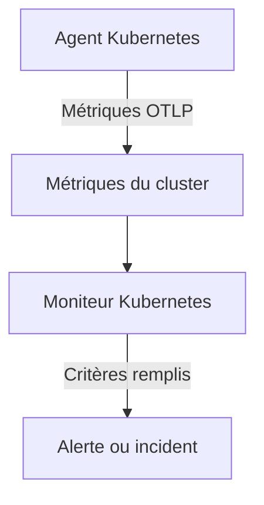

# Surveillance Kubernetes

Un moniteur Kubernetes alerte sur les métriques que l'agent Kubernetes de OneUptime envoie depuis un cluster : nœuds, pods, conteneurs, charges de travail, autoscalers et plan de contrôle. Partez d'un modèle d'alerte prêt à l'emploi, choisissez une seule métrique ou écrivez votre propre requête, puis définissez le seuil qui ouvre une alerte ou un incident.

:::cards
- [Installer l'agent](/docs/monitor/kubernetes-agent): Une seule commande Helm fait entrer le cluster dans OneUptime.
- [Créer le moniteur](#créer-un-moniteur-kubernetes): Choisir le cluster, puis un modèle, une métrique ou une requête.
- [Modèles d'alerte](#modèles-dalerte-prêts-à-lemploi): Vingt-six alertes prêtes à l'emploi, d'un cluster devenu silencieux à etcd.
- [Critères](#critères-de-surveillance): Seuils statiques et détection d'anomalies.
:::

## Fonctionnement

L'agent envoie les métriques du cluster à OneUptime via OTLP, chacune marquée du nom du cluster (`k8s.cluster.name`, le `clusterName` du chart). Les premières données d'un nouveau nom enregistrent le cluster sous **Kubernetes**, et dès lors le cluster peut être choisi dans un moniteur Kubernetes. Chaque minute, le moniteur interroge ces métriques sur sa **Plage temporelle**, les agrège et compare le résultat à ses critères.

## Avant de commencer

- L'agent Kubernetes de OneUptime en cours d'exécution dans le cluster. Voir [Agent Kubernetes (installation Helm)](/docs/monitor/kubernetes-agent) ; le cluster apparaît sous **Kubernetes** quelques minutes après l'installation.
- Pour les modèles du plan de contrôle (**etcd No Leader**, **API Server Request Saturation**, **Scheduler Backlog**) : la collecte du plan de contrôle par l'agent, `controlPlane.enabled`, qui lit l'API server d'emblée ; etcd et le scheduler ont aussi besoin que leurs points de terminaison soient indiqués (voir [Activer la surveillance du plan de contrôle](/docs/telemetry/kubernetes-agent#activer-la-surveillance-du-plan-de-contrôle)). Les clusters managés (EKS, GKE, AKS) n'exposent pas ces points de terminaison, si bien que ces moniteurs n'y reçoivent jamais de données.
- Pour les modèles de coûts (**Cluster Daily Cost Over Budget**, **Namespace Daily Cost Over Budget**, **High Idle Spend**) : la surveillance des coûts de l'agent, activée par défaut sauf avec les presets `gke-autopilot` et `eks-fargate` (voir [Observabilité des coûts Kubernetes](/docs/telemetry/kubernetes-cost)).

## Créer un moniteur Kubernetes

:::steps
### Commencer un nouveau moniteur

Allez dans **Moniteurs** et cliquez sur **Créer un moniteur**. Sous **Plus de types de moniteurs**, choisissez **Kubernetes** – ou tapez `k8s` dans le champ de recherche.

### Choisir le cluster

Sélectionnez-le dans **Cluster Kubernetes**. La liste contient chaque cluster depuis lequel l'agent a envoyé des données. Une fois le choix fait, une ligne sous le champ indique si des données arrivent. **Ajouter un cluster Kubernetes** ouvre des étapes de configuration avec vos clés déjà renseignées, qui attendent les premières données.

### Choisir ce qu'il faut surveiller

Un nouveau moniteur démarre sur **Cluster Stopped Reporting**, sous **Sur quoi alerter** ; **Modifier** choisit un autre modèle. **Custom Metric** et **Avancé** sont sous **Plus de champs** :

| Où | Ce que vous choisissez |
| --- | --- |
| **Sur quoi alerter** | Un [modèle d'alerte prêt à l'emploi](#modèles-dalerte-prêts-à-lemploi). Il remplit la métrique, la portée, la plage temporelle et les critères ; vous pouvez toujours changer la **Plage temporelle**. |
| **Custom Metric** | Une métrique du [catalogue de métriques](#catalogue-de-métriques), puis sa **Portée de la ressource**, ses filtres, son **Agrégation** (Moyenne, Maximum, Minimum, Somme ou Comptage) et sa **Plage temporelle**. |
| **Avancé** | La **Portée de la ressource**, les filtres et la **Plage temporelle**, ainsi que vos propres requêtes de métriques et formules sous **Sélectionner les métriques**, avec un graphique en direct du résultat. |

### Définir les critères

Définissez quand le moniteur change de statut et quand il ouvre une alerte ou un incident – voir [Critères de surveillance](#critères-de-surveillance). Un modèle les a déjà remplis : vérifiez les seuils, les gravités et les politiques d'astreinte.

### Enregistrer le moniteur

Terminez le formulaire et enregistrez. Le moniteur apparaît sous **Moniteurs**, et son statut suit vos critères dès sa première évaluation.
:::

## Options de configuration

### Portée de la ressource et filtres

**Portée de la ressource** fixe le niveau auquel la métrique est évaluée et décide quels filtres le formulaire affiche. Chaque filtre est facultatif.

| Portée | Surveille | Filtres |
| --- | --- | --- |
| Cluster | Le cluster entier | — |
| Espace de noms | Les ressources d'un espace de noms | **Espace de noms** |
| Charge de travail | Un deployment, statefulset, daemonset, job ou cronjob | **Espace de noms**, **Type de charge de travail**, **Nom de la charge de travail** |
| Nœud | Un nœud du cluster | **Nom du nœud** |
| Pod | Un pod | **Espace de noms**, **Nom du pod** |

Les métriques d'un conteneur et d'un pod portent les noms des charges de travail auxquelles appartient le pod (le pod d'un Deployment porte le nom du Deployment et celui de son ReplicaSet) : la portée Charge de travail surveille donc les conteneurs et les pods de cette charge de travail. Les métriques propres à une charge de travail, comme les pods en échec d'un Job, ne portent que le nom de leur propre charge de travail : limitez-les au type de cette charge de travail.

### Plage temporelle

**Plage temporelle** est la fenêtre que couvre la requête de métrique à chaque évaluation du moniteur, de **Past 1 Minute** à **Past 365 Days**. Les fenêtres courtes (1 à 15 minutes) conviennent aux alertes ; les plus longues lissent les métriques bruitées.

### Requêtes de métriques et formules

Dans l'onglet **Avancé**, chaque requête nomme une métrique, la façon dont ses valeurs sont agrégées et des filtres d'attributs facultatifs. Une **formule** combine des requêtes avec de l'arithmétique – les modèles d'utilisation des nœuds, par exemple, divisent l'utilisation par la capacité allouable.

## Catalogue de métriques

L'onglet **Custom Metric** propose ces métriques, regroupées par type de ressource :

| Catégorie | Métriques |
| --- | --- |
| Pod | Consommation CPU du pod, Utilisation mémoire du pod, Phase du pod (code), Utilisation du système de fichiers du pod, Capacité du volume, Espace libre du volume, Utilisation de la limite mémoire du pod, Utilisation de la limite CPU du pod, E/S réseau du pod (cumulées, deux sens) |
| Nœud | Consommation CPU du nœud, CPU allouable du nœud, Utilisation de la mémoire du nœud, Working set mémoire du nœud, Utilisation du système de fichiers du nœud, Mémoire allouable du nœud, Condition Ready du nœud, Condition MemoryPressure du nœud, Condition DiskPressure du nœud, Condition PIDPressure du nœud, Système de fichiers disponible du nœud, Capacité du système de fichiers du nœud |
| Conteneur | Redémarrages du conteneur, Redémarrages du conteneur (hausse), Limite CPU du conteneur, Demande CPU du conteneur, Limite mémoire du conteneur, Demande mémoire du conteneur, Conteneur prêt, Système de fichiers disponible du conteneur, Capacité du système de fichiers du conteneur |
| Charge de travail | Réplicas disponibles du Deployment, Réplicas souhaités du Deployment, Nœuds souhaités du DaemonSet, Nœuds mal planifiés du DaemonSet, Nœuds prêts du DaemonSet, Réplicas souhaités du StatefulSet, Réplicas prêts du StatefulSet, Pods en échec du Job, Pods en échec du Job (hausse), Pods réussis du Job |
| HPA | Réplicas actuels du HPA, Réplicas souhaités du HPA, Réplicas maximum du HPA, Réplicas minimum du HPA |
| Plan de contrôle | etcd a un leader, Requêtes en cours du serveur d'API, Pods en attente du planificateur |
| Coût | Coût du cluster, Coût inactif, Coût de la charge de travail, Efficacité des coûts de la charge de travail |

> [!NOTE]
> **Consommation CPU du pod** et **Consommation CPU du nœud** sont exprimés en cœurs, pas en pourcentage : `0.18` correspond à 0,18 cœur. **Phase du pod (code)** est un code (1 Pending, 2 Running, 3 Succeeded, 4 Failed, 5 Unknown) – agrégez-le avec Maximum ou Minimum, jamais avec Somme. Les métriques du plan de contrôle n'arrivent que si la collecte du plan de contrôle par l'agent est activée. **Condition Ready du nœud** vaut 1 pour Ready, 0 pour NotReady et -1 pour Unknown, ce que signale un nœud tombé : alertez en dessous de 1. **Redémarrages du conteneur** est le compteur cumulé des redémarrages du conteneur ; **Redémarrages du conteneur (hausse)** est ce que l'agent envoie avec chaque échantillon : les redémarrages depuis son échantillon précédent du conteneur, si bien que leur somme sur une fenêtre donne les redémarrages qu'elle contient. Elle porte ce que porte **Redémarrages du conteneur**, noms des charges de travail du pod du conteneur compris, mais pas l'identifiant du conteneur, qui change à chaque redémarrage. **Pods en échec du Job** est le compteur cumulé des pods en échec d'un Job ; **Pods en échec du Job (hausse)** est ce que l'agent envoie avec chaque échantillon : les pods du Job en échec depuis son échantillon précédent du Job, si bien que leur somme sur une fenêtre donne les échecs qu'elle contient. Elle porte ce que porte **Pods en échec du Job** : le nom et l'espace de noms du Job.

## Critères de surveillance

### Ce qui est évalué

Ces moniteurs évaluent toujours la **Valeur de la métrique** – la valeur de la requête de métrique ou de la formule configurée. Le formulaire de critère n'a pas de sélecteur de type de filtre ; il affiche **Métrique**, **Agrégation**, **Condition** et **Seuil**.

### Types d'agrégation

| Agrégation | Description |
| --- | --- |
| Moyenne | Valeur moyenne sur la fenêtre de temps |
| Somme | Somme de toutes les valeurs |
| Valeur maximale | Valeur la plus élevée de la fenêtre de temps |
| Valeur minimale | Valeur la plus basse de la fenêtre de temps |
| Toutes les valeurs | Toutes les valeurs doivent correspondre au critère et couvrir toute la fenêtre de temps |
| Au moins une valeur | Au moins une valeur doit correspondre |

### Conditions

Les seuils statiques sont comparés au **Seuil** que vous saisissez : **Supérieur à**, **Inférieur à**, **Supérieur ou égal à**, **Inférieur ou égal à** et **Égal à**. **Aucune donnée** est vraie quand la requête n'a rien renvoyé dans la fenêtre, **Données reçues** quand elle a renvoyé quelque chose.

La détection d'anomalies par rapport à une référence n'a pas besoin de seuil. Choisissez l'une de ces conditions, et le formulaire affiche **Sensibilité** et **Fenêtre de référence** à la place :

| Condition | Correspond quand la valeur |
| --- | --- |
| **Anormalement élevé** | Monte au-dessus de la plage attendue |
| **Anormalement bas** | Descend sous la plage attendue |
| **Anormal** | Sort de la plage attendue dans un sens ou dans l'autre |

Chaque mesure est comparée à une référence de la même heure de la semaine, construite à partir de la **Fenêtre de référence** (14 jours par défaut ; 28, 60 ou 90 jours). **Sensibilité** fixe la largeur de la plage attendue : **Faible (4σ — écarts flagrants uniquement)**, **Moyen (3σ — recommandé)**, la valeur par défaut, ou **Élevé (2σ — plus bruyant, services très stables)**. Les conditions d'anomalie restent dans un état « Learning » et ne produisent aucune alerte tant que cette heure de la semaine n'a pas deux semaines d'historique. Ce moniteur filtre ses requêtes par attributs, donc chaque requête, et chaque série d'une requête regroupée, est comparée à son propre historique, aussi loin que vos métriques sont conservées. Si c'est moins de deux semaines, une somme, un décompte ou une requête sur un histogramme reste dans cet état pour de bon, et tout le reste est comparé à toutes les séries de la métrique. Un centile d'un histogramme reste toujours dans cet état.

**En l'absence de données**, sous **Plus de champs**, décide de ce qui se passe quand la requête ne renvoie rien dans la fenêtre : **Ignore** (par défaut) ne correspond pas, **Déclencheur** traite le silence comme le problème, et **Treat As Zero** compare un zéro. Le temps pendant lequel OneUptime lui-même ne recevait pas de données n'est jamais une absence de données : une vérification dont la fenêtre en contient attend à la place, comme l'explique [Quand OneUptime ne reçoit pas de données](/docs/monitor/when-oneuptime-is-not-receiving).

## Modèles d'alerte prêts à l'emploi

La liste de **Sur quoi alerter** présente ces modèles, regroupés par catégorie. Chacun remplit deux critères : l'un marque le moniteur hors ligne et ouvre un incident et une alerte tant que la condition est remplie, l'autre le remet en ligne quand elle cesse de l'être.

| Modèle | Catégorie | Se déclenche quand | Gravité |
| --- | --- | --- | --- |
| Cluster Stopped Reporting | Disponibilité | Aucune donnée n'arrive de l'agent du cluster pendant 10 minutes | Critique |
| CrashLoopBackOff Detection | Charge de travail | Un conteneur a redémarré en 15 minutes et a été prêt moins de la moitié de ce temps | Critique |
| Pod Stuck in Pending | Planification | Un pod est en phase Pending dans chaque mesure d'une fenêtre de 15 minutes | Avertissement |
| Node Not Ready | Nœud | Un nœud signale NotReady ou cesse de signaler son état (Unknown) | Critique |
| Node Under Pressure | Nœud | Un nœud signale MemoryPressure, DiskPressure ou PIDPressure pendant 10 minutes | Avertissement |
| High Node CPU Utilization | Nœud | L'utilisation moyenne du CPU d'un nœud dépasse 90 % de son CPU allouable | Avertissement |
| High Node Memory Utilization | Nœud | Le working set mémoire moyen d'un nœud dépasse 85 % de sa mémoire allouable | Avertissement |
| Deployment Replica Mismatch | Charge de travail | Un deployment a moins de réplicas disponibles que souhaité pendant 15 minutes | Avertissement |
| StatefulSet Replica Mismatch | Charge de travail | Un StatefulSet a moins de réplicas prêts que souhaité pendant 15 minutes | Avertissement |
| Job Failures | Charge de travail | Un pod d'un job a échoué en 15 minutes | Avertissement |
| etcd No Leader | Plan de contrôle | etcd n'a pas de leader élu | Critique |
| API Server Request Saturation | Plan de contrôle | Le serveur d'API maintient 200 requêtes en cours ou plus pendant toute la fenêtre | Critique |
| Scheduler Backlog | Planification | La file des pods en attente du scheduler n'est pas vide pendant 5 minutes | Avertissement |
| High Node Disk Usage | Stockage | Le système de fichiers d'un nœud est plein à plus de 85 % | Avertissement |
| Node Image Disk Almost Full | Stockage | Le disque où un nœud conserve ses images de conteneurs est plein à plus de 85 % | Avertissement |
| PVC Almost Full | Stockage | Une revendication de volume persistant est pleine à plus de 90 % | Avertissement |
| DaemonSet Pods Not Ready | Charge de travail | Un DaemonSet a des nœuds sans aucun de ses pods prêt pendant 15 minutes | Avertissement |
| DaemonSet Misscheduled Nodes | Charge de travail | Un DaemonSet exécute des pods sur des nœuds qui ne correspondent plus à son sélecteur de nœuds, à son affinité ou à ses tolérances | Avertissement |
| High Node CPU Request Commitment | Nœud | La somme des requêtes CPU des conteneurs d'un nœud dépasse 90 % de son CPU allouable | Avertissement |
| High Node Memory Request Commitment | Nœud | La somme des requêtes mémoire des conteneurs d'un nœud dépasse 90 % de sa mémoire allouable | Avertissement |
| HPA Saturated at Max Replicas | Charge de travail | Un HPA mis à l'échelle au-dessus de ses `minReplicas` tourne à 90 % ou plus de ses `maxReplicas` | Critique |
| Pod Memory Saturating Container Limit | Charge de travail | Un pod utilise plus de 90 % de la limite de mémoire de ses conteneurs | Critique |
| Pod CPU Saturating Container Limit | Charge de travail | Un pod utilise plus de 90 % de la limite de CPU de ses conteneurs | Avertissement |
| Cluster Daily Cost Over Budget | Coût | Le coût du cluster sur la dernière journée dépasse 100, un budget à ajuster au vôtre | Avertissement |
| Namespace Daily Cost Over Budget | Coût | Le coût d'un espace de noms sur la dernière journée dépasse 20, un budget à ajuster au vôtre | Avertissement |
| High Idle Spend | Coût | Plus de 40 % du coût du cluster sur la dernière journée a servi à payer de la capacité inutilisée | Avertissement |

Les modèles fondés sur des métriques par objet évaluent chaque nœud, pod, deployment, job, DaemonSet ou HPA séparément, si bien qu'un cluster avec plusieurs pods défaillants reçoit un incident par pod plutôt qu'un seul pour tout le cluster.

Les modèles de coûts lisent les métriques que OneUptime écrit à partir des lignes de coûts horaires de l'agent, un point par heure : ils additionnent donc la dernière journée, et leurs budgets sont exprimés dans la devise du cluster, USD par défaut.

**High Node CPU Request Commitment** et **High Node Memory Request Commitment** ne comptent que les requêtes (requests) des pods qui ne sont pas terminés, comme le fait le planificateur. Le cluster continue de signaler les requêtes d'un pod Succeeded ou Failed, comme celui d'un Job terminé, jusqu'à la suppression du pod : elles ne sont pas comptées.

**Node Image Disk Almost Full** lit le disque sur lequel, selon le kubelet, chaque conteneur en cours d'exécution écrit ses propres fichiers, car l'agent ne remonte pas lui-même le disque d'images d'un nœud. Dans les configurations habituelles, c'est le disque d'images, mais pas sur tous les nœuds : là où un nœud conserve ses images sur son système de fichiers racine, comme la plupart, c'est le système de fichiers racine, si bien que le modèle se déclenche en même temps que **High Node Disk Usage** ; avec le système de fichiers d'images scindé du kubelet (`KubeletSeparateDiskGC`), c'est le disque où écrivent les conteneurs et non celui des images ; et un nœud sans conteneur en cours d'exécution ne remonte rien. Les recommandations d'un cluster le proposent dès qu'un nœud conserve ses images sur un disque à part, ce que la liste des nœuds montre alors dans la colonne **Disque d'images** ; la liste de **Sur quoi alerter** le présente pour tout cluster. Par défaut, le kubelet supprime les images inutilisées dès qu'un disque qui contient les images est plein à 85 % et évince des pods quand il en reste moins de 15 % de libre : ce modèle et **High Node Disk Usage** se déclenchent donc à 85 % et remettent le moniteur en ligne à 80 %, le niveau auquel le nettoyage des images ramène le disque. Sur un nœud dont les images ont leur propre disque, le kubelet évince des pods selon son système de fichiers racine à partir de 90 %, si bien que **High Node Disk Usage** s'y déclenche avant que l'éviction ne commence.

**Cluster Stopped Reporting** se déclenche quand rien n'arrive de l'agent du cluster pendant dix minutes : l'agent a été désinstallé ou plante en boucle, sa clé d'API a été révoquée, il a perdu sa connexion à OneUptime, ou le serveur d'API du cluster ne lui répond plus. Il se résout dès que les données reviennent. Quand les données cessent d'arriver, les autres modèles n'ont plus rien à comparer et gardent leur dernier état ; c'est donc lui qui vous prévient.

> [!NOTE]
> **CrashLoopBackOff Detection** additionne `k8s.container.restarts.increase`, que l'agent envoie avec chaque échantillon : les redémarrages depuis son échantillon précédent du conteneur. Il compte donc chaque redémarrage, quel que soit l'écart entre les échantillons, se résout seul une fois les redémarrages arrêtés, et un pod recréé commence un nouveau compte au lieu d'être lu comme des redémarrages. Un agent plus ancien n'envoie pas `k8s.container.restarts.increase` : [mettez-le à niveau](/docs/monitor/kubernetes-agent#mise-à-niveau) d'abord. Un moniteur créé à partir du modèle avant cela lit de combien `k8s.container.restarts` a augmenté au sein de chaque minute, ce qui manque environ la moitié des redémarrages d'une boucle de plantage : supprimez-le et créez le modèle à nouveau.

> [!NOTE]
> **Job Failures** additionne `k8s.job.failed_pods.increase`, que l'agent envoie avec chaque échantillon : les pods du Job en échec depuis son échantillon précédent du Job. Il compte donc chaque échec, quel que soit l'écart entre les échantillons, se résout seul une fois les échecs arrêtés, et un Job recréé sous le même nom commence un nouveau compte au lieu d'être lu comme des échecs. Les échecs antérieurs au premier échantillon d'un Job par l'agent sont le point de départ de son compte : un Job qui échoue dans sa première demi-minute et ne réessaie jamais peut donc passer inaperçu. Un agent plus ancien n'envoie pas `k8s.job.failed_pods.increase` : [mettez-le à niveau](/docs/monitor/kubernetes-agent#mise-à-niveau) d'abord. Un moniteur créé à partir du modèle avant cela lit de combien `k8s.job.failed_pods` a augmenté au sein de chaque minute, ce qui manque environ la moitié des échecs : supprimez-le et créez le modèle à nouveau.

### Repérer les causes, pas seulement les symptômes

Les modèles au niveau des nœuds (High Node CPU Utilization, High Node Memory Utilization, Node Not Ready, Pod Stuck in Pending) se déclenchent à la *fin* d'une chaîne d'épuisement des ressources, quand le cluster est déjà dégradé. Trois modèles se déclenchent à son *début*, là où se trouve généralement la solution :

- **Pod Memory Saturating Container Limit** et **Pod CPU Saturating Container Limit** repèrent une charge de travail plaquée contre ses propres limites. Dépasser une limite de mémoire provoque un OOMKill immédiat ; dépasser une limite de CPU pousse le noyau à brider le pod, qui ralentit sans jamais renvoyer d'erreur. Les deux sont la cause habituelle des CrashLoopBackOff et des latences inexpliquées.
- **HPA Saturated at Max Replicas** repère un autoscaler sans marge restante. Une charge de travail dont les limites par pod sont trop basses est bridée ou tuée, ce qui gonfle la métrique même sur laquelle le HPA se base – l'autoscaler continue donc d'ajouter des réplicas tous aussi affamés, jusqu'à atteindre son plafond. Relever les limites est la solution ; relever `maxReplicas` aggrave la situation.

Activez-les ensemble dans tout espace de noms qui exécute une charge de travail mise à l'échelle automatiquement : la combinaison distingue « a vraiment besoin de plus de capacité » de « sous-dimensionnée par pod ».

> [!NOTE]
> Les deux modèles de limite de pod divisent l'utilisation du pod par la **somme** des limites de ses conteneurs, si bien que les pods avec sidecars sont mesurés correctement. Le chiffre de mémoire de pod du kubelet inclut le cache de pages récupérable, donc une charge de travail qui manipule beaucoup de fichiers peut rester haut sur le modèle de mémoire sans jamais subir d'OOMKill : lisez-le comme « approche de la limite », pas « sur le point d'être tué ».

## Dépannage

:::details Le cluster n'est pas dans la liste Cluster Kubernetes
Les clusters s'enregistrent eux-mêmes à partir des données de l'agent, sous le `clusterName` avec lequel l'agent a été installé. Vérifiez que les pods de l'agent tournent et que le cluster figure sous **Produits → Infrastructure → Kubernetes → Tous les clusters**. [Agent Kubernetes (installation Helm)](/docs/monitor/kubernetes-agent) couvre l'installation et ce qu'il faut vérifier quand aucune donnée n'arrive.
:::

:::details Un modèle du plan de contrôle ne se déclenche jamais
**etcd No Leader**, **API Server Request Saturation** et **Scheduler Backlog** lisent des métriques que seule la collecte du plan de contrôle par l'agent recueille. Activez `controlPlane.enabled` dans les valeurs Helm de l'agent ; elle est désactivée par défaut. Cela lit l'API server. etcd et le scheduler s'exécutent sur les nœuds du plan de contrôle, si bien que **etcd No Leader** et **Scheduler Backlog** ont aussi besoin de `controlPlane.etcd.endpoints` et de `controlPlane.scheduler.endpoints` réglés sur des adresses que le pod de l'agent peut atteindre (voir [Activer la surveillance du plan de contrôle](/docs/telemetry/kubernetes-agent#activer-la-surveillance-du-plan-de-contrôle)). Les clusters managés (EKS, GKE, AKS) n'exposent pas ces points de terminaison, si bien que ces moniteurs n'y reçoivent jamais de données.
:::

:::details Un seuil de CPU ne se déclenche jamais
**Consommation CPU du pod** et **Consommation CPU du nœud** sont exprimés en cœurs, pas en pourcentage, donc un seuil de `80` signifie 80 cœurs. Définissez le seuil en cœurs, ou partez de **High Node CPU Utilization** ou de **Pod CPU Saturating Container Limit**, qui comparent un pourcentage.
:::

:::details CrashLoopBackOff Detection ne s'est pas déclenché pour un redémarrage
Le modèle se déclenche quand un conteneur redémarre en 15 minutes alors qu'il a été prêt moins de la moitié de ce temps : un conteneur qui a redémarré une fois et est revenu aussitôt n'alerte donc pas. Il lit `k8s.container.restarts.increase`, qu'un agent plus ancien n'envoie pas : [mettez l'agent à niveau](/docs/monitor/kubernetes-agent#mise-à-niveau). Un moniteur créé à partir du modèle avant cela lit de combien `k8s.container.restarts` a augmenté entre deux échantillons d'une même minute, et manque les redémarrages entre les échantillons de deux minutes : supprimez-le et créez le modèle à nouveau. Si `filters.metrics.include` liste les métriques que l'agent envoie, ajoutez-y `k8s.container.restarts.increase`. Un moniteur limité à une charge de travail a aussi besoin des noms des charges de travail sur `k8s.container.restarts.increase`, qu'un agent plus ancien envoie sans eux : [mettez l'agent à niveau](/docs/monitor/kubernetes-agent#mise-à-niveau).
:::

:::details Job Failures ne s'est pas déclenché pour un Job en échec
Le modèle se déclenche quand un pod d'un Job échoue en 15 minutes, et se résout quinze minutes après le dernier échec. Il lit `k8s.job.failed_pods.increase`, qu'un agent plus ancien n'envoie pas : [mettez l'agent à niveau](/docs/monitor/kubernetes-agent#mise-à-niveau). Un moniteur créé à partir du modèle avant cela lit de combien `k8s.job.failed_pods` a augmenté entre deux échantillons d'une même minute, et manque les échecs entre les échantillons de deux minutes : supprimez-le et créez le modèle à nouveau. Les échecs antérieurs au premier échantillon d'un Job par l'agent sont le point de départ de son compte : un Job dont le seul pod échoue dans sa première demi-minute passe donc inaperçu. Si `filters.metrics.include` liste les métriques que l'agent envoie, ajoutez-y `k8s.job.failed_pods.increase`. Un moniteur limité à une charge de travail doit nommer le Job lui-même : les pods en échec d'un Job portent son nom et son espace de noms, pas le CronJob qui l'a créé.
:::

## Étapes suivantes

:::cards
- [Agent Kubernetes (installation Helm)](/docs/monitor/kubernetes-agent): Installer, mettre à jour et régler l'agent avec Helm.
- [Agent Kubernetes](/docs/telemetry/kubernetes-agent): Filtres d'espaces de noms, métriques du plan de contrôle, filtres de gravité des journaux et l'agent IA.
- [Surveillance des métriques](/docs/monitor/metrics-monitor): Alerter sur n'importe quelle métrique, y compris les métriques personnalisées et eBPF de l'agent.
- [Modèles d'incident et d'alerte](/docs/monitor/incident-alert-templating): Mettre le pod ou le nœud en cause dans les titres d'incident.
:::
