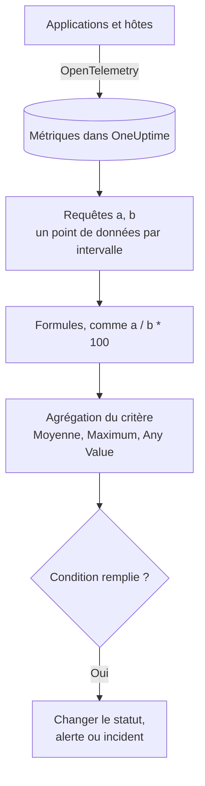

# Surveillance des métriques

Un moniteur de métriques interroge les métriques que vos applications et votre infrastructure envoient à OneUptime, les combine avec des formules quand vous avez besoin d'un ratio ou d'un total, et compare le résultat à vos critères sur une plage de temps glissante. Utilisez-le pour les taux de requêtes, les ratios d'erreurs, la profondeur des files, le CPU, la mémoire et le disque – n'importe quelle série numérique –, avec une alerte par hôte ou par conteneur quand vous le regroupez.

:::cards
- [Créer le moniteur](#créer-un-moniteur-de-métriques): Requêtes, formules, une plage de temps et des critères.
- [Comment il est évalué](#comment-il-est-évalué): Points de données, formules et agrégation des critères.
- [Exemple](#exemple-une-file-qui-grossit): Les mêmes données sous chaque agrégation.
- [Alertes par série](#alertes-par-série-group-by): Une alerte par hôte, conteneur ou point de montage.
:::

## Fonctionnement

Chaque minute, OneUptime exécute chaque requête de métriques du moniteur sur sa plage de temps. Une requête renvoie un point de données par intervalle de temps, et les formules combinent les requêtes intervalle par intervalle. Chaque critère réduit ensuite les points de données de la requête ou de la formule qu'il vérifie – à leur moyenne, à leur maximum ou à un test de chaque point – et compare le résultat à son seuil.

## Avant de commencer

- Vos applications ou votre infrastructure envoient des métriques à OneUptime via OpenTelemetry. Voir [OpenTelemetry](/docs/telemetry/open-telemetry).
- Connaissez le nom de la métrique et les attributs sur lesquels vous voulez filtrer ou regrouper. Les listes **Métrique** et **Regrouper par** ne proposent que des noms et des attributs qu'OneUptime a reçus.

## Créer un moniteur de métriques

:::steps
### Commencer un nouveau moniteur

Allez dans **Moniteurs** et cliquez sur **Créer un moniteur**. Ou bien, dans l'explorateur de métriques, construisez le graphique que vous voulez surveiller et cliquez sur **Créer un moniteur à partir de cette vue** : le nouveau moniteur commence avec ses requêtes.

### Choisir Metrics

Sous **Type de moniteur**, cliquez sur **Plus de types de moniteurs** et choisissez **Métriques** sous **Télémétrie**, ou tapez `metrics` dans le champ de recherche. Saisissez un **Nom**, puis cliquez sur **Suivant**.

### Ajouter les requêtes de métriques

Dans **Métrique à surveiller**, choisissez une **Métrique** et la façon de l'**Agréger par**. Ouvrez **Filtres et regroupement** pour filtrer par attributs ou **Regrouper par** l'un d'eux. Cliquez sur **Ajouter une métrique** pour une autre requête, ou sur **Ajouter une formule** pour les combiner. Le graphique sous les requêtes montre les dernières heures, avec la valeur de la règle en ligne rouge, pour que vous voyiez les valeurs que la règle vérifiera.

### Dire quand alerter

Dans **Quand alerter**, choisissez dans **Mesuré comme** comment la métrique est mesurée, puis une **Fenêtre de temps**, une **Condition** et une **Valeur**. Quand l'étape a plus d'une requête ou formule, choisissez aussi la **Métrique** que lit la règle. La phrase en dessous redit la règle en termes simples.

### Choisir ce qui se passe

Dans **Ce qui se passe**, choisissez **Créer une alerte**, **Déclarer un incident** ou **Les deux**, puis donnez-lui un titre et une gravité. Tant que la règle correspond, le moniteur affiche le statut indiqué sous **Plus de champs** ; quand elle ne correspond plus, le moniteur revient à son statut par défaut et l'alerte ou l'incident se résout de lui-même.

### Créer le moniteur

Cliquez sur **Créer un moniteur**. Le moniteur s'ouvre sur sa page **Vue d'ensemble**, et sa première évaluation a lieu dans la minute.
:::

## Ce qu'il interroge

### Requêtes de métriques

| Champ | Ce qu'il fait | Par défaut |
| --- | --- | --- |
| **Métrique** | La métrique à interroger. | Obligatoire |
| **Agréger par** | Comment les valeurs de chaque intervalle de temps sont combinées en un point de données : Moy., Somme, Min, Max, Comptage, ou un centile – P50, P75, P90, P95 ou P99. | Moy. |
| **Filtrer par attributs** (sous **Filtres et regroupement**) | Seulement les séries dont les attributs remplissent ces conditions. | Aucun filtre |
| **Regrouper par** (sous **Filtres et regroupement**) | Une série par valeur unique de ces attributs – voir [Alertes par série](#alertes-par-série-group-by). | Une seule série |

Chaque requête et chaque formule reçoit une variable – `a`, `b`, `c` et ainsi de suite – dans l'ordre où vous les ajoutez.

### Formules

Une formule combine des variables de requête avec `+`, `-`, `*`, `/`, `%`, `^` et des parenthèses, intervalle par intervalle. Vous pouvez écrire les variables avec ou sans `$` devant :

- `a / b * 100` – la part de `b` que représente `a`, en pourcentage
- `a + b` – deux métriques additionnées
- `a - b` – la différence entre elles

### Fenêtre de temps glissante

La **Fenêtre de temps** de **Quand alerter** fixe la profondeur à laquelle chaque évaluation remonte : **Dernière minute**, **Dernières 5 minutes**, **Dernières 10 minutes**, **Dernières 15 minutes**, **Dernières 30 minutes**, **Dernière heure**, **Dernières 2 heures**, **Dernières 3 heures**, **Dernières 6 heures**, **Dernières 12 heures**, **Dernières 24 heures**, **2 derniers jours**, **3 derniers jours**, **7 derniers jours**, **14 derniers jours**, **30 derniers jours**, **60 derniers jours**, **90 derniers jours**, **180 derniers jours** ou **365 derniers jours**.

Plus la fenêtre est longue, plus chaque intervalle de temps est large, si bien qu'un point de données représente plus de temps :

| Fenêtre de temps | Un point de données par |
| --- | --- |
| Dernière minute à Dernières 3 heures | minute |
| Dernières 6 heures, Dernières 12 heures | 5 minutes |
| Dernières 24 heures | 15 minutes |
| 2 derniers jours, 3 derniers jours | 30 minutes |
| 7 derniers jours | heure |
| 14 derniers jours, 30 derniers jours | jour |
| 60 derniers jours à 180 derniers jours | semaine |
| 365 derniers jours | mois |

## Comment il est évalué

- **Chaque minute.** Un moniteur de métriques n'est pas vérifié par des sondes ; il n'a donc pas d'intervalle à régler ni de page **Sondes et intervalle**.
- **Les requêtes, puis les formules.** Chaque requête renvoie un point de données par intervalle de temps de la plage, selon son **Agréger par**. Les formules sont calculées pour chaque intervalle à partir des points de données des requêtes.
- **Puis la mesure de la règle.** La règle réduit les points de données de sa métrique à ce qu'elle compare à sa valeur, comme l'indique **Mesuré comme** :

| Mesuré comme | Dans les critères personnalisés | La condition est vérifiée sur… |
| --- | --- | --- |
| La moyenne | Moyenne | la moyenne des points de données |
| La somme | Somme | la somme des points de données |
| La valeur la plus haute | Maximum Value | le point de données le plus élevé |
| La valeur la plus basse | Minimum Value | le point de données le plus bas |
| Chaque valeur (toute la fenêtre) | All Values | chaque point de données : tous doivent remplir la condition et couvrir toute la plage de temps |
| Une valeur quelconque (à tout moment) | Any Value | chaque point de données : il suffit que l'un d'eux remplisse la condition |

- **Les critères de haut en bas.** Sur un moniteur sans Group By, le premier critère qui correspond décide ; placez donc le plus grave en premier. Un moniteur regroupé vérifie chaque critère pour chaque série – voir [L'évaluation des critères diffère](#lévaluation-des-critères-diffère).
- **L'absence de données n'est pas zéro.** Quand la requête ne renvoie aucun point de données sur la plage de temps, la règle fait ce que dit **S'il n'y a pas de données**, sous **Plus de champs** dans **Quand alerter** : **Rien** (la valeur par défaut – la règle ne correspond pas), **Compter comme zéro** ou **Alerter, comme si elle correspondait**.
- **Chaque valeur a besoin de toute la plage de temps.** Une série ne remplit une règle mesurée comme **Chaque valeur (toute la fenêtre)** qu'une fois que ses points de données couvrent la plage de temps, de son début à maintenant, sans trou de plus d'un point de données manquant. Quand toutes les données du moniteur arrivent en retard, comme celles de CloudWatch, son point de données le plus récent tient lieu de maintenant. Un hôte, un conteneur ou un deployment qui vient de commencer à envoyer des données, ou qui est resté silencieux un moment, attend d'avoir des données sur toute une plage de temps, et le journal d'évaluation indique où il en est : `Waiting for 15 minutes of data: 2 of 15 minutes so far`. Une série dont l'alerte ou l'incident est déjà ouvert est jugée sur ses seuls points de données, si bien qu'un court trou dans ses données ne le résout pas. Si la métrique envoie des données moins souvent que la durée de la plage de temps, un point de données isolé compte pour toute la plage dès qu'il a quelques minutes ; pour juger combien de temps une valeur dure, la plage de temps doit couvrir au moins deux intervalles d'envoi.
- **L'indisponibilité d'OneUptime lui-même n'est pas un silence.** Tant que la plage de temps contient une période où OneUptime lui-même ne recevait pas de données – il redémarrait, était mis à jour ou rattrapait un retard –, la vérification attend : le statut ne change pas, et aucun incident ni aucune alerte n'est ouvert ni résolu, quoi que dise **S'il n'y a pas de données**. Voir [Quand OneUptime ne reçoit pas de données](/docs/monitor/when-oneuptime-is-not-receiving).

## Critères

Ces moniteurs évaluent toujours la **Metric Value** – la valeur agrégée de la requête de métriques ou de la formule configurée. **Quand alerter** configure un critère à partir de **Mesuré comme**, **Fenêtre de temps**, **Condition** et **Valeur**. Quand la métrique a une unité, choisissez l'unité de la valeur à côté. Sa **Condition** est **Au-dessus de**, **Supérieur ou égal à**, **En dessous de**, **Inférieur ou égal à**, **Exactement**, **Anormalement haut**, **Anormalement bas** ou **Anormalement haut ou bas**. Pour plusieurs critères, comme des paliers de gravité, cliquez sur **Modifier en critères personnalisés** sous **Plus de champs** dans **Ce qui se passe** : chaque critère y a une **Métrique**, une **Agrégation**, une **Condition** et un **Seuil**.

| Condition | Correspond quand la valeur est… |
| --- | --- |
| **Supérieur à** | au-dessus du seuil |
| **Supérieur ou égal à** | égale ou supérieure au seuil |
| **Inférieur à** | en dessous du seuil |
| **Inférieur ou égal à** | égale ou inférieure au seuil |
| **Égal à** | exactement le seuil |
| **Anomalously High** | au-dessus de la plage attendue pour cette heure de la semaine |
| **Anomalously Low** | en dessous de cette plage |
| **Anomalous** | hors de cette plage, dans un sens ou dans l'autre |

Les conditions d'anomalie n'ont pas de seuil. **Quand alerter** affiche à la place **Sensibilité** – Faible, Moyen (la valeur par défaut) ou Élevé –, et les critères personnalisés aussi une **Fenêtre de référence** – 14 jours (la valeur par défaut), 28, 60 ou 90 –, et chaque point de données est comparé à la référence de la même heure de la semaine construite sur cette fenêtre. Tant que cette heure de la semaine n'a pas assez d'historique, le critère est encore en apprentissage et ne produit aucune alerte.

Un moniteur de métriques créé dans « Créer un moniteur » commence avec une règle sur sa première requête : **La moyenne** sur **Dernières 5 minutes**, **Au-dessus de** la **Valeur** saisie, et **Créer une alerte**.

Un nouveau moniteur de métriques créé via l'API ou Terraform sans critères commence avec deux critères sur sa première requête, tous deux avec l'agrégation **Any Value** :

| Critère | Condition | Effet |
| --- | --- | --- |
| Check if … is offline | **Égal à** `0` | Passe le moniteur hors ligne et déclare un incident, résolu automatiquement |
| Check if … is online | **Supérieur à** `0` | Passe le moniteur en ligne |

> [!NOTE]
> Le critère hors ligne se déclenche sur une valeur rapportée de 0, pas sur le silence. Pour alerter quand une métrique cesse d'arriver, réglez son **En l'absence de données** sur **Déclencheur**.

## Exemple : une file qui grossit

Vous voulez un incident quand la file de checkout reste profonde. La requête `a` est la jauge `checkout.queue.depth`, avec **Agréger par** Max, et la **Fenêtre de temps** est **Dernières 5 minutes**. Une évaluation voit ces cinq points de données d'une minute :

| Minute | 10:01 | 10:02 | 10:03 | 10:04 | 10:05 |
| --- | --- | --- | --- | --- | --- |
| `a` | 640 | 980 | 1 500 | 1 620 | 1 100 |

Une règle **Au-dessus de** `1000` donne une réponse différente pour chaque choix de **Mesuré comme** :

| Mesuré comme | Comparé à 1 000 | Correspond ? |
| --- | --- | --- |
| La moyenne | 1 168 | Oui |
| La somme | 5 840 | Oui |
| La valeur la plus haute | 1 620 | Oui |
| La valeur la plus basse | 640 | Non |
| Chaque valeur (toute la fenêtre) | 640, 980, 1 500, 1 620, 1 100 | Non – deux points ne dépassent pas 1 000 |
| Une valeur quelconque (à tout moment) | 640, 980, 1 500, 1 620, 1 100 | Oui – 1 500 le dépasse |

**La moyenne** alerte sur un engorgement qui dure et ignore une minute isolée ; **Chaque valeur (toute la fenêtre)** attend que chaque minute de la plage soit profonde ; **Une valeur quelconque (à tout moment)** alerte dès la première minute profonde.

## Alertes par série (Group By)

**Regrouper par** sur une requête de métriques divise cette requête en une série par valeur unique d'attribut – une par hôte, une par conteneur, une par point de montage –, et un moniteur avec Group By évalue chaque série indépendamment. Ce seul réglage fait la différence entre « la flotte n'est pas en bonne santé » et « `prod-db-01` n'est pas en bonne santé ».

### Une alerte par groupe

Avec Group By sur `host.name`, un moniteur d'utilisation du disque qui surveille cinquante hôtes lève **une alerte (ou un incident) par hôte en dépassement**. L'hôte A qui se remplit ouvre sa propre alerte ; l'hôte B qui se remplit dix minutes plus tard ouvre une seconde alerte, distincte, à côté.

Sans Group By, le même moniteur est un scalaire unique : la requête réduit tous les hôtes à un seul nombre et le moniteur lève **une seule alerte pour tout le moniteur**. Tant que cette alerte est ouverte, un second hôte en dépassement ne produit rien – le moniteur alerte déjà, il n'y a donc rien de nouveau à lever, et l'ingénieur d'astreinte n'apprend jamais l'existence de l'hôte B. **Définir Group By, c'est ainsi qu'on obtient des alertes par hôte.** Si vous voulez être alerté par hôte, par conteneur ou par point de montage, définissez-le.

### Résolution indépendante

Chaque alerte par groupe suit son propre groupe. Quand l'hôte A repasse sous le seuil, son alerte se résout de son côté, et l'alerte de l'hôte B reste ouverte jusqu'à ce que l'hôte B se rétablisse. Le rétablissement d'un groupe ne ferme jamais l'alerte d'un autre.

### L'évaluation des critères diffère

- **Les moniteurs regroupés évaluent chaque critère.** Des niveaux de gravité peuvent donc se déclencher sur différents groupes en même temps : avec « Critical – supérieur à 95 » au-dessus de « Warning – supérieur à 80 », un hôte à 96 % ouvre une alerte critique tandis qu'un hôte à 85 % ouvre un avertissement, lors de la même vérification. Un hôte qui dépasse les deux niveaux ne reçoit toujours qu'une alerte – celle du premier critère qui correspond ; **ordonnez donc les critères du plus grave au moins grave**.
- **Les moniteurs non regroupés s'arrêtent au premier critère qui correspond.** Seul ce critère se déclenche, ce qui est une raison de plus de placer le critère d'alerte au-dessus du critère sain : un critère sain large placé en premier correspond à presque chaque vérification et empêche le critère d'alerte en dessous d'être jamais évalué.

| Hôte | Disque utilisé | Critical (> 95) | Warning (> 80) | Alerte levée |
| --- | --- | --- | --- | --- |
| `prod-db-01` | 96 % | Oui | Oui | Critical |
| `prod-db-02` | 85 % | Non | Oui | Warning |
| `prod-db-03` | 40 % | Non | Non | Aucune |

### Choisir un attribut de regroupement

Regroupez par un attribut qui identifie vraiment une chose distincte pour laquelle vous alerteriez quelqu'un : l'attribut d'hôte pour une métrique d'hôte à l'échelle de la flotte, l'attribut de conteneur ou de pod pour une métrique de conteneur, l'attribut de point de montage ou de périphérique pour une métrique de système de fichiers ou d'E/S disque, l'attribut d'interface pour une métrique réseau. La liste **Regrouper par** est remplie à partir des attributs que votre collecteur envoie réellement ; choisissez donc dans la liste plutôt que de taper une clé à la main.

Ne regroupez pas une métrique qui est déjà un scalaire unique pour tout le système – un indicateur de leader à l'échelle du cluster, un arriéré d'ordonnanceur, ou le CPU d'un seul hôte sur un moniteur mono-hôte. Les regrouper produit exactement une série et ne change rien, à part les titres des alertes.

Les valeurs de l'attribut de regroupement sont aussi disponibles comme [variables de modèle](/docs/monitor/incident-alert-templating) dans le titre, la description et les notes de remédiation de l'alerte ou de l'incident – regrouper par `host.name` permet au titre de dire `Disk almost full on {{host.name}}`.

## Dépannage

:::details Le graphique montre un dépassement, mais le moniteur n'a pas alerté
Vérifiez d'abord **Mesuré comme** : **Chaque valeur (toute la fenêtre)** ne correspond que quand chaque point de données de la plage dépasse, et **La moyenne** lisse un pic bref. **Chaque valeur (toute la fenêtre)** attend aussi qu'une série ait des données sur toute la plage de temps : un hôte ou un deployment qui vient de commencer à envoyer des données n'est donc pas encore jugé. Vérifiez ensuite que la règle lit bien la requête ou la formule voulue (`a` n'est pas la formule `c`), et que la **Valeur** est dans l'unité que vous pensez.
:::

:::details La métrique a cessé d'arriver et rien ne s'est passé
Une plage sans aucun point de données n'est pas une valeur de 0. Avec **S'il n'y a pas de données** à sa valeur par défaut, **Rien**, la règle ne correspond pas. Réglez-le sur **Alerter, comme si elle correspondait** sous **Plus de champs** dans **Quand alerter** pour alerter sur le silence.
:::

:::details Je reçois une seule alerte pour toute la flotte
La requête n'a pas de **Regrouper par** : tous les hôtes sont réduits à un seul nombre. Regroupez la requête par l'attribut d'hôte, de conteneur ou de point de montage – voir [Alertes par série](#alertes-par-série-group-by).
:::

:::details Un critère d'anomalie ne se déclenche jamais
Il est encore en apprentissage : l'heure de la semaine à laquelle il se compare n'a pas encore assez d'historique dans la **Fenêtre de référence**.
:::

## Étapes suivantes

:::cards
- [Modèles d'incident et d'alerte](/docs/monitor/incident-alert-templating): Mettre l'hôte et la valeur dans les titres d'alerte.
- [Surveillance des journaux](/docs/monitor/logs-monitor): Alerter sur le volume et le contenu des journaux, par groupe.
- [Surveillance des hôtes](/docs/monitor/host-monitor): Des vérifications prêtes à l'emploi de CPU, de mémoire et de disque pour vos hôtes.
- [OpenTelemetry](/docs/telemetry/open-telemetry): Envoyer des métriques à OneUptime.
:::
