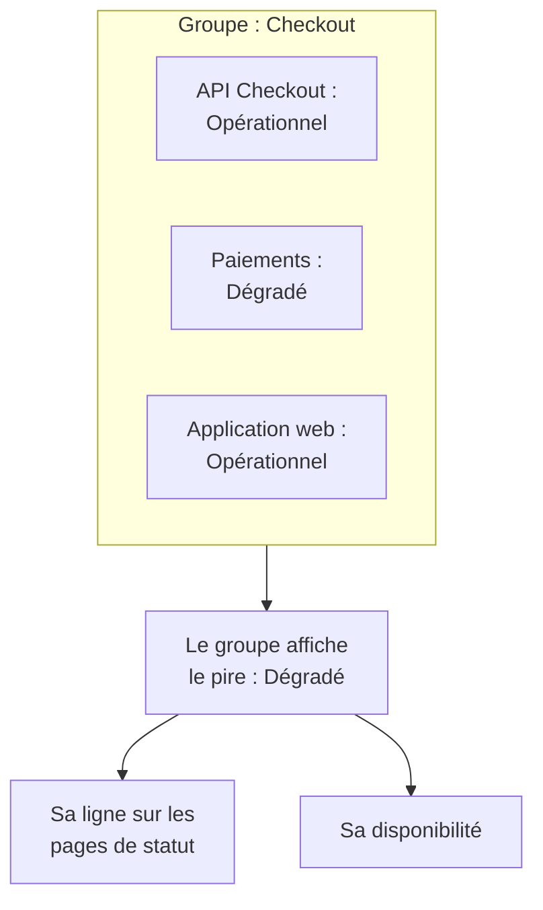

# Groupes de moniteurs

Un groupe de moniteurs réunit plusieurs moniteurs en un seul statut. Regroupez les moniteurs qui forment ensemble un service, comme Checkout : son API, son service de paiement et son application web. Le groupe affiche le pire statut parmi eux, a sa propre disponibilité, et une page de statut peut afficher tout le groupe sur une seule ligne.

:::cards
- [Comment le statut d'un groupe est calculé](#comment-le-statut-dun-groupe-est-calculé): Le pire statut parmi ses moniteurs.
- [Activer les groupes de moniteurs](#activer-les-groupes-de-moniteurs): Un seul interrupteur dans les paramètres du projet.
- [Créer un groupe de moniteurs](#créer-un-groupe-de-moniteurs): Nommez-le, puis ajoutez-lui ses moniteurs.
- [Afficher un groupe sur une page de statut](#afficher-un-groupe-sur-une-page-de-statut): Une seule ligne pour tout le groupe.
:::

## Comment le statut d'un groupe est calculé

Un groupe part de votre statut opérationnel et prend le pire statut parmi ses moniteurs : celui qui est le plus bas dans la liste des statuts de moniteur de votre projet. Un moniteur qui passe à **Dégradé** rend tout le groupe **Dégradé** ; un moniteur qui passe à **Hors ligne** le rend **Hors ligne**.

- **Les moniteurs archivés ne comptent pas.** Un moniteur archivé n'est pas vérifié, son statut est donc figé ; le groupe l'écarte.
- **Un groupe vide est opérationnel.** Un groupe sans moniteur, ou avec seulement des moniteurs archivés, affiche votre statut opérationnel.
- **L'ordre est le vôtre.** Le pire statut suit l'ordre de **Moniteurs → Paramètres → Statut du moniteur**. Voir [Statuts de moniteur](/docs/monitor/criteria-and-statuses#statuts-de-moniteur).

Un groupe de moniteurs n'est pas un groupe de page de statut. Un groupe de page de statut est un titre sur une page de statut qui contient des lignes. Un groupe de moniteurs est une ligne qui représente plusieurs moniteurs, et n'importe quelle page de statut peut l'afficher.

## Avant de commencer

- **Votre plan.** Sur OneUptime Cloud, les groupes de moniteurs nécessitent le plan Scale.
- **L'interrupteur.** Les groupes de moniteurs sont masqués tant que **Groupes de moniteurs** n'est pas activé pour le projet (voir ci-dessous). L'activer demande le rôle Project Owner, ou un rôle personnalisé avec l'autorisation Edit Project ou Manage Billing.
- **Votre rôle.** Créer, modifier et supprimer des groupes demande le rôle Project Owner, Project Admin, Project Member, Monitor Admin ou Monitor Member, ou un rôle personnalisé avec les autorisations de groupe de moniteurs correspondantes. Un Viewer peut voir les groupes mais pas les modifier.

## Activer les groupes de moniteurs

:::steps
### Ouvrir les drapeaux de fonctionnalités

Allez dans **Paramètres du projet → Avancé → Drapeaux de fonctionnalités**. **Avancé** est replié dans le menu latéral : dépliez-le d'abord.

### Basculer l'interrupteur

Activez l'interrupteur **Groupes de moniteurs**. Il est enregistré aussitôt : **Groupes de moniteurs** apparaît dans le menu latéral **Moniteurs**, et l'entrée **Moniteurs** de chaque page de statut devient **Ressources**, où vous pouvez ajouter un groupe.
:::

Désactiver de nouveau l'interrupteur masque **Groupes de moniteurs** du menu. Aucun groupe n'est supprimé.

## Créer un groupe de moniteurs

:::steps
### Ouvrir Groupes de moniteurs

Allez dans **Moniteurs → Groupes de moniteurs**. La carte **Groupes de moniteurs** liste chaque groupe avec son **État actuel**, ses libellés et ses propriétaires.

### Créer le groupe

Cliquez sur **Créer : Groupe de moniteurs**, saisissez un **Nom** et, si vous le souhaitez, une **Description**, puis cliquez sur **Créer : Groupe de moniteurs** en bas du formulaire. Le groupe commence sans aucun moniteur.

### Ajouter ses moniteurs

Ouvrez le groupe : tant qu'il n'a aucun moniteur, sa **Vue d'ensemble** propose **Ajouter des moniteurs**. Ensuite, cliquez sur **Moniteurs** dans son menu latéral, puis sur **Ajouter des moniteurs**. Choisissez chaque moniteur du groupe sous **Moniteurs** et cliquez sur **Ajouter des moniteurs**.

### Vérifier son statut

Cliquez sur **Vue d'ensemble**. **État actuel** montre le statut actuel du groupe, et **Graphique de disponibilité** montre ses 90 derniers jours, une barre par jour.
:::

Pour retirer un moniteur du groupe, cliquez sur **Supprimer** sur sa ligne dans **Moniteurs dans le groupe**. Le moniteur lui-même ne change pas. Un moniteur peut appartenir à plusieurs groupes.

## Les pages d'un groupe

Ouvrez un groupe pour voir ses pages dans le menu latéral :

| Page | Ce qu'elle montre |
| --- | --- |
| **Vue d'ensemble** | **Détails du groupe de moniteurs**, **État actuel** et **Graphique de disponibilité** avec le pourcentage de disponibilité du groupe sur les 90 derniers jours. Un groupe sans moniteur propose **Ajouter des moniteurs** à la place du graphique. |
| **Moniteurs** | **Moniteurs dans le groupe**, avec **Ajouter des moniteurs** et **Supprimer**. |
| **Incidents** | Les incidents sur n'importe quel moniteur du groupe. |
| **Alertes** | Les alertes sur n'importe quel moniteur du groupe. |
| **Propriétaires** | Les personnes et les équipes responsables du groupe. Elle se trouve sous **Avancé**, qui est replié au départ. |
| **Journaux d'audit** | Qui a modifié le groupe, et quand, également sous **Avancé**. |
| **Supprimer le groupe** | Supprime le groupe, également sous **Avancé**. |

La disponibilité de la **Vue d'ensemble** compte tout statut autre que l'opérationnel comme indisponibilité. Une page de statut ne compte que les statuts de sa propre liste **Compte comme indisponibilité** : voir [Choisir ce qui s'affiche sur la page](/docs/status-pages/index#choisir-ce-qui-saffiche-sur-la-page).

La liste **Groupes de moniteurs** peut filtrer les groupes par propriétaire et par libellé, définir les libellés et les propriétaires de nombreux groupes à la fois, et exporter ou importer des groupes en JSON.

## Afficher un groupe sur une page de statut

:::steps
### Ouvrir les ressources de la page de statut

Allez dans **Pages de statut**, ouvrez la page et cliquez sur **Ressources** dans son menu latéral.

### Passer la boîte de dialogue à un groupe

Cliquez sur **Ajouter un moniteur**. Sous la liste déroulante des moniteurs, cliquez sur **Ajoutez plutôt un groupe de moniteurs.** La liste déroulante devient **Groupe de moniteurs**.

### Choisir le groupe et l'ajouter

Choisissez le groupe. **Nom d'affichage**, le nom que lisent les visiteurs, reprend le nom du groupe jusqu'à ce que vous en saisissiez un vous-même. Cliquez sur **Ajouter un moniteur** : la ligne apparaît sur la page avec le statut du groupe.
:::

Sur la page de statut, la ligne représente chaque moniteur du groupe :

- **Son statut.** C'est celui du groupe : le pire de ses moniteurs.
- **Ses incidents.** Un incident sur n'importe quel moniteur du groupe apparaît sur la page, avec le groupe cité parmi les ressources affectées.
- **Ses abonnés.** Un abonné qui choisit le groupe est informé pour chaque moniteur qu'il contient. Voir [Laisser les abonnés choisir les ressources et les types d'événements](/docs/status-pages/subscribers#laisser-les-abonnés-choisir-ressources-et-types-dévénements).

Pour les autres options de la ligne, comme sa disponibilité et son graphique d'historique, voir [Ressources et groupes de la page de statut](/docs/status-pages/resources-and-groups).

> [!WARNING]
> Supprimer un groupe de moniteurs supprime aussi sa ligne de toutes les pages de statut qui l'affichent. Les moniteurs du groupe, et leurs incidents, ne sont pas supprimés.

## API et Terraform

Un groupe est `/api/monitor-group`, et chaque moniteur qu'il contient est une ligne de `/api/monitor-group-resource` qui associe un `monitorGroupId` à un `monitorId`. Dans Terraform, ce sont `oneuptime_monitor_group` et `oneuptime_monitor_group_resource` : voir [Groupe de moniteurs](/docs/terraform/examples#groupe-de-moniteurs).

## Dépannage

:::details Groupes de moniteurs n'est pas dans le menu Moniteurs
L'interrupteur **Groupes de moniteurs** est désactivé. Activez-le sous **Paramètres du projet → Avancé → Drapeaux de fonctionnalités**. Sur OneUptime Cloud, les groupes nécessitent aussi le plan Scale.
:::

:::details Le groupe affiche Hors ligne, mais la plupart de ses moniteurs fonctionnent
C'est la règle : le groupe affiche son pire moniteur. Ouvrez **Moniteurs** dans le groupe pour trouver le moniteur en panne, ou retirez un moniteur qui n'a pas sa place dans le groupe.
:::

:::details Une page de statut ne peut pas ajouter le groupe
**Ajoutez plutôt un groupe de moniteurs.** n'apparaît dans la boîte de dialogue que tant que l'interrupteur **Groupes de moniteurs** est activé pour le projet.
:::

## Étapes suivantes

:::cards
- [Critères et statuts des moniteurs](/docs/monitor/criteria-and-statuses): Ce qui définit le statut de chaque moniteur.
- [Ressources et groupes de la page de statut](/docs/status-pages/resources-and-groups): Organiser les lignes d'une page de statut.
- [Abonnés et annonces](/docs/status-pages/subscribers): Informer les clients des incidents d'un groupe.
:::
