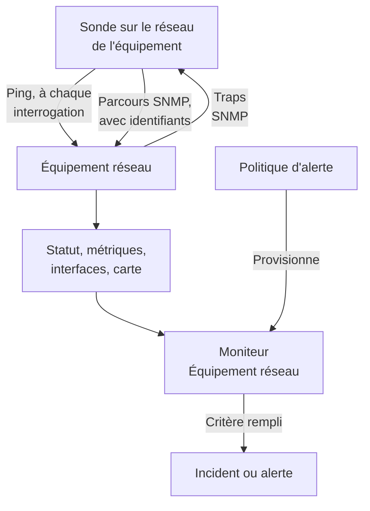
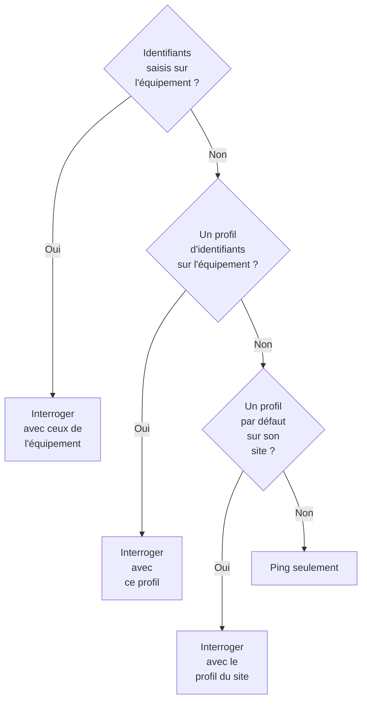
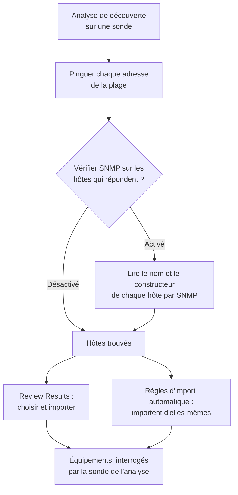
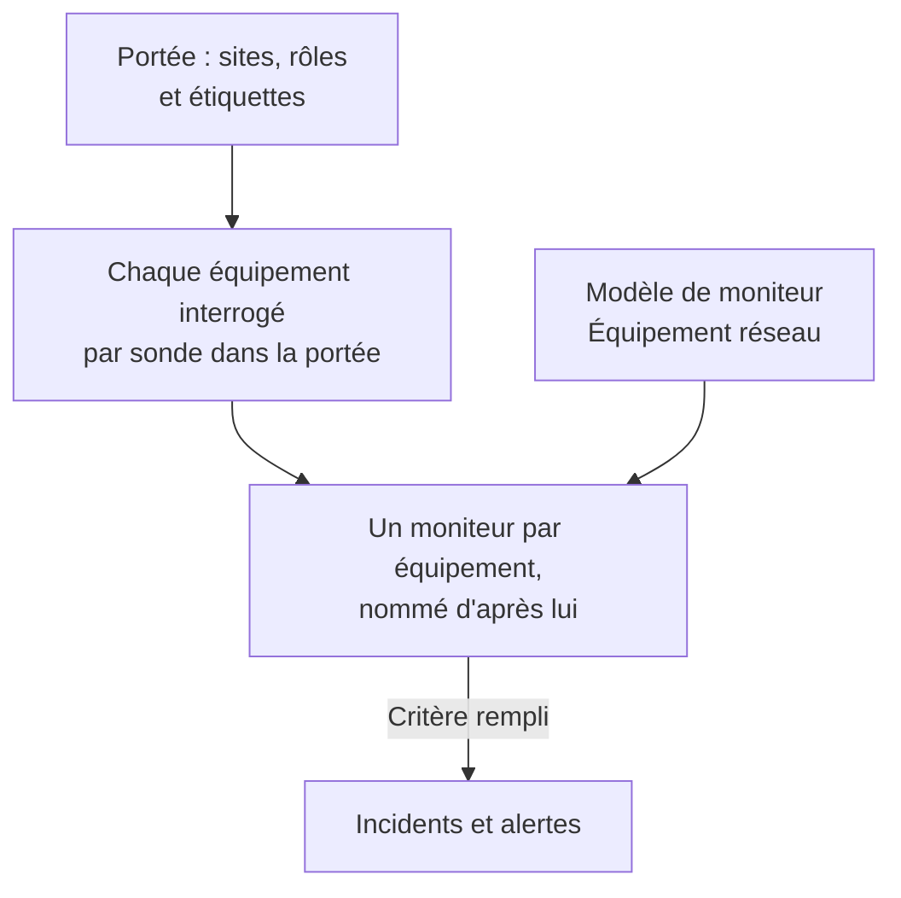
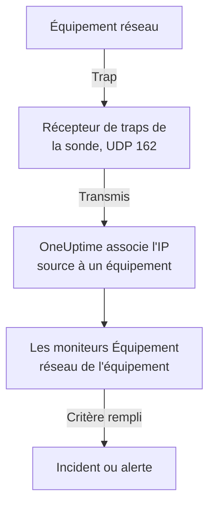

# Surveillance des équipements réseau

Surveillez les commutateurs, routeurs, pare-feu, points d'accès, PDU, caméras et imprimantes : tout ce qui a une adresse sur votre réseau, qu'il parle SNMP ou non.

Ajoutez un équipement avec son adresse et une sonde, et la sonde le pingue selon un calendrier : l'équipement obtient un statut joignable ou hors service, une place sur la carte du réseau et une voix dans la santé de son site. Donnez-lui des identifiants SNMP et la même sonde l'interroge aussi par un parcours SNMP (walk) : les interfaces et les optiques qu'elles contiennent, l'inventaire matériel, les voisins LLDP et CDP, et les OID de santé. Ajoutez un moniteur, ou une politique d'alerte pour toute une flotte, et ses interrogations et ses traps déclenchent des incidents et des alertes.

:::cards
- [Ajouter un équipement](#ajouter-un-équipement-réseau): Son adresse et une sonde, sur une seule page.
- [Découvrir un réseau](#découvrir-des-équipements-par-une-analyse-réseau): Balayer une plage d'adresses et importer ce qui répond.
- [Lire les équipements par SNMP](#identifiants-snmp-et-profils-didentifiants): Interfaces, optiques, inventaire et santé.
- [Être alerté](#alertes): Un moniteur pour un équipement, une politique pour une flotte.
- [Voir la carte](#topologie-du-réseau): Les voisins dessinés en direct, exportés en PDF.
- [Résoudre un problème](#dépannage): Équipements en attente, parcours en échec, traps manquants.
:::

## Fonctionnement



L'équipement et le moniteur ont des rôles différents :

| Élément | Ce qu'il fait | Quand vous en avez besoin |
| --- | --- | --- |
| L'équipement | Sa sonde l'interroge selon le calendrier propre à l'équipement. Chaque interrogation enregistre la joignabilité, le temps d'aller-retour du ping et la perte de paquets ; une interrogation avec des identifiants SNMP lit aussi l'identité, les interfaces, les voisins et les OID de santé de l'équipement. | Toujours : l'équipement est ce que vous ajoutez. |
| Un moniteur | Évalue des critères sur chaque résultat d'interrogation et chaque trap de l'équipement, et ouvre des incidents et des alertes. | Seulement pour les incidents et les alertes. Le statut, l'inventaire, les graphiques et la carte n'ont pas besoin de moniteur. |

## Avant de commencer

- **Une sonde qui peut joindre l'équipement.** La sonde pingue et interroge l'équipement depuis son propre réseau ; un équipement à une adresse privée a donc besoin d'une [sonde personnalisée](/docs/probe/custom-probe) dans ce réseau : une sonde sur l'internet public ne peut pas le joindre.
- **SNMP, pour plus que le ping.** Facultatif. Une communauté v1 ou v2c, ou un utilisateur SNMPv3, configuré sur l'équipement, avec UDP 161 ouvert depuis la sonde. Sans cela, l'équipement est seulement pingué.
- **Traps, syslog et flux.** Facultatif. La sonde reçoit les traps SNMP sur UDP 162, le syslog sur UDP 5140 une fois activé, et les enregistrements de flux sur UDP 2055, 4739 et 6343 ; ouvrez ces ports de vos équipements vers la sonde.

## La vue d'ensemble du réseau

**Réseau → Vue d'ensemble** est la page d'entrée de la zone Réseau, et elle commence par la réponse : une phrase qui dit si votre réseau est en bonne santé et, sinon, ce qui ne va pas, la pire nouvelle d'abord.

| Ce qu'elle dit | Quand |
| --- | --- |
| **3 équipements sont hors service** | La sonde ou le moniteur d'un équipement ne peut pas le joindre. |
| **2 sites nécessitent une attention** | Chaque équipement répond, mais la santé d'un site n'est pas opérationnelle. |
| **5 interfaces sont hors service** | Chaque équipement répond, mais des ports sont éteints. |
| **2 équipements ne remontent pas leurs détails** | Ils répondent au ping, mais leur parcours SNMP échoue, donc leurs interfaces et leur santé ne sont pas actualisées : en général les identifiants. |
| **En attente de la première vérification** | Des équipements ont été ajoutés et leur sonde ne les a pas encore vérifiés. |
| **Les 40 équipements sont en ligne** | Chaque équipement répond. Les équipements qui attendent encore leur première vérification sont comptés sur une ligne à part. |

En dessous, une ligne dit si quelque chose déclenche un incident quand un équipement tombe : combien de [politiques d'alerte](#politiques-dalerte) sont actives, ou un lien **Set up alerts** quand aucune ne l'est. Les boutons **Ajouter l'équipement** et **Découvrir des équipements** à côté ouvrent ces formulaires, et les tuiles et listes en dessous donnent le détail : les équipements et sites qui demandent une attention, la flotte par constructeur et les analyses récentes.

Tant que rien n'a été ajouté, la vue d'ensemble montre à la place les deux points d'entrée : **Découvrir des équipements** analyse une plage d'adresses pour que vous choisissiez quoi ajouter, idéal pour tout un réseau ou un nouveau site, et **Ajouter un seul équipement** en ajoute un par son adresse IP ou son nom d'hôte.

Le menu Réseau garde en vue ce que vous ouvrez tous les jours : **Vue d'ensemble**, **Appareils**, **Sites**, **Carte**, **Traffic** et **Découverte**. Le reste est replié en sections, et une section s'ouvre d'elle-même sur chacune de ses pages :

| Section | Pages |
| --- | --- |
| **Topologie** | **Topologie de l'équipement**, **Points de terminaison**, **Matrice de latence**, **Site Links**, **Liens d'équipements** |
| **Règles** | **Règles d'import automatique**, **Site Assignment Rules**, **Règles de propriétaire**, **Règles d'étiquettes**, **Règles de liens** |
| **Paramètres** | **Politiques d'alerte**, **Identifiants SNMP**, **Rôles d'équipement**, **Site Types**, **Modèles de collecte d'OID** |
| **Avancé** | **Appareils archivés** |

## Ajouter un équipement réseau

:::steps
### Ouvrir la liste des appareils
Allez dans **Réseau → Appareils** et cliquez sur **Ajouter l'équipement**. **Ajouter l'équipement** dans la **Vue d'ensemble** du Réseau ouvre le même formulaire.

### Saisir l'adresse de l'équipement
Dans **Nom d'hôte**, saisissez son adresse IP ou son nom d'hôte. Laissez **Nom** vide pour nommer l'équipement d'après son nom d'hôte.

### Vérifier le site et la sonde
Choisissez le **Site** de l'équipement, si vous utilisez des sites. **Sonde** se remplit avec la sonde par défaut du site, ou avec la seule sonde personnalisée du projet ; assurez-vous qu'elle peut joindre l'équipement.

### Ajouter l'équipement
Cliquez sur **Ajouter l'équipement**. En quelques minutes, la sonde pingue l'équipement et son statut passe à **Up** ou **Hors service**. Avec des identifiants SNMP, sa page d'aperçu se remplit aussi de l'identité, des interfaces et de la santé de l'équipement après le premier parcours réussi.
:::

Le formulaire tient sur une page — le nom d'hôte, un nom, le site et la sonde —, avec **SNMP** et **Plus de champs** repliés en dessous. Il ne demande rien sur la façon dont l'équipement est surveillé : chaque équipement que vous ajoutez est interrogé par sa sonde, et le [remplacement par un moniteur lié](#le-remplacement-par-un-moniteur-lié) se trouve sur la page **Paramètres** de l'équipement pour les rares équipements qui en ont besoin.

Les détails d'un équipement — son nom, sa description, son rôle, son site, ses étiquettes et ses adresses — se modifient ensuite à un seul endroit : la carte **Paramètres de l'appareil** de sa page **Paramètres**. La carte **Détails de l'appareil** de son aperçu les affiche, avec un lien **Modifier dans les paramètres**.

### L'équipement

| Champ | Description | Obligatoire |
| --- | --- | --- |
| Nom d'hôte | L'adresse IP ou le nom d'hôte que la sonde pingue, et interroge par SNMP dès que l'équipement a des identifiants. | Oui |
| Nom | Un nom parlant, comme core-switch-01. Laissez-le vide et l'équipement est nommé d'après son nom d'hôte. L'API fait de même : un équipement créé sans nom est nommé d'après son nom d'hôte. | Non |
| Site | Le [site réseau](/docs/monitor/network-sites) où se trouve l'équipement. La santé du site est agrégée à partir de ses équipements, et un site doté d'une sonde par défaut remplit la sonde ci-dessous. | Non |
| Sonde | La sonde qui pingue cet équipement, l'interroge par SNMP quand il a des identifiants, et reçoit ses traps, son syslog et ses [enregistrements de flux](/docs/monitor/network-traffic). Elle doit joindre l'équipement directement : une sonde sur l'internet public ne peut pas joindre une adresse privée. | Oui |

**Sonde** se remplit d'elle-même quand c'est possible : un projet avec exactement une sonde personnalisée commence sur celle-ci, et choisir un site la remplace par la [sonde par défaut du site](/docs/monitor/network-sites#valeurs-par-défaut-de-surveillance). Elle n'écrase jamais une sonde que vous avez choisie vous-même. Définissez une sonde par défaut sur vos sites et un équipement peut être ajouté par sa seule adresse.

### Plus de champs (replié)

| Champ | Description | Obligatoire |
| --- | --- | --- |
| Description | Texte libre. | Non |
| Rôle de l'équipement | Commutateur de cœur, commutateur d'accès, pare-feu, etc. Il fixe le niveau de l'équipement sur la carte et délimite les politiques d'alerte. | Non |
| Adresse MAC | La MAC propre à l'équipement. La carte s'en sert pour placer un équipement qui ne parle ni LLDP ni CDP sur le port du commutateur qui l'a appris ; voir [Les équipements seulement pingués et leur port de commutateur](#les-équipements-seulement-pingués-et-leur-port-de-commutateur). Généralement apprise pour vous depuis la table ARP d'un routeur. | Non |
| Créer aussi un moniteur Ping pour les incidents | La sonde pingue déjà l'équipement et lui donne un statut ; c'est un moniteur Ping qui transforme les pings échoués en incident. Cochez la case et un moniteur est créé sur le nom d'hôte et lié à l'équipement à l'enregistrement. Il compte dans votre forfait, et ses incidents restent désactivés jusqu'à ce que vous les activiez depuis la page du moniteur. | Non |

Cocher le moniteur Ping fait apparaître **Ping from probes**, les sondes propres du moniteur. Elles doivent joindre le réseau de l'équipement ; laissez le champ vide pour utiliser les sondes par défaut du projet. Pour alerter sur de nombreux équipements à la fois, utilisez plutôt les [politiques d'alerte](#politiques-dalerte).

### SNMP (replié, facultatif)

Laissez-le replié et l'équipement est seulement pingué : la section repliée le dit en une phrase. L'équipement obtient quand même un statut dès sa première interrogation et figure dans son site et sur la carte, mais n'a ni interfaces, ni inventaire, ni OID de santé tant qu'il n'a pas d'identifiants. Ouvrez la section pour saisir une communauté ou un utilisateur v3, ou pour choisir un profil d'identifiants enregistré.

:::tabs
@tab SNMP v1 / v2c
| Champ | Description | Obligatoire |
| --- | --- | --- |
| Version SNMP | V1, V2c ou V3. | Oui, commence sur V2c |
| SNMP Community String | La communauté v1 ou v2c, comme `public`. | Non : vide signifie ping seulement |
| SNMP Port | Le port UDP sur lequel écoute l'agent. | Non, 161 par défaut |
| Profil d'identifiants SNMP | Un jeu d'identifiants enregistré, à utiliser au lieu de les saisir ici. | Non |
@tab SNMPv3
| Champ | Description | Obligatoire |
| --- | --- | --- |
| SNMP v3 Security Level | No Auth, No Priv ; Auth, No Priv ; ou Auth, Priv. | Oui |
| SNMP v3 Username | Le nom de sécurité (utilisateur) configuré sur l'équipement. | Oui : vide signifie ping seulement |
| SNMP v3 Authentication Protocol | MD5, SHA, SHA-256 ou SHA-512. | Avec authentification |
| SNMP v3 Authentication Key | La phrase secrète d'authentification. | Avec authentification |
| SNMP v3 Privacy Protocol | DES, AES ou AES-256. | Avec chiffrement |
| SNMP v3 Privacy Key | La phrase secrète de chiffrement. | Avec chiffrement |
:::

Les identifiants saisis sur l'équipement l'emportent sur un profil d'identifiants choisi à côté, et le site de l'équipement peut aussi porter un profil par défaut. Les identifiants d'un profil sont chiffrés au repos. Les identifiants saisis sur un équipement sont protégés par les mêmes permissions de lecture mais ne sont pas chiffrés au repos : une raison de plus de garder les identifiants partagés dans un profil.

## Modifier de nombreux équipements à la fois

Une analyse de découverte du réseau d'un client fait entrer des dizaines d'équipements qui appartiennent à un même site, partagent un même rôle et viennent d'un même constructeur. Vous ne les ouvrez pas un par un : sélectionnez-les dans la liste **Appareils**, en cochant des lignes ou en sélectionnant tous les équipements qui correspondent aux filtres, et ouvrez **Actions groupées**.

| Action | Ce qu'elle fait |
| --- | --- |
| **Définir le site** / **Retirer du site** | Déplace chaque équipement sélectionné dans le site choisi, où il compte pour la santé du site ; un équipement sans sonde propre reprend la sonde par défaut du site. **Retirer du site** les sort de leurs sites. Un équipement qu'une règle d'affectation de site reconnaît revient au site de la règle à sa prochaine interrogation ; pour les équipements que la découverte retrouve sans cesse, ajoutez donc plutôt une règle sous **Réseau → Règles → Site Assignment Rules** ; la boîte de dialogue **Définir le site** y renvoie. |
| **Définir le rôle de l'appareil** / **Effacer le rôle de l'appareil** | Donne un même rôle à chaque équipement sélectionné, comme les vingt commutateurs qui sont tous « Access Switch ». Les rôles sont ceux du projet, sous **Réseau → Paramètres → Rôles d'équipement**, vers lesquels renvoie la boîte de dialogue. **Effacer le rôle de l'appareil** recalcule le rôle de chaque équipement à partir de son identité SNMP. |
| **Appliquer le modèle constructeur** | Ajoute les OID de santé et les tables SNMP d'un [modèle constructeur](#modèles-de-santé-des-constructeurs) à chaque équipement sélectionné. **Selon le constructeur de chaque appareil**, le premier choix de la boîte de dialogue, choisit le modèle propre à chaque équipement d'après ce que rapporte son parcours SNMP, pour qu'une sélection mélangée obtienne le bon partout ; ou choisissez un modèle pour tous. |

Chaque action est une boîte de dialogue et un enregistrement pour toute la sélection, et chaque équipement passe par les mêmes vérifications qu'une modification sur sa propre page Paramètres : les permissions, la portée d'étiquettes et de propriétaire de votre rôle, et les limites de ce qu'un équipement peut collecter.

**Appliquer le modèle constructeur** montre ce qu'il va faire avant de faire quoi que ce soit : combien d'équipements reçoivent quel modèle, combien il laisse inchangés et pourquoi. Il s'ajoute à ce que chaque équipement collecte déjà et ne retire rien, et un équipement qui a déjà tout le contenu du modèle n'est pas réécrit. Il laisse inchangé un équipement adossé à un moniteur (rien ne l'interroge), un équipement lié à un [modèle de collecte d'OID](#modèles-de-collecte-doid) (le modèle décide de ce qu'il collecte, ajoutez donc les OID du constructeur là-bas) et, lors de la correspondance, un équipement pas encore interrogé par SNMP ou dont le constructeur n'a pas de modèle.

Quand une action se termine, elle indique combien d'équipements ont changé, lesquels ont échoué et pourquoi — un équipement que votre rôle ne peut pas modifier, une liste au-delà de sa limite — et lesquels elle n'a pas changés et pourquoi : un équipement déjà dans ce site ou ce rôle, ou un que le modèle constructeur laisse inchangé.

Les autres actions groupées sont décrites là où elles ont leur place : **Set OID Collection Template** sous [Modèles de collecte d'OID](#modèles-de-collecte-doid), **Set SNMP Credential Profile**, **Switch to Probe Polling** et **Créer des moniteurs Ping** sous [En masse](#en-masse), et **Shorten Names to Hostname** sous [Comment les équipements découverts sont nommés](#comment-les-équipements-découverts-sont-nommés).

## Ce que fait réellement une interrogation

Chaque interrogation d'un équipement interrogé par sonde est un ping. Quand l'équipement a des identifiants SNMP utilisables, la sonde exécute aussi un parcours SNMP complet. Les deux s'exécutent côte à côte et le parcours n'attend jamais le ping, si bien qu'un matériel SNMP derrière une ACL qui rejette l'ICMP indique quand même **Up**.

| Résultat | Équipement seulement pingué | Équipement avec identifiants SNMP |
| --- | --- | --- |
| Statut (Up ou Hors service) | Du ping | Du ping ou du parcours : il suffit que l'un réponde |
| Temps d'aller-retour du ping et perte de paquets | Enregistrés comme métriques de l'équipement | Enregistrés comme métriques de l'équipement |
| Temps de réponse SNMP | — | La durée du parcours, jamais celle du ping |
| Interfaces, voisins, points de terminaison | — | D'un parcours réussi |
| Identité système, constructeur, modèle, numéro de série | — | D'un parcours réussi |
| OID de santé et tables SNMP | — | D'un parcours réussi |

Des identifiants utilisables sont un jeu v1 ou v2c avec une communauté, ou un jeu v3 avec un nom d'utilisateur, trouvés par la [chaîne d'identifiants](#identifiants-snmp-et-profils-didentifiants). Un jeu vide est ignoré, si bien qu'un équipement n'est jamais interrogé avec une communauté par défaut devinée.

La perte de paquets reprend la série du [moniteur Ping](/docs/monitor/ping-monitor), elle se lit donc de la même façon dans tout le produit. Le temps d'aller-retour a sa propre série, `oneuptime.monitor.ping.round.trip.time`, car sur un équipement réseau le simple temps de réponse est celui du parcours SNMP. La page **Métriques** de l'équipement trace l'utilisation des interfaces et les OID de santé ; le temps d'aller-retour de la dernière heure est tracé dans le panneau de l'équipement sur la carte.

### « SNMP failing » n'est pas « Hors service »

Un équipement qui répond au ping mais dont le parcours échoue est **Up**, marqué **SNMP failing**, et les deux moitiés comptent :

- Il est joignable parce que quelque chose répond à cette adresse. Le colorer en rouge mettrait un équipement qui fonctionne parfaitement dans votre décompte d'incidents.
- SNMP échoue parce que ses interfaces, son inventaire et ses OID de santé ne sont plus actualisés, presque toujours à cause des identifiants, d'un agent SNMP désactivé ou d'une ACL. Rien d'autre sur la page ne vous dirait que les chiffres sont figés.

Un équipement dont le ping et le parcours échouent tous les deux est simplement **Hors service**, si bien que la marque n'apparaît jamais qu'à côté d'un statut vert.

### Lire le statut d'un équipement

Chaque endroit qui montre un équipement — la liste des appareils, la page Appareils d'un site, la vue d'ensemble, la carte — utilise les trois mêmes verdicts et les mêmes qualificatifs à côté.

| Verdict | Signifie |
| --- | --- |
| **Up** | La dernière interrogation (ping ou SNMP), ou le moniteur lié, a joint l'équipement. |
| **Hors service** | La dernière interrogation (ping ou SNMP), ou le moniteur lié, n'a pas pu joindre l'équipement. |
| **En attente** | Pas encore de verdict : jamais interrogé, aucune sonde assignée ou aucun moniteur lié. |

| Qualificatif | Affiché quand | Que faire |
| --- | --- | --- |
| **Stale** | Aucune interrogation n'a été tentée depuis bien plus que l'intervalle de l'équipement. | Vérifiez que la sonde de l'équipement est en ligne et suit le rythme de sa flotte. |
| **Aucune sonde** | L'équipement est interrogé par sonde mais n'en a pas, ou son interrogation est désactivée. | Assignez une sonde qui peut le joindre ; rien ne l'interroge d'ici là. |
| **Aucun moniteur** | L'équipement utilise le [remplacement par un moniteur lié](#le-remplacement-par-un-moniteur-lié) et rien n'est lié. | Liez un moniteur, ou repassez-le en interrogation par sonde. |
| **SNMP failing** | Joignable par ping, mais le dernier parcours SNMP a échoué. | Vérifiez les identifiants, l'agent SNMP ou une ACL. |

La liste **Appareils** a un filtre **SNMP** à trois valeurs : **OK** (le dernier parcours a réussi), **En échec** (le dernier parcours a échoué) et **Non configuré** (seulement pingué, pas d'identifiants, ou jamais interrogé). « Quels équipements ont des identifiants qui ne marchent plus » est donc à un clic. La colonne **Interfaces (actives / hors service)** de la liste indique **Pas de SNMP** au lieu de `0 / 0` pour un équipement pingué et jamais interrogé : zéro port fonctionnel serait une autre affirmation, et une fausse.

## Identifiants SNMP et profils d'identifiants

Un équipement est interrogé avec le premier jeu d'identifiants utilisable trouvé dans cet ordre, et la recherche s'arrête au premier trouvé :



L'étape du site lit le site propre de l'équipement et pas au-delà : un équipement dans une unité ne reprend pas un profil défini sur la région au-dessus. La sonde par défaut d'un site, elle, descend l'arborescence, parce qu'une sonde est copiée une fois sur l'équipement alors que les identifiants sont relus à chaque interrogation ; [Sites réseau](/docs/monitor/network-sites#valeurs-par-défaut-de-surveillance) donne les détails.

### La page Identifiants SNMP

**Réseau → Paramètres → Identifiants SNMP** contient les profils d'identifiants du projet. Un profil est un jeu nommé — une communauté v1 ou v2c, ou un utilisateur v3 avec son niveau de sécurité, ses protocoles et ses clés — vers lequel pointent autant d'équipements et de sites que vous voulez. Rien n'est copié sur les équipements : faire tourner une communauté est donc une seule modification ici, et chaque équipement qui utilise le profil prend la nouvelle valeur à sa prochaine interrogation.

Les secrets d'un profil sont chiffrés au repos, et seuls les rôles qui peuvent lire les identifiants propres d'un équipement peuvent les lire. Un équipement ou un site qui affiche son profil en montre le nom et la version, jamais les secrets.

Un profil vers lequel pointe encore un équipement ou un site ne peut pas être supprimé : la suppression est refusée avec le décompte de ce qui bloque. Déplacez ces équipements et sites vers un autre profil, ou retirez-leur le profil, puis supprimez-le.

### Refaire d'un équipement un équipement seulement pingué

Sur la page **Paramètres** de l'équipement, **Modifier les paramètres** a une case **Ping only — clear this device's own SNMP credentials** à l'étape **Identifiants SNMP**. Elle efface la communauté et le nom d'utilisateur v3 propres à l'équipement à l'enregistrement. Elle existe parce que vider le bon champ n'est pas évident : un équipement v3 reste interrogeable tant que son nom d'utilisateur subsiste, quoi que vous vidiez d'autre.

Effacer les identifiants propres de l'équipement n'efface pas un profil. Si l'équipement ou son site en nomme encore un, l'équipement continue d'être interrogé avec ; retirez aussi le profil pour que l'équipement soit seulement pingué.

### En masse

Sélectionnez des équipements dans la liste **Appareils** et utilisez :

- **Set SNMP Credential Profile** / **Clear SNMP Credential Profile** : attacher un profil à une sélection, ou le retirer.
- **Switch to Probe Polling** : pour les équipements en remplacement par un moniteur lié. Choisissez une sonde, et chaque équipement sélectionné est pingué selon son calendrier à partir de là, et interrogé dès qu'il a des identifiants. Un moniteur déjà lié reste lié ; le statut de l'équipement vient désormais de la sonde.
- **Créer des moniteurs Ping** : pour les équipements en remplacement par un moniteur lié, crée un moniteur Ping sur le nom d'hôte de chaque équipement et le lie, pour que l'équipement indique Up ou Hors service.

La page **Appareils** affiche une bannière quand le projet contient des équipements en remplacement par un moniteur lié sans moniteur lié — des équipements que rien n'interroge et dont rien ne rend compte — et renvoie vers la sélection qui les corrige.

## Valeurs par défaut de surveillance du site

Un [site réseau](/docs/monitor/network-sites#valeurs-par-défaut-de-surveillance) porte deux valeurs par défaut pour ses équipements. Sa **Sonde par défaut** est copiée sur un équipement créé dans le site, ou déplacé dedans, sans sonde propre. Son **Profil d'identifiants SNMP par défaut** est lu à chaque interrogation d'un équipement du site qui n'a pas d'identifiants propres. Définissez les deux sur un site et un équipement de ce site peut être ajouté par sa seule adresse, puis pingué et interrogé dès sa première interrogation. Le guide des sites indique jusqu'où chaque valeur par défaut descend dans l'arborescence des sites.

## Le remplacement par un moniteur lié

Certains matériels ne peuvent être ni joints ni utilement pingués par aucune sonde : un équipement derrière un NAT, une appliance dont la santé se juge mieux par une vérification HTTP, un service dont le vrai signal est une vérification de port. Pour ceux-là, **Modifier les paramètres** sur la page **Paramètres** de l'équipement propose une **Méthode de surveillance** :

| Méthode | Ce qu'elle signifie |
| --- | --- |
| **Sonde** | Par défaut. Pingué par la sonde assignée selon son calendrier, et interrogé par SNMP quand il a des identifiants. |
| **Moniteur lié** | Le statut d'un moniteur existant est le statut de cet équipement. |

Passer un équipement en **Moniteur lié** arrête son interrogation. La sonde, l'intervalle et l'interrupteur d'interrogation quittent la carte **Polling & Data Collection**, les anciens résultats d'interrogation de l'équipement sont effacés, et son statut vient du moniteur que vous liez. En lier un est facultatif : en attendant, l'équipement indique **En attente**, marqué **Aucun moniteur**.

Revenir à **Sonde** rétablit l'interrogation et demande une sonde. Un moniteur qui était lié reste lié et continue d'alerter ; il ne décide simplement plus du statut de l'équipement.

La plupart des équipements n'en ont pas besoin. Chaque équipement interrogé par sonde a déjà un statut de joignabilité, il n'est donc pas nécessaire de lier un moniteur Ping pour en avoir un ; liez un moniteur quand vous voulez les incidents de ce moniteur.

## Polling & Data Collection

L'interrogation se règle sur la page **Paramètres** de l'équipement, dans la carte **Polling & Data Collection** (**Modifier l'interrogation**). Les valeurs par défaut conviennent à un nouvel équipement, qui n'a donc besoin d'aucun réglage :

| Paramètre | Description | Par défaut |
| --- | --- | --- |
| Sonde | La sonde qui interroge l'équipement. | Fixée à l'ajout de l'équipement |
| Polling Enabled | La sonde interroge l'équipement selon le calendrier ci-dessous. Désactivez-la pour suspendre l'interrogation sans supprimer l'équipement. | Activée |
| Polling Interval (Minutes) | La fréquence à laquelle la sonde interroge l'équipement. Au moins 1 minute. | 5 |
| Walk Interfaces | Parcourir les tables d'interfaces (IF-MIB) à chaque interrogation : statut, bande passante, utilisation et erreurs de chaque port, plus les voisins LLDP et CDP pour la carte. | Activé |
| Collecter les points de terminaison connectés | Parcourir aussi les tables ARP et de pontage pour trouver ce qui est branché sur l'équipement : terminaux de paiement, imprimantes, téléphones, portables. Depuis une table ARP, remplit aussi l'adresse MAC des équipements enregistrés à ces adresses. Coûte des parcours supplémentaires à chaque interrogation. | Désactivé |
| Modèle de collecte d'OID | Une liste d'OID partagée et nommée que l'équipement collecte. Modifier le modèle change chaque équipement lié à sa prochaine interrogation. | Aucun |
| OID de santé propres à l'équipement | Des OID supplémentaires que seul cet équipement collecte, en plus de ceux de son modèle. | Aucun |
| Appliquer automatiquement le modèle de santé du fabricant | Quand le constructeur de l'équipement est reconnu et que sa propre liste d'OID est vide, remplir la liste avec le modèle du constructeur à la prochaine interrogation. | Désactivé ; activé pour les équipements que la découverte importe |
| Device-Specific SNMP Tables | Des [tables SNMP](#tables-snmp) supplémentaires que seul cet équipement parcourt, en plus de celles de son modèle. Une table de même clé qu'une table du modèle la remplace sur cet équipement. | Aucune |

Tout ce qui suit **Walk Interfaces** demande des identifiants SNMP : sur un équipement seulement pingué, ces paramètres sont conservés mais n'ont aucun parcours auquel s'appliquer.

### Parcours des interfaces

Avec **Walk Interfaces** activé et des identifiants trouvés, chaque interrogation suit pour chaque interface son statut opérationnel et administratif, les bits entrants et sortants, l'utilisation et les erreurs. Le même parcours collecte les voisins LLDP et CDP pour la carte.

Mettez une interface en sourdine sur la page **Interfaces** de l'équipement, pour un port de labo ou un lien débranché exprès, et elle reste dans l'inventaire mais sort des alertes et des métriques. Un parcours échoué n'efface jamais à moitié ce qui a été collecté : le dernier instantané des interfaces reste, et l'équipement est marqué **SNMP failing** pour que personne ne le prenne pour un instantané à jour.

### Modèles de santé des constructeurs

Dans l'éditeur **OID de santé**, **Vendor Health Template** applique un jeu d'OID prédéfini pour le constructeur de l'équipement. De nombreux modèles apportent aussi des [tables SNMP](#tables-snmp), ajoutées avec **Add a Vendor's Tables** dans l'éditeur **SNMP Tables**.

| Modèle constructeur | OID de santé | Tables SNMP |
| --- | --- | --- |
| Generic (Host Resources MIB) | Charge CPU, RAM totale et disponible, charge moyenne | Cœurs CPU (une ligne par cœur, quelle que soit la numérotation de la plateforme) |
| Arista EOS | Charge CPU, charge moyenne, RAM totale et disponible | — |
| Cambium Networks cnMatrix | CPU, RAM, flash, température, tension d'alimentation | Ventilateurs, ports PoE, alimentation redondante |
| Cambium Networks Enterprise Wi-Fi (cnPilot, XV, XE, XH) | CPU, mémoire libre, clients Wi-Fi, connexion cnMaestro | Radios Wi-Fi (bande, canal, largeur, puissance d'émission, clients, bruit de fond, temps d'antenne, état), SSID |
| Cisco IOS / IOS-XE | CPU, mémoire utilisée et libre, température, état des ventilateurs, état des alimentations | — |
| Dell Force10 / OS9 | CPU, mémoire | — |
| Extreme Networks EXOS / Switch Engine | CPU, température, alarme de surchauffe, état de l'alimentation | Alimentations, ventilateurs, mémoire par emplacement, membres de la pile |
| Extreme Networks Fabric Engine / VOSS | Session vIST, nombre d'I-SID | Adjacences de fabric (IS-IS) nommées par voisin, CPU et mémoire par emplacement, capteurs de température, ventilateurs, alimentations |
| Extreme Networks IQ Engine (HiveOS) Access Points | CPU, mémoire, clients Wi-Fi, température | Radios Wi-Fi (canal, puissance d'émission, bruit de fond), SSID |
| Extreme Networks Wireless Controller (XIQ-C, ExtremeWireless) | Points d'accès, points d'accès actifs, clients Wi-Fi | Points d'accès (état, clients, adresse, logiciel), radios Wi-Fi (bande, canal, largeur, bruit de fond, temps d'antenne occupé), WLAN (SSID, clients) |
| Fortinet FortiGate | CPU, mémoire, disque | — |
| HPE / Aruba ProCurve | CPU, mémoire totale et libre | — |
| HPE Aruba Instant (AOS 8) | Nom du cluster, version du firmware, conducteur | Points d'accès (statut, modèle, CPU, mémoire), radios Wi-Fi nommées par point d'accès (canal, puissance d'émission, bruit de fond, utilisation, clients, état), SSID (clients) |
| HPE Aruba Mobility Controller (AOS 8) | Points d'accès, clients Wi-Fi, rôle du contrôleur | Points d'accès (statut, modèle, groupe d'AP), radios Wi-Fi nommées par point d'accès (bande, canal, puissance d'émission, utilisation, clients, mode), SSID (clients, points d'accès actifs et hors service), processeurs, mémoire |
| Huawei VRP | CPU, mémoire, température | — |
| Juniper Junos | CPU, tampon mémoire, température | — |
| MikroTik RouterOS | Charge CPU, température, tension | — |
| Palo Alto PAN-OS | CPU de gestion, utilisation des sessions, sessions actives | — |
| Sophos Firewall (SFOS / XGS) | Mémoire, disque, swap, état HA et état du pair, service IPsec, température CPU (SFOS v22 et suivantes) | Tunnels IPsec (le statut nécessite SFOS v20 et suivantes), cœurs CPU |
| TP-Link Omada Access Points (EAP) | Clients Wi-Fi | — |
| Ubiquiti EdgeOS / EdgeSwitch / UniFi Switches | Charge CPU, RAM totale et disponible | — |
| Ubiquiti UniFi Access Points | État isolé, charge moyenne, RAM totale et disponible | Radios Wi-Fi (bande, temps d'antenne), SSID (bande, canal, clients, puissance d'émission, qualité de connexion), cœurs CPU |

Les OID du modèle sont copiés dans la liste propre de l'équipement, où vous pouvez les élaguer ou les compléter. Une fois que le premier parcours a identifié le constructeur, la page de l'équipement suggère le modèle correspondant. La correspondance lit le `sysObjectID` de l'équipement, et son `sysDescr` là où un même numéro d'entreprise héberge deux systèmes d'exploitation : Extreme Fabric Engine sur matériel universel rapporte le même numéro d'entreprise (1916) qu'EXOS, et seule sa description (`…-FabricEngine (9.0.4.0)`) les distingue. Les points d'accès UniFi se distinguent de la même façon des routeurs d'Ubiquiti (`U6-Pro 6.6.50.15098`), y compris quand un ancien firmware répond avec l'arborescence de Net-SNMP, et les points d'accès IQ Engine des commutateurs Aerohive qui partagent leur arborescence (`AP230, HiveOS 8.2r1`).

Les équipements avec **Appliquer automatiquement le modèle de santé du fabricant** activé reçoivent les OID et les tables du modèle à leur première interrogation : les équipements qu'une règle d'import automatique fait entrer, et ceux importés depuis **Review Results** avec son interrupteur de modèle constructeur activé, ce qu'il est sauf si vous le désactivez. Pour donner leur modèle à de nombreux équipements à la fois, comme une flotte découverte avant l'existence de l'interrupteur, sélectionnez-les dans la liste **Appareils** et utilisez **Appliquer le modèle constructeur** (voir [Modifier de nombreux équipements à la fois](#modifier-de-nombreux-équipements-à-la-fois)).

Appliquer un modèle constructeur est une copie unique : rien n'est propagé quand le modèle change. Au-delà d'un seul équipement, utilisez plutôt un **Modèle de collecte d'OID** ; les modèles constructeurs sont proposés comme point de départ quand vous en créez un.

### Modèles de collecte d'OID

Un **Modèle de collecte d'OID** (**Réseau → Paramètres → Modèles de collecte d'OID**) est une liste d'OID nommée, généralement d'après un type d'équipement comme « Cisco Catalyst 9300 », à laquelle autant d'équipements que vous voulez sont liés. Le lien est vivant, ce n'est pas une copie : la liste d'OID d'un équipement est assemblée à chaque interrogation, donc modifier un modèle change ce que chaque équipement lié collecte à sa prochaine interrogation, sans étape de synchronisation.

Avant d'en créer un, vérifiez que vous en avez besoin. Les bits entrants et sortants par port, le statut opérationnel, l'utilisation et les erreurs par seconde sont collectés pour chaque port à chaque interrogation sans aucun OID (voir [Parcours des interfaces](#parcours-des-interfaces)), et ils sont déjà alertables par port. Les modèles servent à ce qui n'est pas par port : CPU, mémoire, température, ventilateurs, alimentations, pairs BGP.

En venant de Zabbix :

| Zabbix | OneUptime |
| --- | --- |
| Template | Modèle de collecte d'OID |
| Item | Un OID de ce modèle |
| Règle de découverte « Network interfaces by SNMP » avec des prototypes d'items | Intégré et toujours actif pour les compteurs d'interfaces : rien à écrire |
| Trigger | Critères du moniteur |
| Prototype de trigger, un par interface découverte | Un critère avec **Interface** à `*`, qui se démultiplie par port |
| Règle de découverte sur toute autre table SNMP (tunnels, radios, ventilateurs) avec des prototypes d'items | Une [table SNMP](#tables-snmp) sur le modèle |
| Prototype de trigger sur une telle table | Un critère SNMP Table Value ou SNMP Table Row Is Unhealthy avec **Row** à `*` |
| Groupe d'hôtes | Étiquettes |
| Action « Link template on host discovery » | Le **Modèle de collecte d'OID** d'une règle d'import automatique |
| Action sur un groupe d'hôtes (« alerter sur chaque commutateur ») | Une [politique d'alerte](#politiques-dalerte) |

Un OID d'un modèle est collecté tel qu'il est écrit : un OID qui désigne une ligne d'une table (`…ifSpeed.3`) ne collecte que cette ligne, quoi qu'il y ait à l'index 3 le jour de l'interrogation. Tout ce qui est une liste — tunnels, radios, ventilateurs, voisins — a sa place dans une [table SNMP](#tables-snmp), qui parcourt chaque ligne et suit les lignes qui apparaissent et disparaissent. Les données d'interface par port n'ont besoin ni de l'un ni de l'autre : le parcours des interfaces enregistre en séries le statut opérationnel, les bits entrants et sortants par seconde, l'utilisation et un taux d'erreurs par seconde combiné. Les erreurs par sens, les rejets, le statut administratif et la vitesse du lien vont dans l'inventaire d'interfaces de l'équipement, mais ne sont pas des séries et ne peuvent pas faire l'objet d'alertes.

Il y a trois façons de lier des équipements, et pour une flotte que la découverte retrouve sans cesse, la troisième compte le plus :

- Un équipement à la fois, dans la carte **Polling & Data Collection** de l'équipement.
- En masse, en sélectionnant des équipements dans la liste **Appareils** et en utilisant **Set OID Collection Template**. La colonne **Template** de la liste montre quels équipements sont liés à quoi.
- Automatiquement, en définissant un modèle de collecte d'OID sur une règle d'import automatique, pour que chaque équipement qu'une analyse importe soit lié au moment de sa création.

Un équipement collecte d'abord les OID de son modèle, puis ses propres **OID de santé propres à l'équipement**. Quand les deux désignent le même OID, il est collecté une seule fois, le nom et la description de l'équipement l'emportant, et les entrées du modèle gardent leur place, si bien que les ajouts propres à l'équipement ne peuvent jamais les évincer.

| Limite | Valeur |
| --- | --- |
| OID de santé qu'un équipement interroge | 200 |
| OID sur un modèle | 150 |
| OID propres d'un équipement lié | 50 |
| OID propres d'un équipement non lié | 200 |

Les limites s'additionnent, si bien qu'un équipement lié ne peut jamais interroger plus de 200 OID. Les dépasser est une erreur de validation à l'enregistrement, jamais une troncature silencieuse à l'interrogation, et lier un équipement qui a déjà plus de 50 OID propres est refusé avec un message indiquant combien en retirer.

Un modèle auquel des équipements sont encore liés ne peut pas être supprimé. Déliez-les d'abord, par exemple avec l'action groupée **Effacer le modèle de collecte d'OID**, pour qu'une suppression n'arrête jamais en silence la collecte de toute une flotte.

### OID personnalisés

Ajoutez tous les OID que vous voulez collecter à chaque interrogation, sur un modèle ou en ajouts propres à l'équipement :

| Champ | Description | Obligatoire |
| --- | --- | --- |
| OID | L'OID numérique, comme 1.3.6.1.2.1.1.1.0. | Oui |
| Nom | Un nom parlant pour l'OID, comme sysDescr. | Non |
| Description | Ce que représente l'OID. | Non |

Les valeurs collectées sont tracées sur la page **Métriques** de l'équipement, et les critères **SNMP OID Value** et **SNMP OID Exists** alertent dessus. Le sélecteur d'OID de ces critères liste les OID que l'équipement choisi collecte, ceux de son modèle et les siens, il n'y a donc rien à saisir.

Les longues listes d'OID sont réparties sur plusieurs requêtes SNMP GET pour que chacune tienne dans un datagramme UDP. Si vous avez gardé vos listes d'OID courtes parce qu'une ancienne version signalait hors ligne un équipement répondant `tooBig`, ce n'est plus nécessaire.

### Tables SNMP

Une partie de ce que sait un équipement est une liste : une ligne par tunnel IPsec, radio Wi-Fi, SSID, voisin de fabric, ventilateur ou alimentation. Une table SNMP se définit par ses colonnes, et chaque ligne est parcourue à chaque interrogation, si bien qu'un tunnel ajouté, renommé ou supprimé est suivi sans que personne ne modifie quoi que ce soit.

| Champ | Ce qu'il fait |
| --- | --- |
| Nom et clé | Le nom de la table. La clé (lettres, chiffres et tirets bas, formée à partir du nom si elle reste vide) est ce qu'utilisent les critères, les métriques et les variables de modèle, si bien que renommer une table ne casse jamais une alerte. |
| Type | Ce que sont les lignes : tunnels VPN, points d'accès Wi-Fi, radios Wi-Fi, SSID Wi-Fi, voisins de routage, matériel, ou générique. Les types Wi-Fi alimentent la [page Wi-Fi](#longlet-wi-fi) de l'équipement. |
| Colonnes | Les OID de colonne à collecter (l'OID de l'entrée de table plus le numéro de colonne, comme `1.3.6.1.4.1.2604.5.1.6.1.1.1.1.9` pour le statut d'un tunnel Sophos), chacun avec un nom et, en option, une unité, un rôle (statut, bande, canal, largeur de canal, puissance d'émission, clients, bruit de fond, utilisation, SSID), des libellés de valeurs et des valeurs saines. |
| Noms de ligne | Des colonnes facultatives dont les valeurs nomment chaque ligne, comme le nom de connexion d'un tunnel. Sans elles, les lignes sont nommées par leur index. Un nom peut venir d'une table sœur qui partage l'index (Fabric Engine nomme les adjacences IS-IS à partir de `rcIsisAdjHostName`), ou d'une table parente dont l'index commence celui de cette table (Aruba Instant nomme chaque radio d'après son point d'accès). Une table indexée par un nom (ArubaOS indexe ses SSID par le SSID) est nommée par son index décodé. |
| Limite de lignes | Le nombre de lignes conservées : 100 par défaut, 250 au plus. |

Les nombres sont lus comme des nombres, et un texte qui commence par un nombre est lu comme ce nombre (`"36"`, `"-95 dBm"`, `"80MHz"`), car beaucoup de constructeurs mettent des nombres dans des chaînes. Réglez le type de valeur d'une colonne sur **Text only** pour les valeurs qui ont seulement l'air numériques. Les **Value labels** transforment des codes en mots (`0=inactive, 1=active`) : la valeur brute reste ce qui est tracé et comparé, le libellé ce qui est affiché. Les **Healthy values** (`1`) indiquent quelles valeurs signifient que tout va bien : elles colorent la ligne sur la page **SNMP Tables** de l'équipement et pilotent le critère **SNMP Table Row Is Unhealthy**.

Certaines colonnes des modèles constructeurs **ajustent** aussi le nombre qu'elles lisent, pour les MIB qui gardent une valeur dans une unité à elles : ArubaOS rapporte la puissance d'émission doublée (lue × 0.5), Aruba Instant le bruit de fond sans son signe (× −1), Aerohive le bruit de fond plus 256 (− 256), et le contrôleur d'Extreme la largeur de canal par pas de 20 MHz (× 20). Le nombre ajusté est ce qui est affiché, tracé et comparé, si bien que **Noise Floor Greater Than -80** signifie la même chose chez chaque constructeur, et l'éditeur de tables montre le calcul sous la colonne.

Les tables viennent d'un [modèle de collecte d'OID](#modèles-de-collecte-doid), partagé par chaque équipement lié (jusqu'à 10 tables), ou de l'équipement lui-même sous **Device-Specific SNMP Tables** (jusqu'à 10 de plus). Elles sont fusionnées par clé à chaque interrogation, le modèle d'abord, et une table de l'équipement de même clé remplace celle du modèle. Les deux éditeurs proposent **Add a Vendor's Tables**.

La sonde parcourt chaque colonne comme un sous-arbre, dans un budget de 30 secondes partagé par toutes les tables de l'équipement. Une table qui ne peut pas être parcourue dit pourquoi et ne fait jamais échouer l'interrogation : la page **SNMP Tables** de l'équipement garde ses dernières bonnes lignes et indique que le dernier parcours a échoué, tandis que les critères ne jugent que ce que ce parcours a produit, si bien qu'un dépassement de délai n'est jamais pris pour une table vide. Chaque cellule numérique est enregistrée comme métrique `oneuptime.monitor.snmp.table.value`, avec les attributs `snmpTableKey`, `snmpTableName`, `snmpTableColumn`, `snmpTableColumnOid`, `snmpTableRow` et `snmpTableRowIndex` : un tableau de bord peut tracer le statut de chaque tunnel ou la puissance d'émission de chaque radio, et un moniteur de métriques peut grouper par `snmpTableRow`.

### L'onglet Wi-Fi

Un équipement dont le parcours inclut une table Wi-Fi — points d'accès, radios ou SSID, tels que les apportent les modèles Wi-Fi des constructeurs — obtient une page **Wi-Fi**. Elle s'ouvre sur les points d'accès actifs (sur un contrôleur), les radios allumées, les clients et les SSID, puis liste chaque point d'accès que gère un contrôleur avec son état, ses radios et ses clients ; chaque radio avec sa bande, son canal, sa fréquence, sa largeur de canal, sa puissance d'émission, ses clients, son bruit de fond et son temps d'antenne ; et chaque SSID avec sa bande et ses clients. Les colonnes sont trouvées par leur rôle, si bien que les tables de tout constructeur qui étiquettent leurs colonnes s'affichent de la même façon.

Les constructeurs répartissent ces informations différemment, et la page les rassemble :

- La fréquence est calculée à partir de la bande et du canal avec le plan de canaux 802.11 (2.4, 5 et 6 GHz). Un contrôleur qui rapporte la fréquence là où sa MIB dit canal (celui d'Extreme) est lu dans l'autre sens.
- Une radio qui ne rapporte pas de bande est placée par son canal : 1 à 14 est 2.4 GHz, 32 à 177 est 5 GHz, et un numéro que seul le 6 GHz utilise (37, 53, 181…) est 6 GHz.
- UniFi rapporte le canal, la puissance d'émission et les clients par SSID : une radio les reprend des SSID de sa bande.
- Aruba compte les clients par radio : les clients d'un point d'accès sont ceux de ses radios.
- Une interface qui ne diffuse aucun réseau (IQ Engine liste chaque interface, avec N/A pour celles-là) n'est pas listée comme SSID.

Pour un équipement qui ne rapporte pas encore de Wi-Fi, la page nomme le modèle de son constructeur, trouvé à partir de la dernière interrogation comme le fait l'application automatique, et l'applique avec **Appliquer le modèle** ; les radios apparaissent après la prochaine interrogation.

### Constructeurs Wi-Fi pris en charge

Ce que chaque constructeur Wi-Fi rapporte par SNMP, et ce que seul son cloud possède :

| Constructeur | Points d'accès et contrôleurs | Modèle constructeur | Lu par SNMP | Nécessite l'API cloud du constructeur (non développé) |
| --- | --- | --- | --- | --- |
| Cambium Networks | Points d'accès Wi-Fi d'entreprise (cnPilot, XV, XE, XH) | Cambium Networks Enterprise Wi-Fi (cnPilot, XV, XE, XH) | Bande, canal, largeur, puissance d'émission, clients, bruit de fond, temps d'antenne et état de chaque radio ; SSID ; CPU, mémoire | Vues de flotte dans cnMaestro |
| Ubiquiti UniFi | Points d'accès UniFi (UAP, U6, U7, UK) | Ubiquiti UniFi Access Points | Bande et temps d'antenne de chaque radio ; canal, clients et puissance d'émission de chaque SSID ; CPU par cœur, mémoire | Données par client et vues par site dans l'application UniFi Network |
| HPE Aruba | Clusters Instant (AOS 8), via leur contrôleur virtuel | HPE Aruba Instant (AOS 8) | Statut, CPU et mémoire de chaque point d'accès ; canal, puissance d'émission, bruit de fond, utilisation, clients et état de chaque radio ; SSID avec clients | — |
| HPE Aruba | Mobility Controllers (AOS 8) | HPE Aruba Mobility Controller (AOS 8) | Statut de chaque point d'accès géré ; bande, canal, puissance d'émission, utilisation et clients de chaque radio ; SSID avec clients ; CPU et mémoire du contrôleur | — |
| HPE Aruba | Points d'accès sous AOS 10, gérés par Aruba Central | — | Joignabilité (ping) | Radios, SSID et clients : l'API d'Aruba Central |
| Extreme Networks | Points d'accès IQ Engine (HiveOS) | Extreme Networks IQ Engine (HiveOS) Access Points | Canal, puissance d'émission et bruit de fond de chaque radio ; SSID ; CPU, mémoire, clients, température | Vues des clients et de la flotte dans ExtremeCloud IQ |
| Extreme Networks | ExtremeCloud IQ Controller (anciennement Extreme Campus Controller) et contrôleurs ExtremeWireless | Extreme Networks Wireless Controller (XIQ-C, ExtremeWireless) | État et clients de chaque point d'accès ; bande, canal, largeur, bruit de fond et temps d'antenne occupé de chaque radio ; WLAN avec clients | — |
| TP-Link | Points d'accès Omada (EAP) | TP-Link Omada Access Points (EAP) | Le nombre de clients, sur un firmware doté de la MIB client EAP de TP-Link | Radios, canaux et SSID : l'API d'Omada Controller |
| Juniper | Points d'accès Mist | — | Joignabilité (ping) ; points d'accès qui tombent et reviennent, via les webhooks de Mist | Tout le reste : l'API cloud de Mist |

Les modèles sont trouvés à partir du `sysObjectID` et du `sysDescr` de chaque équipement, si bien que l'application automatique, **Selon le constructeur de chaque appareil** de l'action groupée **Appliquer le modèle constructeur** et la page Wi-Fi les choisissent sans qu'on le leur dise, sauf celui de TP-Link, que vous appliquez vous-même. Pour activer SNMP, par constructeur :

- **Cambium** : dans cnMaestro, SNMP se règle par groupe d'AP (Configuration → Wi-Fi Profiles → AP Groups → Management → SNMP), avec une communauté v2c ou un utilisateur v3. Ajoutez chaque point d'accès.
- **Ubiquiti UniFi** : activez SNMP dans l'application UniFi Network, qui le règle sur les équipements qu'elle gère. Ajoutez chaque point d'accès.
- **HPE Aruba Instant** : activez SNMP pour le cluster et ajoutez l'adresse de son contrôleur virtuel comme un seul équipement ; il répond pour chaque point d'accès.
- **HPE Aruba Mobility Controller** : ajoutez le contrôleur ; les points d'accès de campus ne répondent pas eux-mêmes au SNMP.
- **Extreme IQ Engine** : activez SNMP dans la politique réseau qu'ExtremeCloud IQ pousse vers les points d'accès, et ajoutez chaque point d'accès.
- **Extreme Wireless Controller** : activez SNMP dans les paramètres d'administration du contrôleur et ajoutez le contrôleur.
- **TP-Link Omada** : activez SNMP pour le site dans Omada Controller (Network Config → SNMP), ajoutez les points d'accès, et appliquez le modèle depuis leur page Paramètres ou avec **Appliquer le modèle constructeur**.
- **Juniper Mist** : les points d'accès Mist ne répondent pas au SNMP. Ajoutez-les comme équipements seulement pingués pour la joignabilité, et envoyez le webhook `device-updowns` de Mist à un [moniteur de requêtes entrantes](/docs/monitor/incoming-request-monitor) pour qu'un point d'accès qui passe hors ligne devienne un incident.

La table d'un contrôleur garde jusqu'à 250 lignes : sur un contrôleur de plus de 250 points d'accès ou radios, les autres ne sont pas listés, et la table le dit. Ses nombres de points d'accès et de clients sont des OID de santé, ils comptent donc tout.

### Émetteurs-récepteurs

Les optiques SFP, SFP+, SFP28 et QSFP des ports d'un équipement sont lues à chaque interrogation qui parcourt les interfaces : il n'y a rien à activer et aucun modèle à appliquer. Pour chaque optique, OneUptime conserve :

- Ce qu'elle est : constructeur, référence, numéro de série, révision, type et longueur d'onde, tels que l'optique les rapporte. Les optiques tierces (FS.com, FLEXOPTIX, Carritech et les autres) se lisent comme celles du constructeur du commutateur.
- Ses mesures : température, tension d'alimentation, courant de polarisation du laser, et puissance émise et reçue, issues de sa surveillance optique numérique (DOM, aussi appelée DDM). Un QSFP rapporte la puissance et la polarisation par voie.
- Les seuils propres à l'équipement : les limites basses et hautes d'avertissement et d'alarme que le commutateur rapporte pour chaque mesure. Une optique est jugée sur celles-ci et rien d'autre ; OneUptime n'invente jamais de limites à lui.
- Un mois de puissance reçue : la moyenne quotidienne de la voie la plus faible sur les 30 derniers jours. Un connecteur sale, une fibre pliée ou une optique qui s'use se voient ici des semaines avant que le lien tombe.

La page **Interfaces** de l'équipement s'ouvre sur une carte **Émetteurs-récepteurs** : les problèmes d'abord, puis une ligne par optique avec son port, ce qu'elle est, un statut en mots et ses mesures. Une mesure au-delà d'un seuil est colorée et nommée (**Alarme basse**, **Avertissement haut**), et un petit graphique de la puissance reçue du mois accompagne la valeur RX ; la ligne d'un QSFP montre sa pire voie. Cliquez sur une ligne pour voir chaque voie face à chaque seuil, l'évolution de la puissance reçue avec son meilleur jour, et l'identité de l'optique. Un équipement qui ne rapporte aucune optique, avec des ports cuivre seulement ou un agent qui ne les expose pas, n'affiche aucune carte.

| Statut | Signifie |
| --- | --- |
| Sain | Chaque mesure pour laquelle l'équipement a des seuils est dans les limites. |
| Avertissement | Une mesure atteint ou dépasse un seuil d'avertissement. |
| Alarme | Une mesure atteint ou dépasse un seuil d'alarme, ou l'équipement signale une perte de signal ou un défaut d'émetteur. |
| Non détecté | Le port avait une optique et n'en rapporte plus, alors que le port est toujours activé. La page nomme encore ce qui s'y trouvait. |
| Sans seuils | L'optique rapporte des mesures, mais l'équipement ne rapporte aucune limite pour les juger. Alertez dessus avec **SNMP Transceiver Reading**. |
| Détecté | L'optique ne rapporte aucun diagnostic : habituel pour les SFP cuivre et les câbles à connexion directe. |
| Port désactivé | Le port est fermé, son laser est donc éteint à dessein : ses mesures sont affichées mais jamais jugées. |

Le `sysObjectID` de l'équipement choisit d'où viennent les mesures : la table propre du constructeur d'abord, là où elle porte ce que la table standard n'a pas, et ENTITY-SENSOR-MIB en repli.

| Équipements | Lu depuis | Seuils |
| --- | --- | --- |
| Cisco | CISCO-ENTITY-SENSOR-MIB, associé aux ports via ENTITY-MIB | Oui |
| Arista | ENTITY-SENSOR-MIB, avec les seuils d'ARISTA-ENTITY-SENSOR-MIB | Oui |
| Juniper | JUNIPER-DOM-MIB, avec des mesures par voie pour les optiques multivoies | Oui |
| HPE Comware et H3C | HH3C-TRANSCEIVER-INFO-MIB | Oui |
| HPE Aruba ProCurve / ArubaOS-Switch | HP-ICF-TRANSCEIVER-MIB | Oui |
| MikroTik RouterOS | MIKROTIK-MIB (`mtxrOpticalTable`), avec indicateurs de perte de signal et de défaut d'émetteur | Non |
| Cambium Networks cnMatrix (4.5 et suivantes) | CAMBIUM-NETWORKS-TRANSCEIVER-MIB | Non |
| Tout autre équipement | ENTITY-SENSOR-MIB (RFC 3433), associé aux ports via ENTITY-MIB | Non |

La première interrogation lit tout. Les suivantes ne lisent que ce qui change — les mesures, et les numéros de série qui distinguent une optique remplacée —, et le reste (seuils, identité, quelle optique est dans quel port) est relu quand une optique est insérée, retirée ou remplacée, et au moins une fois par heure. Un équipement sans aucune de ces MIB coûte une requête par MIB essayée. La lecture a son propre budget de 20 secondes, et une lecture qui dépasse le délai ou est interrompue garde les dernières bonnes optiques de l'équipement au lieu de les déclarer disparues.

Une optique absente d'un port activé apparaît tout de suite comme **Non détecté** sur la page, et compte comme manquante pour les alertes après deux interrogations de suite, si bien qu'un agent qui répond vide une fois ne réveille personne. Une optique retirée d'un port fermé est simplement oubliée, et une interface en sourdine garde son optique sur la page mais ne déclenche jamais d'alerte.

Chaque mesure est aussi une métrique de l'équipement, une série par port et par voie, dans les unités qu'affiche la page : `oneuptime.monitor.snmp.transceiver.temperature` (°C), `oneuptime.monitor.snmp.transceiver.voltage` (V), `oneuptime.monitor.snmp.transceiver.bias.current` (mA), `oneuptime.monitor.snmp.transceiver.tx.power` et `oneuptime.monitor.snmp.transceiver.rx.power` (dBm), avec les attributs `interfaceName`, `interfaceIndex` et `lane`. Un tableau de bord peut tracer la lumière d'un lien sur des mois, et un moniteur de métriques peut alerter dessus.

Une investigation de OneUptime AI sur un incident ou une alerte d'un moniteur Équipement réseau commence par les optiques des ports concernés : toujours détectées ou non, chaque mesure face aux seuils de l'équipement, et la puissance reçue des dernières semaines. L'IA peut aussi lire les optiques de n'importe quel équipement quand vous l'interrogez à leur sujet.

### Identité de l'équipement

Après le premier parcours réussi, OneUptime lit le groupe système SNMPv2 et, si l'équipement le prend en charge, ENTITY-MIB, et remplit la fiche de l'équipement : nom système, description, emplacement, contact, durée de fonctionnement, constructeur, modèle, numéro de série et version du firmware. L'OID d'entreprise du constructeur (`sysObjectID`) est l'empreinte de l'équipement : il nomme le constructeur et choisit le modèle constructeur correspondant. Les mêmes informations apparaissent dans l'[inventaire](/docs/inventory/cmdb-sync#network-device-asset-attributes) avec tous vos autres actifs.

Un équipement seulement pingué garde le nom et l'adresse que vous, ou une analyse de découverte, lui avez donnés : il n'y a pas d'agent SNMP à qui demander mieux.

## Découvrir des équipements par une analyse réseau

Au lieu d'ajouter les équipements un par un, balayez une plage d'adresses depuis une sonde et importez ce qui répond.



:::steps
### Ouvrir la découverte
Allez dans **Réseau → Découverte** et cliquez sur **Lancer l'analyse**. **Découvrir des équipements** dans la **Vue d'ensemble** du Réseau ouvre le même formulaire.

### Dire quoi analyser
À l'étape **Cible de l'analyse**, saisissez la plage, vérifiez la **Sonde** et décidez s'il faut **Vérifier SNMP sur les hôtes qui répondent**.

### Ajouter les identifiants à essayer
Avec SNMP activé, l'étape **Identifiants SNMP** demande les jeux d'identifiants à essayer. Avec SNMP désactivé, il n'y a pas de deuxième étape : l'analyse est une [analyse par ping seulement](#analyses-par-ping-seulement), et **Lancer l'analyse** est sur la première page.

### Lancer l'analyse
Cliquez sur **Lancer l'analyse**. La sonde balaie la plage et indique combien d'hôtes elle a analysés et combien ont répondu : combien ont répondu au SNMP, ou, pour une analyse par ping seulement, combien ont répondu au ping.

### Importer ce qu'elle a trouvé
Cliquez sur **Review Results** sur l'analyse terminée, sélectionnez les équipements voulus et cliquez sur **Import Selected**.
:::

| Champ | Description | Obligatoire |
| --- | --- | --- |
| Cible de l'analyse | Les adresses à analyser, en [notation CIDR ou par plages d'octets](#notation-de-la-cible-danalyse). | Oui |
| Sonde | La sonde qui exécute le balayage. Elle doit joindre la plage directement. Un projet avec exactement une sonde personnalisée commence sur celle-ci. | Oui |
| Vérifier SNMP sur les hôtes qui répondent | Une analyse pingue d'abord la plage ; ceci décide si les hôtes qui répondent sont ensuite interrogés par SNMP sur leur nom et leur constructeur. Désactivez-le pour une [analyse par ping seulement](#analyses-par-ping-seulement). Choisi à la création de l'analyse et figé ensuite. Activé par défaut. | Non |
| SNMP Configs | La deuxième étape : les jeux d'identifiants à essayer, dans l'ordre. Chaque hôte est interrogé avec chaque jeu jusqu'à ce que l'un réponde ; ajoutez donc un jeu par groupe d'équipements qui partagent une version et une communauté ou un utilisateur v3. | Quand la vérification SNMP est activée |

Repliés sous **Plus de champs** à la première étape, pour les analyses qui en ont besoin :

| Champ | Description | Par défaut |
| --- | --- | --- |
| Nom | À quoi sert l'analyse, pour la distinguer des autres. La liste affiche la cible de l'analyse quand il est vide. | Vide |
| Rechercher les noms Windows (NetBIOS) | Demander à chaque hôte sans nom système SNMP son nom NetBIOS, son nom d'ordinateur Windows, sur UDP 137. Ce nom l'emporte sur le nom DNS inverse de l'hôte. Adresses privées et sondes personnalisées seulement ; voir [Comment les équipements découverts sont nommés](#comment-les-équipements-découverts-sont-nommés). | Activé |
| Nommer les équipements par leur nom d'hôte court | Nommer les équipements importés par la première partie d'un nom d'hôte pleinement qualifié : `core-sw-01` au lieu de `core-sw-01.corp.example.com`. | Désactivé |
| Repeat this scan | Relancer l'analyse à intervalle, le **Rescan Interval (Minutes)**, d'au moins 15 minutes, pour que la découverte continue ; voir [les règles d'import automatique](#importer-automatiquement-avec-les-règles-dimport-automatique). Les hôtes qu'une analyse répétée trouve attendent votre revue, sauf si une règle d'import automatique les reconnaît. | Désactivé |

### Notation de la cible d'analyse

La cible d'analyse accepte deux notations, toutes deux IPv4 uniquement. Le CIDR est un sous-réseau contigu :

```text
192.168.1.0/24
10.0.5.0/28
```

Les adresses de réseau et de diffusion sont ignorées, si bien qu'un `/24` balaie 254 hôtes. `/31` et `/32` n'ont pas d'adresse de réseau ou de diffusion à ignorer, donc chaque adresse qu'ils contiennent est analysée.

Dans une plage d'octets, chacun des quatre octets peut être une plage inclusive `low-high` au lieu d'un seul nombre :

```text
10.16-22.0-255.51-66
10.48-50.0-255.51-66
192.168.1.10-40
10.0.0.5
```

Chaque adresse du résultat est analysée, et aucune n'est traitée comme adresse de réseau ou de diffusion, car il n'y a pas de longueur de préfixe d'où en déduire une : `10.0.0.0-255` inclut `10.0.0.0` et `10.0.0.255`.

- Chaque octet est un nombre de 0 à 255, ou une plage dont la borne basse vient en premier. `10.22-16.0.1` est refusée comme plage inversée au lieu d'analyser silencieusement rien du tout.
- Une adresse seule (`10.0.0.5`) analyse exactement cet hôte.
- Une analyse couvre au plus 32 768 adresses. Une cible plus grande est refusée à l'enregistrement de l'analyse : répartissez-la sur plusieurs analyses, ou resserrez les plages.

Les cibles sont vérifiées à l'enregistrement de l'analyse, si bien qu'une faute de frappe apparaît dans le formulaire plutôt que des minutes plus tard comme une analyse échouée.

Les plages d'octets existent pour les réseaux qui n'ont pas la forme de blocs CIDR. `10.16-22.0-255.51-66` balaie `.51` à `.66` dans chaque `/24` de `10.16` à `10.22` : 28 672 adresses. Écrit en CIDR, cela demande 1 792 analyses, et le plus petit bloc CIDR qui le contient (`10.16.0.0/13`) compte 512k adresses, dont 95% ne valent pas la peine d'être sondées.

### Ce qu'une analyse importe

Chaque hôte qu'une analyse trouve est importé comme équipement interrogé par sonde, avec la sonde de l'analyse assignée et l'interrogation activée, si bien qu'il a un statut dès sa première interrogation. Ce qui diffère d'un hôte à l'autre, c'est ce qui l'accompagne :

- Les hôtes qui ont répondu au SNMP sont importés avec l'adresse qui a répondu comme nom d'hôte, le nom choisi comme ci-dessous et les identifiants qui ont répondu ; une analyse v3 importe donc des équipements prêts à être interrogés en v3 qui commencent aussitôt à collecter interfaces et inventaire.
- Les hôtes qui ont répondu au ping mais pas au SNMP — chaque hôte qu'une [analyse par ping seulement](#analyses-par-ping-seulement) trouve, et les hôtes qu'une analyse SNMP n'a pas pu identifier — sont importés sans identifiants. La sonde les pingue selon leur calendrier ; ajoutez des identifiants plus tard, sur l'équipement ou comme profil sur lui ou sur son site, et la même sonde commence aussi à les interroger.

Les équipements déjà enregistrés sont signalés et ignorés. Liez un moniteur [Ping](/docs/monitor/ping-monitor) ou [IP](/docs/monitor/ip-monitor) à un équipement importé seulement si vous voulez les incidents de ce moniteur ; pour une flotte, une [politique d'alerte](#politiques-dalerte) est en général la meilleure réponse.

Quand une analyse a trouvé des hôtes SNMP, **Review Results** propose **Appliquer le modèle constructeur de chaque hôte SNMP dès son premier sondage (recommandé)**, activé par défaut : chaque équipement SNMP importé reçoit le [modèle constructeur](#modèles-de-santé-des-constructeurs) correspondant à ce que rapporte son premier parcours, ses OID de santé et ses tables SNMP, comme les équipements qu'une règle d'import automatique fait entrer. Un équipement dont le constructeur n'a pas de modèle reste tel quel. Désactivez l'interrupteur pour un lot qui doit commencer sans.

### Comment les équipements découverts sont nommés

Un hôte découvert est nommé par le premier de ces noms qu'il possède :

1. Son nom système SNMP (`sysName`), le nom que l'équipement rapporte pour lui-même. Un nom générique comme `localhost`, ou une adresse IP, ne compte pas.
2. Son nom NetBIOS, le nom d'ordinateur qu'un hôte Windows ou Samba rapporte pour lui-même, quand l'analyse a **Rechercher les noms Windows (NetBIOS)** activé. Il garde la casse que rapporte l'hôte : `WB0024KDS03`.
3. Son nom DNS inverse, l'enregistrement PTR que la sonde recherche après le balayage.
4. Son adresse IP.

Les noms propres de l'équipement passent en premier parce que ce sont ceux qu'utilisent ses propriétaires : un hôte Windows appelé `WB0024KDS03` garde ce nom même quand sa zone inverse l'appelle `wb-0024-kds03.wbhq.com`. Le nom DNS inverse est conservé aussi : **Review Results** l'affiche à côté de l'adresse, et l'équipement le garde comme **Nom DNS**. NetBIOS coupe un nom d'ordinateur à 15 caractères, si bien qu'un nom NetBIOS qui est le début d'un nom DNS inverse plus long (`WB-0024-KITCHEN` pour `wb-0024-kitchen-display-03.wbhq.com`) cède la place au nom DNS inverse.

**Review Results** affiche le nom qu'un équipement recevra, et il reçoit le même nom que vous l'importiez de là ou qu'une [règle d'import automatique](#importer-automatiquement-avec-les-règles-dimport-automatique) le fasse. Le nom d'hôte de l'équipement est toujours son adresse IP. Tant que le nom d'un équipement est encore celui que la découverte lui a donné, son aperçu indique d'où il vient en tant que **Source du nom**.

**Nommer les équipements par leur nom d'hôte court** coupe un nom pleinement qualifié à son premier libellé : `core-sw-01.corp.example.com` est importé en `core-sw-01`. Cela s'applique à un nom DNS inverse et à un `sysName` qui est un nom d'hôte pleinement qualifié ; tout le reste (`Core Switch`, `ubuntu-22.04`, une adresse IP) reste tel quel. Cela ne change que le nom des équipements, aucune nouvelle analyse n'est donc nécessaire : **Review Results** et les règles d'import automatique l'utilisent la prochaine fois qu'ils nomment un hôte, et les équipements déjà importés gardent leur nom.

Un équipement importé à partir d'un hôte doté d'un nom DNS inverse garde le nom complet comme **Nom DNS**, que l'analyse utilise des noms courts ou non. Il est affiché dans l'aperçu de l'équipement, la recherche de la liste **Appareils** le trouve, et les règles d'affectation de site comparent les motifs de nom d'hôte avec lui, si bien qu'une règle `*.store-0660.corp.example.com` continue de placer un équipement dont le nom a perdu son domaine. Un nom NetBIOS n'est jamais enregistré comme nom DNS : l'hôte le rapporte sur lui-même, et ce n'est pas un enregistrement DNS.

> [!WARNING]
> Les règles d'étiquettes et de propriétaire comparent le nom de l'équipement. Un motif écrit pour des noms DNS (`*.wbhq.com`) ou des noms complets (`*.corp.example.com`) ne correspond pas à un équipement nommé par son propre nom ou par son nom court. Les règles d'affectation de site essaient aussi le nom DNS, elles continuent donc de correspondre.

Pour raccourcir des équipements déjà importés, sélectionnez-les dans la liste **Appareils** et utilisez **Shorten Names to Hostname**. La confirmation indique combien d'équipements seront renommés, avec des exemples. Un équipement sans nom DNS garde son nom complet comme nom DNS, sauf si ce nom est aussi son nom système SNMP ou s'il est assez long pour avoir été coupé à l'import. Un équipement est ignoré quand un autre équipement a déjà son nom court, quand deux équipements sélectionnés recevraient le même nom court, ou quand son nom a changé après votre sélection. Les règles d'affectation de site s'exécutent à nouveau pour chaque équipement renommé ; les règles d'étiquettes et de propriétaire non, utilisez donc [Run Now](/docs/configuration/run-rules-now) sur une règle qui compare les noms d'équipements. Les moniteurs Ping existants gardent leur nom, et les séries de métriques étiquetées avec le nom de l'équipement commencent une nouvelle série sous le nouveau nom.

:::details Noms NetBIOS : comment fonctionne la recherche
Les hôtes Windows et Samba n'ont souvent pas d'agent SNMP ; sans cela, ils seraient listés sous un nom DNS inverse que leurs propriétaires n'utilisent peut-être pas, ou par leur adresse. Avec **Rechercher les noms Windows (NetBIOS)** activé, la sonde demande après le balayage son nom NetBIOS à chaque hôte sans nom système SNMP, par une requête NBSTAT vers UDP 137, en commençant par les hôtes sans nom DNS inverse. L'option est activée pour les nouvelles analyses et désactivée pour celles créées avant elle ; l'activer ou la désactiver garde les résultats de l'analyse et prend effet à la prochaine exécution de l'analyse. Elle fonctionne au mieux :

- Seuls les hôtes à des adresses privées (`10.0.0.0/8`, `172.16.0.0/12`, `192.168.0.0/16`) et de NAT de niveau opérateur (`100.64.0.0/10`) sont interrogés. Les adresses publiques jamais.
- Les sondes globales n'envoient jamais ces requêtes, quoi que dise l'analyse. Lancez l'analyse depuis une [sonde personnalisée](/docs/probe/custom-probe) dans le réseau, et autorisez UDP 137 depuis la sonde ainsi que les réponses.
- Le nom garde la casse que rapporte l'hôte (`FILESRV01`), et n'est utilisé que s'il fait de 1 à 15 caractères, est un libellé de nom d'hôte valide et contient une lettre.
- La recherche interroge au plus 2 000 hôtes par analyse et ajoute jusqu'à une minute environ à la fin de l'analyse. Une sonde personnalisée peut augmenter le nombre d'hôtes avec `PROBE_DISCOVERY_NETBIOS_MAX_HOSTS`. Quand le plafond ou la limite de temps l'arrête avant la fin, le message de statut de l'analyse indique combien d'hôtes n'ont pas été interrogés, et un hôte qui ne répond pas garde son nom DNS inverse, ou son adresse, comme nom.
- Les requêtes NBSTAT vers de nombreux hôtes peuvent déclencher des règles de détection d'intrusion. Désactivez l'option pour les analyses des réseaux où cela compte, ou prévenez d'abord votre équipe de sécurité.
:::

:::details Quand un hôte n'a pas de nom
Un hôte listé par son adresse dans **Review Results** affiche **No name found** et un (i) à côté. Survolez le (i) ou donnez-lui le focus pour voir ce qu'a donné chaque façon de le nommer :

- SNMP : l'analyse n'a pas vérifié SNMP, l'hôte n'y a pas répondu, ou il a répondu sans nom système, ou avec un nom inutilisable, comme `localhost` ou une adresse IP.
- NetBIOS : l'option est désactivée pour l'analyse, l'analyse a tourné sur une sonde globale, l'adresse n'a pas été interrogée (une adresse publique, ou la limite d'hôtes ou de temps était atteinte), ou l'hôte n'a pas répondu sur UDP 137.
- DNS inverse : le serveur DNS de la sonde n'a pas d'enregistrement PTR pour l'adresse, en a renvoyé un qui n'est pas un nom d'hôte valide, n'a pas répondu à temps, a échoué (SERVFAIL), a refusé la requête ou était injoignable ; ou l'adresse n'a jamais été recherchée, parce que l'analyse a manqué de temps pour les recherches de noms ou que le serveur DNS ne répondait pas du tout.

La sonde recherche les noms via ses propres serveurs DNS, ceux de `/etc/resolv.conf` là où elle tourne : ceux de l'hôte pour les sondes Docker Compose fournies, le DNS du cluster pour une sonde dans Kubernetes. Ce ne sont peut-être pas les serveurs qu'interroge votre poste ; quand un hôte dont vous savez qu'il a un enregistrement PTR n'en montre aucun, exécutez `nslookup <address>` depuis le conteneur ou le pod de la sonde pour comparer. Une recherche qui dépasse le délai ou échoue est retentée une fois tant que dure le temps de l'analyse pour les recherches de noms, en interrogeant chaque serveur de noms configuré à tour de rôle (jusqu'à trois), et seul le « pas d'enregistrement PTR » du premier serveur de noms est définitif. Quand les recherches échouent encore, le message de statut de l'analyse indique pour combien d'hôtes, et une nouvelle analyse réessaie. Les noms du fichier `/etc/hosts` de la sonde sont utilisés avant d'interroger le DNS.
:::

:::details De meilleurs noms trouvés plus tard
Une analyse ne trouve pas toujours le meilleur nom d'un hôte du premier coup. Les résultats partiels qu'une analyse en cours téléverse ne portent pas de noms, parce que les noms DNS inverses et NetBIOS sont recherchés une fois, après le balayage ; un hôte importé à partir d'eux — par une règle d'import automatique, ou depuis **Review Results** pendant que l'analyse tourne encore — est donc d'abord nommé par son adresse IP. Une réponse NetBIOS peut se perdre, et un hôte peut obtenir un agent SNMP après avoir été importé.

Un équipement que la découverte a nommé se souvient donc d'où vient son nom. Quand une analyse terminée de son adresse trouve un meilleur nom — son nom système SNMP ou son nom NetBIOS au lieu de son nom DNS inverse, n'importe quel nom au lieu de son adresse IP —, l'équipement est renommé avec le nom qu'un import lui donnerait maintenant, et son nom DNS est rempli s'il n'en a pas. Si un autre équipement a déjà ce nom, l'équipement est nommé avec son adresse entre parenthèses (`FILESRV01 (10.0.0.5)`), et si celui-là est pris aussi, il garde son nom.

Un nom ne fait jamais que s'améliorer : un équipement garde son nom quand son enregistrement DNS change, ou quand une analyse ultérieure n'obtient pas de réponse NetBIOS. Un équipement doté d'un nom DNS n'est renommé que par une analyse qui trouve ce même nom DNS à son adresse ; quand l'adresse appartient désormais à une autre machine (un bail DHCP qui a changé, par exemple), l'équipement ne prend donc pas le nom de cette machine. Un équipement que vous avez renommé — sur sa page Paramètres, par l'API ou avec **Shorten Names to Hostname** — n'est jamais renommé par une analyse. Les équipements importés avant que la découverte n'enregistre l'origine des noms gardent leur nom, sauf qu'un équipement qu'une analyse encore en cours a importé par son adresse IP est renommé quand cette analyse se termine.
:::

### Importer automatiquement avec les règles d'import automatique

Revoir chaque analyse à la main ne passe pas l'échelle au-delà des premiers sous-réseaux. **Réseau → Règles → Règles d'import automatique** est l'endroit où vous écrivez l'import une fois pour toutes : une règle dit quels hôtes découverts elle revendique (une plage d'IP, et des motifs facultatifs de nom système, de description et de `sysObjectID`) et, en option, quel modèle de moniteur et quel [modèle de collecte d'OID](#modèles-de-collecte-doid) reçoivent les équipements qu'elle importe. Une règle marquée comme exclusion ne revendique rien et oppose son veto aux autres : c'est ainsi qu'on écarte imprimantes et téléphones d'une règle de sous-réseau large.

Les règles n'ont pas de calendrier propre et n'en ont pas besoin. Les règles activées s'exécutent d'elles-mêmes sur les résultats de chaque analyse à mesure qu'ils arrivent, y compris les résultats partiels qu'un long balayage téléverse en cours de route, si bien que les hôtes sont importés dans la minute qui suit leur découverte plutôt qu'à la fin de la plage. Activez **Repeat this scan** sur une analyse de découverte et le duo devient un dispositif permanent : l'analyse rebalaie sa plage à votre intervalle, et chaque nouvel hôte qu'elle trouve est importé sans que personne n'appuie sur rien.

Enregistrer une règle l'applique aussi aux résultats que le projet a déjà : une règle que vous écrivez ou activez aujourd'hui atteint en une minute environ les hôtes découverts au cours des dernières 24 heures, si bien qu'une règle écrite après une analyse ponctuelle n'attend pas une analyse qui ne repassera jamais. Les résultats plus anciens ne sont pas touchés, car importer un parc découvert le mois dernier est une décision, pas un effet de bord de l'enregistrement d'une règle. Les deux boutons d'une règle sont le moyen de prendre cette décision, et ils atteignent chaque analyse du projet, quel que soit son âge :

- **Simulation** évalue chaque analyse terminée et indique ce que la règle importerait et surveillerait. Rien n'est écrit : c'est le moyen sûr de voir ce qu'une règle revendiquerait avant de l'activer sur un parc en production. Une règle désactivée peut faire une simulation ; seule une vraie exécution exige qu'elle soit activée, c'est pourquoi une règle créée dans le tableau de bord commence avec **Activé** désactivé : simulez-la, puis activez-la.
- **Run Rule** fait la même évaluation et effectue l'import.

**Qui peut exécuter une règle.** Une exécution atteint chaque analyse du projet, donc appuyer sur **Simulation** ou **Run Rule** demande des permissions qui couvrent tout le projet : la permission de modifier la règle, de créer des équipements réseau et - quand la règle a un modèle de moniteur - de créer des moniteurs, chacune portant sur toutes les ressources du projet. Une permission limitée à des étiquettes ou aux équipements possédés ne suffit pas, et un blocage d'équipe avec des étiquettes sur la création d'équipements ou de moniteurs refuse l'exécution. **Run Now** d'une règle d'affectation de site ou d'étiquette d'équipement demande la permission de modifier la règle et de modifier les équipements réseau, sur tout le projet de la même façon (voir [Exécuter des règles sur les ressources existantes](/docs/configuration/run-rules-now#avant-de-commencer), qui nomme chaque permission).

Les grands parcs s'importent par lots cadencés. Créer un équipement ou un moniteur passe par tout le traitement — affectation de site, propriétaires, étiquettes et, pour les moniteurs, le forfait, le statut et les pages de statut —, si bien qu'une exécution en crée quelques centaines de chaque à la fois plutôt que des dizaines de milliers d'un coup. Un appui sur **Run Rule** enchaîne autant de lots que le parc l'exige et rapporte le total : une analyse de 900 routeurs, c'est un seul appui. Si une exécution s'arrête avec du travail restant, le rapport dit exactement combien (« Stopped at the run cap with 409 active Network Device monitors still to create »), et un nouvel appui continue : les hôtes déjà importés et les moniteurs déjà créés sont ignorés, une nouvelle exécution n'ajoute donc jamais deux fois.

Les équipements et les moniteurs sont des tâches distinctes avec des limites distinctes : une règle qui reçoit un modèle de moniteur après l'import de ses équipements ne crée aucun équipement, seulement des moniteurs, et son rapport le dit.

### Analyses par ping seulement

Désactivez **Vérifier SNMP sur les hôtes qui répondent** et l'analyse devient un simple balayage ICMP : elle pingue chaque adresse de la plage, indique celles qui ont répondu, et n'envoie aucun paquet SNMP. L'étape Identifiants SNMP disparaît du formulaire, qui tient alors sur une page avec **Lancer l'analyse**, et aucune version, communauté ni identifiant v3 n'est demandé ni enregistré sur l'analyse.

Le choix se fait à la création de l'analyse et ne peut pas être changé : une analyse créée en ping seulement le reste, y compris à chaque exécution d'une analyse répétée. Pour analyser la même plage autrement, créez une deuxième analyse.

Utilisez-en une quand :

- Vous n'avez pas d'identifiants SNMP pour la plage : un labo, un réseau locataire, un sous-réseau dont vous avez hérité. Une analyse par ping seulement vous dit ce qui est vivant là-bas sans que vous ayez d'abord à deviner une communauté.
- Vous voulez un inventaire plutôt qu'une vérification d'identité : ce qui répond sur cette plage, pas de quel modèle il s'agit. C'est aussi la plus rapide des deux, car elle saute la sonde SNMP et son délai par hôte pour les hôtes qui répondent au ping mais ne vous parleront pas en SNMP.

Deux choses à savoir avant d'en lancer une :

- La sonde a besoin d'un environnement d'exécution qui autorise l'ICMP. Le balayage exécute le `ping` du système d'exploitation, le conteneur de la sonde a donc besoin de la capacité `NET_RAW` et du binaire. Les déploiements de OneUptime ont les deux : `docker-compose.base.yml` et le `probeContainerSecurityContext` du chart Helm ajoutent `NET_RAW`, et l'image de la sonde installe `iputils-ping`. Un échec ici signifie en général qu'un `securityContext` Kubernetes durci a retiré `NET_RAW`, ou qu'une image de sonde personnalisée a omis `ping`. Une analyse par ping seulement n'a alors plus rien à essayer : elle échoue avec un message qui le dit, plutôt que de rapporter une plage vide. Si le ping cesse de fonctionner en cours de route, l'analyse garde les hôtes déjà confirmés et indique que la plage n'a pas été entièrement vérifiée.
- Tout ce qu'elle trouve est importé comme équipement interrogé par sonde sans identifiants, pingué par la sonde de l'analyse dès sa première interrogation. Ajoutez des identifiants, sur l'équipement ou comme profil sur lui ou sur son site, dès que vous les avez, et la sonde commence aussi à interroger l'équipement.

Une analyse par ping seulement ne trouve que les hôtes qui répondent à l'écho ICMP. Les hôtes qui rejettent le ping (les hôtes Windows par défaut, et souvent les VLAN de gestion) lui restent invisibles même quand ils répondent au SNMP. Une analyse SNMP couvre ce cas : quand sa passe de ping ne trouve aucun répondant SNMP, elle revient interroger les adresses silencieuses par SNMP aussi. Si vous attendez des équipements gérés dans une plage et qu'une analyse par ping seulement revient vide, analysez-la à nouveau avec **Vérifier SNMP sur les hôtes qui répondent** activé.

## Alertes

L'interrogation vous donne le statut, l'inventaire et les graphiques. Les incidents, les alertes et les notifications d'astreinte demandent un moniteur, et il y a deux façons d'en avoir un : une politique d'alerte qui maintient un moniteur sur chaque équipement d'un ensemble, ou un moniteur que vous créez pour un équipement.

### Politiques d'alerte

**Réseau → Paramètres → Politiques d'alerte** est l'endroit où les alertes d'une flotte s'écrivent une fois pour toutes. Une politique dit quels équipements (une portée de sites, de rôles d'équipement et d'étiquettes) et sur quoi ils sont alertés (un modèle de moniteur Équipement réseau), si bien que « chaque commutateur d'entrepôt déclenche un incident quand il devient injoignable » est une ligne et non deux cents moniteurs.



OneUptime maintient alors un moniteur Équipement réseau par équipement correspondant, créé à partir du modèle, à mesure que les équipements sont ajoutés, déplacés entre sites, réétiquetés, archivés et supprimés ; le deux cent unième commutateur est couvert dès qu'il est découvert. Une modification portant sur quelques équipements s'applique immédiatement, et un balayage toutes les cinq minutes rattrape les changements plus larges, comme le déplacement de mille équipements dans un site.

- **Portée** : ET entre les types et OU au sein d'un type : un équipement doit correspondre aux sites et aux rôles et aux étiquettes, où « dans le site A ou le site B » est satisfait par l'un ou l'autre. Un type vide correspond à tout, si bien qu'une politique dont tous les types sont vides couvre chaque équipement du projet, et le tableau affiche **Tous les appareils** en face.
- Seuls les équipements interrogés par sonde qui ont une sonde sont couverts. Un équipement en remplacement par un moniteur lié a déjà son propre moniteur, et un équipement archivé est laissé de côté.
- Les moniteurs provisionnés sont nommés d'après l'équipement et maintenus en phase avec le modèle : modifiez les critères du modèle et chaque moniteur suit ; modifiez un moniteur provisionné à la main et la prochaine synchronisation l'écrase. Désactiver une politique met ses moniteurs en pause sans les supprimer ; supprimer une politique supprime les moniteurs qu'elle a provisionnés.
- Un modèle ne peut porter qu'une politique, et ne peut pas être choisi en même temps par une règle d'import automatique, car un moniteur provisionné appartient à un équipement et à un modèle. Le formulaire refuse ces choix avec une phrase. Une politique survit à son modèle : elle garde son nom et sa portée, ne provisionne rien tant qu'un autre modèle n'est pas choisi, et apparaît dans le tableau sans modèle.

> [!IMPORTANT]
> Chaque moniteur qu'une politique provisionne compte dans votre forfait. Une politique sur un grand parc, ce sont beaucoup de moniteurs en un seul enregistrement ; la confirmation de la politique recommandée indique donc le nombre d'équipements du projet avant de créer quoi que ce soit.

La colonne **Équipements couverts** du tableau indique **Pas encore compté** jusqu'à la première synchronisation de la politique, et **Dernière synchronisation** dit quand elle a eu lieu, ou pourquoi elle a échoué.

Tant qu'il n'y a pas de politique, la page propose **Créer la politique recommandée** : un modèle de moniteur **Network device alert pack (recommended)**, qui porte le [pack d'alertes recommandé](#pack-dalertes-recommandé), et une politique **Alert on every device** qui l'applique à tout le projet. Le modèle est retrouvé grâce à un marqueur dans sa description, si bien que l'action ne crée jamais de deuxième copie, et c'est un modèle de moniteur que vous pouvez aussi utiliser pour les moniteurs que vous créez vous-même. Resserrez ensuite la portée de la politique si tout le projet est trop large.

### Un équipement à la fois

Ouvrez la page de l'équipement et cliquez sur **Créer un moniteur** dans la carte **Moniteurs en alerte sur cet équipement**. Le formulaire du moniteur s'ouvre avec le type Équipement réseau et l'équipement choisis, et le [pack d'alertes recommandé](#pack-dalertes-recommandé) rempli : vérifiez-le, définissez les niveaux de gravité et les politiques d'astreinte, puis enregistrez.

Pour en créer un depuis **Moniteurs** à la place :

1. Allez dans **Moniteurs** et cliquez sur **Créer un moniteur**.
2. Choisissez **Équipement réseau** comme type de moniteur.
3. Choisissez l'équipement réseau sur lequel alerter. Tout ce qui concerne la collecte des données — nom d'hôte, identifiants, calendrier, parcours des interfaces, OID de santé — vient de l'équipement ; le moniteur choisit seulement sur quoi alerter, par ses critères.

Un moniteur Équipement réseau n'a pas d'intervalle propre : il est évalué chaque fois que les résultats d'interrogation de l'équipement arrivent, et chaque fois qu'un trap de l'équipement arrive.

### Valeurs par défaut des champs personnalisés

Si votre projet définit des champs personnalisés de moniteur — constructeur, élément de configuration, service propriétaire, tout ce dont votre CMDB a besoin —, un modèle de moniteur peut les remplir. Ouvrez le modèle depuis **Moniteurs → Paramètres → Modèles** et définissez ses **Valeurs par défaut des champs personnalisés**.

Chaque moniteur créé ensuite à partir de ce modèle porte ces valeurs : ceux que vous créez avec **Créer un moniteur à partir d'un modèle**, et ceux qu'une règle d'import automatique ou une politique d'alerte crée quand une [analyse de découverte](#découvrir-des-équipements-par-une-analyse-réseau) fait entrer mille équipements d'un coup.

- Un champ laissé vide sur le modèle n'est pas une valeur par défaut : chaque moniteur continue d'y répondre pour lui-même, si bien qu'un modèle peut imposer le constructeur à toute une flotte de commutateurs tandis que l'élément de configuration reste propre à chaque équipement.
- Les valeurs par défaut s'appliquent à la création d'un moniteur, pas aux moniteurs qui existent déjà. **Sync Custom Fields to Linked Monitors**, sur la même carte, les pousse vers les moniteurs existants. Il écrase les champs que le modèle définit par défaut, y compris les valeurs saisies à la main, et sa confirmation nomme ces champs d'abord ; les champs que le modèle laisse vides ne sont jamais touchés.

Un simple **Synchroniser depuis le modèle** laisse les champs personnalisés tranquilles : pousser des critères ou un intervalle ne réécrit jamais les valeurs de vos moniteurs.

## Critères de surveillance

Les critères examinent chaque résultat d'interrogation et chaque trap, et ouvrent des incidents ou des alertes.

### Types de filtres disponibles

| Type de filtre | Ce qu'il vérifie | Lors d'une interrogation par ping seulement |
| --- | --- | --- |
| SNMP Device Is Online | Si l'équipement est joignable, par ping ou SNMP : le même verdict que son statut. | Évalué |
| SNMP Walk Is Succeeding | Si le dernier parcours SNMP a réussi. Faux correspond à l'état « SNMP failing » : joignable, mais les interfaces et l'inventaire ne sont plus actualisés. | Non évalué |
| SNMP Response Time (in ms) | Le temps de réponse du parcours en millisecondes, jamais celui du ping. | Non évalué |
| SNMP OID Value | La valeur qu'un OID a renvoyée. | Non évalué |
| SNMP OID Exists | Si un OID renvoie une valeur. | Non évalué |
| SNMP Interface Is Down | Vrai quand une interface activée administrativement est hors service opérationnellement. | Non évalué |
| SNMP Interface Utilization (in %) | L'utilisation du lien de l'interface la plus chargée. | Non évalué |
| SNMP Interface Errors (per second) | Le taux d'erreurs de la pire interface. | Non évalué |
| SNMP Transceiver Not Detected | Vrai quand un port qui avait une optique n'en a pas rapporté pendant deux interrogations de suite, alors que le port est activé. | Non évalué |
| SNMP Transceiver Past Alarm Threshold | Vrai quand une mesure d'une optique atteint ou dépasse un seuil d'alarme que l'équipement rapporte, ou que l'équipement signale une perte de signal ou un défaut d'émetteur. | Non évalué |
| SNMP Transceiver Past Warning Threshold | La même chose pour les seuils d'avertissement ; une optique au-delà d'un seuil d'alarme compte aussi. | Non évalué |
| SNMP Transceiver RX Power Drop (in dB) | De combien la puissance reçue d'une optique est en dessous de sa meilleure moyenne quotidienne des 30 derniers jours. | Non évalué |
| SNMP Transceiver Reading | Une mesure — puissance RX ou TX (dBm), température (°C), tension d'alimentation (V) ou courant de polarisation (mA) — comparée à une valeur à vous, pour les équipements qui ne rapportent pas de seuils. Rempli quand une voie de n'importe quelle optique dans la portée correspond. | Non évalué |
| SNMP Table Value | Une colonne d'une [table SNMP](#tables-snmp), ligne par ligne. Rempli quand une ligne dans la portée correspond ; Row `*` déclenche une alerte par ligne. | Non évalué |
| SNMP Table Row Is Unhealthy | Vrai quand une ligne dans la portée a un statut hors des valeurs saines de sa colonne. Row `*` déclenche une alerte par ligne. | Non évalué |
| SNMP Table Row Count | Le nombre de lignes d'une table, ou des lignes dans la portée. | Non évalué |
| SNMP Trap Received (Trap OID) | Rempli quand un trap avec l'OID donné arrive de l'équipement. | Déclenché par les traps |
| SNMP Trap Varbind Value | Les valeurs que porte un trap, ou l'une de ses varbinds. | Déclenché par les traps |

Lors d'une interrogation sans parcours, les critères marqués « Non évalué » ne rendent aucun verdict plutôt qu'un verdict d'échec. Un critère qui ouvre un incident quand le temps de réponse SNMP est trop élevé ne peut pas se déclencher sur un équipement seulement pingué, si bien qu'un équipement seulement pingué surveillé par des critères basés sur le parcours ne déclenche jamais de fausse alerte.

Les vérifications d'interfaces demandent **Walk Interfaces** activé dans les paramètres d'interrogation de l'équipement, ce qui est le cas par défaut. Les vérifications d'OID lisent les OID de santé configurés de l'équipement. Les interfaces désactivées administrativement sont hors service à dessein et ne comptent jamais comme des pannes.

Les critères de table SNMP choisissent une table, une colonne (pour SNMP Table Value) et une portée de lignes. Vide juge chaque ligne comme une seule alerte combinée ; `*` déclenche une alerte distincte pour chaque ligne, qui se résout d'elle-même et porte le nom de sa ligne ; tout le reste désigne une ligne par son nom ou son index. Les nombres se comparent comme des nombres, et le texte à la fois à la valeur brute et à son libellé, si bien que Not Equal To `active` et Not Equal To `1` attrapent tous deux un tunnel Sophos hors service. Une table dont le parcours a échoué lors de cette interrogation n'est pas évaluée au lieu d'être lue comme vide, et les critères de table ne jugent que le parcours en cours, pas une période.

Les critères d'émetteurs-récepteurs ont une portée comme les vérifications d'interfaces : vide juge chaque optique comme une seule alerte combinée, `*` déclenche une alerte distincte pour chaque port doté d'une optique (qui se résout d'elle-même et porte le nom de son port), et tout le reste désigne un port par son nom ou son alias. Ils jugent les [émetteurs-récepteurs](#émetteurs-récepteurs) de l'équipement à l'état de cette interrogation, qui portent déjà leur historique — combien d'interrogations une optique a manqué, un mois de puissance reçue —, ils ne sont donc pas évalués sur une période non plus. Une interrogation dont la lecture des émetteurs-récepteurs a échoué les laisse juger la dernière bonne lecture, si bien qu'une alerte ouverte ne se résout pas lors d'une interrogation qui n'a pas pu regarder.

### Pack d'alertes recommandé

Cliquez sur **Ajouter les alertes recommandées** dans le formulaire de critères pour ajouter un jeu de critères prédéfini : les alertes que veulent la plupart des opérateurs réseau, sans les construire à la main à chaque fois. Le pack est rempli quand vous créez un moniteur depuis la page de l'équipement, et c'est ce que porte le modèle de la politique d'alerte recommandée.

| Critère | Se déclenche quand | Crée |
| --- | --- | --- |
| Device unreachable | L'équipement ne répond plus ni au ping ni au SNMP. | Incident |
| SNMP walk failing | L'équipement répond au ping mais son parcours SNMP échoue. | Alerte |
| Interface down | Une interface activée administrativement tombe hors service opérationnellement. | Incident |
| Interface saturated | Une interface tourne au-dessus de 80% d'utilisation. | Alerte |
| Interface errors | Une interface enregistre plus de 1 erreur par seconde. | Alerte |
| Transceiver not detected | Une optique n'est plus détectée dans un port toujours activé, pendant deux interrogations de suite. | Alerte |
| Transceiver past its alarm threshold | Une mesure d'une optique dépasse un seuil d'alarme que l'équipement rapporte, ou l'équipement signale une perte de signal ou un défaut d'émetteur. | Alerte |
| Transceiver RX power dropping | Une optique reçoit au moins 2 dB de lumière de moins que lors de son meilleur jour des 30 derniers. | Alerte |

Quand l'équipement parcourt des [tables SNMP](#tables-snmp) qui déclarent des valeurs saines, le pack ajoute aussi un critère **SNMP Table Row Is Unhealthy** par table de ce genre, avec Row `*` : un incident par ligne pour les tunnels, les voisins de routage et les points d'accès d'un contrôleur (« IPsec Tunnels: row unhealthy », ou « Access Points: row unhealthy » pour un point d'accès disparu de son contrôleur), et une alerte par ligne pour les tables de matériel et les radios.

SNMP walk failing est une alerte plutôt qu'un incident à dessein : l'équipement n'est pas hors service, réveiller quelqu'un à 2 h du matin pour cela serait donc une erreur, mais son inventaire n'est plus actualisé et quelqu'un devrait réparer les identifiants. Il ne se déclenche jamais sur un équipement seulement pingué, car le critère n'est pas évalué quand aucun parcours n'a eu lieu.

Les trois critères d'émetteurs-récepteurs déclenchent une alerte par port (`*`), et sont des alertes plutôt que des incidents pour la même raison : une optique éteinte fait déjà tomber son interface, et Interface down alerte pour cela, tandis que ceux-ci disent pourquoi, ou préviennent avant que cela arrive. 2 dB, c'est environ un tiers de la lumière perdue : bien au-delà des quelques dixièmes de dB dont un lien sain varie d'un jour à l'autre, et assez tôt pour nettoyer un connecteur avant que le lien perde sa marge. Aucun d'eux ne peut se déclencher sur un équipement qui ne rapporte aucune optique.

Après avoir ajouté le pack, choisissez les niveaux de gravité et les politiques d'astreinte de chaque critère comme d'habitude ; les seuils se modifient comme ceux de tout critère que vous construisez vous-même.

## Traps SNMP

L'interrogation détecte un problème à la prochaine interrogation ; les traps le détectent en quelques secondes. Chaque sonde exécute un récepteur de traps SNMP qui accepte les traps et informs v1 et v2c et les transmet à OneUptime.



### Activer le récepteur de traps

Le récepteur est activé par défaut et écoute sur UDP 162. Configurez-le sur la sonde avec des variables d'environnement :

| Variable d'environnement | Description | Par défaut |
| --- | --- | --- |
| `PROBE_SNMP_TRAP_RECEIVER_ENABLED` | Mettez `false` pour désactiver le récepteur de traps. | `true` |
| `PROBE_SNMP_TRAP_RECEIVER_PORT` | Le port UDP sur lequel écoute le récepteur. | `162` |
| `PROBE_SNMP_TRAP_RATE_LIMIT_PER_MINUTE` | Combien de traps il transmet par minute avant d'abandonner le reste. | `300` |

Si la sonde tourne dans Docker, publiez le port UDP pour que les traps puissent l'atteindre :

```bash
docker run ... -p 162:162/udp oneuptime/probe
```

Hors de Docker, un port inférieur à 1024 demande des privilèges élevés : lancez la sonde avec ceux-ci, ou réglez `PROBE_SNMP_TRAP_RECEIVER_PORT` sur un port supérieur à 1024 et envoyez-y les traps de vos équipements. Un échec de liaison est journalisé et n'affecte jamais l'interrogation.

Pointez ensuite la destination des traps de vos équipements vers la sonde ; sur Cisco IOS, par exemple :

```text
snmp-server host <probe-ip> traps version 2c <community>
```

### Comment les traps sont associés aux moniteurs

Les traps sont associés via l'inventaire des équipements :

1. Un trap arrive au récepteur d'une sonde et est transmis à OneUptime.
2. OneUptime cherche les équipements réseau assignés à cette sonde dont le nom d'hôte, ou l'une des **Autres adresses**, est l'adresse IP source du trap.
3. Le trap est journalisé dans l'historique des traps de l'équipement, et chaque moniteur Équipement réseau d'un équipement correspondant l'évalue au regard de ses critères, généralement un filtre **SNMP Trap Received (Trap OID)**.

L'association se fait par adresse et non par identifiants, si bien qu'un équipement seulement pingué peut quand même recevoir des traps : un équipement pour lequel vous n'avez pas d'identifiants de lecture peut quand même en envoyer. Enregistrez l'équipement avec l'adresse depuis laquelle il envoie ses traps, ou ajoutez cette adresse à ses **Autres adresses** sur sa page **Paramètres**. Les traps génériques SNMPv1 (coldStart, linkDown, linkUp, etc.) sont convertis en leurs OID de notification SNMPv2 standard, si bien que linkDown correspond à l'OID de trap `1.3.6.1.6.3.1.1.5.3` quelle que soit la version SNMP.

#### Exemple : déclencher un incident sur linkDown

- **Type de filtre** : SNMP Trap Received (Trap OID)
- **Condition de filtre** : Equal To
- **Valeur** : `1.3.6.1.6.3.1.1.5.3`

Le filtre propose aussi Contains, Starts With et Ends With, si bien qu'un seul critère peut attraper une famille de traps d'entreprise par préfixe d'OID.

#### Exemple : distinguer des événements qui partagent un même OID de trap

Certains constructeurs envoient chaque événement sous la forme du même trap et mettent l'événement dans une varbind texte : chaque notification d'un Sophos Firewall est `sfosNotification` (`1.3.6.1.4.1.2604.5.1.8.1.1`) avec le message dans `sfosTrapMessage` (`1.3.6.1.4.1.2604.5.1.8.1.2`). Combinez les deux dans un critère :

- **SNMP Trap Received (Trap OID)** : Equal To `1.3.6.1.4.1.2604.5.1.8.1.1`
- **SNMP Trap Varbind Value** : OID de varbind `1.3.6.1.4.1.2604.5.1.8.1.2`, Contains `IPSec`

Un filtre négatif (Not Contains, Not Equal To, Is Empty) n'est rempli que lorsqu'aucune varbind dans la portée ne correspond à sa forme positive. Laissez l'OID de varbind vide pour chercher dans chaque varbind que porte le trap.

## Variables de modèle pour les alertes

Les modèles d'incident et d'alerte d'un moniteur Équipement réseau peuvent utiliser ces variables :

| Variable | Description |
| --- | --- |
| `{{isOnline}}` | Si l'équipement est joignable par ping ou SNMP (true ou false) |
| `{{responseTimeInMs}}` | La durée du parcours SNMP en millisecondes |
| `{{failureCause}}` | Le message d'erreur quand le parcours SNMP a échoué |
| `{{isTimeout}}` | Si le parcours SNMP a expiré (true ou false) |
| `{{oidResponses}}` | Les réponses OID, sous forme de tableau |
| `{{OID_NAME}}` | La valeur d'un OID, par son nom : `{{sysUpTime}}` |
| `{{sysName}}` | Le nom de l'équipement issu du groupe système SNMP |
| `{{sysDescr}}` | La description de l'équipement issue du groupe système SNMP |
| `{{sysObjectId}}` | L'OID d'entreprise du constructeur (l'empreinte de l'équipement) |
| `{{sysLocation}}` | L'emplacement de l'équipement issu du groupe système SNMP |
| `{{downInterfaces}}` | Les interfaces actives administrativement mais hors service opérationnellement, chacune avec `name`, `alias` et `interfaceIndex` |
| `{{interfacesTotal}}` | Le nombre d'interfaces parcourues |
| `{{interfacesUp}}` | Les interfaces actives administrativement et opérationnellement |
| `{{interfacesDown}}` | Les interfaces actives administrativement mais hors service opérationnellement |
| `{{interfaceWalkFailure}}` | Le message d'erreur quand le parcours des interfaces a échoué |
| `{{trapOid}}` | L'OID du trap, pour les vérifications déclenchées par un trap |
| `{{trapSourceIp}}` | L'adresse d'où vient le trap, pour les vérifications déclenchées par un trap |
| `{{trapVarbinds}}` | Les varbinds que portait le trap, chacune avec `oid` et `value` |
| `{{tables.<key>.rowCount}}` | Les lignes parcourues dans une [table SNMP](#tables-snmp), par sa clé : `{{tables.ipsec_tunnels.rowCount}}` |
| `{{tables.<key>.unhealthyRowCount}}` / `{{tables.<key>.unhealthyRows}}` | Les lignes dont le statut est hors de leurs valeurs saines, chacune avec `name`, `index` et `values.<column>` |
| `{{tables.<key>.rows}}` | Chaque ligne (jusqu'à 50), chacune avec `name`, `index` et `values.<column>`, avec les noms de colonnes en minuscules et les espaces remplacés par `_` |
| `{{snmpTable}}` / `{{snmpTableRow}}` | Pour une alerte par ligne (Row `*`), la table et la ligne concernées |

`{{isOnline}}` est rempli à chaque interrogation. Toutes les autres variables viennent du parcours SNMP, elles sont donc toutes vides lors d'une interrogation par ping seulement : écrivez des modèles qui commencent par `{{isOnline}}` et le nom de l'équipement si la portée d'une politique peut inclure des équipements sans identifiants. Les variables d'interface et de système demandent aussi le parcours des interfaces activé, et les variables de trap ne sont définies que quand un trap a déclenché la vérification. Un titre d'incident comme celui-ci :

```text
{{downInterfaces.0.name}} on {{sysName}} is down
```

donne « Gi0/1 on core-switch-01 is down ». [Modèles d'incident et d'alerte](/docs/monitor/incident-alert-templating) explique les modèles en général.

## Topologie du réseau

**Réseau → Topologie → Topologie de l'équipement** est une carte en direct de votre réseau, construite à partir des voisins LLDP que collectent les parcours d'interfaces, complétés par CDP sur les parcs Cisco. Les équipements gérés sont pleins et les pairs LLDP non gérés sont creux ; la couleur d'un nœud est le statut de son équipement, et cliquer sur un équipement géré l'ouvre.

Pour que la carte se remplisse :

- Donnez des identifiants SNMP aux équipements. Les tables de voisins viennent du parcours, si bien qu'un équipement seulement pingué apparaît sur la carte mais ne rapporte aucun voisin à lui.
- Gardez **Walk Interfaces** activé dans les paramètres d'interrogation des équipements : les tables de voisins sont parcourues avec les interfaces.
- Activez LLDP, ou CDP sur les équipements Cisco, sur les équipements eux-mêmes.

Cliquez sur un pair non géré et **Ajouter à la surveillance** l'enregistre comme équipement interrogé par sonde. Il prend la sonde sur laquelle ses voisins s'accordent, il est donc pingué dès sa première interrogation, et vous pouvez ajouter des identifiants plus tard s'il s'avère avoir SNMP.

### Exporter la carte en PDF

**Exporter en PDF**, en haut de la carte, télécharge la carte que vous regardez sous forme de PDF à joindre à un audit, une demande de changement ou une revue d'incident, ou à lire hors ligne. Chaque vue de la carte des équipements l'a : **Topologie de l'équipement**, un site sur la **Carte**, et l'onglet **Réseau** de **Topologie**.

Le PDF contient :

- La carte entière, pas seulement la partie à l'écran, dessinée en vectoriel pour rester nette à tout zoom. Chaque équipement a son nom, la forme de son type et la couleur de son statut (Up, Down ou Unknown). Chaque lien est dessiné dans son état, et les équipements sans lien sont regroupés sous **Lié à rien**.
- Votre vue de la carte : la disposition choisie, les équipements que vous avez déplacés, et vos filtres — types de nœuds masqués, le VLAN des points de terminaison, un filtre de santé ou une recherche, qui estompe les équipements qui ne correspondent pas. L'en-tête indique quels filtres étaient actifs.
- La légende, et un en-tête avec le projet, le site et l'heure de l'export.
- Deux tableaux : chaque équipement (type, genre, statut, constructeur et modèle, adresse, interfaces et nombre de liens), et chaque connexion (le port à chaque extrémité, son état, son utilisation et la façon dont elle a été trouvée).

Un petit site tient sur une page A4. Un réseau plus grand reçoit une première page plus grande, pour que les noms des équipements restent lisibles en zoomant, et les tableaux suivent sur des pages A4. Le PDF est toujours clair, quel que soit votre thème, et il est produit dans votre navigateur à partir de la carte à l'écran. Son texte est en anglais : les noms dans des écritures que sa police intégrée ne peut pas dessiner, comme le chinois, le japonais ou le cyrillique, sont remplacés, et le PDF le signale.

### Ping et traceroute depuis la carte

Cliquer sur un équipement géré de la carte ouvre son panneau, et la section **Connectivité** du panneau répond aux deux questions qui suivent d'habitude « est-il joignable ? » : comment s'est-il comporté, et puis-je le joindre maintenant.

- **Round-trip time, past hour** est un petit graphique du temps d'aller-retour du ping de l'équipement issu de ses propres interrogations, avec les valeurs actuelle, moyenne et maximale en dessous et la pire perte de paquets de l'heure à côté. **Ouvrir les métriques** ouvre la page **Métriques** de l'équipement. Un équipement non pingué au cours de la dernière heure affiche **Aucune donnée de ping au cours de la dernière heure.**
- **Ping** envoie cinq requêtes d'écho ICMP à l'équipement et indique s'il a répondu, les temps d'aller-retour minimal, moyen et maximal, la gigue et la perte de paquets. Un équipement qui répond à certaines d'entre elles est indiqué comme joignable, avec perte de paquets.
- **Traceroute** indique le chemin de la sonde à l'équipement saut par saut — le numéro du saut, l'hôte qui a répondu et son temps d'aller-retour —, les sauts sans réponse étant marqués `* * *` et, quand la route n'a pas atteint l'équipement, le saut où elle s'est interrompue étant nommé.

Les deux s'exécutent depuis la sonde assignée à l'équipement, pas depuis le serveur OneUptime, si bien que la réponse est la vue depuis l'endroit où l'équipement est réellement surveillé. La sonde récupère la demande en une dizaine de secondes et le résultat apparaît dès qu'elle répond. Si la sonde n'a pas répondu au bout de deux minutes, le panneau le dit et suggère de vérifier que la sonde est en ligne et exécute une version qui prend en charge les diagnostics. Un équipement sans sonde affiche, au lieu des boutons, une note renvoyant à sa page **Paramètres**. Lancer un diagnostic demande la permission **Create Network Device Diagnostic**, que les membres du projet ont ; sans elle, les boutons sont masqués, mais le graphique d'aller-retour s'affiche toujours.

Les résultats sont conservés deux jours puis supprimés. Les mêmes outils se trouvent dans l'aperçu de l'équipement, dans la carte **Outils de connectivité**, pour quand vous arrivez sur l'équipement plutôt que sur la carte.

### Les équipements seulement pingués et leur port de commutateur

Une caisse, un combiné, une borne ou une caméra ne parle ni LLDP ni CDP, rien de ce qu'il rapporte ne peut donc le placer sur la carte. Son commutateur le sait, lui : chaque commutateur parcouru rapporte sa table de commutation, quelle MAC il a apprise sur quel port, et la carte s'en sert pour dessiner le câble de l'équipement, du commutateur jusqu'au nœud propre de l'équipement, avec le port et le VLAN sur lesquels il a été appris. Le lien est déduit du dernier parcours à chaque chargement de la carte, si bien que quand l'équipement passe sur un autre port ou un autre commutateur, la carte suit à la prochaine interrogation.

Pour cela, la carte doit savoir quelle MAC apprise est celle de l'équipement. Il y a deux façons, et vous avez rarement besoin de l'une ou l'autre à la main :

- Depuis une table ARP : quand un routeur du site, ou tout équipement parcouru dont le parcours renvoie une table ARP, a **Collecter les points de terminaison connectés** activé, la table associe chaque adresse à une MAC, et un équipement enregistré dont le nom d'hôte est cette adresse voit son **Adresse MAC** remplie. Une MAC apprise ainsi est corrigée quand un parcours ultérieur associe l'adresse à une autre MAC ; une MAC que vous avez saisie n'est jamais touchée. Les équipements enregistrés par adresse IP, comme la découverte les importe, n'ont besoin de rien d'autre.
- En la saisissant : définissez l'**Adresse MAC** sur l'équipement, sur sa page **Paramètres** ou dans la carte de l'aperçu, quand son nom d'hôte est un nom DNS ou qu'aucun routeur du site n'est parcouru. Toutes les écritures habituelles sont acceptées.

Le commutateur auquel l'équipement est relié a besoin aussi de **Collecter les points de terminaison connectés** activé : c'est de là que vient le port. Les adresses sont associées au sein du site de l'équipement, puisque chaque agence a son `10.0.0.5` ; une MAC correspond quel que soit le site.

L'aperçu de l'équipement a une carte **Connecté à** qui nomme le commutateur, le port et le VLAN. Sur la carte, le panneau de l'équipement montre la même chose sous **Connecté à**, et le panneau du lien indique qu'il a été appris de la table de commutation du commutateur. La vue parent-enfant dessine l'équipement sous son commutateur. Un lien que vous avez dessiné à la main sous **Liens d'équipements** pour la même paire fusionne avec le lien appris au lieu de le doubler : le port appris remplace un port mal saisi, et un parent que vous avez défini sur le lien dessiné à la main est conservé.


## Bonnes pratiques

- **Enregistrez tout, ajoutez des identifiants là où vous le pouvez.** Un équipement sans identifiants SNMP a quand même un statut, un site et une place sur la carte : ne laissez rien de côté pendant que vous cherchez une communauté.
- **Définissez des valeurs par défaut de surveillance sur vos sites.** Une sonde par défaut et un profil d'identifiants par défaut par site permettent d'ajouter un nouvel équipement par sa seule adresse, et une rotation des identifiants de tout un site devient une seule modification.
- **Préférez les profils d'identifiants aux identifiants par équipement, et SNMPv3 à v2c.** Faire tourner une communauté touche alors un profil au lieu de centaines d'équipements, et v3 ajoute l'authentification et le chiffrement.
- **Découvrez, puis importez.** Une analyse de découverte est plus rapide et moins sujette aux erreurs que l'ajout manuel, et tout ce qu'elle trouve est interrogé dès son import.
- **Écrivez les alertes d'une flotte sous forme de politique.** Une politique couvre les équipements que vous allez découvrir autant que ceux que vous avez ; les moniteurs construits à la main ne couvrent que ceux que vous aviez.
- **Enregistrez les équipements avec l'adresse depuis laquelle ils envoient leurs traps**, ou listez cette adresse sous **Autres adresses** : les traps sont associés par IP source.
- **Gardez le parcours des interfaces activé sur les commutateurs et routeurs, et activez la collecte des points de terminaison connectés sur les commutateurs et le routeur de chaque site.** Le parcours des interfaces alimente les alertes d'interfaces, l'utilisation et la carte ; les parcours de points de terminaison placent chaque équipement seulement pingué sur le port où il est branché.
- **Réservez le remplacement par un moniteur lié au matériel qu'aucune sonde ne peut joindre.** Il coupe l'interrogation, et avec elle les interfaces, l'inventaire et les métriques propres de l'équipement.

## Dépannage

:::details Un équipement reste En attente
Un équipement affiche **En attente** tant que rien n'a encore rendu compte de lui. Lisez le qualificatif à côté du statut :

- **Aucune sonde** : assignez une sonde, ou réactivez **Polling Enabled**. Rien n'interroge l'équipement d'ici là.
- **Aucun moniteur** : l'équipement est en [remplacement par un moniteur lié](#le-remplacement-par-un-moniteur-lié) sans moniteur lié. Liez un moniteur, ou utilisez **Switch to Probe Polling** pour que sa sonde le pingue.
- Aucun qualificatif : l'équipement a une sonde et attend sa première interrogation. Sur une grande flotte, une sonde distribue un nombre limité d'équipements par cycle, la première interrogation peut donc prendre plus que l'intervalle de l'équipement.

Si un équipement seulement pingué reste En attente pendant des heures alors que les équipements avec identifiants de la même sonde vont bien, vérifiez la version de cette sonde. Une sonde antérieure à l'interrogation par ping d'abord ne peut pas pinguer un équipement, et lui confier un équipement sans identifiants la ferait interroger avec une communauté par défaut et signaler hors service un équipement en bonne santé. Le serveur retient donc les équipements seulement pingués loin d'une ancienne sonde et journalise un avertissement par lot nommant la sonde et le nombre d'équipements retenus. Ces équipements restent En attente, visiblement en attente et jamais à tort hors service, jusqu'à la mise à jour de la sonde ; ils rendent alors compte au cycle suivant sans rien d'autre à faire.
:::

:::details Un équipement est Up mais marqué « SNMP failing »
L'équipement répond au ping et son parcours SNMP non. Par ordre de probabilité :

- Les identifiants sont faux ou ont été changés. Vérifiez la [chaîne d'identifiants](#identifiants-snmp-et-profils-didentifiants) : les identifiants propres de l'équipement l'emportent sur son profil, qui l'emporte sur celui de son site.
- SNMP n'est pas activé sur l'équipement, ou l'agent s'est arrêté.
- Une ACL ou un pare-feu bloque UDP 161 depuis la sonde.
- En v3, le nom d'utilisateur, le protocole ou la clé d'authentification, le protocole ou la clé de confidentialité, ou le niveau de sécurité ne correspond pas à l'équipement.

L'équipement garde entre-temps ses dernières interfaces et son dernier inventaire : ils sont figés, pas effacés, et c'est exactement ce que la marque vous dit.
:::

:::details La colonne Interfaces indique « Pas de SNMP »
L'équipement a été interrogé et aucun parcours n'a été tenté, parce qu'aucun identifiant utilisable n'a été trouvé dans sa chaîne. Ajoutez des identifiants sur l'équipement, pointez-le vers un profil d'identifiants, ou définissez un profil par défaut sur son site. C'est un état normal pour un téléphone, une caméra ou une PDU : tous les équipements n'ont pas besoin d'être parcourus.
:::

:::details Les interfaces n'apparaissent pas sur un équipement avec identifiants
- Vérifiez que **Walk Interfaces** est activé dans les paramètres d'interrogation de l'équipement.
- Vérifiez la variable de modèle `{{interfaceWalkFailure}}` et les journaux du moniteur : l'équipement restreint peut-être le sous-arbre IF-MIB pour vos identifiants.
:::

:::details Un équipement seulement pingué n'est pas rattaché à son commutateur
La carte dessine le câble d'un équipement seulement pingué à partir de la table de commutation de son commutateur, ce qui demande que trois choses concordent :

- Le commutateur collecte les points de terminaison : **Collecter les points de terminaison connectés** activé dans ses paramètres d'interrogation, avec des identifiants qui permettent au parcours de réussir. L'aperçu de l'équipement affiche une carte **Connecté à** dès qu'un commutateur l'a appris.
- La MAC de l'équipement est connue : son **Adresse MAC** est définie, ou un routeur du site collecte les points de terminaison et le nom d'hôte de l'équipement est l'adresse que lie la table ARP de ce routeur. Un équipement enregistré par nom DNS sans MAC ne peut pas être associé : saisissez la MAC.
- Le même site : une adresse n'est associée qu'à un équipement du même site que le commutateur qui l'a apprise. Un équipement sans site n'est associé par adresse que si ce commutateur n'a pas de site non plus ; si le commutateur est dans un site, mettez l'équipement dans le même. Une MAC correspond quel que soit le site.

Si l'équipement est derrière un commutateur non géré ou un concentrateur, le commutateur géré apprend chaque MAC située derrière sur un seul port, et c'est ce port que dessine la carte : la réalité physique vue du commutateur géré.
:::

:::details Seuls certains équipements découverts ont été importés
Le rapport d'exécution répond à cette question, dans la boîte de dialogue qui s'ouvre à la fin d'une exécution plutôt que dans un journal. Une exécution arrêtée à sa limite de lot le dit et nomme ce qui reste : appuyez de nouveau sur **Run Rule** et elle reprend là où elle s'est arrêtée. Une exécution terminée qui a revendiqué moins d'hôtes que prévu dit où est passé le reste : écarté par une règle d'exclusion, déjà enregistré à cette adresse, ou non reconnu par les critères de la règle.

Si les équipements sont tous là mais pas les moniteurs : les équipements et les moniteurs sont des tâches distinctes, si bien qu'une règle qui a reçu son modèle de moniteur après l'import de ses équipements indique zéro équipement importé et seulement des moniteurs créés. C'est la règle qui fait exactement le travail restant, pas un import échoué ; voir [Importer automatiquement avec les règles d'import automatique](#importer-automatiquement-avec-les-règles-dimport-automatique).
:::

:::details Une table SNMP n'affiche aucune ligne
- L'équipement n'a rien renvoyé sous ces OID de colonne. Parcourez-en une depuis le réseau de la sonde (`snmpwalk -v2c -c <community> <device> <column OID>`) : une colonne que l'équipement n'implémente pas n'a pas de lignes.
- La vue SNMP de vos identifiants n'inclut peut-être pas ce sous-arbre ; un utilisateur v3 restreint ne voit souvent que le groupe système et IF-MIB.
- Le statut des tunnels Sophos demande SFOS v20 ou ultérieur ; les nombres de clients Cambium valent 0 avant le firmware 6.5.3.
- Une table Wi-Fi reste vide tant que SNMP n'est pas activé là où le constructeur le règle (voir [Constructeurs Wi-Fi pris en charge](#constructeurs-wi-fi-pris-en-charge)) ; les points d'accès Juniper Mist et les points d'accès AOS 10 d'Aruba Central ne répondent pas du tout au SNMP.
- Une table listée sous **Waiting for the first walk** n'a pas encore été parcourue ; elle apparaît après la prochaine interrogation SNMP réussie de l'équipement.
:::

:::details La carte Émetteurs-récepteurs n'apparaît pas
- L'équipement ne rapporte aucune optique, ou aucune qu'il expose par SNMP. Parcourez ENTITY-SENSOR-MIB depuis le réseau de la sonde (`snmpwalk -v2c -c <community> <device> 1.3.6.1.2.1.99.1.1.1.1`) : aucune ligne signifie que l'agent ne rapporte pas les capteurs de cette façon.
- **Walk Interfaces** est désactivé dans les paramètres d'interrogation de l'équipement : les émetteurs-récepteurs sont lus avec le parcours des interfaces et associés aux ports qu'il trouve.
- La vue SNMP de vos identifiants n'inclut peut-être pas ENTITY-MIB ou la table d'émetteurs-récepteurs du constructeur ; un utilisateur v3 restreint ne voit souvent que le groupe système et IF-MIB.
- Un commutateur Cambium cnMatrix rapporte ses émetteurs-récepteurs à partir du firmware 4.5.
:::

:::details Les traps n'arrivent pas
- Publiez et autorisez UDP 162 jusqu'à la sonde, ou le port de `PROBE_SNMP_TRAP_RECEIVER_PORT`.
- Vérifiez que le nom d'hôte de l'équipement, ou l'une de ses **Autres adresses**, est l'adresse depuis laquelle il envoie ses traps : c'est ainsi que les traps sont associés aux équipements.
- Cherchez dans les journaux de la sonde des erreurs de liaison : port déjà utilisé, ou pas de privilèges pour un port inférieur à 1024.
:::

:::details Tester SNMP depuis le réseau de la sonde
Avant d'ajouter des identifiants à un équipement, testez-les avec les outils en ligne de commande depuis le réseau même de la sonde :

:::tabs
@tab SNMP v2c
```bash
snmpget -v2c -c public 192.168.1.1 1.3.6.1.2.1.1.1.0
```
@tab SNMPv3
```bash
snmpget -v3 -u username -l authPriv -a SHA -A authpassword -x AES -X privpassword 192.168.1.1 1.3.6.1.2.1.1.1.0
```
:::

Une réponse contenant la description de l'équipement signifie que la sonde peut le parcourir avec ces identifiants.
:::

## Étapes suivantes

:::cards
- [Sites réseau](/docs/monitor/network-sites): Regrouper les équipements par lieu et agréger leur santé dans l'arborescence.
- [Trafic réseau](/docs/monitor/network-traffic): Voir qui parle à qui grâce aux enregistrements de flux de vos équipements.
- [Guides par constructeur réseau](/docs/monitor/network-vendor-guides): Sophos, Extreme et Cambium, de bout en bout.
- [Capture de paquets](/docs/probe/packet-capture): Capturer des paquets sur la sonde d'un équipement pour Wireshark.
:::
