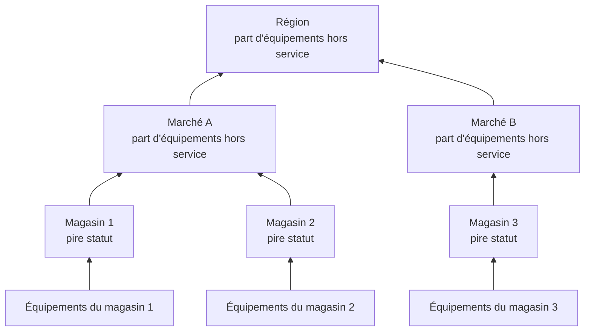

# Sites réseau (agrégation de santé et disponibilité)

Un site réseau est un lieu : une région, un marché, un franchisé, un centre de distribution, un magasin. Les sites s'imbriquent les uns dans les autres, les équipements réseau y sont rattachés, et OneUptime agrège la santé des équipements en remontant l'arborescence, si bien qu'un seul statut sur une région répond à la question « y a-t-il un problème quelque part ? ».

Retrouvez-les sous **Réseau → Sites**, et sur une carte sous **Réseau → Carte**. Cette page précise comment le statut d'un site est déduit de ce qui se trouve en dessous, ce que signifie sa disponibilité, et comment la maintenance planifiée modifie les deux.

:::cards
- [Ajouter un site](#ajouter-un-site): Trois étapes, ou un fichier CSV pour tout un parc.
- [Définir les valeurs par défaut de surveillance](#valeurs-par-défaut-de-surveillance): Une sonde et des identifiants pour chaque équipement d'un site.
- [Choisir comment la santé est agrégée](#comment-la-santé-dun-parent-est-calculée): Le pire statut pour un magasin, une proportion pour une région.
- [Lire la disponibilité](#disponibilité): Ce que comptent les pourcentages, jour après jour.
:::

## Fonctionnement



Le statut de chaque site vient de chaque équipement de son sous-arbre, jugé selon la [politique d'agrégation](#comment-la-santé-dun-parent-est-calculée) du site. La disponibilité d'un site vient de sa propre chronologie de statut, et une [fenêtre de maintenance](#maintenance-planifiée-pour-les-sites-réseau) sur un site retire ses équipements du vote au-dessus de lui.

## La hiérarchie

Les sites forment une arborescence. Chaque site a un **Site Type** et un site parent facultatif. Les types de site sont la liste propre au projet, sous **Réseau → Paramètres → Site Types**, et un nouveau projet commence avec Account Type, Region, Franchisee, Market et Unit, dans cet ordre en partant du haut, plus Data Center et Other. Les types forment leur propre hiérarchie (**Parent Site Type**), qui décide quels sites peuvent être le parent d'un site. Un type marqué **Niveau unité** est le dernier niveau de votre parc, le magasin ou l'agence : ses sites contiennent des équipements, pas d'autres sites.

Le type, le nom, la description, le parent et l'emplacement d'un site se modifient à un seul endroit : la carte **Site Settings** de la page **Paramètres** du site. L'aperçu du site les affiche avec un lien **Modifier dans les paramètres**, et la liste **Sites** ajoute des sites mais ne les modifie pas.

Chaque équipement est rattaché à un site. Le sous-arbre d'un site, c'est le site lui-même plus chaque site en dessous, et la santé du site est agrégée à partir des équipements de ce sous-arbre, si bien qu'une région sans équipements propres a quand même un statut, parce que les unités en dessous en ont un.

> [!NOTE]
> Une agrégation est recalculée quand le statut d'un équipement change, quand un équipement change de site, quand un site est déplacé dans l'arborescence, et par un balayage toutes les cinq minutes qui rattrape les cas où seul le passage du temps a changé la réponse.

## Ajouter un site

:::steps
### Commencer un nouveau site
Allez dans **Réseau → Sites** et cliquez sur **Ajouter : Site**.

### Dire ce qu'est le site
À l'étape **Site Details**, choisissez le **Site Type** (le genre de lieu : une région, un magasin, un centre de données) et saisissez un **Nom**. La description, l'adresse postale, et la latitude et la longitude qui placent le site sur la carte sont repliées sous **Plus de champs** : remplissez-les maintenant ou plus tard.

### Le placer dans l'arborescence
À l'étape **Hiérarchie**, choisissez le **Parent Site** si le site se trouve sous un autre. Laissez-le vide pour garder le site au premier niveau.

### Définir ses valeurs par défaut
À l'étape **Valeurs par défaut de surveillance**, choisissez la [sonde et le profil d'identifiants par défaut](#valeurs-par-défaut-de-surveillance) des équipements ajoutés au site, puis cliquez sur **Ajouter : Site**.
:::

Sur la page **Sites enfants** d'un site, **Ajouter : Site enfant** ne demande que le type et le nom, sur une page avec l'emplacement replié, et place le nouveau site sous celui-ci.

### Importer des sites depuis un fichier CSV

Pour faire entrer tout un parc d'un coup, ouvrez le menu en haut de la liste **Sites** et cliquez sur **Importer depuis un CSV**. Le fichier a besoin d'une ligne d'en-tête ; les colonnes peuvent être dans n'importe quel ordre et leurs noms ne tiennent pas compte de la casse :

```csv title="sites.csv"
name,siteType,parentName,address,latitude,longitude
North,Region,,,,
Leeds,Market,North,,,
Store 0660,Unit,Leeds,"1 High Street, Leeds",53.7997,-1.5492
```

- `name` et `siteType` sont obligatoires. `siteType` doit être l'un des types de site du projet.
- `parentName` nomme le site parent, qui peut figurer dans le même fichier : les lignes sans parent, ou avec un parent qui existe déjà, passent en premier, puis leurs enfants. Laissez-le vide pour un site de premier niveau.
- Une ligne dont le parent est introuvable est ignorée, et les résultats la signalent. **Preview Import** montre ce que le fichier va créer avant que quoi que ce soit ne soit écrit.

## La carte

**Réseau → Carte** montre vos sites sur une carte, cadrée là où ils se trouvent ; cliquez sur un site pour descendre dedans. Un site qui a des sites en dessous les montre, sur la carte et sous forme de graphe des liens entre eux. Un site sans sites en dessous mais avec ses propres équipements, ou un site dont le type est de niveau unité, ouvre la topologie en direct de ces équipements.

Un projet sans sites a quand même une carte : la carte montre alors la topologie de ses équipements, et regrouper les équipements en sites les place sur la carte selon leur emplacement.

## Valeurs par défaut de surveillance

Un site est aussi l'endroit où vous dites, une fois, comment ses équipements sont surveillés. **Modifier les paramètres** sur la carte **Site Settings** a une étape **Valeurs par défaut de surveillance** avec deux champs :

| Paramètre | Effet |
| --- | --- |
| **Sonde par défaut** | La sonde qui pingue les équipements de ce site, et les interroge par SNMP quand ils ont des identifiants. Un équipement créé dans le site sans sonde propre la reprend, de même qu'un équipement déplacé dans le site sans sonde. |
| **Profil d'identifiants SNMP par défaut** | Le [profil d'identifiants](/docs/monitor/network-device-monitor#identifiants-snmp-et-profils-didentifiants) avec lequel les équipements de ce site sont interrogés quand ni l'équipement ni son propre profil n'ont d'identifiants. |

Définissez les deux sur un site et un nouvel équipement peut y être ajouté par sa seule adresse : il est pingué dès sa première interrogation et interrogé dès sa première interrogation.

Les deux se comportent différemment, à dessein :

- La sonde est copiée sur l'équipement quand celui-ci est créé dans le site ou y est déplacé. Changer plus tard la sonde par défaut d'un site ne déplace pas les équipements qui en ont déjà une : quelle sonde peut joindre un équipement est un fait du réseau, pas une préférence à réécrire en masse depuis un formulaire de site.
- Le profil d'identifiants est lu en direct, à chaque interrogation. Définissez-en un sur un site et chaque équipement sans identifiants qui s'y trouve commence à être interrogé à sa prochaine interrogation, sans modification par équipement ; retirez-le et ils redeviennent seulement pingués.

Ils ne descendent pas non plus aussi loin dans l'arborescence :

- La sonde descend toute l'arborescence. Un équipement qui arrive dans un site sans sonde par défaut prend celle de l'ancêtre le plus proche, si bien qu'une sonde définie sur une région couvre chaque marché et chaque unité en dessous, et qu'un marché qui nomme la sienne l'emporte pour son sous-arbre.
- Le profil d'identifiants n'est lu que depuis le site propre de l'équipement. Un équipement dans une unité ne reprend pas un profil défini sur sa région : définissez-le donc sur les sites auxquels les équipements sont réellement rattachés.

## Comment la santé d'un parent est calculée

Chaque site choisit l'une de deux politiques d'agrégation, dans la carte **Agrégation de santé** de sa page **Paramètres** (**Rollup Policy**).

### Pire statut de tous les équipements (par défaut)

Le pire statut qu'un équipement du sous-arbre rapporte devient le statut du site. La gravité d'un statut vient de sa priorité en tant que statut de moniteur : les statuts d'un nouveau projet sont Operational (1), Degraded (2) et Offline (3), et plus haut est pire. Un seul équipement hors ligne met le site hors ligne, quel que soit le nombre d'équipements sains à côté.

C'est la bonne réponse pour une unité. Quatre commutateurs et un pare-feu dans un même bâtiment ne sont pas indépendants : si l'un d'eux s'éteint, il y a un problème à cette adresse, et le diluer dans une moyenne masque une vraie panne.

C'est en général la mauvaise réponse pour une région de plus de quatre cents magasins. Un seul commutateur éteint dans le magasin 12 000 fait passer toute la région hors ligne : vrai au sens le plus étroit, et inutile dans tous les sens pratiques, car la région est alors rouge dès qu'un magasin quelque part a un problème, et ne vous apprend plus rien.

### Part d'équipements hors service

Le statut du site est déterminé par la part des équipements du sous-arbre qui rendent compte et ne sont pas dans un statut opérationnel :

| Part d'équipements hors service | Statut du site |
| --- | --- |
| 0% | Operational |
| Plus de 0%, sous le seuil | Degraded : le statut du projet qui n'est ni opérationnel ni hors ligne, ou Offline quand le projet n'en a pas |
| Au seuil ou au-dessus | Offline |

Le seuil se définit par site, en **Seuil hors ligne (%)**, et vaut 50 par défaut.

Rien de hors service, c'est Operational, si bas que soit le seuil : un seuil de 0 signifie « tout équipement hors service met le site hors ligne », pas « une région saine est hors ligne ».

### Quels équipements votent

Les deux politiques s'accordent sur ce point, et il compte plus qu'il n'y paraît :

- Les équipements archivés ne votent jamais. Ils sont mis hors service : ils gardent leur site mais sont laissés de côté.
- Les équipements qui n'ont encore jamais rien rapporté ne votent jamais. Un équipement qui attend sa première interrogation n'est pas la preuve d'une panne : il sort donc des deux côtés de la proportion, et une région à moitié intégrée est notée sur la moitié qui a répondu.
- Un équipement interrogé par sonde, le cas normal, vote avec le résultat de sa dernière interrogation : joignable par ping ou par SNMP, et non selon l'ancienneté de son dernier succès. Un équipement qui répond au ping alors que son parcours SNMP échoue est joignable et vote comme tel ; le site se dit joignable, et la ligne de l'équipement indique **SNMP failing** pour que quelqu'un répare les identifiants.
- Un équipement adossé à un moniteur, passé en remplacement par un moniteur lié sur sa page Paramètres, vote avec le statut du moniteur qui lui est lié, car rien ne l'interroge. Sans moniteur lié, il n'a jamais rien rapporté et ne vote pas du tout.

Un moniteur Équipement réseau sur un équipement interrogé par sonde ne change pas sa façon de voter. Un moniteur avec un critère « interface hors service, donc Offline » mettrait Offline sur un commutateur qui répond à chaque ping, et un seul port éteint ferait virer tout un site au rouge alors que chaque ligne d'équipement en dessous indique Up : le site contredirait la liste qu'il résume. Pour un équipement interrogé, c'est l'interrogation qui fait foi pour sa santé ; le moniteur est là pour déclencher des incidents.

### Choisir une politique

Un bon point de départ pour un parc de franchises :

| Niveau | Politique | Pourquoi |
| --- | --- | --- |
| Unité ou magasin | Pire statut | Un équipement hors service, c'est un site en difficulté. |
| Marché | Proportion, seuil d'environ 50% | Un marché dont la moitié des magasins est hors service est hors service. |
| Région | Proportion, seuil de 25% à 50% | La panne d'un seul magasin rend la région Degraded, pas Offline, et elle passe Offline quand quelque chose de systémique se produit. |

La politique se définit par site : vous pouvez donc donner la politique de proportion aux régions et laisser tout ce qui est en dessous sur la valeur par défaut.

## Disponibilité

Chaque site a une chronologie de statut : une ligne par changement de son statut agrégé, ouverte quand le statut change et fermée quand il change de nouveau. La disponibilité en est déduite :

- Le temps passé dans un statut non marqué comme opérationnel est de l'indisponibilité.
- Les lignes qui se chevauchent sont fusionnées, aucune seconde ne compte donc deux fois.
- Le temps qu'aucune ligne ne couvre compte comme disponible. La chronologie ne reçoit des lignes qu'une fois qu'une agrégation a eu lieu, et l'absence de preuve n'est pas une panne.
- Une ligne encore ouverte court jusqu'à la fin de la période mesurée.

Degraded n'est pas opérationnel, il compte donc aussi comme indisponible. Quelle que soit la politique, la disponibilité d'un site est donc la part du temps pendant laquelle aucun équipement qui rend compte en dessous n'était hors service : la politique change le statut qu'affiche une panne partielle, Degraded ou Offline, pas le fait qu'elle compte.

Un site sans aucune ligne de chronologie affiche `—` au lieu de 100% : un site pour lequel aucune agrégation n'a jamais eu lieu n'est pas surveillé, il n'est pas parfait.

### Disponibilité quotidienne

À côté du chiffre sur 30 jours, l'aperçu de chaque site affiche **Uptime (24h)**, et sa page **Chronologie de statut** montre les dernières 24 heures, 7, 30 et 90 jours, ainsi qu'une barre par jour pour les 30 derniers.

Une moyenne sur 30 jours ne peut pas montrer un mauvais jour. Une journée complète de panne dans une période de 30 jours coûte 3.3 points, si bien qu'un site éteint pendant tout un mardi affiche encore 96.7% pour le mois, un chiffre qui ressemble à un arrondi. Les barres quotidiennes placent les mêmes données là où un mauvais jour est une mauvaise barre.

Les jours sont des tranches glissantes de 24 heures qui se terminent maintenant, pas des jours calendaires : les équipements, la personne qui regarde et le serveur peuvent chacun être dans un fuseau horaire différent, et il n'y a pas de « jour » unique sur lequel ils s'accorderaient.

### La disponibilité d'un parent n'est pas une moyenne de celle de ses enfants

La disponibilité d'un parent vient de la propre chronologie du parent, produite par sa politique d'agrégation, et non de la moyenne des pourcentages de ses enfants.

Une moyenne sur les enfants pèse un magasin de deux équipements autant qu'un centre de distribution de deux cents. La propre chronologie d'un parent donne à la place une lecture que l'on peut énoncer en une phrase : la part du temps pendant laquelle rien du tout n'était hors service dans la région. Elle est stricte à dessein : pour une grande région, lisez-la donc avec les barres quotidiennes, et avec le statut, qui dit si une panne partielle était Degraded ou Offline.

## Maintenance planifiée pour les sites réseau

Rattachez des sites à un événement de maintenance planifiée sous **Autres ressources affectées**, à l'étape **Ressources affectées** de l'événement, comme vous le feriez pour un hôte. La page **Maintenance planifiée** d'un site liste les événements qui lui sont rattachés, et son bouton **Créer un événement de maintenance planifiée** ouvre le formulaire avec le site déjà choisi.

Une fenêtre sur un parent couvre tout ce qui est en dessous : une fenêtre sur une région couvre chaque marché et chaque unité qu'elle contient, y compris les sites créés après la planification de la fenêtre, si bien qu'une bascule d'opérateur régionale n'a pas à énumérer quatre cents magasins.

La couverture ne descend que vers le bas. Une fenêtre sur une unité ne met pas sa région en maintenance : on attend toujours de la région qu'elle soit disponible, et une vraie panne dans une autre unité pendant les mêmes heures continue de compter contre elle.

### Ce que change une fenêtre de maintenance

| Pendant la fenêtre | Ce qui se passe |
| --- | --- |
| Le statut en direct du site | Inchangé. Une unité éteinte pour des travaux planifiés indique toujours Offline sur la carte et dans l'arborescence, avec un badge « In maintenance » à côté : quiconque la regarde doit savoir qu'elle est éteinte. |
| La disponibilité du site | La fenêtre est retirée à la fois de l'indisponibilité et de la période mesurée. Deux heures de maintenance font une journée de 22 heures, et rien dans ces deux heures ne compte dans un sens ou dans l'autre. |
| L'agrégation de santé de ses ancêtres | Les équipements du sous-arbre en maintenance cessent de voter, si bien que la région ne vire pas au rouge pour une bascule prévue au calendrier. |
| La disponibilité de ses ancêtres | Inchangée, sans rien à corriger, car la panne planifiée n'a jamais atteint leurs chronologies. |

Cette dernière ligne explique pourquoi les ancêtres sont traités en retenant des votes plutôt qu'en retirant la fenêtre de leur disponibilité : la retirer de la période de la région effacerait aussi une vraie panne ailleurs dans la région pendant les mêmes heures.

La disponibilité est corrigée avec le début et la fin déclarés de l'événement, et non avec le moment où un processus l'a fait changer d'état, si bien que le chiffre peut être vérifié à la main avec le calendrier. Un jour entièrement compris dans une fenêtre est dessiné comme de la maintenance dans les barres quotidiennes plutôt que comme un jour parfait, et n'entre pas dans la moyenne.

### Interaction avec les moniteurs

Rattacher un moniteur au même événement fait toujours ce que cela a toujours fait : la surveillance active de ce moniteur est suspendue pendant la fenêtre. Les deux sont indépendants : rattachez le site pour le sortir de l'agrégation et de sa disponibilité, et rattachez les moniteurs pour qu'ils cessent d'alerter.

## Alertes sur un site

La carte **Alertes** de la page **Paramètres** d'un site a **Alerter en cas de mauvaise santé** : une alerte s'ouvre quand l'agrégation du site passe à un statut non opérationnel, et se résout d'elle-même quand le site se rétablit. **Gravité de l'alerte** définit sa gravité ; laissée vide, c'est la plus grave du projet.

Elle n'alerte que sur le changement : l'activer pour un site déjà en mauvaise santé arme le prochain changement au lieu d'alerter sur le passé. Degraded n'est pas opérationnel : un site sous la politique de proportion alerte donc dès qu'un des équipements qui rendent compte est hors service, comme un site sous la politique du pire statut ; l'alerte reste ouverte, sans seconde alerte, pendant que le site passe de Degraded à Offline et inversement, et son titre nomme le statut que le site a atteint en premier.

## Dépannage

:::details Une région est toujours rouge
Le site utilise la politique du pire statut, si bien qu'un seul équipement hors ligne n'importe où en dessous le met hors ligne. Passez la région en **Percentage of devices down** dans sa carte **Agrégation de santé**, avec un seuil qui correspond à la part de la région qui doit être hors service pour que vous la disiez hors service.
:::

:::details Un site affiche — au lieu d'une disponibilité
Aucune agrégation n'a jamais eu lieu pour le site, il n'a donc aucune ligne de chronologie : il n'est pas surveillé, il n'est pas parfait. Ajoutez des équipements au site, ou aux sites en dessous, et la prochaine agrégation commencera sa chronologie.
:::

:::details Un équipement ne compte pas pour son site
Les équipements archivés, et les équipements qui n'ont encore rien rapporté, ne votent jamais. Un équipement adossé à un moniteur sans moniteur lié n'a jamais rien rapporté non plus. Vérifiez le statut de l'équipement : un équipement **En attente** vote après sa première interrogation.
:::

:::details L'alerte d'un site ne s'est pas déclenchée
**Alerter en cas de mauvaise santé** se déclenche lors du passage d'un statut opérationnel à un autre, si bien qu'un site déjà en mauvaise santé quand vous l'avez activé alerte à son prochain changement, après s'être rétabli. Vérifiez aussi que ses équipements votent : les équipements archivés et ceux qui attendent leur première interrogation ne votent jamais, et les équipements d'un site en maintenance ne votent pas dans les agrégations au-dessus de lui.
:::

## Étapes suivantes

:::cards
- [Surveillance des équipements réseau](/docs/monitor/network-device-monitor): Ajouter, interroger et alerter sur les équipements rattachés à ces sites.
- [Trafic réseau](/docs/monitor/network-traffic): Voir le trafic d'un site grâce aux enregistrements de flux de ses équipements.
- [Inventaire](/docs/inventory/overview): Les équipements réseau aux côtés de tous vos autres actifs.
:::
