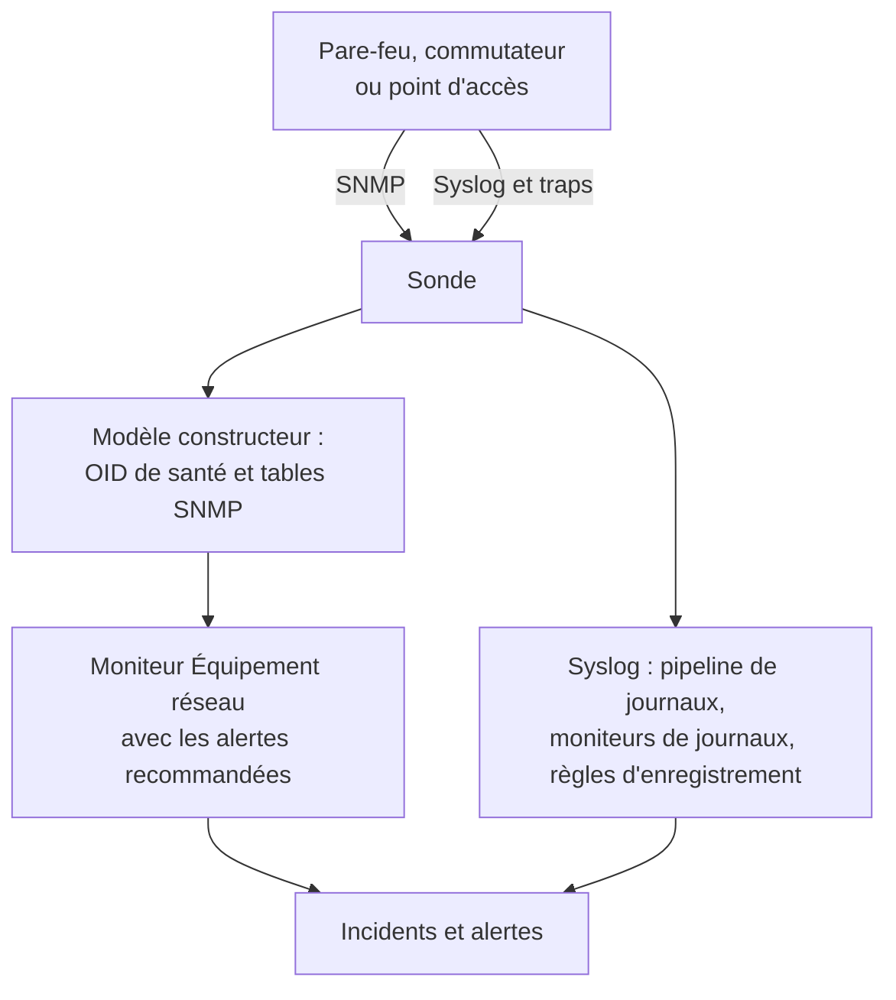

# Guides par constructeur réseau (Sophos, Extreme, Cambium)

Comment surveiller de bout en bout trois parcs courants avec OneUptime : un Sophos Firewall (XGS, SFOS) avec ses tunnels IPsec, ses liens WAN et son SD-WAN ; des commutateurs Extreme Networks (EXOS / Switch Engine et Fabric Engine / VOSS) avec leur fabric ; et des commutateurs cnMatrix et points d'accès Wi-Fi d'entreprise de Cambium Networks, jusqu'au canal et à la puissance d'émission de chaque radio.

:::cards
- [Sophos Firewall](#sophos-firewall-xgs-sfos): Tunnels, liens WAN, passerelles et SD-WAN.
- [Extreme Networks](#extreme-networks-exos-switch-engine-et-fabric-engine-voss): Les commutateurs, la fabric et son matériel.
- [Cambium Networks](#cambium-networks-wi-fi-dentreprise-et-cnmatrix): Les points d'accès jusqu'à chaque radio, et les commutateurs cnMatrix.
:::

## Fonctionnement

Chaque guide utilise les mêmes briques :

- Un [équipement réseau](/docs/monitor/network-device-monitor) par boîtier, interrogé par une sonde qui peut le joindre, avec un modèle constructeur qui apporte les bons OID de santé et les bonnes [tables SNMP](/docs/monitor/network-device-monitor#tables-snmp).
- Un moniteur Équipement réseau par équipement pour les alertes. Créez-le depuis la page de l'équipement pour que les [alertes recommandées](/docs/monitor/network-device-monitor#pack-dalertes-recommandé) soient remplies pour vous, y compris une alerte par ligne pour chaque table qui sait à quoi ressemble un état sain. Pour une flotte, une [politique d'alerte](/docs/monitor/network-device-monitor#politiques-dalerte) en maintient un sur chaque équipement.
- Pour ce qu'un constructeur ne rapporte que dans ses journaux : le syslog vers la sonde, un [pipeline de journaux](/docs/telemetry/log-pipelines) pour transformer chaque ligne en attributs, des [moniteurs de journaux avec Group By](/docs/monitor/logs-monitor#alertes-par-groupe-group-by) pour alerter une fois par tunnel ou par passerelle, et des [règles d'enregistrement de journaux](/docs/telemetry/log-recording-rules) pour tracer les chiffres de ces journaux.

## Sophos Firewall (XGS / SFOS)

| Ce que vous voulez voir | D'où cela vient |
| --- | --- |
| La santé du pare-feu : mémoire, disque, swap, état HA, service IPsec, CPU par cœur | SNMP, avec le modèle constructeur **Sophos Firewall (SFOS / XGS)** |
| Le statut de chaque tunnel IPsec, par son nom | La table SNMP `ipsec_tunnels` (SFOS v20 et suivantes) |
| Le statut, le débit, l'utilisation et les erreurs de chaque lien WAN | Le parcours des interfaces des ports WAN |
| La latence, la perte de paquets et la gigue de chaque lien WAN | Des moniteurs Ping et les interrogations d'équipements depuis les sondes OneUptime |
| Passerelle joignable ou hors service, SLA SD-WAN atteint ou non, changements de route SD-WAN | Le syslog du pare-feu |
| La latence, la gigue et la perte de paquets SD-WAN par passerelle, en graphiques | Des règles d'enregistrement de journaux sur les journaux de SLA SD-WAN |

Sophos ne rapporte la santé des passerelles et du SD-WAN par SNMP dans aucune version de SFOS : elle n'existe que dans les journaux du pare-feu, et dans les alertes de Sophos Central, c'est pourquoi les trois dernières lignes passent par le syslog.

### Enregistrer le pare-feu

:::steps
1. Sur le pare-feu, activez SNMP sous **Administration → SNMP** : ajoutez un utilisateur SNMPv3, ou une communauté v2c, et autorisez l'adresse de la sonde à l'interroger.
2. Dans OneUptime, allez dans **Réseau → Appareils** et cliquez sur **Ajouter l'équipement**. Saisissez l'adresse de gestion du pare-feu, choisissez une sonde qui peut le joindre, et ajoutez les identifiants SNMP sous **SNMP**.
3. Sur la page **Paramètres** de l'équipement, sous **Polling & Data Collection**, appliquez le modèle **Sophos Firewall (SFOS / XGS)** depuis **Vendor Health Template** et ajoutez ses tables depuis **Add a Vendor's Tables**. Ou activez **Appliquer automatiquement le modèle de santé du fabricant**, et la première interrogation fait les deux.
:::

Après l'interrogation suivante, la page **SNMP Tables** de l'équipement liste chaque connexion IPsec avec son statut (active, inactive, partially active), ainsi que les cœurs CPU. SFOS numérote ses cœurs à partir de 196608, c'est pourquoi le CPU vient d'une table plutôt que d'un unique `hrProcessorLoad.1`.

### Alerter sur chaque tunnel IPsec

Sur la page de l'équipement, cliquez sur **Créer un moniteur**. Les alertes recommandées incluent **IPsec Tunnels: row unhealthy**, un critère **SNMP Table Row Is Unhealthy** sur la table `ipsec_tunnels` avec Row `*` : il ouvre un incident par tunnel inactif, nommé d'après le tunnel, et résout chacun quand son tunnel revient.

Un tunnel que Sophos déclare actif n'a que ses associations de sécurité établies. Pour prouver que du trafic le traverse, ajoutez un [moniteur Ping](/docs/monitor/ping-monitor) depuis une sonde d'un site vers un hôte de l'autre côté de chaque tunnel, et dessinez le tunnel comme lien de site sous **Réseau → Topologie → Site Links** entre les deux [sites](/docs/monitor/network-sites), lié à ce moniteur : le lien sur la carte prend alors la couleur du moniteur.

### Liens WAN

- **Santé des ports.** Le parcours des interfaces mesure déjà le statut, les bits entrants et sortants, l'utilisation et les erreurs de chaque port WAN. Sur le moniteur du pare-feu, un critère **SNMP Interface Is Down** ou **SNMP Interface Utilization (in %)** avec **Interface** réglé sur le nom du port WAN, ou `*` pour chaque port, alerte par lien.
- **Qualité du chemin.** La latence, la perte de paquets et la gigue de chaque lien se mesurent depuis l'extérieur du pare-feu : un moniteur Ping depuis les sondes cloud de OneUptime vers l'adresse publique de chaque lien WAN, et un moniteur Ping depuis une sonde du site vers la passerelle de chaque fournisseur d'accès. Des critères de perte de paquets et de gigue sur ces moniteurs alertent par lien, et **Réseau → Topologie → Matrice de latence** montre chaque sonde face à chaque moniteur d'un coup d'œil.
- **Trafic.** SFOS exporte du NetFlow v5. Envoyez-le à la sonde sur UDP 2055, où le collecteur de flux de la sonde écoute par défaut, et la page **Traffic** de l'équipement montre qui parle à qui sur chaque lien WAN ; [Trafic réseau](/docs/monitor/network-traffic) donne les détails.

### Passerelles et SD-WAN depuis le syslog

:::steps
1. Activez le récepteur syslog de la sonde : mettez `PROBE_SYSLOG_RECEIVER_ENABLED=true` sur la sonde. Il écoute sur UDP 5140 par défaut (`PROBE_SYSLOG_RECEIVER_PORT` le change) ; publiez le port si la sonde tourne dans Docker. Les messages sont associés à l'équipement réseau dont le nom d'hôte, ou l'une des **Autres adresses**, est l'adresse de l'expéditeur, et apparaissent sur la page **Journaux** de l'équipement.
2. Sur le pare-feu, sous **System services → Log settings**, ajoutez un serveur syslog qui pointe vers la sonde et ce port, et cochez les types de journal **Event** pour IPsec et les passerelles et le type de journal **SD-WAN** : les journaux de SLA restent désactivés tant qu'il n'est pas coché.
3. Sous **Journaux → Paramètres → Pipelines**, créez un pipeline dont le filtre correspond aux journaux du pare-feu, comme `attributes.networkDevice.name = 'hq-firewall'`, et ajoutez un **Key=Value Parser** avec **Target Prefix** `sophos`. Collez une ligne du pare-feu dans son testeur pour voir les noms d'attributs exacts que produit votre version de SFOS ; [l'exemple Sophos](/docs/telemetry/log-pipelines#exemple-pare-feu-sophos-xgs) le détaille.
4. Créez des [moniteurs de journaux](/docs/monitor/logs-monitor) sur les journaux du pare-feu, chacun avec **Group by Attributes** pour que chaque tunnel ou passerelle alerte séparément, et le critère **Log Count** **Greater Than** `0` sur quelques minutes. Les lignes ci-dessous sont les trois pour commencer.
5. Tracez la qualité du SD-WAN : avec la journalisation SD-WAN activée, le pare-feu écrit un résumé de SLA par profil et par passerelle (`latency`, `jitter`, `packet_loss`). Sous **Journaux → Paramètres → Règles d'enregistrement**, créez une règle par chiffre, comme la moyenne de `sophos.latency` groupée par `sophos.gw_name` et `sophos.profile_name`, puis tracez les résultats, ou alertez dessus avec un [moniteur de métriques](/docs/monitor/metrics-monitor) qui groupe par passerelle. [Règles d'enregistrement de journaux](/docs/telemetry/log-recording-rules) détaille cet exemple.
:::

| Alerte | Journaux à compter | Grouper par |
| --- | --- | --- |
| Tunnel IPsec terminé | Attribut `sophos.log_component` = `IPSec`, le corps contient `terminated` | `sophos.con_name` |
| Passerelle hors service | Attribut `sophos.log_component` = `Gateway`, le corps contient `is Down` | `sophos.gatewayname` |
| SLA SD-WAN non atteint | Attribut `sophos.log_type` = `SD-WAN`, le corps contient `SLA not met` | `sophos.gw_name` |

Les événements syslog complètent la table SNMP : ils arrivent au moment où un tunnel tombe, tandis que la table attrape aussi un tunnel qui ne s'est jamais établi.

### Traps

Chaque notification Sophos est le même trap, `sfosNotification` (`1.3.6.1.4.1.2604.5.1.8.1.1`), avec l'événement en texte dans `sfosTrapMessage` (`1.3.6.1.4.1.2604.5.1.8.1.2`). Pour alerter sur un type d'événement, combinez **SNMP Trap Received (Trap OID)** Equal To `1.3.6.1.4.1.2604.5.1.8.1.1` avec **SNMP Trap Varbind Value** sur cette varbind, Contains `IPSec` par exemple. Réglez la destination des traps du pare-feu sur SNMP v2c : le récepteur de traps de la sonde accepte les traps v1 et v2c.

## Extreme Networks (EXOS / Switch Engine et Fabric Engine / VOSS)

| Ce que vous voulez voir | D'où cela vient |
| --- | --- |
| EXOS : CPU, température et son alarme, état de l'alimentation, alimentations, ventilateurs, mémoire par emplacement, membres de la pile | Le modèle **Extreme Networks EXOS / Switch Engine** |
| Fabric Engine : CPU et mémoire par emplacement, capteurs de température, ventilateurs, alimentations, session vIST, nombre d'I-SID | Le modèle **Extreme Networks Fabric Engine / VOSS** |
| Chaque adjacence Fabric Connect (IS-IS), nommée par son voisin | La table `isis_adjacencies` du modèle Fabric Engine |
| Les ports, les voisins LLDP, la carte du réseau | Le parcours des interfaces, sur les deux |

### Quel modèle

Fabric Engine sur le matériel universel d'Extreme (les séries 5000 et 7000) rapporte le même numéro d'entreprise qu'EXOS : seule sa description système (`7520-48Y-8C-FabricEngine (9.0.4.0)`) dit quel système d'exploitation tourne. OneUptime lit les deux, si bien que l'application automatique et la suggestion de la page de l'équipement choisissent le bon modèle, et les anciens commutateurs VSP rapportent l'arborescence Avaya/Nortel et sont reconnus directement comme Fabric Engine.

### Alertes sur la fabric et le matériel

Les alertes recommandées sur un commutateur Fabric Engine incluent **Fabric Adjacencies (IS-IS): row unhealthy**, un incident par voisin dont l'adjacence n'est pas établie. Fabric Engine envoie aussi un trap quand une adjacence change, `rcnIsisPlsbAdjStateTrap` (`1.3.6.1.4.1.2272.1.21.0.281`), et un critère **SNMP Trap Received (Trap OID)** sur celui-ci alerte en quelques secondes, avant l'interrogation suivante.

Les alimentations, les ventilateurs, les capteurs de température et les membres de la pile sont des tables qui déclarent leurs valeurs saines, si bien que chacune reçoit une alerte par ligne dans les alertes recommandées.

### Flux et Wi-Fi

EXOS et Fabric Engine exportent des flux en sFlow et en IPFIX. Envoyez le sFlow à la sonde sur UDP 6343, ou l'IPFIX sur UDP 4739, et la page **Traffic** de l'équipement montre son trafic ; voir [Trafic réseau](/docs/monitor/network-traffic).

Les points d'accès IQ Engine (HiveOS) et ExtremeCloud IQ Controller ont leurs propres modèles constructeurs, qui remplissent la page **Wi-Fi** de l'équipement. [Constructeurs Wi-Fi pris en charge](/docs/monitor/network-device-monitor#constructeurs-wi-fi-pris-en-charge) les décrit, avec Ubiquiti UniFi, HPE Aruba, TP-Link Omada et Juniper Mist.

## Cambium Networks (Wi-Fi d'entreprise et cnMatrix)

### Points d'accès

:::steps
1. Activez SNMP sur les points d'accès. Dans cnMaestro, SNMP se règle par groupe d'AP : **Configuration → Wi-Fi Profiles → AP Groups → Management → SNMP**. Activez-le avec une communauté de lecture v2c ou un utilisateur SNMPv3.
2. Ajoutez chaque point d'accès avec son adresse de gestion et ces identifiants, et appliquez le modèle **Cambium Networks Enterprise Wi-Fi (cnPilot, XV, XE, XH)**, ou activez l'application automatique.
3. Ouvrez la page **Wi-Fi** de l'équipement. Elle montre combien de radios sont allumées, les clients et les SSID, puis la bande, le canal, la fréquence, la largeur de canal, la puissance d'émission, les clients, le bruit de fond et le temps d'antenne de chaque radio, et chaque SSID avec ses clients. La fréquence est calculée à partir de la bande et du canal ; le point d'accès ne la rapporte pas.
:::

Des alertes utiles, toutes sur la table `wifi_radios` avec Row `*`, pour que chaque radio alerte séparément :

| Alerte | Critère |
| --- | --- |
| Une radio éteinte | **SNMP Table Row Is Unhealthy**, inclus dans les alertes recommandées |
| La puissance d'émission a changé | **SNMP Table Value**, colonne TX Power, Not Equal To votre puissance prévue |
| Une radio surchargée | **SNMP Table Value**, colonne Clients, Greater Than votre limite |
| Un canal bruyant | **SNMP Table Value**, colonne Noise Floor, Greater Than `-80` |

Chaque valeur numérique d'une radio est aussi une métrique (`oneuptime.monitor.snmp.table.value`, une série par radio et par colonne), si bien que le canal, la puissance et les clients peuvent être tracés dans le temps sur un tableau de bord ; un canal qui change sans cesse, c'est le DFS à l'œuvre.

Cambium ne rapporte le nombre total de clients qu'à partir du firmware 6.5.3 ; les firmwares plus anciens renvoient 0.

### Commutateurs cnMatrix

Le modèle **Cambium Networks cnMatrix** collecte le CPU, la RAM, la flash, la température et la tension d'alimentation, plus les ventilateurs, l'alimentation redondante et la consommation PoE de chaque port sous forme de tables. Les ports et les voisins LLDP viennent du parcours des interfaces, comme sur tout commutateur.

### Alarmes cnMaestro

cnMaestro peut envoyer ses alarmes, comme un point d'accès qui passe hors ligne, à un webhook HTTPS. Pointez-le vers un [moniteur de requêtes entrantes](/docs/monitor/incoming-request-monitor) pour transformer ces alarmes en incidents OneUptime aux côtés des données SNMP.

## Dépannage

:::details La table IPsec Tunnels n'a pas de statut
Le statut des tunnels demande SFOS v20 ou ultérieur. Vérifiez aussi que la vue SNMP de vos identifiants inclut l'arborescence d'entreprise de Sophos (`1.3.6.1.4.1.2604`) : un utilisateur v3 restreint ne voit souvent que le groupe système et IF-MIB.
:::

:::details Aucun syslog n'arrive du pare-feu
Le récepteur syslog de la sonde est désactivé par défaut : mettez `PROBE_SYSLOG_RECEIVER_ENABLED=true` et publiez UDP 5140, ou votre `PROBE_SYSLOG_RECEIVER_PORT`, vers la sonde. Les messages sont associés à un équipement par l'adresse de l'expéditeur : le nom d'hôte du pare-feu dans OneUptime, ou l'une de ses **Autres adresses**, doit donc être l'adresse depuis laquelle il envoie le syslog.
:::

:::details Un commutateur Fabric Engine a reçu le modèle EXOS
Le modèle est choisi d'après la description système du commutateur. Vérifiez que l'aperçu de l'équipement affiche une description qui nomme Fabric Engine (comme `7520-48Y-8C-FabricEngine (9.0.4.0)`) ; si c'est le cas, retirez les OID et tables EXOS et appliquez **Extreme Networks Fabric Engine / VOSS** depuis **Vendor Health Template**.
:::

:::details Les points d'accès Cambium indiquent 0 client
Le nombre total de clients demande le firmware 6.5.3 ou ultérieur. Sur un firmware plus ancien, les radios rapportent toujours leur canal, leur puissance et leur bruit de fond.
:::

## Étapes suivantes

:::cards
- [Surveillance des équipements réseau](/docs/monitor/network-device-monitor): Tout ce qu'un équipement collecte, et chaque critère sur lequel il peut alerter.
- [Pipelines de journaux](/docs/telemetry/log-pipelines): Découper les journaux de pare-feu en attributs.
- [Surveillance des journaux](/docs/monitor/logs-monitor): Alerter une fois par tunnel ou par passerelle.
:::
