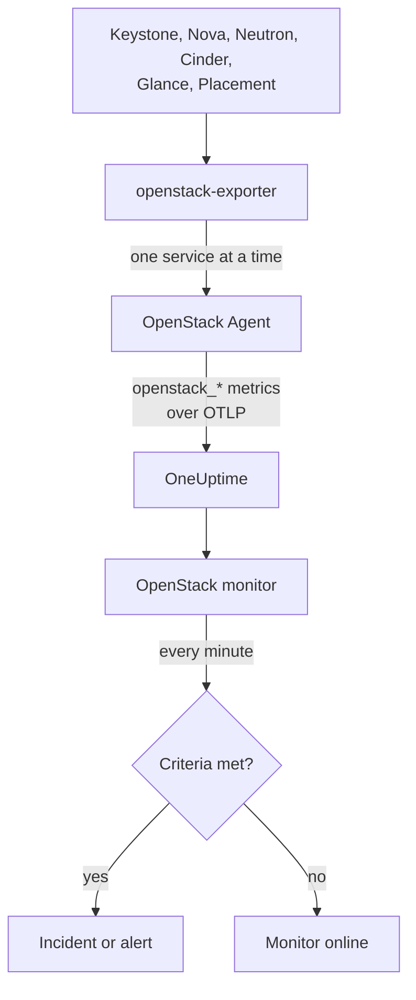

# Surveillance OpenStack

Un moniteur OpenStack surveille un cloud - ses API, les workers qui les soutiennent, les hyperviseurs, les instances, les réseaux, les pools de stockage et les quotas des projets - et vous prévient quand une API cesse de répondre, qu'un worker tombe, qu'un hyperviseur n'a plus de place à offrir ou qu'un pool se remplit. Il lit les séries `openstack_*` que l'agent OpenStack de OneUptime collecte depuis openstack-exporter, ou qu'une sonde collecte depuis les API du cloud.

:::cards
- [Créer le moniteur](#créer-un-moniteur-openstack): six étapes dans le tableau de bord.
- [Modèles](#modèles-dalerte-prédéfinis): alertes prêtes à l'emploi, un incident par worker, instance, réseau ou région.
- [Vérifications depuis l'extérieur](#vérifications-depuis-lextérieur): savoir si quelqu'un peut réellement démarrer une instance, depuis une sonde située hors du cloud.
- [Attributs d'identité](#attributs-didentité): comment cibler une région, un hôte ou un projet.
- [Métriques](#métriques-collectées): toutes les séries sur lesquelles le moniteur peut alerter.
:::

## Fonctionnement

L'agent est un OpenTelemetry Collector associé à un openstack-exporter, que vous exécutez sur une machine capable d'atteindre les API du cloud. Il lit chaque service OpenStack dans sa propre collecte, de sorte qu'un Nova en panne ne coûte que les séries de Nova, et il lit en douceur : compute, network, volume et placement toutes les 2 minutes, identity et image toutes les 5.

Chaque série est estampillée du nom du cloud, `openstack.cloud.name`, et chaque point de données de `openstack.region.name` et `openstack_service`. Un cloud correspond à un Keystone, et un moniteur OpenStack est lié à un seul cloud. Chaque minute, il exécute sa requête sur les métriques de ce cloud et compare le résultat à ses critères.



## Avant de commencer

- **Collectez les métriques du cloud** avec l'agent OpenStack, ou [une sonde](/docs/telemetry/openstack-agentless). **Documentation**, sous **Produits → Infrastructure → OpenStack**, vous guide dans l'installation de l'agent.
- **Vérifiez que le cloud est enregistré.** Après sa première collecte, il apparaît sous **Produits → Infrastructure → OpenStack**, avec le nom donné par `OPENSTACK_CLOUD_NAME` dans l'agent.

## Créer un moniteur OpenStack

:::steps
### Démarrer un nouveau moniteur

Allez dans **Moniteurs** et cliquez sur **Créer un moniteur**.

### Choisir OpenStack

Sous **Type de moniteur**, cliquez sur **Plus de types de moniteurs** et choisissez **OpenStack** sous **Infrastructure**, ou saisissez `openstack` dans la zone de recherche. Saisissez un **Nom** - il sert dans les titres des incidents et des alertes - puis cliquez sur **Suivant**.

### Choisir le cloud

Sous **OpenStack Monitor Configuration**, choisissez le cloud dans **Cloud OpenStack**. Tous les clouds qui ont envoyé des données figurent dans la liste. Une fois le cloud choisi, une ligne sous le champ indique si des données arrivent.

### Choisir ce qu'il faut surveiller

Un nouveau moniteur démarre sur **Cloud Stopped Reporting**, sous **Sur quoi alerter**. Pour surveiller autre chose :

- **Modifier** - choisissez un autre [modèle](#modèles-dalerte-prédéfinis). Il définit la métrique, les filtres d'attributs, l'agrégation, la plage temporelle, le regroupement et les seuils, et remplace les critères ci-dessous par les siens. Vous pouvez toujours modifier la **Plage temporelle**.
- **Custom Metric** (sous **Plus de champs**) - choisissez une métrique dans **Métrique OpenStack**, puis définissez l'**Agrégation** et la **Plage temporelle**, et affinez avec les [filtres](#paramètres-du-moniteur).
- **Avancé** (sous **Plus de champs**) - construisez vous-même des requêtes et des formules sous **Sélectionner les métriques**, avec des filtres sur des attributs tels que `status`, `adminState` ou `resourcetype`. Utilisez **Regrouper par** un [attribut d'identité](#attributs-didentité) pour évaluer chaque élément séparément.

### Vérifier les critères

Ouvrez chaque critère sous **Critères** et vérifiez sa **Métrique**, son **Agrégation**, sa **Condition** et son **Seuil**. Un modèle les remplit. Avec **Custom Metric** ou **Avancé**, le moniteur démarre avec les critères par défaut, qui ne détectent que l'absence de données envoyées par la métrique : définissez donc votre propre seuil.

### Créer le moniteur

Cliquez sur **Créer un moniteur**. OneUptime ouvre la page du moniteur et l'évalue chaque minute. Les incidents et les alertes qu'il déclenche figurent aussi dans les pages **Incidents** et **Alertes** du cloud.
:::

> [!TIP]
> Pour configurer plusieurs modèles d'un coup, ouvrez le cloud depuis **Produits → Infrastructure → OpenStack** et allez dans **Recommandations**. Choisissez les modèles voulus, indiquez qui est alerté, et OneUptime crée un moniteur par modèle.

## Paramètres du moniteur

| Champ | Onglet | Rôle |
| --- | --- | --- |
| **Cloud OpenStack** | Tous | Obligatoire. Limite chaque requête à `resource.openstack.cloud.name`. |
| **Région** | Custom Metric, Avancé | Facultatif. Une région : `openstack.region.name`. Toutes les séries le portent. |
| **Zone de disponibilité** | Custom Metric, Avancé | Facultatif. Une zone : `availability_zone` sur les hyperviseurs, les instances, les volumes et les agents Neutron, `zone` sur les workers de Nova et de Cinder. |
| **Hyperviseur** | Custom Metric, Avancé | Facultatif. Un hôte : `hostname` sur les workers, les hyperviseurs et Placement, `hypervisor_hostname` sur les instances. Les workers de Nova indiquent le nom court de l'hôte, tandis que les hyperviseurs, Placement et les instances indiquent son nom complet : utilisez donc celui que la série indique. |
| **Service** | Custom Metric, Avancé | Facultatif. Le binaire d'un worker, tel que `nova-compute` : `service`. |
| **ID du projet** | Custom Metric, Avancé | Facultatif. Un projet : `tenant_id` sur les séries de Nova et de Cinder ainsi que sur les réseaux et les sous-réseaux, `project_id` sur les adresses IP flottantes, les routeurs et la disponibilité des adresses. |
| **Métrique OpenStack** | Custom Metric | Une métrique du [catalogue](#métriques-collectées). |
| **Agrégation** | Custom Metric | Comment les échantillons sont combinés : **Moyenne**, **Maximum**, **Minimum**, **Somme** ou **Comptage**. Démarre sur l'agrégation habituelle de la métrique. |
| **Plage temporelle** | Tous | La fenêtre glissante lue par la requête, de **Past 1 Minute** à **Past 365 Days**. Un nouveau moniteur démarre sur **15 dernières minutes** ; les modèles définissent la leur. |
| **Sélectionner les métriques** | Avancé | Le générateur de requêtes : **Métrique**, **Agréger par**, **Filtrer par attributs**, **Regrouper par**, ainsi que **Ajouter une métrique** et **Ajouter une formule** pour combiner des requêtes. |

Un filtre ne restreint qu'une série qui porte son label : `openstack_nova_up` n'a pas de projet, donc un filtre de projet la laisse telle quelle.

Gardez une fenêtre d'au moins trois collectes de ce que vous lisez : 6 minutes pour compute, network, volume et placement, 15 pour identity et image. Une fenêtre plus courte ne contient pas assez de collectes pour que l'option **Toutes les valeurs** désigne une durée.

## Attributs d'identité

Chaque série porte `openstack.cloud.name` comme **attribut de ressource**, et `openstack.region.name` et `openstack_service` comme attributs de point de données. Les labels propres à l'exporter indiquent le reste :

| Élément | Séries | Labels qui l'identifient |
| --- | --- | --- |
| API | `openstack_*_up` | `openstack.region.name`, `openstack_service` |
| Worker | `openstack_nova_agent_state`, `openstack_neutron_agent_state`, `openstack_cinder_agent_state` | `hostname`, `service`. `adminState` indique si un opérateur l'a laissé activé. Ne regroupez jamais par `uuid` sur celui de Cinder : l'exporter en invente un à chaque collecte |
| Hyperviseur | `openstack_placement_resource_*`, `openstack_nova_vcpus_*` | `hostname` (son nom complet), `resourcetype` sur celles de Placement |
| Instance | `openstack_nova_server_status` | `uuid`, `name`, `tenant_id`, `hypervisor_hostname`, `status`. La valeur est un code : filtrez sur le mot de `status` |
| Volume | `openstack_cinder_volume_gb` | `id`, `name`, `tenant_id`, `status` |
| Pool de stockage | `openstack_cinder_pool_capacity_*` | `name`, `volume_backend_name` |
| Réseau | `openstack_neutron_network_ip_availabilities_*` | `network_id`, `network_name`, `cidr`, `ip_version` |
| Routeur | `openstack_neutron_l3_agent_of_router` | `router_id`, `agent_host`, `ha_state`, `agent_alive`, `agent_admin_up` |
| Projet | `openstack_nova_limits_*`, `openstack_cinder_limits_*` | `tenant_id`, `tenant` |

Dans les filtres et les clés de regroupement d'un moniteur, un attribut de ressource commence par `resource.` (`resource.openstack.cloud.name`), et un attribut de point de données non (`openstack.region.name`, `hostname`, `status`). Un label vide n'atteint pas OneUptime : `disabledReason` n'est donc présent que sur un worker que quelqu'un a désactivé.

## Modèles d'alerte prédéfinis

OneUptime fournit 120 modèles pour les problèmes courants d'OpenStack, et la liste **Sur quoi alerter** les propose. La page Recommandations d'un cloud ne propose un modèle pour Heat, Magnum, Ironic, Manila, Octavia, Trove, Designate, Gnocchi ou Swift qu'à un cloud qui l'exécute, un modèle sur une série qu'une sonde seule envoie qu'à un cloud qu'une sonde collecte, et un modèle sur une [vérification depuis l'extérieur](#vérifications-depuis-lextérieur) qu'à un cloud où cette vérification est activée : sur tout autre cloud, ses séries n'existent pas, il ne pourrait donc jamais se déclencher. Chacun construit un moniteur complet : la requête de métrique, ses filtres d'attributs, un regroupement sur ce dont traite un incident, un critère qui se déclenche et un autre qui rétablit. Les seuils sont les mêmes lignes que celles que tracent les pages du cloud, et ce sont des points de départ que vous pouvez modifier.

Chaque modèle lit au moins trois collectes de ce qu'il surveille, et ne se déclenche que si la condition tient pendant toute sa fenêtre. Un seuil sur une proportion se rétablit 10 % au-delà de sa ligne, afin qu'une valeur qui oscille autour ne fasse pas clignoter l'alerte.

| Modèle | Catégorie | Gravité | Surveille | Se déclenche quand | Se rétablit quand |
| --- | --- | --- | --- | --- | --- |
| Cloud Stopped Reporting | Disponibilité | Critique | `openstack_identity_up`, Comptage sur l'ensemble du cloud, **15 dernières minutes** | Aucune donnée pendant toute la fenêtre : l'agent s'est arrêté ou ne peut pas joindre OneUptime, ou l'exporter ne peut pas se connecter à Keystone | Les données arrivent de nouveau |
| Identity API Down | Disponibilité | Critique | `openstack_identity_up` et `scrape_samples_scraped` pour `identity`, Min par région, **15 dernières minutes** | Tous les appels ont échoué, ou la collecte est revenue vide parce que l'exporter n'a pas pu se connecter | Les deux valent 1 ou plus |
| Compute API Down | Disponibilité | Critique | `openstack_nova_up` et `scrape_samples_scraped` pour `compute`, Min par région, **10 dernières minutes** | Tous les appels ont échoué, ou la collecte est revenue vide parce que l'exporter n'a pas pu joindre l'API de Nova | Les deux valent 1 ou plus |
| Network API Down | Disponibilité | Critique | `openstack_neutron_up` et `up` pour `network`, Min par région, **10 dernières minutes** | Tous les appels ont échoué, ou l'exporter n'a pas répondu | Les deux valent 1 |
| Block Storage API Down | Disponibilité | Critique | `openstack_cinder_up` et `up` pour `volume`, Min par région, **10 dernières minutes** | Tous les appels ont échoué, ou l'exporter n'a pas répondu | Les deux valent 1 |
| Image API Down | Disponibilité | Critique | `openstack_glance_up` et `up` pour `image`, Min par région, **15 dernières minutes** | Tous les appels ont échoué, ou l'exporter n'a pas répondu | Les deux valent 1 |
| Placement API Down | Disponibilité | Critique | `openstack_placement_up` et `up` pour `placement`, Min par région, **10 dernières minutes** | Tous les appels ont échoué, ou l'exporter n'a pas répondu | Les deux valent 1 |
| Compute Service Down | Plan de contrôle | Critique | `openstack_nova_agent_state` filtré sur `service = nova-compute` et `adminState = enabled`, Min par hôte, **10 dernières minutes** | Inférieur à 1 : un nova-compute activé est arrêté. Un nova-compute désactivé par quelqu'un ne se déclenche jamais | Actif, ou désactivé |
| Compute Service Disabled | Plan de contrôle | Avertissement | `openstack_nova_agent_state` filtré sur `service = nova-compute` et `adminState = disabled`, un Comptage par hôte, **10 dernières minutes** | Supérieur à 0 : un `nova-compute` a été désactivé, et aucun événement de maintenance en cours ne couvre son hôte, sa zone de disponibilité ou le cloud. Un nova-compute qui s'est désactivé de lui-même parce que libvirt est tombé (sa raison commence par `AUTO:`) reste silencieux tant que libvirt Service Down est ouvert. Les projets n'en sont pas informés | Il est de nouveau activé, ou un événement le couvre |
| Scheduler or Conductor Down | Plan de contrôle | Avertissement | `openstack_nova_agent_state` filtré sur `nova-scheduler` ou `nova-conductor` et `adminState = enabled`, Min par hôte et binaire, **10 dernières minutes** | Inférieur à 1. Les autres continuent tant qu'il en reste un | Actif, ou désactivé |
| Every Scheduler or Conductor Down | Plan de contrôle | Critique | Idem, Max par région et binaire, **10 dernières minutes** | Inférieur à 1 : aucun n'est vivant, donc rien de nouveau ne peut démarrer | L'un d'eux est actif |
| Network Agent Down | Plan de contrôle | Critique | `openstack_neutron_agent_state` filtré sur `adminState = up`, Min par hôte et binaire, **10 dernières minutes** | Inférieur à 1 : un agent configuré n'est pas vivant. Un agent mis hors service par quelqu'un ne se déclenche jamais | Vivant, ou mis hors service |
| Block Storage Service Down | Plan de contrôle | Critique | `openstack_cinder_agent_state` filtré sur `adminState = enabled`, Min par hôte et binaire, **10 dernières minutes** | Inférieur à 1 : un service Cinder activé est arrêté. Un service désactivé par quelqu'un ne se déclenche jamais | Actif, ou désactivé |
| vCPU Allocation High | Calcul | Avertissement | `openstack_placement_resource_*` filtré sur `resourcetype = VCPU`, usage / ((total - reserved) x ratio), par hyperviseur, **10 dernières minutes** | Supérieur à 90 % : l'allocation, pas la charge | À 81 % ou moins |
| Memory Allocation High | Calcul | Avertissement | Idem, `resourcetype = MEMORY_MB` | Supérieur à 90 % | À 81 % ou moins |
| Local Disk Allocation High | Calcul | Avertissement | Idem, `resourcetype = DISK_GB` | Supérieur à 90 % | À 81 % ou moins |
| Hypervisor CPU Saturated | Calcul | Avertissement | `openstack.hypervisor.instances.cpu.utilization`, par hyperviseur, **15 dernières minutes**. Nécessite l'exporter de libvirt ou de Ceilometer | Supérieur à 90 % de ses threads CPU : la charge, pas l'allocation. Sa page nomme les instances responsables | À 81 % ou moins |
| Hypervisor Memory Pressure | Calcul | Avertissement | `openstack.hypervisor.instances.memory.utilization`, par hyperviseur, **15 dernières minutes**. Nécessite l'exporter de libvirt, ou `memory.resident` collecté par Ceilometer | Supérieur à 90 % de sa mémoire : utilisée, pas promise | À 81 % ou moins |
| Instance CPU Saturated | Calcul | Avertissement | `openstack.instance.cpu.utilization`, Max par instance, **15 dernières minutes**. Nécessite l'exporter de libvirt ou de Ceilometer | Supérieur à 95 % de ses vCPU | À 85,5 % ou moins |
| Instance Disk Latency High | Calcul | Avertissement | `openstack.instance.disk.read.latency` et `openstack.instance.disk.write.latency`, Max par instance et disque, **15 dernières minutes**. Nécessite l'exporter de libvirt, ou `disk.device.read.latency` et `disk.device.write.latency` collectés par Ceilometer | Supérieur à 50 ms par requête. Un disque sans requête n'a pas de latence, donc un disque inactif ne se déclenche jamais | À 45 ms ou moins, ou il cesse d'être utilisé |
| Instances in Error | Calcul | Avertissement | `openstack_nova_server_status` filtré sur `status = ERROR`, Comptage par région, **10 dernières minutes** | Supérieur à 0 | Plus aucune |
| Instance Stuck Building | Calcul | Avertissement | `openstack_nova_server_status` filtré sur `status = BUILD` ou `BUILD(spawning)`, Max par instance, **dernière heure** | Dans cet état à chaque collecte pendant une heure | Elle en est sortie |
| Instance Stuck Transitioning | Calcul | Avertissement | Idem pour `REBUILD`, `RESIZE`, `REVERT_RESIZE`, `MIGRATING`, `REBOOT`, `HARD_REBOOT` et `PASSWORD`, **dernière heure** | Dans l'un d'eux à chaque collecte pendant une heure | Elle en est sortie |
| Instance Stuck in Verify Resize | Calcul | Avertissement | Idem pour `VERIFY_RESIZE`, **dernière heure** | En attente depuis une heure que quelqu'un confirme ou annule | Confirmée ou annulée |
| Router Not Active | Réseau | Avertissement | `openstack_neutron_routers_not_active`, Max par région, **10 dernières minutes** | Supérieur à 0 | À 0 |
| Floating IP Not Active | Réseau | Avertissement | `openstack_neutron_floating_ips_associated_not_active`, Max par région, **10 dernières minutes** | Supérieur à 0 : une adresse en service n'est pas ACTIVE. Une adresse libre est censée être à l'arrêt | À 0 |
| External IP Pool Nearly Full | Réseau | Avertissement | `openstack_neutron_network_ip_availabilities_*` pour `ip_version = 4`, avec `is_external = true` sur `openstack_neutron_network`, par réseau, **10 dernières minutes** | Supérieur à 90 % des adresses IPv4 d'un réseau externe. Le réseau d'un locataire ne se déclenche jamais | À 81 % ou moins |
| Network Out of IPs | Réseau | Critique | Idem | À 100 % : plus aucune adresse disponible | Inférieur à 90 % |
| Router Without Active Agent | Réseau | Critique | `openstack_neutron_l3_agent_of_router` filtré sur `agent_admin_up = true`, Max par routeur, **10 dernières minutes** | Inférieur à 1 : aucun agent qui le détient n'est vivant. Silencieux sur OVN, qui n'a pas de tels agents | L'un d'eux est vivant |
| Router With Two Active Agents | Réseau | Critique | Idem, filtré sur `ha_state = active` et `agent_alive = true`, Comptage par routeur, **10 dernières minutes** | Supérieur à 1 : un split brain. Silencieux sur OVN | À 1 ou moins |
| Storage Pool Warning | Stockage | Avertissement | `openstack_cinder_pool_capacity_*`, (total - free) / total, par pool, **10 dernières minutes** | Supérieur à 85 % | À 76,5 % ou moins |
| Storage Pool Critical | Stockage | Critique | Idem | Supérieur à 95 % | À 85,5 % ou moins |
| Volumes in Error | Stockage | Avertissement | `openstack_cinder_volume_status_counter` pour chaque mot d'erreur, Max par région et par mot, **10 dernières minutes** | Supérieur à 0 | À 0 |
| Volume Stuck | Stockage | Avertissement | `openstack_cinder_volume_gb` pour chaque mot d'état transitoire, Max par volume, **30 dernières minutes** | Dans cet état à chaque collecte pendant 30 minutes | Il en est sorti |
| Image Stuck | Stockage | Avertissement | `openstack_glance_image_created_at` pour chaque mot d'état transitoire, Max par image, **dernière heure** | Dans cet état à chaque collecte pendant une heure | Elle en est sortie, ou a été supprimée |
| Orchestration API Down | Disponibilité | Critique | `openstack_heat_up` et `up` pour `orchestration`, Min par région, **15 dernières minutes** | Tous les appels ont échoué, ce que traduit aussi un `heat-engine` arrêté, ou l'exporter n'a pas répondu | Les deux valent 1 |
| Kubernetes Clusters API Down | Disponibilité | Critique | `openstack_container_infra_up` et `up` pour `container-infra`, Min par région, **15 dernières minutes** | Tous les appels ont échoué, ou l'exporter n'a pas répondu | Les deux valent 1 |
| Rating API Down | Disponibilité | Critique | `openstack_cloudkitty_up` et `up` pour `rating`, Min par région, **15 dernières minutes**. Seule une sonde l'envoie | L'API de CloudKitty ne répond pas, donc la tarification de chaque projet n'avance plus | Les deux valent 1 |
| Heat Engine Down | Plan de contrôle | Avertissement | `openstack_heat_agent_state`, Min par hôte, **15 dernières minutes**. Seule une sonde l'envoie | Heat liste un `heat-engine` comme arrêté. Quand tous les engines sont arrêtés, Heat ne peut plus les lister, et c'est Orchestration API Down qui se déclenche | Il vaut 1, ou Heat supprime son enregistrement |
| Magnum Conductor Down | Plan de contrôle | Critique | `openstack_container_infra_agent_state` avec `adminState=enabled`, Min par hôte, **15 dernières minutes**. Seule une sonde l'envoie | Magnum liste un `magnum-conductor` activé comme arrêté. L'API de Magnum continue de répondre, donc rien d'autre ne le signale | Il vaut 1, ou quelqu'un le désactive |
| Stack Failed | Orchestration | Avertissement | `openstack_heat_stack_status` avec chaque état `*_FAILED`, par stack, **15 dernières minutes** | Une stack reste dans un état d'échec pendant toute la fenêtre | Elle est mise à jour ou supprimée |
| Stack Stuck In Progress | Orchestration | Avertissement | `openstack_heat_stack_status` avec chaque état `*_IN_PROGRESS`, par stack, **2 dernières heures** | Une stack reste dans un état en cours pendant toute la fenêtre, au-delà de l'heure que Heat accorde sauf si quelqu'un a choisi plus long | Elle atteint son état suivant, ou est supprimée |
| Kubernetes Cluster Failed | Orchestration | Avertissement | `openstack_container_infra_cluster_status` avec chaque état `*_FAILED`, par cluster, **15 dernières minutes** | Un cluster reste dans un état d'échec pendant toute la fenêtre | Il est mis à jour ou supprimé |
| Kubernetes Cluster Stuck | Orchestration | Avertissement | `openstack_container_infra_cluster_status` avec chaque état `*_IN_PROGRESS`, par cluster, **2 dernières heures** | Un cluster reste dans un état en cours pendant toute la fenêtre. Seul le conductor de Magnum le fait avancer | Il atteint son état suivant, ou est supprimé |
| Shared File Systems API Down | Disponibilité | Critique | `openstack_sharev2_up` et `up` pour `sharev2`, Min par région, **15 dernières minutes** | Tous les appels ont échoué, ou l'exporter n'a pas répondu. Tout identifiant capable de se connecter vaut 1, donc cela ne peut pas venir d'un identifiant refusé | Les deux valent 1 |
| Manila Service Down | Plan de contrôle | Avertissement | `openstack_sharev2_agent_state` avec `adminState=enabled`, Min par hôte et service, **15 dernières minutes**. Seule une sonde l'envoie | Manila liste un service activé comme arrêté ou hors service. Son API continue de répondre, donc rien d'autre ne le signale | Il vaut 1, ou quelqu'un le désactive |
| Share in Error | Stockage | Avertissement | `openstack_sharev2_share_gb` avec chaque état d'erreur, par partage, **15 dernières minutes** | Un partage reste dans un état d'erreur pendant toute la fenêtre | Il est réparé ou supprimé |
| Share Stuck | Stockage | Avertissement | `openstack_sharev2_share_gb` avec chaque état transitoire, par partage, **dernière heure** | Un partage reste dans un état transitoire pendant toute la fenêtre. Manila n'a pas de délai d'expiration propre pour un backend lent. Un partage en migration ou en cours de sauvegarde n'est pas surveillé | Il atteint son état suivant, ou est supprimé |
| Load Balancers API Down | Répartiteurs de charge | Critique | `openstack_loadbalancer_up`, Min par région, **15 dernières minutes** | Inférieur à 1. Une API Octavia arrêtée donne à l'exporter de l'agent une réponse vide plutôt qu'un 0, comme un cloud sans Octavia : sur le cloud d'un agent, il reste donc silencieux, et les pages du cloud indiquent quand Octavia a donné signe de vie pour la dernière fois | Vaut 1, ou a disparu |
| Load Balancer in Error | Répartiteurs de charge | Critique | `openstack_loadbalancer_loadbalancer_status` avec `provisioning_status=ERROR`, Comptage par répartiteur de charge, **15 dernières minutes** | Un répartiteur de charge reste en provisioning ERROR pendant toute la fenêtre. Octavia n'en relance aucun | Il revient à ACTIVE, ou est supprimé |
| Load Balancer Stuck Pending | Répartiteurs de charge | Avertissement | `openstack_loadbalancer_loadbalancer_status` avec chaque état de provisioning `PENDING_*`, Comptage par répartiteur de charge, **dernière heure** | Un répartiteur de charge reste dans un état PENDING pendant toute la fenêtre : le worker d'Octavia est arrêté, ou a perdu la requête | Il atteint ACTIVE ou ERROR, ou est supprimé |
| Load Balancer With Two Masters | Répartiteurs de charge | Critique | `openstack_loadbalancer_amphora_status` avec `role=MASTER` et `status=ALLOCATED`, Comptage par répartiteur de charge, **15 dernières minutes**. Nécessite un identifiant autorisé à lister les amphorae | Plus d'une amphora allouée indique MASTER pour un même répartiteur de charge | Une seule l'indique |
| Amphora in Error | Répartiteurs de charge | Critique | `openstack_loadbalancer_amphora_status` avec `status=ERROR`, Comptage par amphora, **15 dernières minutes**. Nécessite un identifiant autorisé à lister les amphorae | Une amphora reste en ERROR pendant toute la fenêtre : le health manager n'a pas pu la remplacer | Elle est remplacée |
| Pool Has No Healthy Members | Répartiteurs de charge | Critique | `openstack_loadbalancer_pool_status` avec `operating_status=ERROR`, Comptage par pool, **15 dernières minutes** | Tous les membres d'un pool échouent à leur vérification d'état, alors que le pool et son répartiteur de charge sont toujours provisionnés ACTIVE | Un membre est de nouveau sain |
| DNS API Down | Disponibilité | Critique | `openstack_designate_up`, Min par région, **15 dernières minutes**. Seule une sonde le propose | Inférieur à 1. Un Designate arrêté donne à l'exporter de l'agent une réponse vide, comme un cloud sans Designate : un cloud que l'agent collecte ne peut donc signaler que son silence | Vaut 1 |
| DNS Zone in Error | Réseau | Avertissement | Un comptage de `openstack_designate_zone_status` avec `status=ERROR`, par zone, **15 dernières minutes** | Une zone vaut `ERROR` pendant toute la fenêtre : son worker a renoncé à l'écrire sur un serveur DNS | Elle prend une autre valeur |
| DNS Zone Stuck Pending | Réseau | Avertissement | Un comptage de `openstack_designate_zone_status` avec `status=PENDING`, par zone, **30 dernières minutes** | Une zone vaut `PENDING` pendant toute la fenêtre. Son worker abandonne au bout de quelques minutes, donc rien n'y travaille | Elle prend une autre valeur |
| DNS Recordset in Error | Réseau | Avertissement | Un comptage de `openstack_designate_recordsets_status` avec `status=ERROR` et chaque type demandé, par zone, **15 dernières minutes** | Un recordset autre que le SOA et les NS propres à une zone vaut `ERROR`. Ces deux-là valent `ERROR` avec leur zone, donc c'est DNS Zone in Error qui le signale | Il prend une autre valeur |
| Metrics API Down | Disponibilité | Critique | `openstack_gnocchi_up` et `up` pour `gnocchi`, Min par région, **15 dernières minutes** | La lecture de Gnocchi par l'exporter a échoué, ou l'exporter n'a pas répondu. Un identifiant que Gnocchi refuse donne le même résultat : un cloud dont l'identifiant n'a jamais lu Gnocchi ne se voit donc pas proposer ce modèle | Les deux valent 1 |
| Gnocchi No Processors | Métriques | Critique | `openstack_gnocchi_status_metricd_processors`, Max par région, **15 dernières minutes** | Le statut de Gnocchi ne nomme aucun processeur. Son API continue de répondre et d'accepter des mesures, donc **Metrics API Down** n'en dit rien | Il en nomme un |
| Gnocchi Backlog Growing | Métriques | Avertissement | `openstack_gnocchi_status_measures_to_process`, une droite tracée sur les **2 dernières heures** | La droite dépasse 10 000 mesures dans l'heure à venir. Un retard au-delà qui diminue ne se déclenche pas | La droite n'atteint plus 9 000 |
| Object Storage API Down | Disponibilité | Critique | `openstack_object_store_up` et `up` pour `object-store`, Min par région, **15 dernières minutes** | La lecture de Swift par l'exporter a échoué, ou l'exporter n'a pas répondu. Un identifiant que Swift refuse donne le même résultat : un cloud dont l'identifiant n'a jamais lu Swift ne se voit donc pas proposer ce modèle | Les deux valent 1 |
| Object Container Growth Forecast | Stockage | Avertissement | `openstack_object_store_bytes`, une droite tracée sur les **7 derniers jours**, par conteneur | La droite dépasse 1 TiB dans la semaine à venir. Modifiez-le selon ce dont votre cloud doit être informé | La droite n'atteint plus 90 % de ce seuil |
| Key Manager API Down | Disponibilité | Critique | `openstack_barbican_up`, Min par région, **15 dernières minutes**. Seule une sonde le propose | Inférieur à 1. L'exporter n'a aucun lecteur pour Barbican | Vaut 1 |
| Swift Storage Server Not Answering | Stockage | Avertissement | `openstack_object_store_recon_up`, Min par serveur, **15 dernières minutes**. Seule une sonde le propose, là où les paramètres du cloud nomment ses serveurs de stockage | Le serveur ne répond pas à `/recon`. Le proxy de Swift continue de répondre sans lui | Il répond |
| Swift Rings Differ | Stockage | Avertissement | `openstack_object_store_recon_rings_differ`, Min par ring, **15 dernières minutes**. Seule une sonde le propose | Les serveurs nommés signalent des sommes de contrôle différentes pour un ring | Ils concordent |
| Swift Replication Stale | Stockage | Avertissement | `openstack_object_store_recon_replication_age_seconds`, Min par serveur et ring, **15 dernières minutes**. Seule une sonde le propose | Un serveur a terminé son dernier passage il y a plus de 6 heures | L'un d'eux en termine un |
| Databases API Down | Disponibilité | Critique | `openstack_trove_up` et `up` pour `database`, Min par région, **15 dernières minutes** | La lecture de Trove par l'exporter a échoué, ou l'exporter n'a pas répondu. Il lit l'API mgmt de Trove : un identifiant refusé donne donc le même résultat qu'une API arrêtée, et un cloud dont l'identifiant n'a jamais lu Trove ne se voit pas proposer ce modèle | Les deux valent 1 |
| Database Instance in Error | Bases de données | Avertissement | Un comptage de `openstack_trove_instance_status` avec chaque état d'erreur, par instance, **15 dernières minutes** | Une instance reste dans un état d'erreur pendant toute la fenêtre | Elle est réparée ou supprimée |
| Database Instance Stuck | Bases de données | Avertissement | Un comptage de `openstack_trove_instance_status` avec chaque état transitoire, par instance, **dernière heure** | Une instance reste dans un état transitoire pendant toute la fenêtre. Trove n'a pas de liste de ses workers, donc c'est ce modèle qui signale l'arrêt de `trove-taskmanager` | Elle atteint son état suivant, ou est supprimée |
| Database Volume Nearly Full | Bases de données | Avertissement | `openstack_trove_instance_volume_used_gb` sur `openstack_trove_instance_volume_size_gb`, par instance, **15 dernières minutes** | À 85 % ou plus. Une instance qui ne tourne pas indique 0 utilisé. Aucun enregistrement ne conserve une instance en cours d'exécution | Elle est redimensionnée, ou diminue |
| Bare Metal API Down | Bare Metal | Critique | `openstack_ironic_up`, Min par région, **15 dernières minutes** | Inférieur à 1. Ne parle que là où une lecture d'Ironic peut le dire : une sonde, ou l'exporter 1.7.0. Un Ironic arrêté ne donne rien à lire à l'exporter de l'agent, comme un cloud sans Ironic : il reste donc silencieux, et les pages du cloud indiquent quand Ironic a donné signe de vie pour la dernière fois | Vaut 1, ou a disparu |
| Bare Metal Conductor Down | Bare Metal | Avertissement | `openstack_ironic_agent_state`, Min par hôte, **15 dernières minutes**. Seule une sonde l'envoie, et seulement là où la politique du cloud autorise son identifiant à lire les conductors d'Ironic : par défaut, elle refuse celui d'un projet | Ironic liste un conductor comme non vivant. Son API continue de répondre, et chaque nœud indique son état habituel, donc rien d'autre ne le signale | Il vaut 1, ou Ironic supprime son enregistrement |
| Bare Metal Node in Error | Bare Metal | Avertissement | `openstack_ironic_node` pour chaque `provision_state` en échec, Max par nœud, **15 dernières minutes** | Dans cet état à chaque collecte pendant 15 minutes, en maintenance ou non | Il en est sorti, ou a été supprimé |
| Bare Metal Node Stuck Transitioning | Bare Metal | Avertissement | `openstack_ironic_node` pour chaque `provision_state` transitoire avec `maintenance = false`, Max par nœud, **2 dernières heures** | Dans cet état à chaque collecte pendant 2 heures. Un long effacement de disque peut réellement durer aussi longtemps, ce que la page d'un nœud peut dire et pas ce modèle | Il en est sorti, ou a été supprimé |
| Bare Metal Node in Maintenance Too Long | Bare Metal | Avertissement | `openstack_ironic_node` avec `maintenance = true`, Max par nœud, **7 derniers jours** | En maintenance à chaque collecte pendant 7 jours. Nécessite que vos métriques soient conservées aussi longtemps | Hors maintenance, ou a été supprimé |
| Bare Metal Power State Unexpected | Bare Metal | Avertissement | `openstack_ironic_node` avec `provision_state = active`, `power_state = power off` et `maintenance = false`, Max par nœud, **15 dernières minutes** | À chaque collecte pendant 15 minutes. Une instance arrêtée par son propriétaire donne le même résultat, ce que la page d'un nœud peut dire et pas ce modèle | Allumé, ou n'est plus déployé |
| Project Quota Nearly Reached | Projets | Avertissement | `openstack_nova_limits_*` et `openstack_cinder_limits_volume_*`, utilisé / max par projet, **3 dernières heures** | Supérieur à 90 % de son quota de vCPU, de mémoire, d'instances ou de volumes. Nécessite d'[activer les séries de limites](#activer-les-séries-de-limites) | À 81 % ou moins |
| Token Issue Failing | Disponibilité | Critique | `openstack_check_token_success`, Min par région, **5 dernières minutes**. Nécessite d'activer les vérifications d'API | Inférieur à 1 : Keystone n'a délivré aucun jeton à la sonde | Un jeton est délivré |
| Service API Check Failing | Disponibilité | Critique | `openstack_check_api_success`, Min par région et `service_type`, **5 dernières minutes**. Nécessite d'activer les vérifications d'API | Inférieur à 1 : ce service n'a pas répondu, pour n'importe quel service du catalogue | Il répond, ou quitte le catalogue |
| Public Certificate Expiring in 30 Days | Disponibilité | Avertissement | `openstack_check_certificate_expiry_days`, Min par région, hôte et port, **5 dernières minutes**. Nécessite d'activer les vérifications d'API | Moins de 30 jours restants | 33 jours restants ou plus, ou le endpoint quitte le catalogue |
| Public Certificate Expiring in 7 Days | Disponibilité | Critique | Idem | Moins de 7 jours restants | 7,7 jours restants ou plus, ou le endpoint quitte le catalogue |
| Instance Boot Failing | Calcul | Critique | `openstack_check_lifecycle_phase_success` filtré sur `phase = boot`, Min par région, **5 dernières minutes**. Nécessite d'activer la vérification du cycle de vie | Inférieur à 1 : la dernière exécution n'a pas pu démarrer d'instance | Une exécution en démarre une |
| Instance Boot Slow | Calcul | Avertissement | `openstack_check_lifecycle_step_duration_seconds` filtré sur `step = server_active`, Max par région, **5 dernières minutes**. Nécessite d'activer la vérification du cycle de vie | Supérieur à 300 secondes, le `build_timeout` propre à Tempest | À 270 secondes ou moins, ou une exécution qui n'a pas démarré, ce que dit Instance Boot Failing |
| Volume Attach Failing | Stockage | Critique | `openstack_check_lifecycle_phase_success` filtré sur `phase = volume`, Min par région, **5 dernières minutes**. Nécessite d'activer la partie volume de la vérification | Inférieur à 1 : la dernière exécution n'a pas pu créer ou attacher un volume | Une exécution en attache un |
| Floating IP Unreachable | Réseau | Critique | `openstack_check_lifecycle_phase_success` filtré sur `phase = floating_ip`, Min par région, **5 dernières minutes**. Nécessite d'activer la partie adresse IP flottante de la vérification | Inférieur à 1 : la dernière exécution n'a pas pu joindre son serveur par une adresse IP flottante | Une exécution en joint un |
| Flavor Can No Longer Be Placed | Capacité | Avertissement | `openstack_capacity_flavor_fits`, **par flavor et par région** | Aucun hôte n'a de place pour une instance de plus, pendant 10 minutes. Uniquement les flavors que l'on peut demander, jamais un flavor trop grand pour tous les hôtes, ni un dont la seule place se trouve sur un hôte désactivé | Un hôte a de la place, ou le flavor n'est plus surveillé |
| Capacity Forecast Under 14 Days | Capacité | Avertissement | `openstack_capacity_days_until_full`, **par zone et classe de ressource, réseau externe ou pool de stockage** | Moins de 14 jours avant saturation au rythme de croissance de la dernière semaine, pendant 10 minutes. Silencieux avec moins d'un jour d'historique, ou quand la ressource ne croît pas | Plus de 15,4 jours, ou plus de prévision |
| Reserved Headroom Gone | Capacité | Avertissement | `openstack_capacity_can_lose_a_host`, **par zone** | Elle ne pourrait pas perdre son plus gros hôte tout en hébergeant ce qui y tourne, pendant 10 minutes. Silencieux sur une zone d'un seul hôte, ou avec un hôte désactivé | Elle le pourrait, ou la zone n'est plus évaluée |

La **Gravité** est le libellé qu'affiche le sélecteur. L'incident et l'alerte qu'un modèle crée démarrent sur la gravité d'incident et d'alerte la plus élevée de votre projet ; modifiez-les dans les critères.

- **Les séries up, alive et d'état utilisent Min**, de sorte qu'un seul élément arrêté donne 0. **Les séries de comptage et d'information utilisent Max.** Aucune n'utilise Sum, car un moniteur lit des tranches d'une minute à travers les séries et les collectes, et un Sum les additionnerait.
- **Tous les modèles sauf Cloud Stopped Reporting regroupent par ce dont traite un incident :** l'hôte et le binaire d'un worker, la région d'une API, une instance, un routeur, un réseau, un pool, un projet. L'incident le nomme, avec les [commandes à exécuter ensuite](#commandes-à-exécuter-ensuite).
- **La valeur d'une série d'état est un code**, pas un comptage : `openstack_nova_server_status` vaut 4 pour une instance en ERROR. Les modèles filtrent sur le mot de `status`.
- **Une série qui vient d'apparaître attend une fenêtre complète**, de sorte qu'une instance, un volume ou une image vu une seule fois en route vers autre chose ne déclenche rien. Chaque modèle sait à quelle fréquence son service est collecté grâce à la série `_up` de ce service.
- **Une série qui disparaît compte comme rétablie :** un worker désactivé par quelqu'un, la dernière instance en ERROR supprimée, un pool retiré. Chaque modèle lit la série `_up` de son service à côté de la sienne, ce qui lui permet de distinguer un élément disparu d'un cloud devenu silencieux. Quand plus rien n'arrive, ses incidents restent ouverts et **Cloud Stopped Reporting** prend la parole.
- **Quand une API est arrêtée, ses propres séries disparaissent aussi**, de sorte que les autres modèles de ce service se résolvent, puis se redéclenchent une fenêtre après son retour si le défaut persiste. Si toutes les API apparaissent arrêtées en même temps, regardez d'abord l'exporter.
- **Un cloud qui n'a pas un service donné reste silencieux.** L'exporter répond par un résultat vide pour un service absent du catalogue du cloud, et **Réseau**, **Block Storage**, **Image** et **Placement API Down** n'y voient pas une panne. **Identité** et **Compute API Down** si, car c'est aussi ainsi que l'exporter signale que l'API de Keystone ou de Nova est complètement arrêtée, et tous les clouds les ont.

### Quand l'un se déclenche

Quand `nova-compute` est arrêté, sa ligne dans la page **Services** du cloud passe à l'état arrêté en quelques minutes :


Une fois cela tenu pendant toute la fenêtre du modèle, **Compute Service Down** ouvre un incident, qui nomme l'hôte et se résout de lui-même dès que le service est de retour :


### Ce que disent les services

Sept autres modèles lisent les journaux d'un cloud plutôt que ses métriques : ce sont donc des moniteurs de journaux, et ils nécessitent le [profil de journaux](/docs/telemetry/openstack#journaux-de-service) de l'agent. Chacun ne lit que les journaux de ce cloud, compte ce qu'il cherche, et se résout de lui-même dès que le compte baisse.

| Modèle | Catégorie | Gravité | Lit | Se déclenche quand | Se rétablit quand |
| --- | --- | --- | --- | --- | --- |
| No Valid Host | Journaux de service | Avertissement | Les lignes qu'un service a écrites au niveau `WARNING` ou pire et contenant `No valid host was found`, **15 dernières minutes** | Une ou plus | Plus aucune dans la fenêtre |
| RabbitMQ Connection Lost | Journaux de service | Critique | `AMQP server on <host> is unreachable`, `Unable to connect to AMQP server`, `Connection failed` ou `MessagingTimeout` d'oslo.messaging, **5 dernières minutes** | 5 ou plus | Moins de 5 |
| Database Connection Lost | Journaux de service | Critique | `DBConnectionError`, `SQL connection failed`, ou `Lost connection` et `Can't connect` de MySQL, **5 dernières minutes** | 5 ou plus | Moins de 5 |
| Too Many Errors from a Service | Journaux de service | Avertissement | Les lignes `ERROR` et `CRITICAL`, par service et par machine, **5 dernières minutes** | 50 ou plus | Moins de 50 |
| Token Validation Failing | Journaux de service | Critique | Le `Authorization failed for token` d'un service, **5 dernières minutes** | 10 ou plus. Une seule correspond à la session périmée de quelqu'un. Un contrôleur dont les clés Fernet diffèrent de celles des autres donne ce résultat sans qu'aucune ligne n'en dise plus : comparez donc `/etc/keystone/fernet-keys` sur chacun | Moins de 10 |
| Instance Action Failed | Événements | Avertissement | `compute.exception` et tout `instance.*.error`, par instance, événement et raison, **15 dernières minutes**. Nécessite les [notifications](/docs/telemetry/openstack#activer-les-notifications) ou une sonde | Une ou plus | Plus aucune dans la fenêtre |
| Scheduling Failed | Événements | Avertissement | Une erreur de tâche de calcul nommant `NoValidHost`, telle que `compute_task.build_instances.error`, ce que Nova envoie. Aussi le `scheduler.create_volume` de Cinder, et `scheduler.select_destinations.error`, que la documentation de Nova nomme et que nos clouds de test n'ont jamais envoyé. Par instance, événement et raison, **15 dernières minutes**. Nécessite la même chose | Une ou plus | Plus aucune dans la fenêtre |

### Ce sur quoi repose le cloud

Ces modèles lisent [ce que l'agent lit sous le cloud](/docs/telemetry/openstack#ce-sur-quoi-repose-le-cloud), une fois que vous l'avez nommé. Une fenêtre lit au moins trois collectes. Aucun n'utilise Sum, et une série qui disparaît compte comme rétablie. Chacun a été écrit d'après ce que de vrais clusters ont indiqué quand on les a cassés exprès.

| Modèle | Gravité | Surveille | Se déclenche quand | Un incident par |
| --- | --- | --- | --- | --- |
| RabbitMQ Down | Critique | `up`, **5 dernières minutes** | Aucun nœud ne répond | Région |
| RabbitMQ Node Down | Avertissement | `up`, **10 dernières minutes** | Un nœud ne répond pas | Machine |
| RabbitMQ Partition Detected | Critique | `erlang_vm_dist_node_state`, **5 dernières minutes** | Tous les nœuds répondent, et un lien entre deux n'est pas actif | Région |
| RabbitMQ Memory Alarm | Critique | `rabbitmq_alarms_memory_used_watermark`, **5 dernières minutes** | Supérieur à 0 : il a cessé d'accepter des messages | Machine |
| RabbitMQ Disk Alarm | Critique | `rabbitmq_alarms_free_disk_space_watermark`, **5 dernières minutes** | Supérieur à 0 : il a cessé d'accepter des messages | Machine |
| RabbitMQ File Descriptors High | Avertissement | Ouverts par rapport aux autorisés, **5 dernières minutes** | Plus de 90 % | Machine |
| RabbitMQ Messages Unacknowledged | Avertissement | `rabbitmq_queue_messages_unacked`, **10 dernières minutes** | Plus de 1000 | Machine |
| RabbitMQ Queue Without Consumers | Avertissement | Chaque file de `/metrics/detailed`, **10 dernières minutes** | Des messages prêts et personne pour les lire. Une file de réponse ou fanout est écartée | File |
| MariaDB Cluster Down | Critique | `up`, `mysql_up` et `wsrep_cluster_status`, **5 dernières minutes** | Aucun nœud ne répond, ou aucun nœud n'est dans le composant Primary | Région |
| Galera Cluster Size Dropped | Avertissement | Nœuds lus par rapport à `wsrep_cluster_size`, **10 dernières minutes** | Galera compte moins de nœuds que vous n'en avez nommé | Région |
| Galera Node Not Ready | Avertissement | `wsrep_ready`, **10 dernières minutes** | Inférieur à 1 avec Galera activé | Machine |
| Galera Node Out of Sync | Avertissement | `wsrep_local_state`, **10 dernières minutes** | Pas Synced, sauf si `wsrep_desync` indique que quelqu'un l'a demandé, comme le fait une sauvegarde | Machine |
| MariaDB Too Many Connections | Avertissement | Connectées par rapport aux autorisées, **5 dernières minutes** | Plus de 80 % | Machine |
| MariaDB Slow Queries | Avertissement | `mysql_slow_queries_increase`, **10 dernières minutes** | Plus de 10 par minute | Machine |
| Memcached Cluster Down | Avertissement | `memcached_up`, **5 dernières minutes** | Aucun ne répond. Rien ne s'arrête, et les API ralentissent | Région |
| Memcached No Connections | Avertissement | `memcached_current_connections` et commandes, **15 dernières minutes** | Moins de 10 connexions et personne qui demande. Il ne vaut jamais 0 : ses propres listeners et l'exporter en tiennent quelques-unes | Région |
| Memcached Evictions High | Avertissement | `memcached_items_evicted_increase`, **10 dernières minutes** | Plus de 100 par minute | Machine |
| HAProxy Down | Critique | `up`, **5 dernières minutes** | Aucun ne répond | Région |
| HAProxy Backend Down | Critique | `haproxy_backend_status` pour `DOWN`, **5 dernières minutes** | Arrêté sur chaque répartiteur de charge qui répond | Backend |
| HAProxy Server Down | Avertissement | `haproxy_server_status` pour `DOWN`, **10 dernières minutes** | Un serveur est arrêté et son backend en a d'autres | Backend |
| API 5xx Rate High | Critique | `haproxy_backend_http_responses_increase`, **5 dernières minutes** | Plus de 5 %, avec des serveurs restants pour répondre | Backend |
| API 4xx Rate High | Avertissement | Idem, **5 dernières minutes** | Plus de 25 %. HAProxy compte par classe, c'est donc ici qu'apparaît une rafale de 401 | Backend |
| OVN Controller Not Running | Critique | `ovnc_encap_ip` et `ovnc_rconn_queued`, **5 dernières minutes** | Un chassis qui en avait un n'en a plus | Machine |
| Northbound or Southbound Database Without a Leader | Critique | `ovn_raft_cluster_leader`, **5 dernières minutes** | Aucun membre ne dit être leader | Base de données |
| OVN Northd Not Active | Critique | `ovn_northd_status`, **10 dernières minutes** | Aucun n'est actif, ce que donne aussi l'arrêt de toutes les bases de données d'OVN | Région |
| Geneve Transmit Errors | Avertissement | `ovs_interface_tx_errors_increase` pour `type = geneve`, **10 dernières minutes** | Des erreurs à chaque minute | Machine |
| Open vSwitch Service Down | Critique | `ovs_memory_rules_total`, **5 dernières minutes** | Disparu d'une machine qui l'avait, alors que l'exporter répond | Machine |
| Exporter Lost Open vSwitch's Database | Avertissement | `ovs_build_info`, **10 dernières minutes** | Disparu d'une machine qui l'avait, alors qu'Open vSwitch répond. Redémarrez l'exporter | Machine |
| Network Exporter Target Down | Avertissement | `up`, **10 dernières minutes** | openstack-network-exporter ne répond pas | Machine |
| libvirt Service Down | Critique | `libvirt_up`, **5 dernières minutes** | Inférieur à 1. nova-compute se désactive de lui-même, donc Compute Service Down et Compute Service Disabled restent silencieux | Machine |
| libvirt Exporter Target Down | Avertissement | `up`, **10 dernières minutes** | prometheus-libvirt-exporter ne répond pas | Machine |

**Une panne ouvre un seul incident.** Un RabbitMQ arrêté entraîne avec lui `nova-compute` et, sur ML2/OVS, les agents de Neutron, chacun avec son propre modèle. Tout ce qui dépend d'autre chose attend donc plus longtemps que cette chose, et son moniteur est lié à celui qu'il attend : une dépendance de moniteur, créée pour vous quand les deux proviennent de ces modèles, quel que soit celui que vous créez en premier. Tant que RabbitMQ Down est ouvert dans une région, ce qui en dépend n'y ouvre rien et apparaît arrêté sur sa propre page. Il continue d'attendre 10 minutes après la résolution de RabbitMQ Down, car l'agent lit ces workers toutes les 2 à 5 minutes, et un worker toujours arrêté après cela a un autre problème.

| Ce qui tombe | Ce qui l'attend |
| --- | --- |
| RabbitMQ Down | RabbitMQ Node Down, tous les modèles de workers et d'API, ainsi que RabbitMQ Connection Lost et Too Many Errors from a Service des journaux |
| MariaDB Cluster Down | Les modèles de nœud et de taille de Galera, tous les modèles de workers et d'API, Cloud Stopped Reporting, ainsi que Database Connection Lost, Token Validation Failing et Too Many Errors from a Service des journaux |
| HAProxy Down | Les autres modèles de HAProxy, tous les modèles d'API et Cloud Stopped Reporting |
| OVN Controller Not Running, Open vSwitch Service Down | Network Agent Down, pour `ovn-controller`, `neutron-ovn-agent` et `neutron-openvswitch-agent` et aucun autre, dans cette région |
| Northbound or Southbound Database Without a Leader | OVN Northd Not Active |

Un exporter nomme une machine par l'adresse à laquelle il l'atteint, et Neutron par son nom d'hôte : ces deux-là ne peuvent donc pas être rapprochés par machine. Tant que l'ovn-controller d'une machine est arrêté, un agent `ovn-controller` arrêté sur une autre machine de la région attend avec lui.

L'incident indique ce qu'il entraîne, et une alerte sur un worker pendant que sa dépendance est arrêtée indique ce qui en est probablement la cause.

### Activer les séries de limites

Les trois modèles **Capacité** lisent des séries que OneUptime écrit lui-même à partir de l'inventaire du cloud, toutes les deux minutes tant que le cloud envoie des données. Aucune série de l'exporter ne contient de zone ni de nombre de flavors. Voir [Capacité](/docs/telemetry/openstack#capacité) pour leur signification. Tous trois portent sur l'allocation, ce qui a été promis, et aucun sur la charge.

**Project Quota Nearly Reached** lit `openstack_nova_limits_*` et `openstack_cinder_limits_*`, qui sont désactivées par défaut, car elles coûtent des appels d'API par projet. Le modèle reste silencieux tant que vous ne les activez pas : relancez l'`install.sh` de l'agent avec `OPENSTACK_COLLECT_QUOTAS=true`. Un second exporter les lit alors une fois par heure, et le modèle attend trois de ces lectures. Sur un cloud qu'une sonde lit, activez **Limites du projet** sous **Collecte des données** dans sa page **Paramètres**.

### Commandes à exécuter ensuite

Un incident ouvert par un modèle indique quoi exécuter pour l'élément qu'il nomme, toujours en lecture seule et pour sa propre région. Par exemple :

| L'incident nomme | Il suggère |
| --- | --- |
| Un nova-compute | `openstack compute service list --host <host> --service nova-compute --long`, `openstack server list --all-projects --host <host>` |
| Un agent Neutron | `openstack network agent list --host <host> --long` |
| Un service Cinder | `openstack volume service list --host <host> --service <binary> --long` |
| Un hyperviseur | `openstack hypervisor show <hypervisor>` |
| Une instance | `openstack server show <instance>`, `openstack server event list <instance> --long` |
| Un routeur | `openstack router show <router>`, `openstack network agent list --router <router> --long` |
| Un réseau | `openstack ip availability show <network>`, `openstack floating ip list --network <network> --long` |
| Un projet | `openstack limits show --absolute --project <project>` |
| Un nœud bare metal | `openstack baremetal node show <node>`, `openstack baremetal node maintenance unset <node>` une fois la maintenance terminée |

## Métriques collectées

Les métriques ci-dessous forment le catalogue que propose le formulaire du moniteur. **Lectures** est son agrégation habituelle, sur laquelle démarre un formulaire. Les tailles en GiB et en MiB sont celles que contiennent les champs `_gb` et `_mb` d'OpenStack.

### Disponibilité

| Métrique | Unité | Lecture | Description |
| --- | --- | --- | --- |
| `up` | - | Min | Indique si l'exporter a répondu à cette collecte (1) ou non (0) : il était arrêté, a dépassé le délai, ou a répondu par une erreur. 1 ne dit rien de l'API elle-même, car l'exporter répond même quand il n'a pas pu l'atteindre. Rapporté par le collecteur de l'agent, une série par service et par région. |
| `scrape_samples_scraped` | `count` | Min | Le nombre de séries avec lequel l'exporter a répondu à une collecte. 0 signifie qu'il n'avait rien à dire : il n'a pas pu se connecter à Keystone, ou n'a pas pu joindre l'API de Nova pour s'accorder sur une microversion, et ces échecs ne laissent aucune série dont le nom commence par openstack. Rapporté par le collecteur de l'agent, une série par service et par région. |
| `openstack_identity_up` | - | Min | Indique si l'API de Keystone a répondu aux appels de l'exporter (1) ou si tous ont échoué (0). Quand il est impossible de se connecter à Keystone, l'exporter répond par un résultat vide : cette série disparaît donc au lieu de valoir 0. |
| `openstack_nova_up` | - | Min | Indique si l'API de Nova a répondu aux appels de l'exporter (1) ou si tous ont échoué (0). Quand l'API de Nova est totalement injoignable, l'exporter répond par un résultat vide : cette série disparaît donc au lieu de valoir 0. |
| `openstack_neutron_up` | - | Min | Indique si l'API de Neutron a répondu aux appels de l'exporter (1) ou si tous ont échoué (0). |
| `openstack_cinder_up` | - | Min | Indique si l'API de Cinder a répondu aux appels de l'exporter (1) ou si tous ont échoué (0). |
| `openstack_glance_up` | - | Min | Indique si l'API de Glance a répondu aux appels de l'exporter (1) ou si tous ont échoué (0). |
| `openstack_placement_up` | - | Min | Indique si l'API de Placement a répondu aux appels de l'exporter (1) ou si tous ont échoué (0). |

### Plan de contrôle

| Métrique | Unité | Lecture | Description |
| --- | --- | --- | --- |
| `openstack_nova_agent_state` | - | Min | Indique si un worker Nova (nova-compute, nova-scheduler, nova-conductor) est actif (1) ou arrêté (0), une série par worker. adminState indique enabled ou disabled, et un worker désactivé relève d'un travail planifié, dont la raison figure dans disabledReason. hostname est le nom d'hôte court de Nova, alors que les séries d'hyperviseur et de Placement donnent le nom complet. forced_down indique qu'un opérateur a dit à Nova qu'il est arrêté : seule une sonde l'envoie. |
| `openstack_neutron_agent_state` | - | Min | Indique si un agent Neutron est vivant (1) ou non (0), une série par hôte et par binaire. adminState indique up ou down, et un agent mis hors service relève d'un travail planifié. dhcp_network_count indique combien de réseaux un agent DHCP dessert : seule une sonde l'envoie. |
| `openstack_cinder_agent_state` | - | Min | Indique si un service Cinder (cinder-volume, cinder-scheduler, cinder-backup) est actif (1) ou arrêté (0), une série par hôte et par binaire. adminState indique enabled ou disabled, et un service désactivé relève d'un travail planifié. Le label uuid est inventé de nouveau à chaque collecte : ne regroupez donc jamais par lui. |

### RabbitMQ

| Métrique | Unité | Lecture | Description |
| --- | --- | --- | --- |
| `erlang_vm_dist_node_state` | - | Min | L'état du lien de ce nœud vers un autre : 3 signifie actif, 1 en attente, ce que donne un pair isolé par une partition. Un pair arrêté n'a aucune série. |
| `rabbitmq_alarms_memory_used_watermark` | - | Max | 1 tant que ce nœud a dépassé son seuil de mémoire. RabbitMQ arrête tous les publishers du cluster tant que cela dure. |
| `rabbitmq_alarms_free_disk_space_watermark` | - | Max | 1 tant que ce nœud a moins d'espace disque libre que sa limite. RabbitMQ arrête tous les publishers du cluster tant que cela dure. |
| `rabbitmq_process_open_fds` | `count` | Max | Les descripteurs de fichiers que ce nœud a ouverts. Chaque connexion en occupe un. |
| `rabbitmq_process_max_fds` | `count` | Max | Le nombre de descripteurs de fichiers que ce nœud peut ouvrir. |
| `rabbitmq_queue_messages_unacked` | `count` | Max | Les messages que les files de ce nœud ont livrés sans en recevoir d'accusé de réception. Un compte qui ne fait que monter est un consommateur qui a cessé de fonctionner sans rien libérer. |
| `rabbitmq_queue_messages` | `count` | Max | Les messages dans les files de ce nœud, prêts ou non acquittés. |
| `rabbitmq_connections` | `count` | Max | Les connexions que ce nœud détient. |
| `rabbitmq_detailed_queue_messages_ready` | `count` | Max | Les messages en attente dans une file, d'après le endpoint détaillé de RabbitMQ. Les files de réponse et fanout sont écartées. |
| `rabbitmq_detailed_queue_consumers` | `count` | Max | Les consommateurs d'une file, d'après le endpoint détaillé de RabbitMQ. Les files de réponse et fanout sont écartées. |

### MariaDB et Galera

| Métrique | Unité | Lecture | Description |
| --- | --- | --- | --- |
| `mysql_up` | - | Min | Indique si MariaDB a répondu à son exporter (1) ou non (0). L'exporter se trouve à côté : un MariaDB arrêté laisse donc cette série à 0 au lieu de la faire disparaître. |
| `mysql_global_status_wsrep_cluster_status` | - | Max | 1 tant que ce nœud est dans le composant Primary, 0 sinon. Un MariaDB que personne n'a mis en cluster vaut aussi 0 : lisez-la donc avec Galera On. |
| `mysql_global_variables_wsrep_on` | - | Max | 1 là où Galera est activé. Les paquets de MariaDB intègrent Galera : un serveur que personne n'a mis en cluster rapporte donc aussi les autres séries, avec celle-ci à 0. |
| `mysql_global_status_wsrep_cluster_size` | `count` | Min | Le nombre de nœuds que ce nœud dit que le cluster compte. |
| `mysql_global_status_wsrep_ready` | - | Min | 1 tant que ce nœud accepte des requêtes, 0 tant qu'il les refuse. |
| `mysql_global_status_wsrep_local_state` | - | Min | Où en est ce nœud, sous forme de code plutôt que de quantité : 4 est Synced, 3 Joined, 2 Donor ou Desynced, 1 Joining, et 0 hors du composant Primary. |
| `mysql_global_variables_wsrep_desync` | - | Max | 1 tant que quelqu'un a demandé à ce nœud de se désynchroniser, généralement pour une sauvegarde. C'est un travail planifié, et aucune alerte ne se déclenche dessus. |
| `mysql_global_status_threads_connected` | `count` | Max | Les connexions que ce nœud détient. |
| `mysql_global_variables_max_connections` | `count` | Max | Le nombre de connexions que ce nœud accepte. |
| `mysql_slow_queries_increase` | `count` | Max | Le nombre de requêtes dépassant long_query_time que ce nœud a comptées depuis la dernière collecte : de combien mysql_global_status_slow_queries a augmenté. |

### Memcached

| Métrique | Unité | Lecture | Description |
| --- | --- | --- | --- |
| `memcached_up` | - | Min | Indique si Memcached a répondu à son exporter (1) ou non (0). L'exporter se trouve à côté : un Memcached arrêté laisse donc cette série à 0 au lieu de la faire disparaître. |
| `memcached_current_connections` | `count` | Max | Les connexions que ce Memcached détient. Elle ne vaut jamais 0, car ses propres listeners et l'exporter en tiennent quelques-unes. |
| `memcached_commands_increase` | `count` | Max | Le nombre de fois où ce Memcached a reçu chaque demande depuis la dernière collecte : de combien memcached_commands_total a augmenté. |
| `memcached_items_evicted_increase` | `count` | Max | Le nombre d'éléments que ce Memcached a évincés prématurément pour faire de la place depuis la dernière collecte : de combien memcached_items_evicted_total a augmenté. |

### HAProxy

| Métrique | Unité | Lecture | Description |
| --- | --- | --- | --- |
| `haproxy_backend_status` | - | Max | Une série par état dans lequel un backend pourrait se trouver, avec 1 sur l'état où il est. Le label state est le mot. |
| `haproxy_server_status` | - | Max | Une série par état dans lequel le serveur d'un backend pourrait se trouver, avec 1 sur l'état où il est. Le label state est le mot. La maintenance n'est ni up ni down. |
| `haproxy_backend_active_servers` | `count` | Min | Le nombre de serveurs actifs de chaque backend. Une section sans serveur vaut 0 pour toujours : cette série seule n'indique donc jamais qu'un backend est arrêté. |
| `haproxy_backend_http_responses_increase` | `count` | Max | Le nombre de réponses données par chaque backend depuis la dernière collecte, par classe : 2xx, 3xx, 4xx et 5xx. HAProxy ne les compte pas plus finement, donc un 401 est un 4xx. |

### OVN et Open vSwitch

| Métrique | Unité | Lecture | Description |
| --- | --- | --- | --- |
| `ovnc_encap_ip` | - | Min | 1 sur une machine configurée comme chassis OVN, avec son adresse de tunnel en label. Elle est lue depuis Open vSwitch : elle subsiste donc quand ovn-controller est arrêté et disparaît avec Open vSwitch. |
| `ovnc_rconn_queued` | `count` | Max | Le nombre de messages OpenFlow qu'ovn-controller a mis en file depuis son démarrage. Seul un ovn-controller en cours d'exécution a cette série, et c'est pour cela qu'elle est lue ici. |
| `ovn_raft_cluster_leader` | - | Max | 1 sur le membre d'une base de données OVN qui en est le leader, et 0 sur les autres. openstack-network-exporter lit Southbound sur une machine dotée des sockets des deux bases, donc Northbound n'apparaît que là où une machine n'a pas de Southbound à lire. |
| `ovn_northd_status` | - | Max | 1 sur l'ovn-northd actif, et 0 sur un standby. Elle vaut 0 partout quand les bases de données d'OVN sont arrêtées. |
| `ovs_memory_rules_total` | `count` | Max | Le nombre de règles OpenFlow que détient ovs-vswitchd. Elle est interrogée via la propre socket d'ovs-vswitchd : elle disparaît donc à son arrêt et revient aussitôt à son démarrage. |
| `ovs_build_info` | - | Max | 1 tant qu'openstack-network-exporter peut lire la base de données d'Open vSwitch, avec sa version en label. La version 0.3.0 ne se connecte qu'une fois à cette base : après un redémarrage d'Open vSwitch, cette série reste donc absente jusqu'au redémarrage de l'exporter. |
| `ovs_interface_tx_errors_increase` | `count` | Max | Le nombre d'erreurs de transmission que les tunnels Geneve d'une machine ont signalées depuis la dernière collecte. L'agent ne conserve que les interfaces Geneve, car une machine a une interface par port. |

### libvirt

| Métrique | Unité | Lecture | Description |
| --- | --- | --- | --- |
| `libvirt_up` | - | Min | Indique si libvirt a répondu à son exporter (1) ou non (0). L'exporter se trouve à côté : un libvirt arrêté le laisse donc répondre, avec cette série à 0. |

### Calcul

| Métrique | Unité | Lecture | Description |
| --- | --- | --- | --- |
| `openstack_placement_resource_total` | - | Max | La quantité d'une ressource dont dispose un hyperviseur, avant tout ratio d'allocation : des vCPU pour VCPU, des MiB pour MEMORY_MB, des GiB pour DISK_GB, selon le label resourcetype. hostname est le nom complet de l'hyperviseur. |
| `openstack_placement_resource_reserved` | - | Max | La quantité d'une ressource que Placement garde en réserve aux instances d'un hyperviseur, dans les mêmes unités que Placement Capacity. |
| `openstack_placement_resource_allocation_ratio` | `ratio` | Max | Le nombre de fois que Placement promettra la ressource d'un hyperviseur. Ce qu'il promettra est (capacity - reserved) x ce ratio. |
| `openstack_placement_resource_usage` | - | Max | La quantité d'une ressource que Placement a promise aux instances d'un hyperviseur. C'est de l'allocation, pas de la charge : une instance inactive la détient en entier. |
| `openstack_placement_resource_generation` | `count` | Max | Le nombre de fois que l'inventaire d'un hyperviseur a changé, selon le décompte de Placement. Elle augmente à chaque changement : elle indique que quelque chose a changé, pas quoi. |
| `openstack_placement_resource_provider_allocations` | - | Max | La quantité d'une ressource que détient un consommateur, son uuid, sur un hyperviseur. |
| `openstack_placement_flavor_fits` | `count` | Max | Le nombre d'instances supplémentaires d'un flavor que Placement estime pouvoir tenir, compté hôte par hôte, d'après `GET /allocation_candidates` : une série pour la région et une pour chaque zone et agrégat. Lue à tour de rôle, quelques flavors par collecte, et envoyée telle que lue en dernier entre-temps. Seule une sonde la demande. |
| `openstack_nova_vcpus_available` | `count` | Max | Les vCPU dont dispose un hyperviseur, quoi qu'en dise le nom, avant tout ratio d'allocation. Nova a cessé de la rapporter à la microversion 2.88 : ce sont donc les séries de Placement qu'il faut croire. |
| `openstack_nova_vcpus_used` | `count` | Max | Les vCPU que Nova a promis aux instances d'un hyperviseur. De l'allocation, pas de la charge. |
| `openstack_nova_memory_available_bytes` | `bytes` | Max | La mémoire dont dispose un hyperviseur, quoi qu'en dise le nom, avant tout ratio d'allocation. |
| `openstack_nova_memory_used_bytes` | `bytes` | Max | La mémoire que Nova a promise aux instances d'un hyperviseur. De l'allocation, pas de la charge. |
| `openstack_nova_local_storage_available_bytes` | `bytes` | Max | Le disque local dont dispose un hyperviseur, quoi qu'en dise le nom, avant tout ratio d'allocation. |
| `openstack_nova_local_storage_used_bytes` | `bytes` | Max | Le disque local que Nova a promis aux instances d'un hyperviseur. De l'allocation, pas de l'utilisation. |
| `openstack_nova_free_disk_bytes` | `bytes` | Min | Le disque local que Nova compte comme libre sur un hyperviseur. Elle peut devenir négative quand un hyperviseur a promis plus qu'il n'en a. |
| `openstack_nova_current_workload` | `count` | Max | Le nombre d'opérations de build, resize, snapshot, migrate et rescue en cours sur un hyperviseur. Ce n'est pas de la charge CPU. |
| `openstack_nova_running_vms` | `count` | Max | Le nombre d'instances ACTIVE d'un hyperviseur. hostname est le nom complet de l'hyperviseur. |
| `openstack_nova_server_status` | - | Max | Une série par instance, dont la valeur est un code numérique de son état : ACTIVE vaut 0, BUILD 1, ERROR 4. Lisez le mot dans le label status, et filtrez dessus : le code n'est ni un comptage ni une gravité. L'exporter de l'agent laisse address_ipv4 et address_ipv6 vides sur un vrai cloud, et une sonde les remplit à partir des adresses que Nova liste. hypervisor_hostname, host_id et availability_zone sont vides tant que l'instance n'est pas planifiée. image_id nomme l'image à partir de laquelle elle a démarré : seule une sonde l'envoie, et pas pour une instance démarrée depuis un volume. network_names liste les réseaux sur lesquels elle a une adresse, sous forme de tableau JSON de leurs noms : seule une sonde l'envoie. |
| `openstack_nova_server_local_gb` | `GiB` | Max | Le disque local que détient une instance. _Désactivée par défaut :_ supprimez `--disable-metric=nova-server_local_gb` de l'exporter. |
| `openstack_nova_total_vms` | `count` | Max | Le nombre d'instances de la région, quel que soit leur état. |
| `openstack_nova_instances_by_status` | `count` | Max | Le nombre d'instances dans chaque état, une série par état et par région. Un cloud au-delà de la taille de synthèse la conserve à la place d'une série par instance. Les autres clouds ne l'envoient pas. |
| `openstack_nova_instances_by_project` | `count` | Max | Le nombre d'instances que détient chaque projet, une série par projet et par région. Un cloud au-delà de la taille de synthèse la conserve à la place d'une série par instance. Les autres clouds ne l'envoient pas. |
| `openstack_nova_flavors` | `count` | Max | Le nombre de flavors de la région. |
| `openstack_nova_flavor` | `count` | Max | Une série par flavor, toujours 1, avec sa taille dans les labels vcpus, ram (MiB) et disk (GiB). |
| `openstack_nova_availability_zones` | `count` | Max | Le nombre de zones de disponibilité que Nova compte dans la région. |
| `openstack_nova_security_groups` | `count` | Max | Le nombre de groupes de sécurité que Nova signale dans la région. L'agent l'écarte avec `--disable-metric=nova-security_groups`, car Nova n'a plus cette route. |
| `openstack.instance.cpu.usage` | `{cpu}` | Max | Le nombre de threads CPU de son hyperviseur que cette instance utilise, calculé à partir de son temps CPU cumulé. Rapportée uniquement là où l'exporter de libvirt ou de Ceilometer est lu. |
| `openstack.instance.cpu.utilization` | `%` | Max | Ce CPU en proportion des vCPU propres à l'instance. 100 signifie tous les vCPU occupés, et elle peut dépasser 100 pendant que les threads propres à QEMU travaillent pour elle. Rapportée uniquement là où l'exporter de libvirt ou de Ceilometer est lu. |
| `openstack.instance.cpu.contention` | `%` | Max | La part du temps pendant laquelle les vCPU de l'instance voulaient s'exécuter et où l'hyperviseur les a fait attendre, en proportion de ses vCPU : l'invité appelle cela le steal. Elle indique qu'un voisin est en cause plutôt que l'instance. Issue de l'exporter de libvirt. Aucune version publiée de Ceilometer n'a encore son compteur `cpu.delay`, et elle sera lue quand il y en aura une. |
| `openstack.instance.memory.usage` | `By` | Max | Ce que l'invité dit utiliser, d'après son pilote balloon. Un invité sans pilote n'a pas cette lecture. Rapportée uniquement là où l'exporter de libvirt ou de Ceilometer est lu. |
| `openstack.instance.memory.resident` | `By` | Max | Ce que l'instance détient réellement de la mémoire de son hyperviseur, quoi que dise l'invité de ce qu'il utilise, soit plus que la taille de son flavor, car QEMU lui-même y figure. Rapportée là où l'exporter de libvirt est lu, ou quand Ceilometer collecte `memory.resident`. |
| `openstack.instance.disk.read.rate` | `By/s` | Max | Les octets par seconde que cette instance lit sur un disque, son `device`. Rapportée uniquement là où l'exporter de libvirt ou de Ceilometer est lu. |
| `openstack.instance.disk.write.rate` | `By/s` | Max | Les octets par seconde que cette instance écrit sur un disque. Rapportée uniquement là où l'exporter de libvirt ou de Ceilometer est lu. |
| `openstack.instance.disk.read.operations` | `{operation}/s` | Max | Les requêtes de lecture par seconde sur un disque de cette instance. Rapportée uniquement là où l'exporter de libvirt ou de Ceilometer est lu. |
| `openstack.instance.disk.write.operations` | `{operation}/s` | Max | Les requêtes d'écriture par seconde sur un disque de cette instance. Rapportée uniquement là où l'exporter de libvirt ou de Ceilometer est lu. |
| `openstack.instance.disk.read.latency` | `ms` | Max | La durée moyenne d'une lecture sur un disque de cette instance. Un disque sans lecture n'a pas de valeur, au lieu de valoir 0. Rapportée uniquement là où l'exporter de libvirt ou de Ceilometer est lu. |
| `openstack.instance.disk.write.latency` | `ms` | Max | La durée moyenne d'une écriture sur un disque de cette instance. Un disque sans écriture n'a pas de valeur, au lieu de valoir 0. Rapportée uniquement là où l'exporter de libvirt ou de Ceilometer est lu. |
| `openstack.instance.network.receive.rate` | `By/s` | Max | Les octets par seconde qui parviennent à cette instance sur une interface réseau, son `device`. Rapportée uniquement là où l'exporter de libvirt ou de Ceilometer est lu. |
| `openstack.instance.network.transmit.rate` | `By/s` | Max | Les octets par seconde qui quittent cette instance sur une interface réseau. Rapportée uniquement là où l'exporter de libvirt ou de Ceilometer est lu. |
| `openstack.hypervisor.instances.cpu.usage` | `{cpu}` | Max | Le nombre de threads CPU de cet hyperviseur que ses instances utilisent à elles toutes. Les processus propres à l'hôte n'y figurent pas : le produit Host les contient, là où l'agent de OneUptime s'exécute dessus. Rapportée uniquement là où l'exporter de libvirt ou de Ceilometer est lu. |
| `openstack.hypervisor.instances.cpu.utilization` | `%` | Max | Cela en proportion des threads CPU dont dispose cet hyperviseur, avant tout ratio d'allocation. 100 signifie tous les threads occupés. Rapportée uniquement là où l'exporter de libvirt ou de Ceilometer est lu, et une fois que l'inventaire sait ce que possède l'hyperviseur. |
| `openstack.hypervisor.instances.memory.resident` | `By` | Max | Ce que les instances de cet hyperviseur détiennent réellement de sa mémoire à elles toutes, quoi qu'on leur ait promis. Rapportée uniquement là où l'exporter de libvirt ou de Ceilometer est lu. |
| `openstack.hypervisor.instances.memory.utilization` | `%` | Max | Cela en proportion de la mémoire dont dispose cet hyperviseur, avant tout ratio d'allocation. Rapportée uniquement là où l'exporter de libvirt ou de Ceilometer est lu, et une fois que l'inventaire sait ce que possède l'hyperviseur. |
| `openstack.hypervisor.instances.reporting` | `{instance}` | Max | Le nombre d'instances que ces séries totalisent, afin de distinguer un total d'un total où certaines manquent. Rapportée uniquement là où l'exporter de libvirt ou de Ceilometer est lu. |

### Réseau

| Métrique | Unité | Lecture | Description |
| --- | --- | --- | --- |
| `openstack_neutron_routers_not_active` | `count` | Max | Le nombre de routeurs de la région dont l'état est autre que ACTIVE. Vaut 0 quand tout va bien. |
| `openstack_neutron_floating_ips_associated_not_active` | `count` | Max | Le nombre d'adresses IP flottantes de la région attachées à quelque chose et qui ne sont pas ACTIVE. Une adresse libre est censée être à l'arrêt : elle ne compte donc pas ici. Vaut 0 quand tout va bien. |
| `openstack_neutron_l3_agent_of_router` | - | Max | Une série par routeur et par agent L3 qui le détient : 1 tant que l'agent est vivant, 0 sinon, avec ses labels ha_state (active ou standby) et agent_admin_up. Un routeur va bien tant qu'un agent est vivant : lisez-la donc avec Max par routeur. Un cloud sous OVN n'a pas de tels agents, et donc pas de telle série. |
| `openstack_neutron_network_ip_availabilities_total` | `count` | Max | Le nombre d'adresses d'un sous-réseau, une série par sous-réseau de chaque réseau. |
| `openstack_neutron_network_ip_availabilities_used` | `count` | Max | Le nombre d'adresses d'un sous-réseau qui sont prises, une série par sous-réseau de chaque réseau. |
| `openstack_neutron_network` | - | Max | Une série par réseau, dont la valeur est un code numérique de son état : ACTIVE vaut 0, BUILD 1, DOWN 2, ERROR 3. Le label is_external indique s'il est externe. |
| `openstack_neutron_networks` | `count` | Max | Le nombre de réseaux de la région. |
| `openstack_neutron_subnet` | `count` | Max | Une série par sous-réseau, toujours 1, avec ses détails dans les labels. |
| `openstack_neutron_subnets` | `count` | Max | Le nombre de sous-réseaux de la région. |
| `openstack_neutron_subnets_total` | `count` | Max | Le nombre de sous-réseaux d'une longueur de préfixe qu'un pool de sous-réseaux pourrait contenir au total. _Désactivée par défaut :_ supprimez `--disable-metric=neutron-subnets_total` de l'exporter. |
| `openstack_neutron_subnets_used` | `count` | Max | Le nombre de sous-réseaux d'une longueur de préfixe qu'un pool de sous-réseaux a attribués. _Désactivée par défaut :_ supprimez `--disable-metric=neutron-subnets_total` de l'exporter. |
| `openstack_neutron_subnets_free` | `count` | Min | Le nombre de sous-réseaux d'une longueur de préfixe qu'un pool de sous-réseaux peut encore attribuer. _Désactivée par défaut :_ supprimez `--disable-metric=neutron-subnets_total` de l'exporter. |
| `openstack_neutron_router` | `count` | Max | Une série par routeur, toujours 1, avec ses labels status et admin_state_up. |
| `openstack_neutron_routers` | `count` | Max | Le nombre de routeurs de la région. |
| `openstack_neutron_floating_ip` | `count` | Max | Une série par adresse IP flottante, toujours 1, avec en labels son état et le routeur par lequel elle passe. Une adresse libre vaut DOWN, sans router_id. |
| `openstack_neutron_floating_ips` | `count` | Max | Le nombre d'adresses IP flottantes de la région. |
| `openstack_neutron_security_groups` | `count` | Max | Le nombre de groupes de sécurité que Neutron compte dans la région. |
| `openstack_neutron_port` | `count` | Max | Une série par port, toujours 1, avec ses labels status et binding_vif_type. L'agent la désactive, car lister tous les ports avec un identifiant administrateur peut saturer Neutron sur un grand cloud. _Désactivée par défaut :_ supprimez `--disable-metric=neutron-port` de l'exporter. |
| `openstack_neutron_ports` | `count` | Max | Le nombre de ports de la région. L'agent la désactive, car lister tous les ports avec un identifiant administrateur peut saturer Neutron sur un grand cloud. _Désactivée par défaut :_ supprimez `--disable-metric=neutron-ports` de l'exporter. |
| `openstack_neutron_ports_no_ips` | `count` | Max | Le nombre de ports ACTIVE sans adresse. L'agent la désactive, comme les autres séries de ports. _Désactivée par défaut :_ supprimez `--disable-metric=neutron-ports_no_ips` de l'exporter. |
| `openstack_neutron_ports_lb_not_active` | `count` | Max | Le nombre de ports de répartiteurs de charge qui ne sont pas ACTIVE. L'agent la désactive, comme les autres séries de ports. _Désactivée par défaut :_ supprimez `--disable-metric=neutron-ports_lb_not_active` de l'exporter. |
| `openstack_neutron_vpn_endpoint_groups` | `count` | Max | Le nombre de groupes de endpoints VPN de la région. |
| `openstack_neutron_vpn_ike_policies` | `count` | Max | Le nombre de politiques VPN IKE de la région. |
| `openstack_neutron_vpn_ipsec_policies` | `count` | Max | Le nombre de politiques VPN IPsec de la région. |
| `openstack_neutron_vpn_services` | `count` | Max | Le nombre de services VPN de la région. |
| `openstack_neutron_vpn_service` | - | Max | Une série par service VPN, dont la valeur est un code numérique de son état : ACTIVE vaut 0, DOWN 1, BUILD 2, ERROR 3. |
| `openstack_neutron_vpn_siteconnections` | `count` | Max | Le nombre de connexions de site VPN de la région. |
| `openstack_neutron_vpn_siteconnection` | - | Max | Une série par connexion de site VPN, dont la valeur est un code numérique de son état : ACTIVE vaut 0, DOWN 1, BUILD 2, ERROR 3. |

### Stockage

| Métrique | Unité | Lecture | Description |
| --- | --- | --- | --- |
| `openstack_cinder_pool_capacity_total_gb` | `GiB` | Max | La capacité d'un pool de stockage Cinder, selon son backend. |
| `openstack_cinder_pool_capacity_free_gb` | `GiB` | Min | L'espace libre d'un pool de stockage Cinder, selon son backend. |
| `openstack_cinder_volume_status_counter` | `count` | Max | Le nombre de volumes dans chaque état, une série par mot d'état dans le label status. Un état connu sans volume vaut 0. |
| `openstack_cinder_volume_gb` | `GiB` | Max | Une série par volume, dont la valeur est sa taille, avec son mot d'état dans le label status. Sur un cloud qu'une sonde collecte, le label pool indique quel pool le détient, pour un identifiant que Cinder traite comme administrateur. |
| `openstack_cinder_volume_status` | - | Max | Une série par volume, dont la valeur est un code numérique de son état. L'exporter l'a dépréciée : lisez le label status de Volume Size, ou Volumes by Status. |
| `openstack_cinder_volumes` | `count` | Max | Le nombre de volumes de la région. |
| `openstack_cinder_snapshots` | `count` | Max | Le nombre de snapshots de volumes de la région. |
| `openstack_cinder_snapshot_gb` | `GiB` | Max | Une série par snapshot de volume, dont la valeur est sa taille, avec son mot d'état dans le label status. Seule une sonde l'envoie : l'exporter de l'agent ne fait que compter les snapshots. |
| `openstack_cinder_backup_gb` | `GiB` | Max | Une série par sauvegarde de volume, dont la valeur est sa taille, avec son mot d'état dans le label status, de sorte qu'une sauvegarde qui échoue sans cesse soit visible. Seule une sonde l'envoie : l'exporter de l'agent n'a pas de sauvegardes. |

### Capacité

OneUptime les écrit lui-même, à partir de l'inventaire du cloud, toutes les deux minutes tant que le cloud envoie des données. Rien ne les collecte. Chacune porte sur l'allocation, ce qui a été promis, et aucune sur la charge.

| Métrique | Unité | Lecture | Ce qu'elle contient |
| --- | --- | --- | --- |
| `openstack_capacity_allocated` | - | Max | Ce qui est alloué de quelque chose qui se remplit : la classe de ressource d'une zone, les adresses IPv4 d'un réseau externe ou les octets d'un pool de stockage. `capacity_scope`, `capacity_name` et `resourcetype` indiquent lequel. Compte ce que détiennent les hôtes perdus et désactivés, car ces instances existent. |
| `openstack_capacity_total` | - | Max | Ce qui peut en être alloué, d'après les hôtes capables d'en fournir : (total - reserved) x ratio d'allocation, pour une zone. |
| `openstack_capacity_days_until_full` | `d` | Max | Le nombre de jours avant saturation, au rythme de croissance de la dernière semaine, et 0 quand elle est atteinte. Pas de série avec moins d'un jour d'historique, ou quand la ressource ne croît pas. |
| `openstack_capacity_flavor_fits` | `count` | Max | Le nombre d'instances supplémentaires d'un flavor qui tiennent, compté hôte par hôte, dans chaque région. `source` indique si Placement a répondu ou si les inventaires ont été additionnés. Uniquement les flavors que l'on peut demander, et aucun trop grand pour tous les hôtes. |
| `openstack_capacity_can_lose_a_host` | - | Min | 1 quand une zone pourrait perdre son plus gros hôte tout en hébergeant ce qui y tourne, et 0 quand elle ne le pourrait pas, par classe de ressource. Pas de série pour une zone d'un seul hôte, ou avec un hôte désactivé. |

### Images

| Métrique | Unité | Lecture | Description |
| --- | --- | --- | --- |
| `openstack_glance_images` | `count` | Max | Le nombre d'images de la région. |
| `openstack_glance_image_bytes` | `bytes` | Max | Une série par image, dont la valeur est sa taille. |
| `openstack_glance_image_created_at` | `seconds` | Max | Une série par image, dont la valeur est sa date de création, en temps Unix. |

### Identité

| Métrique | Unité | Lecture | Description |
| --- | --- | --- | --- |
| `openstack_identity_project_info` | `count` | Max | Une série par projet, toujours 1, avec ses labels name, domain et enabled. |
| `openstack_identity_projects` | `count` | Max | Le nombre de projets du cloud. |
| `openstack_identity_domain_info` | `count` | Max | Une série par domaine, toujours 1, avec ses labels name et enabled. |
| `openstack_identity_domains` | `count` | Max | Le nombre de domaines du cloud. |
| `openstack_identity_users` | `count` | Max | Le nombre d'utilisateurs du cloud. |
| `openstack_identity_groups` | `count` | Max | Le nombre de groupes du cloud. |
| `openstack_identity_regions` | `count` | Max | Le nombre de régions que Keystone connaît. |

### Orchestration

Un cloud qui exécute Heat ou Magnum a ces séries. Un cloud qui n'en exécute aucun n'en a aucune, et aucune de ses pages ni recommandations n'en parle.

| Métrique | Unité | Lecture | Description |
| --- | --- | --- | --- |
| `openstack_heat_up` | | Min | Indique si l'API de Heat a répondu. Un `heat-engine` arrêté donne aussi 0, car l'API de Heat demande ses listes à un engine. |
| `openstack_heat_stack_status` | | Max | Une série par stack, avec `id`, `name`, `project_id` et `status`. Sa valeur est un code : lisez donc son label `status`. `project_id` est vide pour tout ce qui est en dessous d'un administrateur. |
| `openstack_heat_stack_status_counter` | `count` | Max | Le nombre de stacks dans chaque état, par région. |
| `openstack_heat_agent_state` | | Min | Indique si Heat liste chaque `heat-engine` comme actif. Seule une sonde l'envoie. |
| `openstack_container_infra_up` | | Min | Indique si l'API de Magnum a répondu. Un `magnum-conductor` arrêté la laisse à 1. |
| `openstack_cloudkitty_up` | | Min | Indique si l'API de CloudKitty a répondu, sur un cloud qui l'exécute. Seule une sonde l'envoie. |
| `openstack_cloudkitty_rated` | | Max | Ce que CloudKitty a facturé à un projet pour un mois, une fois par heure, par projet et par mois. Un nombre, dans l'unité de ses tarifs. Seule une sonde l'envoie. |
| `openstack_container_infra_total_clusters` | `count` | Max | Le nombre de clusters que Magnum a listés pour cet identifiant. |
| `openstack_container_infra_cluster_status` | | Max | Une série par cluster, avec `uuid`, `name`, `stack_id`, `status`, `node_count`, `master_count` et `project_id`. Sa valeur est un code : lisez donc son label `status`. `project_id` est vide depuis l'exporter. |
| `openstack_container_infra_cluster_masters` | `count` | Max | Le nombre de nœuds du plan de contrôle demandés pour chaque cluster. |
| `openstack_container_infra_cluster_nodes` | `count` | Max | Le nombre de nœuds workers demandés pour chaque cluster. |
| `openstack_container_infra_agent_state` | | Min | Indique si Magnum liste chaque `magnum-conductor` comme actif. Seule une sonde l'envoie. |

### Systèmes de fichiers partagés

Seul un cloud qui exécute Manila envoie ces séries, et un cloud sans Manila n'en montre aucune trace.

| Métrique | Unité | Lecture | Description |
| --- | --- | --- | --- |
| `openstack_sharev2_up` | | Min | Indique si l'API de Manila a répondu. Une API arrêtée donne 0, et tout identifiant capable de se connecter donne 1. Un `manila-share` arrêté la laisse à 1. |
| `openstack_sharev2_share_gb` | `GiB` | Max | Une série par partage, avec `id`, `name`, `project_id`, `availability_zone`, `share_proto`, `share_type` et `status`. Sa valeur n'est jamais 0 : elle indique donc qu'un partage garde un état pendant un moment. |
| `openstack_sharev2_share_status` | | Max | Une série par partage. Sa valeur est un code, et celle de `creating` est 0 : lisez donc son label `status`. |
| `openstack_sharev2_share_status_counter` | `count` | Max | Le nombre de partages dans chaque état, par région. |
| `openstack_sharev2_shares_counter` | `count` | Max | Le nombre de partages que Manila a listés pour cet identifiant, par région. |
| `openstack_sharev2_agent_state` | | Min | Indique si Manila liste chaque service comme actif, avec `state` valant `stopped` pour un service arrêté proprement et `down` pour un service mort. Seule une sonde l'envoie. |

### Répartiteurs de charge

Seul un cloud qui exécute Octavia envoie ces séries, et un cloud sans Octavia n'en montre aucune trace. Les séries d'Octavia portent leur état dans des labels et un code dans leur valeur, et le code d'une série saine est 0 : un modèle lit donc quelles séries sont présentes, jamais la valeur.

| Métrique | Unité | Lecture | Description |
| --- | --- | --- | --- |
| `openstack_loadbalancer_up` | | Min | Indique si une lecture d'Octavia est allée assez loin pour se prononcer. Une API arrêtée ne donne pas 0, seulement une réponse vide. |
| `openstack_loadbalancer_loadbalancer_status` | | Max | Une série par répartiteur de charge, avec `provisioning_status`, `operating_status`, `provider`, `vip_address` et `project_id`. Sa valeur est un code de l'état opérationnel : lisez les mots. |
| `openstack_loadbalancer_pool_status` | | Max | Une série par pool, avec `provisioning_status`, `operating_status`, `protocol` et `lb_algorithm`. Un pool dont tous les membres sont arrêtés vaut toujours 0 : lisez `operating_status`. |
| `openstack_loadbalancer_amphora_status` | | Max | Une série par amphora, avec `status`, `role`, `compute_id`, `loadbalancer_id` et `cert_expiration`, un texte et non un nombre. Seul un administrateur peut lister les amphorae. |
| `openstack_loadbalancer_listener_status` | | Max | Une série par listener, toujours 1, avec `provisioning_status`, `operating_status`, `protocol`, `protocol_port` et `loadbalancer_id`. Seule une sonde l'envoie. |
| `openstack_loadbalancer_member_status` | | Max | Une série par membre de pool, toujours 1, avec `operating_status` avant tout, `pool_id`, `address`, `protocol_port` et `weight`. Seule une sonde l'envoie. |
| `openstack_loadbalancer_stats_active_connections` | `{connection}` | Max | Les connexions ouvertes au moment de la lecture, par répartiteur de charge. Seule une sonde l'envoie : elle lit l'API d'Octavia. |
| `openstack_loadbalancer_stats_connections_per_second` | `{connection}/s` | Max | Les connexions ouvertes chaque seconde, par répartiteur de charge, entre deux lectures. Seule une sonde l'envoie. |
| `openstack_loadbalancer_stats_bytes_in_per_second` | `By/s` | Max | Les octets arrivés chaque seconde, par répartiteur de charge. Seule une sonde l'envoie. |
| `openstack_loadbalancer_stats_bytes_out_per_second` | `By/s` | Max | Les octets envoyés chaque seconde, par répartiteur de charge. Seule une sonde l'envoie. |
| `openstack_loadbalancer_stats_request_errors_per_second` | `{request}/s` | Max | Les requêtes ayant échoué chaque seconde, par répartiteur de charge. Seule une sonde l'envoie. |
| `openstack_loadbalancer_listener_stats_active_connections` | `{connection}` | Max | Idem, par listener. Seule une sonde l'envoie. |
| `openstack_loadbalancer_listener_stats_connections_per_second` | `{connection}/s` | Max | Idem, par listener. Seule une sonde l'envoie. |
| `openstack_loadbalancer_listener_stats_bytes_in_per_second` | `By/s` | Max | Idem, par listener. Seule une sonde l'envoie. |
| `openstack_loadbalancer_listener_stats_bytes_out_per_second` | `By/s` | Max | Idem, par listener. Seule une sonde l'envoie. |
| `openstack_loadbalancer_listener_stats_request_errors_per_second` | `{request}/s` | Max | Idem, par listener. Seule une sonde l'envoie. |
| `openstack_loadbalancer_total_loadbalancers` | `count` | Max | Le nombre de répartiteurs de charge qu'Octavia a listés pour cet identifiant, par région. |
| `openstack_loadbalancer_total_pools` | `count` | Max | Le nombre de pools qu'Octavia a listés pour cet identifiant, par région. |
| `openstack_loadbalancer_total_amphorae` | `count` | Max | Le nombre d'amphorae qu'Octavia a listées pour cet identifiant, par région. |

### DNS

Seul un cloud qui exécute Designate envoie ces séries, et un cloud sans Designate n'en montre aucune trace.

| Métrique | Unité | Lecture | Description |
| --- | --- | --- | --- |
| `openstack_designate_up` | | Min | 1 quand l'exporter a lu les zones de Designate. Une API arrêtée ne dit rien du tout : cette série devient donc silencieuse au lieu de valoir 0. Ainsi, 0 signifie que Designate a répondu et refusé les zones, ce que reçoit tout identifiant en dessous de celui d'un administrateur. |
| `openstack_designate_zones` | `count` | Max | Le nombre de zones que Designate a listées, par région. |
| `openstack_designate_zone_status` | | Max | Une série par zone, avec `id`, `name`, `tenant_id`, `type` et `status`. Sa valeur est un code, et celle de `PENDING` est 0 : lisez donc son label `status`. |
| `openstack_designate_recordsets` | `count` | Max | Le nombre de recordsets que contient chaque zone. L'exporter fait un appel par zone pour l'établir, à chaque collecte. |
| `openstack_designate_recordsets_status` | | Max | Une série par recordset, avec `id`, `name`, `type`, `zone_id`, `zone_name` et `status`. Sa valeur est un code, et celle de `PENDING` est 0 : lisez donc son label `status`. |
| `openstack_designate_agent_state` | | Min | Indique si Designate liste chacun de ses services comme actif. Seule une sonde l'envoie. |

### Métriques

Seul un cloud qui exécute Gnocchi envoie ces séries, et un cloud sans Gnocchi n'en montre aucune trace.

| Métrique | Unité | Lecture | Description |
| --- | --- | --- | --- |
| `openstack_gnocchi_up` | | Min | Indique si la lecture de Gnocchi par l'exporter a abouti. Il lit le statut de Gnocchi, que seul un administrateur peut lire : tout identifiant en dessous donne donc 0, tout comme une API arrêtée. |
| `openstack_gnocchi_status_measures_to_process` | `count` | Max | Le nombre de mesures que `gnocchi-metricd` doit encore traiter. |
| `openstack_gnocchi_status_metric_having_measures_to_process` | `count` | Max | Le nombre de métriques qui ont des mesures en attente. |
| `openstack_gnocchi_status_metricd_processors` | `count` | Max | Le nombre de processeurs que nomme le statut de Gnocchi. |

### Stockage objet

Seul un cloud qui exécute Swift envoie ces séries, et un cloud sans Swift n'en montre aucune trace.

| Métrique | Unité | Lecture | Description |
| --- | --- | --- | --- |
| `openstack_object_store_up` | | Min | Indique si la lecture de Swift par l'exporter a abouti. Un identifiant que Swift refuse donne 0, tout comme un proxy arrêté. |
| `openstack_object_store_bytes` | `bytes` | Max | La taille que contient un conteneur, avec `container_name`. Uniquement ceux du projet propre à l'identifiant, sans label de projet. |
| `openstack_object_store_recon_servers` | `count` | Max | Le nombre de serveurs de stockage de Swift que les paramètres du cloud nomment pour `/recon`. Seule une sonde l'envoie. |
| `openstack_object_store_recon_up` | | Min | Indique si un serveur nommé a répondu à `/recon`, avec `address`. Seule une sonde l'envoie. |
| `openstack_object_store_recon_servers_not_answering` | `count` | Max | Le nombre de serveurs nommés qui ne répondent pas. Seule une sonde l'envoie. |
| `openstack_object_store_recon_replication_age_seconds` | `s` | Min | Il y a combien de temps un serveur a terminé son dernier passage de réplication, avec `address` et `ring`. Seule une sonde l'envoie. |
| `openstack_object_store_recon_replication_failures` | `count` | Max | Le nombre de tentatives de ce passage qui ont échoué, avec `address` et `ring`. Seule une sonde l'envoie. |
| `openstack_object_store_recon_oldest_replication_seconds` | `s` | Max | La plus longue attente parmi celles-ci. Seule une sonde l'envoie. |
| `openstack_object_store_recon_unmounted_drives` | `count` | Max | Le nombre de disques qu'un serveur dit ne pas être montés, avec `address`. Seule une sonde l'envoie. |
| `openstack_object_store_recon_rings_differ` | | Min | Indique si les serveurs nommés signalent des sommes de contrôle différentes pour un ring, avec `ring`. Seule une sonde l'envoie. |
| `openstack_object_store_recon_rings_differing` | `count` | Max | Le nombre de rings pour lesquels c'est le cas. Seule une sonde l'envoie. |
| `openstack_object_store_objects` | `count` | Max | Le nombre d'objets que contient un conteneur, avec `container_name`. Uniquement ceux du projet propre à l'identifiant, sans label de projet. |

### Gestionnaire de clés

Seule une sonde envoie ces séries, sur un cloud dont le catalogue nomme Barbican : l'exporter n'a aucun lecteur pour lui. Un cloud sans Barbican n'en montre aucune trace, pas plus qu'un cloud que l'agent collecte.

| Métrique | Unité | Lecture | Description |
| --- | --- | --- | --- |
| `openstack_barbican_up` | | Min | Indique si l'API de Barbican a répondu. Un identifiant qu'elle refuse donne 1, car elle a répondu. Seule une sonde l'envoie. |
| `openstack_barbican_secrets` | `count` | Max | Le nombre de secrets que détient le projet propre à cet identifiant. Seule une sonde l'envoie. |
| `openstack_barbican_orders` | `count` | Max | Le nombre de commandes que détient le projet propre à cet identifiant. Seule une sonde l'envoie. |
| `openstack_barbican_containers` | `count` | Max | Le nombre de conteneurs de secrets que détient le projet propre à cet identifiant. Seule une sonde l'envoie. |

### Bases de données

Seul un cloud qui exécute Trove envoie ces séries, et un cloud sans Trove n'en montre aucune trace.

| Métrique | Unité | Lecture | Description |
| --- | --- | --- | --- |
| `openstack_trove_up` | | Min | Indique si la lecture de Trove par l'exporter a abouti. Il lit l'API mgmt de Trove, que seul un administrateur peut lire : tout identifiant en dessous donne donc 0, tout comme une API arrêtée. Un `trove-taskmanager` arrêté la laisse à 1. |
| `openstack_trove_total_instances` | `count` | Max | Le nombre d'instances de base de données que Trove a listées, par région. |
| `openstack_trove_instance_status` | | Max | Une série par instance, avec `id`, `name`, `tenant_id`, `datastore_type`, `datastore_version` et `status`. Sa valeur est un code : lisez donc son label `status`. |
| `openstack_trove_instance_volume_size_gb` | `GiB` | Max | Le nombre de GiB que contient le volume de chaque instance. |
| `openstack_trove_instance_volume_used_gb` | `GiB` | Max | Le nombre de GiB du volume de chaque instance que sa base de données a utilisés. Une instance qui ne tourne pas vaut 0, quoi qu'elle contienne. |

### Bare Metal

Seul un cloud qui exécute Ironic envoie ces séries, et un cloud sans Ironic n'en montre aucune trace.

| Métrique | Unité | Lecture | Description |
| --- | --- | --- | --- |
| `openstack_ironic_up` | | Min | 1 quand une lecture d'Ironic est allée assez loin pour se prononcer. Arrêté, l'exporter que l'agent OpenStack exécute répond par un 200 vide, comme pour un cloud sans Ironic : cette série devient donc silencieuse au lieu de valoir 0. Une sonde et l'exporter 1.7.0 peuvent dire 0. |
| `openstack_ironic_node` | | Max | Une série par nœud qu'Ironic montre à cet identifiant, toujours 1 : ce qu'elle dit se trouve dans ses labels, son état de provisionnement, son état d'alimentation et s'il est en maintenance. Ironic ne montre à un projet que les nœuds qu'il possède. |
| `openstack_ironic_node_provision_updated_at` | `seconds` | Max | Le moment où Ironic a vu pour la dernière fois l'état de provisionnement de ce nœud changer, en temps Unix. Les heartbeats d'un agent de déploiement le font aussi bouger : un long effacement n'est donc pas un nœud bloqué. Un nœud qui n'a jamais changé n'a pas de telle série. |
| `openstack_ironic_node_updated_at` | `seconds` | Max | Le moment où l'enregistrement de ce nœud a changé pour la dernière fois, en temps Unix. Un nœud qui n'a jamais changé n'a pas de telle série. |
| `openstack_ironic_agent_state` | | Min | 1 tant qu'Ironic considère un conductor comme vivant, 0 une fois son heartbeat expiré. Seule une sonde l'envoie : l'exporter n'a pas de telle série, et un identifiant limité à un projet se voit refuser la liste. |

### Projets

| Métrique | Unité | Lecture | Description |
| --- | --- | --- | --- |
| `openstack_nova_limits_vcpus_max` | `count` | Max | Le nombre de vCPU qu'un projet peut utiliser, et -1 pour aucune limite. _Désactivée par défaut :_ lancez l'`install.sh` de l'agent avec `OPENSTACK_COLLECT_QUOTAS=true` pour la lire une fois par heure. |
| `openstack_nova_limits_vcpus_used` | `count` | Max | Le nombre de vCPU que détiennent les instances d'un projet. _Désactivée par défaut :_ lancez l'`install.sh` de l'agent avec `OPENSTACK_COLLECT_QUOTAS=true` pour la lire une fois par heure. |
| `openstack_nova_limits_memory_max` | `MiB` | Max | La quantité de mémoire, en MiB, qu'un projet peut utiliser, et -1 pour aucune limite. _Désactivée par défaut :_ lancez l'`install.sh` de l'agent avec `OPENSTACK_COLLECT_QUOTAS=true` pour la lire une fois par heure. |
| `openstack_nova_limits_memory_used` | `MiB` | Max | La quantité de mémoire, en MiB, que détiennent les instances d'un projet. _Désactivée par défaut :_ lancez l'`install.sh` de l'agent avec `OPENSTACK_COLLECT_QUOTAS=true` pour la lire une fois par heure. |
| `openstack_nova_limits_instances_max` | `count` | Max | Le nombre d'instances qu'un projet peut avoir, et -1 pour aucune limite. _Désactivée par défaut :_ lancez l'`install.sh` de l'agent avec `OPENSTACK_COLLECT_QUOTAS=true` pour la lire une fois par heure. |
| `openstack_nova_limits_instances_used` | `count` | Max | Le nombre d'instances d'un projet. _Désactivée par défaut :_ lancez l'`install.sh` de l'agent avec `OPENSTACK_COLLECT_QUOTAS=true` pour la lire une fois par heure. |
| `openstack_cinder_limits_volume_max_gb` | `GiB` | Max | L'espace de volumes qu'un projet peut utiliser, et -1 pour aucune limite. _Désactivée par défaut :_ lancez l'`install.sh` de l'agent avec `OPENSTACK_COLLECT_QUOTAS=true` pour la lire une fois par heure. |
| `openstack_cinder_limits_volume_used_gb` | `GiB` | Max | L'espace de volumes que détient un projet. _Désactivée par défaut :_ lancez l'`install.sh` de l'agent avec `OPENSTACK_COLLECT_QUOTAS=true` pour la lire une fois par heure. |
| `openstack_cinder_limits_backup_max_gb` | `GiB` | Max | L'espace de sauvegarde qu'un projet peut utiliser, et -1 pour aucune limite. _Désactivée par défaut :_ lancez l'`install.sh` de l'agent avec `OPENSTACK_COLLECT_QUOTAS=true` pour la lire une fois par heure. |
| `openstack_cinder_limits_backup_used_gb` | `GiB` | Max | L'espace de sauvegarde que détient un projet. _Désactivée par défaut :_ lancez l'`install.sh` de l'agent avec `OPENSTACK_COLLECT_QUOTAS=true` pour la lire une fois par heure. |
| `openstack_cinder_volume_type_quota_gigabytes` | `GiB` | Max | La quantité d'un type de volume qu'un projet peut utiliser. _Désactivée par défaut :_ lancez l'`install.sh` de l'agent avec `OPENSTACK_COLLECT_QUOTAS=true` pour la lire une fois par heure. |
| `openstack_nova_quota_cores` | `count` | Max | Le quota de vCPU d'un projet. Son label type indique de quel nombre il s'agit : in_use, reserved ou limit. _Désactivée par défaut :_ supprimez `--disable-metric=nova-quota_cores` de l'exporter. |
| `openstack_nova_quota_instances` | `count` | Max | Le quota d'instances d'un projet. Son label type indique de quel nombre il s'agit : in_use, reserved ou limit. _Désactivée par défaut :_ supprimez `--disable-metric=nova-quota_cores` de l'exporter. |
| `openstack_nova_quota_ram` | `MiB` | Max | Le quota de mémoire d'un projet en MiB. Son label type indique de quel nombre il s'agit : in_use, reserved ou limit. _Désactivée par défaut :_ supprimez `--disable-metric=nova-quota_cores` de l'exporter. |
| `openstack_nova_quota_key_pairs` | `count` | Max | Le quota de paires de clés d'un projet. Son label type indique de quel nombre il s'agit : in_use, reserved ou limit. _Désactivée par défaut :_ supprimez `--disable-metric=nova-quota_cores` de l'exporter. |
| `openstack_nova_quota_metadata_items` | `count` | Max | Le quota d'éléments de métadonnées par instance d'un projet. Son label type indique de quel nombre il s'agit : in_use, reserved ou limit. _Désactivée par défaut :_ supprimez `--disable-metric=nova-quota_cores` de l'exporter. |
| `openstack_nova_quota_server_groups` | `count` | Max | Le quota de groupes de serveurs d'un projet. Son label type indique de quel nombre il s'agit : in_use, reserved ou limit. _Désactivée par défaut :_ supprimez `--disable-metric=nova-quota_cores` de l'exporter. |
| `openstack_nova_quota_server_group_members` | `count` | Max | Le quota de membres par groupe de serveurs d'un projet. Son label type indique de quel nombre il s'agit : in_use, reserved ou limit. _Désactivée par défaut :_ supprimez `--disable-metric=nova-quota_cores` de l'exporter. |
| `openstack_nova_quota_fixed_ips` | `count` | Max | Le quota d'adresses IP fixes d'un projet dans Nova, que les clouds modernes laissent à Neutron. Son label type indique de quel nombre il s'agit : in_use, reserved ou limit. _Désactivée par défaut :_ supprimez `--disable-metric=nova-quota_cores` de l'exporter. |
| `openstack_nova_quota_floating_ips` | `count` | Max | Le quota d'adresses IP flottantes d'un projet dans Nova, que les clouds modernes laissent à Neutron. Son label type indique de quel nombre il s'agit : in_use, reserved ou limit. _Désactivée par défaut :_ supprimez `--disable-metric=nova-quota_cores` de l'exporter. |
| `openstack_nova_quota_security_groups` | `count` | Max | Le quota de groupes de sécurité d'un projet dans Nova, que les clouds modernes laissent à Neutron. Son label type indique de quel nombre il s'agit : in_use, reserved ou limit. _Désactivée par défaut :_ supprimez `--disable-metric=nova-quota_cores` de l'exporter. |
| `openstack_nova_quota_security_group_rules` | `count` | Max | Le quota de règles de groupes de sécurité d'un projet dans Nova, que les clouds modernes laissent à Neutron. Son label type indique de quel nombre il s'agit : in_use, reserved ou limit. _Désactivée par défaut :_ supprimez `--disable-metric=nova-quota_cores` de l'exporter. |
| `openstack_nova_quota_injected_files` | `count` | Max | Le quota de fichiers injectés par instance d'un projet. Son label type indique de quel nombre il s'agit : in_use, reserved ou limit. _Désactivée par défaut :_ supprimez `--disable-metric=nova-quota_cores` de l'exporter. |
| `openstack_nova_quota_injected_file_content_bytes` | `bytes` | Max | Le quota sur la taille d'un fichier injecté d'un projet. Son label type indique de quel nombre il s'agit : in_use, reserved ou limit. _Désactivée par défaut :_ supprimez `--disable-metric=nova-quota_cores` de l'exporter. |
| `openstack_nova_quota_injected_file_path_bytes` | `bytes` | Max | Le quota sur la longueur du chemin d'un fichier injecté d'un projet. Son label type indique de quel nombre il s'agit : in_use, reserved ou limit. _Désactivée par défaut :_ supprimez `--disable-metric=nova-quota_cores` de l'exporter. |
| `openstack_neutron_quota_network` | `count` | Max | Le quota de réseaux d'un projet. Son label type indique de quel nombre il s'agit : used, reserved ou limit. _Désactivée par défaut :_ lancez l'`install.sh` de l'agent avec `OPENSTACK_COLLECT_QUOTAS=true` pour la lire une fois par heure. |
| `openstack_neutron_quota_subnet` | `count` | Max | Le quota de sous-réseaux d'un projet. Son label type indique de quel nombre il s'agit : used, reserved ou limit. _Désactivée par défaut :_ lancez l'`install.sh` de l'agent avec `OPENSTACK_COLLECT_QUOTAS=true` pour la lire une fois par heure. |
| `openstack_neutron_quota_subnetpool` | `count` | Max | Le quota de pools de sous-réseaux d'un projet. Son label type indique de quel nombre il s'agit : used, reserved ou limit. _Désactivée par défaut :_ lancez l'`install.sh` de l'agent avec `OPENSTACK_COLLECT_QUOTAS=true` pour la lire une fois par heure. |
| `openstack_neutron_quota_port` | `count` | Max | Le quota de ports d'un projet. Son label type indique de quel nombre il s'agit : used, reserved ou limit. _Désactivée par défaut :_ lancez l'`install.sh` de l'agent avec `OPENSTACK_COLLECT_QUOTAS=true` pour la lire une fois par heure. |
| `openstack_neutron_quota_router` | `count` | Max | Le quota de routeurs d'un projet. Son label type indique de quel nombre il s'agit : used, reserved ou limit. _Désactivée par défaut :_ lancez l'`install.sh` de l'agent avec `OPENSTACK_COLLECT_QUOTAS=true` pour la lire une fois par heure. |
| `openstack_neutron_quota_floatingip` | `count` | Max | Le quota d'adresses IP flottantes d'un projet. Son label type indique de quel nombre il s'agit : used, reserved ou limit. _Désactivée par défaut :_ lancez l'`install.sh` de l'agent avec `OPENSTACK_COLLECT_QUOTAS=true` pour la lire une fois par heure. |
| `openstack_neutron_quota_security_group` | `count` | Max | Le quota de groupes de sécurité d'un projet. Son label type indique de quel nombre il s'agit : used, reserved ou limit. _Désactivée par défaut :_ lancez l'`install.sh` de l'agent avec `OPENSTACK_COLLECT_QUOTAS=true` pour la lire une fois par heure. |
| `openstack_neutron_quota_security_group_rule` | `count` | Max | Le quota de règles de groupes de sécurité d'un projet. Son label type indique de quel nombre il s'agit : used, reserved ou limit. _Désactivée par défaut :_ lancez l'`install.sh` de l'agent avec `OPENSTACK_COLLECT_QUOTAS=true` pour la lire une fois par heure. |
| `openstack_neutron_quota_rbac_policy` | `count` | Max | Le quota de politiques RBAC d'un projet. Son label type indique de quel nombre il s'agit : used, reserved ou limit. _Désactivée par défaut :_ lancez l'`install.sh` de l'agent avec `OPENSTACK_COLLECT_QUOTAS=true` pour la lire une fois par heure. |

### Vérifications

Ce qu'une sonde constate depuis l'extérieur du cloud : voir [Vérifications depuis l'extérieur](#vérifications-depuis-lextérieur). Rien ne les collecte, elles sont donc vides tant que personne n'a activé les vérifications. Chacune porte `openstack.region.name`.

| Métrique | Unité | Lecture | Description |
| --- | --- | --- | --- |
| `openstack_check_token_success` | - | Min | Indique si Keystone a délivré un jeton à la sonde qui vérifie ce cloud depuis l'extérieur : 1 si oui, 0 sinon. |
| `openstack_check_token_duration_seconds` | `s` | Max | Le temps que Keystone a mis à délivrer ce jeton. |
| `openstack_check_api_success` | - | Min | Indique si un service du catalogue a répondu à une lecture d'une seule ligne : 1 s'il a répondu, ou refusé cet identifiant, car son API fonctionne alors, et 0 s'il a échoué, dépassé le délai ou été injoignable. Labels `service_type`, `service_name`, `outcome`. |
| `openstack_check_api_duration_seconds` | `s` | Max | Le temps que ce service a mis à répondre. Labels `service_type`, `service_name`. |
| `openstack_check_certificate_expiry_days` | `d` | Min | Le nombre de jours avant l'expiration du certificat d'un endpoint que nomme le catalogue, négatif une fois expiré. Labels `host`, `port`. |
| `openstack_check_lifecycle_success` | - | Min | Indique si la dernière exécution du cycle de vie terminée dans une région a réussi toutes ses étapes : 1 ou 0. Répétée chaque minute jusqu'à la fin de l'exécution suivante : sa moyenne sur un mois donne donc la part du mois pendant laquelle quelqu'un aurait pu démarrer une instance. |
| `openstack_check_lifecycle_phase_success` | - | Min | Le résultat de la dernière fois pour chaque partie de la vérification du cycle de vie : label `phase`, parmi `credential`, `boot`, `floating_ip`, `volume` et `cleanup`. Une partie qu'une exécution n'a pas atteinte garde son dernier résultat. |
| `openstack_check_lifecycle_step_success` | - | Min | Indique si chaque étape de la dernière exécution a réussi : label `step`. Les étapes non atteintes n'ont pas de série. |
| `openstack_check_lifecycle_step_duration_seconds` | `s` | Max | La durée de chaque étape de la dernière exécution, pour les étapes réussies : label `step`. `server_active` est le démarrage lui-même. |
| `openstack_check_lifecycle_run_duration_seconds` | `s` | Max | La durée de la dernière exécution, de sa première requête à sa dernière. |
| `openstack_check_lifecycle_run_age_seconds` | `s` | Max | Il y a combien de temps la dernière exécution s'est terminée. |
| `openstack_check_lifecycle_leftovers` | `count` | Max | Le nombre d'éléments que la dernière exécution n'a pas pu supprimer. |
| `openstack_check_lifecycle_janitor_removed` | `count` | Max | Le nombre d'éléments que le janitor a supprimés au début de la dernière exécution : ce qu'une exécution interrompue a laissé derrière elle. |
| `openstack_check_lifecycle_refused` | - | Max | 1 tant que la vérification refuse d'écrire avec son identifiant, de sorte qu'aucune exécution n'a de verdict. |

## Vérifications depuis l'extérieur

Tous les services peuvent se déclarer sains alors que personne ne peut démarrer une instance. Le `/healthcheck` d'`oslo.middleware` montre seulement qu'un service est joignable : le test le plus fidèle consiste donc à faire ce que font les utilisateurs. Une sonde le fait depuis l'extérieur du cloud, car une vérification à l'intérieur d'un cloud en panne ne dit rien. Activez-les depuis la page **Vérifications** du cloud. [Le guide](/docs/telemetry/openstack#vérifier-le-cloud-depuis-lextérieur) explique comment, et ce que la vérification du cycle de vie crée et peut toucher, précisément.

- **Les vérifications d'API** s'exécutent par défaut chaque minute et ne font que lire. Keystone délivre un jeton, chaque service du catalogue répond à une lecture authentifiée d'une seule ligne, et le certificat de chaque endpoint est lu pour connaître sa date d'expiration. Il n'y a pas de liste à tenir : un service ajouté au catalogue est vérifié dès cet instant.
- **La vérification du cycle de vie** s'exécute par défaut toutes les 30 minutes, et seulement si vous l'activez. Dans un projet qui lui est réservé, elle crée un serveur, attend `ACTIVE`, attache éventuellement une adresse IP flottante et la teste par ping, crée et attache éventuellement un volume, puis supprime tout. La durée de chaque étape est une série.

### Un incident par région, de l'exécution en échec à l'exécution réussie

Une exécution du cycle de vie rapporte une fois toutes les 30 minutes, et un modèle lit plusieurs collectes. Ce que la dernière exécution a constaté est donc répété à chaque vérification d'API de la minute, tant qu'elle reste la dernière. Un incident s'ouvre dans les minutes qui suivent une exécution en échec, et se ferme dans les minutes qui suivent la prochaine exécution réussie, quel que soit l'intervalle. L'incident d'une exécution en échec nomme l'étape et l'erreur donnée par Nova ou Cinder, lue dans ce que l'exécution a rapporté. Une erreur est du texte libre : ce n'est donc pas un label, et un démarrage qui échoue autrement la fois suivante reste le même incident.

Le silence n'est pas un rétablissement. Un verdict plus vieux que deux intervalles et demi n'est plus répété, pas plus que quoi que ce soit une fois la sonde arrêtée : un incident ouvert reste donc ouvert au lieu d'apparaître comme résolu.

### S'appuyer sur ces séries

Ces noms et ces labels sont stables, et les SLO et les pages de statut peuvent s'appuyer dessus.

- `openstack_check_lifecycle_success` est le signal le plus fidèle qu'une région fonctionne. À tout instant, elle indique si la dernière exécution a réussi : sa moyenne sur un mois est donc la part du mois pendant laquelle quelqu'un aurait pu démarrer une instance.
- `openstack_check_api_success` et `openstack_check_token_success` répondent à la même question pour chaque API, une fois par minute.
- Une vérification qui voit son propre identifiant refusé, ou qui a été ignorée parce qu'une autre exécution était peut-être en cours, ne dit rien du cloud et laisse ces séries telles qu'elles étaient.

## Critères de surveillance

Un critère compare une des requêtes ou formules du moniteur à un seuil. Les critères d'un moniteur OpenStack n'ont pas de **Type de filtre** : chaque règle vérifie la valeur de la métrique, avec ces champs.

| Champ | Rôle |
| --- | --- |
| **Métrique** | La requête ou la formule à vérifier, par son nom de variable. |
| **Agrégation** | Comment les valeurs de la fenêtre deviennent une seule réponse : **Moyenne**, **Somme**, **Valeur maximale**, **Valeur minimale**, **Toutes les valeurs** (chaque valeur doit correspondre, sur toute la fenêtre) ou **Au moins une valeur** (une seule suffit). |
| **Condition** | **Supérieur à**, **Inférieur à**, **Supérieur ou égal à**, **Inférieur ou égal à** ou **Égal à** - ou une condition d'anomalie : **Anormalement élevé**, **Anormalement bas** ou **Anormal**. **Aucune donnée** correspond quand la requête n'a rien envoyé dans la fenêtre, **Données reçues** quand elle a envoyé quoi que ce soit. **Devrait dépasser** et **Devrait passer sous** correspondent quand la tendance de la métrique sur la fenêtre aura franchi le seuil à la fin de l'**Horizon**. |
| **Seuil** | La valeur à laquelle comparer. Une liste d'unités l'accompagne quand la métrique a une unité. Non affiché pour les conditions d'anomalie. |
| **Sensibilité** | Conditions d'anomalie uniquement. **Faible** (4σ), **Moyen** (3σ, par défaut) ou **Élevé** (2σ). |
| **Fenêtre de référence** | Conditions d'anomalie uniquement. 14 jours (par défaut), 28, 60 ou 90 jours d'historique. |
| **En l'absence de données** | Sous **Plus de champs**. Ce qui se passe quand la fenêtre n'a aucun échantillon : **Ignore** (par défaut), **Treat As Zero** ou **Déclencheur**. |

Les conditions d'anomalie comparent chaque valeur à la même heure de la semaine dans la référence. Elles restent dans un état « Apprentissage », et ne déclenchent rien, tant que la fenêtre de référence ne contient pas assez d'historique. Ce moniteur filtre ses requêtes par attributs : chaque requête, et chaque série d'une requête regroupée, est donc comparée à son propre historique, aussi loin que vos métriques sont conservées. S'il est inférieur à deux semaines, une Somme, un Comptage ou une requête sur un histogramme reste définitivement dans cet état, et tout le reste est comparé à toutes les séries de la métrique. Un percentile d'un histogramme reste toujours dans cet état.

Quelques critères pour commencer :

- **Le nova-compute d'une zone est arrêté :** `openstack_nova_agent_state` filtré sur `service = nova-compute`, `adminState = enabled` et `zone = nova`, Minimum, regroupé par `hostname`, **Inférieur à** `1`, sur les 10 dernières minutes.
- **Un hôte porte trop d'instances :** `openstack_nova_running_vms`, Maximum, regroupé par `hostname`, **Supérieur à** le nombre qu'un hôte doit porter.
- **Un pool de stockage manque d'espace :** `openstack_cinder_pool_capacity_free_gb`, Minimum, regroupé par `name`, **Inférieur à** `100`.
- **Trop d'instances démarrent en même temps :** `openstack_nova_server_status` filtré sur `status = BUILD`, Comptage, regroupé par `openstack.region.name`, **Supérieur à** `20`.

### Critères par défaut

Un moniteur que vous ne construisez pas à partir d'un modèle démarre avec deux critères :

| Ordre | Critère | Correspond quand | Alors |
| --- | --- | --- | --- |
| 1 | Check if _monitor name_ is offline | La première requête n'a aucune donnée pendant toute la fenêtre | Passe le moniteur à **Hors ligne** et déclare l'incident « _monitor name_ is offline », qui se résout de lui-même quand le moniteur se rétablit. |
| 2 | Check if _monitor name_ is online | La première requête a des données | Passe le moniteur à **Opérationnel**. |

> [!IMPORTANT]
> Une valeur de `0` est une donnée : une métrique souvent à zéro, comme les redémarrages ou les erreurs, ne met donc pas le moniteur hors ligne. Pour alerter sur une valeur, partez d'un modèle ou ajoutez un critère avec un seuil. Quand aucune donnée n'arrive du tout et qu'aucun critère ne correspond, le moniteur garde son statut et les incidents ouverts le restent : le silence n'est pas un rétablissement. Le temps pendant lequel OneUptime lui-même ne recevait rien n'est jamais une absence de données : une vérification dont la fenêtre le contient attend à la place, comme l'explique [Quand OneUptime ne reçoit pas de données](/docs/monitor/when-oneuptime-is-not-receiving).

## Terraform

Le [fournisseur Terraform de OneUptime](/docs/terraform/monitor-steps) porte la configuration d'une étape de moniteur OpenStack dans l'attribut `openstack_monitor` : le JSON brut de la configuration `openstackMonitor` (`cloudIdentifier`, `resourceFilters`, `metricViewConfig`, `rollingTime`).

```hcl title="main.tf"
monitor_steps = [{
  openstack_monitor = jsonencode({
    cloudIdentifier = "production"
    resourceFilters = { regionName = "RegionOne" }
    rollingTime     = "Past 10 Minutes"
    metricViewConfig = {
      queryConfigs = [{
        metricAliasData = { metricVariable = "compute_service_up", title = "Compute Service", description = "", legend = "" }
        metricQueryData = {
          filterData = {
            metricName     = "openstack_nova_agent_state"
            attributes     = { service = "nova-compute", adminState = "enabled" }
            aggegationType = "Min"
            aggregateBy    = {}
          }
          groupByAttributeKeys = ["openstack.region.name", "hostname", "service"]
        }
      }]
      formulaConfigs = []
    }
  })
  criteria = [ /* ... */ ]
}]
```

`cloudIdentifier` est le `openstack.cloud.name` du cloud - le `OPENSTACK_CLOUD_NAME` avec lequel l'agent a été démarré - et non son ID OneUptime.

## Dépannage

:::details Le cloud ne figure pas dans la liste des clouds
Un cloud s'enregistre à partir des données de l'agent. Vérifiez que les conteneurs de l'agent sont en cours d'exécution et qu'il peut joindre OneUptime avec son jeton.
:::

:::details Project Quota Nearly Reached ne se déclenche jamais
Ses séries sont désactivées par défaut. Voir [Activer les séries de limites](#activer-les-séries-de-limites).
:::

:::details Router Without Active Agent ne se déclenche jamais
Un cloud sous OVN n'a pas d'agents L3 : `openstack_neutron_l3_agent_of_router` n'y existe donc pas, et les deux modèles d'agents de routeur restent silencieux.
:::

:::details Block Storage API Down ne s'est pas déclenché quand Keystone est tombé
Sans Keystone, l'exporter ne peut rien lire, pour aucun service, et répond à chaque collecte par un résultat vide. Ce sont **Identity API Down** et **Cloud Stopped Reporting** qui se déclenchent.
:::

:::details Un worker que j'ai désactivé apparaît encore sur un graphique
Les modèles filtrent un worker sur `adminState` : un worker désactivé par quelqu'un ne se déclenche donc jamais, mais un graphique sans filtre le trace quand même. Son `disabledReason` dit pourquoi il a été désactivé.
:::

:::details Un filtre sur un hôte ne correspond à rien
Les workers de Nova indiquent le nom court de l'hôte dans `hostname`, tandis que les hyperviseurs, Placement et les instances indiquent son nom complet. Utilisez le nom que la série indique.
:::

## Étapes suivantes

:::cards
- [Moniteur Proxmox](/docs/monitor/proxmox-monitor): le même type de moniteur pour Proxmox VE.
- [Moniteur VMware](/docs/monitor/vmware-monitor): le même type de moniteur pour vCenter.
- [Incidents](/docs/incidents/index): ce qui se passe après qu'un critère déclare un incident.
:::
