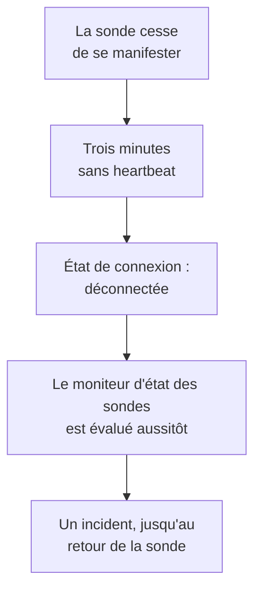

# Moniteur d'état des sondes

Un moniteur d'état des sondes vous prévient quand une sonde cesse de se manifester : un incident lorsqu'elle se déconnecte, résolu de lui-même dès qu'elle revient. Pointez-le sur vos sondes personnalisées ou, sur un OneUptime auto-hébergé, sur la sonde globale qui exécute chaque moniteur, afin qu'une sonde silencieuse ne laisse jamais ses moniteurs sans vérification à l'insu de tous.

:::cards
- [En créer un](#créer-un-moniteur-détat-des-sondes): Choisir les sondes et garder les critères par défaut.
- [Critères](#critères): Compter les sondes connectées ou déconnectées, maintenant ou sur une période.
- [Métriques](#métriques): Combien de sondes étaient connectées, minute par minute.
:::

## Comment ça marche

OneUptime évalue chaque moniteur d'état des sondes une fois par minute, et à nouveau dès qu'une de ses sondes se connecte ou se déconnecte. Il lit l'état de connexion de chaque sonde, celui qu'affiche la page de la sonde : une sonde est déconnectée lorsque rien n'a été reçu d'elle pendant trois minutes. Après une panne de OneUptime lui-même, ou une période sans réception, il attend trois minutes entières avant de déclarer une sonde déconnectée, si bien qu'une mise à niveau de OneUptime n'ouvre jamais d'incident.

Une sonde qui reste hors service fait un seul incident, pas un par minute. Le moniteur reste hors ligne, avec son incident ouvert, jusqu'à ce que chaque sonde qu'il surveille soit de nouveau connectée ; l'incident se résout alors de lui-même.

Un moniteur peut surveiller les sondes de son propre projet et les sondes globales. Une sonde supprimée n'est comptée ni d'un côté ni de l'autre. Lorsqu'il ne reste aucune des sondes qu'un moniteur surveille, il garde son statut, et sa vue d'ensemble le signale au bout d'un jour.

## Créer un moniteur d'état des sondes

:::steps
### Commencer un nouveau moniteur

Allez dans **Moniteurs** et cliquez sur **Créer un moniteur**.

### Choisir l'état des sondes

Sous **Type de moniteur**, cliquez sur **Plus de types de moniteurs** et choisissez **Statut de la sonde** sous **Autre**. Renseignez le **Nom** et cliquez sur **Suivant**.

### Choisir les sondes

Sous **Sondes à surveiller**, choisissez les sondes. Un nouveau moniteur commence avec les sondes de votre projet. Un OneUptime auto-hébergé sans sonde à lui commence avec ses sondes globales ; sur OneUptime Cloud, les sondes globales sont exploitées par OneUptime, donc un projet les choisit lui-même s'il veut les surveiller.

### Créer le moniteur

Gardez les critères par défaut, décrits plus bas, et cliquez sur **Créer un moniteur**. Le moniteur est évalué aussitôt, et sa vue d'ensemble liste chaque sonde avec le moment où elle s'est manifestée pour la dernière fois.
:::

> [!TIP]
> **Surveiller cette sonde**, sur la page d'une sonde et dans le menu de sa ligne sous **Moniteurs → Paramètres → Sondes**, ouvre **Créer un moniteur** sur un moniteur d'état des sondes qui surveille cette sonde et porte son nom.

## Critères

Les filtres d'un moniteur d'état des sondes comptent des sondes :

| Filtre | Ce qu'il compte |
| --- | --- |
| **Disconnected Probes** | Les sondes surveillées qui sont déconnectées. |
| **Connected Probes** | Les sondes surveillées qui sont connectées. |

Ce sont des nombres entiers, comparés avec **Supérieur à**, **Inférieur à**, **Égal à** et les autres comparaisons. Un nouveau moniteur commence avec deux critères :

| Critère | Filtre | Ce qu'il fait |
| --- | --- | --- |
| Check if a probe is disconnected | **Disconnected Probes** supérieur à `0` | Met le moniteur hors ligne et déclare un incident intitulé `Probe disconnected: {{disconnectedProbeNames}}`, qui se résout de lui-même. |
| Check if every probe is connected | **Disconnected Probes** égal à `0` | Met le moniteur en état opérationnel. |

**Connected Probes** convient à un moniteur qui surveille plusieurs sondes et peut en perdre une : **Connected Probes** inférieur à `2` ne déclare un incident que lorsqu'il en reste moins de deux.

### Attendre plus longtemps avant un incident

Une sonde n'est déconnectée qu'après trois minutes de silence, donc un redémarrage rapide n'ouvre rien. Pour attendre plus longtemps, cochez **Évaluer ce critère sur une période donnée** sous le filtre, choisissez **All Values** sous **Évaluer** et une période sous **Pour les dernières (en minutes)**. Avec cinq minutes, une sonde doit rester déconnectée cinq minutes de plus avant que l'incident soit déclaré.

## Métriques

Chaque évaluation enregistre deux séries sur le moniteur : `oneuptime.monitor.probes.connected` et `oneuptime.monitor.probes.disconnected`, le nombre de sondes surveillées qui étaient connectées et déconnectées. Elles sont tracées sur la page **Métriques** du moniteur, et un tableau de bord ou un moniteur de métriques les lit comme n'importe quelle autre série.

## Variables de modèle

Les modèles d'incident et d'alerte d'un moniteur d'état des sondes peuvent utiliser ces variables, en plus de celles de tout moniteur :

| Variable | Valeur |
| --- | --- |
| `{{disconnectedProbeNames}}` | Les noms des sondes déconnectées, séparés par des virgules. |
| `{{disconnectedProbeCount}}` | Le nombre de sondes déconnectées. |
| `{{connectedProbeNames}}` | Les noms des sondes connectées, séparés par des virgules. |
| `{{connectedProbeCount}}` | Le nombre de sondes connectées. |
| `{{probeStatusSummary}}` | Une phrase qui nomme les sondes déconnectées, comme `1 of 3 probes is disconnected: EU Probe.`, ou qui indique que toutes les sondes sont connectées. |
| `{{probes}}` | Chaque sonde, avec `probeName`, `isConnected`, `isGlobalProbe` et `lastAliveAt`. |

## Dépannage

:::details Le moniteur indique qu'il attend des données
Un nouveau moniteur affiche sa première évaluation en une ou deux minutes. S'il ne surveille aucune sonde, il indique plutôt **Non configuré** : choisissez les sondes sous **Critères**.
:::

:::details Une sonde est tombée et aucun incident n'a été déclaré
Une sonde est déconnectée après trois minutes sans heartbeat, et plus tard encore après une panne de OneUptime lui-même. Vérifiez que le moniteur n'est pas désactivé ni dans une fenêtre de maintenance, et que ses critères déclarent toujours un incident.
:::

## Étapes suivantes

:::cards
- [Sondes personnalisées](/docs/probe/custom-probe): Exécuter une sonde dans votre propre réseau.
- [Critères et statuts des moniteurs](/docs/monitor/criteria-and-statuses): Comment les critères décident du statut d'un moniteur.
- [Modèles d'incident et d'alerte](/docs/monitor/incident-alert-templating): Rédiger l'incident qu'un moniteur déclare.
:::
