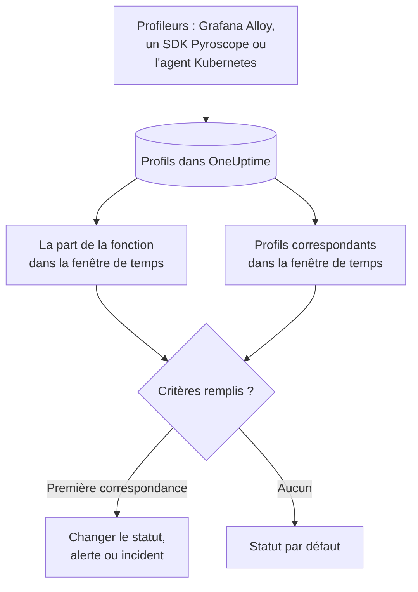

# Surveillance des profils

Un moniteur de profils lit les profils continus que vos services envoient à OneUptime et alerte sur deux choses : une fonction qui prend une plus grande part du temps qu'elle ne devrait, comme un analyseur devenu plus lourd après un déploiement, et des profils qui cessent d'arriver d'un service. Chaque minute, il mesure quelle part de sa fenêtre de temps est passée par la fonction que vous nommez, compte les profils qui correspondent à ses filtres, et change le statut du moniteur, crée une alerte ou déclare un incident quand vos critères sont remplis.

:::cards
- [Créer le moniteur](#créer-un-moniteur-de-profils): Depuis une fonction dans le Profiler, ou depuis Créer un moniteur.
- [Ce qu'il interroge](#ce-quil-interroge): La fonction, le type de profil, les services et la fenêtre.
- [Critères](#critères): La part d'une fonction dans la fenêtre, ou le nombre de profils.
- [Une fonction s'alourdit](#exemple-une-fonction-salourdit): Alerter quand la part d'une fonction bondit.
:::

## Comment ça fonctionne



Chaque minute, OneUptime lit les profils qui correspondent aux filtres du moniteur et ont commencé dans sa fenêtre de temps. Il les compte et, quand le moniteur nomme une fonction, mesure la part du temps de cette fenêtre qui est passée par la fonction. Il compare ces nombres aux critères du moniteur de haut en bas, et le premier critère qui correspond décide de ce qui se passe. Quand aucun ne correspond, le moniteur revient à son statut par défaut.

## Avant de commencer

- Vos services envoient des données de profilage continu à OneUptime, via Grafana Alloy (eBPF), un SDK Pyroscope ou l'agent Kubernetes de OneUptime. Voir [Profilage continu](/docs/telemetry/profiles).
- Pour surveiller une fonction, vous connaissez son nom, ou une partie du chemin de son fichier ou de son paquet, tel que le Profiler l'affiche.

## Créer un moniteur de profils

:::steps
### Partir du Profiler, ou de Créer un moniteur

Le plus rapide est de partir de la fonction elle-même : dans **Profils de performance**, ouvrez la fonction et cliquez sur le lien qui propose une alerte sur sa part. **Créer un moniteur** s'ouvre avec le moniteur rempli pour cette fonction et son service, avec un seuil au-dessus de ce qu'elle prend aujourd'hui, comme décrit dans [Exemple : une fonction s'alourdit](#exemple-une-fonction-salourdit). Sinon, allez dans **Moniteurs** et cliquez sur **Créer un moniteur**.

### Choisir Profiles

Sous **Type de moniteur**, cliquez sur **Plus de types de moniteurs** et choisissez **Profils** sous **Télémétrie**, ou tapez `profiles` dans le champ de recherche. Saisissez un **Nom**, puis cliquez sur **Suivant**.

### Choisir ce qu'il lit

Dans **Configuration du moniteur de profils**, réglez **Fonction** sur la fonction à surveiller, **Quoi analyser** sur le type de profil et **Surveiller les profils sur (durée)** sur la fenêtre. Un nouveau moniteur lit le **Temps CPU** sur les **Dernières 5 minutes**. **Ce que ce moniteur lit maintenant**, sous les champs, montre combien de profils correspondent et quelle part de la fenêtre la fonction prend aujourd'hui, pour que vous puissiez placer le seuil au-dessus. Ouvrez **Plus de champs** pour filtrer par service de télémétrie ou par entité d'infrastructure.

### Définir les critères

Un moniteur lancé depuis **Créer un moniteur** a deux critères : hors ligne, avec un incident, quand le **Nombre de profils** est 0, et en ligne quand il est au-dessus de 0. Pour alerter sur la fonction, ajoutez un filtre **Part de la fonction (en %)** – voir [Critères](#critères).

### Créer le moniteur

Cliquez sur **Créer un moniteur**. Le moniteur s'ouvre sur sa page **Vue d'ensemble**, et sa première évaluation s'exécute dans la minute.
:::

### Le créer via l'API ou Terraform

L'étape d'un moniteur contient les mêmes réglages que sa configuration `profileMonitor`. Celle-ci surveille `parseOrder` dans les profils CPU d'un service sur les cinq dernières minutes :

```json
{
  "profileMonitor": {
    "telemetryServiceIds": [],
    "profileTypes": ["cpu"],
    "profileType": "",
    "functionName": "parseOrder",
    "attributes": {},
    "lastXSecondsOfProfiles": 300
  }
}
```

Mettez l'ID du service dans `telemetryServiceIds`, ou laissez la liste vide pour lire les profils de tous les services, et laissez `functionName` vide pour seulement compter les profils. Créez un moniteur avec le type de moniteur `Profiles` et une étape qui contient cette configuration et au moins un critère, via l'[API](/docs/api-reference/api-reference) ou [Terraform](/docs/terraform/monitor-steps). Dans Terraform, passez la configuration comme attribut `profile_monitor` de l'étape, écrite avec `jsonencode()`.

## Ce qu'il interroge

| Champ | Ce qu'il retient | Par défaut |
| --- | --- | --- |
| `profileTypes` | Les profils de l'un de ces types, comparés exactement, comme `cpu`. | Vide : tous les types |
| `profileType` | Les profils dont le type contient ce texte, sans tenir compte de la casse. Quand il est défini, `profileTypes` est ignoré. | Vide |
| `functionName` | Le code dont **Part de la fonction (en %)** mesure la part : les cadres de pile dont le nom de fonction ou le chemin de fichier contient ce texte, sans tenir compte de la casse. | Vide : aucune part n'est mesurée |
| `telemetryServiceIds` | Les profils de l'un de ces services de télémétrie. | Vide : tous les services |
| `entityKeys` | Les profils de l'un de ces hôtes, pods, conteneurs et autres entités d'infrastructure. | Vide : toutes les entités |
| `attributes` | Les profils dont les attributs ont ces valeurs. | Vide : aucune condition |
| `lastXSecondsOfProfiles` | Les profils qui ont commencé dans ce nombre de secondes avant l'évaluation. | Aucun : définissez-le toujours, sinon chaque profil stocké est compté et le décompte ne tombe jamais à 0 |

Tous les filtres que vous définissez doivent correspondre pour qu'un profil soit lu. Dans le formulaire, **Fonction** définit `functionName`, **Quoi analyser** définit `profileTypes` (**Tous les types de profils** le laisse vide), **Surveiller les profils sur (durée)** définit `lastXSecondsOfProfiles`, et **Filtrer par service de télémétrie** et **Filtrer par entité d'infrastructure** définissent `telemetryServiceIds` et `entityKeys`.

## Comment il est évalué

- **Chaque minute.** Un moniteur de profils n'est pas vérifié par des sondes ; il n'a donc pas d'intervalle à régler ni de page **Sondes et intervalle**.
- **Deux nombres par évaluation.** Le moniteur compte les profils qui correspondent à chaque filtre et ont commencé dans `lastXSecondsOfProfiles`, et mesure la part de la fonction dans ces mêmes profils. Un profileur envoie ses données à intervalle régulier ; laissez donc à la fenêtre la place pour plusieurs envois.
- **Une unité à la fois.** Une part additionne des échantillons d'une seule unité : quand les types lus mélangent les unités, comme du temps CPU en nanosecondes venant d'un SDK et des nombres d'échantillons venant d'eBPF, il lit l'unité qui a le plus d'échantillons dans la fenêtre.
- **Aucun profil, c'est un décompte de 0 et aucune part.** Un service dont le profileur cesse d'envoyer produit un décompte de 0, et un critère **Part de la fonction (en %)** ne correspond pas à une fenêtre vide : alertez sur le **Nombre de profils** pour savoir que le profilage s'est arrêté.
- **L'indisponibilité d'OneUptime lui-même n'est pas un silence.** Tant que la fenêtre de temps contient une période où OneUptime lui-même ne recevait pas de données – il redémarrait, était mis à jour ou rattrapait un retard –, la vérification attend : le statut ne change pas, et aucun incident ni aucune alerte n'est ouvert ni résolu. Voir [Quand OneUptime ne reçoit pas de données](/docs/monitor/when-oneuptime-is-not-receiving).
- **Les critères de haut en bas.** Le premier critère qui correspond décide ; placez donc le plus grave en premier.

Chaque changement de statut est enregistré, avec sa raison, dans la **Chronologie de statut** du moniteur.

## Critères

Les critères d'un moniteur de profils comparent l'un de deux nombres à une valeur.

**Part de la fonction (en %)** est la part du temps de la fenêtre, de 0 à 100, qui est passée par la fonction du moniteur : chaque pile ayant un cadre qui correspond à `functionName` compte une fois, quelle que soit sa profondeur, de sorte que le code propre de la fonction et tout ce qu'elle appelle y sont inclus.

| Condition de filtre | Correspond quand la part de la fonction est… |
| --- | --- |
| **Supérieur à** | au-dessus de la valeur |
| **Supérieur ou égal à** | égale ou supérieure à la valeur |
| **Inférieur à** | en dessous de la valeur |
| **Inférieur ou égal à** | égale ou inférieure à la valeur |

Le **Nombre de profils** est le nombre de profils qui ont correspondu dans la fenêtre :

| Condition de filtre | Correspond quand le nombre de profils est… |
| --- | --- |
| **Supérieur à** | au-dessus de la valeur |
| **Supérieur ou égal à** | égal ou supérieur à la valeur |
| **Inférieur à** | en dessous de la valeur |
| **Inférieur ou égal à** | égal ou inférieur à la valeur |
| **Égal à** | exactement la valeur |
| **Différent de** | tout sauf la valeur |

Les décomptes de profils n'ont pas de conditions d'anomalie : il n'existe pas de référence à laquelle les comparer.

## Exemple : une fonction s'alourdit

Dans le service checkout, `parseOrder` prend 18 % de son temps CPU. Un déploiement qui analyse une charge utile plus grosse ne doit pas passer inaperçu :

1. Dans **Profils de performance**, choisissez le service checkout et ouvrez `parseOrder`.
2. Cliquez sur le lien qui propose une alerte sur sa part. Le Profiler suggère 30 % : la moitié de plus que la part d'aujourd'hui, au moins 10 points de plus, arrondi au multiple de 5 supérieur.
3. **Créer un moniteur** s'ouvre sur un moniteur de profils du service checkout qui lit le **Temps CPU** sur les **Dernières 5 minutes**, avec deux critères : **Part de la fonction (en %)** **Supérieur à** `30` déclenche une alerte, qui se résout d'elle-même, et passe le moniteur en dégradé ; **Inférieur ou égal à** `30` le passe en opérationnel. L'incident est rempli mais désactivé : activez-le pour alerter quelqu'un.
4. Cliquez sur **Créer un moniteur**.

Quand le déploiement fait prendre à `parseOrder` 45 % du temps CPU, l'évaluation suivante déclenche l'alerte. Quand une correction la ramène sous 30 %, l'alerte se résout d'elle-même.

## Exemple : les profils cessent d'arriver

Le service checkout exécute un SDK Pyroscope qui envoie des profils CPU. Vous voulez un incident quand ils s'arrêtent pendant cinq minutes :

- `profileTypes` : `["cpu"]`, `telemetryServiceIds` : le service checkout, `lastXSecondsOfProfiles` : `300`
- Critère 1 : **Nombre de profils** **Égal à** `0` – passer le moniteur hors ligne et déclarer un incident
- Critère 2 : **Nombre de profils** **Supérieur à** `0` – passer le moniteur en ligne

Tant que le SDK envoie, chaque évaluation compte quelques profils et le critère 2 garde le moniteur en ligne. Quand le service est déployé sans le SDK, le décompte tombe à 0 cinq minutes après le dernier envoi, le critère 1 correspond et l'incident est déclaré. Le premier envoi après la correction ramène le décompte au-dessus de 0, et l'incident se résout de lui-même si **Résoudre automatiquement l'incident** est activé pour lui.

## Dépannage

:::details Le moniteur compte 0, mais des profils apparaissent dans OneUptime
Comparez les filtres aux profils que vous voyez : `profileTypes` doit correspondre exactement au type, et `telemetryServiceIds` doit contenir les bons ID de service. Un `lastXSecondsOfProfiles` court peut aussi tomber entre deux envois.
:::

:::details La part de la fonction reste à 0 %
Aucun cadre de la fenêtre ne contient le texte de la fonction. Ouvrez la fonction dans le Profiler et copiez son nom tel qu'il y est affiché ; une partie du nom suffit, et la casse ne compte pas. Vérifiez ensuite que le service envoie le type de profil que lit **Quoi analyser**.
:::

## Étapes suivantes

:::cards
- [Profilage continu](/docs/telemetry/profiles): Envoyer des profils, et les lire dans le Profiler.
- [Étapes de moniteur](/docs/terraform/monitor-steps): Passer la configuration de l'étape depuis Terraform.
- [Surveillance des traces](/docs/monitor/traces-monitor): Alerter sur les spans en échec.
- [Surveillance des métriques](/docs/monitor/metrics-monitor): Alerter sur le CPU, la mémoire et d'autres métriques.
:::
