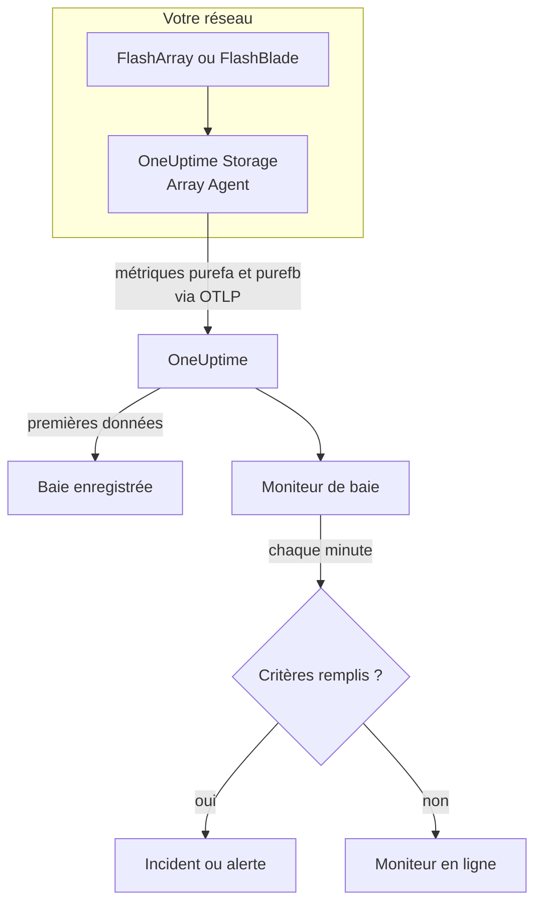

# Surveillance des baies de stockage

Un moniteur de baie de stockage surveille une baie de stockage et vous prévient lorsque la baie lève une alerte qui lui est propre, manque d'espace, ralentit, perd du matériel ou un chemin d'hôte, ou prend du retard sur la réplication. Il fonctionne avec Pure Storage FlashArray et Pure Storage FlashBlade, et lit les métriques que la baie exporte elle-même - les séries `purefa_*` et `purefb_*` de Pure -, que collecte le OneUptime Storage Array Agent.

:::cards
- [Créer le moniteur](#créer-un-moniteur-de-baie-de-stockage): Six étapes dans le tableau de bord.
- [Modèles](#modèles-dalerte-prédéfinis): Dix-huit alertes prêtes à l'emploi, un incident par volume, hôte ou composant.
- [Comment fonctionnent les séries de Pure](#comment-sont-construites-les-séries-de-pure): Un nom de métrique, plusieurs valeurs.
- [Métriques](#métriques-collectées): Chaque série sur laquelle le moniteur peut alerter.
:::

## Fonctionnement

Le OneUptime Storage Array Agent tourne sur une machine qui peut joindre l'interface de gestion de la baie. Il lit les métriques de la baie avec un jeton d'API en lecture seule, les étiquette avec le nom de la baie, `storage.array.name`, et sa plateforme, `storage.system`, et les envoie à OneUptime via OTLP. Les premières données enregistrent la baie.

Un moniteur de baie de stockage est lié à une baie. Chaque minute, il exécute sa requête sur les métriques de cette baie et compare le résultat à ses critères.



## Avant de commencer

- **Installez le Storage Array Agent** là où il peut joindre la baie en HTTPS, avec le jeton d'API d'un utilisateur qui a le rôle **readonly** de la baie. Le [guide du Storage Array Agent](/docs/telemetry/storage-arrays) couvre l'utilisateur, le jeton et l'installation, via `ONEUPTIME_URL`, `ONEUPTIME_TELEMETRY_INGESTION_KEY`, `STORAGE_ARRAY_NAME`, ainsi que l'adresse et le jeton de la baie (`PURE_FA_ENDPOINT` et `PURE_FA_API_TOKEN`, ou `PURE_FB_ENDPOINT` et `PURE_FB_API_TOKEN`).
- **Vérifiez que la baie est enregistrée.** Elle apparaît sous **Produits → Infrastructure → Storage Arrays → All Storage Arrays**, sous le nom du `STORAGE_ARRAY_NAME` de l'agent, environ une minute après la première collecte.

## Créer un moniteur de baie de stockage

:::steps
### Commencer un nouveau moniteur

Allez dans **Moniteurs** et cliquez sur **Créer un moniteur**.

### Choisir Baie de stockage

Sous **Type de moniteur**, cliquez sur **Plus de types de moniteurs** et choisissez **Baie de stockage** sous **Infrastructure**, ou tapez `storage` dans le champ de recherche. Saisissez un **Nom** - il est utilisé dans les titres des incidents et des alertes - et cliquez sur **Suivant**.

### Choisir la baie

Sous **Storage Array Monitor Configuration**, choisissez la baie dans **Baie de stockage**. Chaque baie qui a envoyé des données figure dans la liste. Sa plateforme décide des métriques et des modèles que propose le formulaire.

### Choisir ce qui est surveillé

Choisissez l'un des trois onglets :

- **Quick Setup** - cliquez sur un [modèle](#modèles-dalerte-prédéfinis). Il définit la métrique, les filtres de labels, l'agrégation, la plage temporelle et les seuils, et remplace les critères ci-dessous par les siens. Vous pouvez toujours modifier la **Plage temporelle**.
- **Custom Metric** - choisissez une métrique dans **Storage Array Metric**, puis définissez l'**Agrégation** et la **Plage temporelle**. Les [filtres](#paramètres-du-moniteur) la restreignent à un volume, un hôte, un pod, un composant, un système de fichiers ou un bucket.
- **Avancé** - construisez vous-même requêtes et formules sous **Sélectionner les métriques**, par exemple la capacité utilisée comme `purefa_array_space_bytes` filtrée sur `space=capacity` moins la même métrique filtrée sur `space=empty`. Utilisez **Regrouper par** avec le label d'un objet pour juger chaque objet séparément.

### Vérifier les critères

Ouvrez chaque critère sous **Critères du moniteur** et vérifiez sa **Métrique**, son **Agrégation**, sa **Condition** et son **Threshold**. Un modèle les remplit. Avec **Custom Metric** ou **Avancé**, le moniteur démarre avec les [critères par défaut](#critères-par-défaut), qui ne remarquent qu'une métrique tombant à zéro, donc définissez votre propre seuil.

### Créer le moniteur

Cliquez sur **Créer un moniteur**. OneUptime ouvre la page du moniteur et l'évalue chaque minute. Les incidents et alertes qu'il lève figurent aussi sur les pages **Incidents** et **Alertes** de la baie.
:::

> [!TIP]
> Pour configurer plusieurs modèles à la fois, ouvrez la baie depuis **Produits → Infrastructure → Storage Arrays** et allez dans **Recommendations**. Choisissez les modèles voulus, indiquez qui est alerté, et OneUptime crée un moniteur par modèle.

## Paramètres du moniteur

| Champ | Onglet | Ce qu'il fait |
| --- | --- | --- |
| **Baie de stockage** | Tous | Obligatoire. Limite chaque requête à `resource.storage.array.name`, de sorte que deux baies qui ont toutes deux un volume nommé `vol-01` ne se mélangent jamais. |
| **Volume** | Custom Metric, Avancé | FlashArray uniquement. Un volume, par le label `name`, comme `vol-db-01`. Un volume dans un pod ou un groupe de volumes est nommé `pod::volume` ou `group/volume`. |
| **Hôte** | Custom Metric, Avancé | FlashArray uniquement. Un hôte tel que la baie le connaît, par le label `host`, comme `esxi-01`. |
| **Pod** | Custom Metric, Avancé | FlashArray uniquement. Un pod ActiveCluster ou ActiveDR, par le label `name`, ou `local_pod` sur les séries de liens de réplication. |
| **Hardware Component** | Custom Metric, Avancé | Un composant matériel, comme `CH0.BAY1` ou `CT0` : le label `component_name` sur un FlashArray, `name` sur un FlashBlade. |
| **File System** | Custom Metric, Avancé | FlashBlade uniquement. Un système de fichiers, par le label `name`. |
| **Bucket** | Custom Metric, Avancé | FlashBlade uniquement. Un bucket de stockage objet, par le label `name`. |
| **Storage Array Metric** | Custom Metric | Une métrique du [catalogue](#métriques-collectées). Le formulaire ajoute le filtre de label qui lui donne son sens, et la regroupe par l'objet qu'elle décrit, de sorte que chaque volume, hôte ou composant est jugé séparément. |
| **Agrégation** | Custom Metric | La façon dont les échantillons sont combinés : **Moyenne**, **Maximum**, **Minimum**, **Somme** ou **Comptage**. Commence à l'agrégation habituelle de la métrique. |
| **Plage temporelle** | Tous | La fenêtre glissante que lit la requête, de **Past 1 Minute** à **Past 365 Days**. Un nouveau moniteur commence à **Past 5 Minutes** ; une métrique personnalisée d'un système de fichiers ou d'un bucket à **Past 15 Minutes** ; les modèles définissent la leur. |
| **Sélectionner les métriques** | Avancé | Le constructeur de requêtes : **Métrique**, **Agréger par**, **Filtrer par attributs**, **Regrouper par**, plus **Ajouter une métrique** et **Ajouter une formule** pour combiner des requêtes. |

L'agent lit le point de terminaison de la baie toutes les 60 secondes, et les volumes, hôtes et pods toutes les 2 minutes, donc une fenêtre de 5 minutes contient toujours un échantillon. Il lit les systèmes de fichiers et les buckets d'un FlashBlade toutes les 5 minutes, d'où 15, et les répertoires FlashArray toutes les 30 minutes : donnez à un moniteur de répertoire une fenêtre de 60 minutes.

## Comment sont construites les séries de Pure

Pure place plusieurs valeurs sur **un seul** nom de métrique et les distingue par un label :

- **`dimension`** sur les séries de performance. `purefa_array_performance_latency_usec` porte la latence de lecture (`usec_per_read_op`), la latence d'écriture (`usec_per_write_op`), la latence d'écriture en miroir, ainsi que le temps SAN, de file d'attente, de QoS et de service de chacune. Filtrez toujours sur une seule `dimension` : une moyenne sur toutes mélange une latence de lecture de 200 µs avec une valeur de file d'attente.
- **`space`** sur les séries de capacité : `capacity`, `empty`, `snapshots`, `total_provisioned`, `total_physical`, `available_ratio` et d'autres.

Plusieurs séries portent leur état dans un **label**, avec une valeur toujours égale à 1 :

| Série | Label d'état | Une série par |
| --- | --- | --- |
| `purefa_alerts_open` | `severity`, avec `summary`, `code` et `component_type` | Alerte ouverte |
| `purefa_hw_component_status` | `component_status` | Composant matériel |
| `purefa_host_connectivity_info` | `status`, avec `details` | Hôte |
| `purefa_drive_capacity_bytes` | `component_status` (la valeur est la capacité du disque) | Disque |

Une série filtrée sur un mauvais état n'existe que tant que quelque chose est dans cet état, donc l'absence de série signifie que tout va bien. C'est pourquoi **Max au-dessus de 0 déclenche et 0 rétablit** est la bonne forme pour elles, et c'est ainsi que sont construits les modèles : leurs critères de rétablissement comptent une série absente comme zéro.

Dans les filtres du moniteur et les clés de regroupement, les attributs de l'agent commencent par `resource.` (`resource.storage.array.name`, `resource.storage.system`), alors que les propres labels de Pure non (`name`, `host`, `component_name`, `dimension`, `space`, `severity`).

## Modèles d'alerte prédéfinis

OneUptime fournit 18 modèles — 11 pour FlashArray et 7 pour FlashBlade — et **Quick Setup** propose ceux de la plateforme de la baie. Chacun construit un moniteur complet : la requête de métrique, ses filtres de labels, un regroupement sur le propre label de l'objet, un critère qui déclenche et un qui rétablit. Les seuils sont des points de départ que vous pouvez modifier.

Un critère ne déclenche que lorsque la condition est vraie pour **chaque** valeur de sa fenêtre. Un moniteur qui s'est déclenché sur un seuil de capacité, de latence, de retard ou de ratio ne se rétablit que 10 % au-delà, donc une valeur qui oscille autour du seuil ne bascule pas sans cesse ; les modèles d'alerte et de matériel se rétablissent dès que l'état disparaît.

### FlashArray

| Modèle                         | Catégorie    | Gravité  | Surveille                                                                                       | Déclenche quand                                                                                                                                  |
| ------------------------------ | ------------ | -------- | ----------------------------------------------------------------------------------------------- | ------------------------------------------------------------------------------------------------------------------------------------------------ |
| Critical Array Alert           | Array Health | Critique | `purefa_alerts_open` filtrée sur `severity=critical`, Max par `summary`, 5 dernières minutes    | > 0 — la baie a une alerte critique ouverte (un composant en panne, une urgence de capacité, un échec de réplication). Un incident par alerte ; se rétablit quand l'alerte se ferme |
| Warning Array Alert            | Array Health | Warning  | `purefa_alerts_open` filtrée sur `severity=warning`, Max par `summary`, 5 dernières minutes     | > 0 — la baie a une alerte de niveau warning ouverte. Un incident par alerte ; se rétablit quand l'alerte se ferme                              |
| Capacity Above 80%             | Capacité     | Warning  | `purefa_array_space_utilization`, Max, 15 dernières minutes                                     | > 80 — le premier seuil de capacité de Pure lui-même ; se rétablit à ≤ 72                                                                        |
| Capacity Above 90%             | Capacité     | Critique | `purefa_array_space_utilization`, Max, 5 dernières minutes                                      | > 90 — la baie est sur le point de refuser les écritures ; se rétablit à ≤ 81                                                                    |
| High Read Latency              | Performance  | Warning  | `purefa_array_performance_latency_usec` filtrée sur `dimension=usec_per_read_op`, Avg, 10 dernières minutes  | > 5000 µs (5 ms) — les lectures d'un FlashArray se terminent normalement bien en dessous de 1 ms ; se rétablit à ≤ 4500                  |
| High Write Latency             | Performance  | Warning  | `purefa_array_performance_latency_usec` filtrée sur `dimension=usec_per_write_op`, Avg, 10 dernières minutes | > 5000 µs (5 ms) ; se rétablit à ≤ 4500                                                                                                  |
| Hardware Component Failed      | Hardware     | Critique | `purefa_hw_component_status` filtrée sur `component_status=critical`, Max par `component_name`, 5 dernières minutes | > 0 — un contrôleur, une alimentation, un ventilateur, une baie ou un port est critique et la redondance a disparu. Un incident par composant ; se rétablit quand il signale ok |
| Hardware Component Degraded    | Hardware     | Warning  | `purefa_hw_component_status` filtrée sur `component_status=degraded`, Max par `component_name`, 5 dernières minutes | > 0 — un composant est dégradé. Un incident par composant ; se rétablit quand il signale ok                                            |
| Drive Failed                   | Hardware     | Critique | `purefa_drive_capacity_bytes` filtrée sur `component_status=failed`, Max par `component_name`, 5 dernières minutes | > 0 — un module DirectFlash ou un SSD est en panne et la baie reconstruit sur les autres. Un incident par disque ; se rétablit quand il est remplacé |
| Host Lost Redundant Paths      | Hôtes        | Warning  | `purefa_host_connectivity_info` filtrée sur `status=critical`, Max par `host`, 5 dernières minutes | > 0 — l'hôte joint la baie par un seul contrôleur ou aucun ; un basculement de contrôleur mettrait son stockage hors ligne. Un incident par hôte ; se rétablit quand ses chemins reviennent |
| Replication Lag Above 1 Minute | Replication  | Warning  | `purefa_pod_replica_links_lag_max_msec`, Max par `local_pod`, 10 dernières minutes              | > 60000 ms (60 s) — un basculement maintenant perdrait plus d'écritures récentes que prévu. Un incident par pod ; se rétablit à ≤ 54000          |

### FlashBlade

| Modèle                       | Catégorie    | Gravité  | Surveille                                                                                                      | Déclenche quand                                                                                                     |
| ---------------------------- | ------------ | -------- | -------------------------------------------------------------------------------------------------------------- | ------------------------------------------------------------------------------------------------------------------- |
| Critical Array Alert         | Array Health | Critique | `purefb_alerts_open` filtrée sur `severity=critical`, Max par `summary`, 5 dernières minutes                   | > 0 — le FlashBlade a une alerte critique ouverte. Un incident par alerte ; se rétablit quand l'alerte se ferme     |
| Warning Array Alert          | Array Health | Warning  | `purefb_alerts_open` filtrée sur `severity=warning`, Max par `summary`, 5 dernières minutes                    | > 0 — le FlashBlade a une alerte de niveau warning ouverte. Un incident par alerte ; se rétablit quand l'alerte se ferme |
| Capacity Above 80%           | Capacité     | Warning  | `purefb_array_space_utilization` filtrée sur `type=array`, Max, 15 dernières minutes                           | > 80 ; se rétablit à ≤ 72                                                                                           |
| Capacity Above 90%           | Capacité     | Critique | `purefb_array_space_utilization` filtrée sur `type=array`, Max, 5 dernières minutes                            | > 90 — les écritures échouent pour chaque client quand il est plein ; se rétablit à ≤ 81                            |
| Hardware Component Unhealthy | Hardware     | Critique | `purefb_hardware_health`, Min par `name`, 5 dernières minutes                                                  | < 1 — une lame, un module de fabric, une alimentation ou un ventilateur n'est pas en bonne santé (un emplacement inutilisé signale 2). Un incident par composant ; se rétablit à ≥ 1 |
| High Read Latency            | Performance  | Warning  | `purefb_array_performance_latency_usec` filtrée sur `dimension=usec_per_read_op` et `protocol=all`, Avg, 10 dernières minutes | > 10000 µs (10 ms) sur tous les protocoles ; se rétablit à ≤ 9000                                      |
| File System Near Full        | File Systems | Warning  | `purefb_file_systems_space_bytes` filtrée sur `space=available_ratio`, Min par `name`, 15 dernières minutes    | < 0.1 — il reste moins de 10 % de la taille provisionnée d'un système de fichiers. Un incident par système de fichiers ; se rétablit à ≥ 0.11 |

La **Gravité** est le libellé qu'affiche le sélecteur. L'incident et l'alerte qu'un modèle crée commencent à la gravité d'incident et d'alerte la plus élevée de votre projet ; modifiez-les dans le critère.

- **Les alertes ouvertes et les états matériels utilisent Max** d'une série qui n'existe que tant que l'alerte est ouverte ou que le composant est dans cet état, donc une seule collecte qui la montre franchit le seuil.
- **Chaque modèle par objet regroupe sur le propre label de l'objet** (`summary`, `component_name`, `host`, `local_pod`, `name`), donc un incident se déclenche par objet concerné, et l'incident le nomme.
- **Les modèles de latence utilisent Avg** de la propre moyenne par opération de la baie, et les modèles de capacité **Max** de son propre pourcentage d'utilisation. Les latences sont fixées en microsecondes et la capacité en pourcentage.
- **Hardware Component Unhealthy utilise Min** par composant : sa santé vaut 1 lorsqu'il est en bonne santé et tombe à 0 sinon.

Il n'y a pas de modèle pour la latence de chaque volume, car le bon seuil dépend de la charge de travail : construisez-le depuis le catalogue avec un regroupement sur `name`. La prévision de capacité nécessite une tendance de croissance plutôt qu'un seuil, et l'usure des disques n'a aucune série sur laquelle alerter.

## Métriques collectées

L'agent envoie tout ce que la baie exporte ; les séries ci-dessous forment le catalogue que propose le formulaire du moniteur. Chaque valeur est une jauge que la baie calcule elle-même - les latences sont en microsecondes par opération et le débit est par seconde -, donc aucun calcul de taux n'est nécessaire. Le **Filtre** est le filtre de label qui donne à la série le sens qu'indique sa ligne ; le formulaire l'applique pour vous.

### Array Health

| Métrique             | Filtre | Plateforme | Unité   | Description                                                                                                                                                       |
| -------------------- | ------ | ---------- | ------- | ----------------------------------------------------------------------------------------------------------------------------------------------------------------- |
| `purefa_alerts_open` | —      | FlashArray | `count` | Une série par alerte ouverte sur la baie (valeur 1), avec les labels `severity` (`critical`, `warning`, `info`, `hidden`), `category`, `code`, `component_type` et `summary` |
| `purefb_alerts_open` | —      | FlashBlade | `count` | Une série par alerte ouverte sur le FlashBlade (valeur 1), avec les labels `severity` (`info`, `warning`, `critical`), `code`, `component_name`, `component_type`, `summary` et `kburl` (l'article de la base de connaissances de Pure) |

### Capacity

| Métrique                                  | Filtre                       | Plateforme | Unité   | Description                                                                                                                           |
| ----------------------------------------- | ---------------------------- | ---------- | ------- | ------------------------------------------------------------------------------------------------------------------------------------- |
| `purefa_array_space_utilization`          | —                            | FlashArray | `%`     | Part de la capacité utilisable de la baie qui est occupée. Pure lève ses propres alertes de capacité à 80 %, 90 % et 100 %            |
| `purefa_array_space_bytes`                | `space=capacity`             | FlashArray | `bytes` | Capacité utilisable de la baie                                                                                                        |
| `purefa_array_space_bytes`                | `space=empty`                | FlashArray | `bytes` | Capacité inutilisée — suivez sa tendance pour prévoir quand la baie sera pleine                                                      |
| `purefa_array_space_bytes`                | `space=snapshots`            | FlashArray | `bytes` | Espace physique occupé uniquement par les snapshots ; une hausse rapide signifie souvent qu'un groupe de protection garde plus de snapshots que prévu |
| `purefa_array_space_data_reduction_ratio` | —                            | FlashArray | `ratio` | Déduplication et compression sur toute la baie, p. ex. 4.2 pour 4.2:1. Une baisse durable signifie que les nouvelles données se réduisent mal |
| `purefb_array_space_utilization`          | `type=array`                 | FlashBlade | `%`     | Part de la capacité utilisable du FlashBlade qui est occupée                                                                          |
| `purefb_array_space_bytes`                | `type=array`, `space=empty`  | FlashBlade | `bytes` | Capacité inutilisée du FlashBlade                                                                                                     |
| `purefb_array_space_data_reduction_ratio` | `type=array`                 | FlashBlade | `ratio` | Réduction des données sur tout le FlashBlade                                                                                          |

### Performance

| Métrique                                   | Filtre                                         | Plateforme | Unité     | Description                                                                                                  |
| ------------------------------------------ | ---------------------------------------------- | ---------- | --------- | ------------------------------------------------------------------------------------------------------------ |
| `purefa_array_performance_latency_usec`    | `dimension=usec_per_read_op`                   | FlashArray | `µs`      | Latence moyenne d'une lecture telle que la voient les hôtes ; les lectures d'un FlashArray se terminent généralement bien en dessous de 1 ms |
| `purefa_array_performance_latency_usec`    | `dimension=usec_per_write_op`                  | FlashArray | `µs`      | Latence moyenne d'une écriture telle que la voient les hôtes                                                 |
| `purefa_array_performance_latency_usec`    | `dimension=usec_per_mirrored_write_op`         | FlashArray | `µs`      | Latence moyenne d'une écriture vers un pod étendu ActiveCluster, aller-retour vers la baie paire compris      |
| `purefa_array_performance_latency_usec`    | `dimension=san_usec_per_read_op`               | FlashArray | `µs`      | Temps qu'une lecture passe dans le SAN ; une latence SAN élevée avec une latence de service faible désigne le fabric ou l'hôte |
| `purefa_array_performance_throughput_iops` | `dimension=reads_per_sec`                      | FlashArray | `ops/s`   | Opérations de lecture par seconde                                                                            |
| `purefa_array_performance_throughput_iops` | `dimension=writes_per_sec`                     | FlashArray | `ops/s`   | Opérations d'écriture par seconde                                                                            |
| `purefa_array_performance_bandwidth_bytes` | `dimension=read_bytes_per_sec`                 | FlashArray | `bytes/s` | Octets lus par seconde                                                                                       |
| `purefa_array_performance_bandwidth_bytes` | `dimension=write_bytes_per_sec`                | FlashArray | `bytes/s` | Octets écrits par seconde                                                                                    |
| `purefa_array_performance_queue_depth_ops` | —                                              | FlashArray | `ops`     | Opérations en file d'attente sur la baie ; une file qui grandit avec une latence en hausse signifie que les hôtes envoient plus qu'elle ne peut servir |
| `purefa_array_performance_average_bytes`   | `dimension=bytes_per_op`                       | FlashArray | `bytes`   | Taille moyenne d'une opération — de grosses E/S augmentent la latence sans que rien ne soit anormal          |
| `purefb_array_performance_latency_usec`    | `dimension=usec_per_read_op`, `protocol=all`   | FlashBlade | `µs`      | Latence moyenne de lecture sur tous les protocoles                                                           |
| `purefb_array_performance_latency_usec`    | `dimension=usec_per_write_op`, `protocol=all`  | FlashBlade | `µs`      | Latence moyenne d'écriture sur tous les protocoles                                                           |
| `purefb_array_performance_throughput_iops` | `dimension=reads_per_sec`, `protocol=all`      | FlashBlade | `ops/s`   | Opérations de lecture par seconde sur tous les protocoles                                                    |
| `purefb_array_performance_throughput_iops` | `dimension=writes_per_sec`, `protocol=all`     | FlashBlade | `ops/s`   | Opérations d'écriture par seconde sur tous les protocoles                                                    |
| `purefb_array_performance_bandwidth_bytes` | `dimension=read_bytes_per_sec`, `protocol=all` | FlashBlade | `bytes/s` | Octets lus par seconde sur tous les protocoles                                                               |
| `purefb_array_performance_bandwidth_bytes` | `dimension=write_bytes_per_sec`, `protocol=all` | FlashBlade | `bytes/s` | Octets écrits par seconde sur tous les protocoles                                                           |

### Volumes

| Métrique                                    | Filtre                           | Plateforme | Unité     | Description                                                   |
| ------------------------------------------- | -------------------------------- | ---------- | --------- | ------------------------------------------------------------- |
| `purefa_volume_performance_latency_usec`    | `dimension=usec_per_read_op`     | FlashArray | `µs`      | Latence moyenne de lecture de chaque volume — regroupez par `name` |
| `purefa_volume_performance_latency_usec`    | `dimension=usec_per_write_op`    | FlashArray | `µs`      | Latence moyenne d'écriture de chaque volume                   |
| `purefa_volume_performance_throughput_iops` | `dimension=reads_per_sec`        | FlashArray | `ops/s`   | Opérations de lecture par seconde de chaque volume            |
| `purefa_volume_performance_throughput_iops` | `dimension=writes_per_sec`       | FlashArray | `ops/s`   | Opérations d'écriture par seconde de chaque volume            |
| `purefa_volume_performance_bandwidth_bytes` | `dimension=read_bytes_per_sec`   | FlashArray | `bytes/s` | Octets lus par seconde depuis chaque volume                   |
| `purefa_volume_performance_bandwidth_bytes` | `dimension=write_bytes_per_sec`  | FlashArray | `bytes/s` | Octets écrits par seconde dans chaque volume                  |
| `purefa_volume_space_bytes`                 | `space=total_provisioned`        | FlashArray | `bytes`   | Taille de chaque volume telle que la voient les hôtes         |
| `purefa_volume_space_bytes`                 | `space=total_physical`           | FlashArray | `bytes`   | Espace physique qu'utilise chaque volume après réduction des données |
| `purefa_volume_space_data_reduction_ratio`  | —                                | FlashArray | `ratio`   | Ratio de réduction des données de chaque volume               |

### Hosts

| Métrique                                  | Filtre                        | Plateforme | Unité   | Description                                                                                                                                    |
| ----------------------------------------- | ----------------------------- | ---------- | ------- | ---------------------------------------------------------------------------------------------------------------------------------------------- |
| `purefa_host_connectivity_info`           | —                             | FlashArray | `count` | Une série par hôte (valeur 1) avec le label de sa connectivité `status` (`healthy`, `critical`, `unused`) et `details` (`Redundant`, `Single Controller`, `None`, ...) |
| `purefa_host_performance_latency_usec`    | `dimension=usec_per_read_op`  | FlashArray | `µs`    | Latence moyenne de lecture que voit chaque hôte — regroupez par `host`                                                                         |
| `purefa_host_performance_latency_usec`    | `dimension=usec_per_write_op` | FlashArray | `µs`    | Latence moyenne d'écriture que voit chaque hôte                                                                                                |
| `purefa_host_performance_throughput_iops` | `dimension=reads_per_sec`     | FlashArray | `ops/s` | Opérations de lecture par seconde de chaque hôte                                                                                               |
| `purefa_host_performance_throughput_iops` | `dimension=writes_per_sec`    | FlashArray | `ops/s` | Opérations d'écriture par seconde de chaque hôte                                                                                               |

### Replication

| Métrique                                             | Filtre                                 | Plateforme | Unité     | Description                                                                                                                                                  |
| ---------------------------------------------------- | -------------------------------------- | ---------- | --------- | ------------------------------------------------------------------------------------------------------------------------------------------------------------ |
| `purefa_pod_replica_links_lag_max_msec`              | —                                      | FlashArray | `ms`      | Plus grand retard de réplication de chaque lien de réplication de pod (ActiveDR / asynchrone), avec les labels `local_pod`, `remote_pod`, `remote`, `direction` et `status` — regroupez par `local_pod` |
| `purefa_pod_replica_links_lag_average_msec`          | —                                      | FlashArray | `ms`      | Retard de réplication moyen de chaque lien de réplication de pod                                                                                             |
| `purefa_pod_performance_replication_bandwidth_bytes` | —                                      | FlashArray | `bytes/s` | Trafic de réplication de chaque pod, avec les labels `direction` et `dimension`                                                                              |
| `purefa_pod_performance_latency_usec`                | `dimension=usec_per_mirrored_write_op` | FlashArray | `µs`      | Latence moyenne d'écriture en miroir de chaque pod ActiveCluster                                                                                             |

### Hardware

| Métrique                                      | Filtre                           | Plateforme | Unité      | Description                                                                                                                                                                                                  |
| --------------------------------------------- | -------------------------------- | ---------- | ---------- | ------------------------------------------------------------------------------------------------------------------------------------------------------------------------------------------------------------ |
| `purefa_hw_component_status`                  | —                                | FlashArray | `count`    | Une série par composant matériel (valeur 1) — châssis, contrôleurs, baies de disques et de NVRAM, alimentations, ventilateurs, sondes de température, ports Ethernet et Fibre Channel — avec le label `component_status` (`ok`, `critical`, `degraded`, `device_off`, `identifying`, `not_installed`, `unknown`) |
| `purefa_hw_component_temperature_celsius`     | —                                | FlashArray | `°C`       | Température de chaque sonde — regroupez par `component_name`                                                                                                                                                 |
| `purefa_drive_capacity_bytes`                 | —                                | FlashArray | `bytes`    | Capacité brute de chaque disque, avec le label de son `component_status` (`healthy`, `failed`, `missing`, `recovering`, `unhealthy`, `empty`, ...) et de son type                                            |
| `purefa_network_interface_performance_errors` | `dimension=total_errors_per_sec` | FlashArray | `errors/s` | Erreurs par seconde sur chaque interface Ethernet et Fibre Channel — des erreurs persistantes signifient généralement un câble, une optique ou un port de switch défectueux                                     |
| `purefb_hardware_health`                      | —                                | FlashBlade | —          | Santé de chaque composant matériel (lames, modules de fabric, alimentations, ventilateurs, ...) : 1 = en bonne santé, 2 = inutilisé, 0 = défaillant. Prenez le minimum par `name`                            |

### File Systems

| Métrique                                       | Filtre                        | Plateforme | Unité   | Description                                                                                  |
| ---------------------------------------------- | ----------------------------- | ---------- | ------- | -------------------------------------------------------------------------------------------- |
| `purefb_file_systems_performance_latency_usec` | `dimension=usec_per_read_op`  | FlashBlade | `µs`    | Latence moyenne de lecture de chaque système de fichiers — regroupez par `name`              |
| `purefb_file_systems_performance_latency_usec` | `dimension=usec_per_write_op` | FlashBlade | `µs`    | Latence moyenne d'écriture de chaque système de fichiers                                     |
| `purefb_file_systems_space_bytes`              | `space=total_physical`        | FlashBlade | `bytes` | Espace physique qu'utilise chaque système de fichiers                                        |
| `purefb_file_systems_space_bytes`              | `space=available_ratio`       | FlashBlade | `ratio` | Part de la taille provisionnée de chaque système de fichiers encore disponible, de 0 à 1 — proche de 0, il est sur le point de remplir son quota |

### Buckets

| Métrique                                  | Filtre                       | Plateforme | Unité   | Description                                           |
| ----------------------------------------- | ---------------------------- | ---------- | ------- | ----------------------------------------------------- |
| `purefb_buckets_performance_latency_usec` | `dimension=usec_per_read_op` | FlashBlade | `µs`    | Latence moyenne de lecture de chaque bucket — regroupez par `name` |
| `purefb_buckets_space_bytes`              | `space=total_physical`       | FlashBlade | `bytes` | Espace physique qu'utilise chaque bucket              |
| `purefb_buckets_object_count`             | —                            | FlashBlade | `count` | Nombre d'objets dans chaque bucket                    |

## Critères de surveillance

Un critère compare l'une des requêtes ou formules du moniteur à un seuil. Les critères d'un moniteur de baie de stockage n'ont pas de **Type de filtre** : chaque règle vérifie la valeur de la métrique, avec ces champs.

| Champ | Ce qu'il fait |
| --- | --- |
| **Métrique** | La requête ou la formule à vérifier, par son nom de variable. |
| **Agrégation** | La façon dont les valeurs de la fenêtre deviennent une seule réponse : **Moyenne**, **Somme**, **Maximum Value**, **Minimum Value**, **All Values** (chaque valeur doit correspondre) ou **Any Value** (une seule suffit). |
| **Condition** | **Greater Than**, **Less Than**, **Greater Than Or Equal To**, **Less Than Or Equal To** ou **Equal To** — ou une condition d'anomalie : **Anomalously High**, **Anomalously Low** ou **Anomalous**. |
| **Threshold** | La valeur à laquelle comparer. Une liste d'unités se trouve à côté lorsque la métrique a une unité. Non affiché pour les conditions d'anomalie. |
| **Sensibilité** | Conditions d'anomalie uniquement. **Faible** (4σ), **Moyen** (3σ, la valeur par défaut) ou **Élevé** (2σ). |
| **Fenêtre de référence** | Conditions d'anomalie uniquement. 14 jours (la valeur par défaut), 28, 60 ou 90 jours d'historique. |
| **En l'absence de données** | Sous **Plus de champs**. Ce qui se passe lorsque la fenêtre n'a aucun échantillon : **Ignore** (la valeur par défaut), **Treat As Zero** ou **Déclencheur**. |

Les conditions d'anomalie comparent chaque valeur à la même heure de la semaine dans la référence. Elles restent dans un état « Learning », et ne lèvent rien, tant que la fenêtre de référence ne contient pas assez d'historique.

Quelques critères pour commencer :

- **Un volume est lent :** `purefa_volume_performance_latency_usec` filtrée sur `dimension=usec_per_read_op`, Moyenne, regroupée par `name`, **Greater Than** `2000`, sur les 10 dernières minutes.
- **La baie se remplit :** `purefa_array_space_utilization`, Maximum, **Greater Than** `85`, sur les 15 dernières minutes.
- **Un hôte tourne sur un seul contrôleur :** `purefa_host_connectivity_info` filtrée sur `status=critical`, Maximum, regroupée par `host`, **Greater Than** `0`.
- **Un système de fichiers FlashBlade est presque plein :** `purefb_file_systems_space_bytes` filtrée sur `space=available_ratio`, Minimum, regroupée par `name`, **Less Than** `0.05`.

### Critères par défaut

Un moniteur que vous ne construisez pas à partir d'un modèle commence avec deux critères :

| Ordre | Critère | Correspond quand | Ensuite |
| --- | --- | --- | --- |
| 1 | Check if _monitor name_ is offline | Une valeur quelconque de la première requête vaut `0` | Marque le moniteur **Hors ligne** et déclare l'incident « _monitor name_ is offline », qui se résout de lui-même lorsque le moniteur se rétablit. |
| 2 | Check if _monitor name_ is online | Une valeur quelconque est supérieure à `0` | Marque le moniteur **Opérationnel**. |

> [!IMPORTANT]
> Le silence ne correspond à aucun des deux critères : une baie qui cesse d'envoyer des données laisse le moniteur dans son état. Pour être prévenu lorsque les données s'arrêtent, réglez **En l'absence de données** sur **Déclencheur** dans un critère. Une période pendant laquelle OneUptime lui-même ne recevait rien n'est jamais une absence de données : une vérification dont la fenêtre la contient attend plutôt, comme l'explique [Quand OneUptime ne reçoit pas de données](/docs/monitor/when-oneuptime-is-not-receiving).

## Terraform

Le [fournisseur Terraform de OneUptime](/docs/terraform/monitor-steps) porte la configuration d'une étape de moniteur de baie de stockage dans l'attribut `storage_array_monitor` : le JSON brut de la configuration `storageArrayMonitor` (`arrayIdentifier`, `storageSystem`, `resourceFilters`, `metricViewConfig`, `rollingTime`), écrit avec `jsonencode()` :

```hcl title="main.tf"
monitor_steps = [{
  storage_array_monitor = jsonencode({
    arrayIdentifier = "my-storage-array"
    storageSystem   = "purestorage.flasharray"
    resourceFilters = {}
    rollingTime     = "Past 15 Minutes"
    metricViewConfig = {
      queryConfigs = [{
        metricAliasData = { metricVariable = "capacity_used_percent", title = "Capacity Used", description = "", legend = "" }
        metricQueryData = {
          filterData = {
            metricName     = "purefa_array_space_utilization"
            attributes     = {}
            aggegationType = "Max"
            aggregateBy    = {}
          }
        }
      }]
      formulaConfigs = []
    }
  })
  criteria = [ /* ... */ ]
}]
```

`arrayIdentifier` est le `storage.array.name` de la baie - le `STORAGE_ARRAY_NAME` avec lequel l'agent a été démarré -, et non son ID OneUptime. `storageSystem` vaut `purestorage.flasharray` ou `purestorage.flashblade`. Il décide du catalogue et des modèles qu'affiche le formulaire, et de si un filtre de matériel lit `component_name` ou `name`.

## Dépannage

:::details La baie n'est pas dans la liste Baie de stockage
Les baies s'enregistrent d'elles-mêmes à partir des données de l'agent. Vérifiez que l'agent tourne et envoie des données (voir le [guide du Storage Array Agent](/docs/telemetry/storage-arrays)), et que `STORAGE_ARRAY_NAME` est défini.
:::

:::details Un modèle d'alerte ou de matériel ne se déclenche jamais
C'est le cas normal. `purefa_alerts_open`, `purefa_hw_component_status`, `purefa_drive_capacity_bytes` et `purefa_host_connectivity_info` portent leur état dans un label, et une série filtrée sur un mauvais état (`severity=critical`, `component_status=failed`) n'existe que tant que quelque chose est dans cet état. Pour voir la série derrière un modèle, exécutez sa requête sans le filtre sur la page **Métriques**.
:::

:::details Un moniteur de latence affiche des valeurs fausses
Pure place les valeurs de lecture, d'écriture, d'écriture en miroir, de SAN, de file d'attente et de QoS sur un seul nom de métrique, distinguées uniquement par le label `dimension`, et une requête sans filtre `dimension` en fait la moyenne. Filtrez sur une seule dimension, comme le font les modèles et le catalogue du formulaire. Les séries par volume et par hôte ne gardent que `usec_per_read_op`, `usec_per_write_op` et `usec_per_mirrored_write_op` : l'agent supprime les autres pour économiser des séries, et seul `purefa_array_performance_latency_usec`, sur toute la baie, les garde toutes.
:::

:::details Une fenêtre de 1 minute n'affiche aucune donnée
L'agent lit les volumes, hôtes et pods toutes les 2 minutes, les systèmes de fichiers et buckets d'un FlashBlade toutes les 5, et les répertoires FlashArray toutes les 30, donc une fenêtre de 1 minute peut ne contenir aucun échantillon. Utilisez 5 minutes ou plus : 15 pour les systèmes de fichiers et les buckets, 60 pour les répertoires.
:::

:::details Les incidents se déclenchent une fois pour toute la baie au lieu d'une fois par volume
Regroupez la requête par le label de l'objet : `name` pour les volumes, pods, répertoires, systèmes de fichiers et buckets, `host` pour les hôtes, et `component_name` pour le matériel FlashArray. Les labels de Pure n'ont pas de préfixe, donc `resource.name` ne correspond à rien.
:::

## Étapes suivantes

:::cards
- [Agent pour baies de stockage](/docs/telemetry/storage-arrays): Installer l'agent qui envoie les métriques.
- [Surveillance Ceph](/docs/monitor/ceph-monitor): Le même type de moniteur pour les clusters de stockage Ceph.
- [Surveillance des métriques](/docs/monitor/metrics-monitor): Alerter sur n'importe quelle métrique, de n'importe quelle source.
- [Vue d'ensemble des incidents](/docs/incidents/index): Ce qui se passe après qu'un critère a déclaré un incident.
:::
