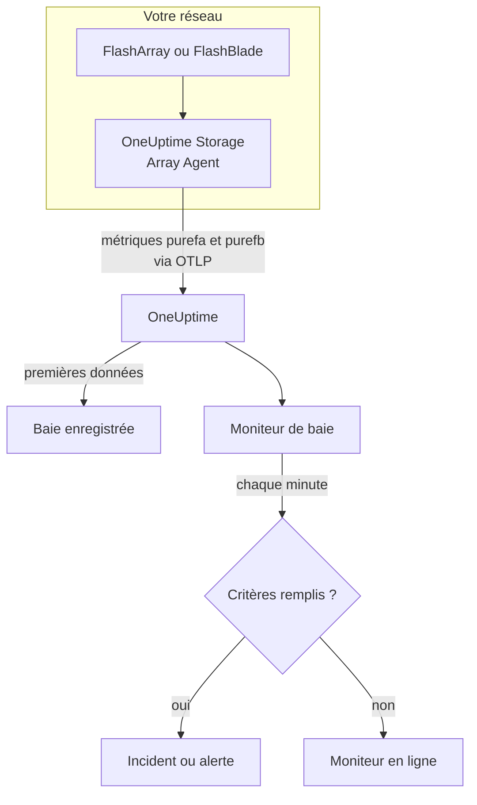

# Surveillance des baies de stockage

Un moniteur de baie de stockage surveille une baie de stockage et vous prévient lorsque la baie lève une alerte qui lui est propre, manque d'espace, ralentit, perd du matériel ou un chemin d'hôte, ou prend du retard sur la réplication. Il fonctionne avec Pure Storage FlashArray, Pure Storage FlashBlade et NetApp ONTAP (Amazon FSx for NetApp ONTAP compris), et lit les métriques que collecte le OneUptime Storage Array Agent : les séries `purefa_*` et `purefb_*` de Pure, et les séries `netapp_*` que NetApp Harvest lit sur un cluster ONTAP.

Il fonctionne aussi avec Dell PowerStore (`dell.powerstore`), à partir des séries `powerstore_*` de Dell.

Il fonctionne aussi avec Dell PowerScale (`dell.powerscale`), à partir des séries `powerscale_*` de Dell.

:::cards
- [Créer le moniteur](#créer-un-moniteur-de-baie-de-stockage): Six étapes dans le tableau de bord.
- [Modèles](#modèles-dalerte-prédéfinis): Des alertes prêtes à l'emploi, un incident par volume, hôte, appliance ou composant.
- [Comment fonctionnent les séries de Pure](#comment-sont-construites-les-séries-de-pure): Un nom de métrique, plusieurs valeurs. Celles d'ONTAP [ont leur propre section](#comment-sont-construites-les-séries-dontap).
- [Métriques](#métriques-collectées): Chaque série sur laquelle le moniteur peut alerter.
:::

## Fonctionnement

Le OneUptime Storage Array Agent tourne sur une machine qui peut joindre l'interface de gestion de la baie. Il lit les métriques de la baie avec un jeton d'API en lecture seule (celles d'un PowerScale en SNMP, avec une communauté en lecture seule ou un utilisateur SNMPv3), les étiquette avec le nom de la baie, `storage.array.name`, et sa plateforme, `storage.system`, et les envoie à OneUptime via OTLP. Les premières données enregistrent la baie.

Un moniteur de baie de stockage est lié à une baie. Chaque minute, il exécute sa requête sur les métriques de cette baie et compare le résultat à ses critères.



## Avant de commencer

- **Installez le Storage Array Agent** là où il peut joindre la baie en HTTPS, avec le jeton d'API d'un utilisateur qui a le rôle **readonly** de la baie. Le [guide du Storage Array Agent](/docs/telemetry/storage-arrays) couvre l'utilisateur, le jeton et l'installation, via `ONEUPTIME_URL`, `ONEUPTIME_TELEMETRY_INGESTION_KEY`, `STORAGE_ARRAY_NAME`, ainsi que l'adresse et le jeton de la baie (`PURE_FA_ENDPOINT` et `PURE_FA_API_TOKEN`, ou `PURE_FB_ENDPOINT` et `PURE_FB_API_TOKEN`), ou pour ONTAP l'adresse du cluster et un utilisateur REST en lecture seule (`NETAPP_ONTAP_ENDPOINT`, `NETAPP_ONTAP_USERNAME` et `NETAPP_ONTAP_PASSWORD`).
- **Vérifiez que la baie est enregistrée.** Elle apparaît sous **Produits → Infrastructure → Baies de stockage → Toutes les baies de stockage**, sous le nom du `STORAGE_ARRAY_NAME` de l'agent, environ une minute après la première collecte.

## Créer un moniteur de baie de stockage

:::steps
### Commencer un nouveau moniteur

Allez dans **Moniteurs** et cliquez sur **Créer un moniteur**.

### Choisir Baie de stockage

Sous **Type de moniteur**, cliquez sur **Plus de types de moniteurs** et choisissez **Baie de stockage** sous **Infrastructure**, ou tapez `storage` dans le champ de recherche. Saisissez un **Nom** - il est utilisé dans les titres des incidents et des alertes - et cliquez sur **Suivant**.

### Choisir la baie

Sous **Storage Array Monitor Configuration**, choisissez la baie dans **Baie de stockage**. Chaque baie qui a envoyé des données figure dans la liste. Sa plateforme décide des métriques et des modèles que propose le formulaire. Une fois le choix fait, une ligne sous le champ indique si des données arrivent. **Ajouter une baie de stockage** ouvre des étapes de configuration avec vos clés déjà renseignées, qui attendent les premières données.

### Choisir ce qui est surveillé

Un nouveau moniteur démarre sur **Array Stopped Reporting**, sous **Sur quoi alerter**. Pour surveiller autre chose :

- **Modifier** - choisissez un autre [modèle](#modèles-dalerte-prédéfinis). Il définit la métrique, les filtres de labels, l'agrégation, la plage temporelle et les seuils, et remplace les critères ci-dessous par les siens. Vous pouvez toujours modifier la **Plage temporelle**.
- **Custom Metric** (sous **Plus de champs**) - choisissez une métrique dans **Storage Array Metric**, puis définissez l'**Agrégation** et la **Plage temporelle**. Les [filtres](#paramètres-du-moniteur) la restreignent à un volume, un hôte, un pod, un composant, un système de fichiers ou un bucket.
- **Avancé** (sous **Plus de champs**) - construisez vous-même requêtes et formules sous **Sélectionner les métriques**, par exemple la capacité utilisée comme `purefa_array_space_bytes` filtrée sur `space=capacity` moins la même métrique filtrée sur `space=empty`. Utilisez **Regrouper par** avec le label d'un objet pour juger chaque objet séparément.

### Vérifier les critères

Ouvrez chaque critère sous **Critères** et vérifiez sa **Métrique**, son **Agrégation**, sa **Condition** et son **Seuil**. Un modèle les remplit. Avec **Custom Metric** ou **Avancé**, le moniteur démarre avec les [critères par défaut](#critères-par-défaut), qui ne remarquent qu'une métrique qui n'envoie plus de données, donc définissez votre propre seuil.

### Créer le moniteur

Cliquez sur **Créer un moniteur**. OneUptime ouvre la page du moniteur et l'évalue chaque minute. Les incidents et alertes qu'il lève figurent aussi sur les pages **Incidents** et **Alertes** de la baie.
:::

> [!TIP]
> Pour configurer plusieurs modèles à la fois, ouvrez la baie depuis **Produits → Infrastructure → Baies de stockage** et allez dans **Recommandations**. Choisissez les modèles voulus, indiquez qui est alerté, et OneUptime crée un moniteur par modèle.

## Paramètres du moniteur

| Champ | Onglet | Ce qu'il fait |
| --- | --- | --- |
| **Baie de stockage** | Tous | Obligatoire. Limite chaque requête à `resource.storage.array.name`, de sorte que deux baies qui ont toutes deux un volume nommé `vol-01` ne se mélangent jamais. |
| **Volume** | Custom Metric, Avancé | Un volume : sur un FlashArray par le label `name`, comme `vol-db-01` (un volume dans un pod ou un groupe de volumes est nommé `pod::volume` ou `group/volume`) ; sur ONTAP par le label `volume`, que deux SVM peuvent partager. |
| **Hôte** | Custom Metric, Avancé | FlashArray uniquement. Un hôte tel que la baie le connaît, par le label `host`, comme `esxi-01`. |
| **Pod** | Custom Metric, Avancé | FlashArray uniquement. Un pod ActiveCluster ou ActiveDR, par le label `name`, ou `local_pod` sur les séries de liens de réplication. |
| **Composant matériel** | Custom Metric, Avancé | Un composant matériel, comme `CH0.BAY1` ou `CT0` : le label `component_name` sur un FlashArray, `name` sur un FlashBlade, et sur ONTAP le label par lequel sa série le nomme (`node`, `disk`, `shelf` ou `port`). |
| **Système de fichiers** | Custom Metric, Avancé | FlashBlade et PowerScale. Un système de fichiers par le label `name` sur un FlashBlade ; un quota par le label `quota` sur un PowerScale, comme `/ifs/data/home`. |
| **Bucket** | Custom Metric, Avancé | FlashBlade uniquement. Un bucket de stockage objet, par le label `name`. |
| **Storage Array Metric** | Custom Metric | Une métrique du [catalogue](#métriques-collectées). Le formulaire ajoute le filtre de label qui lui donne son sens, et la regroupe par l'objet qu'elle décrit, de sorte que chaque volume, hôte ou composant est jugé séparément. |
| **Agrégation** | Custom Metric | La façon dont les échantillons sont combinés : **Moyenne**, **Maximum**, **Minimum**, **Somme** ou **Comptage**. Commence à l'agrégation habituelle de la métrique. |
| **Plage temporelle** | Tous | La fenêtre glissante que lit la requête, de **Past 1 Minute** à **Past 365 Days**. Un nouveau moniteur commence à **5 dernières minutes** ; une métrique personnalisée d'un système de fichiers ou d'un bucket à **15 dernières minutes** ; les modèles définissent la leur. |
| **Sélectionner les métriques** | Avancé | Le constructeur de requêtes : **Métrique**, **Agréger par**, **Filtrer par attributs**, **Regrouper par**, plus **Ajouter une métrique** et **Ajouter une formule** pour combiner des requêtes. |

L'agent lit le point de terminaison de la baie toutes les 60 secondes, et les volumes, hôtes et pods toutes les 2 minutes, donc une fenêtre de 5 minutes contient toujours un échantillon. Il lit les systèmes de fichiers et les buckets d'un FlashBlade toutes les 5 minutes, d'où 15, et les répertoires FlashArray toutes les 30 minutes : donnez à un moniteur de répertoire une fenêtre de 60 minutes. Sur ONTAP, Harvest lit les performances du cluster chaque minute et sa configuration, son état et ses événements EMS toutes les 3 minutes, donc une fenêtre de 5 minutes contient toujours un échantillon. Il interroge un cluster PowerScale et chacun de ses nœuds toutes les 60 secondes, et ses quotas toutes les 5 minutes : donnez à un moniteur de quota une fenêtre de 15 minutes.

Il lit un PowerStore toutes les 5 minutes, et l'état de son cluster toutes les 60 secondes : donnez à un moniteur PowerStore une fenêtre de 15 minutes.

## Comment sont construites les séries de Pure

Pure place plusieurs valeurs sur **un seul** nom de métrique et les distingue par un label :

- **`dimension`** sur les séries de performance. `purefa_array_performance_latency_usec` porte la latence de lecture (`usec_per_read_op`), la latence d'écriture (`usec_per_write_op`), la latence d'écriture en miroir, ainsi que le temps SAN, de file d'attente, de QoS et de service de chacune. Filtrez toujours sur une seule `dimension` : une moyenne sur toutes mélange une latence de lecture de 200 µs avec une valeur de file d'attente.
- **`space`** sur les séries de capacité : `capacity`, `empty`, `snapshots`, `total_provisioned`, `total_physical`, `available_ratio` et d'autres.

Plusieurs séries portent leur état dans un **label**, avec une valeur toujours égale à 1 :

| Série | Label d'état | Une série par |
| --- | --- | --- |
| `purefa_alerts_open` | `severity`, avec `summary`, `code` et `component_type` | Alerte ouverte |
| `purefa_hw_component_status` | `component_status` | Composant matériel |
| `purefa_host_connectivity_info` | `status`, avec `details` | Hôte |
| `purefa_drive_capacity_bytes` | `component_status` (la valeur est la capacité du disque) | Disque |

Une série filtrée sur un mauvais état n'existe que tant que quelque chose est dans cet état, donc l'absence de série signifie que tout va bien. C'est pourquoi **Max au-dessus de 0 déclenche et 0 rétablit** est la bonne forme pour elles, et c'est ainsi que sont construits les modèles : leurs critères de rétablissement comptent une série absente comme zéro. Quand il ne reste plus aucune série, un tel modèle ne se rétablit que si `purefa_info` ou `purefb_info` est arrivé dans la même fenêtre, si bien qu'une baie qui ne rapporte plus ne ferme rien.

Dans les filtres du moniteur et les clés de regroupement, les attributs de l'agent commencent par `resource.` (`resource.storage.array.name`, `resource.storage.system`), alors que les propres labels des baies non (`name`, `host`, `component_name`, `dimension`, `space`, `severity`, et ceux d'un PowerScale : `node`, `quota`, `drive` et `protocol`).

## Forme des séries de PowerStore

L'exportateur de Dell écrit une valeur par nom de métrique, donc une série PowerStore n'a besoin d'aucun filtre de label. Ses labels nomment l'objet : `appliance_id` une appliance, `name` une pièce, un volume ou un système de fichiers, et `volume_id`, `fc_port_id`, `eth_port_id`, `nas_id` ou `volume_group_id` l'objet d'une série de performances. Ses séries d'état valent 1 tant que tout va bien et 0 sinon, donc les modèles se déclenchent sous 1. Ses propres alertes arrivent par syslog, et leurs modèles, des moniteurs de journaux, sont listés après son tableau ci-dessous.

## Comment sont construites les séries d'ONTAP

NetApp Harvest nomme chaque série `netapp_<object>_<counter>` et nomme l'objet par ses labels : un volume par `volume` au sein de son `svm`, un agrégat par `aggr`, une LUN par `lun` au sein de son `volume` et de son `svm`, un nœud par `node`, un disque par `disk`, un tiroir par `shelf`, une relation SnapMirror par `destination_location`. Les latences sont en microsecondes par opération, les `_ops` en opérations par seconde, les `_data` en octets par seconde.

Les états d'ONTAP arrivent de trois façons :

| Série | État | Une série par |
| --- | --- | --- |
| `netapp_*_new_status` | 1 sain, en ligne, actif ou en cours d'exécution, 0 sinon | Objet, à chaque interrogation |
| `netapp_health_*_alerts` | Valeur 1, avec `severity` (`error` ou `warning`) et la raison dans ses labels | Problème ouvert : un disque défectueux, un défaut de tiroir, un nœud qui ne peut pas reprendre son partenaire, un port hors service, une alerte de santé du système |
| `netapp_ems_events` | Valeur 1, avec `message`, `severity` et les paramètres de l'événement | Événement EMS, pour la seule interrogation qui l'a collecté ; la levée d'un événement apparié est exportée une fois de plus avec la valeur 0 |

Un état sous forme de nombre se déclenche quand chaque relevé de la fenêtre est inférieur à 1, et se rétablit dès qu'un relevé vaut de nouveau 1. Un problème ouvert se déclenche tant que sa série est présente et se rétablit une fois qu'elle a disparu, à condition que `netapp_cluster_new_status` arrive toujours, si bien qu'un agent arrêté ne ferme rien. Un événement EMS se déclenche sur son unique relevé et reste ouvert tant qu'il se trouve dans l'heure du modèle ; il se rétablit quand une heure s'écoule sans autre événement.

## Modèles d'alerte prédéfinis

OneUptime fournit 80 modèles — 12 pour FlashArray, 8 pour FlashBlade, 16 pour PowerStore, 13 pour PowerScale et 31 pour ONTAP — et la liste de **Sur quoi alerter** propose ceux de la plateforme de la baie. Chacun construit un moniteur complet : la requête de métrique, ses filtres de labels, un regroupement sur le propre label de l'objet, un critère qui déclenche et un qui rétablit. Les seuils sont des points de départ que vous pouvez modifier.

Un critère ne déclenche que lorsque la condition est vraie pour **chaque** valeur de sa fenêtre, sauf celui d'un modèle EMS pour ONTAP : Harvest exporte un événement pour une seule interrogation, un seul relevé suffit donc. Un moniteur qui s'est déclenché sur un seuil de capacité, de latence, de retard ou de ratio ne se rétablit que 10 % au-delà, donc une valeur qui oscille autour du seuil ne bascule pas sans cesse. Les modèles d'alerte, de matériel et de connectivité se déclenchent une fois qu'un état s'est montré pendant toute leur fenêtre de 5 minutes, et se rétablissent environ 5 minutes après sa disparition.

### FlashArray

| Modèle                         | Catégorie    | Gravité  | Surveille                                                                                       | Déclenche quand                                                                                                                                  |
| ------------------------------ | ------------ | -------- | ----------------------------------------------------------------------------------------------- | ------------------------------------------------------------------------------------------------------------------------------------------------ |
| Array Stopped Reporting        | Disponibilité | Critique | `purefa_info`, Count, 10 dernières minutes                                                      | Aucune donnée pendant toute la fenêtre — le Storage Array Agent s'est arrêté, a perdu sa connexion à OneUptime ou a vu son jeton révoqué, ou la baie ne lui répond plus ; se rétablit quand des données arrivent de nouveau |
| Critical Array Alert           | Santé de la baie | Critique | `purefa_alerts_open` filtrée sur `severity=critical`, Max par `summary`, 5 dernières minutes    | > 0 — la baie a une alerte critique ouverte (un composant en panne, une urgence de capacité, un échec de réplication). Un incident par alerte ; se rétablit quand l'alerte se ferme |
| Warning Array Alert            | Santé de la baie | Avertissement  | `purefa_alerts_open` filtrée sur `severity=warning`, Max par `summary`, 5 dernières minutes     | > 0 — la baie a une alerte de niveau warning ouverte. Un incident par alerte ; se rétablit quand l'alerte se ferme                              |
| Capacity Above 80%             | Capacité     | Avertissement  | `purefa_array_space_utilization`, Max, 15 dernières minutes                                     | > 80 — le premier seuil de capacité de Pure lui-même ; se rétablit à ≤ 72                                                                        |
| Capacity Above 90%             | Capacité     | Critique | `purefa_array_space_utilization`, Max, 5 dernières minutes                                      | > 90 — la baie est sur le point de refuser les écritures ; se rétablit à ≤ 81                                                                    |
| High Read Latency              | Performances | Avertissement  | `purefa_array_performance_latency_usec` filtrée sur `dimension=usec_per_read_op`, Avg, 10 dernières minutes  | > 5000 µs (5 ms) — les lectures d'un FlashArray se terminent normalement bien en dessous de 1 ms ; se rétablit à ≤ 4500                  |
| High Write Latency             | Performances | Avertissement  | `purefa_array_performance_latency_usec` filtrée sur `dimension=usec_per_write_op`, Avg, 10 dernières minutes | > 5000 µs (5 ms) ; se rétablit à ≤ 4500                                                                                                  |
| Hardware Component Failed      | Matériel     | Critique | `purefa_hw_component_status` filtrée sur `component_status=critical`, Max par `component_name`, 5 dernières minutes | > 0 — un contrôleur, une alimentation, un ventilateur, une baie ou un port est critique et la redondance a disparu. Un incident par composant ; se rétablit quand il signale ok |
| Hardware Component Degraded    | Matériel     | Avertissement  | `purefa_hw_component_status` filtrée sur `component_status=degraded`, Max par `component_name`, 5 dernières minutes | > 0 — un composant est dégradé. Un incident par composant ; se rétablit quand il signale ok                                            |
| Drive Failed                   | Matériel     | Critique | `purefa_drive_capacity_bytes` filtrée sur `component_status=failed`, Max par `component_name`, 5 dernières minutes | > 0 — un module DirectFlash ou un SSD est en panne et la baie reconstruit sur les autres. Un incident par disque ; se rétablit quand il est remplacé |
| Host Lost Redundant Paths      | Hôtes        | Avertissement  | `purefa_host_connectivity_info` filtrée sur `status=critical`, Max par `host`, 5 dernières minutes | > 0 — l'hôte joint la baie par un seul contrôleur ou aucun ; un basculement de contrôleur mettrait son stockage hors ligne. Un incident par hôte ; se rétablit quand ses chemins reviennent |
| Replication Lag Above 1 Minute | Réplication  | Avertissement  | `purefa_pod_replica_links_lag_max_msec`, Max par `local_pod`, 10 dernières minutes              | > 60000 ms (60 s) — un basculement maintenant perdrait plus d'écritures récentes que prévu. Un incident par pod ; se rétablit à ≤ 54000          |

### FlashBlade

| Modèle                       | Catégorie    | Gravité  | Surveille                                                                                                      | Déclenche quand                                                                                                     |
| ---------------------------- | ------------ | -------- | -------------------------------------------------------------------------------------------------------------- | ------------------------------------------------------------------------------------------------------------------- |
| Array Stopped Reporting      | Disponibilité | Critique | `purefb_info`, Count, 10 dernières minutes                                                                     | Aucune donnée pendant toute la fenêtre — l'agent, son exporteur ou le FlashBlade ne répond plus ; se rétablit quand des données arrivent de nouveau |
| Critical Array Alert         | Santé de la baie | Critique | `purefb_alerts_open` filtrée sur `severity=critical`, Max par `summary`, 5 dernières minutes                   | > 0 — le FlashBlade a une alerte critique ouverte. Un incident par alerte ; se rétablit quand l'alerte se ferme     |
| Warning Array Alert          | Santé de la baie | Avertissement  | `purefb_alerts_open` filtrée sur `severity=warning`, Max par `summary`, 5 dernières minutes                    | > 0 — le FlashBlade a une alerte de niveau warning ouverte. Un incident par alerte ; se rétablit quand l'alerte se ferme |
| Capacity Above 80%           | Capacité     | Avertissement  | `purefb_array_space_utilization` filtrée sur `type=array`, Max, 15 dernières minutes                           | > 80 ; se rétablit à ≤ 72                                                                                           |
| Capacity Above 90%           | Capacité     | Critique | `purefb_array_space_utilization` filtrée sur `type=array`, Max, 5 dernières minutes                            | > 90 — les écritures échouent pour chaque client quand il est plein ; se rétablit à ≤ 81                            |
| Hardware Component Unhealthy | Matériel     | Critique | `purefb_hardware_health`, Min par `name`, 5 dernières minutes                                                  | < 1 — une lame, un module de fabric, une alimentation ou un ventilateur n'est pas en bonne santé (un emplacement inutilisé signale 2). Un incident par composant ; se rétablit à ≥ 1 |
| High Read Latency            | Performances | Avertissement  | `purefb_array_performance_latency_usec` filtrée sur `dimension=usec_per_read_op` et `protocol=all`, Avg, 10 dernières minutes | > 10000 µs (10 ms) sur tous les protocoles ; se rétablit à ≤ 9000                                      |
| File System Near Full        | Systèmes de fichiers | Avertissement  | `purefb_file_systems_space_bytes` filtrée sur `space=available_ratio`, Min par `name`, 15 dernières minutes    | < 0.1 — il reste moins de 10 % de la taille provisionnée d'un système de fichiers. Un incident par système de fichiers ; se rétablit à ≥ 0.11 |

### PowerStore

| Modèle                       | Catégorie    | Gravité  | Surveille                                                                                                      | Déclenche quand                                                                                                     |
| --- | --- | --- | --- | --- |
| Array Stopped Reporting | Disponibilité | Critique | `powerstore_cluster`, Count, 10 dernières minutes | Aucune donnée pendant toute la fenêtre — l'agent, l'exportateur de Dell ou le cluster ne répond plus ; se rétablit quand des données arrivent à nouveau |
| Capacity Above 80% | Capacité | Avertissement | `powerstore_cap_physical_used_percent`, Max par `appliance_id`, 15 dernières minutes | > 80 — la capacité d'une appliance se remplit ; se rétablit à ≤ 72 |
| Capacity Above 90% | Capacité | Critique | `powerstore_cap_physical_used_percent`, Max par `appliance_id`, 15 dernières minutes | > 90 — une appliance est près de refuser les écritures ; se rétablit à ≤ 81 |
| High Read Latency | Performances | Avertissement | `powerstore_perf_avg_read_latency`, Avg par `appliance_id`, 15 dernières minutes | > 5000 µs (5 ms) ; se rétablit à ≤ 4500 |
| High Write Latency | Performances | Avertissement | `powerstore_perf_avg_write_latency`, Avg par `appliance_id`, 15 dernières minutes | > 5000 µs (5 ms) ; se rétablit à ≤ 4500 |
| Drive Failed | Matériel | Critique | `powerstore_hardware_Drive_state`, Min par `name`, 10 dernières minutes | < 1 — un disque est en panne ou a été retiré ; se rétablit à ≥ 1 |
| Node Unhealthy | Matériel | Critique | `powerstore_hardware_node_state`, Min par `name`, 10 dernières minutes | < 1 — un nœud n'est pas Healthy ; se rétablit à ≥ 1 |
| Power Supply Unhealthy | Matériel | Avertissement | `powerstore_hardware_Power_Supply_state`, Min par `name`, 10 dernières minutes | < 1 — une alimentation est en panne ou privée de courant ; se rétablit à ≥ 1 |
| Fan Unhealthy | Matériel | Avertissement | `powerstore_hardware_Fan_state`, Min par `name`, 10 dernières minutes | < 1 — un ventilateur est en panne ; se rétablit à ≥ 1 |
| Battery Unhealthy | Matériel | Avertissement | `powerstore_hardware_Battery_state`, Min par `name`, 10 dernières minutes | < 1 — un module de batterie de secours est en défaut ; se rétablit à ≥ 1 |
| Drive Wearing Out | Matériel | Avertissement | `powerstore_wear_metrics_by_drive`, Min par `name`, 15 dernières minutes | < 10 — il reste moins de 10 % de l'endurance d'un disque ; se rétablit à ≥ 11 |
| NAS Server Not Started | Systèmes de fichiers | Avertissement | `powerstore_nas_server_operational_status`, Max par `name`, 10 dernières minutes | < 1 — un serveur NAS est arrêté ou dégradé ; se rétablit à ≥ 1 |
| Volume Not Ready | Santé de la baie | Avertissement | `powerstore_volume_state`, Max par `name`, 15 dernières minutes | < 1 — un volume est hors ligne ; se rétablit à ≥ 1 |
| File System Near Full | Systèmes de fichiers | Avertissement | `powerstore_filesystem_logical_used_percent`, Max par `name`, 15 dernières minutes | > 90 — un système de fichiers est presque plein ; se rétablit à ≤ 81 |
| Cluster Not Configured | Santé de la baie | Avertissement | `powerstore_cluster`, Max, 10 dernières minutes | < 1 — le cluster n'est pas Configured ; se rétablit à ≥ 1 |
| Metro Witness Not Connected | Réplication | Avertissement | `powerstore_metro_witness_status`, Min par `name`, 10 dernières minutes | > 0 — un témoin Metro n'est pas connecté ; se rétablit quand il est de nouveau OK |

### Alertes PowerStore, par syslog

Les propres alertes d'un PowerStore arrivent sous forme de journaux, donc leurs modèles sont des moniteurs **Journaux**, proposés sur la page **Recommandations** de la baie sous **Alertes de la baie**. Chacun ouvre une alerte par alerte PowerStore, regroupée par `powerstore.resource.name` et `powerstore.alert.id`, et la résout quand le PowerStore lève cette alerte :

| Modèle | Gravité | S'ouvre sur une ligne avec | Se résout sur |
| --- | --- | --- | --- |
| Critical Array Alert | Critique | `powerstore.alert.severity=Critical` | `powerstore.alert.state=Cleared` |
| Major Array Alert | Avertissement | `powerstore.alert.severity=Major` | `powerstore.alert.state=Cleared` |
| Port Link Down | Avertissement | `powerstore.event.code=0x00307404` | `powerstore.alert.state=Cleared` |

### ONTAP

| Modèle | Catégorie | Gravité | Surveille | Déclenche quand |
| --- | --- | --- | --- | --- |
| Array Stopped Reporting | Disponibilité | Critique | `netapp_cluster_new_status`, Count, 10 dernières minutes | Aucune donnée pendant toute la fenêtre — l'agent ou Harvest s'est arrêté, ou le cluster ne répond plus à Harvest ; se rétablit quand des données arrivent de nouveau |
| Cluster Not Healthy | Santé de la baie | Avertissement | `netapp_cluster_new_status`, Max, 10 dernières minutes | < 1 — ONTAP signale le cluster comme non sain ; se rétablit à ≥ 1 |
| System Health Alert | Santé de la baie | Avertissement | `netapp_health_support_alerts`, Max par `name`, 5 dernières minutes | > 0 — la surveillance de l'état du système d'ONTAP a levé une alerte (un chemin manquant vers un tiroir, un problème de connectivité d'un nœud). Un incident par alerte ; se rétablit quand ONTAP l'efface |
| Emergency EMS Event | Santé de la baie | Critique | `netapp_ems_events` filtrée sur `severity=emergency`, Max par `message`, sur 1 heure, au moins un relevé | > 0 — ONTAP a journalisé un événement de niveau emergency. Un incident par événement ; se rétablit quand une heure s'écoule sans autre événement |
| Alert EMS Event | Santé de la baie | Critique | `netapp_ems_events` filtrée sur `severity=alert`, Max par `message`, sur 1 heure, au moins un relevé | > 0 — ONTAP a journalisé un événement de niveau alert (un ventilateur en panne) ; se rétablit quand une heure s'écoule sans autre événement |
| Disk Out of Service | Matériel | Avertissement | `netapp_ems_events` filtrée sur `message=disk.outOfService`, Max par `disk`, sur 1 heure, au moins un relevé | > 0 — ONTAP a mis un disque hors service ; se rétablit quand une heure s'écoule sans autre événement |
| Node Panic | Matériel | Critique | `netapp_ems_events` filtrée sur `message=sk.panic`, Max par `node`, sur 1 heure, au moins un relevé | > 0 — un nœud a paniqué et redémarré, et son partenaire a repris son stockage ; se rétablit quand une heure s'écoule sans autre événement |
| Aggregate Above 80% | Capacité | Avertissement | `netapp_aggr_space_used_percent`, Max par `aggr`, 15 dernières minutes | > 80 ; se rétablit à ≤ 72 |
| Aggregate Above 90% | Capacité | Critique | `netapp_aggr_space_used_percent`, Max par `aggr`, 5 dernières minutes | > 90 — ses volumes ne peuvent plus grandir ; se rétablit à ≤ 81 |
| Volume Above 90% | Capacité | Avertissement | `netapp_volume_size_used_percent`, Max par `volume` et `svm`, 15 dernières minutes | > 90 ; se rétablit à ≤ 81 |
| Volume Above 98% | Capacité | Critique | `netapp_volume_size_used_percent`, Max par `volume` et `svm`, 5 dernières minutes | > 98 — les clients reçoivent des erreurs d'espace insuffisant, et une LUN qu'il contient peut passer hors ligne ; se rétablit à ≤ 88.2 |
| High Read Latency | Performances | Avertissement | `netapp_cluster_read_latency`, Avg, 15 dernières minutes | > 10000 µs (10 ms) ; se rétablit à ≤ 9000 |
| High Write Latency | Performances | Avertissement | `netapp_cluster_write_latency`, Avg, 15 dernières minutes | > 10000 µs (10 ms) ; se rétablit à ≤ 9000 |
| Volume Latency Above 20 ms | Performances | Avertissement | `netapp_volume_read_latency`, Avg par `volume` et `svm`, 15 dernières minutes | > 20000 µs ; se rétablit à ≤ 18000 |
| Node Not Healthy | Matériel | Critique | `netapp_node_new_status`, Max par `node`, 10 dernières minutes | < 1 — ONTAP signale le nœud comme non sain ; se rétablit à ≥ 1 |
| Takeover Not Possible | Matériel | Critique | `netapp_health_ha_alerts`, Max par `node`, 5 dernières minutes | > 0 — un nœud ne peut pas reprendre son partenaire HA : une panne mettrait donc le stockage de ce partenaire hors ligne ; se rétablit quand il le peut de nouveau |
| Disk Failed | Matériel | Critique | `netapp_health_disk_alerts` filtrée sur `container_type=broken`, Max par `disk`, 5 dernières minutes | > 0 — un disque est défectueux ; se rétablit quand le disque est remplacé |
| Shelf Fault | Matériel | Critique | `netapp_health_shelf_alerts` filtrée sur `severity=error`, Max par `shelf`, 5 dernières minutes | > 0 — ONTAP signale une erreur sur un tiroir disque (une alimentation, un module, un chemin) ; se rétablit quand ONTAP l'efface |
| Node Fan Failed | Matériel | Avertissement | `netapp_node_failed_fan`, Max par `node`, 10 dernières minutes | > 0 ventilateurs en panne ; se rétablit à ≤ 0 |
| Node Power Supply Failed | Matériel | Critique | `netapp_node_failed_power`, Max par `node`, 10 dernières minutes | > 0 alimentations en panne ; se rétablit à ≤ 0 |
| Shelf Power Supply Failed | Matériel | Critique | `netapp_shelf_psu_status`, Max par `shelf`, 10 dernières minutes | < 1 — l'alimentation d'un tiroir n'est pas normale ; se rétablit à ≥ 1 |
| Shelf Fan Failed | Matériel | Avertissement | `netapp_shelf_fan_status`, Max par `shelf`, 10 dernières minutes | < 1 — le ventilateur d'un tiroir n'est pas normal ; se rétablit à ≥ 1 |
| Ethernet Port Down | Matériel | Avertissement | `netapp_health_network_ethernet_port_alerts`, Max par `port` et `node`, 5 dernières minutes | > 0 — un port Ethernet activé est hors service ; se rétablit quand sa liaison est de nouveau active |
| FC Port Link Failures | Matériel | Avertissement | `netapp_fcp_link_failure`, Max par `port` et `node`, 15 dernières minutes | > 0 — la liaison d'un port Fibre Channel est tombée pendant la fenêtre ; se rétablit à ≤ 0 |
| SnapMirror Behind Schedule | Réplication | Avertissement | `netapp_snapmirror_lag_time` divisé par `netapp_snapmirror_schedule_seconds`, Max par `destination_location`, 15 dernières minutes | > 1.5 — une relation a plus d'un intervalle et demi de planification de retard (pour une planification horaire, 90 minutes) ; se rétablit à ≤ 1.35 |
| SnapMirror Relationship Unhealthy | Réplication | Critique | `netapp_snapmirror_labels` filtrée sur `healthy=false`, Max par `destination_location`, 5 dernières minutes | > 0 — ONTAP signale la relation comme défaillante, avec la raison dans son label `unhealthy_reason` ; se rétablit quand ONTAP la signale comme saine |
| SnapMirror Lag Above 1 Day | Réplication | Avertissement | `netapp_snapmirror_lag_time`, Max par `destination_location`, 15 dernières minutes | > 86400 s, quelle que soit sa planification ; se rétablit à ≤ 77760 |
| Aggregate Offline | Disponibilité | Critique | `netapp_aggr_new_status`, Max par `aggr`, 10 dernières minutes | < 1 — un agrégat n'est pas en ligne : aucun de ses volumes n'est donc joignable ; se rétablit à ≥ 1 |
| Volume Offline | Disponibilité | Avertissement | `netapp_volume_new_status`, Max par `volume` et `svm`, 10 dernières minutes | < 1 — un volume n'est pas en ligne ; se rétablit à ≥ 1 |
| LUN Offline | Disponibilité | Critique | `netapp_lun_new_status`, Max par `lun`, `volume` et `svm`, 10 dernières minutes | < 1 — une LUN n'est pas en ligne, et ses hôtes ont perdu le disque ; se rétablit à ≥ 1 |
| SVM Stopped | Disponibilité | Avertissement | `netapp_svm_labels` filtrée sur `state=stopped` et `type=data`, Max par `svm`, 10 dernières minutes | > 0 — un SVM de données est arrêté ; se rétablit quand il tourne de nouveau. Les SVM qu'ONTAP garde pour lui-même ne sont jamais surveillés |

### PowerScale

| Modèle | Catégorie | Gravité | Surveille | Déclenche quand |
| --- | --- | --- | --- | --- |
| Array Stopped Reporting | Disponibilité | Critique | `powerscale_cluster_health`, Count, 10 dernières minutes | Aucune donnée pendant toute la fenêtre — le Storage Array Agent s'est arrêté, a perdu sa connexion à OneUptime ou a vu son jeton révoqué, ou le cluster ne répond plus à ses interrogations ; se rétablit quand des données arrivent de nouveau |
| Cluster Needs Attention | Santé de la baie | Avertissement | `powerscale_cluster_health`, Max, 5 dernières minutes | > 0 — OneFS signale que le cluster demande de l'attention, est en panne ou invalide, et `isi event groups list` dit pourquoi ; se rétablit à ≤ 0 |
| Cluster Down | Santé de la baie | Critique | `powerscale_cluster_health`, Max, 5 dernières minutes | ≥ 2 — OneFS signale le cluster en panne ou invalide ; se rétablit à < 2 |
| Node Offline | Matériel | Critique | `powerscale_cluster_offline_nodes`, Max, 5 dernières minutes | > 0 — un nœud du cluster est hors ligne, et `offline_nodes` indique lequel ; se rétablit à ≤ 0 |
| Node Needs Attention | Matériel | Avertissement | `powerscale_node_health`, Max par `node`, 5 dernières minutes | > 0 — un nœud signale qu'il demande de l'attention, qu'il est en panne ou invalide. Un incident par nœud ; se rétablit à ≤ 0 |
| Node Read-Only | Matériel | Avertissement | `powerscale_node_read_only`, Max par `node`, 5 dernières minutes | > 0 — un nœud est en mode lecture seule, et les clients qui y sont connectés ne peuvent pas écrire. Un incident par nœud ; se rétablit à ≤ 0 |
| Drive Failed | Matériel | Critique | `powerscale_drive_size_bytes` filtrée sur `status=DEAD`, Count par `drive`, 5 dernières minutes | > 0 — un disque est mort, et OneFS protège de nouveau ses données sur les autres. Un incident par disque ; se rétablit quand il signale un autre état |
| Drive Smartfailed | Matériel | Avertissement | `powerscale_drive_size_bytes` filtrée sur `status=SMARTFAIL`, Count par `drive`, 5 dernières minutes | > 0 — OneFS déplace les données d'un disque défaillant avant son remplacement. Un incident par disque ; se rétablit quand il signale un autre état |
| Capacity Above 80% | Capacité | Avertissement | `powerscale_ifs_used_percent`, Max, 15 dernières minutes | > 80, en comptant l'espace réservé aux disques de secours virtuels ; se rétablit à ≤ 72 |
| Capacity Above 90% | Capacité | Critique | `powerscale_ifs_used_percent`, Max, 5 dernières minutes | > 90 — le cluster est sur le point de refuser les écritures ; se rétablit à ≤ 81 |
| Quota Near Its Limit | Capacité | Avertissement | `powerscale_quota_used_percent`, Max par `quota`, 15 dernières minutes | > 90 de sa limite stricte, ou de sa limite souple s'il n'en a pas. Un incident par quota ; se rétablit à ≤ 81 |
| Quota Full | Capacité | Critique | `powerscale_quota_used_percent`, Max par `quota`, 5 dernières minutes | ≥ 100 — les écritures sous le chemin du quota échouent à une limite stricte. Un incident par quota ; se rétablit à < 90 |
| High Protocol Latency | Performances | Avertissement | `powerscale_protocol_latency_microseconds`, Max par `protocol`, 10 dernières minutes | > 20000 µs (20 ms) sur le nœud le plus lent. Un incident par protocole ; se rétablit à ≤ 18000 |

La **Gravité** est le libellé qu'affiche le sélecteur. L'incident et l'alerte qu'un modèle crée commencent à la gravité d'incident et d'alerte la plus élevée de votre projet ; modifiez-les dans le critère.

- **Array Stopped Reporting** compte la série d'identité de la plateforme (`purefa_info` ou `purefb_info`), que chaque point de terminaison interrogé par l'agent exporte à chaque collecte ; celle d'un PowerScale est `powerscale_cluster_health`, que l'interrogation du cluster par l'agent envoie chaque minute. Quand les données cessent d'arriver, les autres modèles n'ont plus rien à comparer et gardent leur dernier état ; c'est donc lui qui vous prévient.
- **Les alertes ouvertes et les états matériels utilisent Max** d'une série qui n'existe que tant que l'alerte est ouverte ou que le composant est dans cet état, donc l'état franchit le seuil une fois qu'il s'est montré pendant toute la fenêtre de 5 minutes.
- **Chaque modèle par objet regroupe sur le propre label de l'objet** (`summary`, `component_name`, `host`, `local_pod`, `name`, et ceux d'un PowerScale : `node`, `drive`, `quota` et `protocol`), donc un incident se déclenche par objet concerné, et l'incident le nomme.
- **Les modèles de latence utilisent Avg** de la propre moyenne par opération de la baie, et les modèles de capacité **Max** de son propre pourcentage d'utilisation. Les latences sont fixées en microsecondes et la capacité en pourcentage.
- **Hardware Component Unhealthy utilise Min** par composant : sa santé vaut 1 lorsqu'il est en bonne santé et tombe à 0 sinon.

Il n'y a pas de modèle FlashArray pour la latence de chaque volume, car le bon seuil dépend de la charge de travail : construisez-le depuis le catalogue avec un regroupement sur `name`. La prévision de capacité nécessite une tendance de croissance plutôt qu'un seuil, et l'usure des disques n'a aucune série sur laquelle alerter.

## Métriques collectées

L'agent envoie tout ce que la baie exporte ; les séries ci-dessous forment le catalogue que propose le formulaire du moniteur. Chaque valeur est une jauge que la baie calcule elle-même - les latences sont en microsecondes par opération et le débit est par seconde -, donc aucun calcul de taux n'est nécessaire. Le **Filtre** est le filtre de label qui donne à la série le sens qu'indique sa ligne ; le formulaire l'applique pour vous.

### Santé de la baie

| Métrique             | Filtre | Plateforme | Unité   | Description                                                                                                                                                       |
| -------------------- | ------ | ---------- | ------- | ----------------------------------------------------------------------------------------------------------------------------------------------------------------- |
| `purefa_alerts_open` | —      | FlashArray | `count` | Une série par alerte ouverte sur la baie (valeur 1), avec les labels `severity` (`critical`, `warning`, `info`, `hidden`), `category`, `code`, `component_type` et `summary` |
| `purefb_alerts_open` | —      | FlashBlade | `count` | Une série par alerte ouverte sur le FlashBlade (valeur 1), avec les labels `severity` (`info`, `warning`, `critical`), `code`, `component_name`, `component_type`, `summary` et `kburl` (l'article de la base de connaissances de Pure) |
| `powerstore_cluster` | — | PowerStore | `count` | 1 tant que le cluster PowerStore est Configured (formé et en service), 0 dans tout autre état : Configuring, Expanding, Removing, Clustering_Failed ou Unconfigured. |
| `netapp_cluster_new_status` | — | ONTAP | — | 1 tant qu'ONTAP signale le cluster comme sain ; indique aussi que l'agent le lit toujours |
| `netapp_cluster_subsystem_outstanding_alerts` | — | ONTAP | `count` | Alertes ouvertes dans chacun des sous-systèmes de santé d'ONTAP, par `subsystem` |
| `netapp_health_support_alerts` | — | ONTAP | `count` | Une série par alerte ouverte par la surveillance de l'état du système d'ONTAP, tant qu'elle est ouverte |
| `netapp_ems_events` | — | ONTAP | `count` | Une série par événement EMS, pour l'interrogation qui l'a collecté ; la levée d'un événement apparié l'exporte une fois de plus avec la valeur 0 |
| `powerscale_cluster_health` | — | PowerScale | — | La santé que OneFS signale pour le cluster : 0 signifie OK, 1 demande de l'attention, 2 en panne et 3 invalide. Prenez le maximum pour voir tout changement |
| `powerscale_cluster_offline_nodes` | — | PowerScale | `count` | Nombre de nœuds du cluster hors ligne ; le label `offline_nodes` liste leurs numéros de nœud logiques |

### Capacité

| Métrique                                  | Filtre                       | Plateforme | Unité   | Description                                                                                                                           |
| ----------------------------------------- | ---------------------------- | ---------- | ------- | ------------------------------------------------------------------------------------------------------------------------------------- |
| `purefa_array_space_utilization`          | —                            | FlashArray | `%`     | Part de la capacité utilisable de la baie qui est occupée. Pure lève ses propres alertes de capacité à 80 %, 90 % et 100 %            |
| `purefa_array_space_bytes`                | `space=capacity`             | FlashArray | `bytes` | Capacité utilisable de la baie                                                                                                        |
| `purefa_array_space_bytes`                | `space=empty`                | FlashArray | `bytes` | Capacité inutilisée — suivez sa tendance pour prévoir quand la baie sera pleine                                                      |
| `purefa_array_space_bytes`                | `space=snapshots`            | FlashArray | `bytes` | Espace physique occupé uniquement par les snapshots ; une hausse rapide signifie souvent qu'un groupe de protection garde plus de snapshots que prévu |
| `purefa_array_space_data_reduction_ratio` | —                            | FlashArray | `ratio` | Déduplication et compression sur toute la baie, p. ex. 4.2 pour 4.2:1. Une baisse durable signifie que les nouvelles données se réduisent mal |
| `purefb_array_space_utilization`          | `type=array`                 | FlashBlade | `%`     | Part de la capacité utilisable du FlashBlade qui est occupée                                                                          |
| `purefb_array_space_bytes`                | `type=array`, `space=empty`  | FlashBlade | `bytes` | Capacité inutilisée du FlashBlade                                                                                                     |
| `purefb_array_space_data_reduction_ratio` | `type=array`                 | FlashBlade | `ratio` | Réduction des données sur tout le FlashBlade                                                                                          |
| `powerstore_cap_physical_used_percent` | — | PowerStore | `%` | Part de la capacité physique de chaque appliance utilisée, en pourcentage : son espace physique utilisé sur son total physique, d'après le cumul d'espace quotidien de PowerStore. PowerStore déclenche ses propres alertes de capacité dès 70 %. Regroupez par appliance_id. |
| `powerstore_cap_last_physical_total` | — | PowerStore | `bytes` | Capacité physique utilisable de chaque appliance en octets. |
| `powerstore_cap_last_physical_used` | — | PowerStore | `bytes` | Capacité physique utilisée par chaque appliance en octets, après déduplication et compression. Suivez sa tendance pour prévoir quand une appliance sera pleine. |
| `powerstore_cap_last_logical_provisioned` | — | PowerStore | `bytes` | Capacité logique provisionnée sur chaque appliance en octets : la taille de chaque volume, système de fichiers et vVol qu'elle contient, qui peut dépasser de loin sa capacité physique. |
| `powerstore_cap_last_logical_used` | — | PowerStore | `bytes` | Données que les hôtes ont écrites sur chaque appliance en octets, avant déduplication et compression. |
| `powerstore_cap_last_data_reduction` | — | PowerStore | `ratio` | Déduplication et compression sur chaque appliance, par exemple 3.4 pour 3.4:1. Une baisse durable signifie que les données nouvellement écrites se réduisent mal : données chiffrées ou déjà compressées. |
| `powerstore_cap_last_efficiency_ratio` | — | PowerStore | `ratio` | Efficacité globale de chaque appliance : la réduction des données avec les économies des snapshots et du provisionnement fin. |
| `netapp_aggr_space_used_percent` | — | ONTAP | `%` | Part de l'espace utilisable de chaque agrégat en cours d'utilisation — regroupez par `aggr` |
| `netapp_aggr_space_total` | — | ONTAP | `bytes` | Espace utilisable de chaque agrégat ; la capacité du cluster en est la somme |
| `netapp_aggr_space_used` | — | ONTAP | `bytes` | Espace que chaque agrégat utilise ou réserve |
| `netapp_aggr_space_available` | — | ONTAP | `bytes` | Espace restant sur chaque agrégat — suivez sa tendance pour prévoir quand il sera plein |
| `netapp_aggr_inode_used_percent` | — | ONTAP | `%` | Part des fichiers (inodes) de chaque agrégat en cours d'utilisation |
| `netapp_aggr_new_status` | — | ONTAP | — | 1 tant qu'un agrégat est en ligne |
| `netapp_aggr_logical_used_wo_snapshots_flexclones` | — | ONTAP | `bytes` | Ce qu'occuperaient les données de chaque agrégat sans l'efficacité du stockage, hors snapshots et FlexClone |
| `netapp_aggr_physical_used_wo_snapshots_flexclones` | — | ONTAP | `bytes` | Ce qu'occupent sur disque les données de chaque agrégat après l'efficacité du stockage |
| `powerscale_ifs_used_percent` | — | PowerScale | `%` | Part de la capacité du cluster qui n'est plus disponible pour les écritures : ce qui est utilisé, plus l'espace que OneFS réserve aux disques de secours virtuels |
| `powerscale_ifs_available_bytes` | — | PowerScale | `bytes` | Espace encore disponible pour les écritures sur `/ifs` |
| `powerscale_ifs_used_bytes` | — | PowerScale | `bytes` | Espace utilisé sur `/ifs`, tel que OneFS le compte |
| `powerscale_ifs_total_bytes` | — | PowerScale | `bytes` | La taille de `/ifs` sur l'ensemble du cluster |
| `powerscale_quota_used_percent` | — | PowerScale | `%` | Utilisation de chaque quota en part de sa limite stricte, ou de sa limite souple s'il n'a pas de limite stricte (le label `limit` indique laquelle) — regroupez par `quota` |
| `powerscale_quota_usage_bytes` | — | PowerScale | `bytes` | Ce que contient chaque quota, tel que OneFS l'impute au quota |

### Performances

| Métrique                                   | Filtre                                         | Plateforme | Unité     | Description                                                                                                  |
| ------------------------------------------ | ---------------------------------------------- | ---------- | --------- | ------------------------------------------------------------------------------------------------------------ |
| `purefa_array_performance_latency_usec`    | `dimension=usec_per_read_op`                   | FlashArray | `µs`      | Latence moyenne d'une lecture telle que la voient les hôtes ; les lectures d'un FlashArray se terminent généralement bien en dessous de 1 ms |
| `purefa_array_performance_latency_usec`    | `dimension=usec_per_write_op`                  | FlashArray | `µs`      | Latence moyenne d'une écriture telle que la voient les hôtes                                                 |
| `purefa_array_performance_latency_usec`    | `dimension=usec_per_mirrored_write_op`         | FlashArray | `µs`      | Latence moyenne d'une écriture vers un pod étendu ActiveCluster, aller-retour vers la baie paire compris      |
| `purefa_array_performance_latency_usec`    | `dimension=san_usec_per_read_op`               | FlashArray | `µs`      | Temps qu'une lecture passe dans le SAN ; une latence SAN élevée avec une latence de service faible désigne le fabric ou l'hôte |
| `purefa_array_performance_throughput_iops` | `dimension=reads_per_sec`                      | FlashArray | `ops/s`   | Opérations de lecture par seconde                                                                            |
| `purefa_array_performance_throughput_iops` | `dimension=writes_per_sec`                     | FlashArray | `ops/s`   | Opérations d'écriture par seconde                                                                            |
| `purefa_array_performance_bandwidth_bytes` | `dimension=read_bytes_per_sec`                 | FlashArray | `bytes/s` | Octets lus par seconde                                                                                       |
| `purefa_array_performance_bandwidth_bytes` | `dimension=write_bytes_per_sec`                | FlashArray | `bytes/s` | Octets écrits par seconde                                                                                    |
| `purefa_array_performance_queue_depth_ops` | —                                              | FlashArray | `ops`     | Opérations en file d'attente sur la baie ; une file qui grandit avec une latence en hausse signifie que les hôtes envoient plus qu'elle ne peut servir |
| `purefa_array_performance_average_bytes`   | `dimension=bytes_per_op`                       | FlashArray | `bytes`   | Taille moyenne d'une opération — de grosses E/S augmentent la latence sans que rien ne soit anormal          |
| `purefb_array_performance_latency_usec`    | `dimension=usec_per_read_op`, `protocol=all`   | FlashBlade | `µs`      | Latence moyenne de lecture sur tous les protocoles                                                           |
| `purefb_array_performance_latency_usec`    | `dimension=usec_per_write_op`, `protocol=all`  | FlashBlade | `µs`      | Latence moyenne d'écriture sur tous les protocoles                                                           |
| `purefb_array_performance_throughput_iops` | `dimension=reads_per_sec`, `protocol=all`      | FlashBlade | `ops/s`   | Opérations de lecture par seconde sur tous les protocoles                                                    |
| `purefb_array_performance_throughput_iops` | `dimension=writes_per_sec`, `protocol=all`     | FlashBlade | `ops/s`   | Opérations d'écriture par seconde sur tous les protocoles                                                    |
| `purefb_array_performance_bandwidth_bytes` | `dimension=read_bytes_per_sec`, `protocol=all` | FlashBlade | `bytes/s` | Octets lus par seconde sur tous les protocoles                                                               |
| `purefb_array_performance_bandwidth_bytes` | `dimension=write_bytes_per_sec`, `protocol=all` | FlashBlade | `bytes/s` | Octets écrits par seconde sur tous les protocoles                                                           |
| `powerstore_perf_avg_read_latency` | — | PowerStore | `µs` | Latence moyenne d'une lecture sur chaque appliance, en microsecondes, sur le dernier échantillon de cinq minutes de PowerStore. Les lectures PowerStore se terminent généralement bien en dessous de 1 ms. |
| `powerstore_perf_avg_write_latency` | — | PowerStore | `µs` | Latence moyenne d'une écriture sur chaque appliance, en microsecondes. |
| `powerstore_perf_avg_read_iops` | — | PowerStore | `ops/s` | Opérations de lecture par seconde sur chaque appliance. |
| `powerstore_perf_avg_write_iops` | — | PowerStore | `ops/s` | Opérations d'écriture par seconde sur chaque appliance. |
| `powerstore_perf_avg_read_bandwidth` | — | PowerStore | `bytes/s` | Octets lus par seconde sur chaque appliance. |
| `powerstore_perf_avg_write_bandwidth` | — | PowerStore | `bytes/s` | Octets écrits par seconde sur chaque appliance. |
| `powerstore_perf_avg_io_workload_cpu_utilization` | — | PowerStore | `%` | Part des cœurs CPU que chaque appliance consacre aux E/S de stockage qui sont occupés, en pourcentage. Des valeurs durablement élevées signifient que l'appliance approche de la charge qu'elle peut servir. |
| `netapp_cluster_read_latency` | — | ONTAP | `µs` | Latence moyenne d'une lecture sur l'ensemble du cluster |
| `netapp_cluster_write_latency` | — | ONTAP | `µs` | Latence moyenne d'une écriture sur l'ensemble du cluster |
| `netapp_cluster_read_ops` | — | ONTAP | `ops/s` | Opérations de lecture par seconde sur l'ensemble du cluster |
| `netapp_cluster_write_ops` | — | ONTAP | `ops/s` | Opérations d'écriture par seconde sur l'ensemble du cluster |
| `netapp_cluster_total_ops` | — | ONTAP | `ops/s` | Toutes les opérations par seconde sur l'ensemble du cluster, métadonnées comprises |
| `netapp_cluster_read_data` | — | ONTAP | `bytes/s` | Octets lus par seconde sur l'ensemble du cluster |
| `netapp_cluster_write_data` | — | ONTAP | `bytes/s` | Octets écrits par seconde sur l'ensemble du cluster |
| `netapp_aggr_read_latency` | — | ONTAP | `µs` | Latence moyenne d'une lecture sur chaque agrégat |
| `netapp_aggr_write_latency` | — | ONTAP | `µs` | Latence moyenne d'une écriture sur chaque agrégat |
| `netapp_aggr_read_ops` | — | ONTAP | `ops/s` | Opérations de lecture par seconde sur chaque agrégat |
| `netapp_aggr_write_ops` | — | ONTAP | `ops/s` | Opérations d'écriture par seconde sur chaque agrégat |
| `netapp_svm_vol_read_latency` | — | ONTAP | `µs` | Latence moyenne d'une lecture sur les volumes de chaque SVM |
| `netapp_svm_vol_write_latency` | — | ONTAP | `µs` | Latence moyenne d'une écriture sur les volumes de chaque SVM |
| `netapp_svm_vol_read_ops` | — | ONTAP | `ops/s` | Opérations de lecture par seconde sur les volumes de chaque SVM |
| `netapp_svm_vol_write_ops` | — | ONTAP | `ops/s` | Opérations d'écriture par seconde sur les volumes de chaque SVM |
| `netapp_svm_vol_read_data` | — | ONTAP | `bytes/s` | Octets lus par seconde depuis les volumes de chaque SVM |
| `netapp_svm_vol_write_data` | — | ONTAP | `bytes/s` | Octets écrits par seconde dans les volumes de chaque SVM |
| `powerscale_cluster_ifs_read_bytes_per_second` | — | PowerScale | `bytes/s` | Octets lus dans `/ifs` par seconde, sur l'ensemble du cluster |
| `powerscale_cluster_ifs_write_bytes_per_second` | — | PowerScale | `bytes/s` | Octets écrits dans `/ifs` par seconde, sur l'ensemble du cluster |
| `powerscale_cluster_network_in_bytes_per_second` | — | PowerScale | `bytes/s` | Octets par seconde que reçoivent les ports front-end du cluster |
| `powerscale_cluster_network_out_bytes_per_second` | — | PowerScale | `bytes/s` | Octets par seconde qu'envoient les ports front-end du cluster |
| `powerscale_cluster_cpu_busy_percent` | — | PowerScale | `%` | Part du temps CPU utilisée, en moyenne sur les nœuds du cluster |
| `powerscale_protocol_latency_microseconds` | — | PowerScale | `µs` | Durée moyenne d'une opération par protocole (NFS, SMB, HDFS, ...) sur chaque nœud ; le maximum est le nœud le plus lent — regroupez par `protocol` ou `node` |
| `powerscale_protocol_latency_max_microseconds` | — | PowerScale | `µs` | L'opération individuelle la plus lente par protocole sur chaque nœud |
| `powerscale_protocol_operations_per_second` | — | PowerScale | `ops/s` | Opérations par seconde par protocole sur chaque nœud ; le maximum est le nœud le plus chargé |
| `powerscale_protocol_in_bytes_per_second` | — | PowerScale | `bytes/s` | Octets par seconde que les clients envoient par chaque protocole à chaque nœud : écritures et requêtes |
| `powerscale_protocol_out_bytes_per_second` | — | PowerScale | `bytes/s` | Octets par seconde envoyés aux clients par chaque protocole depuis chaque nœud : lectures et réponses |

### Volumes

| Métrique                                    | Filtre                           | Plateforme | Unité     | Description                                                   |
| ------------------------------------------- | -------------------------------- | ---------- | --------- | ------------------------------------------------------------- |
| `purefa_volume_performance_latency_usec`    | `dimension=usec_per_read_op`     | FlashArray | `µs`      | Latence moyenne de lecture de chaque volume — regroupez par `name` |
| `purefa_volume_performance_latency_usec`    | `dimension=usec_per_write_op`    | FlashArray | `µs`      | Latence moyenne d'écriture de chaque volume                   |
| `purefa_volume_performance_throughput_iops` | `dimension=reads_per_sec`        | FlashArray | `ops/s`   | Opérations de lecture par seconde de chaque volume            |
| `purefa_volume_performance_throughput_iops` | `dimension=writes_per_sec`       | FlashArray | `ops/s`   | Opérations d'écriture par seconde de chaque volume            |
| `purefa_volume_performance_bandwidth_bytes` | `dimension=read_bytes_per_sec`   | FlashArray | `bytes/s` | Octets lus par seconde depuis chaque volume                   |
| `purefa_volume_performance_bandwidth_bytes` | `dimension=write_bytes_per_sec`  | FlashArray | `bytes/s` | Octets écrits par seconde dans chaque volume                  |
| `purefa_volume_space_bytes`                 | `space=total_provisioned`        | FlashArray | `bytes`   | Taille de chaque volume telle que la voient les hôtes         |
| `purefa_volume_space_bytes`                 | `space=total_physical`           | FlashArray | `bytes`   | Espace physique qu'utilise chaque volume après réduction des données |
| `purefa_volume_space_data_reduction_ratio`  | —                                | FlashArray | `ratio`   | Ratio de réduction des données de chaque volume               |
| `powerstore_volume_state` | — | PowerStore | `count` | 1 tant qu'un volume est Ready, 0 tant qu'il est Initializing, Offline ou en cours de destruction. Regroupez par name pour trouver le volume que les hôtes ne peuvent pas atteindre. |
| `powerstore_volume_size` | — | PowerStore | `bytes` | Taille de chaque volume telle que les hôtes la voient, en octets. |
| `powerstore_volume_logical_used` | — | PowerStore | `bytes` | Données que les hôtes ont écrites dans chaque volume en octets, avant déduplication et compression. |
| `powerstore_metricVolume_avg_read_latency` | — | PowerStore | `µs` | Latence moyenne en lecture de chaque volume en microsecondes. Regroupez par volume_id, qui contient le nom du volume, pour trouver le volume lent. |
| `powerstore_metricVolume_avg_write_latency` | — | PowerStore | `µs` | Latence moyenne en écriture de chaque volume en microsecondes. |
| `powerstore_metricVolume_avg_read_iops` | — | PowerStore | `ops/s` | Opérations de lecture par seconde de chaque volume. |
| `powerstore_metricVolume_avg_write_iops` | — | PowerStore | `ops/s` | Opérations d'écriture par seconde de chaque volume. |
| `powerstore_metricVolume_avg_read_bandwidth` | — | PowerStore | `bytes/s` | Octets lus par seconde depuis chaque volume. |
| `powerstore_metricVolume_avg_write_bandwidth` | — | PowerStore | `bytes/s` | Octets écrits par seconde vers chaque volume. |
| `powerstore_volumegroup_logical_provisioned` | — | PowerStore | `bytes` | Capacité provisionnée pour les volumes de chaque groupe de volumes, en octets. Regroupez par name. |
| `powerstore_volumegroup_logical_used` | — | PowerStore | `bytes` | Données que les hôtes ont écrites dans les volumes de chaque groupe de volumes en octets, avant déduplication et compression. |
| `powerstore_metricVg_avg_read_latency` | — | PowerStore | `µs` | Latence moyenne en lecture sur les volumes de chaque groupe de volumes, en microsecondes. Regroupez par volume_group_id, qui contient le nom du groupe. |
| `powerstore_metricVg_avg_write_latency` | — | PowerStore | `µs` | Latence moyenne en écriture sur les volumes de chaque groupe de volumes, en microsecondes. |
| `powerstore_metricVg_avg_total_iops` | — | PowerStore | `ops/s` | Opérations de lecture et d'écriture par seconde sur les volumes de chaque groupe de volumes. |
| `netapp_svm_new_status` | — | ONTAP | — | 1 tant qu'un SVM est en cours d'exécution — regroupez par `svm` |
| `netapp_svm_labels` | `state=stopped`, `type=data` | ONTAP | — | Une série par SVM de données arrêté |
| `netapp_volume_size_used_percent` | — | ONTAP | `%` | Part de l'espace de chaque volume en cours d'utilisation, telle que `volume show` la signale — regroupez par `volume` et `svm` |
| `netapp_volume_size_total` | — | ONTAP | `bytes` | Taille utilisable de chaque volume, hors réserve de snapshots |
| `netapp_volume_size_used` | — | ONTAP | `bytes` | Espace qu'utilise chaque volume |
| `netapp_volume_size_available` | — | ONTAP | `bytes` | Espace restant dans chaque volume |
| `netapp_volume_snapshots_size_used` | — | ONTAP | `bytes` | Espace qu'utilisent les snapshots de chaque volume |
| `netapp_volume_inode_used_percent` | — | ONTAP | `%` | Part des fichiers (inodes) de chaque volume en cours d'utilisation |
| `netapp_volume_sis_total_saved_percent` | — | ONTAP | `%` | Part des données de chaque volume que la déduplication et la compression économisent |
| `netapp_volume_new_status` | — | ONTAP | — | 1 tant qu'un volume est en ligne |
| `netapp_volume_read_latency` | — | ONTAP | `µs` | Latence moyenne d'une lecture sur chaque volume |
| `netapp_volume_write_latency` | — | ONTAP | `µs` | Latence moyenne d'une écriture sur chaque volume |
| `netapp_volume_read_ops` | — | ONTAP | `ops/s` | Opérations de lecture par seconde sur chaque volume |
| `netapp_volume_write_ops` | — | ONTAP | `ops/s` | Opérations d'écriture par seconde sur chaque volume |
| `netapp_volume_read_data` | — | ONTAP | `bytes/s` | Octets lus par seconde depuis chaque volume |
| `netapp_volume_write_data` | — | ONTAP | `bytes/s` | Octets écrits par seconde dans chaque volume |
| `netapp_lun_size_used_percent` | — | ONTAP | `%` | Part de la taille de chaque LUN que son hôte a écrite |
| `netapp_lun_size` | — | ONTAP | `bytes` | La taille que chaque LUN présente à ses hôtes |
| `netapp_lun_size_used` | — | ONTAP | `bytes` | Espace qu'utilise chaque LUN dans son volume |
| `netapp_lun_new_status` | — | ONTAP | — | 1 tant qu'une LUN est en ligne |
| `netapp_lun_avg_read_latency` | — | ONTAP | `µs` | Latence moyenne d'une lecture sur chaque LUN |
| `netapp_lun_avg_write_latency` | — | ONTAP | `µs` | Latence moyenne d'une écriture sur chaque LUN |
| `netapp_lun_read_ops` | — | ONTAP | `ops/s` | Opérations de lecture par seconde sur chaque LUN |
| `netapp_lun_write_ops` | — | ONTAP | `ops/s` | Opérations d'écriture par seconde sur chaque LUN |
| `netapp_lun_read_data` | — | ONTAP | `bytes/s` | Octets lus par seconde depuis chaque LUN |
| `netapp_lun_write_data` | — | ONTAP | `bytes/s` | Octets écrits par seconde dans chaque LUN |

### Hôtes

| Métrique                                  | Filtre                        | Plateforme | Unité   | Description                                                                                                                                    |
| ----------------------------------------- | ----------------------------- | ---------- | ------- | ---------------------------------------------------------------------------------------------------------------------------------------------- |
| `purefa_host_connectivity_info`           | —                             | FlashArray | `count` | Une série par hôte (valeur 1) avec le label de sa connectivité `status` (`healthy`, `critical`, `unused`) et `details` (`Redundant`, `Single Controller`, `None`, ...) |
| `purefa_host_performance_latency_usec`    | `dimension=usec_per_read_op`  | FlashArray | `µs`    | Latence moyenne de lecture que voit chaque hôte — regroupez par `host`                                                                         |
| `purefa_host_performance_latency_usec`    | `dimension=usec_per_write_op` | FlashArray | `µs`    | Latence moyenne d'écriture que voit chaque hôte                                                                                                |
| `purefa_host_performance_throughput_iops` | `dimension=reads_per_sec`     | FlashArray | `ops/s` | Opérations de lecture par seconde de chaque hôte                                                                                               |
| `purefa_host_performance_throughput_iops` | `dimension=writes_per_sec`    | FlashArray | `ops/s` | Opérations d'écriture par seconde de chaque hôte                                                                                               |

### Réplication

| Métrique                                             | Filtre                                 | Plateforme | Unité     | Description                                                                                                                                                  |
| ---------------------------------------------------- | -------------------------------------- | ---------- | --------- | ------------------------------------------------------------------------------------------------------------------------------------------------------------ |
| `purefa_pod_replica_links_lag_max_msec`              | —                                      | FlashArray | `ms`      | Plus grand retard de réplication de chaque lien de réplication de pod (ActiveDR / asynchrone), avec les labels `local_pod`, `remote_pod`, `remote`, `direction` et `status` — regroupez par `local_pod` |
| `purefa_pod_replica_links_lag_average_msec`          | —                                      | FlashArray | `ms`      | Retard de réplication moyen de chaque lien de réplication de pod                                                                                             |
| `purefa_pod_performance_replication_bandwidth_bytes` | `direction=total`                      | FlashArray | `bytes/s` | Trafic de réplication de chaque pod, avec les labels `direction` et `dimension`                                                                              |
| `purefa_pod_performance_latency_usec`                | `dimension=usec_per_mirrored_write_op` | FlashArray | `µs`      | Latence moyenne d'écriture en miroir de chaque pod ActiveCluster                                                                                             |
| `powerstore_metro_witness_status` | — | PowerStore | `count` | État de chaque témoin Metro : 0 OK, 1 partiellement connecté, 2 déconnecté, 3 en cours de suppression, 4 en initialisation. Au-dessus de 0, une session Metro risque de ne pas basculer d'elle-même. |
| `netapp_snapmirror_lag_time` | — | ONTAP | `s` | Retard de la destination de chaque relation SnapMirror sur sa source |
| `netapp_snapmirror_schedule_seconds` | — | ONTAP | `s` | Intervalle entre les transferts de la planification de chaque relation ; l'agent l'écrit d'après le nom de la planification |
| `netapp_snapmirror_last_transfer_duration` | — | ONTAP | `s` | Durée du dernier transfert de chaque relation |
| `netapp_snapmirror_last_transfer_size` | — | ONTAP | `bytes` | Ce qu'a envoyé le dernier transfert de chaque relation |
| `netapp_snapmirror_update_failed_count` | — | ONTAP | `count` | Nombre de mises à jour de chaque relation qui ont échoué ; il ne fait qu'augmenter |
| `netapp_snapmirror_labels` | `healthy=false` | ONTAP | — | Une série par relation qu'ONTAP signale comme défaillante, avec la raison dans `unhealthy_reason` |

### Matériel

| Métrique                                      | Filtre                           | Plateforme | Unité      | Description                                                                                                                                                                                                  |
| --------------------------------------------- | -------------------------------- | ---------- | ---------- | ------------------------------------------------------------------------------------------------------------------------------------------------------------------------------------------------------------ |
| `purefa_hw_component_status`                  | —                                | FlashArray | `count`    | Une série par composant matériel (valeur 1) — châssis, contrôleurs, baies de disques et de NVRAM, alimentations, ventilateurs, sondes de température, ports Ethernet et Fibre Channel — avec le label `component_status` (`ok`, `critical`, `degraded`, `device_off`, `identifying`, `not_installed`, `unknown`) |
| `purefa_hw_component_temperature_celsius`     | —                                | FlashArray | `°C`       | Température de chaque sonde — regroupez par `component_name`                                                                                                                                                 |
| `purefa_drive_capacity_bytes`                 | —                                | FlashArray | `bytes`    | Capacité brute de chaque disque, avec le label de son `component_status` (`healthy`, `failed`, `missing`, `recovering`, `unhealthy`, `empty`, ...) et de son type                                            |
| `purefa_network_interface_performance_errors` | `dimension=total_errors_per_sec` | FlashArray | `errors/s` | Erreurs par seconde sur chaque interface Ethernet et Fibre Channel — des erreurs persistantes signifient généralement un câble, une optique ou un port de switch défectueux                                     |
| `purefb_hardware_health`                      | —                                | FlashBlade | —          | Santé de chaque composant matériel (lames, modules de fabric, alimentations, ventilateurs, ...) : 1 = en bonne santé, 2 = inutilisé, 0 = défaillant. Prenez le minimum par `name`                            |
| `powerstore_hardware_node_state` | — | PowerStore | `count` | 1 tant qu'un nœud d'une appliance est Healthy, 0 dans tout autre état, que nomme son label state (Failed, Disconnected, Initializing...). Regroupez par name et appliance_id. |
| `powerstore_hardware_Drive_state` | — | PowerStore | `count` | 1 tant qu'un disque est Healthy, 0 lorsqu'il est en panne, retiré ou pas prêt. Regroupez par name pour déclencher un incident par disque. |
| `powerstore_wear_metrics_by_drive` | — | PowerStore | `%` | Part de l'endurance en écriture restante de chaque disque, en pourcentage. Un disque proche de 0 arrive en fin de vie : prévoyez son remplacement. |
| `powerstore_hardware_Fan_state` | — | PowerStore | `count` | 1 tant que le module de ventilation d'un nœud est Healthy, 0 lorsqu'il est en panne ou retiré. |
| `powerstore_hardware_Power_Supply_state` | — | PowerStore | `count` | 1 tant que l'alimentation d'un nœud est Healthy, 0 lorsqu'elle est en panne, privée de courant d'entrée ou déconnectée. |
| `powerstore_hardware_Battery_state` | — | PowerStore | `count` | 1 tant que le module de batterie de secours d'un nœud est Healthy, 0 lorsqu'il est en défaut ou déconnecté. |
| `powerstore_fc_port_is_link_up` | — | PowerStore | `count` | 1 tant que le lien d'un port Fibre Channel est actif, 0 tant qu'il est coupé, ce qui est toujours le cas d'un port sans câble. Regroupez par fc_port_id, qui contient le nom du port. |
| `powerstore_eth_port_is_link_up` | — | PowerStore | `count` | 1 tant que le lien d'un port Ethernet est actif, 0 tant qu'il est coupé. Regroupez par eth_port_id, qui contient le nom du port. |
| `powerstore_metricFcPort_avg_read_latency` | — | PowerStore | `µs` | Latence moyenne d'une lecture via chaque port Fibre Channel, en microsecondes. |
| `powerstore_metricFcPort_avg_write_latency` | — | PowerStore | `µs` | Latence moyenne d'une écriture via chaque port Fibre Channel, en microsecondes. |
| `powerstore_metricFcPort_avg_total_iops` | — | PowerStore | `ops/s` | Opérations de lecture et d'écriture par seconde via chaque port Fibre Channel. |
| `powerstore_metricFcPort_avg_total_bandwidth` | — | PowerStore | `bytes/s` | Octets lus et écrits par seconde via chaque port Fibre Channel. |
| `powerstore_metricFcPort_avg_invalid_crc_count_ps` | — | PowerStore | `errors/s` | Trames reçues avec un CRC invalide par seconde sur chaque port Fibre Channel. Des erreurs durables indiquent généralement un câble, une optique ou un port de switch défectueux. |
| `powerstore_metricFcPort_avg_link_failure_count_ps` | — | PowerStore | `errors/s` | Pannes de lien par seconde sur chaque port Fibre Channel. Chacune mérite un coup d'œil au câble, à l'optique et au switch du port. |
| `powerstore_metricEthPort_avg_bytes_rx_ps` | — | PowerStore | `bytes/s` | Octets reçus par seconde sur chaque port Ethernet. |
| `powerstore_metricEthPort_avg_bytes_tx_ps` | — | PowerStore | `bytes/s` | Octets transmis par seconde sur chaque port Ethernet. |
| `powerstore_metricEthPort_avg_pkt_rx_crc_error_ps` | — | PowerStore | `errors/s` | Paquets reçus avec une erreur CRC par seconde sur chaque port Ethernet. Des erreurs durables indiquent généralement un câble, une optique ou un port de switch défectueux. |
| `netapp_node_new_status` | — | ONTAP | — | 1 tant qu'ONTAP signale un nœud comme sain — regroupez par `node` |
| `netapp_node_avg_processor_busy` | — | ONTAP | `%` | Taux d'occupation des processeurs de chaque nœud |
| `netapp_node_failed_fan` | — | ONTAP | `count` | Ventilateurs en panne de chaque nœud |
| `netapp_node_failed_power` | — | ONTAP | `count` | Alimentations en panne de chaque nœud |
| `netapp_node_uptime` | — | ONTAP | `s` | Depuis combien de temps chaque nœud fonctionne ; une chute est un redémarrage ou un rétablissement |
| `netapp_disk_new_status` | — | ONTAP | — | 1 tant qu'un disque ne signale aucune indisponibilité — regroupez par `disk` |
| `netapp_health_disk_alerts` | — | ONTAP | `count` | Une série par disque qu'ONTAP signale comme défectueux ou non attribué, tant que c'est le cas |
| `netapp_shelf_new_status` | — | ONTAP | — | 1 tant qu'un tiroir disque est en ligne |
| `netapp_health_shelf_alerts` | — | ONTAP | `count` | Une série par défaut qu'ONTAP signale sur un tiroir disque, tant qu'il dure |
| `netapp_shelf_psu_status` | — | ONTAP | — | 1 tant que l'alimentation d'un tiroir est normale |
| `netapp_shelf_fan_status` | — | ONTAP | — | 1 tant que le ventilateur d'un tiroir est normal |
| `netapp_shelf_temperature_status` | — | ONTAP | — | 1 tant que la sonde de température d'un tiroir reste dans ses seuils |
| `netapp_shelf_temperature_reading` | — | ONTAP | `°C` | Relevé de chaque sonde de température de tiroir |
| `netapp_environment_sensor_status` | — | ONTAP | — | 1 tant qu'une sonde d'environnement d'un nœud reste dans ses seuils |
| `netapp_health_node_alerts` | — | ONTAP | `count` | Une série par nœud qu'ONTAP signale comme défaillant, tant que c'est le cas |
| `netapp_health_ha_alerts` | — | ONTAP | `count` | Une série par nœud qui ne peut pas reprendre son partenaire HA, tant qu'il ne le peut pas |
| `netapp_net_port_status` | — | ONTAP | — | 1 tant que la liaison d'un port Ethernet est active |
| `netapp_health_network_ethernet_port_alerts` | — | ONTAP | `count` | Une série par port Ethernet activé qui est hors service, tant que c'est le cas |
| `netapp_nic_rx_bytes` | — | ONTAP | `bytes/s` | Octets que chaque port Ethernet reçoit par seconde |
| `netapp_nic_tx_bytes` | — | ONTAP | `bytes/s` | Octets que chaque port Ethernet envoie par seconde |
| `netapp_nic_util_percent` | — | ONTAP | `%` | Part de la vitesse de chaque port Ethernet en cours d'utilisation |
| `netapp_nic_rx_total_errors` | — | ONTAP | `count` | Erreurs de réception que chaque port Ethernet a comptées au cours de la dernière minute |
| `netapp_fcp_read_data` | — | ONTAP | `bytes/s` | Octets lus par seconde via chaque port Fibre Channel |
| `netapp_fcp_write_data` | — | ONTAP | `bytes/s` | Octets écrits par seconde via chaque port Fibre Channel |
| `netapp_fcp_util_percent` | — | ONTAP | `%` | Part de la vitesse de chaque port Fibre Channel en cours d'utilisation |
| `netapp_fcp_link_failure` | — | ONTAP | `count` | Pannes de liaison que chaque port Fibre Channel a comptées au cours de la dernière minute |
| `powerscale_node_health` | — | PowerScale | — | La santé que signale chaque nœud : 0 signifie OK, 1 demande de l'attention, 2 en panne et 3 invalide — regroupez par `node` |
| `powerscale_node_read_only` | — | PowerScale | — | 1 tant qu'un nœud est en mode lecture seule, 0 sinon — regroupez par `node` |
| `powerscale_node_cpu_busy_percent` | — | PowerScale | `%` | Part du temps CPU utilisée de chaque nœud — regroupez par `node` |
| `powerscale_node_ifs_read_bytes_per_second` | — | PowerScale | `bytes/s` | Octets lus dans `/ifs` par seconde via chaque nœud |
| `powerscale_node_ifs_write_bytes_per_second` | — | PowerScale | `bytes/s` | Octets écrits dans `/ifs` par seconde via chaque nœud |
| `powerscale_drive_size_bytes` | — | PowerScale | `bytes` | Une série par emplacement de disque, valant la taille du disque et étiquetée avec son `status` (`HEALTHY`, `SMARTFAIL`, `DEAD`, ...), son `model` et son `serial` |
| `powerscale_drive_operations_per_second` | — | PowerScale | `ops/s` | Opérations par seconde que sert chaque disque — regroupez par `drive` |
| `powerscale_temperature_celsius` | — | PowerScale | `°C` | Mesure de chaque capteur de température sur chaque nœud ; le maximum par nœud est son capteur le plus chaud |
| `powerscale_fan_speed_rpm` | — | PowerScale | `rpm` | Vitesse de chaque ventilateur sur chaque nœud ; le minimum repère un ventilateur qui ralentit |
| `powerscale_interface_status` | — | PowerScale | — | État de chaque port de nœud : 1 signifie actif, 2 inactif, 7 inactif sous le port (pas de lien) ; `admin_status` vaut 1 pour un port censé être actif |

### Systèmes de fichiers

| Métrique                                       | Filtre                        | Plateforme | Unité   | Description                                                                                  |
| ---------------------------------------------- | ----------------------------- | ---------- | ------- | -------------------------------------------------------------------------------------------- |
| `purefb_file_systems_performance_latency_usec` | `dimension=usec_per_read_op`  | FlashBlade | `µs`    | Latence moyenne de lecture de chaque système de fichiers — regroupez par `name`              |
| `purefb_file_systems_performance_latency_usec` | `dimension=usec_per_write_op` | FlashBlade | `µs`    | Latence moyenne d'écriture de chaque système de fichiers                                     |
| `purefb_file_systems_space_bytes`              | `space=total_physical`        | FlashBlade | `bytes` | Espace physique qu'utilise chaque système de fichiers                                        |
| `purefb_file_systems_space_bytes`              | `space=available_ratio`       | FlashBlade | `ratio` | Part de la taille provisionnée de chaque système de fichiers encore disponible, de 0 à 1 — proche de 0, il est sur le point de remplir son quota |
| `powerstore_nas_server_operational_status` | — | PowerStore | `count` | 1 tant qu'un serveur NAS est Started, 0 tant qu'il est Stopped, Starting, Stopping, basculé ou Degraded (il fonctionne sans son nœud de secours). Regroupez par name. |
| `powerstore_metricNas_avg_read_latency` | — | PowerStore | `µs` | Latence moyenne d'une lecture servie par chaque serveur NAS, en microsecondes. Regroupez par nas_id, qui contient le nom du serveur. |
| `powerstore_metricNas_avg_write_latency` | — | PowerStore | `µs` | Latence moyenne d'une écriture servie par chaque serveur NAS, en microsecondes. |
| `powerstore_metricNas_avg_total_iops` | — | PowerStore | `ops/s` | Opérations de lecture et d'écriture par seconde servies par chaque serveur NAS. |
| `powerstore_filesystem_logical_used_percent` | — | PowerStore | `%` | Part de la taille de chaque système de fichiers utilisée, en pourcentage : son espace logique utilisé sur sa taille provisionnée. Regroupez par name. |
| `powerstore_filesystem_logical_provisioned` | — | PowerStore | `bytes` | Taille de chaque système de fichiers telle que les clients la voient, en octets. |
| `powerstore_filesystem_logical_used` | — | PowerStore | `bytes` | Données que les clients ont écrites dans chaque système de fichiers, en octets. |
| `powerstore_metricFilesystem_avg_read_latency` | — | PowerStore | `µs` | Latence moyenne d'une lecture depuis chaque système de fichiers, en microsecondes. Regroupez par name. |
| `powerstore_metricFilesystem_avg_write_latency` | — | PowerStore | `µs` | Latence moyenne d'une écriture vers chaque système de fichiers, en microsecondes. |
| `powerstore_metricFilesystem_avg_read_iops` | — | PowerStore | `ops/s` | Opérations de lecture par seconde de chaque système de fichiers. |
| `powerstore_metricFilesystem_avg_write_iops` | — | PowerStore | `ops/s` | Opérations d'écriture par seconde de chaque système de fichiers. |

### Buckets

| Métrique                                  | Filtre                       | Plateforme | Unité   | Description                                           |
| ----------------------------------------- | ---------------------------- | ---------- | ------- | ----------------------------------------------------- |
| `purefb_buckets_performance_latency_usec` | `dimension=usec_per_read_op` | FlashBlade | `µs`    | Latence moyenne de lecture de chaque bucket — regroupez par `name` |
| `purefb_buckets_space_bytes`              | `space=total_physical`       | FlashBlade | `bytes` | Espace physique qu'utilise chaque bucket              |
| `purefb_buckets_object_count`             | —                            | FlashBlade | `count` | Nombre d'objets dans chaque bucket                    |

## Critères de surveillance

Un critère compare l'une des requêtes ou formules du moniteur à un seuil. Les critères d'un moniteur de baie de stockage n'ont pas de **Type de filtre** : chaque règle vérifie la valeur de la métrique, avec ces champs.

| Champ | Ce qu'il fait |
| --- | --- |
| **Métrique** | La requête ou la formule à vérifier, par son nom de variable. |
| **Agrégation** | La façon dont les valeurs de la fenêtre deviennent une seule réponse : **Moyenne**, **Somme**, **Valeur maximale**, **Valeur minimale**, **Toutes les valeurs** (chaque valeur doit correspondre, sur toute la fenêtre) ou **Au moins une valeur** (une seule suffit). |
| **Condition** | **Supérieur à**, **Inférieur à**, **Supérieur ou égal à**, **Inférieur ou égal à**, **Égal à** ou **Différent de** — ou une condition d'anomalie : **Anormalement élevé**, **Anormalement bas** ou **Anormal**. **Aucune donnée** est vraie quand la requête n'a rien renvoyé dans la fenêtre, **Données reçues** quand elle a renvoyé quelque chose. **Devrait dépasser** et **Devrait passer sous** correspondent quand la tendance de la métrique sur la fenêtre aura franchi le seuil à la fin de **Horizon**. |
| **Seuil** | La valeur à laquelle comparer. Une liste d'unités se trouve à côté lorsque la métrique a une unité. Non affiché pour les conditions d'anomalie. |
| **Sensibilité** | Conditions d'anomalie uniquement. **Faible** (4σ), **Moyen** (3σ, la valeur par défaut) ou **Élevé** (2σ). |
| **Fenêtre de référence** | Conditions d'anomalie uniquement. 14 jours (la valeur par défaut), 28, 60 ou 90 jours d'historique. |
| **En l'absence de données** | Sous **Plus de champs**. Ce qui se passe lorsque la fenêtre n'a aucun échantillon : **Ignore** (la valeur par défaut), **Treat As Zero** ou **Déclencheur**. |

Les conditions d'anomalie comparent chaque valeur à la même heure de la semaine dans la référence. Elles restent dans un état « Learning », et ne lèvent rien, tant que la fenêtre de référence ne contient pas assez d'historique. Ce moniteur filtre ses requêtes par attributs, donc chaque requête, et chaque série d'une requête regroupée, est comparée à son propre historique, aussi loin que vos métriques sont conservées. Si c'est moins de deux semaines, une somme, un décompte ou une requête sur un histogramme reste dans cet état pour de bon, et tout le reste est comparé à toutes les séries de la métrique. Un centile d'un histogramme reste toujours dans cet état.

Quelques critères pour commencer :

- **Un volume est lent :** `purefa_volume_performance_latency_usec` filtrée sur `dimension=usec_per_read_op`, Moyenne, regroupée par `name`, **Supérieur à** `2000`, sur les 10 dernières minutes.
- **La baie se remplit :** `purefa_array_space_utilization`, Maximum, **Supérieur à** `85`, sur les 15 dernières minutes.
- **Un hôte tourne sur un seul contrôleur :** `purefa_host_connectivity_info` filtrée sur `status=critical`, Maximum, regroupée par `host`, **Supérieur à** `0`.
- **Un système de fichiers FlashBlade est presque plein :** `purefb_file_systems_space_bytes` filtrée sur `space=available_ratio`, Minimum, regroupée par `name`, **Inférieur à** `0.05`.

### Critères par défaut

Un moniteur que vous ne construisez pas à partir d'un modèle commence avec deux critères :

| Ordre | Critère | Correspond quand | Ensuite |
| --- | --- | --- | --- |
| 1 | Vérifier si _nom du moniteur_ est hors ligne | La première requête n'a aucune donnée sur toute la fenêtre | Marque le moniteur **Hors ligne** et déclare l'incident « _nom du moniteur_ est hors ligne », qui se résout de lui-même lorsque le moniteur se rétablit. |
| 2 | Vérifier si _nom du moniteur_ est en ligne | La première requête a des données | Marque le moniteur **Opérationnel**. |

> [!IMPORTANT]
> Une valeur de `0` est une donnée : une métrique souvent nulle, comme les redémarrages ou les erreurs, ne met pas le moniteur hors ligne. Pour être alerté sur une valeur, partez d'un modèle ou ajoutez un critère avec un seuil. Quand aucune donnée n'arrive et qu'aucun critère ne correspond, le moniteur garde son statut et les incidents ouverts restent ouverts : le silence n'est pas un rétablissement. Le temps où OneUptime lui-même ne recevait rien ne compte jamais comme une absence de données : une vérification dont la fenêtre en contient attend, comme l'explique [Quand OneUptime ne reçoit pas de données](/docs/monitor/when-oneuptime-is-not-receiving).

## Terraform

Le [fournisseur Terraform de OneUptime](/docs/terraform/monitor-steps) porte la configuration d'une étape de moniteur de baie de stockage dans l'attribut `storage_array_monitor` : le JSON brut de la configuration `storageArrayMonitor` (`arrayIdentifier`, `storageSystem`, `resourceFilters`, `metricViewConfig`, `rollingTime`), écrit avec `jsonencode()` :

```hcl title="main.tf"
monitor_steps = [{
  storage_array_monitor = jsonencode({
    arrayIdentifier = "my-storage-array"
    storageSystem   = "purestorage.flasharray"
    resourceFilters = {}
    rollingTime     = "Past 15 Minutes"
    metricViewConfig = {
      queryConfigs = [{
        metricAliasData = { metricVariable = "capacity_used_percent", title = "Capacity Used", description = "", legend = "" }
        metricQueryData = {
          filterData = {
            metricName     = "purefa_array_space_utilization"
            attributes     = {}
            aggegationType = "Max"
            aggregateBy    = {}
          }
        }
      }]
      formulaConfigs = []
    }
  })
  criteria = [ /* ... */ ]
}]
```

`arrayIdentifier` est le `storage.array.name` de la baie - le `STORAGE_ARRAY_NAME` avec lequel l'agent a été démarré -, et non son ID OneUptime. `storageSystem` vaut `purestorage.flasharray`, `purestorage.flashblade` ou `netapp.ontap`. Il décide du catalogue et des modèles qu'affiche le formulaire, et du label que lit un filtre de volume ou de matériel.

## Dépannage

:::details La baie n'est pas dans la liste Baie de stockage
Les baies s'enregistrent d'elles-mêmes à partir des données de l'agent. Vérifiez que l'agent tourne et envoie des données (voir le [guide du Storage Array Agent](/docs/telemetry/storage-arrays)), et que `STORAGE_ARRAY_NAME` est défini.
:::

:::details Un modèle d'alerte ou de matériel ne se déclenche jamais
C'est le cas normal. `purefa_alerts_open`, `purefa_hw_component_status`, `purefa_drive_capacity_bytes` et `purefa_host_connectivity_info` portent leur état dans un label, et une série filtrée sur un mauvais état (`severity=critical`, `component_status=failed`) n'existe que tant que quelque chose est dans cet état. Pour voir la série derrière un modèle, exécutez sa requête sans le filtre sur la page **Métriques**.
:::

:::details Un moniteur de latence affiche des valeurs fausses
Pure place les valeurs de lecture, d'écriture, d'écriture en miroir, de SAN, de file d'attente et de QoS sur un seul nom de métrique, distinguées uniquement par le label `dimension`, et une requête sans filtre `dimension` en fait la moyenne. Filtrez sur une seule dimension, comme le font les modèles et le catalogue du formulaire. Les séries par volume et par hôte ne gardent que `usec_per_read_op`, `usec_per_write_op` et `usec_per_mirrored_write_op` : l'agent supprime les autres pour économiser des séries, et seul `purefa_array_performance_latency_usec`, sur toute la baie, les garde toutes.
:::

:::details Un modèle ONTAP sur un événement EMS ne se déclenche jamais
Un modèle EMS ne se déclenche que tant qu'un événement de son type se trouve dans sa fenêtre : Harvest exporte un événement une seule fois, pour l'interrogation qui l'a collecté. Vérifiez que le Harvest de l'agent exécute le collecteur `Ems` (c'est le cas tel que livré), et que l'événement fait partie de la liste par défaut de Harvest : `sk.panic`, `disk.outOfService` et les événements de niveau alert et emergency en font partie. Un défaut ONTAP qui dure (un disque défectueux, une erreur de tiroir, un nœud qui ne peut pas reprendre son partenaire) est aussi surveillé par son modèle de problème ouvert, qui reste ouvert jusqu'à ce qu'ONTAP l'efface.
:::

:::details Une fenêtre de 1 minute n'affiche aucune donnée
L'agent lit les volumes, hôtes et pods toutes les 2 minutes, les systèmes de fichiers et buckets d'un FlashBlade toutes les 5, et les répertoires FlashArray toutes les 30, donc une fenêtre de 1 minute peut ne contenir aucun échantillon. Utilisez 5 minutes ou plus : 15 pour les systèmes de fichiers et les buckets, 60 pour les répertoires.
:::

:::details Les incidents se déclenchent une fois pour toute la baie au lieu d'une fois par volume
Regroupez la requête par le label de l'objet : `name` pour les volumes, pods, répertoires, systèmes de fichiers et buckets, `host` pour les hôtes, et `component_name` pour le matériel FlashArray. Les labels de Pure n'ont pas de préfixe, donc `resource.name` ne correspond à rien.
:::

## Étapes suivantes

:::cards
- [Agent pour baies de stockage](/docs/telemetry/storage-arrays): Installer l'agent qui envoie les métriques.
- [Surveillance Ceph](/docs/monitor/ceph-monitor): Le même type de moniteur pour les clusters de stockage Ceph.
- [Surveillance des métriques](/docs/monitor/metrics-monitor): Alerter sur n'importe quelle métrique, de n'importe quelle source.
- [Vue d'ensemble des incidents](/docs/incidents/index): Ce qui se passe après qu'un critère a déclaré un incident.
:::
