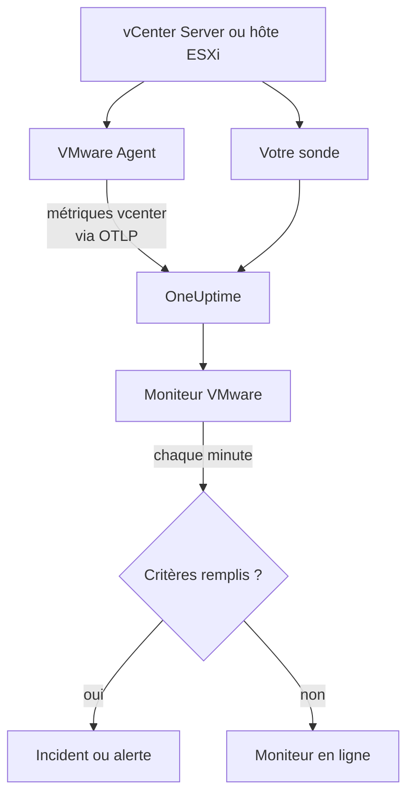

# Surveillance VMware

Un moniteur VMware surveille un vCenter - ses datacenters, clusters, hôtes ESXi, machines virtuelles, datastores, pools de ressources et vSAN - et vous prévient lorsqu'un hôte sature, qu'une VM manque de CPU ou de mémoire, qu'un datastore se remplit ou que vSphere lève une alarme. Il lit les métriques `vcenter.*` que collecte le OneUptime VMware Agent, ou que l'une de vos sondes collecte sans agent.

:::cards
- [Créer le moniteur](#créer-un-moniteur-vmware): Six étapes dans le tableau de bord.
- [Modèles](#modèles-dalerte-prédéfinis): Vingt-trois alertes prêtes à l'emploi, un incident par hôte, VM ou datastore.
- [Attributs d'identité](#attributs-didentité): Comment cibler un hôte, une VM ou un datastore.
- [Métriques](#métriques-collectées): Chaque série `vcenter.*` sur laquelle le moniteur peut alerter.
:::

## Fonctionnement

Les métriques viennent de l'API de vCenter, lues avec un compte en lecture seule, de l'une de deux façons :

- **Le VMware Agent**, un OpenTelemetry Collector avec son récepteur `vcenter`, que vous exécutez sur une machine qui peut joindre vCenter. Voir [Agent VMware](/docs/telemetry/vmware).
- **Une sonde**, sans rien à installer : vous connectez le vCenter dans OneUptime et choisissez la sonde qui le joint. Voir [VMware sans agent](/docs/telemetry/vmware-agentless).

Les deux envoient les mêmes séries à chaque intervalle de collecte (2 minutes par défaut), marquées du nom du vCenter, `vmware.vcenter.name`. Un vCenter est un point de terminaison vSphere : un vCenter Server ou un hôte ESXi autonome. Un moniteur VMware est lié à un vCenter. Chaque minute, il exécute sa requête sur les métriques de ce vCenter et compare le résultat à ses critères.



## Avant de commencer

- **Collectez les métriques du vCenter**, avec le [VMware Agent](/docs/telemetry/vmware) ou [sans agent](/docs/telemetry/vmware-agentless). Les deux utilisent un utilisateur vSphere ayant le rôle **Read-Only** sur l'objet vCenter de plus haut niveau, avec **Propagate to children** coché. L'agent lit `ONEUPTIME_URL`, `ONEUPTIME_TELEMETRY_INGESTION_KEY`, `VMWARE_VCENTER_NAME`, `VCENTER_ENDPOINT`, `VCENTER_USERNAME` et `VCENTER_PASSWORD`.
- **Vérifiez que le vCenter est enregistré.** Il apparaît sous **Produits → Infrastructure → VMware → Tous les vCenter** : via l'agent, sous le nom de son `VMWARE_VCENTER_NAME`, après sa première collecte complète ; sans agent, dès que vous le connectez.

## Créer un moniteur VMware

:::steps
### Commencer un nouveau moniteur

Allez dans **Moniteurs** et cliquez sur **Créer un moniteur**.

### Choisir VMware

Sous **Type de moniteur**, cliquez sur **Plus de types de moniteurs** et choisissez **VMware** sous **Infrastructure**, ou tapez `vmware` dans le champ de recherche. Saisissez un **Nom** - il est utilisé dans les titres des incidents et des alertes - et cliquez sur **Suivant**.

### Choisir le vCenter

Sous **VMware Monitor Configuration**, choisissez le vCenter dans **vCenter**. Chaque vCenter qui a envoyé des données, ou que vous avez connecté sans agent, figure dans la liste.

### Choisir ce qui est surveillé

Choisissez l'un des trois onglets :

- **Quick Setup** - cliquez sur un [modèle](#modèles-dalerte-prédéfinis). Il définit la métrique, les filtres d'attributs, l'agrégation, la plage temporelle, le regroupement et les seuils, et remplace les critères ci-dessous par les siens. Vous pouvez toujours modifier la **Plage temporelle**.
- **Custom Metric** - choisissez une métrique dans **VMware Metric**, puis définissez l'**Agrégation** et la **Plage temporelle**. Le formulaire la regroupe par l'objet qu'elle décrit, de sorte que chaque hôte, VM ou datastore est jugé séparément, et les [filtres](#paramètres-du-moniteur) la restreignent à un datacenter, un cluster, un hôte, une VM, un datastore ou un pool de ressources.
- **Avancé** - construisez vous-même requêtes et formules sous **Sélectionner les métriques**, avec des filtres sur des attributs comme `disk_state`, `power_state` ou `status`. Utilisez **Regrouper par** avec un [attribut d'identité](#attributs-didentité) pour juger chaque objet séparément.

### Vérifier les critères

Ouvrez chaque critère sous **Critères du moniteur** et vérifiez sa **Métrique**, son **Agrégation**, sa **Condition** et son **Threshold**. Un modèle les remplit. Avec **Custom Metric** ou **Avancé**, le moniteur démarre avec les [critères par défaut](#critères-par-défaut), qui ne remarquent qu'une métrique tombant à zéro, donc définissez votre propre seuil.

### Créer le moniteur

Cliquez sur **Créer un moniteur**. OneUptime ouvre la page du moniteur et l'évalue chaque minute. Les incidents et alertes qu'il lève figurent aussi sur les pages **Incidents** et **Alertes** du vCenter.
:::

> [!TIP]
> Pour configurer plusieurs modèles à la fois, ouvrez le vCenter depuis **Produits → Infrastructure → VMware** et allez dans **Recommendations**. Choisissez les modèles voulus, indiquez qui est alerté, et OneUptime crée un moniteur par modèle.

## Paramètres du moniteur

| Champ | Onglet | Ce qu'il fait |
| --- | --- | --- |
| **vCenter** | Tous | Obligatoire. Limite chaque requête à `resource.vmware.vcenter.name`. |
| **Datacenter** | Custom Metric, Avancé | Facultatif. Un datacenter : `resource.vcenter.datacenter.name`. Chaque série le porte. |
| **Cluster** | Custom Metric, Avancé | Facultatif. Un cluster : `resource.vcenter.cluster.name`. Correspond aux propres séries du cluster et à celles des hôtes, VM et pools de ressources qu'il contient ; un hôte ESXi autonome n'en a pas. |
| **Hôte ESXi** | Custom Metric, Avancé | Facultatif. Un hôte ESXi : `resource.vcenter.host.name`. Correspond aux propres séries de l'hôte **et** à celles de chaque VM qu'il exécute, car une VM porte le nom de son hôte. |
| **Virtual Machine** | Custom Metric, Avancé | Facultatif. Une VM : `resource.vcenter.vm.name`. Les noms de VM ne sont pas forcément uniques : ajoutez un hôte ou un cluster lorsque deux VM partagent un nom. |
| **Datastore** | Custom Metric, Avancé | Facultatif. Un datastore : `resource.vcenter.datastore.name`. |
| **Resource Pool Path** | Custom Metric, Avancé | Facultatif. Un pool de ressources, par son chemin d'inventaire (`/DC/host/Cluster/Resources/pool`) : `resource.vcenter.resource_pool.inventory_path`. Un chemin, car les noms de pools ne sont uniques qu'au sein de leur parent. |
| **VMware Metric** | Custom Metric | Une métrique du [catalogue](#métriques-collectées). |
| **Agrégation** | Custom Metric | La façon dont les échantillons sont combinés : **Moyenne**, **Maximum**, **Minimum**, **Somme** ou **Comptage**. Commence à l'agrégation habituelle de la métrique. |
| **Plage temporelle** | Tous | La fenêtre glissante que lit la requête, de **Past 1 Minute** à **Past 365 Days**. Un nouveau moniteur commence à **Past 5 Minutes** ; les modèles définissent la leur. |
| **Sélectionner les métriques** | Avancé | Le constructeur de requêtes : **Métrique**, **Agréger par**, **Filtrer par attributs**, **Regrouper par**, plus **Ajouter une métrique** et **Ajouter une formule** pour combiner des requêtes. |

vCenter est lu une fois par intervalle de collecte, 2 minutes par défaut, donc une fenêtre de 1 minute peut ne contenir aucun échantillon. Gardez une fenêtre de 5 minutes ou plus, et plus longue si vous avez augmenté l'intervalle de collecte pour un grand inventaire.

## Attributs d'identité

Le récepteur `vcenter` envoie une ressource OpenTelemetry par objet vSphere, et la nomme avec des **attributs de ressource**. Ceux que porte une série vous indiquent le type d'objet qu'elle décrit :

| Objet vSphere       | Attributs de ressource d'identité                                                                                              |
| ------------------- | ------------------------------------------------------------------------------------------------------------------------------ |
| Datacenter          | `vcenter.datacenter.name`                                                                                                      |
| Cluster             | `vcenter.datacenter.name`, `vcenter.cluster.name`                                                                              |
| Hôte ESXi           | `vcenter.datacenter.name`, `vcenter.host.name` (+ `vcenter.cluster.name` lorsqu'il est dans un cluster)                        |
| Machine virtuelle   | `vcenter.datacenter.name`, `vcenter.host.name`, `vcenter.vm.name`, `vcenter.vm.id` (+ `vcenter.cluster.name` ; `vcenter.resource_pool.*` ou `vcenter.virtual_app.*`) |
| Modèle de VM        | `vcenter.datacenter.name`, `vcenter.host.name`, `vcenter.vm_template.name`, `vcenter.vm_template.id`                           |
| Datastore           | `vcenter.datacenter.name`, `vcenter.datastore.name`                                                                            |
| Pool de ressources  | `vcenter.datacenter.name`, `vcenter.resource_pool.name`, `vcenter.resource_pool.inventory_path` (+ `vcenter.cluster.name` ou `vcenter.host.name`) |

Dans les filtres du moniteur et les clés de regroupement, les attributs de ressource commencent par `resource.` (`resource.vcenter.host.name`), alors que les attributs de point de données non (`disk_state`, `power_state`, `status`, `effective`, `direction`, `object`, `type`). L'attribut booléen `effective` est stocké sous forme de texte `"true"` ou `"false"`, donc filtrez-le avec le texte. Filtrez sur un attribut d'identité pour cibler un objet, et regroupez par lui pour juger chaque objet séparément.

## Modèles d'alerte prédéfinis

OneUptime fournit 23 modèles pour les problèmes VMware courants, et **Quick Setup** les propose tous. Chacun construit un moniteur complet : la requête de métrique, ses filtres d'attributs, un regroupement sur le propre attribut d'identité de l'objet, un critère qui déclenche et un qui rétablit. Les seuils sont des points de départ que vous pouvez modifier.

Les modèles lisent les 5 dernières minutes, sauf indication contraire du tableau. Un critère ne déclenche que lorsque la condition est vraie pour chaque minute de sa fenêtre, et un critère de seuil se rétablit 10 % au-delà de son seuil, donc une valeur qui oscille autour de la ligne ne bascule pas sans cesse.

| Modèle | Catégorie | Gravité | Surveille | Déclenche quand | Se rétablit quand |
| --- | --- | --- | --- | --- | --- |
| Host CPU Saturation | Hôte | Warning | `vcenter.host.cpu.utilization`, Avg par `resource.vcenter.host.name` | Au-dessus de 90 % : chaque VM de l'hôte se dispute les cœurs, et affiche du temps CPU ready | À 81 % ou moins |
| Host Memory Saturation | Hôte | Warning | `vcenter.host.memory.utilization`, Avg par hôte | Au-dessus de 90 % : l'hôte commence à reprendre de la mémoire par ballooning, compression et swap | À 81 % ou moins |
| Host Disk Latency High | Hôte | Warning | `vcenter.host.disk.latency.max`, Max par hôte | Au-dessus de 50 ms : chaque VM dont les disques passent par ce chemin attend le stockage. Nécessite le niveau de compteurs de performance 3 | À 45 ms ou moins |
| Host Network Packet Errors | Hôte | Warning | `vcenter.host.network.packet.error.rate`, Max par hôte | Au-dessus de 0 : presque toujours un défaut de câble, de SFP ou de port de switch | À 0 |
| Host Network Packet Drops | Hôte | Warning | `vcenter.host.network.packet.drop.rate`, Max par hôte | Au-dessus de 0 : un uplink sursouscrit, ou des tampons circulaires de NIC qui débordent | À 0 |
| VM CPU Saturation | Virtual Machine | Warning | `vcenter.vm.cpu.utilization`, Avg par `resource.vcenter.vm.name`, **15 dernières minutes** | Au-dessus de 90 % des vCPU de la VM pendant les 15 minutes : une VM peut utiliser ce qu'on lui a donné, donc seule une VM qui ne redescend jamais alerte | À 81 % ou moins |
| VM CPU Ready Contention | Virtual Machine | Warning | `vcenter.vm.cpu.readiness`, Avg par VM | Au-dessus de 10 % : la VM était prête à s'exécuter, mais l'hôte n'avait aucun cœur physique pour elle. Invisible depuis l'intérieur de l'invité | À 9 % ou moins |
| VM Memory Saturation | Virtual Machine | Warning | `vcenter.vm.memory.utilization`, Avg par VM | Au-dessus de 90 % de sa mémoire : l'invité est sur le point de paginer | À 81 % ou moins |
| VM Memory Ballooning | Virtual Machine | Warning | `vcenter.vm.memory.ballooned`, Max par VM | Au-dessus de 0 : l'hôte manque de mémoire et la reprend à cet invité | À 0 |
| VM Memory Swapping | Virtual Machine | Critique | `vcenter.vm.memory.swapped`, Max par VM | Au-dessus de 0 : l'hôte swappe la mémoire de la VM, le dernier recours après le ballooning et la compression | À 0 |
| VM Disk Latency High | Virtual Machine | Warning | `vcenter.vm.disk.latency.max`, Max par VM | Au-dessus de 50 ms : les applications de l'invité expirent sur les E/S | À 45 ms ou moins |
| VM Disk Usage High | Virtual Machine | Warning | `vcenter.vm.disk.utilization`, Avg par VM | Au-dessus de 90 % de son stockage provisionné engagé : une VM en provisionnement fin est sur le point de réclamer sa taille complète | À 81 % ou moins |
| Datastore Capacity Warning | Datastore | Warning | `vcenter.datastore.disk.utilization`, Avg par `resource.vcenter.datastore.name` | Au-dessus de 80 % : un avertissement précoce, car les disques fins et les snapshots consomment vite le reste | À 72 % ou moins |
| Datastore Capacity Critical | Datastore | Critique | `vcenter.datastore.disk.utilization`, Avg par datastore | Au-dessus de 90 % : un datastore plein met en pause chaque VM qui y a un disque | À 81 % ou moins |
| Cluster Host Not Effective | Cluster | Critique | `vcenter.cluster.host.count` filtrée sur `effective = false`, Max par `resource.vcenter.cluster.name` | Au-dessus de 0 : un hôte est en mode maintenance, déconnecté ou ne répond pas, donc le cluster tourne avec moins de capacité que prévu | À 0 |
| Datacenter Hosts Unhealthy | Datacenter | Critique | `vcenter.datacenter.host.count` filtrée sur `status = red`, Max par `resource.vcenter.datacenter.name` | Au-dessus de 0 : un hôte a une alarme critique, comme un capteur matériel, un chemin de stockage perdu ou une erreur de l'agent HA | À 0 |
| Datacenter Hosts Degraded | Datacenter | Warning | `vcenter.datacenter.host.count` filtrée sur `status = yellow`, Max par datacenter | Au-dessus de 0 : un hôte a une alarme d'avertissement | À 0 |
| Datacenter Hosts Powered Off | Datacenter | Warning | `vcenter.datacenter.host.count` filtrée sur `power_state = off`, Max par datacenter | Au-dessus de 0 : un hôte est éteint - il a planté, perdu son alimentation, ou été mis en veille par DPM | À 0 |
| Datacenter VMs Unhealthy | Datacenter | Warning | `vcenter.datacenter.vm.count` filtrée sur `status = red`, Max par datacenter | Au-dessus de 0 : une VM a une alarme critique, comme un redémarrage HA échoué, un datastore perdu ou un heartbeat des Tools perdu | À 0 |
| Datacenter Clusters Unhealthy | Datacenter | Critique | `vcenter.datacenter.cluster.count` filtrée sur `status = red`, Max par datacenter | Au-dessus de 0 : un cluster a une alarme critique, comme des ressources de basculement HA insuffisantes, une élection HA échouée ou une vérification de santé vSAN critique | À 0 |
| vSAN Latency High | vSAN | Warning | `vcenter.cluster.vsan.latency.avg`, Avg par cluster | Au-dessus de 20 000 µs (20 ms) : le stockage ralentit pour chaque VM du datastore vSAN. Silencieux sur les clusters sans vSAN | À 18 000 µs ou moins |
| vSAN Congestion | vSAN | Warning | `vcenter.cluster.vsan.congestions`, Max par cluster | Au-dessus de 0 : un groupe de disques ne suit pas, et vSAN ralentit les E/S de ses clients | À 0 |
| Resource Pool Memory Swapped | Cluster | Warning | `vcenter.resource_pool.memory.swapped`, Max par `resource.vcenter.resource_pool.inventory_path` | Au-dessus de 0 : les VM du pool prennent de la mémoire dans le swap de l'hôte, généralement parce que la limite ou les parts mémoire du pool sont trop basses | À 0 |

La **Gravité** est le libellé qu'affiche le sélecteur. L'incident et l'alerte qu'un modèle crée commencent à la gravité d'incident et d'alerte la plus élevée de votre projet ; modifiez-les dans le critère.

- **Les modèles d'utilisation utilisent Avg :** le récepteur signale un vrai pourcentage de 0 à 100 pour chaque objet, donc la moyenne sur une minute est l'utilisation soutenue.
- **Les modèles de latence utilisent Max :** la métrique est déjà la pire latence sur les disques de l'objet, donc son échantillon le plus élevé est le plus honnête.
- **Les modèles de comptage et d'état utilisent Max**, donc une seule collecte qui montre la condition les déclenche : erreurs de paquets, ballooning, swap, statuts rouge et jaune, hôtes non effectifs, congestion.
- **Chaque modèle regroupe sur le propre attribut d'identité de l'objet**, donc un incident se déclenche par objet concerné, et l'incident le nomme.
- **Les seuils sont fixés dans leur unité** (`%`, `ms`, `us`), donc ils gardent leur sens quelle que soit l'unité qu'affiche un graphique.

## Métriques collectées

Les métriques ci-dessous forment le catalogue que propose le formulaire du moniteur. Les unités sont celles du récepteur : `MHz`, `%`, `MiBy` (mébioctets), `By` (octets), `KiBy`, `ms`, `us` (microsecondes), `{KiBy/s}`, `By/s` et des comptages. Une métrique marquée _désactivée par défaut_ n'est pas collectée tant que vous ne l'activez pas dans le `otel-collector-config.yaml` de l'agent ; la configuration fournie active déjà `vcenter.host.memory.capacity`.

### Centre de données

| Métrique                             | Unité               | Description                                                                                                                                                    |
| ------------------------------------ | ------------------- | -------------------------------------------------------------------------------------------------------------------------------------------------------------- |
| `vcenter.datacenter.cluster.count`   | `{clusters}`        | Clusters du datacenter, répartis par `status` (`red` / `yellow` / `green` / `gray`). Additionnez pour le total ; filtrez `status = red` pour les clusters ayant une alarme critique |
| `vcenter.datacenter.cpu.limit`       | `MHz`               | CPU total disponible pour le datacenter sur tous les hôtes ESXi                                                                                                |
| `vcenter.datacenter.datastore.count` | `{datastores}`      | Datastores du datacenter                                                                                                                                       |
| `vcenter.datacenter.disk.space`      | `By`                | Espace des datastores sur tout le datacenter, réparti par `disk_state` (`used` / `available`). used ÷ (used + available) est l'utilisation du stockage de tout le datacenter |
| `vcenter.datacenter.host.count`      | `{hosts}`           | Hôtes ESXi du datacenter, répartis par `status` et `power_state` (`on` / `off` / `standby` / `unknown`). Filtrez `status = red` ou `power_state = off`         |
| `vcenter.datacenter.memory.limit`    | `By`                | Mémoire physique totale disponible pour le datacenter sur tous les hôtes ESXi                                                                                  |
| `vcenter.datacenter.vm.count`        | `{virtual_machines}` | Machines virtuelles du datacenter, réparties par `status` et `power_state` (`on` / `off` / `suspended` / `unknown`). Filtrez `power_state = on` pour les VM en cours d'exécution |

### Cluster

| Métrique                            | Unité                         | Description                                                                                                                                                  |
| ----------------------------------- | ----------------------------- | ------------------------------------------------------------------------------------------------------------------------------------------------------------ |
| `vcenter.cluster.cpu.effective`     | `MHz`                         | CPU que le cluster peut réellement planifier — sans les hôtes en mode maintenance ou qui ne répondent pas. Comparez à `vcenter.cluster.cpu.limit` pour la capacité hors service |
| `vcenter.cluster.cpu.limit`         | `MHz`                         | CPU total de chaque hôte ESXi du cluster, quel que soit l'état de l'hôte                                                                                     |
| `vcenter.cluster.host.count`        | `{hosts}`                     | Hôtes ESXi du cluster, répartis par `effective` (`"true"` / `"false"`). Un hôte n'est pas effectif tant qu'il est en mode maintenance, déconnecté ou ne répond pas |
| `vcenter.cluster.memory.effective`  | `By`                          | Mémoire que le cluster peut réellement allouer aux VM — sans les hôtes en mode maintenance ou qui ne répondent pas, ni la mémoire réservée par ESXi lui-même |
| `vcenter.cluster.memory.limit`      | `By`                          | Mémoire physique totale de chaque hôte ESXi du cluster                                                                                                       |
| `vcenter.cluster.vm.count`          | `{virtual_machines}`          | Machines virtuelles du cluster, réparties par `power_state`. Additionnez pour le total ; filtrez `power_state = on` pour les VM en cours d'exécution        |
| `vcenter.cluster.vm_template.count` | `{virtual_machine_templates}` | Modèles de machines virtuelles du cluster                                                                                                                    |

### Hôte (ESXi)

| Métrique                                 | Unité         | Description                                                                                                                                                       |
| ---------------------------------------- | ------------- | ----------------------------------------------------------------------------------------------------------------------------------------------------------------- |
| `vcenter.host.cpu.capacity`              | `MHz`         | Capacité CPU totale de l'hôte ESXi (cœurs × fréquence) — le dénominateur de `vcenter.host.cpu.usage`                                                              |
| `vcenter.host.cpu.reserved`              | `MHz`         | CPU réservé aux machines virtuelles, réparti par `cpu_reservation_type` (`total` / `used`). Un `used` qui approche de `total` signifie que les nouvelles réservations échoueront au contrôle d'admission |
| `vcenter.host.cpu.usage`                 | `MHz`         | CPU actuellement consommé sur l'hôte par toutes les VM et l'hyperviseur lui-même                                                                                  |
| `vcenter.host.cpu.utilization`           | `%`           | Utilisation CPU de l'hôte en pourcentage (0–100) de sa capacité                                                                                                   |
| `vcenter.host.disk.latency.avg`          | `ms`          | Latence disque moyenne (temps du périphérique + du noyau), répartie par `direction` (`read` / `write`) et `object` (périphérique disque). Nécessite le niveau de compteurs de performance 2 |
| `vcenter.host.disk.latency.max`          | `ms`          | Latence la plus élevée observée sur tous les disques qu'utilise l'hôte, par `object`, sur le dernier intervalle de 20 s. Nécessite le niveau de compteurs de performance 3 |
| `vcenter.host.disk.throughput`           | `{KiBy/s}`    | Kilo-octets par seconde lus depuis ou écrits sur les disques de l'hôte, par `direction` et `object`. Nécessite le niveau de compteurs de performance 4           |
| `vcenter.host.memory.active`             | `MiBy`        | Mémoire que les VM allumées de l'hôte utilisent activement. _Désactivée par défaut_ — activez `vcenter.host.memory.active` dans la configuration de l'agent       |
| `vcenter.host.memory.ballooned`          | `MiBy`        | Mémoire invitée récupérée sur les VM de l'hôte par le pilote de ballooning ; au-dessus de 0, l'hôte subit une pression mémoire. _Désactivée par défaut_           |
| `vcenter.host.memory.capacity`           | `MiBy`        | Mémoire physique totale de l'hôte — le dénominateur de `vcenter.host.memory.usage`. Désactivée par défaut en amont ; la configuration fournie de l'agent l'active |
| `vcenter.host.memory.granted`            | `MiBy`        | Mémoire machine accordée aux VM allumées de l'hôte. _Désactivée par défaut_                                                                                       |
| `vcenter.host.memory.usage`              | `MiBy`        | Mémoire actuellement consommée sur l'hôte, surcoût propre de l'hyperviseur compris                                                                               |
| `vcenter.host.memory.utilization`        | `%`           | Utilisation mémoire de l'hôte en pourcentage (0–100) de sa capacité physique                                                                                      |
| `vcenter.host.network.packet.drop.rate`  | `{packets/s}` | Paquets par seconde abandonnés sur chaque NIC physique, par `direction` (`transmitted` / `received`) et `object` (p. ex. `vmnic0`) — un uplink sursouscrit ou une NIC défaillante |
| `vcenter.host.network.packet.error.rate` | `{errors/s}`  | Erreurs de paquets par seconde sur les NIC physiques de l'hôte, par `direction` et `object` — presque toujours un défaut de câble, de SFP ou de port de switch     |
| `vcenter.host.network.packet.rate`       | `{packets/s}` | Paquets par seconde émis ou reçus sur chaque NIC physique, par `direction` et `object`                                                                           |
| `vcenter.host.network.throughput`        | `{KiBy/s}`    | Kilo-octets par seconde émis ou reçus par l'hôte, par `direction` et `object`                                                                                    |
| `vcenter.host.network.usage`             | `{KiBy/s}`    | Débit combiné d'émission et de réception sur les NIC de l'hôte, par `object`                                                                                      |

### Machine virtuelle

| Métrique                                   | Unité         | Description                                                                                                                                                                   |
| ------------------------------------------ | ------------- | ----------------------------------------------------------------------------------------------------------------------------------------------------------------------------- |
| `vcenter.vm.cpu.readiness`                 | `%`           | Pourcentage du temps pendant lequel la VM était prête à s'exécuter mais n'a pas pu être planifiée sur un CPU physique (CPU ready). Au-delà de 5 % l'invité semble lent ; au-delà de 10 % l'hôte est sursouscrit. VM allumées uniquement |
| `vcenter.vm.cpu.time`                      | `%`           | Temps passé par les vCPU de la VM dans chaque état, par `cpu_state` (`idle` / `ready` / `wait`) et `object` (vCPU). _Désactivée par défaut_ — activez `vcenter.vm.cpu.time` |
| `vcenter.vm.cpu.usage`                     | `MHz`         | CPU consommé par la VM. VM allumées uniquement — sa présence est la façon dont OneUptime déduit l'état d'alimentation d'une VM                                                 |
| `vcenter.vm.cpu.utilization`               | `%`           | Utilisation CPU de la VM en pourcentage (0–100) de ses vCPU configurés. VM allumées uniquement                                                                                |
| `vcenter.vm.disk.latency.avg`              | `ms`          | Latence disque moyenne, par `direction` (`read` / `write`), `disk_type` (`virtual` / `physical`) et `object` (disque virtuel). Nécessite le niveau de compteurs de performance 2 |
| `vcenter.vm.disk.latency.max`              | `ms`          | Latence totale la plus élevée (temps du périphérique + du noyau) que la VM a vue sur un disque sur un intervalle de 20 s, par `object`                                        |
| `vcenter.vm.disk.throughput`               | `{KiBy/s}`    | Kilo-octets par seconde lus depuis ou écrits sur les disques de la VM, par `direction` et `object`. Nécessite le niveau de compteurs de performance 2                          |
| `vcenter.vm.disk.usage`                    | `By`          | Espace de datastore consommé par les fichiers de la VM, réparti par `disk_state` (`used` / `available`). Émis aussi pour les modèles de VM. Filtrez `disk_state = used` pour la taille engagée |
| `vcenter.vm.disk.utilization`              | `%`           | Pourcentage (0–100) du stockage provisionné de la VM qui est engagé sur le datastore — une VM en provisionnement fin proche de 100 % est sur le point de réclamer sa taille complète |
| `vcenter.vm.memory.ballooned`              | `MiBy`        | Mémoire invitée récupérée sur la VM par le pilote de ballooning (VMware Tools). Au-dessus de 0, l'hôte ESXi manque de mémoire                                                 |
| `vcenter.vm.memory.granted`                | `MiBy`        | Mémoire machine accordée à la VM par l'hôte. _Désactivée par défaut_ — activez `vcenter.vm.memory.granted`                                                                   |
| `vcenter.vm.memory.swapped`                | `MiBy`        | Mémoire accordée à la VM depuis le fichier de swap de l'hôte — le dernier recours après le ballooning et la compression ; toute valeur au-dessus de 0 signifie que la VM paie la latence disque pour de la RAM |
| `vcenter.vm.memory.swapped_ssd`            | `KiBy`        | Mémoire de la VM swappée vers le cache de swap flash de l'hôte — moins pénible que le fichier de swap, mais toujours une pression mémoire                                      |
| `vcenter.vm.memory.usage`                  | `MiBy`        | Mémoire activement utilisée par l'invité de la VM. Émise pour les VM allumées comme éteintes (0 lorsqu'elle est éteinte)                                                      |
| `vcenter.vm.memory.utilization`            | `%`           | Utilisation mémoire de la VM en pourcentage (0–100) de sa mémoire configurée                                                                                                   |
| `vcenter.vm.network.broadcast.packet.rate` | `{packets/s}` | Paquets de broadcast par seconde par vNIC, par `direction` et `object`. _Désactivée par défaut_                                                                               |
| `vcenter.vm.network.multicast.packet.rate` | `{packets/s}` | Paquets de multicast par seconde par vNIC, par `direction` et `object`. _Désactivée par défaut_                                                                               |
| `vcenter.vm.network.packet.drop.rate`      | `{packets/s}` | Paquets par seconde abandonnés par chaque vNIC, par `direction` et `object`. Des pertes côté réception signifient généralement que l'invité ne vide pas son tampon circulaire assez vite |
| `vcenter.vm.network.packet.rate`           | `{packets/s}` | Paquets par seconde émis ou reçus par chaque vNIC, par `direction` et `object`                                                                                               |
| `vcenter.vm.network.throughput`            | `By/s`        | Octets par seconde émis ou reçus sur le réseau de la VM, par `direction` et `object`                                                                                         |
| `vcenter.vm.network.usage`                 | `{KiBy/s}`    | Débit combiné d'émission et de réception de la VM, par `object`                                                                                                                |

### Datastore

| Métrique                             | Unité | Description                                                                                                                                  |
| ------------------------------------ | ----- | -------------------------------------------------------------------------------------------------------------------------------------------- |
| `vcenter.datastore.disk.usage`       | `By`  | Espace sur le datastore, réparti par `disk_state` (`used` / `available`). used + available est la capacité du datastore                    |
| `vcenter.datastore.disk.utilization` | `%`   | Pourcentage (0–100) de la capacité du datastore utilisée. Un datastore plein met en pause chaque VM qui y écrit, donc alertez bien avant 100 % |

### Pool de ressources

| Métrique                                 | Unité      | Description                                                                                                                                                              |
| ---------------------------------------- | ---------- | ------------------------------------------------------------------------------------------------------------------------------------------------------------------------ |
| `vcenter.resource_pool.cpu.shares`       | `{shares}` | Parts CPU configurées sur le pool — sa priorité relative face aux pools frères lorsque le parent est en contention                                                        |
| `vcenter.resource_pool.cpu.usage`        | `MHz`      | CPU consommé par toutes les VM du pool (et de ses pools enfants)                                                                                                         |
| `vcenter.resource_pool.memory.ballooned` | `MiBy`     | Mémoire récupérée par le pilote de ballooning sur toutes les VM du pool                                                                                                  |
| `vcenter.resource_pool.memory.granted`   | `MiBy`     | Mémoire de l'hôte accordée aux VM du pool, répartie par `type` (`private` / `shared` — les pages partagées sont dédupliquées par le transparent page sharing)            |
| `vcenter.resource_pool.memory.shares`    | `{shares}` | Parts mémoire configurées sur le pool                                                                                                                                    |
| `vcenter.resource_pool.memory.swapped`   | `MiBy`     | Mémoire accordée aux VM du pool depuis l'espace de swap des hôtes ESXi — toute valeur au-dessus de 0 signifie qu'au moins une VM du pool est swappée par l'hôte         |
| `vcenter.resource_pool.memory.usage`     | `MiBy`     | Mémoire utilisée par le pool, répartie par `type` (`guest` / `host` / `overhead`) sur les versions récentes du collecteur ; les plus anciennes émettent une seule série sans type. Filtrez `type = guest` |

### vSAN

Envoyées uniquement pour les clusters avec vSAN, leurs hôtes et les VM d'un datastore vSAN. Les latences sont en **microsecondes** (`us`), contrairement aux latences en millisecondes des hôtes et des VM :

| Métrique                            | Unité             | Description                                                                                                                                     |
| ----------------------------------- | ----------------- | ----------------------------------------------------------------------------------------------------------------------------------------------- |
| `vcenter.cluster.vsan.congestions`  | `{congestions/s}` | Événements de congestion par seconde levés contre les E/S de chaque client vSAN du cluster — le propre signal de contre-pression de vSAN        |
| `vcenter.cluster.vsan.latency.avg`  | `us`              | Latence moyenne que voit le cluster en accédant au stockage vSAN, par `type` (`read` / `write`). 20 000 µs = 20 ms                              |
| `vcenter.cluster.vsan.operations`   | `{operations/s}`  | Opérations d'E/S vSAN par seconde sur tout le cluster, par `type` (`read` / `write` / `unmap`)                                                  |
| `vcenter.cluster.vsan.throughput`   | `By/s`            | Débit vSAN du cluster, par `direction` (`read` / `write`)                                                                                       |
| `vcenter.host.vsan.cache.hit_rate`  | `%`               | Pourcentage des E/S de lecture vSAN de l'hôte servies par son cache client local sur le dernier intervalle de 5 min — un taux en baisse signifie que les lectures atteignent le niveau de capacité |
| `vcenter.host.vsan.congestions`     | `{congestions/s}` | Événements de congestion par seconde levés contre les E/S vSAN de l'hôte                                                                        |
| `vcenter.host.vsan.latency.avg`     | `us`              | Latence moyenne que voit l'hôte en accédant au stockage vSAN, par `type`                                                                        |
| `vcenter.host.vsan.operations`      | `{operations/s}`  | Opérations d'E/S vSAN par seconde émises par l'hôte, par `type`                                                                                 |
| `vcenter.host.vsan.throughput`      | `By/s`            | Débit vSAN de l'hôte, par `direction`                                                                                                           |
| `vcenter.vm.vsan.latency.avg`       | `us`              | Latence moyenne que voit la VM en accédant au stockage vSAN, par `type`                                                                         |
| `vcenter.vm.vsan.operations`        | `{operations/s}`  | Opérations d'E/S vSAN par seconde émises par la VM, par `type`                                                                                  |
| `vcenter.vm.vsan.throughput`        | `By/s`            | Débit vSAN de la VM, par `direction`                                                                                                            |

> [!NOTE]
> L'état d'alimentation d'une VM n'est pas une métrique. Le récepteur n'envoie `vcenter.vm.cpu.*` que pour les VM allumées, donc OneUptime distingue **Powered on** de **Powered off** selon que des données CPU sont arrivées dans la même collecte que les données mémoire et disque de la VM ; la page **Virtual Machines** du vCenter affiche le résultat. Pour alerter sur des hôtes éteints ou sur le nombre de VM en cours d'exécution, utilisez l'attribut `power_state` de `vcenter.datacenter.host.count`, `vcenter.datacenter.vm.count` ou `vcenter.cluster.vm.count`.

## Critères de surveillance

Un critère compare l'une des requêtes ou formules du moniteur à un seuil. Les critères d'un moniteur VMware n'ont pas de **Type de filtre** : chaque règle vérifie la valeur de la métrique, avec ces champs.

| Champ | Ce qu'il fait |
| --- | --- |
| **Métrique** | La requête ou la formule à vérifier, par son nom de variable. |
| **Agrégation** | La façon dont les valeurs de la fenêtre deviennent une seule réponse : **Moyenne**, **Somme**, **Maximum Value**, **Minimum Value**, **All Values** (chaque valeur doit correspondre) ou **Any Value** (une seule suffit). |
| **Condition** | **Greater Than**, **Less Than**, **Greater Than Or Equal To**, **Less Than Or Equal To** ou **Equal To** — ou une condition d'anomalie : **Anomalously High**, **Anomalously Low** ou **Anomalous**. |
| **Threshold** | La valeur à laquelle comparer. Une liste d'unités se trouve à côté lorsque la métrique a une unité. Non affiché pour les conditions d'anomalie. |
| **Sensibilité** | Conditions d'anomalie uniquement. **Faible** (4σ), **Moyen** (3σ, la valeur par défaut) ou **Élevé** (2σ). |
| **Fenêtre de référence** | Conditions d'anomalie uniquement. 14 jours (la valeur par défaut), 28, 60 ou 90 jours d'historique. |
| **En l'absence de données** | Sous **Plus de champs**. Ce qui se passe lorsque la fenêtre n'a aucun échantillon : **Ignore** (la valeur par défaut), **Treat As Zero** ou **Déclencheur**. |

Les conditions d'anomalie comparent chaque valeur à la même heure de la semaine dans la référence. Elles restent dans un état « Learning », et ne lèvent rien, tant que la fenêtre de référence ne contient pas assez d'historique.

Quelques critères pour commencer :

- **Un hôte est saturé :** `vcenter.host.cpu.utilization`, Moyenne, regroupée par `resource.vcenter.host.name`, **Greater Than** `90`, sur les 5 dernières minutes.
- **Un datastore se remplit :** `vcenter.datastore.disk.utilization`, Moyenne, regroupée par `resource.vcenter.datastore.name`, **Greater Than** `80`.
- **Un cluster a perdu un hôte :** `vcenter.cluster.host.count` filtrée sur `effective = false`, Maximum, regroupée par `resource.vcenter.cluster.name`, **Greater Than** `0`.
- **Moins de VM tournent que prévu :** `vcenter.cluster.vm.count` filtrée sur `power_state = on` et `resource.vcenter.cluster.name = Production`, Somme, **Less Than** le nombre que vous attendez.
- **Une VM est swappée par l'hôte :** `vcenter.vm.memory.swapped`, Maximum, regroupée par `resource.vcenter.vm.name`, **Greater Than** `0`.

### Critères par défaut

Un moniteur que vous ne construisez pas à partir d'un modèle commence avec deux critères :

| Ordre | Critère | Correspond quand | Ensuite |
| --- | --- | --- | --- |
| 1 | Check if _monitor name_ is offline | Une valeur quelconque de la première requête vaut `0` | Marque le moniteur **Hors ligne** et déclare l'incident « _monitor name_ is offline », qui se résout de lui-même lorsque le moniteur se rétablit. |
| 2 | Check if _monitor name_ is online | Une valeur quelconque est supérieure à `0` | Marque le moniteur **Opérationnel**. |

> [!IMPORTANT]
> Le silence ne correspond à aucun des deux critères : un vCenter qui cesse d'envoyer des données laisse le moniteur dans son état. Pour être prévenu lorsque les données s'arrêtent, réglez **En l'absence de données** sur **Déclencheur** dans un critère. Une période pendant laquelle OneUptime lui-même ne recevait rien n'est jamais une absence de données : une vérification dont la fenêtre la contient attend plutôt, comme l'explique [Quand OneUptime ne reçoit pas de données](/docs/monitor/when-oneuptime-is-not-receiving).

## Terraform

Le [fournisseur Terraform de OneUptime](/docs/terraform/monitor-steps) porte la configuration d'une étape de moniteur VMware dans l'attribut `vmware_monitor` : le JSON brut de la configuration `vmwareMonitor` (`vcenterIdentifier`, `resourceFilters`, `metricViewConfig`, `rollingTime`), écrit avec `jsonencode()` :

```hcl title="main.tf"
monitor_steps = [{
  vmware_monitor = jsonencode({
    vcenterIdentifier = "prod-vcenter"
    resourceFilters   = { clusterName = "Production" }
    rollingTime       = "Past 5 Minutes"
    metricViewConfig = {
      queryConfigs = [{
        metricAliasData = { metricVariable = "host_cpu", title = "Host CPU", description = "", legend = "" }
        metricQueryData = {
          filterData = {
            metricName     = "vcenter.host.cpu.utilization"
            attributes     = {}
            aggegationType = "Avg"
            aggregateBy    = {}
          }
          groupByAttributeKeys = ["resource.vcenter.host.name"]
        }
      }]
      formulaConfigs = []
    }
  })
  criteria = [ /* ... */ ]
}]
```

`vcenterIdentifier` est le `vmware.vcenter.name` du vCenter - le `VMWARE_VCENTER_NAME` avec lequel l'agent a été démarré -, et non son ID OneUptime.

## Dépannage

:::details Le vCenter n'est pas dans la liste vCenter
Un vCenter que collecte l'agent s'enregistre de lui-même à partir des données de l'agent. Vérifiez que l'agent tourne et envoie des données (voir [Vérifier l'installation](/docs/telemetry/vmware#vérifier-linstallation)), que `VMWARE_VCENTER_NAME` est défini, et qu'un intervalle de collecte s'est écoulé : rien n'est envoyé avant la fin du premier parcours complet de l'inventaire.
:::

:::details Les hôtes ont des métriques, mais pas les VM, les datastores ou les clusters
L'utilisateur vSphere en lecture seule a reçu son rôle sans **Propagate to children**, ou sur un objet situé sous la racine du vCenter. Les objets que l'utilisateur ne peut pas voir sont simplement absents des métriques. Définissez l'autorisation sur l'objet vCenter de plus haut niveau, avec la propagation cochée.
:::

:::details Host CPU Saturation ne se déclenche jamais
Le modèle fait la moyenne de `vcenter.host.cpu.utilization` par `resource.vcenter.host.name`, donc chaque hôte est vérifié séparément. Si vous avez construit votre propre requête, regroupez-la par l'attribut d'identité avec son préfixe `resource.` : le simple `vcenter.host.name` ne correspond à rien, et une moyenne sur tous les hôtes est tirée vers le bas par les hôtes inactifs.
:::

:::details Les modèles vSAN ne se déclenchent jamais
`vcenter.cluster.vsan.*`, `vcenter.host.vsan.*` et `vcenter.vm.vsan.*` ne sont envoyées que pour les clusters avec vSAN, leurs hôtes et les VM d'un datastore vSAN. Sans vSAN, les séries n'existent pas, et les modèles restent silencieux.
:::

:::details Un critère filtré sur effective ne correspond à rien
L'attribut booléen `effective` du récepteur est stocké sous forme de texte `"true"` ou `"false"`. Filtrez-le avec le texte, pas avec un booléen.
:::

:::details Des métriques de latence ou de débit disque manquent
`vcenter.host.disk.latency.avg` et `vcenter.vm.disk.*` nécessitent le niveau de statistiques 2 de vCenter, `vcenter.host.disk.latency.max` le niveau 3, et `vcenter.host.disk.throughput` le niveau 4. Augmentez le niveau de statistiques de l'intervalle de 5 minutes sous _vCenter → Configure → General → Statistics_.
:::

:::details Une fenêtre de 1 minute n'affiche aucune donnée
vCenter est lu une fois par intervalle de collecte, 2 minutes par défaut et souvent plus pour un grand inventaire, donc une fenêtre de 1 minute peut ne contenir aucun échantillon. Utilisez 5 minutes ou plus.
:::

## Étapes suivantes

:::cards
- [Agent VMware](/docs/telemetry/vmware): Installer l'agent qui collecte depuis vCenter.
- [VMware sans agent](/docs/telemetry/vmware-agentless): Laisser plutôt une sonde collecter.
- [Surveillance Proxmox](/docs/monitor/proxmox-monitor): Le même type de moniteur pour Proxmox VE.
- [Vue d'ensemble des incidents](/docs/incidents/index): Ce qui se passe après qu'un critère a déclaré un incident.
:::
