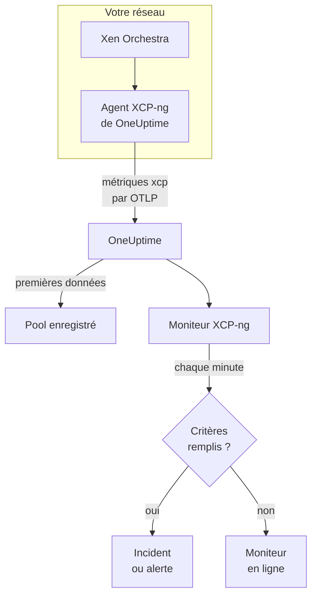

# Surveillance XCP-ng

Un moniteur XCP-ng surveille un pool XCP-ng – ses hôtes, ses VM, ses référentiels de stockage et ses disques virtuels – et vous prévient quand Xen Orchestra perd le pool, qu'un hôte passe hors ligne ou reste désactivé, qu'une VM qui tournait s'arrête ou manque de CPU, ou qu'un référentiel de stockage se remplit ou ralentit. Il lit les séries `xcp_*` du plugin OpenMetrics de Xen Orchestra, que collecte l'agent XCP-ng de OneUptime, et les séries de santé que OneUptime en dérive : rien n'est sondé depuis l'extérieur.

:::cards
- [Créer le moniteur](#créer-un-moniteur-xcp-ng): Six étapes dans le tableau de bord.
- [Modèles](#modèles-dalerte-prêts-à-lemploi): Dix alertes prêtes à l'emploi, un incident par hôte, VM ou référentiel de stockage.
- [Identité des ressources](#identité-des-ressources): Comment cibler un hôte, une VM ou un référentiel de stockage.
- [Métriques](#métriques-collectées): Chaque série sur laquelle le moniteur peut alerter.
:::

## Fonctionnement

L'agent XCP-ng de OneUptime s'exécute sur une machine qui peut joindre Xen Orchestra. Toutes les 60 secondes, il lit le plugin OpenMetrics de Xen Orchestra, qui lit chaque hôte de chaque pool que gère Xen Orchestra, et envoie les séries à OneUptime par OTLP, une ressource par pool, portant l'UUID du pool, `xcp_ng.pool.id`. Les premières données enregistrent chaque pool.

Un moniteur XCP-ng est lié à un pool. Chaque minute, il exécute sa requête sur les métriques de ce pool et compare le résultat à ses critères.



## Avant de commencer

- **Installez l'agent XCP-ng** là où il peut joindre Xen Orchestra, avec le secret du plugin OpenMetrics de Xen Orchestra. Le [guide de l'agent XCP-ng](/docs/telemetry/xcp-ng) couvre le plugin, le certificat de Xen Orchestra et l'installation.
- **Vérifiez que le pool est enregistré.** Il apparaît sous **Produits → Infrastructure → XCP-ng → Tous les pools**, nommé comme Xen Orchestra le nomme, environ une minute après la première collecte.

## Créer un moniteur XCP-ng

:::steps
### Commencer un nouveau moniteur

Allez dans **Moniteurs** et cliquez sur **Créer un moniteur**.

### Choisir XCP-ng

Sous **Type de moniteur**, cliquez sur **Plus de types de moniteurs** et choisissez **XCP-ng** sous **Infrastructure**, ou tapez `xcp` dans la zone de recherche. Saisissez un **Nom** – il est utilisé dans les titres des incidents et des alertes – et cliquez sur **Suivant**.

### Choisir le pool

Sous **XCP-ng Monitor Configuration**, choisissez le pool dans **Pool XCP-ng**. Chaque pool qui a envoyé des données figure dans la liste. Une fois le choix fait, une ligne sous le champ indique si des données arrivent. **Ajouter un pool XCP-ng** ouvre les étapes de configuration avec vos clés déjà renseignées, qui attendent les premières données.

### Choisir ce qu'il faut surveiller

Un nouveau moniteur commence sur **Pool Disconnected**, sous **Sur quoi alerter**. Pour surveiller autre chose :

- **Modifier** – choisissez un autre [modèle](#modèles-dalerte-prêts-à-lemploi). Il définit les métriques, les filtres, l'agrégation, la plage temporelle et les seuils, et remplace les critères plus bas par les siens. Vous pouvez toujours changer la **Plage temporelle**.
- **Custom Metric** (sous **Plus de champs**) – choisissez une métrique dans **XCP-ng Metric**, puis définissez l'**Agrégation** et la **Plage temporelle**. Les [filtres](#paramètres-du-moniteur) la restreignent à un type d'objet ou à un objet.
- **Avancé** (sous **Plus de champs**) – construisez vous-même des requêtes et des formules sous **Sélectionner les métriques**, par exemple la part utilisée d'un référentiel de stockage à partir de `xcp_sr_physical_usage_bytes / xcp_sr_physical_size_bytes`. Utilisez **Regrouper par** `xcp_ng.id` pour juger chaque objet séparément.

### Vérifier les critères

Ouvrez chaque critère sous **Critères** et vérifiez sa **Métrique**, son **Agrégation**, sa **Condition** et son **Seuil**. Un modèle les remplit. Avec **Custom Metric** ou **Avancé**, le moniteur commence avec les [critères par défaut](#critères-par-défaut), qui ne remarquent qu'une métrique qui n'envoie plus de données ; définissez donc votre propre seuil.

### Créer le moniteur

Cliquez sur **Créer un moniteur**. OneUptime ouvre la page du moniteur et l'évalue chaque minute. Les incidents et alertes qu'il déclenche figurent aussi dans les pages **Incidents** et **Alertes** du pool.
:::

> [!TIP]
> Pour configurer plusieurs modèles à la fois, ouvrez le pool depuis **Produits → Infrastructure → XCP-ng** et allez dans **Recommandations**. Choisissez les modèles voulus, choisissez qui est alerté, et OneUptime crée un moniteur par modèle.

## Paramètres du moniteur

| Champ | Onglet | Ce qu'il fait |
| --- | --- | --- |
| **Pool XCP-ng** | Tous | Obligatoire. Limite chaque requête à `resource.xcp_ng.pool.id`, l'UUID du pool, si bien que deux pools du même nom ne se mélangent jamais. |
| **Portée de la ressource** | Custom Metric, Avancé | Facultatif. **Hôte**, **VM**, **Référentiel de stockage**, **Disque virtuel**, **XOSTOR** ou **Pool XCP-ng** – une correspondance exacte sur `xcp_ng.scope`. |
| **UUID** | Custom Metric, Avancé | Facultatif. Correspondance exacte sur `xcp_ng.id` : l'UUID d'un hôte, d'une VM, d'un référentiel de stockage ou d'un disque virtuel, tel que l'affiche Xen Orchestra. Associez-le à une portée pour cibler un objet. |
| **Nom de l'hôte** | Custom Metric, Avancé | Facultatif. Correspondance exacte sur l'étiquette `host_name` de Xen Orchestra : les propres séries de l'hôte et celles des VM qui tournent dessus. |
| **XCP-ng Metric** | Custom Metric | Une métrique du [catalogue](#métriques-collectées). |
| **Agrégation** | Custom Metric | Comment les mesures sont combinées : **Moyenne**, **Maximum**, **Minimum**, **Somme** ou **Comptage**. Commence à l'agrégation habituelle de la métrique. |
| **Plage temporelle** | Tous | La fenêtre glissante que lit la requête, de **Past 1 Minute** à **Past 365 Days**. Un nouveau moniteur commence à **Past 1 Minute** ; les modèles définissent la leur. |
| **Sélectionner les métriques** | Avancé | Le constructeur de requêtes : **Métrique**, **Agréger par**, **Filtrer par attributs**, **Regrouper par**, plus **Ajouter une métrique** et **Ajouter une formule** pour combiner des requêtes. |

L'agent lit Xen Orchestra toutes les 60 secondes, et Xen Orchestra lit ses hôtes avec une résolution de 60 secondes : une fenêtre de 1 minute contient donc environ une mesure ; les modèles lisent 5 minutes ou plus.

## Identité des ressources

Xen Orchestra nomme un hôte ou une VM par son étiquette `uuid`, un référentiel de stockage par `sr_uuid` et un disque virtuel par `vdi_uuid`. OneUptime appose deux attributs sur chaque point à son arrivée, si bien qu'un seul filtre lit chaque série d'un objet, quelle que soit l'étiquette qui l'a nommé. Les modèles s'appuient sur eux :

| Attribut | Valeurs | Pour une VM |
| --- | --- | --- |
| `xcp_ng.scope` | `pool`, `host`, `vm`, `sr` (un référentiel de stockage), `vdi` (un disque virtuel), `xostor` | `vm` |
| `xcp_ng.id` | L'UUID de l'objet, en minuscules : l'`uuid` d'un hôte ou d'une VM, le `sr_uuid` d'un référentiel de stockage ou d'un cluster XOSTOR, le `vdi_uuid` d'un disque virtuel, et l'UUID propre du pool sur les séries du pool | `5c6d7e8f-1a2b-4c3d-9e8f-0a1b2c3d4e5f` |

Filtrez sur `xcp_ng.scope` pour un type d'objet, sur `xcp_ng.id` pour un objet, et regroupez par `xcp_ng.id` pour juger chaque objet séparément. Les propres étiquettes de Xen Orchestra restent telles qu'il les envoie : `host_name` nomme un hôte sur ses séries et l'hôte d'une VM sur celles de la VM, `vm_name`, `sr_name` et `vdi_name` nomment le reste, `power_state` et `enabled` portent l'état d'un hôte ou d'une VM sur les séries d'état, et `is_control_domain` vaut `true` sur les séries de VM d'un domaine de contrôle.

Le pool lui-même est la ressource sur laquelle arrivent les séries : ses attributs prennent donc un préfixe `resource.` dans les filtres et les clés de regroupement : `resource.xcp_ng.pool.id` (son UUID), `resource.xcp_ng.pool.name` (son nom dans Xen Orchestra) et `resource.xen_orchestra.name` (le Xen Orchestra depuis lequel il est lu).

## Modèles d'alerte prêts à l'emploi

La liste **Sur quoi alerter** propose 10 modèles. Chacun construit un moniteur complet – requêtes, filtres d'attributs, un regroupement, un critère qui déclenche et un qui rétablit. La plupart regroupent par `xcp_ng.id`, si bien que chaque hôte, VM ou référentiel de stockage a son propre incident et sa propre alerte. Les seuils sont des points de départ que vous pouvez modifier.

Un critère ne se déclenche que si la condition tient à chaque minute de sa fenêtre, et un critère à seuil ne se rétablit que 10 % au-delà de son seuil, pour qu'une valeur qui oscille autour de la ligne ne fasse pas basculer le moniteur sans cesse. Une série 0/1 se rétablit à l'autre valeur.

| Modèle | Catégorie | Gravité | Surveille | Déclenche quand | Se rétablit quand |
| --- | --- | --- | --- | --- | --- |
| Pool Disconnected | Disponibilité | Critique | `xcp_pool_connected`, Count sur tout le pool, 5 dernières minutes | Aucune donnée sur toute la fenêtre | Les données reviennent |
| Host Offline | Disponibilité | Critique | `xcp_ng.host.running` pour `xcp_ng.scope = host`, Min par `xcp_ng.id`, 5 dernières minutes | Sous 1 | À 1 |
| VM Stopped | VM | Avertissement | `xcp_ng.vm.stopped_after_running` pour `xcp_ng.scope = vm`, Min par `xcp_ng.id`, 5 dernières minutes | Au-dessus de 0 | À 0 |
| Storage Repository Near Full | Stockage | Critique | `xcp_sr_physical_usage_bytes` ÷ `xcp_sr_physical_size_bytes` × 100 pour `xcp_ng.scope = sr` (les deux en Somme), par `xcp_ng.id`, 5 dernières minutes | Au-dessus de 90 % | 81 % ou moins |
| Host Disabled | Hôte | Avertissement | `xcp_ng.host.enabled` pour `xcp_ng.scope = host`, Max par `xcp_ng.id`, 30 dernières minutes | Sous 1 | À 1 |
| Host Restarted | Hôte | Avertissement | `xcp_host_uptime_seconds` et `xcp_ng.host.running` pour `xcp_ng.scope = host`, Min par `xcp_ng.id`, 5 dernières minutes | `xcp_host_uptime_seconds` est sous 900 (15 minutes) alors que `xcp_ng.host.running` vaut 1 | `xcp_host_uptime_seconds` atteint 990 ou plus, ou `xcp_ng.host.running` vaut 0 |
| High Host CPU Usage | Hôte | Avertissement | `xcp_host_cpu_average` pour `xcp_ng.scope = host`, Avg par `xcp_ng.id`, 10 dernières minutes | Au-dessus de 0,9 (90 % du CPU de l'hôte) | 0,81 ou moins |
| High Host Memory Usage | Hôte | Avertissement | (`xcp_host_memory_total_bytes` − `xcp_host_memory_free_bytes`) ÷ `xcp_host_memory_total_bytes` × 100 pour `xcp_ng.scope = host` (les deux en Somme), par `xcp_ng.id`, 10 dernières minutes | Au-dessus de 95 % | 85,5 % ou moins |
| VM Starved of CPU | VM | Avertissement | `xcp_vm_runstate_full_contention` pour `xcp_ng.scope = vm`, Avg par `xcp_ng.id`, 15 dernières minutes | Au-dessus de 0,1 (10 % du temps) | 0,09 ou moins |
| Storage Repository Slow | Stockage | Avertissement | `xcp_host_disk_latency_seconds` pour `xcp_ng.scope = host`, Avg par `sr`, 15 dernières minutes | Au-dessus de 0,05 (50 ms) | 0,045 ou moins |

**Gravité** est le libellé qu'affiche le sélecteur. L'incident et l'alerte qu'un modèle crée commencent avec la gravité d'incident et d'alerte la plus élevée de votre projet ; changez-les dans les critères.

- **Pool Disconnected** se déclenche quand `xcp_pool_connected` cesse d'arriver pendant cinq minutes. Xen Orchestra l'envoie à chaque collecte tant qu'il est connecté au pool, et cesse de l'envoyer, plutôt que d'envoyer 0, quand il perd le maître du pool ; elle cesse aussi quand Xen Orchestra, son plugin ou l'agent XCP-ng s'arrête, ou que l'agent perd sa route vers OneUptime. Il se résout quand la série revient. Quand les données s'arrêtent, les autres modèles n'ont rien à comparer et gardent leur dernier statut : c'est donc celui-ci qui vous prévient.
- **Host Offline** lit `xcp_ng.host.running`, que OneUptime dérive de `xcp_host_status` : 0 tant que Xen Orchestra rapporte l'hôte Halted, ou son état Unknown parce que le maître du pool a perdu le contact avec lui. Les VM qui tournaient sur l'hôte sont tombées elles aussi, sauf si HA les a redémarrées ailleurs.
- **VM Stopped** lit `xcp_ng.vm.stopped_after_running` : 1 tant qu'une VM qui a tourné au cours des dernières 24 heures est Halted ou Paused. Une VM éteinte depuis plus d'un jour est considérée comme éteinte exprès et cesse d'alerter, une VM suspendue (Suspended) n'alerte jamais, et les domaines de contrôle et les modèles de VM sont laissés de côté.
- **Host Disabled** se déclenche pour un hôte qui reste désactivé pendant 30 minutes : en mode maintenance, ou laissé désactivé par une évacuation. XAPI ne démarre aucune VM dessus et HA ne peut pas basculer vers lui. Trente minutes laissent passer un redémarrage ou une mise à jour planifiés sans alerte.
- **Host Restarted** se déclenche pour un hôte qui tourne mais n'est démarré que depuis moins de 15 minutes : il a redémarré, ou il a planté puis est revenu. Il se résout une fois l'hôte démarré depuis 16,5 minutes, 10 % au-delà du seuil ; un hôte arrêté déclenche plutôt **Host Offline**.
- Les **formules de rapport** prennent la **Somme** des deux côtés. Les deux viennent de la même collecte, le résultat est donc un vrai pourcentage. Un référentiel de stockage qui rapporte une taille de 0, comme certaines bibliothèques ISO et certains supports amovibles, ne se déclenche jamais.
- **VM Starved of CPU** lit la contention complète : la part du temps où tous les vCPU d'une VM étaient prêts à tourner mais attendaient un CPU physique. Son hôte a plus de vCPU exécutables que de threads de CPU, si bien que la VM tourne plus lentement que ne le laisse penser sa propre utilisation du CPU.
- **Storage Repository Slow** regroupe par `sr`, l'identifiant court d'un référentiel de stockage chez Xen Orchestra, présent sur chaque série disque d'un hôte : chaque référentiel de stockage a donc un incident, sa latence étant la moyenne sur les hôtes qui y lisent et y écrivent.

Le plugin ne rapporte aucune alarme hormis celles de XOSTOR, ni état HA, ni maître du pool, ni correctifs manquants, ni sauvegardes : aucun modèle ne les surveille donc encore. Voir [Ce que le plugin ne couvre pas encore](/docs/telemetry/xcp-ng#ce-que-le-plugin-ne-couvre-pas-encore).

## Métriques collectées

L'agent lit chaque série du plugin OpenMetrics de Xen Orchestra toutes les 60 secondes ; les séries ci-dessous sont le catalogue que propose le formulaire du moniteur. Xen Orchestra convertit déjà les Kio, Mio/s et microsecondes de XAPI en octets, octets par seconde et secondes. Huit séries qu'il nomme `_total` et type comme des compteurs contiennent des débits par seconde, et OneUptime les stocke comme les débits qu'ils sont, comme l'explique le [guide de l'agent XCP-ng](/docs/telemetry/xcp-ng#ce-que-collecte-lagent). Les quatre séries `xcp_ng.*` sont propres à OneUptime, dérivées des séries d'état de Xen Orchestra à leur arrivée.

### Disponibilité

| Métrique | Unité | Description |
| --- | --- | --- |
| `xcp_pool_connected` | — | 1 tant que Xen Orchestra est connecté au pool. Xen Orchestra cesse de l'envoyer quand il perd le pool, plutôt que d'envoyer 0 : guettez son absence. |
| `xcp_ng.host.running` | — | 1 tant que Xen Orchestra rapporte un hôte Running, 0 tant qu'il est Halted ou que son état est Unknown. Dérivée par OneUptime de l'état de l'hôte. |
| `xcp_ng.host.enabled` | — | 1 tant qu'un hôte est activé, 0 tant qu'il est en mode maintenance ou en cours d'évacuation, quand XAPI ne démarre aucune VM dessus. Dérivée par OneUptime de l'état de l'hôte. |
| `xcp_ng.vm.running` | — | 1 tant qu'une VM est Running, 0 tant qu'elle est Halted, Paused ou Suspended. Les domaines de contrôle sont laissés de côté. Dérivée par OneUptime de l'état de la VM. |
| `xcp_ng.vm.stopped_after_running` | — | 1 tant qu'une VM qui a tourné au cours des dernières 24 heures est Halted ou Paused, sinon 0. Une VM que personne n'a vue tourner depuis un jour est considérée comme éteinte exprès, et une VM suspendue ne compte jamais. Dérivée par OneUptime. |
| `xcp_host_status` | count | Toujours 1 pour chaque hôte, qu'il tourne ou non ; l'état de l'hôte figure dans les étiquettes `power_state` (Running, Halted, Unknown) et `enabled`. |
| `xcp_vm_status` | count | Toujours 1 pour chaque VM sauf les domaines de contrôle et les modèles ; l'état de la VM figure dans l'étiquette `power_state` (Running, Halted, Paused, Suspended). |
| `xcp_host_uptime_seconds` | seconds | Depuis combien de temps un hôte fonctionne depuis son démarrage. |
| `xcp_vm_uptime_seconds` | seconds | Depuis combien de temps une VM en marche fonctionne depuis son démarrage. Rapportée seulement tant que la VM tourne. |

### Hôte

| Métrique | Unité | Description |
| --- | --- | --- |
| `xcp_host_cpu_average` | ratio | L'utilisation du CPU d'un hôte, moyennée sur ses cœurs, sous forme de ratio de 0 à 1. |
| `xcp_host_cpu_core_usage` | ratio | L'utilisation d'un thread de CPU sur un hôte, sous forme de ratio de 0 à 1 ; l'étiquette `core` indique lequel. |
| `xcp_host_load` | — | Les vCPU qui tournent ou attendent de tourner sur un hôte, par CPU physique. Au-dessus de 1, des VM attendent un CPU. |
| `xcp_host_load_average` | — | La charge moyenne du domaine de contrôle (dom0) d'un hôte. |
| `xcp_host_memory_total_bytes` | bytes | La mémoire physique d'un hôte. |
| `xcp_host_memory_free_bytes` | bytes | La mémoire d'un hôte attribuée à aucune VM. Comparez-la à `xcp_host_memory_total_bytes` pour voir à quel point l'hôte est plein. |
| `xcp_host_memory_reclaimed_bytes` | bytes | La mémoire récupérée sur les VM d'un hôte par le contrôle dynamique de la mémoire. |
| `xcp_host_memory_reclaimed_max_bytes` | bytes | Le maximum de mémoire que le contrôle dynamique de la mémoire pourrait récupérer sur les VM d'un hôte. |
| `xcp_host_running_vcpus` | count | Les vCPU des VM qui tournent sur un hôte, additionnés. |
| `xcp_host_power_consumption_watts` | W | La puissance consommée par un hôte, lue sur son capteur DCMI. Là où Xen Orchestra la lit plutôt par IPMI, il envoie cette mesure sans son pool, et l'agent ne la garde pas ; la part estimée de chaque VM est gardée. |

### VM

| Métrique | Unité | Description |
| --- | --- | --- |
| `xcp_vm_cpu_usage` | ratio | L'utilisation du CPU d'une VM, moyennée sur ses vCPU, sous forme de ratio de 0 à 1. |
| `xcp_vm_cpu_core_usage` | ratio | L'utilisation d'un vCPU, sous forme de ratio de 0 à 1 ; l'étiquette `core` indique lequel. |
| `xcp_vm_runstate_full_contention` | ratio | La part du temps où tous les vCPU d'une VM étaient prêts à tourner mais attendaient un CPU physique, de 0 à 1. Une valeur élevée signifie que ses voisines privent la VM de CPU. |
| `xcp_vm_runstate_partial_contention` | ratio | La part du temps où certains vCPU d'une VM attendaient un CPU physique pendant que les autres étaient bloqués, de 0 à 1. |
| `xcp_vm_runstate_concurrency_hazard` | ratio | La part du temps où certains vCPU d'une VM tournaient pendant que d'autres attendaient un CPU physique, de 0 à 1. |
| `xcp_vm_runstate_fullrun` | ratio | La part du temps où tous les vCPU d'une VM tournaient, de 0 à 1. |
| `xcp_vm_runstate_partial_run` | ratio | La part du temps où certains vCPU d'une VM tournaient et les autres étaient bloqués, de 0 à 1. |
| `xcp_vm_runstate_blocked` | ratio | La part du temps où tous les vCPU d'une VM étaient bloqués, sans rien à faire ou en attente d'E/S, de 0 à 1. |
| `xcp_vm_memory_bytes` | bytes | La mémoire attribuée à une VM. |
| `xcp_vm_memory_target_bytes` | bytes | La mémoire que le contrôle dynamique de la mémoire vise à attribuer à une VM. |
| `xcp_vm_memory_internal_free_bytes` | bytes | La mémoire que l'invité déclare libre. Nécessite les outils invités dans la VM. |
| `xcp_vm_power_consumption_watts` | W | L'estimation par Xen Orchestra de la part d'une VM dans la puissance de son hôte, répartie selon la charge CPU. Son étiquette `data_complete` vaut `false` quand la mesure CPU de la VM manquait. |

### Stockage

| Métrique | Unité | Description |
| --- | --- | --- |
| `xcp_sr_physical_size_bytes` | bytes | La taille physique d'un référentiel de stockage. Certaines bibliothèques ISO et certains supports amovibles rapportent 0. |
| `xcp_sr_physical_usage_bytes` | bytes | L'espace utilisé sur un référentiel de stockage. Divisez-le par sa taille pour voir à quel point il est plein. |
| `xcp_sr_virtual_size_bytes` | bytes | La taille virtuelle de tous les disques d'un référentiel de stockage, additionnée. Au-delà de sa taille, le référentiel est provisionné en thin au-delà de ce qu'il peut contenir. |
| `xcp_vdi_virtual_size_bytes` | bytes | La taille d'un disque virtuel telle que la voit sa VM. |
| `xcp_vdi_physical_usage_bytes` | bytes | L'espace qu'occupe un disque virtuel sur son référentiel de stockage. |
| `xcp_host_disk_iops_read` | ops/s | Les opérations de lecture par seconde d'un hôte vers un référentiel de stockage ; l'étiquette `sr_name` indique lequel. |
| `xcp_host_disk_iops_write` | ops/s | Les opérations d'écriture par seconde d'un hôte vers un référentiel de stockage. |
| `xcp_host_disk_iops_total` | ops/s | Les opérations de lecture et d'écriture par seconde d'un hôte vers un référentiel de stockage. |
| `xcp_host_disk_throughput_read_bytes` | bytes/s | Les octets par seconde qu'un hôte lit depuis un référentiel de stockage. |
| `xcp_host_disk_throughput_write_bytes` | bytes/s | Les octets par seconde qu'un hôte écrit sur un référentiel de stockage. |
| `xcp_host_disk_throughput_total_bytes` | bytes/s | Les octets par seconde qu'un hôte lit depuis un référentiel de stockage et y écrit. |
| `xcp_host_disk_read_latency_seconds` | seconds | Le temps que prennent les lectures d'un hôte depuis un référentiel de stockage. |
| `xcp_host_disk_write_latency_seconds` | seconds | Le temps que prennent les écritures d'un hôte sur un référentiel de stockage. |
| `xcp_host_disk_latency_seconds` | seconds | Le temps que prennent les lectures et les écritures d'un hôte sur un référentiel de stockage. |
| `xcp_host_disk_iowait` | ratio | La part du temps où un hôte attendait un référentiel de stockage, de 0 à 1. |
| `xcp_vm_disk_read_bytes_total` | bytes/s | Les octets par seconde qu'une VM lit depuis l'un de ses disques ; l'étiquette `device` indique lequel. Un débit, même si Xen Orchestra la nomme `_total` et la type comme un compteur. |
| `xcp_vm_disk_write_bytes_total` | bytes/s | Les octets par seconde qu'une VM écrit sur l'un de ses disques. Un débit, même si Xen Orchestra la nomme `_total` et la type comme un compteur. |
| `xcp_vm_disk_iops_read` | ops/s | Les opérations de lecture par seconde sur le disque d'une VM. |
| `xcp_vm_disk_iops_write` | ops/s | Les opérations d'écriture par seconde sur le disque d'une VM. |
| `xcp_vm_disk_iops_total` | ops/s | Les opérations de lecture et d'écriture par seconde sur le disque d'une VM. |
| `xcp_vm_disk_throughput_read_bytes` | bytes/s | Les octets par seconde lus depuis le disque d'une VM. |
| `xcp_vm_disk_throughput_write_bytes` | bytes/s | Les octets par seconde écrits sur le disque d'une VM. |
| `xcp_vm_disk_throughput_total_bytes` | bytes/s | Les octets par seconde lus depuis le disque d'une VM et écrits dessus. |
| `xcp_vm_disk_read_latency_seconds` | seconds | Le temps que prennent les lectures sur le disque d'une VM. |
| `xcp_vm_disk_write_latency_seconds` | seconds | Le temps que prennent les écritures sur le disque d'une VM. |
| `xcp_vm_disk_latency_seconds` | seconds | Le temps moyen que prennent les lectures et les écritures sur le disque d'une VM. |
| `xcp_vm_disk_iowait` | ratio | La part du temps où une VM attendait l'un de ses disques, de 0 à 1. |
| `xcp_vm_disk_inflight` | count | Les requêtes sur le disque d'une VM qui n'ont pas encore reçu de réponse. |
| `xcp_vm_disk_queue_size` | count | La file moyenne des requêtes sur le disque d'une VM. |

### Réseau

| Métrique | Unité | Description |
| --- | --- | --- |
| `xcp_host_network_receive_bytes_total` | bytes/s | Les octets par seconde qu'un hôte reçoit sur une interface physique ; l'étiquette `interface` indique laquelle. Un débit, même si Xen Orchestra la nomme `_total` et la type comme un compteur. |
| `xcp_host_network_transmit_bytes_total` | bytes/s | Les octets par seconde qu'un hôte envoie sur une interface physique. Un débit, même si Xen Orchestra la nomme `_total` et la type comme un compteur. |
| `xcp_host_network_aggregated_receive_bytes` | bytes/s | Les octets par seconde qu'un hôte reçoit sur toutes ses interfaces physiques. |
| `xcp_host_network_aggregated_transmit_bytes` | bytes/s | Les octets par seconde qu'un hôte envoie sur toutes ses interfaces physiques. |
| `xcp_vm_network_receive_bytes_total` | bytes/s | Les octets par seconde qu'une VM reçoit sur l'une de ses interfaces réseau ; l'étiquette `vif` indique laquelle. Un débit, même si Xen Orchestra la nomme `_total` et la type comme un compteur. |
| `xcp_vm_network_transmit_bytes_total` | bytes/s | Les octets par seconde qu'une VM envoie sur l'une de ses interfaces réseau. Un débit, même si Xen Orchestra la nomme `_total` et la type comme un compteur. |
| `xcp_vm_network_receive_errors_total` | errors/s | Les erreurs de réception par seconde sur l'une des interfaces réseau d'une VM. Un débit, même si Xen Orchestra la type comme un compteur. |
| `xcp_vm_network_transmit_errors_total` | errors/s | Les erreurs d'envoi par seconde sur l'une des interfaces réseau d'une VM. Un débit, même si Xen Orchestra la type comme un compteur. |

### XOSTOR

Envoyées seulement pour les pools qui exécutent XOSTOR, le stockage répliqué de Vates construit sur LINSTOR.

| Métrique | Unité | Description |
| --- | --- | --- |
| `xcp_xostor_up` | — | 1 quand Xen Orchestra a pu lire la santé d'un cluster XOSTOR, 0 sinon. |
| `xcp_xostor_node_status` | count | Toujours 1 pour chaque nœud d'un cluster XOSTOR ; son rôle et son état figurent dans les étiquettes `role` et `state`. |
| `xcp_xostor_resource_total` | count | Les ressources LINSTOR que définit un cluster XOSTOR. |
| `xcp_xostor_resource_state_count` | count | Les réplicas de ressources d'un cluster XOSTOR dans chaque état de disque ; l'étiquette `state` indique lequel. |
| `xcp_xostor_alarms_up` | — | 1 quand Xen Orchestra a pu lire les alarmes d'un cluster XOSTOR, 0 sinon. |
| `xcp_xostor_alarms_count` | count | Les alarmes XAPI actives sur un référentiel de stockage XOSTOR ou ses hôtes, par `alarm_name` et `target_type`. Absente quand aucune n'est levée. |
| `xcp_xostor_smart_up` | — | 1 quand Xen Orchestra a pu lire les données SMART d'un hôte pour XOSTOR, 0 sinon. |
| `xcp_xostor_disk_smart_status` | count | Toujours 1 pour chaque disque d'un hôte XOSTOR ; sa santé SMART figure dans l'étiquette `status`. |
| `xcp_xostor_updates_up` | — | 1 quand la vérification des mises à jour XOSTOR d'un hôte a répondu, 0 quand elle a échoué. |
| `xcp_xostor_package_update_available` | count | 1 pour chaque paquet XOSTOR dont une mise à jour attend sur un hôte ; l'étiquette `package` indique lequel. |

## Critères de surveillance

Un critère compare l'une des requêtes ou formules du moniteur à un seuil. Les critères d'un moniteur XCP-ng n'ont pas de **Type de filtre** : chaque règle vérifie la valeur de la métrique, avec ces champs.

| Champ | Ce qu'il fait |
| --- | --- |
| **Métrique** | La requête ou la formule à vérifier, par son nom de variable. |
| **Agrégation** | Comment les valeurs de la fenêtre deviennent une seule réponse : **Moyenne**, **Somme**, **Valeur maximale**, **Valeur minimale**, **Toutes les valeurs** (chaque valeur doit correspondre, sur toute la fenêtre) ou **Au moins une valeur** (une seule suffit). |
| **Condition** | **Supérieur à**, **Inférieur à**, **Supérieur ou égal à**, **Inférieur ou égal à**, **Égal à** ou **Différent de** – ou une condition d'anomalie : **Anormalement élevé**, **Anormalement bas** ou **Anormal**. **Aucune donnée** est vraie quand la requête n'a rien renvoyé dans la fenêtre, **Données reçues** quand elle a renvoyé quelque chose. **Devrait dépasser** et **Devrait passer sous** correspondent quand la tendance de la métrique sur la fenêtre aura franchi le seuil à la fin de **Horizon**. |
| **Seuil** | La valeur de comparaison. Une liste d'unités se trouve à côté quand la métrique a une unité. Non affiché pour les conditions d'anomalie. |
| **Sensibilité** | Conditions d'anomalie uniquement. **Faible** (4σ), **Moyen** (3σ, la valeur par défaut) ou **Élevé** (2σ). |
| **Fenêtre de référence** | Conditions d'anomalie uniquement. 14 jours (la valeur par défaut), 28, 60 ou 90 jours d'historique. |
| **En l'absence de données** | Sous **Plus de champs**. Ce qui se passe quand la fenêtre n'a aucune mesure : **Ignore** (par défaut), **Treat As Zero** ou **Déclencheur**. |

Les conditions d'anomalie comparent chaque valeur à la même heure de la semaine dans la référence. Elles restent dans un état « Learning », et ne déclenchent rien, tant que la fenêtre de référence ne contient pas assez d'historique. Ce moniteur filtre ses requêtes par attributs, donc chaque requête, et chaque série d'une requête regroupée, est comparée à son propre historique, aussi loin que vos métriques sont conservées. Si c'est moins de deux semaines, une somme, un décompte ou une requête sur un histogramme reste dans cet état pour de bon, et tout le reste est comparé à toutes les séries de la métrique. Un centile d'un histogramme reste toujours dans cet état.

Chaque critère indique aussi quoi faire quand il correspond : changer le statut du moniteur, créer une alerte ou déclarer un incident. Les critères sont vérifiés de haut en bas, et le premier qui correspond l'emporte.

### Critères par défaut

Un moniteur que vous ne créez pas à partir d'un modèle commence avec deux critères :

| Ordre | Critère | Correspond quand | Ensuite |
| --- | --- | --- | --- |
| 1 | Vérifier si _nom du moniteur_ est hors ligne | La première requête n'a aucune donnée sur toute la fenêtre | Marque le moniteur **Hors ligne** et déclare l'incident « _nom du moniteur_ est hors ligne », qui se résout de lui-même quand le moniteur se rétablit. |
| 2 | Vérifier si _nom du moniteur_ est en ligne | La première requête a des données | Marque le moniteur **Opérationnel**. |

> [!IMPORTANT]
> Une valeur de `0` est une donnée : une métrique souvent nulle, comme les erreurs réseau d'une VM, ne met donc pas le moniteur hors ligne. Pour alerter sur une valeur, partez d'un modèle ou ajoutez un critère avec un seuil. Quand aucune donnée n'arrive du tout et qu'aucun critère ne correspond, le moniteur garde son statut et les incidents ouverts restent ouverts : le silence n'est pas un rétablissement. Le temps pendant lequel OneUptime lui-même ne recevait rien n'est jamais une absence de données : une vérification dont la fenêtre le contient attend plutôt, comme l'explique [Quand OneUptime ne reçoit pas de données](/docs/monitor/when-oneuptime-is-not-receiving).

## Terraform

Le [fournisseur Terraform de OneUptime](/docs/terraform/monitor-steps) porte la configuration d'une étape de moniteur XCP-ng dans l'attribut `xcp_ng_monitor` : le JSON brut de la configuration `xcpNgMonitor` (`poolIdentifier`, `resourceFilters`, `metricViewConfig`, `rollingTime`), écrit avec `jsonencode()` :

```hcl title="main.tf"
monitor_steps = [{
  xcp_ng_monitor = jsonencode({
    poolIdentifier  = "b7569d99-30f8-178a-7d94-801de3e29b5b"
    resourceFilters = { scope = "host" }
    rollingTime     = "Past 10 Minutes"
    metricViewConfig = {
      queryConfigs = [{
        metricAliasData = { metricVariable = "host_cpu", title = "Host CPU", description = "", legend = "" }
        metricQueryData = {
          filterData = {
            metricName     = "xcp_host_cpu_average"
            attributes     = {}
            aggegationType = "Avg"
            aggregateBy    = {}
          }
          groupByAttributeKeys = ["xcp_ng.id"]
        }
      }]
      formulaConfigs = []
    }
  })
  criteria = [ /* ... */ ]
}]
```

`poolIdentifier` est l'UUID du pool, son `xcp_ng.pool.id` tel que l'affichent les **Paramètres** du pool, et non son ID OneUptime. `resourceFilters` contient les [filtres](#paramètres-du-moniteur) que le formulaire appelle **Portée de la ressource**, **UUID** et **Nom de l'hôte** : `scope` (`host`, `vm`, `sr`, `vdi`, `xostor` ou `pool`), `xcpNgId` et `hostName`.

## Dépannage

:::details Le pool n'est pas dans la liste Pool XCP-ng
Les pools s'enregistrent à partir des données de l'agent. Vérifiez que l'agent tourne et envoie des données (voir le [guide de l'agent XCP-ng](/docs/telemetry/xcp-ng)), et que Xen Orchestra est connecté au pool : un pool que Xen Orchestra ne rapporte pas n'atteint jamais OneUptime.
:::

:::details Host Offline ou VM Stopped ne se déclenche jamais
Ils lisent `xcp_ng.host.running` et `xcp_ng.vm.stopped_after_running`, que OneUptime dérive de `xcp_host_status` et `xcp_vm_status`. Ces deux séries d'état viennent du plugin OpenMetrics de Xen Orchestra 6.9 ou ultérieur : sur un Xen Orchestra plus ancien, mettez-le à jour. **VM Stopped** reste aussi muet pour une VM que personne n'a vue tourner au cours des dernières 24 heures, et pour une VM suspendue.
:::

:::details Les incidents se déclenchent une fois pour tout le pool au lieu d'une fois par hôte
Regroupez la requête par `xcp_ng.id`, comme le font les modèles. Sans regroupement, la requête lit chaque hôte, VM ou référentiel de stockage du pool comme une seule série, et une moyenne sur l'ensemble masque celui qui a un problème.
:::

:::details Un graphique de débit affiche des valeurs bien trop élevées, ou passe sous zéro
Les huit séries `_total` qui contiennent des débits sont stockées comme des jauges, en octets ou en erreurs par seconde, les valeurs que sert Xen Orchestra. Lisez-les telles quelles, avec **Moyenne** ou **Maximum** : **Convertir en taux par seconde** dans le constructeur de requêtes prendrait un débit de débit. Un collecteur que vous avez configuré vous-même doit aussi les transformer en jauges, comme le fait le processeur `transform/xcp-ng-rates` de l'agent ; OneUptime convertit aussi celles qui arrivent encore comme des compteurs.
:::

:::details Pool Disconnected se déclenche pour tous les pools d'un Xen Orchestra à la fois
L'agent, Xen Orchestra ou son plugin OpenMetrics s'est arrêté, ou l'agent a perdu sa route vers OneUptime : tous les pools de ce Xen Orchestra se sont tus ensemble. Le `troubleshoot.sh` de l'agent nomme l'étape qui échoue, comme l'explique le [guide de l'agent XCP-ng](/docs/telemetry/xcp-ng#dépannage).
:::

## Étapes suivantes

:::cards
- [Agent XCP-ng](/docs/telemetry/xcp-ng): Installer l'agent qui envoie les métriques.
- [Surveillance Proxmox](/docs/monitor/proxmox-monitor): Le même type de moniteur pour Proxmox VE.
- [Surveillance VMware](/docs/monitor/vmware-monitor): Le même type de moniteur pour vSphere.
- [Vue d'ensemble des incidents](/docs/incidents/index): Ce qui se passe après qu'un critère a déclaré un incident.
:::
