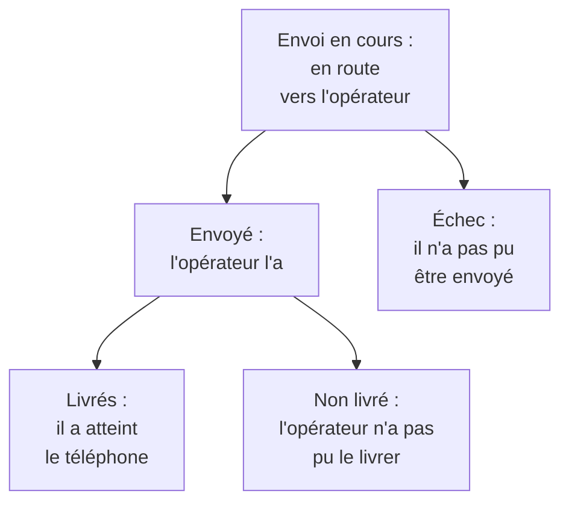

# Journaux de notification

Les journaux de notification listent chaque message que OneUptime a envoyé pour votre projet, un onglet par canal, et ce qu'il est devenu : s'il est parti, s'il est arrivé et, sinon, pourquoi. Ouvrez-les sous **Paramètres du projet → Notifications → Journaux de notification**, ou sous **Journaux de notification** sur un incident, une alerte, un événement de maintenance, une page de statut ou une politique d'astreinte, pour ce qui a été envoyé à son sujet.

:::cards
- [Lire un statut](#lire-un-statut): Sa couleur indique où en est le message, et le pointer indique ce qu'il signifie.
- [SMS](#sms): Envoi en cours, puis Envoyé, puis Livrés, selon ce que l'opérateur signale.
- [Appels](#appels): Appel en cours, puis la façon dont l'appel s'est terminé.
- [WhatsApp et Telegram](#whatsapp-et-telegram): Ce que chaque application signale après avoir pris un message.
- [E-mail, push, webhooks et espaces de travail](#e-mail-push-webhooks-et-espaces-de-travail): Succès, ou Erreur et pourquoi.
- [Quand un SMS reste Envoyé](#quand-un-sms-reste-envoyé): Les opérateurs qui ne répondent jamais, et les rapports qui n'arrivent jamais.
:::

## Lire un statut

Chaque statut est une pastille dont la couleur indique où en est le message :

| Couleur | Où en est le message |
| --- | --- |
| Gris | Transmis, et rien n'est encore revenu, comme **Envoi en cours**. |
| Bleu | Le fournisseur l'a, et doit encore dire comment il s'est terminé, comme **Envoyé** pour un SMS ou **Appel en cours** pour un appel. |
| Vert | Il a atteint la personne, comme **Livrés**, ou c'est le dernier statut qu'il aura. |
| Jaune | Il a atteint le téléphone et personne n'a répondu, comme **Appel manqué**, ou il est parti avec un avertissement. |
| Rouge | Il n'a pas atteint la personne, comme **Non livré**, **Échec**, **Erreur** ou **Solde insuffisant**. |

Pointez un statut, touchez-le ou atteignez-le avec la touche Tab : il indique ce qu'il signifie et ce qui vient ensuite. **Voir le message de statut**, dans le menu de la ligne, montre ce que le fournisseur a répondu, comme l'identifiant du message ou la raison de son échec. Le filtre **Statut** de chaque onglet liste tous les statuts que l'onglet peut afficher, dans l'ordre où un message les traverse.

## SMS

| Statut | Ce qu'il signifie |
| --- | --- |
| **Envoi en cours** | OneUptime a remis le SMS à Twilio, qui le transmet à l'opérateur. |
| **Envoyé** | L'opérateur a accepté le SMS. Il passe à **Livrés** ou **Non livré** dès que l'opérateur répond. |
| **Livrés** | L'opérateur a confirmé que le SMS a atteint le téléphone. C'est le dernier statut d'un SMS arrivé. |
| **Non livré** | L'opérateur n'a pas pu le livrer. **Code d'erreur** en donne la raison : `30003` est un téléphone éteint ou injoignable, `30005` un numéro qui n'existe pas, `30006` une ligne fixe, et `30007` un message que l'opérateur a filtré. |
| **Échec** | Twilio n'a pas pu l'envoyer. **Code d'erreur** en donne la raison. |
| **Erreur** | Il n'a pas été envoyé, par exemple parce que les SMS sont désactivés pour le projet, ou que Twilio a refusé le numéro. **Voir le message de statut** en donne la raison. |
| **Solde insuffisant** | Il n'a pas été envoyé : le solde du projet était insuffisant pour le payer. |
| **Succès** | Il a été envoyé avant que OneUptime ne suive la livraison, et Twilio l'a accepté. |

Un SMS que la passerelle SMS et appels du serveur a pris reste **Envoyé**, en vert : la passerelle ne signale pas la livraison, c'est donc son dernier statut.

Twilio signale chaque changement à OneUptime dès qu'il se produit, signé avec le jeton d'authentification du compte qui a envoyé le SMS, et OneUptime refuse tout rapport qui ne vient pas de Twilio. Pour cela, Twilio doit pouvoir joindre votre serveur : voir [Intégration Twilio](/docs/self-hosted/twilio-integration).

## Appels

| Statut | Ce qu'il signifie |
| --- | --- |
| **Appel en cours** | Twilio a passé l'appel. Le statut change dès que Twilio indique comment l'appel s'est terminé. |
| **Succès** | L'appel a été décroché, et **Voir le message de statut** indique sa durée. Un appel que la passerelle SMS et appels du serveur a pris est **Succès** dès que la passerelle l'accepte. |
| **Appel manqué** | L'appel a sonné sans réponse : personne n'a décroché. |
| **Occupé** | La ligne était occupée, ou l'appel a été refusé. |
| **Messagerie vocale** | La messagerie vocale a répondu à un appel d'astreinte. **Voir le message de statut** indique si un message a été laissé. |
| **Erreur** | L'appel n'a pas pu être passé ou connecté. |
| **Solde insuffisant** | Il n'a pas été passé : le solde du projet était insuffisant pour le payer. |

## WhatsApp et Telegram

Un message WhatsApp est **En file d'attente** pendant que OneUptime le transmet, **Envoyé** dès que WhatsApp l'accepte, **Livrés** dès qu'il atteint le téléphone, et **Lu** dès qu'il est ouvert, si la personne partage les confirmations de lecture. **Échec** est un message que WhatsApp n'a pas pu livrer, et **Avertissement** un message qu'il a envoyé avec un avertissement : **Voir le message de statut** indique ce que WhatsApp a signalé. **Erreur** et **Solde insuffisant** signifient qu'il n'a pas été envoyé, comme pour un SMS.

Telegram ne signale plus rien après avoir pris un message, donc le statut **Envoyé** d'un message Telegram est vert : Telegram l'a publié dans la conversation, et c'est son dernier statut.

## E-mail, push, webhooks et espaces de travail

Ces onglets indiquent **Succès** ou **Erreur**. **Succès** est le dernier statut : le serveur de messagerie a accepté l'e-mail, le service push a accepté la notification, l'adresse du webhook a répondu qu'elle avait pris la requête, ou l'espace de travail a fait ce qui était demandé. OneUptime ne suit plus un e-mail une fois que le serveur de messagerie l'a accepté, et une notification push passe à **Erreur** si le service push signale plus tard qu'elle n'a pas été livrée. **Voir le message de statut** indique pourquoi un message est en **Erreur**, comme **Motif** sur l'onglet **Espace de travail**.

## Quand un SMS reste Envoyé

**Envoyé** signifie que l'opérateur a le SMS et n'a pas encore répondu. La plupart des opérateurs répondent en quelques secondes ou minutes, mais certains ne le font jamais : Twilio garde alors lui aussi le SMS à `sent`, comme le montrent ses journaux de messages, et OneUptime ne peut pas savoir s'il est arrivé.

Un SMS qui reste **Envoi en cours** est une autre affaire : les rapports de Twilio n'atteignent pas OneUptime. Vérifiez que Twilio peut joindre votre serveur, et cherchez dans le journal du serveur les lignes qui commencent par `Twilio callback refused` : voir [Intégration Twilio](/docs/self-hosted/twilio-integration).

## Étapes suivantes

:::cards
- [Intégration Twilio](/docs/self-hosted/twilio-integration): Connecter Twilio, et laisser ses rapports de livraison atteindre OneUptime.
- [Passerelle SMS et appels](/docs/self-hosted/sms-and-call-gateway): Envoyer les SMS et les appels par une passerelle à vous.
- [Métriques de distribution des notifications](/docs/self-hosted/notification-delivery-metrics): Compter ce qui a été livré dans toute l'installation.
:::
