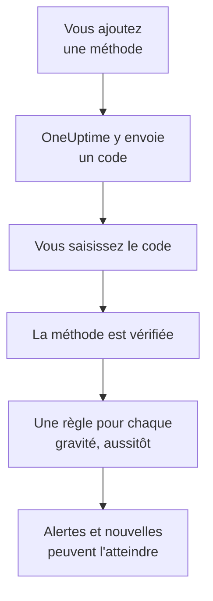

# Méthodes de notification

Une méthode de notification est une adresse à laquelle OneUptime peut vous joindre dans un projet : une adresse e-mail, un numéro de téléphone pour les SMS ou les appels, un numéro WhatsApp, un compte Telegram, votre compte Slack ou Microsoft Teams, un téléphone ou un navigateur pour les notifications push, ou un webhook. Vous les ajoutez dans **Paramètres utilisateur → Méthodes de notification**, vous les vérifiez, et OneUptime commence aussitôt à les utiliser pour vos alertes.

:::cards
- [Choisir une méthode](#choisir-une-méthode): Ce dont chaque méthode a besoin, et comment elle est vérifiée.
- [Ajouter et vérifier une méthode](#ajouter-et-vérifier-une-méthode): E-mail, SMS, appels et WhatsApp, avec un code à 6 chiffres.
- [Webhooks](#webhooks): Envoyez les alertes à votre propre point de terminaison, signées si vous le souhaitez.
- [Activer un canal pour votre projet](#activer-un-canal-pour-votre-projet): Pourquoi les SMS, les appels, WhatsApp ou Telegram peuvent manquer.
:::

## Comment une méthode devient active



Une méthode que vous n'avez pas vérifiée n'est jamais utilisée. Les appareils push, Slack, Microsoft Teams et les webhooks se passent de code : enregistrer un appareil ou lier votre compte prouve qu'il vous appartient, et un webhook n'a besoin d'aucune preuve. Vérifier une méthode ajoute aussitôt vos [règles par défaut](/docs/notifications/on-call-rules#les-règles-de-départ) pour elle, si bien qu'un nouveau numéro de téléphone vous alerte pour chaque gravité jusqu'à ce que vous changiez ses règles.

## Choisir une méthode

Chaque onglet des **Méthodes de notification** contient une ou plusieurs cartes, une par type de méthode :

| Carte | Onglet | Ce que vous ajoutez | Comment elle est vérifiée |
| --- | --- | --- | --- |
| **E-mails pour les notifications** | **Direct Contact** | Une adresse e-mail | Un code par e-mail |
| **Numéros de téléphone pour les notifications SMS** | **Direct Contact** | Un numéro de téléphone | Un code par SMS |
| **Numéros de téléphone pour les notifications par appel** | **Direct Contact** | Un numéro de téléphone | Un code lu lors d'un appel, ou aucun pour un numéro vérifié pour les SMS |
| **Numéros WhatsApp pour les notifications** | **Direct Contact** | Un numéro WhatsApp | Un code sur WhatsApp |
| **Comptes Telegram pour les notifications** | **Direct Contact** | Votre compte Telegram | Un message au bot OneUptime |
| **Slack Account for Notifications** | **Workspace Apps** | Votre compte Slack | Lier votre compte à l'espace de travail du projet |
| **Compte Microsoft Teams pour les notifications** | **Workspace Apps** | Votre compte Microsoft Teams | Lier votre compte à l'espace de travail du projet |
| **Appareils de notification push** | **Push Notifications** | Un téléphone avec l'application OneUptime On-Call, ou un navigateur | Enregistrer l'appareil |
| **Webhooks pour les notifications** | **Webhooks** | Un point de terminaison HTTPS à vous | Aucune |

**Workspace Apps** n'apparaît que si le projet a connecté Slack ou Microsoft Teams, et ne contient que ceux qu'il a connectés. Les SMS, les appels, WhatsApp et Telegram peuvent être désactivés pour tout le projet ; voir [Activer un canal pour votre projet](#activer-un-canal-pour-votre-projet).

## Ajouter et vérifier une méthode

Les adresses e-mail, les numéros SMS, les numéros d'appel et les numéros WhatsApp sont vérifiés avec un code à 6 chiffres.

:::steps
### Ouvrir vos méthodes

Allez dans **Paramètres utilisateur → Méthodes de notification**. **Direct Contact** est le premier onglet.

### Ajouter l'adresse

Dans la carte de la méthode, cliquez sur son bouton d'ajout, par exemple **Ajouter : Numéro de téléphone pour les notifications SMS**. Saisissez l'**E-mail**, ou le **Numéro de téléphone** au format international, par exemple `+11234567890`, et enregistrez.

### Saisir le code

La boîte de dialogue de vérification s'ouvre d'elle-même et indique où le code est parti et jusqu'à quand il est valable. Tapez le code dans **Code de vérification** et cliquez sur **Vérifier**.

### Contrôler la ligne

La ligne est maintenant marquée **Vérifié**. Vous avez fermé la boîte de dialogue trop tôt ? Cliquez sur **Vérifier** dans la ligne pour la rouvrir.
:::

- Un code est valable 15 minutes. Cinq essais erronés l'annulent, et il vous en faut un nouveau.
- **Send a new code**, ou **Call me with a new code** pour un numéro d'appel, se trouve dans la boîte de dialogue. Vous pouvez en demander un une minute après le précédent.
- Un numéro vérifié pour les SMS l'est aussi pour les appels. L'ajouter sous **Numéros de téléphone pour les notifications par appel** ne demande pas de code, et vérifier un numéro SMS vérifie aussi le numéro d'appel que vous avez ajouté pour lui.
- Votre e-mail de connexion est déjà là, vérifié, depuis le jour où vous avez rejoint le projet.

## Lier Telegram

:::steps
### Ajouter le compte

Dans **Comptes Telegram pour les notifications**, cliquez sur **Ajouter : Compte Telegram**. **Identifiant Telegram (facultatif)** n'est qu'une étiquette pour vous, et peut rester vide.

### Écrire au bot

Cliquez sur **Vérifier** dans la nouvelle ligne. La boîte de dialogue **Vérifier le compte Telegram** vous propose trois façons de joindre le bot OneUptime : scanner le code QR avec votre téléphone, cliquer sur **Ouvrir dans Telegram**, ou chercher le bot dans Telegram et lui envoyer la commande `/start` que la boîte de dialogue affiche.

### Confirmer

De retour dans OneUptime, cliquez sur **J'ai envoyé le message — vérifier**. Dès que le bot a reçu votre message, le compte est vérifié.
:::

**Faire pivoter le code** crée un nouveau code pour un compte qui n'est pas encore vérifié. Le code QR et le lien ouverts auparavant ne fonctionnent plus. Sur un OneUptime auto-hébergé, l'admin du serveur connecte un bot Telegram avant que quiconque puisse lier un compte.

## Slack et Microsoft Teams

1. Liez votre propre compte à l'espace de travail du projet : **Paramètres utilisateur → Espace de travail → Slack**, ou **Microsoft Teams**. Voir [Slack](/docs/workspace-connections/slack) et [Microsoft Teams](/docs/workspace-connections/microsoft-teams).
2. Dans l'onglet **Workspace Apps**, cliquez sur **Ajouter un compte Slack** ou **Ajouter un compte Microsoft Teams**. Le compte est vérifié dès qu'il est ajouté.
3. Cliquez sur **Send Test Message** dans sa ligne. Les alertes arrivent en messages directs de l'application OneUptime.

## Notifications push

L'onglet **Push Notifications** liste vos **Appareils de notification push**.

- **Un téléphone.** Installez l'application OneUptime On-Call, connectez-la à votre OneUptime, connectez-vous et autorisez les notifications : le téléphone s'ajoute lui-même à cette liste. Voir [Vue d'ensemble des applications](/docs/mobile-desktop-apps/index).
- **Ce navigateur.** Cliquez sur **Enregistrer l'appareil**, renseignez un **Nom de l'appareil**, et autorisez les notifications quand le navigateur le demande.
- **Notification de test** dans la ligne d'un appareil lui envoie une notification push tout de suite.
- **Alertes critiques** indique si les alertes du téléphone passent outre le mode silencieux et Ne pas déranger. Cela s'active dans l'application, jamais ici, et un navigateur ne peut pas le faire. Voir [Alertes d'astreinte critiques](/docs/self-hosted/push-notifications#alertes-dastreinte-critiques-outrepasser-le-mode-silencieux).
- Un appareil marqué **Ne reçoit pas de notifications** ne reçoit plus rien. Ouvrez l'application sur ce téléphone, ou enregistrez de nouveau le navigateur, et il revient.

## Webhooks

Un webhook envoie chaque alerte en JSON à un point de terminaison HTTPS à vous, pour qu'un outil à vous puisse agir.

:::steps
### Ajouter le webhook

Dans l'onglet **Webhooks**, cliquez sur **Ajouter : Webhook**. Renseignez un **Nom** que vous reconnaîtrez, l'**URL du webhook**, et un **Secret de signature (facultatif)**.

### Envoyer un test

Cliquez sur **Envoyer le test** dans sa ligne. Votre point de terminaison reçoit un événement dont l'`eventType` est `test`.

### Vérifier ce qui arrive

Une alerte est un `POST` JSON comme celui ci-dessous. Répondez avec n'importe quel statut `2xx` en moins de 10 secondes ; les redirections ne sont pas suivies.
:::

```json title="A page, as your endpoint receives it"
{
  "eventType": "on-call.incident.created",
  "timestamp": "2026-10-15T09:30:00.000Z",
  "projectId": "6a3f0d2e-1c4b-4e8a-9b7d-2f5c8e1a0b3c",
  "userId": "0c9e8d7f-6b5a-4c3d-8e2f-1a0b9c8d7e6f",
  "incident": {
    "id": "5b4a3c2d-1e0f-4a9b-8c7d-6e5f4a3b2c1d",
    "title": "Checkout API is down",
    "description": "Health check failed from 3 probes.",
    "incidentNumber": 42,
    "incidentNumberWithPrefix": "INC-42",
    "severity": "Critical Incident",
    "state": "Identified"
  },
  "onCallPolicyId": "7d6c5b4a-3e2f-4d1c-9b8a-7f6e5d4c3b2a",
  "onCallPolicyEscalationRuleId": "8e7d6c5b-4a3f-4e2d-8c1b-9a8f7e6d5c4b"
}
```

| `eventType` | Envoyé pour | La clé de l'élément |
| --- | --- | --- |
| `on-call.incident.created` | Un incident | `incident` |
| `on-call.alert.created` | Une alerte | `alert` |
| `on-call.incidentEpisode.created` | Un épisode d'incident | `incidentEpisode` |
| `on-call.alertEpisode.created` | Un épisode d'alerte | `alertEpisode` |

Les nouvelles que vous activez pour Webhook dans les **Paramètres de notification** arrivent au même point de terminaison, avec l'événement du paramètre dans `eventType` et un court résumé dans `subject` et `message`.

Chaque requête porte `X-OneUptime-Event`, le type d'événement. Avec un secret de signature, elle porte aussi `X-OneUptime-Signature` : `sha256=` suivi du HMAC-SHA256 du corps brut, en hexadécimal. Vérifiez-le avant de faire confiance à la requête :

```javascript title="verify-signature.js"
const crypto = require("crypto");

// rawBody: the request body exactly as it arrived, before any JSON parsing.
function isFromOneUptime(rawBody, signatureHeader, secret) {
  const expected =
    "sha256=" + crypto.createHmac("sha256", secret).update(rawBody).digest("hex");
  const received = Buffer.from(signatureHeader || "");
  const wanted = Buffer.from(expected);
  return received.length === wanted.length && crypto.timingSafeEqual(received, wanted);
}
```

Un webhook n'a pas besoin de vérification, donc l'ajouter ajoute aussitôt ses règles. Les adresses privées et internes sont refusées, sauf si l'admin d'un serveur auto-hébergé les autorise : voir [Accès au réseau privé](/docs/self-hosted/private-network-access#webhooks-et-workflows).

## Activer un canal pour votre projet

**SMS**, **Appels téléphoniques**, **WhatsApp** et **Telegram** sont désactivés dans chaque nouveau projet, car chaque message coûte de l'argent : sur OneUptime Cloud, il est payé sur le solde du projet, et les SMS et les appels passent plutôt par le compte Twilio du projet quand son compte par défaut les envoie. L'e-mail, le push, Slack, Microsoft Teams et les webhooks sont toujours activés.

Tant qu'un canal est désactivé, personne dans le projet ne peut y ajouter de méthode : sa carte n'a pas de bouton d'ajout et indique qui peut l'activer. Un propriétaire du projet, un **Administrateur de la facturation** ou une personne disposant de **Manage Billing** l'active, dans la carte **Canaux de notification** de **Paramètres du projet → Notifications → Paramètres de notification**. Un admin du projet ne le peut pas. Sur un OneUptime auto-hébergé, les SMS et les appels nécessitent aussi un compte Twilio, et Telegram un bot que l'admin du serveur connecte ; voir [Intégration Twilio](/docs/self-hosted/twilio-integration).

## Supprimer une méthode

Cliquez sur **Supprimer** dans la ligne de la méthode. Supprimer une méthode supprime chaque règle d'astreinte qui l'utilise, donc la boîte de dialogue compte d'abord ces règles et nomme toute gravité que la suppression laisserait sans aucune règle.

## Dépannage

:::details Une carte n'a pas de bouton d'ajout
Ce canal est désactivé dans ce projet. La carte indique qui peut l'activer ; voir [Activer un canal pour votre projet](#activer-un-canal-pour-votre-projet).
:::

:::details Le code n'est jamais arrivé
Les e-mails peuvent prendre quelques minutes, et arrivent parfois dans les spams ; les SMS peuvent prendre une minute. Attendez une minute, puis cliquez sur **Send a new code** dans la boîte de dialogue. **Paramètres du projet → Notifications → Journaux de notification** montre ce qu'il est advenu du message.
:::

:::details L'ajout de mon compte Slack échoue
Liez d'abord votre compte dans **Paramètres utilisateur → Espace de travail → Slack**, puis cliquez de nouveau sur **Ajouter un compte Slack**. La boîte de dialogue d'erreur a un bouton qui vous y emmène.
:::

:::details Mon téléphone ne reçoit pas de notifications push
Vérifiez que le téléphone figure sous **Appareils de notification push**, et envoyez-lui une **Notification de test**. Voir [FAQ et dépannage](/docs/mobile-desktop-apps/faq-troubleshooting#notifications).
:::

## Étapes suivantes

:::cards
- [Règles d'astreinte personnelles](/docs/notifications/on-call-rules): Décidez quelle méthode chaque alerte essaie, et quand.
- [Paramètres de notification](/docs/notifications/notification-settings): Choisissez les nouvelles dont vous êtes informé, et par quels canaux.
- [Vue d'ensemble des applications](/docs/mobile-desktop-apps/index): Recevez les alertes sur votre téléphone ou votre ordinateur.
- [Comment OneUptime vous joint](/docs/notifications/index): Comment les méthodes, les règles et les paramètres s'articulent.
:::
