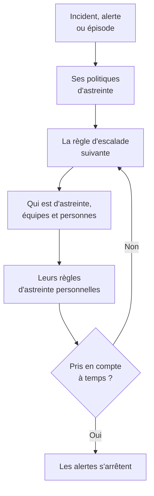

# Vue d'ensemble de l'astreinte

L'astreinte, c'est la façon dont OneUptime amène quelqu'un sur un problème, à toute heure. Quand un incident, une alerte ou un épisode a besoin de quelqu'un, ses politiques d'astreinte alertent des personnes niveau par niveau jusqu'à ce que quelqu'un prenne en compte, et chaque personne est jointe comme elle l'a choisi : notification push, SMS, appel, e-mail ou message de chat. Cette page montre comment les éléments s'articulent et où se trouve chacun d'eux.

:::cards
- [Comment une alerte joint quelqu'un](#comment-une-alerte-joint-quelquun): D'un nouvel incident à la personne qui répond.
- [Les éléments de base](#les-éléments-de-base): Politiques, règles d'escalade, plannings, remplacements et règles personnelles.
- [Mettre en place l'astreinte](#mettre-en-place-lastreinte): De zéro à une équipe alertée, en cinq étapes.
- [Où se trouve l'astreinte](#où-se-trouve-lastreinte): Le menu Astreinte, section par section.
:::

## Comment une alerte joint quelqu'un

1. Un nouvel incident, une nouvelle alerte ou un nouvel épisode exécute aussitôt ses politiques d'astreinte : celles choisies sur lui, et celles qu'ajoutent ses règles d'astreinte. Chaque politique s'exécute de son côté. Une règle d'astreinte réglée sur **Uniquement pendant les heures ouvrées** fait attendre les politiques qu'elle ajoute jusqu'au début de ces heures.
2. La première règle d'escalade d'une politique alerte tout de suite : qui est d'astreinte en ce moment dans ses plannings, chaque membre de ses équipes et les personnes qu'elle nomme.
3. Si l'une d'elles est absente, un remplacement d'utilisateur envoie son alerte à la personne qui la remplace, ou la saute.
4. Chaque personne est jointe selon ses règles d'astreinte personnelles : quelle méthode est essayée, et au bout de combien de temps. Une alerte sans règle la joint quand même sur les méthodes qu'elle a vérifiées.
5. Si personne ne prend en compte avant la fin de l'attente de la règle, la règle suivante alerte. Après la dernière, la politique recommence si elle se répète, et sinon s'arrête.

Prendre en compte ou résoudre l'incident, l'alerte ou l'épisode arrête toute politique qui alerte encore pour lui. OneUptime fait avancer les politiques en cours chaque minute et consigne chaque exécution, règle par règle, dans les **Journaux d'exécution**.

La première fois qu'une alerte joint quelqu'un, OneUptime l'enregistre sur l'incident, l'alerte ou l'épisode sous `First Paged At`. Une mesure peut compter à partir de ce moment : **Délai de prise en compte après l'alerte** chronomètre le temps que les personnes ont mis à répondre une fois alertées, et non le temps d'attente avant que quiconque le soit. Voir [Délai de prise en compte après l'alerte](/docs/incidents/settings#délai-de-prise-en-compte-après-lalerte).

> [!NOTE]
> Un incident, une alerte ou un épisode créé déjà pris en compte ou résolu n'exécute aucune de ses politiques, et son fil d'activité l'indique. Voir [Créée déjà prise en compte ou résolue](/docs/alerts/index#créée-déjà-prise-en-compte-ou-résolue).

## Les éléments de base

| Élément | Ce qu'il décide | En savoir plus |
| --- | --- | --- |
| Politique d'astreinte | Qui est alerté pour un incident ou une alerte, niveau par niveau | [Politiques d'astreinte](/docs/on-call/policies) |
| Règle d'escalade | Un niveau d'une politique : qui il alerte, et combien de temps il attend une prise en compte | [Règles d'escalade](/docs/on-call/escalation-rules) |
| Planning d'astreinte | Qui est d'astreinte à chaque instant, à tour de rôle | [Plannings d'astreinte](/docs/on-call/schedules) |
| Remplacement d'utilisateur | Qui remplace quelqu'un pendant son absence | [Remplacements d'utilisateur](/docs/on-call/user-overrides) |
| Règles d'astreinte personnelles | Comment une personne est jointe : par quelle méthode, et au bout de combien de temps | [Règles d'astreinte personnelles](/docs/notifications/on-call-rules) |
| Politique d'appels entrants | Un numéro de téléphone qui fait sonner la personne d'astreinte | [Politique d'appels entrants](/docs/on-call/incoming-call-policy) |

Les politiques, les règles d'escalade, les plannings et les remplacements appartiennent au projet, sous **Astreinte**. Les méthodes de notification et les règles d'astreinte personnelles appartiennent à chaque personne, sous **Paramètres utilisateur** : un administrateur peut consulter la configuration de quelqu'un, mais seule cette personne peut vérifier son téléphone ou son e-mail. Voir [Comment OneUptime vous joint](/docs/notifications/index).

## Mettre en place l'astreinte

:::steps
### Créer un planning

Ouvrez **Astreinte** depuis le menu **Produits** et allez dans **Plannings d'astreinte**. Cliquez sur **Créer un planning d'astreinte**, donnez-lui un nom et, sous **Qui assure l'astreinte à tour de rôle ?**, choisissez les personnes dans l'ordre où elles se relaient. Voir [Plannings d'astreinte](/docs/on-call/schedules).

### Créer une politique

Allez dans **Politiques d'astreinte** et cliquez sur **Créer : Politique d'astreinte**. Sous **Qui est alerté en premier ?**, choisissez le planning. Il devient la première règle d'escalade de la politique, **Level 1**, qui attend 30 minutes une prise en compte.

### Ajouter les niveaux suivants

Sur la page **Règles d'escalade** de la politique, cliquez sur **Ajouter une règle d'escalade** pour chaque niveau après le premier : la personne suivante de la rotation du même planning, un responsable d'équipe, un manager. Voir [Règles d'escalade](/docs/on-call/escalation-rules).

### Exécuter la politique automatiquement

La première politique d'un projet peut le faire dès sa création : laissez **La déclencher pour chaque nouvel incident et chaque nouvelle alerte** activé. Pour toute autre politique, allez dans **Incidents → Règles → Règles d'astreinte** ou **Alertes → Règles → Règles d'astreinte** et ajoutez une règle qui l'exécute pour les incidents ou les alertes qu'elle cible, par exemple chaque incident critique. Voir [Ce qui exécute une politique](/docs/on-call/policies#ce-qui-exécute-une-politique).

### Vérifier que tout le monde est joignable

Ouvrez **Astreinte → Disponibilité**. Chaque personne que vos politiques peuvent alerter y figure comme **Prêt**, **À configurer** ou **Injoignable**, avec ce qui manque. Voir [Disponibilité et rapports](/docs/on-call/readiness).
:::

> [!NOTE]
> Sur OneUptime Cloud, les politiques d'astreinte et les règles d'escalade sont incluses dans toutes les offres. Les plannings d'astreinte, les remplacements d'utilisateur, les journaux d'exécution et le rapport sur le temps d'astreinte nécessitent l'offre **Growth**.

## Où se trouve l'astreinte

Ouvrez **Astreinte** depuis le menu **Produits** de la barre supérieure. Il s'ouvre sur **Politiques d'astreinte**, à l'adresse `/dashboard/{projectId}/on-call-duty/policies`, et son menu latéral contient le reste :

| Section | Pages |
| --- | --- |
| **Politiques** | **Politiques d'astreinte** et **Disponibilité** : qui vos politiques peuvent réellement joindre |
| **Plannings** | **Plannings d'astreinte**, **Chronologie des astreintes** et **Flux de calendrier** |
| **Appels entrants** | **Politiques d'appels entrants** : un numéro de téléphone qui fait sonner la personne d'astreinte |
| **Avancé** | **Remplacements d'utilisateur**, **Journaux d'exécution** et **Politiques archivées** |
| **Rapports** | **Temps d'astreinte de l'utilisateur** : combien de temps chaque personne a été d'astreinte |
| **Espace de travail** | **Slack** et **Microsoft Teams** : des règles qui publient les événements d'astreinte dans un canal |
| **Paramètres** | **Champs personnalisés**, **Règles d'étiquettes** et **Règles de propriétaire** |
| **Développeurs** | **Terraform**, **API** et **Assistants IA** : l'astreinte configurée par le code |

**Politiques**, **Plannings** et **Appels entrants** sont ouvertes ; les autres sections démarrent repliées, et une section s'ouvre d'elle-même quand vous êtes sur l'une de ses pages. **Espace de travail** liste les outils de chat que le projet a connectés, ou **Connecter Slack ou Teams** s'il n'en a aucun.

Quand vous êtes d'astreinte pour une politique, la cloche en haut à droite l'indique. Cliquez dessus pour ouvrir **Mes politiques d'astreinte** : chaque politique pour laquelle vous êtes d'astreinte, dans tous vos projets, et si vous y êtes nommé, dans une équipe ou dans un planning.

## Dépannage

:::details Personne n'a été alerté pour un nouvel incident
Ouvrez la page **Exécutions d'astreinte** de l'incident. Si elle est vide, l'incident n'avait aucune politique d'astreinte : aucune n'a été choisie sur lui, et aucune règle d'astreinte ne lui correspondait. Une exécution à l'état **Execution Completed - No One Notified** a parcouru chaque règle d'escalade sans trouver personne : en général un planning où personne n'est d'astreinte. Voir [Journaux d'exécution](/docs/on-call/policies#journaux-dexécution). Une exécution **En attente** attend les heures ouvrées, pour une règle d'astreinte réglée sur **Uniquement pendant les heures ouvrées**, et n'alerte personne avant qu'elles commencent.
:::

:::details Quelqu'un a été alerté sur le mauvais canal, ou pas du tout
Ouvrez **Astreinte → Disponibilité** et cliquez sur **Couverture** sur sa ligne. Vous y voyez les méthodes que la personne a vérifiées et chaque gravité pour laquelle elle n'a pas de règle. Elle seule peut corriger cela, sous **Paramètres utilisateur** : envoyez-lui un rappel de configuration depuis la même page. Voir [Disponibilité et rapports](/docs/on-call/readiness). Sur OneUptime Cloud, un téléphone qui bloque les appels inconnus peut faire taire une alerte : ajoutez [les numéros de OneUptime](/docs/on-call/phone-number-whitelist) à sa liste d'autorisation.
:::

:::details Une personne en congé est toujours alertée
Ajoutez un remplacement d'utilisateur avec elle sous **Qui est absent ?**. Un remplacement sous **Astreinte → Avancé → Remplacements d'utilisateur** couvre toutes les politiques ; un remplacement sur la page **Remplacements d'utilisateur** d'une politique ne couvre que cette politique. Voir [Remplacements d'utilisateur](/docs/on-call/user-overrides).
:::

## Étapes suivantes

:::cards
- [Politiques d'astreinte](/docs/on-call/policies): Créer une politique, décider de ce qui l'exécute et lire ce qu'elle a fait.
- [Règles d'escalade](/docs/on-call/escalation-rules): Alerter niveau par niveau jusqu'à ce que quelqu'un réponde.
- [Plannings d'astreinte](/docs/on-call/schedules): Rotations, couches et passations.
- [Comment OneUptime vous joint](/docs/notifications/index): Les méthodes et les règles qui décident comment chaque personne est jointe.
:::
