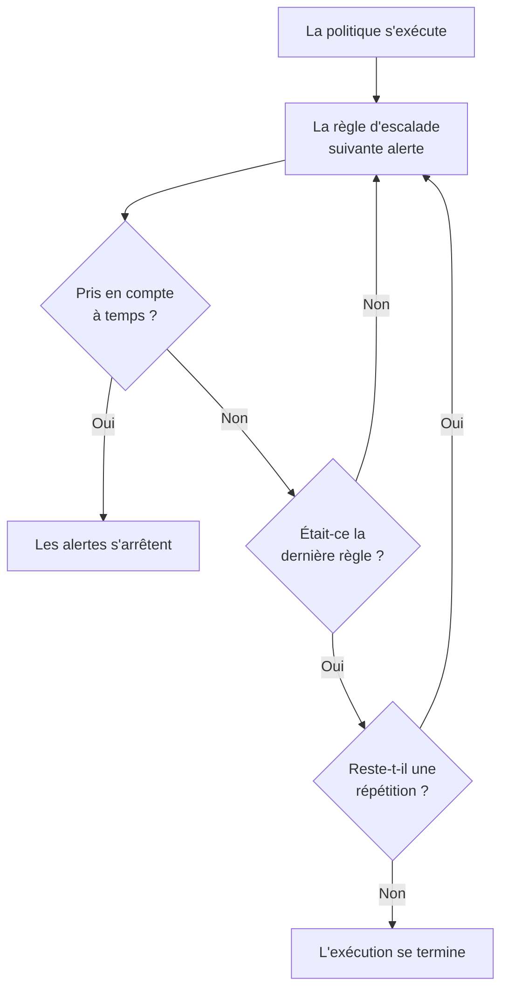

# Politiques d'astreinte

Une politique d'astreinte décide qui est alerté pour un incident ou une alerte, et qui vient ensuite si personne ne prend en compte. Ses règles d'escalade sont ses niveaux, et ce sont les incidents, les alertes et les épisodes qui l'utilisent qui l'exécutent. Cette page explique comment créer une politique, ce qui l'exécute, ce que montrent ses pages et comment chaque exécution est consignée.

:::cards
- [Créer une politique](#créer-une-politique): Un nom, et qui est alerté en premier.
- [Ce qui exécute une politique](#ce-qui-exécute-une-politique): Règles, modèles, moniteurs, chat et vous-même.
- [Journaux d'exécution](#journaux-dexécution): Chaque exécution, règle par règle, et pourquoi elle s'est arrêtée.
- [Archiver ou supprimer une politique](#archiver-ou-supprimer-une-politique): Retirer une politique du service.
:::

## Créer une politique

:::steps
1. Allez dans **Astreinte → Politiques d'astreinte** et cliquez sur **Créer : Politique d'astreinte**.
2. Saisissez un **Nom**, par exemple « Paiements principal ».
3. Sous **Qui est alerté en premier ?**, cliquez sur **Ajouter un intervenant** et choisissez les plannings d'astreinte, les équipes et les personnes à alerter en premier.
4. Cliquez sur **Créer : Politique d'astreinte**. La politique s'ouvre sur sa page **Règles d'escalade**, avec **Level 1** déjà en place.
:::

**Qui est alerté en premier ?** est facultatif, et n'est demandé qu'aux personnes autorisées à ajouter des règles d'escalade : laissé vide, la politique n'alerte personne tant qu'elle n'a pas de règle. **Description** et **Étiquettes** attendent sous **Plus de champs**. Pour ajouter les niveaux suivants, voir [Règles d'escalade](/docs/on-call/escalation-rules).

La liste **Politiques d'astreinte** affiche pour chaque politique **Nom**, **Description**, **Étiquettes** et **Propriétaires**. Sélectionnez des politiques pour **Ajouter des étiquettes**, **Retirer des étiquettes**, **Ajouter un propriétaire**, **Retirer un propriétaire**, **Archiver**, **Exporter en JSON** ou pour les supprimer. **Importer du JSON** crée des politiques à partir d'un export : un export contient les réglages propres à une politique, pas ses règles d'escalade ni ses propriétaires.

## Ce qui exécute une politique

Une politique n'alerte personne tant que rien ne l'exécute. Chaque incident, alerte et épisode exécute les politiques qu'il porte dès sa création :

| Quoi | Comment la politique est ajoutée | En savoir plus |
| --- | --- | --- |
| L'enregistrement lui-même | Le champ **Politique d'astreinte** à la création d'un incident ou d'une alerte, un modèle d'incident, ou la section repliée **Astreinte** des critères d'un moniteur | [Déclarer un incident](/docs/incidents/declaring-incidents) |
| Règles d'astreinte | **Incidents → Règles → Règles d'astreinte** et **Alertes → Règles → Règles d'astreinte** ajoutent les politiques de chaque règle qui correspond | [Règles d'astreinte des incidents](/docs/incidents/settings#règles-dastreinte-des-incidents) |
| Règles de regroupement | Une règle de regroupement exécute ses politiques quand elle ouvre un épisode | [Épisodes d'alertes et règles de regroupement](/docs/alerts/episodes) |
| À la main | **Exécuter la politique d'astreinte**, dans le menu **Actions** d'un fil d'activité, ou sur un message Slack ou Microsoft Teams | [Le fil d'activité de l'incident](/docs/incidents/notes-owners-and-feed#le-fil-dactivité-de-lincident) |
| Chat et workflows | `/oneuptime page` dans Slack ou Microsoft Teams, et l'étape **Page an On-Call Policy** d'un workflow | [Paging](/docs/workflows/components#paging) |

Une politique que plusieurs règles ajoutent ne s'exécute qu'une fois. Une gravité n'exécute jamais une politique à elle seule : c'est une règle d'astreinte correspondant à cette gravité qui le fait. Un incident ou une alerte créé déjà pris en compte ou résolu n'exécute aucune de ses politiques. Une règle d'astreinte réglée sur **Uniquement pendant les heures ouvrées** fait attendre les politiques qu'elle ajoute jusqu'au début de ces heures.

## Les pages d'une politique

Ouvrez une politique depuis la liste. Son menu latéral contient tout ce qui la concerne :

| Section | Pages |
| --- | --- |
| **Basique** | **Vue d'ensemble**, **Règles d'escalade** et **Propriétaires** |
| **Journaux** | **Journaux d'exécution** et **Journaux de notification** |
| **Développeurs** | **Terraform**, **API** et **Assistants IA** |
| **Avancé** | **Remplacements d'utilisateur**, **Champs personnalisés**, **Paramètres**, **Journaux d'audit** et **Supprimer la politique** |

**Basique** est ouverte ; les autres sections démarrent repliées jusqu'à ce que vous cliquiez dessus.

- **Vue d'ensemble** affiche les **Détails de la politique d'astreinte**, puis **La politique en un coup d'œil** : combien de niveaux et d'intervenants a la politique, combien de temps avant son dernier niveau et combien de fois elle se répète. **Préparation des intervenants** indique si chaque personne qu'elle peut alerter est joignable maintenant, et **Fil d'activité de la politique d'astreinte** liste ce qui a changé : personnes, équipes et plannings ajoutés ou retirés, remplacements et passations.
- Les **Propriétaires** sont les personnes et les équipes responsables de la politique. Quand une alerte qu'elle envoie ne trouve pas de règle pour quelqu'un, ou ne peut pas être remise, ils reçoivent un e-mail ; une politique sans propriétaires écrit à la place aux propriétaires du projet.
- **Journaux de notification** liste chaque message envoyé par la politique, avec un onglet par canal.
- **Remplacements d'utilisateur** remplace des personnes dans cette seule politique. Voir [Remplacements d'utilisateur](/docs/on-call/user-overrides).
- **Paramètres** contient **Exporter : Politique d'astreinte** et la carte qui archive la politique.

## Répéter une politique

Quand l'attente du dernier niveau se termine sans que personne ne prenne en compte, une politique s'arrête, sauf si elle se répète. Pour choisir, ouvrez la page **Règles d'escalade** de la politique et cliquez sur **Modifier** sur la carte **Politique de répétition** sous les règles. **Modifier la politique de répétition** demande **Si personne ne prend en compte après le dernier niveau** :

| Réponse | Ce qu'elle fait |
| --- | --- |
| **Arrêter les alertes** | Personne n'est alerté de nouveau : la politique s'exécute une seule fois. Une nouvelle politique commence avec cette réponse. |
| **Recommencer depuis Level 1** | Chaque niveau est alerté de nouveau, dans l'ordre. **Combien de fois de plus ?** indique combien de fois : 1 ou plus. |

Une politique qui recommence trois fois de plus parcourt ses niveaux quatre fois au total. La ligne **Après le dernier niveau** de la carte dit ce que fait la politique, et **La politique en un coup d'œil** sur la **Vue d'ensemble** dit la même chose en toutes lettres.

## Alerter de nouveau si ce n'est pas résolu

La prise en compte arrête définitivement les alertes d'une politique, même si personne ne résout ensuite l'incident ou l'alerte. Une politique peut plutôt alerter de nouveau : ouvrez sa page **Règles d'escalade**, ouvrez **Plus de paramètres** en bas, puis cliquez sur **Modifier** sur la carte **Délai après prise en compte**. **Modifier le délai après prise en compte** demande **S'il est pris en compte mais pas résolu** :

| Réponse | Ce qu'elle fait |
| --- | --- |
| **Ne pas alerter de nouveau** | La prise en compte arrête définitivement les alertes. Une nouvelle politique commence avec cette réponse. |
| **Alerter de nouveau** | Alerte la personne qui l'a pris en compte et la personne d'astreinte maintenant. **Après combien de minutes ?** indique quand : de 5 à 1440, 30 au départ. |

Les minutes sont comptées à partir de chaque prise en compte, et une politique alerte de nouveau au plus 5 fois pour un même incident, une même alerte ou un même épisode. Une nouvelle alerte commence au niveau qui alertait lors de la prise en compte, alerte la personne d'astreinte à ce niveau maintenant, puis parcourt les niveaux comme la première exécution. L'incident ou l'alerte reste pris en compte : la nouvelle alerte est une exécution à part, dans son fil d'activité et dans les journaux d'exécution de la politique, où son **Statut** indique « Alerté de nouveau (1 sur 5) ».

La personne alertée de nouveau la prend en compte depuis son message, ou avec **Prendre en compte de nouveau** sur la page de l'incident ou de l'alerte, et les minutes recommencent ; **Escalader** la passe au niveau suivant. Résoudre ou supprimer l'incident ou l'alerte, archiver ou supprimer la politique, ou choisir **Ne pas alerter de nouveau** l'arrête. La ligne **Après une prise en compte** de la carte dit ce que fait la politique, et **Plus de paramètres** affiche les minutes tant qu'il est replié. **La politique en un coup d'œil** sur la **Vue d'ensemble** et le **Résumé de l'escalade** disent la même chose en toutes lettres.

## Journaux d'exécution

Chaque fois qu'une politique s'exécute, elle écrit un journal d'exécution, et ce journal passe par ses statuts au fil de l'exécution :

| Statut | Ce qu'il signifie |
| --- | --- |
| **En attente** | Une règle d'astreinte réglée sur **Uniquement pendant les heures ouvrées** fait attendre l'exécution jusqu'au début de ces heures : elle indique quand les alertes commencent, et n'alerte personne d'ici là. Elle se termine sans alerter si l'incident ou l'alerte est pris en compte ou résolu avant. Elle commence aussitôt à alerter si l'incident ou l'alerte change et correspond désormais à une règle d'astreinte qui alerte immédiatement. |
| **Planifié**, **Démarrée** | L'exécution est en préparation. Une exécution encore là après 5 minutes est arrêtée en **Erreur**. |
| **Executing** | L'exécution alerte. OneUptime la fait avancer chaque minute. |
| **Execution Completed** | Quelqu'un a pris en compte, l'incident ou l'alerte a été résolu, chaque règle et chaque répétition ont été utilisées, ou la politique a été archivée. |
| **Execution Completed - No One Notified** | L'exécution a parcouru chaque règle sans alerter personne : en général un planning où personne n'est d'astreinte. |
| **Erreur** | L'exécution a échoué. **Voir le message de statut** indique pourquoi. |

Vous trouvez les journaux d'exécution à trois endroits :

- dans les propres **Journaux d'exécution** de la politique, sous **Journaux** ;
- dans **Astreinte → Avancé → Journaux d'exécution**, pour toutes les politiques, où les appels directs venus des workflows et du chat apparaissent comme **Appel direct** ;
- sur la page **Exécutions d'astreinte** d'un incident ou d'une alerte.

Chaque ligne montre ce qui a déclenché l'exécution, quand, son **Statut** et qui l'a prise en compte. **Voir la chronologie** ouvre sa **Chronologie d'exécution** : chaque règle d'escalade, qui elle a alerté, par quel planning, et comment chaque alerte s'est terminée. Un planning où personne n'est d'astreinte affiche **Personne n'était d'astreinte** au lieu d'une personne. Sur OneUptime Cloud, les journaux d'exécution nécessitent l'offre **Growth**.

## Archiver ou supprimer une politique

Archiver retire une politique du service et conserve tout : ouvrez les **Paramètres** de la politique et cliquez sur **Archiver** sur sa carte d'archivage, ou sélectionnez des politiques dans la liste et choisissez **Archiver**.

- Une politique archivée n'alerte personne. Les incidents et les alertes qui l'utilisent la sautent, et une exécution encore en escalade s'arrête à son étape suivante.
- Elle quitte la liste **Politiques d'astreinte** pour **Astreinte → Avancé → Politiques archivées**, où **Désarchiver** la remet en service.

**Supprimer la politique**, sous **Avancé**, supprime la politique avec ses règles d'escalade et ses remplacements d'utilisateur. La suppression depuis la liste demande d'abord confirmation et propose d'archiver à la place.

## Qui peut modifier une politique

**Propriétaire du projet**, **Administrateur du projet**, **Membre du projet**, **Administrateur des astreintes** et **Membre des astreintes** peuvent créer, modifier et supprimer des politiques ; **Lecteur** et **Lecteur des astreintes** peuvent les consulter. Dans un rôle personnalisé, les permissions sont **Create On-Call Duty Policy**, **Edit On-Call Duty Policy**, **Delete On-Call Duty Policy** et **Read On-Call Duty Policy**, et un rôle limité à certaines étiquettes n'atteint que les politiques qui les portent. Ajouter des propriétaires et des champs personnalisés nécessite l'offre **Growth** sur OneUptime Cloud.

## API et Terraform

Les politiques d'astreinte sont la ressource `/api/on-call-duty-policy`, et la ressource `oneuptime_on_call_policy` dans Terraform :

| Réglage | Champ de l'API |
| --- | --- |
| **Nom** | `name` |
| **Description** | `description` |
| **Si personne ne prend en compte après le dernier niveau** | `repeatPolicyIfNoOneAcknowledges` |
| **Combien de fois de plus ?** | `repeatPolicyIfNoOneAcknowledgesNoOfTimes` |
| **Après combien de minutes ?** | `acknowledgementTimeoutInMinutes` |
| Archivée | `isArchived` |

`repeatPolicyIfNoOneAcknowledges` vaut `false` pour **Arrêter les alertes** et `true` pour **Recommencer depuis Level 1**. À `true` avec `repeatPolicyIfNoOneAcknowledgesNoOfTimes` à `0`, une politique ne se répète jamais, et le tableau de bord l'affiche comme **Arrêter les alertes**.

`acknowledgementTimeoutInMinutes` vaut `null` pour **Ne pas alerter de nouveau**, et un nombre entier de minutes de 5 à 1440 pour **Alerter de nouveau**. OneUptime refuse toute autre valeur.

Pour créer une politique avec son premier niveau en une seule requête, voir [Créer des règles avec l'API ou Terraform](/docs/on-call/escalation-rules#créer-des-règles-avec-lapi-ou-terraform).

## Dépannage

:::details Une politique s'est exécutée, mais personne n'a été alerté
Son exécution indique **Execution Completed - No One Notified**. Ouvrez **Voir la chronologie** : une ligne **Personne n'était d'astreinte** désigne un planning avec un trou, et le message de statut d'une ligne **Ignoré** dit pourquoi, par exemple quelqu'un d'absent sans personne pour le remplacer. **Astreinte → Disponibilité** montre qui n'a pas pu être joint.
:::

:::details Le niveau suivant a été alerté une minute après son attente
OneUptime fait avancer les politiques en cours une fois par minute, donc un niveau est alerté au premier contrôle après la fin de son attente.
:::

:::details Un incident affiche une politique qui n'a alerté personne
La politique est archivée : une politique archivée reste sur les incidents et les alertes qui l'utilisent, n'alerte personne, et son journal d'exécution indique qu'elle n'a pas été exécutée. Désarchivez-la sous **Astreinte → Avancé → Politiques archivées**.
:::

## Étapes suivantes

:::cards
- [Règles d'escalade](/docs/on-call/escalation-rules): Ajouter les niveaux qu'une politique alerte, et combien de temps chacun attend.
- [Remplacements d'utilisateur](/docs/on-call/user-overrides): Envoyer les alertes de quelqu'un à un collègue pendant son absence.
- [Disponibilité et rapports](/docs/on-call/readiness): Vérifier que chaque personne qu'une politique alerte est joignable.
:::
