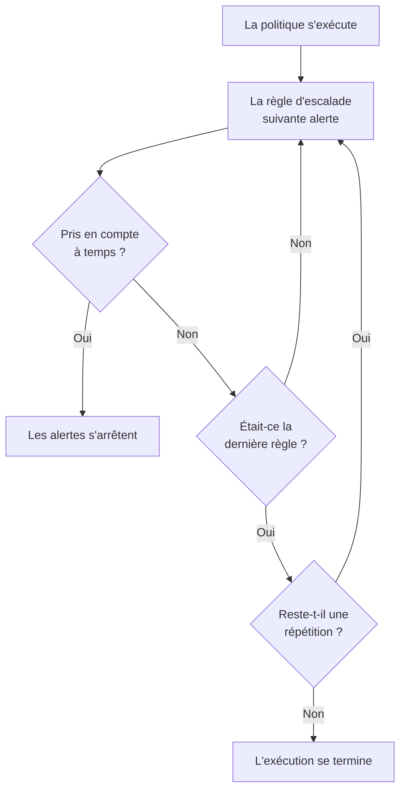

# Politiques d'astreinte

Une politique d'astreinte décide qui est alerté pour un incident ou une alerte, et qui vient ensuite si personne ne prend en compte. Ses règles d'escalade sont ses niveaux, et ce sont les incidents, les alertes et les épisodes qui l'utilisent qui l'exécutent. Cette page explique comment créer une politique, ce qui l'exécute, ce que montrent ses pages et comment chaque exécution est consignée.

:::cards
- [Créer une politique](#créer-une-politique): Un nom, et qui est alerté en premier.
- [Ce qui exécute une politique](#ce-qui-exécute-une-politique): Règles, modèles, moniteurs, chat et vous-même.
- [Journaux d'exécution](#journaux-dexécution): Chaque exécution, règle par règle, et pourquoi elle s'est arrêtée.
- [Archiver ou supprimer une politique](#archiver-ou-supprimer-une-politique): Retirer une politique du service.
:::

## Créer une politique

:::steps
1. Allez dans **Astreinte → Politiques d'astreinte** et cliquez sur **Créer une politique d'astreinte**.
2. Saisissez un **Nom**, par exemple « Paiements principal ».
3. Sous **Qui est alerté en premier ?**, cliquez sur **Ajouter un intervenant** et choisissez les plannings d'astreinte, les équipes et les personnes à alerter en premier.
4. Cliquez sur **Créer une politique d'astreinte**. La politique s'ouvre sur sa page **Règles d'escalade**, avec **Level 1** déjà en place.
:::

**Qui est alerté en premier ?** est facultatif, et n'est demandé qu'aux personnes autorisées à ajouter des règles d'escalade : laissé vide, la politique n'alerte personne tant qu'elle n'a pas de règle. **Description** et **Étiquettes** attendent sous **Plus de champs**. Pour ajouter les niveaux suivants, voir [Règles d'escalade](/docs/on-call/escalation-rules).

Le formulaire demande aussi **La déclencher pour chaque nouvel incident et chaque nouvelle alerte** aux personnes autorisées à ajouter des règles d'astreinte. Cela ajoute une règle sous **Incidents → Règles → Règles d'astreinte** et une autre sous **Alertes → Règles → Règles d'astreinte**, qui correspondent chacune à tout et exécutent cette politique. C'est activé au départ pour la première politique d'un projet, tant que le projet n'a ni politique d'astreinte ni règle d'astreinte, et désactivé pour les suivantes : déclencher deux politiques pour chaque nouvel incident et chaque nouvelle alerte est un choix à faire. Désactivée, une politique n'alerte personne tant qu'une règle, un moniteur ou une personne ne l'exécute pas.

Pour être guidé pas à pas à la place, de votre téléphone jusqu'à une alerte de test, cliquez sur **Configuration guidée** : sur la liste **Politiques d'astreinte** vide, ou sous **Fonctionnement**. Voir [Être alerté par appel, SMS ou push](/docs/guides/paging).

La liste **Politiques d'astreinte** affiche pour chaque politique **Nom**, **Alertés en premier**, **Description**, **Étiquettes** et **Propriétaires**. **Alertés en premier** indique qui est alerté par la première règle d'escalade de la politique : ses plannings, chacun avec la personne qui y est d'astreinte en ce moment, ses équipes et les personnes qu'elle nomme, ou **Aucune règle d'escalade** ou **Aucun intervenant** quand elle n'alerte personne. Sélectionnez des politiques pour **Ajouter des étiquettes**, **Retirer des étiquettes**, **Ajouter un propriétaire**, **Retirer un propriétaire**, **Archiver**, **Exporter en JSON** ou pour les supprimer. **Importer du JSON** crée des politiques à partir d'un export : un export contient les réglages propres à une politique, pas ses règles d'escalade ni ses propriétaires.

## Ce qui exécute une politique

Une politique n'alerte personne tant que rien ne l'exécute. Chaque incident, alerte et épisode exécute les politiques qu'il porte dès sa création :

| Quoi | Comment la politique est ajoutée | En savoir plus |
| --- | --- | --- |
| L'enregistrement lui-même | Le champ **Politique d'astreinte** à la création d'un incident ou d'une alerte, un modèle d'incident, ou la section repliée **Astreinte** des critères d'un moniteur | [Déclarer un incident](/docs/incidents/declaring-incidents) |
| Règles d'astreinte | **Incidents → Règles → Règles d'astreinte** et **Alertes → Règles → Règles d'astreinte** ajoutent les politiques de chaque règle qui correspond | [Règles d'astreinte des incidents](/docs/incidents/settings#règles-dastreinte-des-incidents) |
| Règles de regroupement | Une règle de regroupement exécute ses politiques quand elle ouvre un épisode | [Épisodes d'alertes et règles de regroupement](/docs/alerts/episodes) |
| À la main | **Exécuter la politique d'astreinte**, dans le menu **Actions** d'un fil d'activité, ou sur un message Slack ou Microsoft Teams | [Le fil d'activité de l'incident](/docs/incidents/notes-owners-and-feed#le-fil-dactivité-de-lincident) |
| Chat et flux de travail | `/oneuptime page` dans Slack ou Microsoft Teams, et l'étape **Page an On-Call Policy** d'un flux de travail | [Paging](/docs/workflows/components#paging) |

Une politique que plusieurs règles ajoutent ne s'exécute qu'une fois. Une gravité n'exécute jamais une politique à elle seule : c'est une règle d'astreinte correspondant à cette gravité qui le fait. Un incident ou une alerte créé déjà pris en compte ou résolu n'exécute aucune de ses politiques. Une règle d'astreinte réglée sur **Uniquement pendant les heures ouvrées** fait attendre les politiques qu'elle ajoute jusqu'au début de ces heures.

## Les pages d'une politique

Ouvrez une politique depuis la liste. Son menu latéral contient tout ce qui la concerne :

| Section | Pages |
| --- | --- |
| **Basique** | **Vue d'ensemble**, **Règles d'escalade** et **Propriétaires** |
| **Journaux** | **Journaux d'exécution** et **Journaux de notification** |
| **Développeurs** | **Terraform**, **API**, **CLI** et **Assistants IA** |
| **Avancé** | **Remplacements d'utilisateur**, **Champs personnalisés**, **Paramètres**, **Journaux d'audit** et **Supprimer la politique** |

**Basique** est ouverte ; les autres sections démarrent repliées jusqu'à ce que vous cliquiez dessus.

- **Vue d'ensemble** affiche les **Détails de la politique d'astreinte**, puis **La politique en un coup d'œil** : combien de niveaux et d'intervenants a la politique, combien de temps avant son dernier niveau et combien de fois elle se répète. **Préparation des intervenants** indique si chaque personne qu'elle peut alerter est joignable maintenant, et **Fil d'activité de la politique d'astreinte** liste ce qui a changé : personnes, équipes et plannings ajoutés ou retirés, remplacements et passations. Ses règles Slack, Microsoft Teams et Mattermost les publient dans vos canaux, une relève en une ligne : voir [Messages d'astreinte](/docs/workspace-connections/slack#messages-dastreinte).
- Les **Propriétaires** sont les personnes et les équipes responsables de la politique. Quand une alerte qu'elle envoie ne trouve pas de règle pour quelqu'un, ou ne peut pas être remise, ils reçoivent un e-mail ; une politique sans propriétaires écrit à la place aux Propriétaires du projet.
- **Journaux de notification** liste chaque message envoyé par la politique, avec un onglet par canal.
- **Remplacements d'utilisateur** remplace des personnes dans cette seule politique. Voir [Remplacements d'utilisateur](/docs/on-call/user-overrides).
- **Paramètres** contient **Exporter : Politique d'astreinte** et la carte qui archive la politique.

**Ce qui déclenche cette politique**, sur la **Vue d'ensemble**, liste les règles d'astreinte, les moniteurs dont les critères déclenchent la politique, les modèles et autres règles qui la déclenchent, et les flux de travail qui le font, chacun avec un lien. Une règle désactivée indique **Désactivé**. Quand rien ne déclenche la politique, la carte le dit : elle n'appelle personne tant que rien ne la déclenche. Supprimer ou archiver la politique le dit d'abord. Ce que vous ne pouvez pas ouvrir est compté, pas nommé.

## Répéter une politique

Quand l'attente du dernier niveau se termine sans que personne ne prenne en compte, une politique s'arrête, sauf si elle se répète. Pour choisir, ouvrez la page **Règles d'escalade** de la politique et cliquez sur **Modifier** sur la carte **Politique de répétition** sous les règles. **Modifier la politique de répétition** demande **Si personne ne prend en compte après le dernier niveau** :

| Réponse | Ce qu'elle fait |
| --- | --- |
| **Arrêter les alertes** | Personne n'est alerté de nouveau : la politique s'exécute une seule fois. Une nouvelle politique commence avec cette réponse. |
| **Recommencer depuis Level 1** | Chaque niveau est alerté de nouveau, dans l'ordre. **Combien de fois de plus ?** indique combien de fois : 1 ou plus. |

Une politique qui recommence trois fois de plus parcourt ses niveaux quatre fois au total. Un passage où aucun niveau n'avait personne à alerter n'est pas répété : un autre n'alerterait personne non plus, donc la politique s'arrête. La ligne **Après le dernier niveau** de la carte dit ce que fait la politique, et **La politique en un coup d'œil** sur la **Vue d'ensemble** dit la même chose en toutes lettres.

## Alerter de nouveau si ce n'est pas résolu

La prise en compte arrête définitivement les alertes d'une politique, même si personne ne résout ensuite l'incident ou l'alerte. Une politique peut plutôt alerter de nouveau : ouvrez sa page **Règles d'escalade**, ouvrez **Plus de paramètres** en bas, puis cliquez sur **Modifier** sur la carte **Délai après prise en compte**. **Modifier le délai après prise en compte** demande **S'il est pris en compte mais pas résolu** :

| Réponse | Ce qu'elle fait |
| --- | --- |
| **Ne pas alerter de nouveau** | La prise en compte arrête définitivement les alertes. Une nouvelle politique commence avec cette réponse. |
| **Alerter de nouveau** | Alerte la personne qui l'a pris en compte et la personne d'astreinte maintenant. **Après combien de minutes ?** indique quand : de 5 à 1440, 30 au départ. |

Les minutes sont comptées à partir de chaque prise en compte, et une politique alerte de nouveau au plus 5 fois pour un même incident, une même alerte ou un même épisode. Une nouvelle alerte commence au niveau qui alertait lors de la prise en compte, alerte la personne d'astreinte à ce niveau maintenant, puis parcourt les niveaux comme la première exécution. L'incident ou l'alerte reste pris en compte : la nouvelle alerte est une exécution à part, dans son fil d'activité et dans les journaux d'exécution de la politique, où son **Statut** indique « Alerté de nouveau (1 sur 5) ».

La personne alertée de nouveau la prend en compte depuis son message, ou avec **Prendre en compte de nouveau** sur la page de l'incident ou de l'alerte, et les minutes recommencent ; **Escalader** la passe au niveau suivant. Résoudre ou supprimer l'incident ou l'alerte, archiver ou supprimer la politique, ou choisir **Ne pas alerter de nouveau** l'arrête. La ligne **Après une prise en compte** de la carte dit ce que fait la politique, et **Plus de paramètres** affiche les minutes tant qu'il est replié. **La politique en un coup d'œil** sur la **Vue d'ensemble** et le **Résumé de l'escalade** disent la même chose en toutes lettres.

## Quand plusieurs politiques alertent

Un incident, une alerte ou un épisode exécute chacune de ses politiques séparément, en même temps.

- Une personne d'astreinte dans deux d'entre elles n'est alertée qu'une fois. Quand le niveau d'une politique atteint une personne qu'une autre politique alerte déjà à ce sujet, elle ne l'alerte pas de nouveau : son journal d'exécution indique **Déjà appelé** pour cette personne, et le fil d'activité de l'incident ainsi que le message Slack et Microsoft Teams de la politique nomment la politique qui l'alerte. Le niveau attend tout de même ses minutes avant de passer au niveau suivant, comme il le fait pour toute personne qu'il a alertée. Répondre à cette seule alerte vaut pour les deux politiques. Au sein d'une politique, une personne qu'un niveau nomme deux fois, en personne et via une équipe ou un planning, n'est alertée qu'une fois.
- Une alerte envoyée directement à des personnes compte aussi. Quand le niveau d'une politique atteint une personne qu'une alerte depuis Slack ou Microsoft Teams, ou le bloc d'alerte d'un flux de travail, alerte déjà à ce sujet, elle ne l'alerte pas de nouveau : son journal d'exécution nomme qui a envoyé cette alerte, ou le flux de travail. Le bloc d'alerte d'un flux de travail n'alerte pas non plus de nouveau une personne déjà alertée par une politique ou par une autre alerte.
- La prise en compte de l'incident ou de l'alerte arrête en moins d'une minute toutes les politiques en cours pour lui, où qu'elle ait lieu : depuis n'importe quelle alerte à son sujet, sur sa propre page, dans l'application mobile, ou dans Slack ou Microsoft Teams. Aucun niveau suivant n'est alerté, et aucun appel ni SMS encore en attente n'est envoyé. Les notifications déjà envoyées le restent.

Personne ne manque d'alerte pour n'avoir été alerté qu'une fois. Cette alerte unique peut prendre fin sans réponse : la personne l'escalade depuis l'un de ses messages, ce qui n'escalade que cette alerte, l'alerte ne peut pas être envoyée, ou elle s'arrête. L'autre politique, ou le bloc du flux de travail, alerte alors la personne en moins d'une minute, sans renvoyer ce qui lui est déjà parvenu. **Escalader** sur la page de l'incident ou dans l'application mobile escalade les deux. Une nouvelle alerte, une politique lancée à la main et une alerte que quelqu'un a envoyée depuis Slack ou Microsoft Teams alertent toujours elles-mêmes leurs propres personnes, même une personne qu'une autre politique alerte déjà. L'alerte d'un observateur et celle d'un intervenant ne sont jamais fusionnées.

Certaines alertes continuent après la prise en compte, jusqu'à ce qu'une personne qu'elles ont alertée réponde ou que ce soit résolu : une nouvelle alerte, une alerte aux observateurs, une alerte que quelqu'un a envoyée à des personnes depuis Slack ou Microsoft Teams, et une politique lancée à la main.

Une politique lancée à la main est une politique lancée avec **Exécuter la politique d'astreinte**, ou par une alerte depuis Slack ou Microsoft Teams qui la nomme. Elle alerte niveau par niveau comme toute exécution, appels et notifications push répétées compris, et la prise en compte de l'incident par quelqu'un d'autre ne l'arrête pas : c'est ainsi que vous alertez une autre équipe sur un incident dont quelqu'un s'occupe déjà. La personne qu'elle a alertée répond depuis le message de son alerte, par un appel ou un SMS, ou en prenant elle-même l'incident en compte ; une fois l'incident pris en compte, sa page lui propose **Prendre en compte de nouveau**. **Escalader** la passe au niveau suivant. Sur un incident, une alerte ou un épisode résolu, rien n'est lancé, et on vous dit pourquoi : le tableau de bord désactive **Exécuter la politique d'astreinte** et en donne la raison. Ses notifications disent qui a lancé quelle politique, et reprennent le message envoyé avec une alerte depuis Slack ou Microsoft Teams.

## Tester une politique

**Tester cette politique**, dans les règles d'escalade d'une politique, appelle son premier niveau à titre de test, sans incident derrière : chaque message indique TEST, et aucune page de statut, aucun abonné ni aucun canal n'est informé. Activez **Parcourir chaque niveau d'escalade** pour appeler chaque niveau tour à tour, à 2 minutes d'intervalle au plus, jusqu'à ce que quelqu'un le prenne en compte. Avant tout envoi, la boîte de dialogue indique qui le test appelle et comment, et ce qu'il coûte sur OneUptime Cloud.

**Envoyer l'appel de test** reste désactivé tant que le test n'atteindrait personne : chaque personne qu'il appelle s'est désabonnée de cette gravité, n'a aucune règle pour elle et rien vers quoi se replier, ou n'a que des méthodes non vérifiées ou désactivées dans le projet. Une ligne sous la liste indique pourquoi. Quand seul un niveau suivant peut être atteint, la ligne propose **Parcourir chaque niveau d'escalade** en un clic.

La personne appelée prend le test en compte depuis n'importe lequel de ses messages : le lien d'un e-mail, d'un SMS ou d'un message de chat, le 1 d'un appel, ou sa notification push dans l'application OneUptime On-Call, dans les versions plus récentes que 1.6.0. Une politique peut être testée une fois toutes les 5 minutes, et un projet envoie au plus 20 tests par heure.

### Lancer un exercice d'alerte sur un moniteur

**Lancer un exercice d'alerte**, sur la carte **Quand il tombe en panne** d'un moniteur, répète l'une de ses pannes : un incident ou une alerte qu'ouvre l'un de ses critères, ou l'incident qu'une règle d'incident des alertes déclare à partir d'une telle alerte. Il teste chaque politique d'astreinte que cette panne appellerait, chacune comme **Tester cette politique** la teste, et rien de public ne se produit : aucun incident ni aucune alerte n'est créé, et aucune page de statut, aucun abonné ni aucun canal n'est informé. Avant tout envoi, la boîte de dialogue nomme la panne, chaque politique et qui cette politique appelle en ce moment. Pour un incident déclaré, elle nomme aussi la règle et combien de temps l'alerte reste ouverte avant : l'exercice teste aussitôt les politiques de l'incident, sans cette attente.

Un exercice appelle le premier niveau de chaque politique. Sous **Plus de champs**, activez **Parcourir chaque niveau d'escalade** pour appeler les niveaux de chaque politique tour à tour, à 2 minutes d'intervalle au plus, jusqu'à ce que quelqu'un le prenne en compte : la boîte de dialogue liste alors chaque niveau que chaque politique atteint, et ce que le parcours coûte au plus. Quand personne aux premiers niveaux ne peut être atteint mais qu'un niveau suivant le peut, la ligne sous la liste propose **Parcourir chaque niveau d'escalade** en un clic.

**Démarrer l'exercice d'alerte** reste désactivé tant que l'une de ces politiques est une politique que vous ne pouvez pas tester, parce que vous ne pouvez pas la modifier, ou tant que personne parmi ceux qu'elles appellent ne peut être atteint. Chaque politique d'un exercice compte comme un test à part : une politique testée dans les 5 dernières minutes bloque tout l'exercice, et un exercice de trois politiques prend trois des 20 tests par heure du projet.

Une fois la boîte de dialogue fermée, **Dernier exercice d'alerte** sur la carte indique quelle panne le dernier exercice du moniteur a répétée, quand et par qui il a été démarré, et combien de ses tests ont été pris en compte. **Afficher les détails** liste le test de chaque politique : s'il a été pris en compte, par qui, par quel moyen et en combien de temps. Chaque test reste dans les journaux d'exécution de sa politique, marqué comme exercice d'alerte du moniteur. Les résultats d'un exercice s'affichent pour qui peut lire le moniteur et chacun de ces journaux d'exécution.

## Journaux d'exécution

Chaque fois qu'une politique s'exécute, elle écrit un journal d'exécution, et ce journal passe par ses statuts au fil de l'exécution :

| Statut | Ce qu'il signifie |
| --- | --- |
| **En attente** | Une règle d'astreinte réglée sur **Uniquement pendant les heures ouvrées** fait attendre l'exécution jusqu'au début de ces heures : elle indique quand les alertes commencent, et n'alerte personne d'ici là. Elle se termine sans alerter si l'incident ou l'alerte est pris en compte ou résolu avant. Elle commence aussitôt à alerter si l'incident ou l'alerte change et correspond désormais à une règle d'astreinte qui alerte immédiatement. |
| **Planifié**, **Démarrée** | L'exécution est en préparation. Une exécution encore là après 5 minutes n'a pas fini de démarrer : elle passe en **Exécution en cours** et alerte à partir de l'endroit où son démarrage s'est arrêté. Un appel direct ou un appel de test encore là est arrêté en **Erreur**. |
| **Exécution en cours** | L'exécution alerte. OneUptime la fait avancer chaque minute. Une étape qui échoue un instant, par exemple parce que la base de données était injoignable, est retentée une minute plus tard, puis 2 et 4 minutes plus tard, puis toutes les 5 minutes. |
| **Exécution terminée** | Quelqu'un a pris en compte, l'incident ou l'alerte a été résolu, chaque règle et chaque répétition ont été utilisées, ou la politique a été archivée. |
| **Exécution terminée - personne n'a été notifié** | L'exécution a parcouru chaque règle sans alerter personne : en général un planning où personne n'est d'astreinte, ou un niveau sans intervenant. |
| **Erreur** | L'exécution a échoué : une étape a échoué d'une façon qu'un nouvel essai ne peut pas corriger, comme une règle d'escalade supprimée, ou a échoué 10 essais d'affilée, sur environ 37 minutes. **Voir le message de statut** indique pourquoi. |

Vous trouvez les journaux d'exécution à trois endroits :

- dans les propres **Journaux d'exécution** de la politique, sous **Journaux** ;
- dans **Astreinte → Avancé → Journaux d'exécution**, pour toutes les politiques, où les appels directs venus des flux de travail et du chat apparaissent comme **Appel direct** ;
- sur la page **Exécutions d'astreinte** d'un incident ou d'une alerte.

Chaque ligne montre ce qui a déclenché l'exécution, quand, son **Statut** et qui l'a prise en compte. **Voir la chronologie** ouvre sa **Chronologie d'exécution** : chaque règle d'escalade, qui elle a alerté, par quel planning, et comment chaque alerte s'est terminée. **Notifié via** indique comment chaque alerte a atteint la personne : appel téléphonique, SMS, e-mail, notification push, etc. Un planning où personne n'est d'astreinte affiche **Personne n'était d'astreinte** au lieu d'une personne. Un niveau qui n'a alerté personne dit pourquoi, avec **Poursuivi sans attendre** en dessous : la politique ne l'a pas attendu. Une personne qu'une autre politique, ou une alerte qui lui a été envoyée directement, alertait déjà affiche **Déjà appelé** : voir [Quand plusieurs politiques alertent](#quand-plusieurs-politiques-alertent). Sur OneUptime Cloud, les journaux d'exécution nécessitent l'offre **Growth**.

## Archiver ou supprimer une politique

Archiver retire une politique du service et conserve tout : ouvrez les **Paramètres** de la politique et cliquez sur **Archiver** sur sa carte d'archivage, ou sélectionnez des politiques dans la liste et choisissez **Archiver**.

- Une politique archivée n'alerte personne. Les incidents et les alertes qui l'utilisent la sautent, et une exécution encore en escalade s'arrête à son étape suivante.
- Elle quitte la liste **Politiques d'astreinte** pour **Astreinte → Avancé → Politiques archivées**, où **Désarchiver** la remet en service.

**Supprimer la politique**, sous **Avancé**, supprime la politique avec ses règles d'escalade et ses remplacements d'utilisateur. La suppression depuis la liste demande d'abord confirmation et propose d'archiver à la place.

## Qui peut modifier une politique

**Propriétaire du projet**, **Administrateur du projet**, **Membre du projet**, **Administrateur des astreintes** et **Membre des astreintes** peuvent créer, modifier et supprimer des politiques ; **Lecteur** et **Lecteur des astreintes** peuvent les consulter. Dans un rôle personnalisé, les permissions sont **Create On-Call Policy**, **Edit On-Call Policy**, **Delete On-Call Policy** et **Read On-Call Policy**, et un rôle limité à certaines étiquettes n'atteint que les politiques qui les portent. Ajouter des propriétaires et des champs personnalisés nécessite l'offre **Growth** sur OneUptime Cloud.

## API et Terraform

Les politiques d'astreinte sont la ressource `/api/on-call-duty-policy`, et la ressource `oneuptime_on_call_policy` dans Terraform :

| Réglage | Champ de l'API |
| --- | --- |
| **Nom** | `name` |
| **Description** | `description` |
| **Si personne ne prend en compte après le dernier niveau** | `repeatPolicyIfNoOneAcknowledges` |
| **Combien de fois de plus ?** | `repeatPolicyIfNoOneAcknowledgesNoOfTimes` |
| **Après combien de minutes ?** | `acknowledgementTimeoutInMinutes` |
| Archivée | `isArchived` |

`repeatPolicyIfNoOneAcknowledges` vaut `false` pour **Arrêter les alertes** et `true` pour **Recommencer depuis Level 1**. À `true`, `repeatPolicyIfNoOneAcknowledgesNoOfTimes` doit être un nombre entier d'au moins 1 : OneUptime refuse `0`. Une politique plus ancienne enregistrée avec `0` ne se répète jamais, et le tableau de bord l'affiche comme **Arrêter les alertes**.

`acknowledgementTimeoutInMinutes` vaut `null` pour **Ne pas alerter de nouveau**, et un nombre entier de minutes de 5 à 1440 pour **Alerter de nouveau**. OneUptime refuse toute autre valeur.

Pour créer une politique avec son premier niveau en une seule requête, voir [Créer des règles avec l'API ou Terraform](/docs/on-call/escalation-rules#créer-des-règles-avec-lapi-ou-terraform).

## Dépannage

:::details Une politique s'est exécutée, mais personne n'a été alerté
Son exécution indique **Exécution terminée - personne n'a été notifié**. Ouvrez **Voir la chronologie** : une ligne **Personne n'était d'astreinte** désigne un planning avec un trou, et le message de statut d'une ligne **Ignoré** dit pourquoi, par exemple quelqu'un d'absent sans personne pour le remplacer. **Astreinte → Disponibilité** montre qui n'a pas pu être joint.
:::

:::details Le niveau suivant a été alerté une minute après son attente
OneUptime fait avancer les politiques en cours une fois par minute, donc un niveau est alerté au premier contrôle après la fin de son attente.
:::

:::details Le niveau suivant a été alerté immédiatement, sans attendre
Le niveau précédent n'avait personne à alerter : aucun intervenant, personne d'astreinte dans ses plannings ou personne de joignable. Un niveau qui n'alerte personne n'a pas de délai, donc le niveau suivant est alerté dès que la politique l'atteint. **Voir la chronologie** montre pourquoi ce niveau n'a alerté personne.
:::

:::details Un incident affiche une politique qui n'a alerté personne
La politique est archivée : une politique archivée reste sur les incidents et les alertes qui l'utilisent, n'alerte personne, et son journal d'exécution indique qu'elle n'a pas été exécutée. Désarchivez-la sous **Astreinte → Avancé → Politiques archivées**.
:::

:::details Quelqu'un a été alerté deux fois pour un même incident
Une personne d'astreinte dans deux des politiques que l'incident exécute n'est alertée qu'une fois, par la première politique qui l'atteint, de même qu'une personne qu'atteignent à la fois une politique et une alerte depuis Slack, Microsoft Teams ou un flux de travail. La seconde l'alerte aussi quand il s'agit d'une nouvelle alerte, d'une politique lancée à la main, d'une alerte envoyée depuis Slack ou Microsoft Teams ou d'une alerte aux observateurs, qui alertent elles-mêmes leurs personnes, ou quand sa première alerte était déjà terminée avant que la seconde ne l'atteigne : la personne l'avait escaladée, ou elle s'était arrêtée. **Voir la chronologie** de la seconde alerte indique **Déjà appelé** pour une personne qu'elle n'a pas alertée de nouveau.
:::

:::details Une politique a continué d'alerter après la prise en compte de l'incident
Elle a été lancée à la main, ou c'est une nouvelle alerte : elle continue jusqu'à ce qu'une personne qu'elle a alertée réponde, ou que l'incident soit résolu. Voir [Quand plusieurs politiques alertent](#quand-plusieurs-politiques-alertent).
:::

## Étapes suivantes

:::cards
- [Règles d'escalade](/docs/on-call/escalation-rules): Ajouter les niveaux qu'une politique alerte, et combien de temps chacun attend.
- [Remplacements d'utilisateur](/docs/on-call/user-overrides): Envoyer les alertes de quelqu'un à un collègue pendant son absence.
- [Disponibilité et rapports](/docs/on-call/readiness): Vérifier que chaque personne qu'une politique alerte est joignable.
:::
