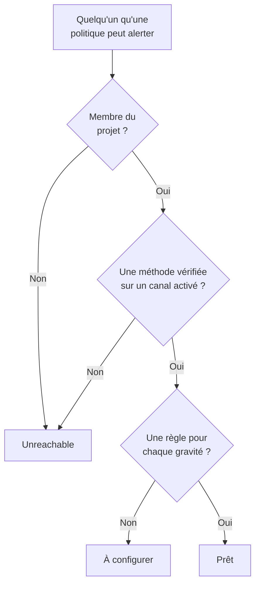

# Disponibilité et rapports

La disponibilité répond à une question avant qu'un incident ne le fasse : si quelque chose se déclenchait maintenant, chaque personne que vos politiques d'astreinte alertent serait-elle vraiment jointe ? Elle liste chaque intervenant du projet, indique qui est prêt et qui ne l'est pas, et vous permet de rappeler aux gens de terminer leur configuration. Le rapport **Temps d'astreinte de l'utilisateur** montre ensuite combien de temps chaque personne a été d'astreinte.

:::cards
- [Comment un statut est déterminé](#comment-un-statut-est-déterminé): Prêt, À configurer ou Unreachable, et pourquoi.
- [La page Disponibilité](#la-page-disponibilité): Chaque intervenant du projet, dans une seule liste.
- [Rappeler aux gens de terminer leur configuration](#rappeler-aux-gens-de-terminer-leur-configuration): Un e-mail qui nomme ce qui manque.
- [Temps d'astreinte de l'utilisateur](#temps-dastreinte-de-lutilisateur): Combien de temps chaque personne a été d'astreinte.
:::

## Comment un statut est déterminé

Un intervenant est toute personne qu'une politique d'astreinte peut alerter : une personne nommée dans une règle d'escalade, un membre d'une équipe qu'une règle alerte, quelqu'un dans une couche d'un planning qu'une règle alerte, et le remplaçant d'un remplacement d'utilisateur qui n'est pas terminé. Un planning qu'aucune politique n'alerte n'ajoute personne.

| Statut | Ce qu'il signifie |
| --- | --- |
| **Prêt** | La personne a une méthode vérifiée sur un canal que le projet a activé, et une règle pour chaque gravité, sur chaque onglet de ses règles d'astreinte. |
| **À configurer** | La personne est joignable, mais certaines gravités n'ont pas de règle. La ligne compte ces lacunes. |
| **Injoignable** | Rien ne la joint : aucune méthode vérifiée, chaque méthode vérifiée est sur un canal que le projet a désactivé, ou elle n'est pas membre du projet. |

Une lacune est une gravité sans règle, sur l'onglet des incidents, des épisodes d'incidents, des alertes ou des épisodes d'alertes. Une règle qui désactive volontairement une gravité n'est pas une lacune. Une alerte qui tombe sur une lacune joint quand même la personne sur ses méthodes vérifiées, sauf si le projet a désactivé ce repli : voir [Quand aucune règle ne correspond](/docs/notifications/index#quand-aucune-règle-ne-correspond).

## La page Disponibilité

Ouvrez **Astreinte → Disponibilité**. La carte **Préparation de l'astreinte** liste chaque personne qu'une politique d'astreinte du projet peut joindre, celles qui ont besoin de quelque chose en premier. Toute personne du projet peut l'ouvrir.

Au-dessus de la liste, les tuiles comptent **Intervenants**, **Prêt**, **À configurer** et **Injoignable**. Cliquez sur **Prêt**, **À configurer** ou **Injoignable** pour ne lister que ces intervenants, et cliquez à nouveau pour lister tout le monde.

| Colonne | Ce qu'elle montre |
| --- | --- |
| **Intervenant** | La personne, avec son adresse e-mail. |
| **Statut** | **Prêt**, **Injoignable**, ou le nombre de lacunes de la personne. |
| **Équipes** | Les équipes qui l'alertent par une règle d'escalade. |
| **Canaux** | Un segment par canal : plein pour une méthode vérifiée, creux pour une méthode pas encore vérifiée. |
| **Couverture** | Combien de gravités ont une règle, sur chaque onglet, sur le total. |
| **Reached via** | Comment les politiques la joignent : `Direct`, `Team`, `Schedule` ou `Override`. |

**Couverture** sur une ligne montre les méthodes de notification de la personne, pourquoi elle a son statut, et une grille de chaque gravité avec ou sans règle. L'entonnoir filtre la liste par **Intervenant**, **Statut**, **Équipe** ou **Reached via**. La réponse peut dater d'une minute : **Actualiser** la recalcule.

## Rappeler aux gens de terminer leur configuration

Seule la personne elle-même peut ajouter et vérifier ses méthodes de notification et ses règles : la solution est donc de le lui demander.

:::steps
1. Sur la page Disponibilité, cochez les intervenants à qui envoyer un rappel. Les intervenants prêts ne peuvent pas être cochés : il n'y a rien à leur rappeler.
2. Cliquez sur **Envoyer un rappel de configuration**. La confirmation nomme chaque personne à qui un e-mail va être envoyé.
3. Confirmez. Chaque personne reçoit un e-mail qui nomme ce qui manque dans sa propre configuration, avec un lien vers la page qui le corrige.
:::

Un bandeau indique ensuite combien de rappels ont été envoyés, ignorés ou ont échoué, et pourquoi pour chacun de ceux qui n'ont pas été envoyés. Personne ne reçoit plus d'un rappel en 24 heures, et un envoi rappelle au plus 250 personnes. Envoyer des rappels demande **Propriétaire du projet**, **Administrateur du projet** ou **Administrateur des astreintes**, ou **Edit On-Call Duty Policy** dans un rôle personnalisé.

## La disponibilité sur d'autres pages

- Sur la **Vue d'ensemble** d'une politique, **Préparation des intervenants** liste chaque personne que cette politique peut alerter et qui demande une action, et **Revérifier** relit le tout. Votre propre ligne a un bouton vers la page qui corrige le problème ; celle de quelqu'un d'autre ouvre un e-mail à son intention dans votre propre messagerie, avec la solution dedans.
- Sur les **Règles d'escalade** d'une politique, un niveau dont les intervenants ne peuvent pas tous être alertés l'indique sur sa carte. Voir [Le résumé de l'escalade](/docs/on-call/escalation-rules#le-résumé-de-lescalade).
- Sous **Utilisateurs**, ouvrez un membre, puis **Disponibilité** dans la section **Astreinte** : son statut, ses méthodes et sa grille de couverture.
- Pour votre propre configuration, **Paramètres utilisateur → Liste de configuration** vous guide. Voir [La liste de configuration](/docs/notifications/index#la-liste-de-configuration).

## L'e-mail hebdomadaire de disponibilité

Une fois par semaine, OneUptime vérifie chaque projet qui a une politique d'astreinte. Quand quelqu'un y est **Injoignable** ou **À configurer**, les propriétaires du projet reçoivent un e-mail qui liste ces personnes en deux groupes, celles qui ne peuvent pas du tout être alertées et celles joignables avec des lacunes, jusqu'à 20 noms chacun, avec un lien vers la page Disponibilité.

Une semaine où tout le monde est prêt n'envoie rien : l'e-mail signifie donc toujours qu'il y a quelque chose à corriger. Quand quelqu'un ne peut pas du tout être alerté, son objet commence par `[Action Required]`.

## Temps d'astreinte de l'utilisateur

**Astreinte → Rapports → Temps d'astreinte de l'utilisateur** montre combien de temps chaque personne a été d'astreinte, sur une période que vous choisissez : **Dernier mois** au départ.

| Colonne | Ce qu'elle montre |
| --- | --- |
| **Utilisateur** | La personne. |
| **Temps pendant lequel l'utilisateur était d'astreinte** | Son temps d'astreinte sur la période, en heures et en minutes. |

Le temps est enregistré à mesure que les personnes prennent et quittent l'astreinte : à partir du moment où un planning qu'une règle alerte leur passe un tour, ou où elles sont ajoutées à une règle directement ou par une équipe, jusqu'à la passation ou jusqu'à leur retrait. Une astreinte assurée par deux politiques à la fois compte une seule fois, et le temps encore en cours compte jusqu'à maintenant.

La **Chronologie des astreintes** et les flux de calendrier montrent les permanences passées selon la rotation telle qu'elle est configurée aujourd'hui. Ce rapport, lui, est écrit au fil de l'eau : utilisez-le pour les revues d'équité et la rémunération des astreintes.

> [!NOTE]
> Sur OneUptime Cloud, le rapport nécessite l'offre **Growth**, et le temps terminé depuis plus de 200 jours est supprimé. Une installation auto-hébergée le conserve en entier.

## Dépannage

:::details Quelqu'un est injoignable, mais a un numéro de téléphone vérifié
Ses méthodes sont peut-être toutes sur des canaux que le projet a désactivés : SMS, appels, WhatsApp et Telegram sont désactivés dans un nouveau projet. Voir [Activer un canal pour votre projet](/docs/notifications/notification-methods#activer-un-canal-pour-votre-projet).
:::

:::details Quelqu'un manque dans la liste
La liste ne contient que des personnes qu'une politique d'astreinte peut alerter. Un membre d'équipe qui n'a pas accepté son invitation, quelqu'un dans un planning qu'aucune politique n'alerte et un remplaçant dont le remplacement est terminé n'y figurent pas.
:::

:::details Les propriétaires ne reçoivent jamais l'e-mail hebdomadaire
Il n'est envoyé qu'une semaine où quelqu'un est **Injoignable** ou **À configurer**, et uniquement aux propriétaires du projet.
:::

## Étapes suivantes

:::cards
- [Comment OneUptime vous joint](/docs/notifications/index): Les méthodes, les règles et le repli derrière chaque statut.
- [Méthodes de notification](/docs/notifications/notification-methods): Ajouter et vérifier les moyens par lesquels OneUptime joint quelqu'un.
- [Règles d'astreinte personnelles](/docs/notifications/on-call-rules): Combler les lacunes, gravité par gravité.
:::
