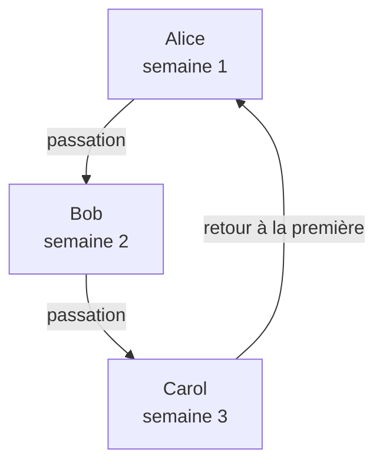

# Plannings d'astreinte

Un planning d'astreinte détermine qui est d'astreinte à chaque instant. Les personnes y assurent l'astreinte à tour de rôle : chacune est d'astreinte pendant un temps, puis la suivante prend le relais. Ajoutez un planning aux règles d'escalade d'une politique d'astreinte, et la politique alerte la personne d'astreinte dans ce planning lorsque ce niveau s'exécute.

> [!NOTE]
> Sur OneUptime Cloud, les plannings d'astreinte font partie de l'offre **Growth** et des offres supérieures. Un planning qu'un projet possède encore continue d'alerter les personnes qui y figurent, via les règles d'escalade qui le nomment, après la fin d'un essai Growth ou une rétrogradation de l'offre. Sous **Growth**, la page **Plannings d'astreinte** affiche donc la note sur l'offre avec, en dessous, les plannings encore configurés, que vous pouvez y supprimer. Créer ou modifier un planning nécessite **Growth**.

:::cards
- [Qui assure l'astreinte à tour de rôle](#qui-assure-lastreinte-à-tour-de-rôle): Créer un planning avec sa première rotation.
- [Couches](#couches): Empiler des rotations, limiter les heures d'astreinte et ajouter une couverture de secours.
- [Quand quelqu'un est absent](#quand-quelquun-est-absent): Faire passer son tour à quelqu'un dans la rotation jusqu'à son retour.
- [API et Terraform](#créer-des-plannings-avec-lapi-ou-terraform): Créer des plannings et leurs rotations sous forme de code.
:::

## Qui assure l'astreinte à tour de rôle

Lorsque vous créez un planning sur la page **Plannings d'astreinte**, le formulaire demande son **Nom** et **Qui assure l'astreinte à tour de rôle ?**. Les personnes choisies forment la première couche du planning, **Layer 1**, d'astreinte 24 heures sur 24.

:::steps
1. Allez dans **Astreinte** > **Plannings d'astreinte** et cliquez sur **Créer un planning d'astreinte**.
2. Saisissez un **Nom**. Un nom que porte déjà un autre planning du projet est refusé, quels que soient sa casse ou ses espaces, afin que chaque sélecteur distingue les plannings.
3. Sous **Qui assure l'astreinte à tour de rôle ?**, cliquez sur **Ajouter un utilisateur** et choisissez les personnes, dans l'ordre de leurs tours.
4. Si vous le souhaitez, ouvrez **Plus de champs** pour changer la durée de chaque tour, le fuseau horaire, la description ou les étiquettes.
5. Cliquez sur **Créer un planning d'astreinte**. Le nouveau planning s'ouvre ensuite sur sa page **Couches**, où vous pouvez modifier la rotation ou ajouter d'autres couches.
:::

Les personnes se relaient une à une, et la première est d'astreinte dès la création du planning :



**Qui assure l'astreinte à tour de rôle ?** est facultatif. Si vous le laissez vide, le planning démarre sans couches : il ne met personne d'astreinte tant que vous n'ajoutez pas de couche sur sa page **Couches**. La question n'est posée qu'aux personnes autorisées à ajouter des couches.

Tout le reste se trouve sous **Plus de champs**, replié jusqu'à ce que vous l'ouvriez :

| Champ | Ce qu'il fait |
| --- | --- |
| **Chaque tour dure** | **1 jour**, **1 semaine**, **2 semaines** ou **1 mois**, et **1 semaine** si vous ne le changez pas. Il est demandé dès que quelqu'un assure l'astreinte à tour de rôle. Chaque personne est d'astreinte pendant cette durée, puis la suivante prend le relais, à l'heure de la journée à laquelle le planning a été créé. |
| **Fuseau horaire** | Le fuseau horaire des heures de passation et des heures d'astreinte. Il commence avec le vôtre. Le changer ensuite garde chaque heure telle qu'elle se lit : une passation à 09:00 reste à 09:00, et une plage du lundi reste le lundi. Chaque fuseau horaire suit les règles actuelles de sa région : America/Vancouver (Colombie-Britannique) reste à UTC-7 toute l'année à partir de 2026. |
| **Description** | Des notes sur le planning. |
| **Étiquettes** | Des étiquettes pour retrouver et regrouper le planning. |

Tant que quelqu'un assure l'astreinte à tour de rôle et que rien n'est modifié sous **Plus de champs**, son en-tête replié indique ce qui va se passer : chaque personne est d'astreinte pendant une semaine, puis la suivante prend le relais.

Une personne invitée au projet qui ne l'a pas encore rejoint peut aussi assurer l'astreinte à tour de rôle, mais rien ne l'alerte tant qu'elle n'a pas accepté son invitation, et rien ne lui est dit. Son tour est un trou de couverture, et les canaux et le fil d'activité de chaque politique d'astreinte qui alerte le planning le disent, en la nommant par le nom saisi avec son invitation, jamais par son adresse e-mail : « ⚠️ Nobody is paged for Payments through schedule Primary until tomorrow at 5:50 PM, when @bob takes over: Ivy is on call but hasn't joined the project yet. » `/oneuptime oncall` dans Slack et `oncall` dans Microsoft Teams le disent aussi. Dès qu'elle rejoint le projet, elle est alertée comme les autres, on lui dit quelles politiques d'astreinte l'alertent désormais, et les canaux reçoivent « 📞 Ivy has joined the project and is now on call for Payments until tomorrow at 5:50 PM, then @bob. » D'ici là, [Disponibilité et rapports](/docs/on-call/readiness) la liste, avec ce qu'il faut faire.

## Couches

La rotation d'un planning se compose de couches, sur sa page **Couches**. Les couches se lisent de haut en bas : la couche la plus haute où quelqu'un est d'astreinte est celle qui alerte. Placez donc la rotation principale en haut et la couverture de secours en dessous.

```mermaid title="La couche la plus haute où quelqu'un est d'astreinte est celle qui alerte"
flowchart TB
    start["Un niveau alerte<br/>le planning"] --> first{"Quelqu'un<br/>d'astreinte<br/>dans la couche<br/>du haut ?"}
    first -->|"Oui"| pageTop["Alerter cette<br/>personne"]
    first -->|"Non"| next{"Quelqu'un<br/>d'astreinte<br/>dans la couche<br/>suivante ?"}
    next -->|"Oui"| pageNext["Alerter cette<br/>personne"]
    next -->|"Non"| gap["Personne<br/>n'est alerté<br/>un trou de<br/>couverture"]
```

**Ajouter une couche** ajoute une couche qui démarre comme la première : d'astreinte dès maintenant, chaque personne pendant une semaine, 24 heures sur 24. Dépliez une couche pour y ajouter des personnes, et pour changer quand elle commence, à quelle fréquence elle passe le relais, quand a lieu sa première passation et ses heures d'astreinte :

| Champ | Ce qu'il définit |
| --- | --- |
| **Nom de la couche** | Ce que la couche couvre, par exemple « Principal en semaine ». |
| **La rotation commence le** | La date et l'heure de début de la rotation de la couche. |
| **Rotation tous les** | La fréquence à laquelle l'astreinte passe à la personne suivante de la couche. |
| **Heure de la première passation** | La première passation à la personne suivante, au début ou après. Les passations suivantes suivent chaque intervalle de rotation. |
| **Restrictions** | Les heures d'astreinte de la couche (**Heures actives**) : **Aucune restriction**, **Heures spécifiques de la journée** ou **Heures spécifiques de la semaine**, dans le fuseau horaire du planning. En dehors, les couches inférieures prennent le relais. |

Une plage de type **Heures spécifiques de la semaine** va du jour et de l'heure sous **De :** au jour et à l'heure sous **À :**, et les jours qu'elle affiche sont les jours où elle est d'astreinte. Une plage dont les heures tombent sur d'autres jours que ceux avec lesquels elle a été enregistrée, comme une plage écrite via l'API avec des heures datées d'autres jours, ou une plage enregistrée avant que le fuseau horaire de son planning change, est marquée **Heures actives à vérifier** sur sa couche, et indique en dessous sous quels jours elle a été enregistrée. Elle reste d'astreinte les jours affichés, et **Enregistrer la couche** l'y maintient : choisissez les jours voulus avant d'enregistrer.

Avec des heures actives, chaque plage est une permanence à part entière. De 17:00 à 07:00, c'est une permanence qui se termine à 07:00 le lendemain matin : dans la **Chronologie des astreintes**, dans les e-mails, dans l'application mobile et dans Slack et Microsoft Teams de la même façon, dans le fuseau horaire du planning et aussi les nuits de changement d'heure. Le tour d'une personne couvre toutes ses plages jusqu'au relais suivant, et elle est prévenue une fois dans chaque sens : « You are now on-call » quand la première plage de son tour commence, avec la fin de cette plage et la fin de son tour, et « You are no longer on-call » quand sa dernière plage se termine, pas à chaque plage. Pour recevoir un rappel avant chaque plage, choisissez une heure dans **Me rappeler avant les permanences**, comme le décrit [Flux de calendrier](/docs/on-call/calendar-feeds#rappels-et-avis-de-réaffectation). Quand quelqu'un d'autre est d'astreinte entre deux de ses plages, par un remplacement ou une couche inférieure, ou qu'une modification des couches donne la plage suivante à quelqu'un d'autre, c'est un relais, annoncé comme tel. Son temps d'astreinte est toujours enregistré plage par plage, et les canaux et le flux de la politique d'astreinte disent toujours à chaque fois qui est d'astreinte.

Pour changer la couche qui passe en premier, utilisez les flèches sur la carte d'une couche : **Monter la couche (priorité plus haute)** ou **Descendre la couche (priorité plus basse)**.

Les changements de qui se relaie attendent que vous les enregistriez : vous pouvez en faire plusieurs et les vérifier avant que le tour de quiconque ne change. Faites glisser des personnes dans un nouvel ordre, ajoutez ou retirez des personnes, montez ou descendez une couche ou supprimez-en une, et la page montre chaque changement avant qu'il soit enregistré :

- Une personne ajoutée est marquée **Nouveau**, et une personne glissée à une nouvelle place **Déplacé**. Les personnes retirées sont listées sous **Retirés à l'enregistrement**, chacune avec **Annuler**.
- Une couche supprimée indique qu'elle sera supprimée à l'enregistrement, avec **Annuler**.
- Chaque couche et le planning final montrent la rotation telle qu'elle sera. Le planning final est marqué **Inclut des modifications non enregistrées**.
- Une barre en bas de la page nomme les changements, avec **Enregistrer les modifications** et **Abandonner**.

**Enregistrer les modifications** enregistre tous les changements en une fois. Qui est d'astreinte est alors calculé une seule fois, pour les couches telles qu'enregistrées : une personne qui prend ou quitte l'astreinte, ou qui est la suivante, en est informée une fois, et non une fois par changement. **Abandonner** remet les couches dans leur dernier état enregistré. Quitter la page avant d'enregistrer demande d'abord : **Enregistrer les modifications** enregistre puis quitte la page, **Continuer la modification** reste sur la page, et **Annuler les modifications** la quitte sans enregistrer.

Si quelqu'un d'autre a modifié les couches après que vous avez ouvert la page, vos changements ne sont pas enregistrés par-dessus les siens. La barre le signale, et **Recharger les couches** montre les couches telles qu'elles sont maintenant, pour que vous refassiez vos changements. **Ajouter une couche** ajoute sa couche immédiatement, et les réglages d'une couche s'enregistrent avec son propre bouton **Enregistrer la couche**.

Chaque personne garde une seule couleur partout, pour que vous puissiez la suivre d'un coup d'œil : sur chaque couche, dans le planning final et ses remplacements, et sur la **Chronologie des astreintes**.

## Quand quelqu'un est absent

Quand quelqu'un part en vacances, faites-lui passer son tour jusqu'à son retour. Sur la page **Couches** du planning, dépliez une couche et cliquez sur **Passer son tour jusqu'au…** à côté de son nom. Cela ouvre le formulaire d'absence avec cette personne sous **Qui est absent ?**, **Personne suivante de la rotation** sous **Qui remplace ?** et **Commence** à maintenant : réglez **Se termine** sur la date de son retour, puis enregistrez. Si la personne a déjà une absence à ces heures, le formulaire le signale à côté des heures pendant que vous les choisissez, avec **Modifier ce remplacement** pour modifier plutôt celui-là.

Pendant son absence :

- Chacun de ses tours revient à la personne suivante de la couche qui n'est pas absente, dans chaque planning dont elle fait partie. Les tours des autres ne bougent pas, et les siens lui reviennent dès son retour.
- Si tout le monde dans une couche est absent, la couche n'a personne d'astreinte et les couches en dessous prennent le relais. La couche indique **Tout le monde dans cette couche est absent en ce moment**.
- Les règles d'escalade qui la visent directement, ou via une équipe, ne l'alertent pas. L'exécution de la politique indique qu'elle est absente, et jusqu'à quand.
- Sa ligne dans la couche indique jusqu'à quand elle est absente, et le planning final ainsi que la **Chronologie des astreintes** montrent qui assure chacun de ses tours.

Choisissez plutôt quelqu'un sous **Qui remplace ?**, et cette personne reçoit toutes ses alertes, de chaque planning et de chaque politique, au lieu que la rotation reprenne ses tours.

Une absence ajoutée ainsi s'applique à toutes les politiques d'astreinte, si bien qu'elle demande la permission des remplacements sur tout le projet. Si le rôle de votre équipe est limité à ses propres politiques ou à certaines étiquettes, elle s'ajoute à la place sur les politiques de ce planning sur lesquelles vous pouvez ajouter des remplacements, avec un remplacement par politique, listé sur la page **Remplacements d'utilisateur** de chaque politique ; s'il y en a plusieurs, vous les cochez sous **Politiques d'astreinte**. **Passer son tour jusqu'au…** n'est verrouillé et ne dit pourquoi que là où vous n'en avez aucune. Elle figure dans **Astreinte** > **Plannings** > **Remplacements d'utilisateur**, ainsi que parmi les remplacements d'utilisateur du planning sur sa page **Couches**, où **Terminer maintenant** fait revenir la personne plus tôt. Pour faire passer son tour à quelqu'un dans une seule politique, ajoutez le remplacement sur la page **Remplacements d'utilisateur** de cette politique et laissez **Qui remplace ?** tel quel. Voir [Remplacements d'utilisateur](/docs/on-call/user-overrides).

Avec l'API, un remplacement d'utilisateur (`/api/on-call-duty-policy-user-override`) créé sans `routeAlertsToUserId` fait passer son tour à la personne de `overrideUserId` de `startsAt` à `endsAt`.

La **Vue d'ensemble** d'un planning a une carte **Utilisé par** : les politiques d'astreinte dont les règles d'escalade appellent la personne d'astreinte, avec les règles qui le font. Quand aucune ne le fait, elle le dit et renvoie aux politiques d'astreinte. Supprimer le planning, sur sa page ou depuis la liste, dit d'abord quelles politiques appellent via lui. Les politiques que vous ne pouvez pas ouvrir sont comptées, pas nommées. Un planning qui porte le même nom qu'un autre planning, datant d'avant l'obligation de noms distincts, est marqué **Même nom qu'un autre planning** dans la liste **Plannings d'astreinte**, qui indique combien il y en a : comparez leurs couches, puis renommez l'un d'eux avec **Renommer** sur sa ligne.

## Créer des plannings avec l'API ou Terraform

Les plannings d'astreinte sont la ressource `/api/on-call-duty-policy-schedule` ; leurs couches et les personnes qui les composent sont les ressources `/api/on-call-duty-schedule-layer` et `/api/on-call-duty-schedule-layer-user`.

- Créer un planning avec `firstLayerUsers` (une liste d'identifiants d'utilisateurs, dans l'ordre de leurs tours) dans ses `miscDataProps` lui donne sa première couche, comme le fait le tableau de bord : **Layer 1**, d'astreinte dès maintenant, 24 heures sur 24. `firstLayerRotation` indique la durée de chaque tour, sous forme de rotation comme `{"_type": "Recurring", "value": {"intervalType": "Week", "intervalCount": 1}}` ; sans elle, une semaine. Chaque utilisateur doit être membre du projet et l'appelant doit être autorisé à créer des couches, sinon le planning n'est pas créé.
- Un planning créé sans eux n'a pas de couches, comme auparavant ; la ressource Terraform des plannings ne les envoie pas.
- Une couche créée sans `rotation` passe le relais chaque semaine, et une couche sans `restrictionTimes` est d'astreinte 24 h/24, comme commence une nouvelle couche dans le tableau de bord.
- Les `restrictionTimes` d'une couche, ses heures actives, nomment leur type sous `restrictionType` : `None` (astreinte 24 h/24), `Daily` ou `Weekly`. `restictionType`, son ancienne orthographe sans le second « r », est lu aussi, et chaque réponse porte le type sous les deux, si bien qu'un client ou une configuration Terraform écrits avec l'une ou l'autre continuent de fonctionner ; la couche est enregistrée avec `restrictionType`. `restictionType` dans les réponses est obsolète : les réponses le portent jusqu'à la première version majeure publiée le 1er juin 2027 ou après, et les écritures le liront toujours. Écrivez `restrictionType`.
- Une plage `Weekly`, `{"startDay", "startTime", "endDay", "endTime"}`, est d'astreinte les jours qu'elle nomme : ses `startTime` et `endTime` doivent tomber sur ses `startDay` et `endDay` dans le fuseau horaire du planning. Une plage dont l'heure tombe un autre jour est refusée avec un `400` qui nomme la plage, le jour où tombe son heure et une heure du jour nommé à envoyer à la place. Un jour omis est le jour où tombe son heure. Une plage renvoyée exactement telle que la couche la contient n'est pas jugée à nouveau, si bien qu'un client qui lit une couche et la réécrit n'est pas refusé pour autant. Dans un planning sans fuseau horaire, dont les heures sont lues dans celui du serveur, une heure n'est refusée que si elle ne tombe sur son jour dans aucun fuseau horaire.
- La mise à niveau de OneUptime déplace chaque plage enregistrée dont les heures tombent sur d'autres jours que ceux qu'elle nomme, et ne tombent sur ces jours dans aucun fuseau horaire, vers les jours qu'elle nomme, à la même heure de la journée, et recalcule qui est d'astreinte. Une plage dont les heures tombent sur ses jours dans un autre fuseau horaire, comme cela peut arriver à une plage définie dans un autre fuseau ou enregistrée avant que le fuseau horaire de son planning change, est laissée telle quelle, alertant comme avant, et marquée **Heures actives à vérifier**.
- Changer le `timezone` d'un planning d'un fuseau à un autre fait passer les `startsAt`, `handOffTime` et `restrictionTimes` de ses couches à l'horloge du nouveau fuseau : chacun y indique la même date, le même jour et la même heure de la journée qu'avant. Donner à un planning son premier fuseau horaire, ou le lui retirer, laisse les instants tels qu'ils sont.
- Une écriture qui laisserait une couche d'astreinte à aucun moment est refusée avec un `400` qui nomme la clé : un type absent, inconnu ou différent sous les deux orthographes (une mise à jour prend celui qui diffère du type actuel de la couche) ; une plage `Daily` dont `startTime` et `endTime` ne sont pas des dates et heures (`"09:00"` seul est refusé) ; une restriction `Weekly` sans `weeklyRestrictionTimes` ; ou une plage qui s'ouvre et se ferme à la même heure. Une `rotation` dont l'`intervalType` n'est pas `Hour`, `Day`, `Week`, `Month` ou `Year` est refusée de la même façon.
- Une couche enregistrée avant que ces écritures soient refusées, sans type qui soit lu, n'était jamais d'astreinte. La mise à niveau de OneUptime lit chacune de ces couches d'après les heures qu'elle contient, l'enregistre ainsi et recalcule qui est d'astreinte dans son planning, de sorte que ses personnes sont alertées dès lors et en sont prévenues.
- Un changement apporté aux couches d'un planning et aux personnes qui les composent, fait avec l'API ou Terraform, est annoncé comme un seul changement : qui est d'astreinte est calculé une fois que les couches sont restées une demi-minute sans changement, et une personne qui prend ou quitte l'astreinte, ou qui est la suivante, en est informée une fois, et non une fois par couche ou par personne écrite. Les alertes vont à la personne que les couches mettent d'astreinte dès que chaque changement est enregistré.
- Pour changer d'un coup qui prend son tour dans les couches d'un planning, comme le fait **Enregistrer les modifications** sur la page **Couches**, lisez les couches avec `GET /api/on-call-duty-policy-schedule/<schedule-id>/layers` et renvoyez-les, modifiées, à `POST /api/on-call-duty-policy-schedule/<schedule-id>/save-layers`. Elles listent chaque couche que le planning garde, la plus prioritaire en premier, chacune avec ses personnes dans l'ordre de leurs tours : une personne déjà dans une couche par son `layerUserId`, une personne ajoutée par son seul `userId`. `deletedLayerIds` liste les couches à supprimer.
- Un enregistrement est écrit en entier ou pas du tout, et qui est d'astreinte est calculé une seule fois, aussitôt. Un enregistrement fait après qu'une autre personne a changé les couches est refusé avec 409, car son `basedOnVersion` n'est plus celui des couches : lisez à nouveau les couches et appliquez la modification à ce qui s'y trouve maintenant. La ressource Terraform `oneuptime_on_call_schedule_layers` enregistre ainsi les couches d'un planning.

```bash
curl -X POST https://oneuptime.com/api/on-call-duty-policy-schedule \
  -H "apikey: $ONEUPTIME_API_KEY" \
  -H "Content-Type: application/json" \
  -d '{
    "data": {
      "projectId": "<project-id>",
      "name": "Primary on-call",
      "timezone": "Europe/Berlin"
    },
    "miscDataProps": {
      "firstLayerUsers": ["<user-id-1>", "<user-id-2>", "<user-id-3>"],
      "firstLayerRotation": {"_type": "Recurring", "value": {"intervalType": "Week", "intervalCount": 1}}
    }
  }'
```

```bash
curl -X POST https://oneuptime.com/api/on-call-duty-schedule-layer \
  -H "apikey: $ONEUPTIME_API_KEY" \
  -H "Content-Type: application/json" \
  -d '{
    "data": {
      "name": "Nights",
      "onCallDutyPolicyScheduleId": "<schedule-id>",
      "startsAt": "2026-11-23T08:00:00.000Z",
      "handOffTime": "2026-11-30T08:00:00.000Z",
      "rotation": {"_type": "Recurring", "value": {"intervalType": "Week", "intervalCount": {"_type": "PositiveNumber", "value": 1}}},
      "restrictionTimes": {"_type": "RestrictionTimes", "value": {
        "restrictionType": "Daily",
        "dayRestrictionTimes": {
          "startTime": {"_type": "DateTime", "value": "2026-01-05T17:00:00+01:00"},
          "endTime": {"_type": "DateTime", "value": "2026-01-05T07:00:00+01:00"}
        }
      }}
    }
  }'
```

```bash
curl -X PUT https://oneuptime.com/api/on-call-duty-schedule-layer/<layer-id> \
  -H "apikey: $ONEUPTIME_API_KEY" \
  -H "Content-Type: application/json" \
  -d '{
    "data": {
      "restrictionTimes": {"_type": "RestrictionTimes", "value": {
        "restrictionType": "Weekly",
        "weeklyRestrictionTimes": [{
          "startDay": "Monday",
          "startTime": {"_type": "DateTime", "value": "2026-01-05T09:00:00+01:00"},
          "endDay": "Friday",
          "endTime": {"_type": "DateTime", "value": "2026-01-09T17:00:00+01:00"}
        }]
      }}
    }
  }'
```

```bash
curl https://oneuptime.com/api/on-call-duty-policy-schedule/<schedule-id>/layers \
  -H "apikey: $ONEUPTIME_API_KEY"

curl -X POST https://oneuptime.com/api/on-call-duty-policy-schedule/<schedule-id>/save-layers \
  -H "apikey: $ONEUPTIME_API_KEY" \
  -H "Content-Type: application/json" \
  -d '{
    "basedOnVersion": "<the version the read answered>",
    "layers": [
      {
        "layerId": "<layer-id>",
        "users": [
          {"layerUserId": "<row-of-user-2>", "userId": "<user-id-2>"},
          {"layerUserId": "<row-of-user-1>", "userId": "<user-id-1>"},
          {"userId": "<user-id-4>"}
        ]
      }
    ],
    "deletedLayerIds": []
  }'
```

## Étapes suivantes

:::cards
- [Règles d'escalade](/docs/on-call/escalation-rules): Faire alerter ce planning par un niveau d'une politique d'astreinte.
- [Chronologie des astreintes](/docs/on-call/schedule-timeline): Voir tous les plannings côte à côte, avec les trous de couverture.
- [Flux de calendrier](/docs/on-call/calendar-feeds): Mettre les permanences dans Google Agenda, Outlook ou Apple Calendrier.
- [Comment me joindre](/docs/notifications/on-call-rules): Choisissez comment une alerte vous parvient pendant votre astreinte.
:::
