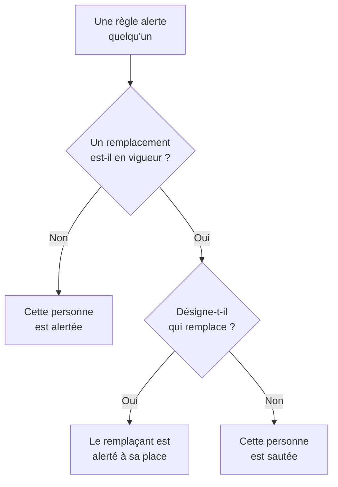

# Remplacements d'utilisateur

Pendant l'absence de quelqu'un, un remplacement d'utilisateur envoie les alertes qui le joindraient à la personne qui le remplace, pour une durée fixée. Si personne n'est désigné pour remplacer, il le saute à la place : chacun de ses tours dans un planning d'astreinte passe à la personne suivante de la rotation. Utilisez-en un pour des vacances, un arrêt maladie ou un échange de permanence.

:::cards
- [Comment un remplacement change une alerte](#comment-un-remplacement-change-une-alerte): Qui est alerté à la place, et quand.
- [Ajouter un remplacement](#ajouter-un-remplacement): Qui est absent, qui remplace, à partir de quand et jusqu'à quand.
- [Toutes les politiques, ou une seule](#toutes-les-politiques-ou-une-seule): Où ajouter un remplacement, et lequel l'emporte.
- [Autres façons d'en ajouter un](#autres-façons-den-ajouter-un): Depuis un planning, et depuis vos permanences à venir.
:::

## Comment un remplacement change une alerte



Tant qu'un remplacement est en vigueur, de son début à sa fin :

- Avec quelqu'un sous **Qui remplace ?**, cette personne reçoit toutes les alertes de la personne absente, de chaque planning, équipe et règle auxquels le remplacement s'applique. L'alerte la joint selon ses propres règles d'astreinte personnelles.
- Sans remplaçant, la personne est sautée. Dans un planning d'astreinte, chacun de ses tours passe à la personne suivante de la rotation qui n'est pas absente ; si tout le monde dans une couche est absent, les couches en dessous prennent le relais. Une règle qui la nomme directement, ou par une équipe, ne l'alerte pas, et l'exécution de la politique indique qu'elle est absente, et jusqu'à quand.
- Les remplacements ne s'enchaînent pas. Si le remplaçant est lui aussi absent, c'est quand même lui qui est alerté pour la personne qu'il remplace.

Une fois le remplacement terminé, les alertes reviennent à la personne. La **Chronologie des astreintes**, les couches d'un planning et les flux de calendrier montrent tous qui a chaque permanence remplacée.

## Ajouter un remplacement

:::steps
### Ouvrir les remplacements

Allez dans **Astreinte → Avancé → Remplacements d'utilisateur** pour remplacer quelqu'un dans toutes les politiques d'astreinte, ou sur la page **Remplacements d'utilisateur** d'une politique, sous **Avancé**, pour le remplacer dans cette seule politique. Cliquez sur **Ajouter : Remplacement d'utilisateur**.

### Indiquer qui est absent

**Qui est absent ?** commence avec vous, car déclarer sa propre absence est le cas le plus courant. Choisissez quelqu'un d'autre pour organiser son remplacement.

### Indiquer qui remplace

Laissez **Qui remplace ?** sur **Personne suivante de la rotation** pour sauter la personne, ou choisissez le collègue qui prend toutes ses alertes. La personne absente n'est pas proposée.

### Fixer les horaires

**Commence** vaut maintenant, sauf si vous choisissez une autre heure. Réglez **Se termine** sur le moment de son retour : il doit venir après le début. Cliquez sur **Ajouter : Remplacement d'utilisateur**.
:::

Chaque remplacement est une ligne : **Absent**, **Remplacé par**, **Commence** et **Se termine**, filtrable par début et par fin. **Remplacé par** affiche **Personne suivante de la rotation** pour un saut. Un remplacement ne se modifie pas : supprimez-le et ajoutez-en un nouveau, ou supprimez-le pour faire revenir quelqu'un plus tôt.

## Toutes les politiques, ou une seule

| Ajouté sous | Carte | S'applique à |
| --- | --- | --- |
| **Astreinte → Avancé → Remplacements d'utilisateur** | **Remplacements d'utilisateur globaux** | Toutes les politiques d'astreinte du projet |
| **Remplacements d'utilisateur** d'une politique | **Remplacements d'utilisateurs de la politique d'astreinte** | Cette politique seulement |

Quand deux remplacements pour la même personne se chevauchent, celui de la politique l'emporte sur un remplacement global, et celui qui désigne un remplaçant l'emporte sur un saut. Une alerte envoyée sans politique, depuis un workflow ou depuis le chat, ne suit que les remplacements globaux.

## Autres façons d'en ajouter un

- Depuis un planning : sur la page **Couches** d'un planning, dépliez une couche et cliquez sur **Passer son tour jusqu'au…** à côté d'une personne. Le même formulaire s'ouvre, avec elle absente et la rotation qui remplace, comme remplacement global. Voir [Quand quelqu'un est absent](/docs/on-call/schedules#quand-quelquun-est-absent).
- Depuis vos permanences à venir : **Trouver un remplaçant** sur l'une de vos permanences, sous **Paramètres utilisateur → Calendrier → Flux de calendrier**, ouvre le formulaire avec vous absent pour les horaires de cette permanence, si bien qu'il ne reste que **Qui remplace ?**. Voir [Permanences à venir et remplacement](/docs/on-call/calendar-feeds#permanences-à-venir-et-remplacement).

Quand quelqu'un quitte le projet, chaque remplacement qui le nomme et qui n'est pas encore terminé est supprimé, d'un côté comme de l'autre.

## Qui peut ajouter des remplacements

**Propriétaire du projet**, **Administrateur du projet**, **Membre du projet**, **Administrateur des astreintes** et **Membre des astreintes** peuvent ajouter et supprimer des remplacements ; **Lecteur** et **Lecteur des astreintes** peuvent les voir. Dans un rôle personnalisé, les permissions sont **Create On-Call Duty Policy User Override**, **Delete On-Call Duty Policy User Override** et **Read On-Call Duty Policy User Override**. Sur la **Chronologie des astreintes**, seules les personnes qui peuvent lire les remplacements voient quelle permanence est remplacée.

Sur OneUptime Cloud, les remplacements d'utilisateur nécessitent l'offre **Growth**.

## API

Les remplacements d'utilisateur sont la ressource `/api/on-call-duty-policy-user-override` :

| Champ | Ce qu'il contient |
| --- | --- |
| `overrideUserId` | La personne absente. Obligatoire. |
| `routeAlertsToUserId` | La personne qui remplace. Omettez-le pour sauter la personne à la place. |
| `startsAt`, `endsAt` | Quand le remplacement commence et se termine. Les deux sont obligatoires, et la fin vient après le début. |
| `onCallDutyPolicyId` | La politique à laquelle il s'applique. Omettez-le pour un remplacement global. |

```bash
curl -X POST https://oneuptime.com/api/on-call-duty-policy-user-override \
  -H "apikey: $ONEUPTIME_API_KEY" \
  -H "Content-Type: application/json" \
  -d '{
    "data": {
      "projectId": "<project-id>",
      "overrideUserId": "<away-user-id>",
      "routeAlertsToUserId": "<cover-user-id>",
      "startsAt": "2026-12-22T09:00:00Z",
      "endsAt": "2027-01-05T09:00:00Z"
    }
  }'
```

Un remplacement dont la personne absente et le remplaçant sont la même personne est refusé, tout comme un remplacement qui se termine avant de commencer.

## Dépannage

:::details La personne en congé a quand même été alertée
Vérifiez où le remplacement a été ajouté. Un remplacement sur la page **Remplacements d'utilisateur** d'une politique ne couvre que cette politique, et les autres politiques l'alertent encore : ajoutez-le sous **Astreinte → Avancé → Remplacements d'utilisateur** pour couvrir toutes les politiques. Vérifiez aussi **Commence** et **Se termine** : les horaires sont affichés dans votre fuseau horaire.
:::

:::details Le remplaçant n'a pas été alerté non plus
Il est joint selon ses propres règles d'astreinte personnelles et ses méthodes vérifiées. Cherchez-le dans **Astreinte → Disponibilité**, et consultez l'exécution dans les **Journaux d'exécution** de la politique.
:::

:::details Je ne peux pas ajouter de remplacement
Il faut l'un des rôles ci-dessus, et sur OneUptime Cloud l'offre **Growth**.
:::

## Étapes suivantes

:::cards
- [Plannings d'astreinte](/docs/on-call/schedules): Rotations, couches, et sauter quelqu'un dans une couche.
- [Chronologie des astreintes](/docs/on-call/schedule-timeline): Voir chaque permanence remplacée, sur tous les plannings.
- [Flux de calendrier](/docs/on-call/calendar-feeds): Trouver un remplaçant pour l'une de vos propres permanences.
:::
