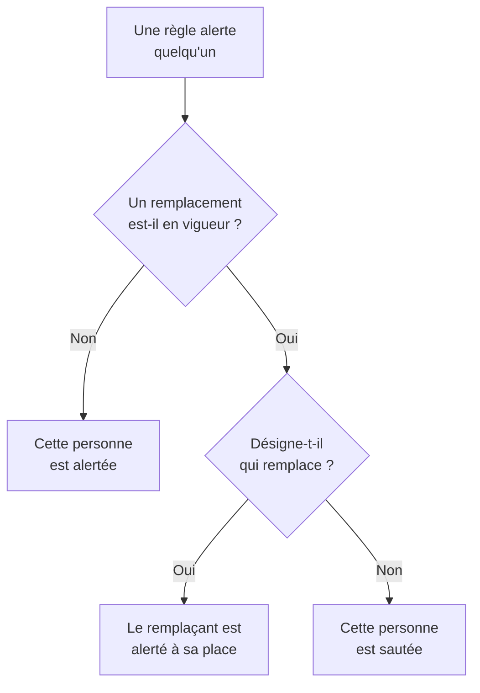

# Remplacements d'utilisateur

Pendant l'absence de quelqu'un, un remplacement d'utilisateur envoie les alertes qui le joindraient à la personne qui le remplace, pour une durée fixée. Si personne n'est désigné pour remplacer, il le saute à la place : chacun de ses tours dans un planning d'astreinte passe à la personne suivante de la rotation. Utilisez-en un pour des vacances, un arrêt maladie ou un échange de permanence.

:::cards
- [Comment un remplacement change une alerte](#comment-un-remplacement-change-une-alerte): Qui est alerté à la place, et quand.
- [Ajouter un remplacement](#ajouter-un-remplacement): Qui est absent, qui remplace, à partir de quand et jusqu'à quand.
- [Modifier un remplacement](#modifier-un-remplacement): Changer qui remplace, ou quand il commence et se termine.
- [Toutes les politiques, ou une seule](#toutes-les-politiques-ou-une-seule): Où ajouter un remplacement, et lequel l'emporte.
- [Autres façons d'en ajouter un](#autres-façons-den-ajouter-un): Depuis un planning, et depuis vos permanences à venir.
:::

## Comment un remplacement change une alerte



Tant qu'un remplacement est en vigueur, de son début à sa fin :

- Avec quelqu'un sous **Qui remplace ?**, cette personne reçoit toutes les alertes de la personne absente, de chaque planning, équipe et règle auxquels le remplacement s'applique. L'alerte la joint selon ses propres règles d'astreinte personnelles.
- Sans remplaçant, la personne est sautée. Dans un planning d'astreinte, chacun de ses tours passe à la personne suivante de la rotation qui n'est pas absente ; si tout le monde dans une couche est absent, les couches en dessous prennent le relais. Une règle qui la nomme directement, ou par une équipe, ne l'alerte pas, et l'exécution de la politique indique qu'elle est absente, et jusqu'à quand.
- Les remplacements ne s'enchaînent pas. Si le remplaçant est lui aussi absent, c'est quand même lui qui est alerté pour la personne qu'il remplace.

Une fois le remplacement terminé, les alertes reviennent à la personne. La **Chronologie des astreintes**, les couches d'un planning et les flux de calendrier montrent tous qui a chaque permanence remplacée.

## Ajouter un remplacement

:::steps
### Ouvrir les remplacements

Allez dans **Astreinte → Avancé → Remplacements d'utilisateur** pour remplacer quelqu'un dans toutes les politiques d'astreinte, ou sur la page **Remplacements d'utilisateur** d'une politique, sous **Avancé**, pour le remplacer dans cette seule politique. Cliquez sur **Ajouter : Remplacement d'utilisateur**.

### Indiquer qui est absent

**Qui est absent ?** commence avec vous, car déclarer sa propre absence est le cas le plus courant. Choisissez quelqu'un d'autre pour organiser son remplacement.

### Indiquer qui remplace

Laissez **Qui remplace ?** sur **Personne suivante de la rotation** pour sauter la personne, ou choisissez le collègue qui prend toutes ses alertes. La personne absente n'est pas proposée.

### Fixer les horaires

**Commence** vaut maintenant, sauf si vous choisissez une autre heure. Réglez **Se termine** sur le moment de son retour : il doit venir après le début. Cliquez sur **Ajouter : Remplacement d'utilisateur**.
:::

Chaque remplacement est une ligne : **Absent**, **Remplacé par**, **Commence** et **Se termine**, filtrable par début et par fin. **Remplacé par** affiche **Personne suivante de la rotation** pour un saut.

## Modifier un remplacement

Cliquez sur **Modifier** sur la ligne d'un remplacement, sur l'une ou l'autre page **Remplacements d'utilisateur**, ou dans la liste des remplacements d'utilisateur de la page **Couches** d'un planning. Le formulaire s'ouvre avec le remplacement tel qu'il a été enregistré : modifiez-le, puis cliquez sur **Enregistrer les modifications**.

- **Qui remplace ?** peut changer jusqu'à la fin du remplacement. Remettez **Personne suivante de la rotation** pour sauter plutôt la personne.
- **Commence** peut être déplacé jusqu'au début du remplacement, puis reste tel quel. **Se termine** peut être déplacé jusqu'à la fin du remplacement : réglez-le sur maintenant pour arrêter le remplacement plus tôt. Aucun des deux ne peut être déplacé dans le passé.
- **Qui est absent ?** ne peut pas changer. Pour quelqu'un d'autre, ajoutez un nouveau remplacement.

Un remplacement terminé ne peut plus être modifié : son **Modifier** est verrouillé et dit pourquoi.

## Toutes les politiques, ou une seule

| Ajouté sous | Carte | S'applique à |
| --- | --- | --- |
| **Astreinte → Avancé → Remplacements d'utilisateur** | **Remplacements d'utilisateur globaux** | Toutes les politiques d'astreinte du projet |
| **Remplacements d'utilisateur** d'une politique | **Remplacements d'utilisateurs de la politique d'astreinte** | Cette politique seulement |

Deux remplacements pour la même personne ne peuvent pas se chevaucher sur la même politique, ni quand les deux sont globaux. Le formulaire le signale dès que les heures sont choisies, avec **Modifier ce remplacement** pour modifier plutôt celui-là. L'un peut se terminer quand le suivant commence.

Le remplacement propre à une politique peut chevaucher un remplacement global de la même personne : sur cette politique, c'est le sien qui est utilisé tant que les deux s'appliquent, et le formulaire le signale. Une alerte envoyée sans politique, depuis un workflow ou depuis le chat, ne suit que les remplacements globaux.

Les remplacements qui se chevauchaient avant cette règle restent tels quels. Les deux sont marqués **Chevauchement**, qui indique lequel est utilisé : celui qui désigne un remplaçant plutôt qu'un saut, puis celui qui commence en premier, puis celui ajouté en premier.

## Autres façons d'en ajouter un

- Depuis un planning : sur la page **Couches** d'un planning, dépliez une couche et cliquez sur **Passer son tour jusqu'au…** à côté d'une personne. Le même formulaire s'ouvre, avec elle absente et la rotation qui remplace, comme remplacement global. Voir [Quand quelqu'un est absent](/docs/on-call/schedules#quand-quelquun-est-absent).
- Depuis vos permanences à venir : **Trouver un remplaçant** sur l'une de vos permanences, sous **Paramètres utilisateur → Calendrier → Flux de calendrier**, ouvre le formulaire avec vous absent pour les horaires de cette permanence, si bien qu'il ne reste que **Qui remplace ?**. Voir [Permanences à venir et remplacement](/docs/on-call/calendar-feeds#permanences-à-venir-et-remplacement).

Quand quelqu'un quitte le projet, chaque remplacement qui le nomme et qui n'est pas encore terminé est supprimé, d'un côté comme de l'autre.

## Qui peut ajouter des remplacements

**Propriétaire du projet**, **Administrateur du projet**, **Membre du projet**, **Administrateur des astreintes** et **Membre des astreintes** peuvent ajouter, modifier et supprimer des remplacements ; **Lecteur** et **Lecteur des astreintes** peuvent les voir. Dans un rôle personnalisé, les permissions sont **Create On-Call Policy User Override**, **Edit On-Call Policy User Override**, **Delete On-Call Policy User Override** et **Read On-Call Policy User Override**. Sur la **Chronologie des astreintes**, seules les personnes qui peuvent lire les remplacements voient quelle permanence est remplacée.

Un remplacement sur une politique suit la portée de la politique. Donnez à une équipe **Membre des astreintes** limité aux politiques qu'elle possède, ou à son étiquette, et ses membres ajoutent, modifient et suppriment des remplacements sur ces seules politiques. Un remplacement global s'applique à toutes les politiques, celles d'une autre équipe comprises, si bien que l'ajouter, le modifier ou le supprimer demande la permission des remplacements sur tout le projet. Avec une permission plus étroite, **Ajouter : Remplacement d'utilisateur**, **Modifier** et **Supprimer** dans **Astreinte → Avancé → Remplacements d'utilisateur** sont verrouillés et disent pourquoi. **Passer son tour jusqu'au…** dans les couches d'un planning et **Trouver un remplaçant** sur vos permanences à venir, qui ajoutent des remplacements globaux, proposent à la place les politiques sur lesquelles vous pouvez ajouter des remplacements, avec un remplacement par politique, tout comme le remplacement dans l'application mobile ; là où vous n'en avez aucune, ils sont verrouillés et disent pourquoi. L'équipe ajoute ses remplacements sur la page **Remplacements d'utilisateur** de chaque politique. Il en va de même pour l'API : un remplacement sans `onCallDutyPolicyId` est refusé pour une permission limitée à des étiquettes ou aux politiques possédées.

Sur OneUptime Cloud, les remplacements d'utilisateur nécessitent l'offre **Growth**.

## API

Les remplacements d'utilisateur sont la ressource `/api/on-call-duty-policy-user-override` :

| Champ | Ce qu'il contient |
| --- | --- |
| `overrideUserId` | La personne absente. Obligatoire. |
| `routeAlertsToUserId` | La personne qui remplace. Omettez-le pour sauter la personne à la place. |
| `startsAt`, `endsAt` | Quand le remplacement commence et se termine. Les deux sont obligatoires, et la fin vient après le début. |
| `onCallDutyPolicyId` | La politique à laquelle il s'applique. Omettez-le pour un remplacement global. |

```bash
curl -X POST https://oneuptime.com/api/on-call-duty-policy-user-override \
  -H "apikey: $ONEUPTIME_API_KEY" \
  -H "Content-Type: application/json" \
  -d '{
    "data": {
      "projectId": "<project-id>",
      "overrideUserId": "<away-user-id>",
      "routeAlertsToUserId": "<cover-user-id>",
      "startsAt": "2026-12-22T09:00:00Z",
      "endsAt": "2027-01-05T09:00:00Z"
    }
  }'
```

Un remplacement dont la personne absente et le remplaçant sont la même personne est refusé, tout comme un remplacement qui se termine avant de commencer. Il en va de même d'un remplacement qui en chevauche un autre de la même personne sur la même politique, ou quand les deux sont globaux : le refus nomme celui qu'il chevauche.

Pour modifier un remplacement, envoyez `PUT /api/on-call-duty-policy-user-override/<override-id>` avec les champs à changer dans `data` : `routeAlertsToUserId` (`null` pour sauter plutôt la personne), `startsAt` et `endsAt`. `overrideUserId` et `onCallDutyPolicyId` ne peuvent pas changer. Un remplacement terminé ne peut pas être modifié, ni le début d'un remplacement déjà commencé, et une heure modifiée ne peut pas être déplacée dans le passé.

## Dépannage

:::details La personne en congé a quand même été alertée
Vérifiez où le remplacement a été ajouté. Un remplacement sur la page **Remplacements d'utilisateur** d'une politique ne couvre que cette politique, et les autres politiques l'alertent encore : ajoutez-le sous **Astreinte → Avancé → Remplacements d'utilisateur** pour couvrir toutes les politiques. Vérifiez aussi **Commence** et **Se termine** : les horaires sont affichés dans votre fuseau horaire.
:::

:::details Le remplaçant n'a pas été alerté non plus
Il est joint selon ses propres règles d'astreinte personnelles et ses méthodes vérifiées. Cherchez-le dans **Astreinte → Disponibilité**, et consultez l'exécution dans les **Journaux d'exécution** de la politique.
:::

:::details Je ne peux pas ajouter de remplacement
Il faut l'un des rôles ci-dessus, et sur OneUptime Cloud l'offre **Growth**. Un remplacement global demande le rôle sur tout le projet : si le rôle de votre équipe est limité à ses propres politiques ou à certaines étiquettes, ajoutez le remplacement sur la page **Remplacements d'utilisateur** de la politique elle-même. **Passer son tour jusqu'au…**, **Trouver un remplaçant** et l'application mobile ne proposent alors que les politiques sur lesquelles vous pouvez ajouter des remplacements, et sont verrouillés là où vous n'en avez aucune.
:::

:::details Un remplacement ne peut pas être enregistré, car il en chevauche un autre
La personne a déjà un remplacement à certaines de ces heures : sur la même politique, ou un remplacement global quand celui-ci est global aussi. Cliquez sur **Modifier ce remplacement** sous **Se termine** pour modifier plutôt celui-là, ou choisissez des heures qui ne le chevauchent pas.
:::

## Étapes suivantes

:::cards
- [Plannings d'astreinte](/docs/on-call/schedules): Rotations, couches, et sauter quelqu'un dans une couche.
- [Chronologie des astreintes](/docs/on-call/schedule-timeline): Voir chaque permanence remplacée, sur tous les plannings.
- [Flux de calendrier](/docs/on-call/calendar-feeds): Trouver un remplaçant pour l'une de vos propres permanences.
:::
