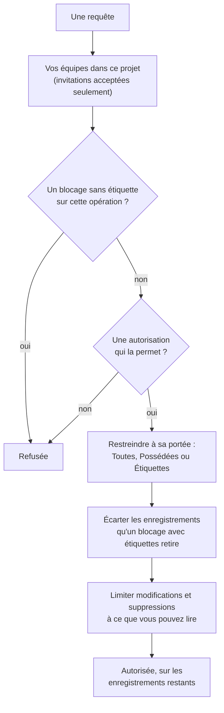

# Utilisateurs, équipes et autorisations

Tout dans OneUptime vit à l'intérieur d'un **projet**. Qui peut y faire quoi se ramène à trois choses : les **utilisateurs** qui en font partie, les **équipes** auxquelles ils appartiennent et les **autorisations** accordées à ces équipes.

> [!IMPORTANT]
> **Les utilisateurs ne détiennent jamais d'autorisations directement.** L'accès d'un utilisateur est l'union des autorisations de toutes les équipes auxquelles il appartient dans ce projet. Pour changer ce que quelqu'un peut faire, vous changez son appartenance à une équipe ou les autorisations de cette équipe.

Les **propriétaires** relèvent d'une autre idée. Un propriétaire est la personne responsable d'une ressource précise — un moniteur, un incident, un tableau de bord. Les propriétaires sont notifiés au sujet de leurs ressources, et les autorisations peuvent facultativement être restreintes à « uniquement ce que je possède ».

## Comment fonctionne l'accès

```mermaid title="Comment une personne et une clé d'API obtiennent un accès"
flowchart TB
    User["Un utilisateur<br/>(un compte)"]
    Key["Une clé d'API"]
    subgraph Project["Un projet"]
        direction TB
        Team["Équipe"]
        Allow["Autorisations accordées,<br/>chacune avec une portée :<br/>Toutes, Possédées ou Étiquettes"]
        Block["Autorisations bloquées,<br/>qui l'emportent toujours"]
        KeyRules["Les autorisations accordées<br/>et bloquées de la clé"]
        Resources["Moniteurs, incidents,<br/>pages de statut et plus"]
    end
    User -->|"membre de"| Team
    Team --> Allow
    Team --> Block
    Key --> KeyRules
    Allow -->|"atteignent"| Resources
    KeyRules -->|"atteignent"| Resources
    Block -.->|"retirent"| Resources
```

| Concept | Ce que c'est |
| --- | --- |
| Utilisateur | Un compte OneUptime unique. Une connexion, autant de projets que nécessaire. |
| Projet | La frontière du locataire. Moniteurs, incidents, équipes et données appartiennent à un seul projet. |
| Équipe | Un groupe nommé au sein d'un projet, porteur des autorisations. |
| Membre d'équipe | Un utilisateur invité dans une équipe et ayant accepté. |
| Autorisation | Une capacité unique, p. ex. `CreateProjectMonitor`, ou un rôle qui en regroupe plusieurs, p. ex. `MonitorAdmin`. |
| Portée | Jusqu'où va une autorisation accordée : toutes les ressources, seulement celles possédées, ou seulement celles étiquetées. |
| Propriétaire | Un utilisateur ou une équipe désigné responsable d'une ressource précise. |
| Étiquette | Un marqueur posé sur les ressources, utilisé pour restreindre les autorisations et pour organiser. |

## Utilisateurs

Un compte utilisateur est global à l'instance OneUptime — la même connexion fonctionne dans tous les projets où l'utilisateur a été invité.

Un utilisateur est « dans » un projet dès qu'il est membre d'**au moins une équipe** de ce projet. Il n'existe pas d'étape séparée « ajouter un utilisateur au projet » : inviter quelqu'un dans un projet, c'est l'inviter dans une équipe.

:::steps
1. Ouvrez **Utilisateurs** depuis le menu **Produits**, sous **Paramètres**, puis cliquez sur **Inviter un utilisateur**. La liste montre toutes les personnes du projet et leur statut d'invitation.
2. Saisissez son **E-mail**. Une personne qui n'a pas encore de compte OneUptime se voit aussi demander un **Nom**.
3. Choisissez son **Équipe**, qui décide de ce qu'elle peut faire, puis cliquez sur **Inviter**.
4. Elle accepte depuis la cloche en haut à droite, sur **Invitations au projet**, et fait dès lors partie du projet.
:::

- Les invitations créent un membre d'équipe en attente. L'utilisateur ne compte comme membre du projet — et n'obtient la moindre autorisation — **qu'après avoir accepté l'invitation.**
- **Inviter un utilisateur** démarre sur l'équipe des membres du projet : l'équipe qui détient `ProjectMember` pour tout le projet, soit **Members** si vous ne l'avez pas renommée. Choisissez une autre équipe pour donner à la personne plus ou moins d'accès. Rien n'est présélectionné si vous ne pourriez pas inviter vous-même dans cette équipe — inviter quelqu'un lui transmet les autorisations de l'équipe, et vous ne pouvez transmettre que des autorisations que vous détenez — ou si le projet n'a pas d'équipe de ce genre. Le tableau de bord d'administration démarre sur la même équipe partout où un administrateur de l'instance ajoute quelqu'un à un projet : **Inviter un utilisateur** sur un projet, **Ajouter à un projet** sur un utilisateur et sur plusieurs utilisateurs à la fois, et les projets rattachés à un [fournisseur SSO global](/docs/identity/global-sso).
- Retirer un utilisateur de toutes les équipes d'un projet lui retire l'accès à ce projet, dès sa requête suivante — y compris pendant qu'il est connecté. Son compte et ses autres projets ne sont pas touchés. Il est retiré des plannings d'astreinte, des règles d'escalade et des remplacements du projet, des rôles de ses incidents et épisodes ouverts et des propriétaires de ses ressources ; les incidents résolus gardent la trace de qui les possédait et les a menés.
- Une personne qui quitte un projet ne reçoit plus ses notifications. Ses propres méthodes, règles et paramètres de notification pour le projet sont supprimés avec sa dernière équipe — e-mail, SMS, appel, WhatsApp, Telegram, push, webhook, Slack et Microsoft Teams, son récapitulatif par e-mail et l'e-mail pas encore envoyé, son numéro pour les appels entrants et ses rappels de garde —, si bien qu'en revenant elle repart des valeurs par défaut. Ce qui la nomme encore, comme l'utilisateur qu'une règle d'appel entrant appelle ou un propriétaire conservé sur un incident résolu, ne la notifie plus : rien n'est envoyé au nom d'un projet à quelqu'un qui n'en est pas membre, et une invitation en attente n'est pas encore une adhésion. Ces endroits affichent **N'est plus membre** à côté de son nom, pour que vous puissiez y mettre quelqu'un d'autre. Une personne invitée qui n'a pas encore accepté affiche plutôt **Invitation pas encore acceptée**. Si un remplacement transfère les alertes de quelqu'un à une personne qui a quitté le projet, c'est la personne qu'il couvre qui est alertée à la place. Quitter le projet déconnecte aussi les clients MCP que la personne avait connectés au projet, et son lien personnel vers le calendrier d'astreinte affiche dès lors un calendrier vide. Sur OneUptime Cloud, une personne qui revient par l'authentification unique (SSO) du projet la confirme de nouveau depuis sa messagerie.
- Si votre projet impose le SSO et qu'un utilisateur ne s'est pas encore authentifié auprès du fournisseur d'identité, il est traité comme un utilisateur SSO non autorisé et ne voit rien tant qu'il ne l'a pas fait. Voir [SSO](/docs/identity/sso).
- Avec SCIM configuré, votre fournisseur d'identité peut créer, mettre à jour et supprimer automatiquement les utilisateurs et leurs appartenances aux équipes. Voir [SCIM](/docs/identity/scim).

## Équipes

Les équipes sont le chemin par lequel les autorisations parviennent aux personnes. Chaque nouveau projet démarre avec trois :

| Équipe | Autorisation détenue | Modifiable |
| --- | --- | --- |
| Owners | `ProjectOwner` | Non. Compte toujours au moins un membre. |
| Admin | `ProjectAdmin` | Non |
| Members | `ProjectMember` | Oui — c'est un point de départ, modifiez-la librement |

Les équipes **Owners** et **Admin** sont volontairement verrouillées : leurs autorisations ne peuvent pas être modifiées et les équipes ne peuvent être ni supprimées ni renommées. C'est ce qui empêche un projet de se verrouiller lui-même par accident. L'équipe Owners doit toujours conserver au moins un membre.

`ProjectOwner` est le niveau d'accès le plus élevé : facturation, suppression du projet, et tout ce que peut faire un administrateur. `ProjectAdmin` couvre tout sauf la facturation et la suppression du projet.

Activer ou désactiver les SMS, les appels téléphoniques, WhatsApp ou Telegram pour le projet relève de la facturation, car chaque message coûte de l'argent. Seuls `ProjectOwner`, le rôle `BillingAdmin` (**Billing Admin**) et l'autorisation `ManageProjectBilling` (**Manage Billing**) peuvent modifier ces interrupteurs, dans **Paramètres du projet > Notifications > Paramètres de notification** — pas `ProjectAdmin`.

Recharger les soldes prépayés du projet relève aussi de la facturation. Sur OneUptime Cloud, les SMS, les appels téléphoniques, WhatsApp et Telegram sont payés par le solde de **Paramètres du projet > Notifications > Paramètres de notification**, et l'IA par les crédits IA de **Paramètres du projet > IA > Crédits IA**. Seul un propriétaire du projet ou une personne disposant de **Manage Billing** peut les recharger ou modifier leur **Rechargement automatique** — un administrateur du projet ne le peut pas. Un message sur un solde qui s'épuise indique qui peut le recharger, et seules ces personnes ont un bouton **Recharger le solde** qui fonctionne ou un lien vers la page.

Créez autant d'équipes supplémentaires que vous voulez — « Astreinte Frontend », « Support », « Auditeurs en lecture seule » — et donnez à chacune les autorisations dont elle a besoin. Sur OneUptime Cloud, créer une équipe et modifier ses autorisations demande l'offre Scale.

**Créer une équipe** demande un nom et son **Accès**, c'est-à-dire ce que peuvent faire les membres de l'équipe :

| Accès | Ce que peuvent faire les membres de l'équipe |
| --- | --- |
| Administrateur du projet | Créer, modifier et supprimer tout ce qui se trouve dans le projet, ses paramètres compris. Pas la facturation, ni la suppression du projet. |
| Membre du projet | Créer, modifier et supprimer les moniteurs, les incidents, les pages de statut et les autres ressources du projet. |
| Lecteur | Tout lire dans le projet, et ne rien modifier. |
| Choisir les autorisations plus tard | Rien pour l'instant. Sélectionné au départ. |

:::steps
1. Ouvrez **Équipes** depuis le menu **Produits**, sous **Paramètres**, puis cliquez sur **Créer une équipe**.
2. Saisissez le **Nom** de l'équipe et choisissez son **Accès**. La description se trouve sous **Plus de champs**.
3. Créez l'équipe. Une équipe dotée d'un rôle s'ouvre sur sa page **Membres**, prête pour inviter des personnes ; avec **Choisir les autorisations plus tard**, elle s'ouvre sur sa page **Autorisations**, où vous ajoutez un rôle plus étroit comme `IncidentMember`, ou des autorisations isolées.
:::

Le rôle que vous choisissez devient la première autorisation de l'équipe, pour toutes les ressources du projet, dès que l'équipe existe — exactement comme si vous l'aviez ajouté avec **Ajouter un rôle** sur la page Autorisations de l'équipe. Seuls les rôles que vous détenez vous-même vous sont proposés, car toute personne que vous invitez dans l'équipe reçoit ses autorisations ; une personne qui peut créer des équipes sans pouvoir changer ce qu'elles peuvent faire n'est pas interrogée. Si le rôle ne peut pas être ajouté, l'équipe est tout de même créée et un avis au-dessus de la liste renvoie vers elle.

Où le trouver : ouvrez une équipe depuis **Équipes** pour accéder à **Membres** et **Autorisations** ; **Bloquer les autorisations** se trouve sous **Plus de paramètres**, en bas de la page Autorisations, dont l'en-tête replié indique combien l'équipe en a.

## Autorisations

Une autorisation est une capacité unique. Il y a deux façons de les distribuer, toutes deux dans l'onglet **Autorisations** de l'équipe.

### Rôles

Un rôle regroupe tout un domaine du produit à l'un de trois niveaux :

- **Admin** — ce que fait le Member, plus la configuration propre au domaine, comme les gravités et états des incidents et des alertes, les statuts des moniteurs et les états de maintenance.
- **Member** — le travail quotidien : créer, modifier et supprimer les ressources du domaine, avec leurs notes, propriétaires et modèles. Pour les pages de statut et l'astreinte, le Member fait tout ce que fait l'Admin.
- **Viewer** — lecture seule.

`MonitorAdmin`, `IncidentMember`, `StatusPageViewer`, etc. Les rôles conviennent dans la quasi-totalité des cas — ils restent corrects à mesure que OneUptime ajoute des fonctionnalités, car une nouvelle table liée aux moniteurs est rattachée aux rôles moniteurs existants au lieu d'exiger une nouvelle attribution de votre part.

Les workflows et les runbooks font exception. Tous deux exécutent du code dans votre projet — un workflow ses étapes, un runbook ses scripts sur vos Runners —, donc `WorkflowMember` ouvre les workflows et leurs exécutions et les lance à la main, et `RunbookMember` ouvre les runbooks et leurs exécutions et les exécute : il lance une exécution, termine ou ignore ses étapes et l'annule. Aucun des deux ne crée, ne modifie ni ne supprime ce qu'il exécute ; `WorkflowAdmin` et `RunbookAdmin` les construisent. Un rôle n'exécute que les runbooks que sa portée atteint : un `RunbookMember` limité à certaines étiquettes exécute les runbooks qui les portent. Voir [Autorisations des workflows](/docs/workflows/configuration#autorisations) et [Autorisations des runbooks](/docs/runbooks/configuration#autorisations).

Les règles d'un domaine (règles d'étiquettes, de propriétaires, d'astreinte, de regroupement et de rappel), les champs personnalisés, les SLA et les secrets relèvent de la configuration du projet : ils demandent `ProjectAdmin`, quel que soit le rôle de domaine de la personne. Il en va de même des clés API, des équipes et de leurs permissions, des étiquettes, du SSO et des domaines — les rôles Settings s'occupent des services, sondes, infrastructures et intégrations du projet, pas de qui peut faire quoi.

La facturation a trois rôles à elle. `BillingViewer` lit la facturation du projet — l'offre et l'abonnement, les factures, l'utilisation, les soldes, les crédits IA, les moyens de paiement et les coordonnées de facturation — et ne modifie rien. `BillingMember` télécharge en plus les factures et modifie les coordonnées de facturation. `BillingAdmin` fait ce que fait `BillingMember` et active ou désactive les SMS, les appels téléphoniques, WhatsApp et Telegram. Changer l'offre, les moyens de paiement ou les soldes, et payer les factures, demande `ProjectOwner` ou **Manage Billing** ; sur les pages de facturation, ces boutons sont verrouillés pour tous les autres et indiquent qui peut les utiliser.

Les {{PERMISSION_ROLE_COUNT}} rôles sont listés dans la [Référence des autorisations](/docs/permissions/reference).

### Autorisations granulaires

Chaque capacité individuelle est aussi attribuable seule — `CreateProjectMonitor`, `ReadProjectIncident`, `DeleteProjectStatusPage` et {{PERMISSION_TOTAL_COUNT}} autres. Utilisez-les quand un rôle est trop large et que vous devez n'accorder qu'une seule chose.

Une autorisation de modifier ou de supprimer n'atteint que ce que vous pouvez aussi lire : accordez donc avec elle l'autorisation de lecture correspondante — `EditProjectIncident` ne modifie aucun incident sans `ReadProjectIncident`. Un enregistrement lu à travers un autre, comme une note d'incident, demande aussi une autorisation de lire cet autre enregistrement : `ReadIncidentInternalNote` n'atteint aucune note sans une autorisation de lire les incidents, et `CreateIncidentInternalNote` n'ajoute une note qu'à un incident que vous pouvez lire. Les rôles comprennent déjà les deux.

Ce sont également les clés à utiliser pour créer des clés d'API, et celles qu'attendent l'API et le fournisseur Terraform.

La liste complète est dans la [Référence des autorisations](/docs/permissions/reference).

### Accorder et bloquer

Chaque équipe possède deux listes :

- **Autorisations** (accorder) — ce que cette équipe peut faire.
- **Bloquer les autorisations** — ce que cette équipe ne peut jamais faire, quelle que soit l'autorisation accordée.

Les deux se trouvent sur la page **Autorisations** de l'équipe. Peu d'équipes ont besoin d'un blocage, c'est pourquoi les autorisations bloquées sont repliées sous **Plus de paramètres**, en bas de la page.

> [!WARNING]
> **Le blocage l'emporte toujours.** Une entrée de blocage sans étiquette retire purement et simplement la capacité à l'équipe. Une entrée de blocage avec étiquettes ne la retire que pour les ressources portant ces étiquettes — pratique pour « cette équipe peut modifier les moniteurs, sauf ceux étiquetés Production ».

Une autorisation ne peut pas porter d'étiquettes de restriction dans les deux listes à la fois ; OneUptime rejette la seconde avec une explication.

Les autorisations accordées à un utilisateur s'additionnent sur toutes ses équipes, mais un blocage s'applique à tout ce que fait l'utilisateur : un blocage sans étiquette sur une équipe retire la capacité même si une autre équipe l'accorde, et une entrée de blocage n'accorde jamais rien. Si quelqu'un a moins d'accès que prévu, cherchez un blocage dans chacune de ses équipes ; s'il en a plus, cherchez une autorisation dans chacune.

### Changer un état

Un incident, une alerte, un épisode d'alertes ou d'incidents et une maintenance planifiée changent d'état, et un moniteur change de statut, par une nouvelle ligne dans leur chronologie des états. **Prendre en compte**, **Résoudre**, **Modifier l'état**, la page **Chronologie d'état**, l'API et les workflows en ajoutent tous une. L'ajouter demande l'autorisation de création de cette chronologie, avec une autorisation de lire l'enregistrement qu'elle modifie :

| Pour changer l'état de | Il faut |
| --- | --- |
| Un incident | **Create Incident State Timeline** |
| Une alerte | **Create Alert State Timeline** |
| Un épisode d'alertes | **Create Alert Episode State Timeline** |
| Un épisode d'incidents | **Create Incident Episode State Timeline** |
| Une maintenance planifiée | **Create Scheduled Maintenance State Timeline** |
| Un moniteur (son statut) | **Create Monitor Status Timeline** |

L'enregistrement reçoit ensuite le nouvel état de OneUptime elle-même, avec ce qui l'accompagne, comme le moment où un épisode a été résolu ou celui où une maintenance rappelle de nouveau ses abonnés. Un changement ne demande donc pas en plus une autorisation de modifier l'enregistrement : un rôle personnalisé avec **Create Incident State Timeline** mais sans **Edit Incident** change l'état d'un incident. Pour empêcher une équipe de changer des états, bloquez l'autorisation de création de la chronologie ; un blocage de **Edit Incident** laisse les changements d'état tels quels. Les étiquettes, les propriétaires et les enregistrements privés restreignent l'autorisation de création de la chronologie comme ils restreignent toute autre, à travers l'enregistrement dont elle change l'état : voir les règles de portée plus bas.

Seul l'état est écrit pour vous. Une note publiée avec un changement l'est en votre nom et demande l'autorisation propre à la note, comme décrit dans [Informer les abonnés de la page de statut d'un changement d'état](/docs/incidents/states-and-severities#prévenir-les-abonnés-de-la-page-de-statut-dun-changement-détat). Prendre en compte les alertes d'un incident pendant que vous le déclarez demande la même chose que de prendre en compte chacune d'elles sur sa propre page : **Create Alert State Timeline**, restreinte à travers chaque alerte, et pas **Edit Alert**. Voir [Prendre en compte les alertes en déclarant](/docs/incidents/linked-alerts#prendre-les-alertes-en-compte-en-déclarant).

## Portée : jusqu'où va une autorisation accordée

Chaque autorisation accordée l'est avec une portée, choisie sous **Portée** au moment de l'ajout :

| Portée | Signification |
| --- | --- |
| Toutes les ressources du projet | La valeur par défaut. L'autorisation s'applique à toutes les ressources correspondantes. |
| Possédées par cette équipe ou ses membres | L'autorisation ne s'applique qu'aux ressources dont cette équipe, ou l'utilisateur qui agit, est propriétaire. |
| Restreindre par étiquettes (avancé) | L'autorisation ne s'applique qu'aux ressources portant au moins une des étiquettes sélectionnées. |

**Possédées** est le moyen le plus simple de construire un modèle « chacun s'occupe de ses propres services » : donnez à une équipe `MonitorAdmin` avec la portée Possédées, puis faites de cette équipe le propriétaire des moniteurs dont elle a la charge. Cela ne restreint que les ressources pouvant réellement avoir des propriétaires — moniteurs, incidents, tableaux de bord, services, etc. La configuration du projet (états d'incident, étiquettes, équipes elles-mêmes) n'a pas de propriétaire ; un rôle en portée Possédées s'y comporte donc normalement.

**Étiquettes** est la version plus manuelle de la même idée : marquez les ressources, puis accordez des autorisations restreintes à ces marqueurs.

**Agir sur tout le projet demande une autorisation qui l'atteint.** **Run Now** d'une règle applique la règle à chaque ressource du projet, et les règles d'affectation de site, d'étiquette d'appareil et d'importation automatique d'un réseau à chaque appareil réseau ou analyse ; cela demande donc des autorisations dont la portée couvre toutes les ressources du projet : une autorisation restreinte à des étiquettes ou aux ressources possédées ne suffit pas, et un blocage avec étiquettes sur les ressources qu'une exécution modifie refuse l'exécution, car elle modifierait aussi les ressources qui portent ces étiquettes.

Certains rôles sont projet-entier par définition et n'offrent aucune portée, car les restreindre n'aurait pas de sens — « Billing Admin, mais seulement pour la facturation que je possède » ne décrit rien :

{{PERMISSION_SCOPE_EXEMPT_ROLES}}

## Propriétaires

Un propriétaire est un utilisateur ou une équipe rattaché à une ressource précise. La plupart des ressources représentant quelque chose que vous exploitez — moniteurs, incidents, alertes, maintenances planifiées, politiques d'astreinte, tableaux de bord, services, pages de statut, workflows, runbooks et SLO — ont un onglet **Propriétaires**.

Les propriétaires jouent deux rôles :

1. **Notification.** Les propriétaires sont ceux que OneUptime prévient quand il arrive quelque chose à la ressource — un moniteur tombe, un incident est créé, un SLO commence à consommer son budget d'erreur.
2. **Accès, si vous le demandez.** La propriété est ce sur quoi se résout la portée d'autorisation `Owned` (Possédées). Un utilisateur correspond s'il est personnellement propriétaire, ou si l'une de ses équipes l'est.

La propriété seule n'accorde rien. Être propriétaire d'un moniteur ne permet pas de le modifier si aucune de vos équipes ne détient également une autorisation sur les moniteurs. La propriété restreint l'accès ; elle ne l'élargit jamais.

Les propriétaires d'une ressource se lisent à travers la ressource. Les propriétaires d'un moniteur ou de toute autre ressource ne sont listés, lus, ajoutés et retirés que par quelqu'un qui peut lire cette ressource, et une autorisation portant sur les seuls propriétaires n'atteint les propriétaires d'aucune ressource que vous ne pouvez pas lire.

## Étiquettes

Les étiquettes sont des marqueurs valables dans tout le projet que vous attachez aux ressources. Elles servent à deux choses : filtrer et regrouper dans le tableau de bord, et restreindre les autorisations comme décrit plus haut.

Une restriction par étiquettes est satisfaite si la ressource porte **au moins une** des étiquettes de l'autorisation. Une ressource sans aucune étiquette ne satisfait aucune autorisation restreinte par étiquettes.

Un enregistrement sans étiquettes propres, comme la note d'un incident, une annonce de page de statut ou un insight IA sur un service, porte les étiquettes des enregistrements auxquels il appartient ou dont il parle. Une autorisation restreinte par étiquettes l'atteint quand l'un de ces enregistrements porte l'une de ses étiquettes, et un blocage avec étiquettes l'écarte quand l'un d'eux porte une étiquette bloquée, pour la lecture, la modification et la suppression. Un enregistrement qui ne concerne aucun d'eux, comme un insight IA qui ne concerne aucun service, appartient au projet : une restriction par étiquettes ne le restreint pas, et un blocage avec étiquettes ne l'écarte pas.

Où le trouver : **Paramètres du projet > Basique > Étiquettes**. La couleur d'une nouvelle étiquette est déjà choisie quand son formulaire s'ouvre, une couleur que les étiquettes de la page n'utilisent pas encore ; choisissez-en une autre si vous le souhaitez. Sur OneUptime Cloud, créer et modifier des étiquettes demande l'offre Growth.

## Télémétrie

Les logs, les traces, les métriques, les exceptions, les profils et les relectures de session appartiennent à la ressource qui les a envoyés : un service, un hôte, un cluster Kubernetes, un moniteur, une application RUM, etc. Une autorisation de télémétrie lit aussi loin que porte sa portée :

- **Toutes les ressources** lit la télémétrie de toutes les ressources du projet.
- **Possédées** lit la télémétrie des ressources que vous ou l'une de vos équipes possédez, ainsi que la télémétrie qui ne nomme aucune ressource.
- **Étiquettes** lit la télémétrie des ressources portant l'une des étiquettes de l'autorisation.

Un blocage avec étiquettes sur une autorisation de télémétrie écarte la télémétrie des ressources portant ces étiquettes, quoi que vous déteniez par ailleurs. Cela vaut partout où la télémétrie est lue : les explorateurs et leurs graphiques, filtres et listes d'attributs, les exports, les relectures de session et ce que l'assistant IA lit pour vous. La liste des noms de métriques montre les métriques que remonte un service que vous pouvez lire, et celles qu'aucun service ne remonte, comme les métriques des hôtes et des clusters. Si vous pouvez aussi lire la télémétrie d'autres types de ressources, comme des hôtes ou des clusters, elle montre tous les noms de métriques.

La suppression de télémétrie s'en tient aux mêmes ressources : une suppression atteint les lignes des ressources qu'atteignent à la fois votre autorisation de lire le signal et votre autorisation de le supprimer, moins celles qu'un blocage avec étiquettes sur l'une ou l'autre retire, et elle se fait dans un seul projet à la fois.

Les logs de moniteur, l'historique des SLO, les flux réseau et les allocations de coûts Kubernetes se lisent de la même façon, à travers le moniteur, le SLO, l'appareil réseau ou le cluster auquel ils appartiennent : Possédées et Étiquettes atteignent les lignes des enregistrements que vous pouvez lire, et un blocage avec étiquettes écarte les lignes des enregistrements qui portent ces étiquettes. Le journal d'audit et les indicateurs de renseignement sur les menaces se lisent sur tout le projet par quiconque peut les lire.

## Clés d'API

Les clés d'API reçoivent leurs autorisations directement, sur la clé elle-même — elles n'appartiennent à aucune équipe et ne sont pas affectées par les appartenances.

- Attribuez les mêmes autorisations granulaires et rôles que vous donneriez à une équipe.
- Les clés prennent en charge les **autorisations bloquées** et les **restrictions par étiquettes**, comme les équipes.
- Les clés ne prennent **pas** en charge la portée Possédées. La propriété se résout par rapport à un utilisateur, et une clé n'est pas un utilisateur : accordez donc aux clés l'accès dont elles ont besoin de manière explicite.

**Créer une clé** demande un nom et son **Accès** :

| Accès | Ce que peut faire la clé |
| --- | --- |
| Administrateur du projet | Créer, modifier et supprimer tout ce qui se trouve dans le projet, ses paramètres compris. Pas la facturation, ni la suppression du projet. |
| Membre du projet | Créer, modifier et supprimer les moniteurs, les incidents, les pages de statut et les autres ressources du projet, comme le peut un membre du projet. |
| Lecteur | Tout lire dans le projet, et ne rien modifier. |
| Choisir les autorisations plus tard | Rien pour l'instant. Sélectionné au départ. |

:::steps
1. Ouvrez **Paramètres du projet > Avancé > Clés API** et cliquez sur **Créer : Clé API**. Sur OneUptime Cloud, les clés d'API demandent l'offre Growth.
2. Saisissez le **Nom** de la clé et choisissez son **Accès**. La description et la date d'expiration se trouvent sous **Plus de champs** ; une clé expire un an après le jour de sa création, sauf si vous choisissez une autre date, et la section repliée l'indique.
3. Créez la clé. Elle s'ouvre sur sa page, où vous la copiez.
:::

Le rôle que vous choisissez devient la première autorisation de la clé dès que la clé existe, exactement comme si vous l'aviez ajouté sur la page de la clé. Seuls les rôles que vous détenez vous-même vous sont proposés — une clé ne peut jamais recevoir plus que ce que détient la personne qui la donne — et une personne qui peut créer des clés sans pouvoir changer ce qu'elles peuvent faire n'est pas interrogée.

Sur la page d'une clé, **Ajouter un rôle** ajoute un rôle de la même liste que celle que propose l'onglet Autorisations d'une équipe, et **Ajouter une permission** (dans le menu **⋯** de la carte) ajoute une autorisation granulaire. **Bloquer les autorisations** se trouve sous **Plus de paramètres**, en bas de la page, dont l'en-tête replié indique combien la clé en a.

> [!TIP]
> Donnez à chaque intégration sa propre clé, avec le jeu d'autorisations le plus étroit qui fonctionne, afin de pouvoir en révoquer une sans perturber les autres.

## Comment OneUptime décide si une requête est autorisée

Pour un utilisateur connecté, dans l'ordre :



1. Trouver les équipes auxquelles l'utilisateur appartient dans ce projet, en ne comptant que les invitations acceptées. Une requête n'atteint que les enregistrements de ce projet : un enregistrement d'un autre projet, désigné par son identifiant ou dans un filtre, est traité comme s'il n'existait pas.
2. Rassembler toutes les lignes d'autorisation de ces équipes — accordées et bloquées, chacune avec ses étiquettes et sa portée.
3. Vérifier d'abord la liste des blocages. Un blocage sans étiquette sur n'importe quelle autorisation que la table cible accepte pour cette opération rejette la requête immédiatement, quelle que soit l'équipe qui le porte.
4. Vérifier la liste des autorisations accordées. La requête a besoin d'au moins une autorisation que la table cible accepte pour cette opération. Pour une ressource opérationnelle — un moniteur, un incident, un tableau de bord, etc. — l'autorisation **All Operational Resources** correspondante (Create, Read, Edit ou Delete) compte aussi, sauf si elle est elle-même bloquée.
5. Appliquer la portée. Les attributions en portée Possédées restreignent la requête aux ressources possédées ; celles par étiquettes la restreignent aux étiquettes correspondantes. Si une autre attribution pour la même opération est plus large, c'est la plus large qui l'emporte. Un enregistrement sans étiquettes propres, comme une note d'incident, correspond à une attribution par étiquettes quand l'un des enregistrements auxquels il appartient porte l'une de ses étiquettes. Une autorisation **All Operational Resources** restreinte à des étiquettes restreint de la même façon : elle atteint les ressources opérationnelles qui portent l'une de ses étiquettes, comme le ferait l'autorisation propre de la ressource restreinte à ces étiquettes. Une création est restreinte de la même façon : une autorisation de créer des pages de statut restreinte à des étiquettes ne crée que des pages de statut qui portent l'une de ses étiquettes, et une autorisation de créer des notes d'incident restreinte à des étiquettes n'ajoute des notes qu'aux incidents qui en portent une, sauf si une autre autorisation pour la création atteint tout le projet ; une création hors de leur portée est refusée avec un message qui nomme les étiquettes permises. Une autorisation de créer en portée Possédées ne crée une ressource ayant ses propres propriétaires, comme un moniteur ou une page de statut, que pour une personne, qui en devient propriétaire, et une note que sur un incident dont vous ou l'une de vos équipes êtes propriétaires. Une modification des étiquettes que porte un enregistrement est restreinte de la même façon : avec une autorisation de le modifier restreinte à des étiquettes, l'enregistrement garde au moins l'une d'elles, sauf si une autre autorisation de le modifier atteint tout le projet, et une modification qui retire la dernière est refusée avec un message qui nomme les étiquettes autorisées. Quand votre autorisation de créer un type d'enregistrement n'atteint que ce qui vous appartient, vous devenez propriétaire de ce que vous créez avant que quoi que ce soit d'autre ne lui arrive, et si vous ne pouvez pas l'être, la création est refusée sans rien laisser derrière elle.
6. Appliquer les blocages par étiquettes. Un blocage avec étiquettes rejette la requête si la ressource cible en porte une. Un blocage avec étiquettes sur une autorisation **All Operational Resources** retire les ressources qui portent ces étiquettes de ce que cette autorisation accorde. Quand un enregistrement n'a pas d'étiquettes propres, comme une note d'incident ou une annonce de page de statut, un blocage avec étiquettes l'écarte des lectures, des modifications et des suppressions si un enregistrement auquel il appartient porte l'une de ces étiquettes. Une liste d'enregistrements de tous vos projets à la fois, comme les incidents de votre page d'accueil, restreint les enregistrements de chaque projet selon vos blocages et vos attributions dans ce projet. Un blocage avec étiquettes sur une autorisation de créer refuse un nouvel enregistrement qui porte l'une de ses étiquettes ou, s'il n'a pas d'étiquettes propres, qui appartient à un enregistrement qui en porte une. Un blocage avec étiquettes sur une autorisation de modifier vous empêche de donner à un enregistrement l'une de ses étiquettes ou, s'il n'a pas d'étiquettes propres, de le faire pointer vers un enregistrement qui en porte une.
7. Limiter les modifications et les suppressions à ce que vous pouvez lire. Une modification ou une suppression est restreinte par vos autorisations de lecture autant que par l'autorisation de modifier : un enregistrement que vous ne pouvez pas lire — hors de vos étiquettes ou de vos propriétaires, ou portant une étiquette qu'un blocage de la lecture retire — n'est pas un enregistrement que vous pouvez modifier ou supprimer, et un blocage sans étiquette sur la lecture d'un type d'enregistrement retire aussi sa modification et sa suppression. Un enregistrement lu à travers un autre, comme une note d'incident ou une annonce de page de statut, n'est atteint qu'à travers un enregistrement que vous pouvez lire : sans autorisation de lire les incidents, une autorisation sur les notes n'atteint aucune note, un blocage avec étiquettes sur la lecture des incidents écarte les notes des incidents qui les portent, et quand votre autorisation de lire les incidents est en portée Possédées, une autorisation sur les notes n'atteint que les notes des incidents dont vous ou l'une de vos équipes êtes propriétaires. Un tel enregistrement n'est aussi créé que sous un enregistrement que vous pouvez lire : une note seulement sur un incident que vous pouvez lire, et une annonce seulement sur des pages de statut que vous pouvez lire, chacune d'elles ; en désigner un que vous ne pouvez pas lire est refusé comme s'il n'existait pas. Une modification suit la même règle : un enregistrement déplacé sous un autre, comme une annonce mise sur une autre page de statut, ne va que sous un enregistrement que vous pouvez lire, et ce sous quoi il se trouve déjà reste tel quel. Les enregistrements qu'une création ou une modification énumère, comme les moniteurs d'un incident ou les services d'une alerte, s'en tiennent à votre autorisation de les lire quand vous en avez une, et dans tous les cas à un blocage avec étiquettes sur leur lecture : un enregistrement hors de leur portée est refusé comme s'il n'existait pas, tandis qu'un enregistrement déjà énuméré reste. L'unique enregistrement qu'une création ou une modification nomme dans un champ à part, comme le moniteur d'une alerte ou le moniteur qu'affiche une page de statut, suit la même règle, tout comme les enregistrements qu'un modèle remplit, comme les moniteurs et les pages de statut qu'un modèle d'incident ajoute à un incident déclaré à partir de lui ; les sondes globales et les agents d'IA de OneUptime restent ouverts à tous les projets. Une modification ou une suppression d'un enregistrement désigné par son identifiant qui n'atteint rien reçoit la même réponse que si l'enregistrement n'existait pas (`404`) quand vous ne pouvez pas le lire, et est refusée quand vous pouvez le lire sans pouvoir le modifier. Une lecture d'un enregistrement par son identifiant répond `404` de la même façon quand l'enregistrement n'existe pas ou que vous ne pouvez pas le lire.

Chaque champ d'un enregistrement se lit avec l'autorisation de lecture de l'enregistrement lui-même : une autorisation portant sur un autre type d'enregistrement ne l'ouvre jamais. Certains champs sont volontairement plus restreints. Les secrets ne sont lus que par les personnes qui peuvent modifier ou administrer l'enregistrement auquel ils appartiennent, comme les clés de requêtes entrantes et d'e-mails entrants d'un moniteur et la clé de son agent serveur, ou les clés de webhook et d'e-mail entrant d'un workflow. Regarder l'enregistrement d'une relecture de session demande **Watch Session Replays**, pas seulement **List Session Replays**. La télémétrie se lit signal par signal : **Read Telemetry Service Log** lit les logs, **Read Telemetry Service Traces** lit les traces et **Read Telemetry Service Metrics** lit les métriques, graphiques de métriques compris.

Les champs suivent la même règle. Un blocage sans étiquette sur l'autorisation d'un champ retire ce champ, et pour une ressource opérationnelle l'autorisation **All Operational Resources** correspondante ouvre chaque champ que peut ouvrir toute personne autorisée à lire ou modifier l'enregistrement — mais pas un champ volontairement plus restreint, comme une clé secrète.

Un paramètre qui contient des identifiants n'est désigné que par quelqu'un qui peut le lire. Une création ou une modification ne désigne un serveur SMTP, un fournisseur d'appels et de SMS, un identifiant de runbook, des identifiants SNMP, une connexion d'appel vidéo ou une clé d'API — comme le serveur SMTP par lequel une page de statut envoie ses e-mails, ou l'identifiant avec lequel s'exécute une étape de runbook — que si vous pouvez lire ce type de paramètre ; celui que vous ne pouvez pas lire est refusé comme s'il n'existait pas, tandis qu'un enregistrement garde celui qu'il désigne déjà. Chercher des numéros à acheter auprès d'un fournisseur d'appels et de SMS, ou lister les numéros qu'il possède, demande la même lecture. Approuver un plan de commandes IA comportant une commande SSH, qui s'exécute avec un identifiant de runbook que OneUptime AI a choisi parmi ceux de son Runner, demande la lecture des identifiants de runbook (**Read Runbook Credential** ; les propriétaires et les administrateurs du projet le peuvent), tout comme enregistrer une règle de remédiation automatique qui laisse OneUptime AI exécuter ses commandes sans demander, quand l'enregistrement active cela ou ajoute des motifs de liste d'autorisation ou des Runners, activer **Exécute les commandes de remédiation IA** pour un Runner qui détient des identifiants SSH, ou attribuer un identifiant SSH à un Runner qui exécute les commandes de OneUptime AI. Une étape de workflow agit comme un administrateur du projet, mais on ne lui prête jamais la lecture d'un paramètre qui contient des identifiants : elle n'en désigne aucun et ne fait aucune de ces modifications ; une personne qui peut les lire doit s'en charger.

La même règle décide de tout ce qui demande si vous détenez une autorisation : les actions qui ne sont pas une simple lecture ou écriture — ajouter du crédit SMS, appels ou IA, payer une facture, tester une règle de notification — et les boutons qu'affiche OneUptime. Un bouton que vous ne pouvez pas utiliser s'affiche verrouillé et dit pourquoi ; quand un blocage sur l'une de vos équipes en est la raison, il nomme l'autorisation bloquée.

Les mises à jour en direct suivent la même règle. Quand un enregistrement est créé, modifié ou supprimé, OneUptime prévient les pages ouvertes des personnes qui peuvent lire cet enregistrement, et de personne d'autre. Ce qui limite ce que vous pouvez lire limite aussi vos mises à jour en direct : étiquettes, propriétaires, un blocage avec étiquettes, un incident privé ou la conversation IA de quelqu'un d'autre. Quand un changement vous retire l'accès à un enregistrement, par exemple en le rendant privé, vos pages ouvertes sont aussi prévenues, afin qu'elles cessent de l'afficher. Un changement de vos autorisations, un blocage ou la perte des droits d'administrateur principal atteint vos pages ouvertes immédiatement.

Les mises à jour en direct prennent aussi fin avec la connexion qui les a ouvertes. Se déconnecter, changer de mot de passe ou être bloqué arrête immédiatement les mises à jour en direct de vos pages ouvertes. Une page ouverte renouvelle sa connexion toutes les 15 minutes et reprend ses mises à jour en direct ; quand la connexion ne peut pas être renouvelée, elle vous emmène vers la page de connexion. Un projet qui exige le SSO n'envoie des mises à jour en direct qu'aux pages connectées avec le SSO, comme pour tout le reste.

Tout utilisateur connecté détient en plus un petit ensemble d'autorisations automatiques couvrant par exemple la lecture de son propre profil et de ses propres règles de notification. Ce ne sont pas des autorisations d'administration et elles ne donnent accès aux données de personne d'autre.

Les autorisations résolues sont mises en cache par utilisateur et par projet, et rafraîchies quand l'appartenance aux équipes ou les autorisations d'équipe changent. Si vous modifiez des autorisations et qu'un utilisateur ne voit pas le changement immédiatement, demandez-lui de recharger.

## Recettes

**Une équipe qui observe seulement.** Créez l'équipe avec **Lecteur** sous **Accès**. Pour certains domaines seulement, choisissez **Choisir les autorisations plus tard** et ajoutez les rôles `*Viewer` par domaine qu'elle doit voir.

**Des ingénieurs d'astreinte qui gèrent leurs propres services.** Donnez à l'équipe `MonitorAdmin`, `IncidentMember` et `OnCallMember` en portée **Possédées**, puis ajoutez l'équipe comme propriétaire des moniteurs qu'elle exploite.

**Des prestataires tenus à l'écart de la production.** Donnez à l'équipe les rôles nécessaires en portée **Toutes**, puis ajoutez une **autorisation bloquée** (sous **Plus de paramètres** sur la page Autorisations de l'équipe) pour les capacités sensibles, restreinte à l'étiquette `Production`.

**Un pipeline CI qui ne fait que signaler des déploiements.** Créez une clé d'API avec **Choisir les autorisations plus tard**, puis ajoutez sur sa page uniquement les autorisations granulaires nécessaires — aucun rôle.

**Quelqu'un qui ne doit ni modifier la facturation ni voir les factures.** Donnez-lui `ProjectMember`, pas `ProjectAdmin` : un administrateur de projet ne peut pas changer l'offre, les moyens de paiement ni les soldes, mais il lit et télécharge les factures. Pour qu'une personne lise les pages de facturation sans rien modifier, donnez-lui `BillingViewer`.

Quand l'accès n'est pas celui que vous attendez :

:::details Quelqu'un ne peut pas voir ou modifier ce qu'il devrait
Vérifiez qu'il a accepté l'invitation : un membre d'équipe en attente n'a aucune autorisation. Ouvrez ensuite chacune de ses équipes : un blocage sans étiquette sur n'importe quelle équipe retire la capacité, et une portée Possédées ou par étiquettes n'atteint que les ressources possédées ou étiquetées. Un bouton verrouillé nomme l'autorisation qu'il demande, ou le blocage qui le refuse.
:::

:::details Quelqu'un peut faire plus que prévu
Son accès est l'union de toutes les équipes dont il fait partie : cherchez donc une autorisation accordée dans chaque équipe, y compris **Admin** et **Owners**. Pour retirer une capacité quoi que ses équipes accordent, ajoutez une autorisation bloquée sur l'une de ses équipes.
:::

## Étapes suivantes

:::cards
- [Référence des autorisations](/docs/permissions/reference): Chaque rôle et chaque autorisation granulaire, générés depuis le code source de OneUptime.
- [SSO](/docs/identity/sso): Laissez les personnes se connecter avec votre fournisseur d'identité.
- [SCIM](/docs/identity/scim): Créez les utilisateurs et les appartenances aux équipes depuis votre fournisseur d'identité.
- [Référence de l'API](/docs/api-reference/api-reference): Appelez l'API avec une clé d'API et ses autorisations.
:::
