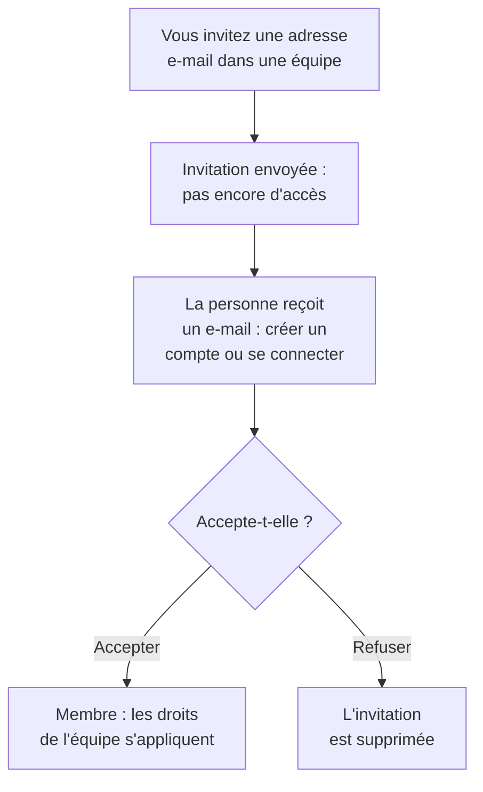

# Inviter des personnes

On rejoint un projet sur invitation. Vous invitez l'adresse e-mail d'une personne dans une équipe, elle accepte, et dès lors son équipe décide de ce qu'elle peut faire. Cette page montre comment inviter des personnes, ce qu'elles voient, et comment modifier ou retirer leur accès plus tard.

:::cards
- [Inviter quelqu'un](#inviter-quelquun): Une adresse e-mail et une équipe.
- [Accepter une invitation](#accepter-une-invitation): Ce que la personne invitée voit et fait.
- [Changer les équipes d'une personne](#changer-les-équipes-dune-personne): Lui donner plus d'accès, ou moins.
- [Retirer quelqu'un](#retirer-quelquun-du-projet): Ce que quitter le projet emporte.
:::

## Comment fonctionne une invitation

- **Son équipe décide de ce qu'elle peut faire.** Personne n'a d'autorisations propres : une personne peut faire ce que permettent les équipes dont elle fait partie. Voir [Utilisateurs, équipes et autorisations](/docs/permissions/index).
- **Rien n'est accordé avant l'acceptation.** Une invitation en attente apparaît comme **Invitation envoyée** et ne donne aucun accès au projet.
- **Une acceptation vaut pour tout le projet.** Accepter une invitation accepte toutes les autres invitations de la personne dans le même projet. Un membre que vous ajoutez plus tard à une autre équipe y est aussitôt, sans rien à accepter.

## Avant de commencer

- **Un rôle qui peut inviter.** Project Owner, Project Admin, ou un rôle avec l'autorisation **Invite New Members**. Vous ne pouvez inviter des personnes que dans une équipe dont vous détenez vous-même les autorisations, car une invitation leur donne l'accès de l'équipe.
- **Sur OneUptime Cloud, de la place dans votre forfait.** Chaque personne du projet est un siège sur sa facture, dès le moment où elle est invitée. Le forfait Free a de la place pour une personne. Voir [Facturation et utilisation](/docs/configuration/billing#votre-forfait-et-vos-sièges).
- **Pas de SCIM Push Groups.** Tant que votre fournisseur d'identité gère les équipes du projet via SCIM Push Groups, vous invitez et retirez les personnes là-bas, pas dans OneUptime.

## Inviter quelqu'un

:::steps
### Ouvrir Utilisateurs

Allez dans **Produits → Paramètres → Utilisateurs**. La liste **Utilisateurs** montre toutes les personnes du projet, leurs équipes et si elles l'ont rejoint.

### Cliquer sur Inviter un utilisateur

Cliquez sur **Inviter un utilisateur**. La boîte de dialogue **Inviter un nouvel utilisateur** s'ouvre.

### Saisir son adresse e-mail

Saisissez son adresse dans **E-mail**. Si aucun compte OneUptime ne l'utilise encore, la boîte de dialogue demande aussi un **Nom**, avec lequel son nouveau compte commence.

### Choisir son équipe

**Équipe** commence sur l'équipe des membres du projet : l'équipe qui détient Project Member pour tout le projet, ou sinon celle nommée Members. Choisissez une autre équipe pour lui donner plus d'accès, ou moins. **Équipe** reste vide quand le projet n'a pas une telle équipe, ou quand vous ne pourriez y inviter personne vous-même.

### Envoyer l'invitation

Cliquez sur **Inviter**. OneUptime envoie l'invitation par e-mail et ouvre la page de la personne. Elle apparaît comme **Invitation envoyée** jusqu'à ce qu'elle accepte.
:::

> [!TIP]
> Invitez les personnes dans l'équipe la plus restreinte qui leur permet de faire leur travail. Vous pourrez les ajouter à d'autres équipes plus tard, et chaque équipe qu'elles rejoignent élargit ce qu'elles peuvent faire.

## Accepter une invitation

L'e-mail d'invitation nomme le projet. Son bouton est **Create Your Account** pour quelqu'un qui n'a pas encore de compte OneUptime, et **Sign In to OneUptime** pour quelqu'un qui en a un. Une fois connectée, la personne accepte à l'un de deux endroits :

| Où elle se trouve | Ce qu'elle voit | Ce sur quoi elle clique |
| --- | --- | --- |
| Dans aucun projet encore | L'invitation, sur la page où elle arrive après s'être connectée | **Accepter et rejoindre**, ou **Refuser** |
| Déjà dans un autre projet | L'invitation en attente sur la cloche en haut à droite, qui ouvre **Invitations au projet** | **Accepter**, ou **Rejeter** |

L'acceptation la place aussitôt dans le projet, avec les autorisations de son équipe et la configuration de notifications avec laquelle tout membre commence : voir [Ce avec quoi vous commencez](/docs/notifications/index#ce-dont-vous-disposez-au-départ). Refuser supprime l'invitation : pour rejoindre plus tard, il en faut une nouvelle.

## Voir qui est dans le projet

**Utilisateurs** a une ligne par personne :

| Colonne | Ce qu'elle montre |
| --- | --- |
| **Utilisateur** | Son nom et son adresse e-mail. |
| **Équipes** | Chaque équipe du projet dont elle fait partie, ou à laquelle elle est invitée. |
| **Statut** | **Membre** une fois qu'elle a rejoint le projet, avec le nombre d'invitations vers d'autres équipes qu'elle n'a pas encore acceptées. **Invitation envoyée** jusque-là. |

Filtrez la liste par **Utilisateur**, **Statut** ou **Équipe**. Cliquez sur une ligne pour ouvrir la page de la personne :

| Page | À quoi elle sert |
| --- | --- |
| **Profil** | Son nom, son adresse e-mail, sa photo et son ID utilisateur. |
| **Équipes** | Les équipes dont elle fait partie. Ajoutez ou retirez une équipe ici. |
| **Disponibilité**, **Méthodes de notification**, **Règles d'astreinte** | Si elle peut être appelée, et comment. Visible par les Project Owners, les Project Admins, la personne elle-même et toute personne qui peut lire les règles de notification des autres. Voir [Disponibilité et rapports](/docs/on-call/readiness). |
| **Champs personnalisés** | Les champs personnalisés du projet pour les personnes, s'il en a. |
| **Retirer du projet** | La retirer du projet. |

## Changer les équipes d'une personne

:::steps
### Ouvrir sa page Équipes

Dans **Utilisateurs**, cliquez sur la personne, puis sur **Équipes**.

### L'ajouter à une équipe

Cliquez sur **Inviter**, choisissez l'**Équipe**, puis cliquez sur **Inviter** dans la boîte de dialogue. Un membre est aussitôt dans la nouvelle équipe. Une personne qui n'a pas encore rejoint le projet reçoit une invitation de plus, et accepter l'une accepte les deux.

### La retirer d'une équipe

Cliquez sur **Supprimer** sur la ligne de l'équipe. Si c'est la dernière équipe qu'elle a rejointe, la retirer la sort du projet, et la boîte de dialogue le dit avant que rien ne change.
:::

L'équipe Owners garde toujours au moins un membre qui a rejoint le projet, pour qu'un projet ne perde jamais son dernier propriétaire.

## Retirer quelqu'un du projet

Dans **Utilisateurs**, ouvrez le menu de la ligne de la personne, **⋯**, et cliquez sur **Retirer du projet**. Ou ouvrez la personne et choisissez **Retirer du projet** dans son menu latéral. Pour retirer plusieurs personnes à la fois, sélectionnez leurs lignes et supprimez la sélection : chacune est retirée de la même façon.

La retirer l'enlève de chaque équipe du projet. Elle perd l'accès aussitôt, même si elle est connectée, est retirée des plannings d'astreinte et des règles d'escalade, et ne reçoit plus les notifications du projet. Son compte OneUptime n'est pas supprimé, et vous pouvez l'inviter de nouveau. [Utilisateurs, équipes et autorisations](/docs/permissions/index#utilisateurs) liste tout ce que quitter un projet emporte.

## Autres façons de rejoindre un projet

- **Authentification unique.** Une personne qui se connecte pour la première fois avec le fournisseur d'identité du projet rejoint les équipes que le fournisseur nomme. Voir [Rôles et équipes des utilisateurs SSO](/docs/identity/sso#rôles-et-équipes-des-utilisateurs-sso).
- **SCIM.** Votre fournisseur d'identité crée les personnes et les ajoute aux équipes par défaut de la connexion. Voir [SCIM](/docs/identity/scim#provisionnement-dun-utilisateur-de-projet).
- **L'Admin Dashboard.** Sur une installation auto-hébergée, un administrateur principal peut ajouter quelqu'un à un projet et accepter l'invitation pour lui. Voir [Utilisateurs, équipes et autorisations](/docs/permissions/index#utilisateurs).

## Dépannage

:::details "This user has already been invited to this team"
La personne est déjà dans cette équipe, comme membre ou avec une invitation qu'elle n'a pas acceptée. Ouvrez-la dans **Utilisateurs** pour voir ses équipes, ou invitez-la dans une autre équipe.
:::

:::details "You have reached the user limit for the free plan"
Sur OneUptime Cloud, un projet au forfait Free a de la place pour une personne. Changez de forfait, puis invitez de nouveau. Voir [Changer de forfait](/docs/configuration/billing#changer-de-forfait).
:::

:::details "Too many invitations were sent to this email address in the last hour"
Une adresse peut recevoir 10 invitations par heure, aux projets et aux pages de statut privées ensemble, quel qu'en soit l'expéditeur. Attendez une heure, puis invitez la personne de nouveau.
:::

:::details L'e-mail d'invitation n'est pas arrivé, ou son lien a expiré
L'invitation ne dépend pas de l'e-mail. Demandez à la personne de s'inscrire avec l'adresse invitée : OneUptime envoie à cette adresse un nouveau lien pour finir de créer le compte. Une personne qui a déjà un compte se connecte et trouve l'invitation qui l'attend.
:::

:::details Inviter un utilisateur indique que les utilisateurs sont gérés par SCIM Push Groups
Votre fournisseur d'identité gère les équipes du projet. Invitez ou retirez les personnes dans le fournisseur d'identité, ou désactivez Push Groups dans **Paramètres du projet → Sécurité → SCIM** pour les gérer ici.
:::

## Étapes suivantes

:::cards
- [Utilisateurs, équipes et autorisations](/docs/permissions/index): Décider de ce que chaque équipe peut faire.
- [Paramètres du projet](/docs/configuration/project-settings): Tout ce qui s'applique au projet entier.
- [Votre compte](/docs/introduction/your-account): Connexion, profil et projets dont vous faites partie.
- [SCIM](/docs/identity/scim): Laisser votre fournisseur d'identité gérer les personnes et les équipes.
:::
