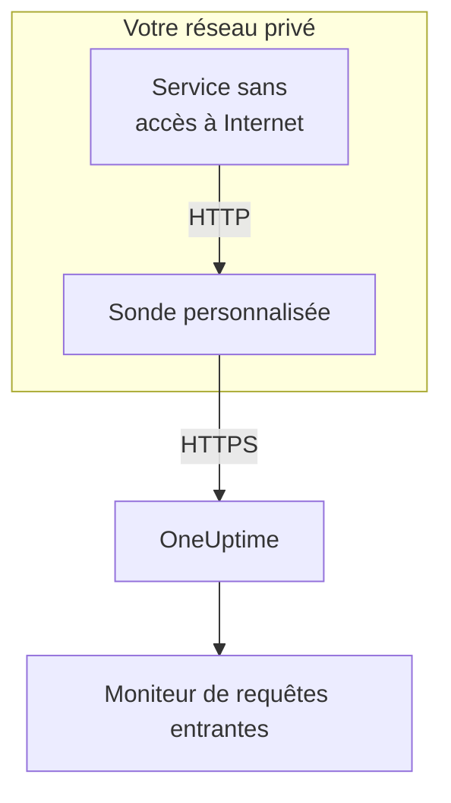

# Ingress de requêtes entrantes

Un service sans accès à Internet peut tout de même envoyer des heartbeats à un [moniteur de requêtes entrantes](/docs/monitor/incoming-request-monitor). Il les envoie plutôt à une [sonde personnalisée](/docs/probe/custom-probe) de son propre réseau, et la sonde les transmet à OneUptime.

:::cards
- [Fonctionnement](#fonctionnement): De votre service au moniteur, en passant par la sonde.
- [Activer l'écouteur](#activer-lécouteur): Un seul réglage sur la sonde, pour Docker, Docker Compose ou Kubernetes.
- [Envoyer les requêtes à la sonde](#envoyer-les-requêtes-à-la-sonde): Changer l'URL à laquelle votre service envoie, et rien d'autre.
- [Dépannage](#dépannage): Ce que la sonde journalise quand une requête ne passe pas.
:::

## Fonctionnement



1. **Votre service envoie la requête à la sonde.** Le même `GET` ou `POST`, avec la même clé secrète, qu'il enverrait à OneUptime, vers un port sur lequel la sonde écoute.
2. **La sonde répond aussitôt.** Elle répond `200` avant de transmettre la requête, pour que votre service n'attende jamais OneUptime.
3. **La sonde la transmet.** Elle envoie la requête à OneUptime avec sa méthode, ses en-têtes et son corps, et ajoute un en-tête `OneUptime-Probe-Id` qui désigne la sonde.
4. **OneUptime la lit comme d'habitude.** Les critères du moniteur voient la requête comme si le service l'avait envoyée directement.

L'écouteur tourne sur un port à lui, séparé des contrôles de santé de la sonde : vous pouvez l'ouvrir à votre réseau privé sans rien ouvrir d'autre.

## Quand l'utiliser

Utilisez l'écouteur lorsque :

- Vos services tournent dans un segment réseau isolé sans accès HTTPS sortant
- Vous devez garder tout le trafic de surveillance dans votre VPC ou votre réseau sur site
- Vous voulez un seul point de sortie – la sonde – autorisé à joindre OneUptime
- Vous avez déjà déployé une [sonde personnalisée](/docs/probe/custom-probe) et voulez la réutiliser pour des heartbeats entrants

Si vos services peuvent déjà joindre `https://oneuptime.com` (ou votre URL auto-hébergée) directement, vous n'avez **pas** besoin de cette fonction : appelez l'URL de heartbeat directement depuis le service.

## Avant de commencer

- **Une sonde personnalisée en marche.** Son **Statut** indique **Connecté**. Voir [Sondes personnalisées](/docs/probe/custom-probe) pour en installer une.
- **Un moniteur de requêtes entrantes.** Son URL de heartbeat contient la clé secrète qu'envoie votre service : voir [Surveillance des requêtes entrantes](/docs/monitor/incoming-request-monitor).
- **Un port de l'hôte de la sonde que vos services peuvent joindre.** Les exemples utilisent `3875`.

## Activer l'écouteur

Réglez `PROBE_INGRESS_PORT` sur le port que doit utiliser l'écouteur. Toute valeur supérieure à `0` l'active ; non définie, ou à `0`, elle le laisse désactivé.

:::tabs
@tab Docker
```bash
docker run --name oneuptime-probe --network host \
  -e PROBE_KEY=<probe-key> \
  -e PROBE_ID=<probe-id> \
  -e ONEUPTIME_URL=https://oneuptime.com \
  -e PROBE_INGRESS_PORT=3875 \
  -d oneuptime/probe:release
```

Sans `--network host`, publiez le port avec `-p 3875:3875`.
@tab Docker Compose
```yaml title="docker-compose.yml"
services:
  oneuptime-probe:
    image: oneuptime/probe:release
    container_name: oneuptime-probe
    environment:
      - PROBE_KEY=<probe-key>
      - PROBE_ID=<probe-id>
      - ONEUPTIME_URL=https://oneuptime.com
      - PROBE_INGRESS_PORT=3875
    network_mode: host
    restart: always
```

Sans `network_mode: host`, publiez le port sous `ports:` avec `"3875:3875"`.
@tab Kubernetes
```yaml title="oneuptime-probe.yaml"
apiVersion: apps/v1
kind: Deployment
metadata:
  name: oneuptime-probe
spec:
  selector:
    matchLabels:
      app: oneuptime-probe
  template:
    metadata:
      labels:
        app: oneuptime-probe
    spec:
      containers:
        - name: oneuptime-probe
          image: oneuptime/probe:release
          env:
            - name: PROBE_KEY
              value: "<probe-key>"
            - name: PROBE_ID
              value: "<probe-id>"
            - name: ONEUPTIME_URL
              value: "https://oneuptime.com"
            - name: PROBE_INGRESS_PORT
              value: "3875"
          ports:
            - name: ingress
              containerPort: 3875
---
apiVersion: v1
kind: Service
metadata:
  name: oneuptime-probe-ingress
spec:
  selector:
    app: oneuptime-probe
  ports:
    - name: ingress
      port: 3875
      targetPort: 3875
  type: ClusterIP
```

Les services du cluster envoient alors à `http://oneuptime-probe-ingress.<namespace>.svc.cluster.local:3875/heartbeat/<secret-key>`.
:::

Quand l'écouteur est en marche, le journal de la sonde indique `Probe ingress listener started on port 3875 (heartbeat / incoming-request endpoints)`.

## Envoyer les requêtes à la sonde

Votre service envoie à la sonde au lieu de OneUptime. Remplacez l'URL publique de heartbeat :

```text
https://oneuptime.com/heartbeat/<secret-key>
```

par l'URL d'ingress de la sonde :

```text
http://<probe-host>:<PROBE_INGRESS_PORT>/heartbeat/<secret-key>
```

Le chemin, la méthode, le corps et les en-têtes restent identiques par ailleurs : un code client existant n'a qu'à changer l'URL de base. La sonde accepte aussi `/incoming-request/<secret-key>`, qui fonctionne de la même façon.

```bash
# GET heartbeat
curl http://probe.internal:3875/heartbeat/YOUR_SECRET_KEY

# POST heartbeat with JSON body
curl -X POST http://probe.internal:3875/heartbeat/YOUR_SECRET_KEY \
  -H "Content-Type: application/json" \
  -d '{"status": "healthy", "version": "1.2.3"}'

# Cron job
*/5 * * * * curl -s http://probe.internal:3875/heartbeat/YOUR_SECRET_KEY > /dev/null
```

## Comment les requêtes sont transmises

| Quoi | Comment la sonde le gère |
| --- | --- |
| La réponse | `200` avec un objet JSON vide (`{}`), envoyée avant que la requête soit transmise. Comme sur OneUptime, elle est envoyée quoi qu'il arrive ensuite : une clé secrète erronée la reçoit aussi. |
| Les méthodes | `POST` est transmise en `POST`. `GET`, et `HEAD`, sont transmises en `GET`. Les autres méthodes reçoivent un `404` de la sonde. |
| Les en-têtes | Tous, sauf les en-têtes hop-by-hop (`Host`, `Connection`, `Content-Length`, `Transfer-Encoding`, `Keep-Alive`, `Proxy-Authenticate`, `Proxy-Authorization`, `TE`, `Trailer`, `Upgrade`). La sonde ajoute `OneUptime-Probe-Id`. |
| Le corps | Les corps JSON et de formulaire jusqu'à 50 Mo, comme quand vous envoyez directement à OneUptime. Comme là-bas, tout autre corps arrive vide au moniteur. |
| Les nouvelles tentatives | Quand une transmission échoue, la sonde réessaie jusqu'à `PROBE_INGRESS_FORWARD_RETRY_LIMIT` fois, en attendant 2 s, puis 4 s, puis 8 s, et jamais plus de 15 s. Ensuite elle journalise l'échec et abandonne la requête. |
| Les proxys | La transmission passe par le proxy de la sonde quand `HTTP_PROXY_URL` ou `HTTPS_PROXY_URL` est défini. |
| La destination | `ONEUPTIME_URL` suivi de `/incoming-request-ingest/incoming-request/<secret-key>`. |

## Variables d'environnement

| Variable | Défaut | Ce qu'elle fait |
| --- | --- | --- |
| `PROBE_INGRESS_PORT` | non définie (désactivé) | Le port qu'utilise l'écouteur. Toute valeur supérieure à `0` l'active. |
| `PROBE_INGRESS_FORWARD_TIMEOUT_MS` | `10000` | Durée maximale de chaque transmission vers OneUptime, en millisecondes. Une valeur inférieure à `1000` revient à la valeur par défaut. |
| `PROBE_INGRESS_FORWARD_RETRY_LIMIT` | `3` | Combien de fois une transmission échouée est retentée. `0` désactive les nouvelles tentatives. |

Les variables habituelles de la sonde (`PROBE_KEY`, `PROBE_ID`, `ONEUPTIME_URL` et les variables de proxy) s'appliquent toutes : voir [Sondes personnalisées](/docs/probe/custom-probe) pour la liste complète.

## Considérations de sécurité

- **Le point de terminaison est volontairement non authentifié** – la clé secrète dans le chemin de l'URL *est* l'authentification, exactement comme sur le point de terminaison public `oneuptime.com`. Traitez la clé secrète comme un identifiant.
- **Gardez l'écouteur dans votre réseau privé.** Il ne doit pas être joignable depuis Internet. Utilisez une network policy, une règle de pare-feu ou un service `ClusterIP` pour limiter qui peut le joindre.
- **Placez TLS devant lui si vous avez besoin de chiffrement dans votre réseau.** L'écouteur parle HTTP simple. Mettez-le derrière un répartiteur de charge interne ou un contrôleur d'ingress pour avoir TLS sur ce tronçon. La transmission de la sonde vers OneUptime utilise HTTPS quand `ONEUPTIME_URL` commence par `https://`.
- **Limitez vous-même la taille des corps si 50 Mo c'est trop.** Placez devant l'écouteur un proxy inverse avec une limite plus basse.

## Dépannage

:::details Le journal de la sonde n'indique jamais que l'écouteur a démarré
`PROBE_INGRESS_PORT` n'est pas définie, vaut `0` ou n'est pas un nombre. Réglez-la sur un numéro de port et redémarrez la sonde. La ligne de journal est `Probe ingress listener started on port <port> (heartbeat / incoming-request endpoints)`.
:::

:::details La sonde journalise `Probe ingress: failed to forward to <url> after N attempts`
La sonde n'a pas pu joindre OneUptime, même après ses nouvelles tentatives. Vérifiez la connectivité sortante de la sonde, ses réglages de proxy et la valeur de `ONEUPTIME_URL`. Si la sonde affiche aussi **Déconnecté**, voir [Sondes personnalisées](/docs/probe/custom-probe) pour trouver où ses requêtes s'arrêtent.
:::

:::details La sonde journalise `Probe ingress: probe ID not available, forwarding without it`
La sonde n'a pas encore fini de se connecter à OneUptime, elle transmet donc la requête sans l'en-tête `OneUptime-Probe-Id`. La requête atteint quand même le moniteur.
:::

:::details Le moniteur reçoit les requêtes, mais pas par la sonde
Votre service envoie toujours à l'URL publique. Vérifiez qu'il envoie à `http://<probe-host>:<port>/...` : un nom DNS ou une entrée de `/etc/hosts` qui pointe ailleurs en est la cause habituelle.
:::

:::details Le moniteur ne reçoit rien, et la sonde ne journalise rien
La requête n'a jamais atteint la sonde. Vérifiez que le service peut joindre l'hôte de la sonde sur le port : une règle de pare-feu, un port non publié, ou un Service Kubernetes qui ne sélectionne pas le pod de la sonde.
:::

## Prochaines étapes

:::cards
- [Surveillance des requêtes entrantes](/docs/monitor/incoming-request-monitor): Décider de ce qui compte comme un heartbeat sain.
- [Sondes personnalisées](/docs/probe/custom-probe): Installer la sonde, et chaque réglage qu'elle lit.
:::
