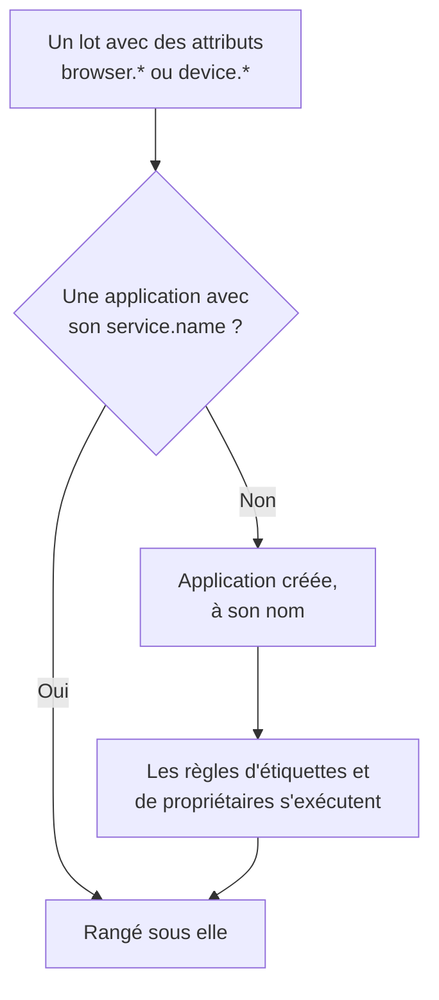

# Gérer les applications

OneUptime crée une application RUM la première fois que la télémétrie de votre application arrive. Cette page couvre ce que vous gérez ensuite : le nom de l'application, ses étiquettes et ses propriétaires, la durée de conservation de ses données, l'archivage, qui peut la voir et les alertes.

:::cards
- [Comment une application est créée](#comment-une-application-est-créée): Reconnue par son `service.name`, créée à son premier lot.
- [Étiquettes](#étiquettes): Regroupez les applications et décidez qui peut y accéder.
- [Rétention](#rétention): Combien de temps la télémétrie et les enregistrements sont conservés.
- [Autorisations](#autorisations): Qui peut voir les applications, et qui peut regarder les enregistrements.
:::

## Comment une application est créée

Vous n'avez pas à créer d'application RUM. Lorsqu'un lot de télémétrie portant des attributs de navigateur ou d'appareil et un `service.name` arrive, OneUptime le range sous l'application qui porte ce `service.name`, et crée l'application si le projet n'en a aucune.



- Le `service.name` est l'identité de l'application, comparée sans tenir compte de la casse : `Storefront-Web` et `storefront-web` sont une seule application.
- Un nouveau `service.name` démarre une nouvelle application. L'ancienne garde son historique et passe à **Déconnecté**, la nouvelle démarre vide, et les deux ne sont jamais fusionnées.
- Utilisez un `service.name` par application, pas un par environnement. Distinguez les environnements par une étiquette comme `oneuptime.label.env=production`, pour qu'ils partagent une application et un historique.

### Renommer une application

Le **Nom d'affichage** est d'abord le `service.name`. Pour le changer, ouvrez la page **Paramètres** de l'application et cliquez sur **Modifier les détails** dans la carte **Détails de l'application**, où vous modifiez aussi sa description et ses étiquettes. La télémétrie est rapprochée par le **Nom de l'application (service.name)**, que la carte affiche et qui ne change jamais : renommer est donc sans risque.

### Ajouter vous-même une application

Créez vous-même une application lorsque vous voulez que ses étiquettes, ses propriétaires ou sa politique de relecture soient en place avant l'arrivée du premier visiteur.

:::steps
#### Ouvrir la liste des applications

Allez dans **Produits → Ressources → Surveillance des utilisateurs réels** et cliquez sur **Créer : Application RUM**.

#### Saisir le nom de l'application

Renseignez **Nom de l'application (service.name)** avec le `service.name` que votre application enverra, exactement tel qu'elle l'envoie.

#### La nommer et enregistrer

L'application porte le nom de son application, comme une application découverte. Pour afficher un autre nom, ouvrez **Plus de champs** et saisissez un **Nom d'affichage** ; la description et les étiquettes s'y trouvent aussi. Enregistrez ensuite le formulaire.
:::

Son guide de configuration s'ouvre alors de lui-même, avec le nom de l'application comme `service.name` de l'extrait. Sa dernière étape, **Attendre la connexion**, indique quand les premières données arrivent.

Si le projet a déjà une application avec ce `service.name`, découverte, ajoutée auparavant ou archivée, le formulaire le signale au lieu d'en créer une seconde.

## État de la connexion

Une application affiche **Connecté** tant que de la télémétrie arrive, et **Déconnecté** après 15 minutes sans aucune. La télémétrie OpenTelemetry et le trafic de relecture de session comptent tous les deux.

**Dernière fois vu** est actualisé toutes les quelques minutes plutôt qu'à chaque lot : il peut donc avoir jusqu'à environ cinq minutes de retard sur le trafic réel, et les 15 minutes en tiennent compte. Le temps pendant lequel OneUptime lui-même était arrêté ou rattrapait sa file d'ingestion n'est pas compté.

**Déconnecté** n'est pas une erreur en soi : un outil interne sans visiteurs la nuit est réellement déconnecté. Si des personnes utilisent l'application, consultez [Dépannage RUM](/docs/rum/troubleshooting).

## Étiquettes

Les étiquettes regroupent les applications dans les listes et les filtres. Elles décident aussi de ce qu'un membre restreint à certaines étiquettes peut atteindre : un tel membre ne voit que les applications qui portent l'une de ces étiquettes. Une application reçoit ses étiquettes de trois façons :

| Comment | Où |
| --- | --- |
| À la main | Dans le formulaire de création, sous **Plus de champs**, ou plus tard avec **Modifier les détails** dans la carte **Détails de l'application** de la page **Paramètres** de l'application. Pour plusieurs à la fois, sélectionnez-les dans la liste et choisissez **Ajouter des étiquettes** sous **Actions groupées**. |
| Depuis la télémétrie | Un attribut de ressource nommé `oneuptime.label.<name>` ajoute l'étiquette `<name>:<value>`, comme ci-dessous. |
| Depuis une règle d'étiquettes | Une règle ajoute des étiquettes à chaque nouvelle application qu'elle sélectionne. Voir [Règles d'étiquettes et règles de propriétaires](#règles-détiquettes-et-règles-de-propriétaires). |

Définissez les attributs sur la même ressource que `service.name`, par exemple dans le fichier `src/telemetry.ts` de la [Configuration navigateur](/docs/rum/browser-setup) :

```ts
const resource = defaultResource().merge(
  resourceFromAttributes({
    [ATTR_SERVICE_NAME]: "storefront-web",
    "oneuptime.label.team": "payments",
    "oneuptime.label.env": "production",
  }),
);
```

Cela ajoute les étiquettes `team:payments` et `env:production`, et les crée dans le projet si elles n'existent pas. Écrire le nom de l'attribut dans l'étiquette garde `oneuptime.label.team=prod` et `oneuptime.label.env=prod` distincts. Une étiquette de plus de 100 caractères est coupée à 100, et une valeur vide ou qui n'est pas une chaîne n'ajoute rien.

## Règles d'étiquettes et règles de propriétaires

Une règle ajoute des étiquettes ou des propriétaires à chaque nouvelle application qu'elle sélectionne. Ouvrez **Surveillance des utilisateurs réels → Paramètres → Règles d'étiquettes**, ou **Règles de propriétaire**, et créez la règle en deux étapes :

1. Dans **Correspondance**, **Toutes les applications RUM**, où démarre une nouvelle règle, sélectionne toutes les applications. Pour la restreindre, choisissez **Uniquement les applications RUM qui correspondent aux conditions** et ajoutez des conditions sur **Étiquettes de l'application** (a l'une, toutes ou aucune des étiquettes choisies), **Nom de l'application** ou **Description de l'application** (est égal à, contient, commence par, se termine par, ou correspond à un motif).
2. Dans **Étiquettes**, ou **Propriétaires** pour une règle de propriétaires, choisissez ce que la règle ajoute. Une nouvelle règle doit ajouter au moins une étiquette ou un propriétaire. Le **Nom** est rempli à partir de vos choix, comme _Add team:payments_ ou _Add Payments as owners_, jusqu'à ce que vous saisissiez votre propre nom. La **Description**, et **Notifier les propriétaires** pour une règle de propriétaires, attendent sous **Plus de champs**.

Les règles s'exécutent à la création d'une application, applications découvertes comprises. Pour appliquer une règle aux applications que vous avez déjà, ouvrez le menu **⋯** de sa ligne et choisissez **Exécuter maintenant** : voir [Exécuter des règles sur les ressources existantes](/docs/configuration/run-rules-now). Une règle qu'une modification a laissée sans rien à ajouter est marquée **N'ajoute rien** dans la liste. [Règles d'étiquettes et de propriétaires](/docs/configuration/label-and-owner-rules) couvre les formulaires en entier.

### Propriétaires

Les propriétaires sont les personnes et les équipes responsables d'une application. Les règles de propriétaires les ajoutent aux nouvelles applications. Pour les ajouter ou les retirer à la main, sélectionnez des applications dans la liste et choisissez **Ajouter un propriétaire** ou **Retirer un propriétaire** sous **Actions groupées** ; l'API les ajoute via `/rum-application-owner-user` et `/rum-application-owner-team`. Avec **Notifier les propriétaires** activé, ce qui est le défaut, chaque propriétaire qu'une règle ajoute en est averti. Désactivez-le avant d'exécuter une règle sur de nombreuses applications si personne ne doit être notifié.

## Rétention

La télémétrie d'une application et ses enregistrements sont conservés pendant des durées différentes :

| Données | Conservées | Réglées dans |
| --- | --- | --- |
| Journaux, métriques, traces et profils | La rétention du projet, sauf si l'application la remplace | La page **Paramètres** de l'application |
| Enregistrements de relecture de session | 7 jours par défaut, ou 1, 14, 30 ou 90 jours | **Replay Policy**, avec **Modifier la politique → Limites** |

### Rétention de la télémétrie

Par défaut, la télémétrie d'une application est conservée selon la rétention du projet, réglée sous **Paramètres du projet → Télémétrie & APM → Rétention des données**. Deux cartes de la page **Paramètres** de l'application, repliées sous **Plus de paramètres**, la remplacent :

- **Conservation des données de télémétrie** contient **Conserver les données de télémétrie pendant (jours)**, une valeur pour toute la télémétrie de l'application. Laissez-la vide pour utiliser la rétention du projet.
- **Rétention par type de télémétrie** contient une valeur par défaut pour les journaux, les traces, les métriques et les profils, et pour les journaux par gravité et les traces par statut. Une valeur laissée vide se rabat sur celle de l'application, puis sur celle du projet.

Les remplacements de rétention font partie de l'[Édition Enterprise](/docs/self-hosted/enterprise), et du forfait Scale et au-delà sur OneUptime Cloud. Sans eux, les cartes indiquent ce que le forfait ajoute, et l'application garde la rétention du projet.

Sur un forfait Cloud inférieur, un remplacement laissé par un essai continue de s'appliquer à la nouvelle télémétrie. La page **Paramètres** l'affiche dans une carte **Remplacement de rétention** avec un bouton **Supprimer le remplacement**, qui fonctionne sur tous les forfaits : dès lors l'application garde la rétention du projet, et ce qui est déjà stocké garde la rétention avec laquelle il a été stocké. Redéfinir un remplacement exige le forfait Scale.

### Rétention de la relecture de session

Les enregistrements ont leur propre rétention, réglée dans la page **Replay Policy** de l'application avec **Modifier la politique → Limites** : 7 jours par défaut, ou 1, 14, 30 ou 90 jours. Elle est courte à dessein, car un enregistrement est bien plus sensible, et bien plus volumineux, qu'un span. La carte **Conservation de la relecture de session**, sous **Plus de paramètres** de la page **Paramètres**, l'affiche (_Session replays are kept for 7 days._), et son bouton **Modifier dans Replay Policy** ouvre la politique.

Une rétention de télémétrie plus longue ne conserve pas les enregistrements plus longtemps. Les compteurs, signaux et appareil d'une session expirent avec ses images ; seuls les journaux, spans et exceptions de la session suivent la rétention de la télémétrie. Voir [Rétention et suppression](/docs/telemetry/session-replay#rétention-et-suppression).

> [!TIP]
> Le RUM est souvent la télémétrie la plus volumineuse d'un projet, car il grandit avec vos utilisateurs plutôt qu'avec vos serveurs. Une rétention plus courte ici, et une plus longue sur vos services backend, est un réglage courant.

## Archivage et suppression

**Archiver** masque une application dans **Toutes les applications** tout en continuant à collecter sa télémétrie. Archivez une application que vous ne surveillez plus mais dont vous voulez garder l'historique.

- Cliquez sur **Archiver** dans la page **Paramètres** de l'application, ou sélectionnez plusieurs applications dans la liste et archivez-les ensemble.
- Les applications archivées se trouvent sous **Surveillance des utilisateurs réels → Avancé → Archivé**. **Avancé** est replié au départ dans le menu latéral : cliquez dessus pour afficher **Archivé**. **Désarchiver** une application à cet endroit, ou plusieurs à la fois.

**Supprimer l'application**, dans la section **Avancé** du menu latéral de l'application, supprime l'application définitivement. Si l'application envoie encore de la télémétrie, son prochain lot recrée l'application, sans aucun de ses réglages : arrêtez donc d'abord l'instrumentation.

Pour effacer les données d'une personne plutôt que toute une application, déposez une demande d'effacement : voir [Effacer des sessions](/docs/telemetry/session-replay#effacer-des-sessions).

## Autorisations

Toute personne ayant le rôle Viewer du projet peut voir les applications RUM et leur télémétrie. La relecture de session ne fait délibérément pas partie de ce rôle : lister les enregistrements, en regarder un et lire qui a regardé sont des autorisations distinctes. Les propriétaires et administrateurs du projet les ont toutes. Les sélecteurs d'autorisations listent chaque autorisation par son titre, indiqué ici en italique.

| Autorisation | Permet à un membre de |
| --- | --- |
| `ReadRumApplication` (_Read RUM Application_) | Voir les applications et leurs pages de télémétrie. |
| `CreateRumApplication`, `EditRumApplication`, `DeleteRumApplication` | Ajouter, modifier et supprimer des applications. |
| `ReadRumSessionReplay` (_List Session Replays_) | Lister les sessions enregistrées et leurs détails, sans les lire ni savoir qui était l'utilisateur. |
| `ReadRumSessionReplayPayload` (_Watch Session Replays_) | Lire les enregistrements, et lire la référence et les attributs de l'utilisateur identifié. |
| `ReadRumSessionReplayAudit` (_Read Session Replay Audit_) | Lire le **Journal d'accès aux relectures** : qui a regardé quel enregistrement. |
| `DeleteRumSessionReplay` (_Delete Session Replays_) | Supprimer des enregistrements. |
| `CreateRumSessionErasureRequest`, `ReadRumSessionErasureRequest` | Déposer des demandes d'effacement et les suivre. |
| `ReadRumApplicationLabelRule`, `ReadRumApplicationOwnerRule` (et leurs Create, Edit et Delete) | Gérer les règles d'étiquettes et les règles de propriétaires. |
| `ReadRumApplicationOwnerUser`, `ReadRumApplicationOwnerTeam` (et leurs Create, Edit et Delete) | Ajouter et retirer des propriétaires via l'API. |

Une répartition utile : donnez à un ingénieur du support `ReadRumApplication` et `ReadRumSessionReplay`. Il peut voir quelles sessions ont rencontré des erreurs sans regarder l'écran de quiconque ni savoir qui était l'utilisateur. Ne donnez `ReadRumSessionReplayPayload` qu'aux personnes qui en ont besoin ; les membres qui ont `ReadRumSessionReplayAudit` voient alors chaque lecture dans la page **Journal d'accès aux relectures** de l'application. [Qui peut regarder un enregistrement](/docs/telemetry/session-replay#qui-peut-regarder-un-enregistrement) montre ce que chaque autorisation ouvre dans la liste des sessions et le lecteur.

## Alertes sur les données RUM

La télémétrie RUM se compose de journaux, de métriques et de traces ordinaires : il n'y a donc pas de moniteur RUM à part, les moniteurs habituels fonctionnent dessus. Le plus rapide est de commencer par la page **Recommandations** de l'application, qui propose des moniteurs déjà limités à l'application :

| Groupe | Recommandations |
| --- | --- |
| Core Web Vitals | Poor Largest Contentful Paint, Poor Interaction to Next Paint, Poor Cumulative Layout Shift, Slow First Contentful Paint et Slow Time to First Byte. Voir [Core Web Vitals](/docs/rum/web-vitals). |
| Erreurs | Failed User Operations, et Unhandled Browser Exceptions. |
| Relecture de session | Les quatre [alertes de budget de stockage](/docs/telemetry/session-replay#alertes-de-budget-de-stockage), qui préviennent avant que la limite quotidienne du projet ou le budget mensuel de l'application soit épuisé. Elles sont proposées dès que l'application a enregistré une relecture, et la paire mensuelle dès qu'elle a aussi un budget mensuel. |

Pour créer votre propre moniteur, choisissez celui qui lit le signal :

- [Surveillance des métriques](/docs/monitor/metrics-monitor) : une Core Web Vital, ou toute métrique que votre application envoie.
- [Surveillance des traces](/docs/monitor/traces-monitor) : le taux d'erreurs ou la latence côté client.
- [Surveillance des journaux](/docs/monitor/logs-monitor) : un motif dans les journaux du navigateur.
- [Surveillance des exceptions](/docs/monitor/exceptions-monitor) : des exceptions côté client nouvelles ou en hausse brutale.

Limitez à l'application un moniteur que vous créez, pour qu'un service backend à la signature semblable ne le déclenche pas.

## Prochaines étapes

:::cards
- [Relecture de session](/docs/telemetry/session-replay): Enregistrez ce que les utilisateurs ont vu, avec sa propre politique et sa propre rétention.
- [Règles d'étiquettes et de propriétaires](/docs/configuration/label-and-owner-rules): Les deux formulaires de règle, étape par étape.
- [Exécuter des règles sur les ressources existantes](/docs/configuration/run-rules-now): Appliquez une nouvelle règle aux applications que vous avez déjà.
- [Dépannage RUM](/docs/rum/troubleshooting): Quand une application manque, est vide ou Déconnecté.
:::
