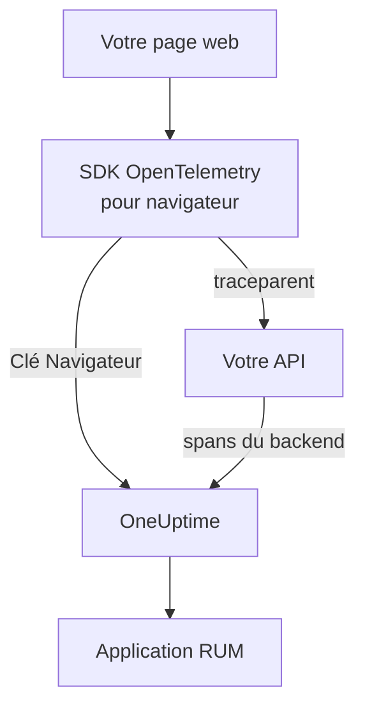

# Configuration navigateur

Instrumentez une application web avec le SDK OpenTelemetry pour navigateur afin qu'elle se signale à OneUptime comme application RUM. Les chargements de page et les requêtes arrivent sous forme de traces, et la même configuration transporte vos erreurs, journaux, métriques et Core Web Vitals.

:::cards
- [Mise en place](#mise-en-place): Six étapes, de la clé Navigateur à votre premier chargement de page.
- [Relier à votre backend](#relier-vos-traces-backend): Relier les spans du navigateur aux traces backend qu'ils déclenchent.
- [Signaler les erreurs](#signaler-les-erreurs-non-interceptées): Envoyer les erreurs non interceptées vers la vue Exceptions.
- [Dépannage](#dépannage): Que vérifier quand rien n'arrive.
:::

## Fonctionnement

Le SDK s'exécute dans les navigateurs de vos visiteurs. Il enregistre un span pour chaque chargement de page et chaque requête, et les exporte directement vers OneUptime avec une clé d'ingestion **Navigateur**, sans collector ni proxy à vous entre les deux.



## Avant de commencer

- Une application web dont vous pouvez modifier et redéployer le code, avec ses dépendances installées via npm.
- Les origines depuis lesquelles vos pages sont servies, par exemple `https://app.example.com`. Une clé Navigateur n'accepte les requêtes que depuis les origines que vous y listez.
- Un rôle qui peut créer des clés d'ingestion : les propriétaires et administrateurs du projet le peuvent, ainsi que toute personne disposant de l'autorisation **Create Telemetry Ingestion Key**.

## Mise en place

:::steps
### Créer une clé d'ingestion Navigateur

1. Allez dans **Produits → Paramètres du projet**.
2. Dans le menu latéral, dépliez **Télémétrie & APM** et sélectionnez **Clés d'ingestion**.
3. Cliquez sur **Créer une clé d'ingestion** et choisissez **Navigateur** comme **Type de clé**.
4. À l'étape **Paramètres du navigateur**, listez vos origines dans **Origines autorisées** sous forme de tableau JSON, par exemple `["https://app.example.com"]`, puis créez la clé. Avec le plan gratuit de OneUptime Cloud, une dernière étape **Facturation** affiche d'abord le prix de la télémétrie.


La nouvelle clé s'ouvre sur sa propre page. Copiez sa **Clé secrète** : c'est le jeton que le SDK envoie dans `x-oneuptime-token`.


### Installer les paquets

```bash
npm install @opentelemetry/api \
  @opentelemetry/sdk-trace-web \
  @opentelemetry/resources \
  @opentelemetry/semantic-conventions \
  @opentelemetry/opentelemetry-browser-detector \
  @opentelemetry/exporter-trace-otlp-http \
  @opentelemetry/context-zone \
  @opentelemetry/instrumentation \
  @opentelemetry/instrumentation-document-load \
  @opentelemetry/instrumentation-fetch \
  @opentelemetry/instrumentation-xml-http-request
```

### Créer le fichier de télémétrie

Créez `src/telemetry.ts`. `browserDetector` ajoute les attributs `browser.*` qui classent la télémétrie comme RUM, et `service.name` nomme l'application.

```ts title="src/telemetry.ts"
import {
  WebTracerProvider,
  BatchSpanProcessor,
} from "@opentelemetry/sdk-trace-web";
import { OTLPTraceExporter } from "@opentelemetry/exporter-trace-otlp-http";
import { ZoneContextManager } from "@opentelemetry/context-zone";
import { registerInstrumentations } from "@opentelemetry/instrumentation";
import { DocumentLoadInstrumentation } from "@opentelemetry/instrumentation-document-load";
import { FetchInstrumentation } from "@opentelemetry/instrumentation-fetch";
import { XMLHttpRequestInstrumentation } from "@opentelemetry/instrumentation-xml-http-request";
import {
  defaultResource,
  detectResources,
  resourceFromAttributes,
} from "@opentelemetry/resources";
import { browserDetector } from "@opentelemetry/opentelemetry-browser-detector";
import { ATTR_SERVICE_NAME } from "@opentelemetry/semantic-conventions";

const ONEUPTIME_URL = "https://oneuptime.com";
// Public: it ships in your page. It must be a Browser ingestion key.
const ONEUPTIME_TOKEN = "YOUR_TELEMETRY_INGESTION_TOKEN";

/*
 * browserDetector supplies the browser.* attributes. Without them this
 * telemetry is classified as a backend Service, not a RUM application.
 * The attributes set last win, so service.name here overrides the
 * "unknown_service" that defaultResource() provides.
 */
const resource = defaultResource()
  .merge(detectResources({ detectors: [browserDetector] }))
  .merge(
    resourceFromAttributes({
      [ATTR_SERVICE_NAME]: "storefront-web",
    }),
  );

const provider = new WebTracerProvider({
  resource: resource,
  spanProcessors: [
    new BatchSpanProcessor(
      new OTLPTraceExporter({
        url: `${ONEUPTIME_URL}/otlp/v1/traces`,
        headers: { "x-oneuptime-token": ONEUPTIME_TOKEN },
      }),
    ),
  ],
});

provider.register({
  contextManager: new ZoneContextManager(),
});

registerInstrumentations({
  instrumentations: [
    new DocumentLoadInstrumentation(),
    new FetchInstrumentation({
      // See "Linking to your backend traces" before widening this.
      propagateTraceHeaderCorsUrls: [/^https:\/\/api\.example\.com/],
    }),
    new XMLHttpRequestInstrumentation({
      propagateTraceHeaderCorsUrls: [/^https:\/\/api\.example\.com/],
    }),
  ],
});
```

### L'importer en premier

Faites-en le premier import de votre application. Les instrumentations modifient `fetch` et `XMLHttpRequest`, et une requête faite avant cette modification n'est pas tracée.

```ts
// src/index.tsx (React), src/main.ts (Vue / Angular), etc.
import "./telemetry";
import React from "react";
// ... the rest of your app
```

### Vérifier la clé

Demandez à OneUptime s'il accepte la clé avant de chercher ailleurs :

```bash
curl -i https://oneuptime.com/otlp/v1/validate \
  -H "x-oneuptime-token: YOUR_TELEMETRY_INGESTION_TOKEN"
```

`200` avec `"valid": true` signifie que la clé est acceptée ; pour une clé Navigateur, le message précise qu'elle ne fonctionne que depuis un navigateur, depuis l'une de ses origines autorisées. `401` signifie que la clé est inconnue, révoquée, désactivée ou expirée.

### Charger une page

Ouvrez votre site. En moins d'une minute, l'application apparaît sous **Produits → Ressources → Surveillance des utilisateurs réels**, nommée d'après son `service.name`.
:::

## Ce que permet une clé Navigateur

Tout ce que contient l'extrait est envoyé à vos visiteurs : n'importe qui peut donc copier le jeton depuis votre page. Une clé Navigateur limite ce qu'une copie peut faire :

| Paramètre | Effet |
| --- | --- |
| **Origines autorisées** | Les requêtes ne sont acceptées que depuis ces origines, chacune avec son schéma et son port éventuel. Un hôte peut commencer par un seul joker `*.` : `https://*.example.com` couvre chaque sous-domaine de `example.com`, mais pas `example.com` lui-même. |
| **Requests Per Minute Limit** | Un plafond unique pour tous les visiteurs qui utilisent la clé : 6000 requêtes par minute, sauf si vous fixez le vôtre. |
| **Pinned Service Name** | Impose `service.name` sur tout ce que la clé écrit, pour qu'une copie ne puisse pas faire passer sa télémétrie pour l'un de vos services backend. |
| **Expire le** | Après cette date, la clé n'est plus acceptée. |
| **Activé** | Désactivez-le pour arrêter immédiatement une clé qui a fuité. |

Une clé Navigateur écrit des traces, journaux et métriques OTLP, ainsi que des relectures de session ; toutes les autres voies d'ingestion la refusent. Vous modifiez ces paramètres sur la page de la clé. Le type de clé ne peut plus être changé une fois la clé créée.

> [!WARNING]
> Ne mettez jamais une clé **Serveur** dans une page. Une clé Serveur écrit tout type de télémétrie depuis n'importe où, sans vérification d'origine : quiconque lit votre page pourrait écrire dans votre projet.

## Définir `browser.*` sans le détecteur

`browserDetector` lit l'[API UA Client Hints](https://wicg.github.io/ua-client-hints/), que seuls les navigateurs Chromium possèdent. Sur Safari et Firefox, il définit `browser.language` et `user_agent.original`, mais pas `browser.platform`, `browser.brands` ni `browser.mobile`.

Cela suffit pourtant à classer la télémétrie comme RUM, car `browser.language` seul marque un lot comme RUM navigateur. La page **Clients** liste toutefois les plateformes à partir de `browser.platform` : les visites depuis Safari et Firefox n'y ajoutent donc aucune ligne.

Pour vous passer du détecteur, ou pour donner une plateforme à chaque navigateur, définissez les attributs vous-même :

```ts
const resource = defaultResource().merge(
  resourceFromAttributes({
    [ATTR_SERVICE_NAME]: "storefront-web",
    // browser.language or browser.platform marks the telemetry as browser RUM.
    "browser.language": navigator.language,
    "browser.platform":
      (navigator as any).userAgentData?.platform ?? "unknown",
    "browser.mobile": (navigator as any).userAgentData?.mobile ?? false,
    "user_agent.original": navigator.userAgent,
  }),
);
```

Gardez `browser.platform` grossier. Chaque valeur distincte devient une ligne de la page **Clients** : une chaîne user-agent complète ou une valeur par utilisateur y produit une liste sans fin, et pose en plus un problème de confidentialité.

## Tracer les changements de route

`DocumentLoadInstrumentation` ne trace que le premier chargement. Dans une application monopage, les changements de route restent invisibles tant que vous ne les enregistrez pas, ce qui demande quelques lignes dans votre routeur :

```ts
import { trace } from "@opentelemetry/api";

const tracer = trace.getTracer("app-router");

function onRouteChange(to: string): void {
  const span = tracer.startSpan("route-change", {
    attributes: { "app.route": to },
  });
  // End it when the route's data has loaded and the view has painted.
  requestAnimationFrame(() => {
    return span.end();
  });
}
```

Ajoutez `@opentelemetry/instrumentation-user-interaction` pour tracer aussi les clics et les autres événements DOM. Pour l'INP de chaque route, voir [Applications monopages](/docs/rum/web-vitals#applications-monopages).

## Relier vos traces backend

`propagateTraceHeaderCorsUrls` décide quelles requêtes cross-origin portent un en-tête W3C `traceparent`, qui relie le span du navigateur à la trace backend qu'il a déclenchée. Les requêtes vers l'origine de votre page le portent sans aucune configuration.

> [!WARNING]
> Ne le réglez pas sur `/.*/`. L'en-tête transforme une requête cross-origin simple en requête avec preflight : toute API tierce qui ne liste pas `traceparent` dans son `Access-Control-Allow-Headers` se met à échouer.

Ne listez que les origines que vous contrôlez et avez configurées :

```ts
new FetchInstrumentation({
  propagateTraceHeaderCorsUrls: [
    /^https:\/\/api\.example\.com/,
    /^https:\/\/auth\.example\.com/,
  ],
});
```

Avec la [Relecture de session](/docs/telemetry/session-replay) installée, les requêtes vers votre propre origine portent aussi l'ID de session de la relecture, ce qui range votre télémétrie backend sous l'enregistrement : voir [Relier les traces à la relecture de session](#relier-les-traces-à-la-relecture-de-session).

## Relier les traces à la relecture de session

Si vous utilisez aussi la [Relecture de session](/docs/telemetry/session-replay), votre télémétrie **backend** rejoint l'enregistrement sans aucun code ici. Pendant qu'une session s'envoie, l'enregistreur ajoute un membre `tracestate` portant l'ID de session aux requêtes que votre page fait vers sa propre origine, et laisse le `traceparent` à votre `FetchInstrumentation` / `XMLHttpRequestInstrumentation`. Les spans de votre backend reçoivent l'ID de session à l'ingestion, dans chaque service qui poursuit le contexte de trace W3C, et ses journaux et exceptions rejoignent l'enregistrement par ID de trace. Voir [Corréler avec le reste de votre télémétrie](/docs/telemetry/session-replay#correlating-with-your-other-telemetry) pour le fonctionnement, ce que cela ne couvre pas et l'interrupteur qui le désactive.

L'enregistreur relit aussi le `traceparent` que vos instrumentations définissent, que l'appel passe une URL (avec ou sans objet init) ou un objet `Request` : chaque ligne de requête de la relecture renvoie ainsi à sa trace backend. Pour une API sur une autre origine, listez-la dans `propagateTraceHeaderCorsUrls` ci-dessus ; ses requêtes ne portent pas d'ID de session et rejoignent l'enregistrement par ID de trace. **Trace propagation origins** dans la politique de relecture de l'application fait de même pour les pages *sans* ce SDK.

Ce que les en-têtes n'atteignent pas, ce sont les spans de navigateur de ce SDK : chargements de document, changements de route et erreurs que vous signalez. Pour les ranger aussi sous l'enregistrement, ajoutez `session.id` à chaque span au moment où il démarre. L'enregistreur vous donne l'ID via `onSessionChange`, qui se déclenche aussitôt si une session existe déjà, puis à chaque changement d'ID : quand le visiteur revient après 30 minutes d'inactivité, au plafond de 4 heures, quand `identify()` nomme un autre utilisateur, ou quand un autre onglet du même visiteur l'a changé en premier.

```ts title="src/replaySession.ts"
import type { Context } from "@opentelemetry/api";
import type {
  ReadableSpan,
  Span,
  SpanProcessor,
} from "@opentelemetry/sdk-trace-web";

declare global {
  interface Window {
    OneUptimeReplayQueue?: Array<Array<unknown>>;
  }
}

let replaySessionId: string | null = null;

// The recorder script loads asynchronously. The queue is applied the
// moment it starts and stays live afterwards, so this works either way.
(window.OneUptimeReplayQueue = window.OneUptimeReplayQueue || []).push([
  "onSessionChange",
  (sessionId: string): void => {
    replaySessionId = sessionId;
  },
]);

export class ReplaySessionSpanProcessor implements SpanProcessor {
  public onStart(span: Span, _parentContext: Context): void {
    if (replaySessionId) {
      span.setAttribute("session.id", replaySessionId);
    }
  }

  public onEnd(_span: ReadableSpan): void {}

  public forceFlush(): Promise<void> {
    return Promise.resolve();
  }

  public shutdown(): Promise<void> {
    return Promise.resolve();
  }
}
```

Placez-le ensuite en premier parmi les processeurs de spans du provider, dans `src/telemetry.ts` :

```ts
import { ReplaySessionSpanProcessor } from "./replaySession";

const provider = new WebTracerProvider({
  resource: resource,
  spanProcessors: [
    new ReplaySessionSpanProcessor(),
    new BatchSpanProcessor(
      new OTLPTraceExporter({
        url: `${ONEUPTIME_URL}/otlp/v1/traces`,
        headers: { "x-oneuptime-token": ONEUPTIME_TOKEN },
      }),
    ),
  ],
});
```

Les spans démarrés ensuite portent l'ID, l'onglet **Traces** du lecteur de relecture les liste sur l'horloge de l'enregistrement, et chacun d'eux renvoie dans le tableau de bord au moment correspondant de la relecture. Un processeur de spans marque chaque span avec l'ID en vigueur à son démarrage ; écrire l'ID dans `resource.attributes` réétiquetterait à la place les spans qui attendaient encore dans le lot d'export quand la session a changé. L'écouteur reçoit l'ID dès que l'enregistreur démarre, avant tout consentement ou déclencheur de capture : si cela compte pour vous, ne marquez les spans qu'une fois que votre page a le consentement.

## Content Security Policy

Si votre site envoie une Content Security Policy, le navigateur bloque les requêtes de l'exportateur tant que vous n'autorisez pas OneUptime dans `connect-src`. Rien n'échoue de façon visible : la page ne signale simplement rien.

```text
connect-src 'self' https://oneuptime.com;
```

Fusionnez-le dans votre directive `connect-src` existante. Si vous hébergez OneUptime vous-même, utilisez votre propre hôte.

## Signaler les erreurs non interceptées

Le SDK OpenTelemetry pour navigateur ne capture pas les erreurs non interceptées. Signalez-les vous-même, et elles apparaissent sous **Exceptions** à côté de vos erreurs backend :

```ts
import { trace, SpanStatusCode } from "@opentelemetry/api";

const tracer = trace.getTracer("app-errors");

window.addEventListener("error", (event: ErrorEvent) => {
  const span = tracer.startSpan("window.onerror");
  span.recordException(event.error ?? new Error(event.message));
  span.setStatus({ code: SpanStatusCode.ERROR });
  span.end();
});

window.addEventListener("unhandledrejection", (event: PromiseRejectionEvent) => {
  const span = tracer.startSpan("unhandledrejection");
  span.recordException(
    event.reason instanceof Error ? event.reason : new Error(String(event.reason)),
  );
  span.setStatus({ code: SpanStatusCode.ERROR });
  span.end();
});
```

Avec la [Relecture de session](/docs/telemetry/session-replay), l'enregistreur capture lui aussi les erreurs non interceptées et les marque sur la chronologie de la relecture. La page de l'exception affiche alors une carte **Watch what the user saw**, qui ouvre la relecture dix secondes avant l'erreur. Avec la politique par défaut, chaque session est enregistrée, qu'une erreur survienne ou non ; l'erreur décide seulement où la carte s'ouvre.

## Ajouter journaux et métriques

Les traces suffisent à remplir la vue d'ensemble. Ajoutez les pipelines de journaux et de métriques si vous voulez les journaux du navigateur dans OneUptime, ou pour envoyer les [Core Web Vitals](/docs/rum/web-vitals) :

```bash
npm install @opentelemetry/api-logs @opentelemetry/sdk-logs \
  @opentelemetry/exporter-logs-otlp-http \
  @opentelemetry/sdk-metrics @opentelemetry/exporter-metrics-otlp-http
```

```ts
import { LoggerProvider, BatchLogRecordProcessor } from "@opentelemetry/sdk-logs";
import { OTLPLogExporter } from "@opentelemetry/exporter-logs-otlp-http";
import { MeterProvider, PeriodicExportingMetricReader } from "@opentelemetry/sdk-metrics";
import { OTLPMetricExporter } from "@opentelemetry/exporter-metrics-otlp-http";
import { logs } from "@opentelemetry/api-logs";
import { metrics } from "@opentelemetry/api";

const headers = { "x-oneuptime-token": ONEUPTIME_TOKEN };

logs.setGlobalLoggerProvider(
  new LoggerProvider({
    resource: resource,
    processors: [
      new BatchLogRecordProcessor({
        exporter: new OTLPLogExporter({
          url: `${ONEUPTIME_URL}/otlp/v1/logs`,
          headers,
        }),
      }),
    ],
  }),
);

metrics.setGlobalMeterProvider(
  new MeterProvider({
    resource: resource,
    readers: [
      new PeriodicExportingMetricReader({
        exporter: new OTLPMetricExporter({
          url: `${ONEUPTIME_URL}/otlp/v1/metrics`,
          headers,
        }),
        exportIntervalMillis: 30000,
      }),
    ],
  }),
);
```

Construisez-les avec le même objet `resource`. Un pipeline de journaux ou de métriques dont la ressource n'a pas `browser.*` est classé comme service backend distinct.

## Référence des points de terminaison

| Signal | Point de terminaison | En-tête |
| --- | --- | --- |
| Traces | `POST {host}/otlp/v1/traces` | `x-oneuptime-token: <token>` |
| Métriques | `POST {host}/otlp/v1/metrics` | `x-oneuptime-token: <token>` |
| Journaux | `POST {host}/otlp/v1/logs` | `x-oneuptime-token: <token>` |

`{host}` vaut `https://oneuptime.com`, ou votre propre hôte si vous exploitez OneUptime vous-même ; changez-le dans les URL OTLP et dans l'entrée de la Content Security Policy. OneUptime accepte OTLP/JSON et OTLP/protobuf. Les points de terminaison répondent aux requêtes cross-origin de n'importe quelle origine et autorisent l'en-tête `x-oneuptime-token` : un navigateur exporte donc directement vers eux.

## Dépannage

:::details Aucune requête vers OneUptime dans l'onglet Réseau
Ouvrez les outils de développement de votre navigateur, allez dans l'onglet Réseau et filtrez sur `otlp` : vous cherchez `POST /otlp/v1/traces`. L'absence de toute requête signifie que le SDK n'a jamais démarré :

- `telemetry.ts` n'est pas le premier import, ou votre bundler l'a supprimé.
- Le processeur de lots n'a pas encore exporté. Il attend quelques secondes pour remplir un lot : patientez, ou passez à une autre page, avant de conclure que rien n'est envoyé.
- Une variable d'environnement de build vaut `undefined`, si bien que l'URL de l'exportateur est cassée. Journalisez l'URL une fois au démarrage.
:::

:::details Le navigateur bloque la requête
- Une erreur de Content Security Policy dans la console signifie que `connect-src` n'autorise pas encore OneUptime : voir [Content Security Policy](#content-security-policy).
- Une erreur CORS signifie presque toujours que la requête n'a jamais atteint OneUptime, dont les points de terminaison acceptent toute origine : cherchez un proxy d'entreprise, un bloqueur de publicité ou une faute de frappe dans l'hôte.
:::

:::details OneUptime refuse la requête
- `422` avec `Origin https://app.example.com is not allowed for this browser ingestion key.` signifie que l'origine exacte de la page (schéma, hôte et port) manque dans les **Origines autorisées** de la clé.
- `422` avec `This telemetry ingestion key has been disabled.` signifie que quelqu'un a désactivé la clé. Réactivez-la ou utilisez une autre clé.
- `401` signifie que la clé est inconnue, révoquée ou expirée. Lancez la vérification de clé de [Mise en place](#mise-en-place), puis créez une clé Navigateur valide.
- `404` signifie que l'URL est fausse. L'exportateur de traces a besoin du chemin complet, `/otlp/v1/traces`.
:::

:::details L'application apparaît sous Services au lieu de Surveillance des utilisateurs réels
La ressource n'a aucun attribut `browser.*`, la télémétrie a donc été classée comme service backend. Ajoutez `browserDetector`, ou définissez les attributs comme dans [Définir `browser.*` sans le détecteur](#définir-browser-sans-le-détecteur).

Vérifiez ce que vous envoyez dans l'onglet Réseau, dans la charge utile de la requête : `resourceSpans[0].resource.attributes` est la liste qui en décide. Le service déjà créé ne devient pas une application RUM : supprimez-le sous **Produits → Services** dès que la télémétrie RUM arrive.
:::

:::details La page Clients est vide sur Safari ou Firefox
Les lignes de clients viennent de `browser.platform`, que `browserDetector` ne définit que sur les navigateurs Chromium. Définissez-le vous-même pour lister les visites depuis Safari et Firefox : voir [Définir `browser.*` sans le détecteur](#définir-browser-sans-le-détecteur).
:::

## Prochaines étapes

:::cards
- [Core Web Vitals](/docs/rum/web-vitals): Envoyer LCP, INP, CLS, FCP et TTFB depuis la même page.
- [Relecture de session](/docs/telemetry/session-replay): Enregistrer ce que l'utilisateur a vu, à côté de ces traces.
- [Gérer les applications](/docs/rum/applications): Noms, étiquettes, propriétaires et rétention.
- [Dépannage RUM](/docs/rum/troubleshooting): Chaque vérification, dans l'ordre où les problèmes surviennent d'habitude.
:::
