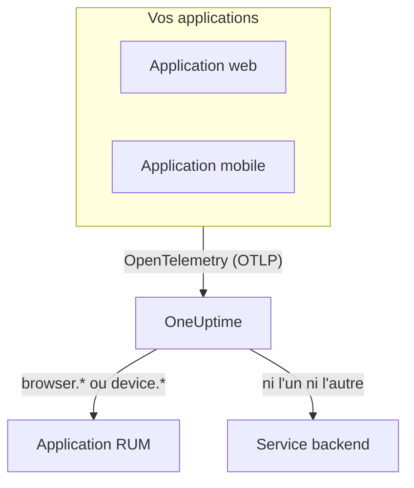

# Vue d'ensemble du RUM

Le Real User Monitoring (RUM) montre ce que vivent les vrais utilisateurs de vos applications web et mobiles : chargements de page, requêtes, erreurs et Core Web Vitals, signalés par l'application elle-même plutôt que par une sonde. OneUptime range cette télémétrie dans une application RUM que vous pouvez représenter en graphiques, explorer et surveiller par des alertes.

:::cards
- [Fonctionnement](#fonctionnement): Un seul pipeline OpenTelemetry, classé comme RUM à l'arrivée.
- [Comment OneUptime reconnaît le RUM](#comment-oneuptime-reconnaît-le-rum): Les attributs de ressource qui en décident.
- [Ce que vous obtenez](#ce-que-vous-obtenez): La vue d'ensemble, les vitals, les explorateurs et les relectures.
- [Bien démarrer](#bien-démarrer): De la clé d'ingestion à votre premier chargement de page.
:::

## Fonctionnement

Le RUM utilise le même pipeline OpenTelemetry que le reste de OneUptime. Il n'y a ni agent RUM ni format de transport propre : vous pointez un SDK OpenTelemetry pour navigateur ou mobile vers OneUptime, et la télémétrie est classée comme RUM à son arrivée.

- **Une application par app.** Son identité est le `service.name` que votre SDK signale, et OneUptime crée l'application à son premier lot de télémétrie.
- **Jamais comptée deux fois.** La télémétrie client n'appartient qu'à son application RUM ; elle n'apparaît pas aussi comme service backend.
- **La relecture de session est une couche séparée et facultative.** Elle a son propre extrait de code et ses propres réglages de confidentialité : voir [Relecture de session](/docs/telemetry/session-replay).

## Où la trouver

Ouvrez **Produits → Ressources → Surveillance des utilisateurs réels**. **Toutes les applications** liste vos applications avec leur **Type de client**, leur **Statut** et **Dernière fois vu**. Deux autres sections du menu latéral sont repliées au départ :

- **Paramètres** : **Règles de propriétaire**, **Règles d'étiquettes** et l'interrupteur **Relecture de session** de tout le projet.
- **Avancé** : **Archivé**, les applications que vous avez archivées.

Le menu latéral d'une application regroupe ses pages ainsi ; **Paramètres**, **Développeurs** et **Avancé** sont repliés au départ :

| Section | Pages |
| --- | --- |
| **Basique** | **Vue d'ensemble**, **Recommendations**, **Documentation** |
| **Observabilité** | **Métriques**, **Journaux**, **Traces**, **Clients** |
| **Relecture de session** | **Relecture de session**, **User Flows**, **Replay Users**, **Santé**, **Replay Policy**, **Replay Access Log**, **Documentation** |
| **Paramètres** | **Paramètres** |
| **Développeurs** | **Terraform**, **API**, **Assistants IA** |
| **Avancé** | **Supprimer l'application** |

## Comment OneUptime reconnaît le RUM

La plupart des questions du type « mon application n'apparaît pas » se terminent ici. OneUptime décide, pour chaque lot de télémétrie à son arrivée, à partir de ses **attributs de ressource** :

1. Un lot dont la ressource porte `browser.platform`, `browser.language` ou un `browser.brands` non vide est du RUM **navigateur**.
2. Sinon, un lot avec `device.id` ou `device.model.identifier` est du RUM **mobile**.
3. Sinon, un lot avec `device.manufacturer` et sans identité d'hôte (`host.name`, `host.id` ou `k8s.node.name`) est aussi du RUM **mobile**.
4. Tout le reste est un service backend.

Les SDK backend ne définissent jamais `browser.*`, `device.id` ni `device.model.identifier` : ce sont donc des signaux nets. `device.manufacturer` est l'exception : l'inventaire d'un hôte s'en sert aussi pour indiquer le fabricant d'une machine, il ne compte donc que sur une ressource sans identité d'hôte. Voir [Attributs d'inventaire](/docs/telemetry/host-otel-collector#attributs-dinventaire-ip-mac-numéro-de-série-fabricant-modèle-firmware).

| Attribut | Requis | Effet |
| --- | --- | --- |
| `service.name` | **Oui** | L'identité de l'application, par exemple `storefront-web`. Sans lui, aucune application RUM n'est créée. |
| `browser.platform`, `browser.language`, `browser.brands` | L'un d'eux, sur le web | Marque le lot comme RUM navigateur. `browser.platform` remplit aussi la page **Clients**. |
| `device.id`, `device.model.identifier` | L'un d'eux, sur mobile | Marque le lot comme RUM mobile. `device.model.identifier` remplit aussi la page **Clients**. |
| `device.manufacturer` | Non | Marque le lot comme RUM mobile seulement si la ressource ne porte aucune identité d'hôte. |
| `telemetry.sdk.language` | Non | Affiché dans la vue d'ensemble, par exemple `webjs` ou `swift`. |
| `telemetry.sdk.version` | Non | Affiché comme version du SDK ; `oneuptime.agent.version` est lu en son absence. |
| `oneuptime.label.<name>` | Non | Ajoute l'étiquette de projet `<name>:<value>` à l'application. |

OneUptime retrouve l'application par son `service.name`, sans tenir compte de la casse, et la crée si le projet n'en a pas. Un nouveau `service.name` démarre une nouvelle application : gardez-le donc stable et distinguez les environnements par une étiquette plutôt que par un nouveau nom. [Gérer les applications](/docs/rum/applications) couvre les noms, les étiquettes, les propriétaires et la rétention.

> [!IMPORTANT]
> Le SDK OpenTelemetry pour navigateur n'ajoute aucun attribut `browser.*` tant que vous n'ajoutez pas le détecteur de ressources du navigateur ou ne les définissez pas vous-même. Avec seulement `service.name`, la télémétrie devient un service backend, pas une application RUM. [Configuration navigateur](/docs/rum/browser-setup) montre les deux façons de faire.

## Ce que vous obtenez

| Où | Ce qui s'affiche |
| --- | --- |
| **Vue d'ensemble** | Des tuiles pour **Page loads**, **Page load time (p95)**, **Événements**, **Taux d'erreur**, **Durée des événements (p95)**, **Exceptions**, **Clients** et **Sessions recorded**, et des graphiques de tendance sur la période choisie. |
| **Core Web Vitals** | Une carte de la vue d'ensemble avec LCP, INP, CLS, FCP et TTFB, chacun évalué selon les seuils de Google, et l'INP de chaque route d'une application monopage. Voir [Core Web Vitals](/docs/rum/web-vitals) et [Applications monopages](/docs/rum/web-vitals#applications-monopages). |
| **Métriques**, **Journaux**, **Traces** | Les explorateurs de télémétrie, limités à cette application. |
| **Clients** | Les plateformes de navigateur et les modèles d'appareil sur lesquels l'application a été utilisée : une courte liste par plateforme, jamais une ligne par utilisateur. |
| **Relecture de session** | Des enregistrements de vraies sessions, à côté de leurs erreurs, traces et journaux : voir [Relecture de session](/docs/telemetry/session-replay). |
| **Recommendations** | Des moniteurs prêts à l'emploi pour l'application : Core Web Vitals dégradés, requêtes en échec, exceptions du navigateur et, dès qu'elle enregistre, budgets de relecture de session. |

Les chiffres viennent des spans que votre instrumentation envoie. **Page loads** compte le span `documentLoad` que l'instrumentation de chargement de page enregistre à chaque chargement complet : un changement de route dans une application monopage n'est donc pas un chargement de page.

Une application affiche **Connecté** tant que la télémétrie arrive, et **Déconnecté** après 15 minutes sans télémétrie. Le temps pendant lequel OneUptime lui-même était arrêté ou rattrapait sa file d'ingestion ne compte pas dans ces 15 minutes.

## Bien démarrer

:::steps
### Créer une clé d'ingestion

Ouvrez **Paramètres du projet → Télémétrie & APM → Clés d'ingestion** et cliquez sur **Créer une clé d'ingestion**. Une application web a besoin d'une clé **Navigateur**, qui ne fonctionne que depuis les origines que vous listez. Une application mobile a besoin d'une clé **Serveur**, car un SDK mobile n'envoie pas d'en-tête `Origin`.

### Instrumenter votre application

Suivez [Configuration navigateur](/docs/rum/browser-setup) pour une application web, ou [Configuration mobile](/docs/rum/mobile-setup) pour Android, iOS, React Native et les autres plateformes.

### Ouvrir une page

Chargez une page de votre site ou lancez votre application. L'application apparaît sous **Produits → Ressources → Surveillance des utilisateurs réels** dès son premier lot de télémétrie, nommée d'après son `service.name`. Inutile de la créer avant.

### Ajouter les vitals et les relectures

Une fois les bases reçues, envoyez les [Core Web Vitals](/docs/rum/web-vitals) et ajoutez la [Relecture de session](/docs/telemetry/session-replay). Les deux sont facultatifs.
:::

Si rien n'apparaît, [Dépannage RUM](/docs/rum/troubleshooting) passe en revue les causes dans l'ordre où elles surviennent d'habitude.

## Prochaines étapes

:::cards
- [Configuration navigateur](/docs/rum/browser-setup): Instrumenter une application web avec le SDK OpenTelemetry pour navigateur.
- [Configuration mobile](/docs/rum/mobile-setup): Android, iOS, React Native et tout autre SDK OpenTelemetry.
- [Core Web Vitals](/docs/rum/web-vitals): Envoyer LCP, INP, CLS, FCP et TTFB, et lire l'INP route par route.
- [Relecture de session](/docs/telemetry/session-replay): Voir ce que l'utilisateur a vu, à côté de ses erreurs et de ses traces.
:::
