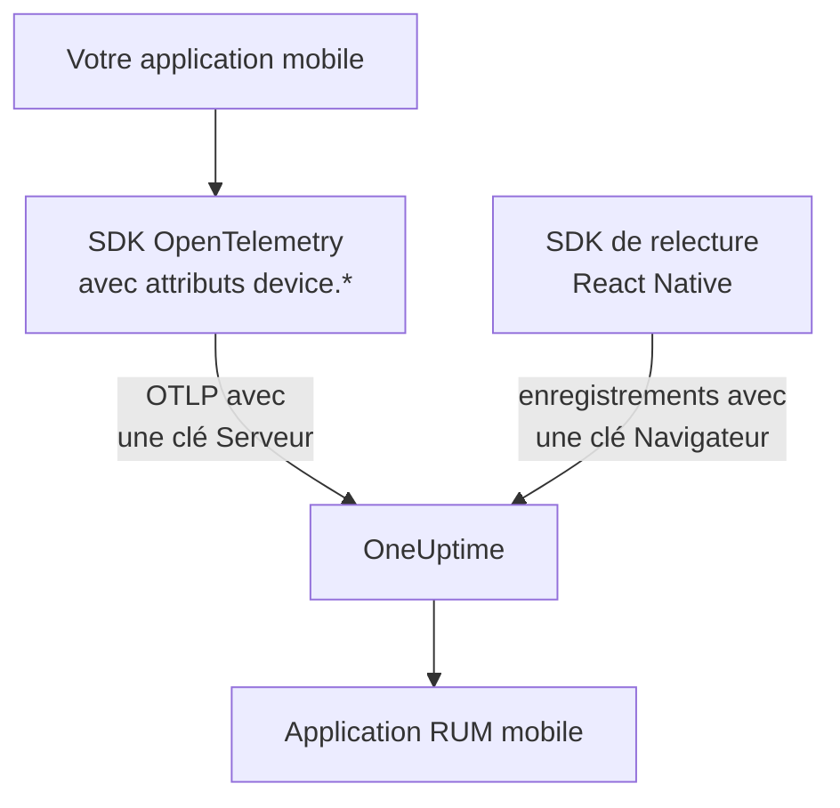

# Configuration mobile

Instrumentez une application Android, iOS ou React Native avec OpenTelemetry afin qu'elle se signale à OneUptime comme application RUM mobile. Toute autre plateforme dotée d'un SDK OpenTelemetry fonctionne de la même façon.

:::cards
- [Ce dont OneUptime a besoin](#ce-dont-oneuptime-a-besoin): Deux attributs de ressource, envoyés avec une clé Serveur.
- [Configurer votre plateforme](#configurer-votre-plateforme): Android, iOS, React Native et les autres.
- [Plantages et blocages iOS](#plantages-et-blocages-ios): Les rapports de MetricKit et de KSCrash dans Exceptions, nommés grâce à vos dSYM.
- [Vérifier que tout arrive](#vérifier-que-tout-arrive): Tester la clé, puis trouver l'application.
- [Relecture de session sur mobile](#relecture-de-session-sur-mobile): Des enregistrements pour les applications React Native.
:::

## Fonctionnement

Votre application exporte l'OTLP directement vers OneUptime avec une clé d'ingestion **Serveur**. Ce sont les attributs `device.*` de sa ressource qui la classent comme RUM mobile plutôt que comme service backend.



## Ce dont OneUptime a besoin

Deux attributs de ressource, sur chaque lot que votre application exporte :

| Attribut | Ce que c'est |
| --- | --- |
| `service.name` | L'identité de l'application, par exemple `storefront-android`. |
| `device.id` ou `device.model.identifier` | Marque la télémétrie comme RUM mobile. `device.model.identifier` remplit aussi la page **Clients**. |

Sans attribut d'appareil, la télémétrie arrive quand même et vous pouvez l'interroger, mais elle est classée comme service backend au lieu d'une application RUM.

`device.manufacturer` marque aussi un lot comme mobile, mais seulement sur une ressource sans identité d'hôte, car l'inventaire d'un hôte s'en sert pour indiquer le fabricant d'une machine. Définissez aussi `device.id` ou `device.model.identifier`, comme le fait chaque recette ci-dessous, et cela ne compte jamais.

Faites de `device.id` un identifiant propre à l'installation, jamais un identifiant publicitaire ni rien d'autre qui identifie une personne. OneUptime ne le lit que pour reconnaître la télémétrie mobile.

## Avant de commencer

- Une application avec un SDK OpenTelemetry : le SDK OpenTelemetry Java ou OpenTelemetry Android, opentelemetry-swift, ou le SDK OpenTelemetry JavaScript pour React Native.
- Une clé d'ingestion **Serveur**, créée sous **Paramètres du projet → Télémétrie & APM → Clés d'ingestion** avec **Créer une clé d'ingestion**. Une clé **Navigateur** est refusée depuis une application mobile : elle est vérifiée par rapport à l'en-tête `Origin`, que les SDK mobiles n'envoient pas.
- Ces paramètres OTLP. Si vous hébergez OneUptime vous-même, remplacez `https://oneuptime.com` par votre propre hôte.

| Paramètre | Valeur |
| --- | --- |
| Point de terminaison OTLP | `https://oneuptime.com/otlp` |
| En-tête | `x-oneuptime-token: YOUR_TELEMETRY_INGESTION_TOKEN` |
| Traces | `POST https://oneuptime.com/otlp/v1/traces` |
| Métriques | `POST https://oneuptime.com/otlp/v1/metrics` |
| Journaux | `POST https://oneuptime.com/otlp/v1/logs` |

> [!WARNING]
> La clé est livrée dans votre application, et une application peut être décompressée : partez donc du principe que quelqu'un la copiera. Sur la page de la clé, définissez un **Nom du service épinglé** pour qu'une copie ne puisse pas écrire sous les noms de vos services backend, ajoutez une **Requests Per Minute Limit** et une date **Expire le**, et renouvelez la clé à chaque version.

## Configurer votre plateforme

Les extraits montrent la forme de la configuration. Les SDK OpenTelemetry mobiles changent leurs API d'une version à l'autre : vérifiez les noms de méthodes sur la version que vous figez. Ce dont OneUptime a besoin ne change jamais : le point de terminaison, l'en-tête, `service.name` et un attribut `device.*`.

:::tabs
@tab Android
Utilisez le SDK OpenTelemetry Java et son exportateur OTLP, qui fonctionnent sur Android :

```kotlin title="app/build.gradle.kts"
dependencies {
    implementation(platform("io.opentelemetry:opentelemetry-bom:<latest>"))
    implementation("io.opentelemetry:opentelemetry-sdk")
    implementation("io.opentelemetry:opentelemetry-exporter-otlp")
}
```

```kotlin title="StorefrontApplication.kt"
import android.app.Application
import android.os.Build
import io.opentelemetry.exporter.otlp.http.trace.OtlpHttpSpanExporter
import io.opentelemetry.sdk.OpenTelemetrySdk
import io.opentelemetry.sdk.resources.Resource
import io.opentelemetry.sdk.trace.SdkTracerProvider
import io.opentelemetry.sdk.trace.export.BatchSpanProcessor

class StorefrontApplication : Application() {
    override fun onCreate() {
        super.onCreate()

        val resource = Resource.getDefault().toBuilder()
            .put("service.name", "storefront-android")
            .put("device.manufacturer", Build.MANUFACTURER)
            .put("device.model.identifier", Build.MODEL)
            .build()

        val exporter = OtlpHttpSpanExporter.builder()
            .setEndpoint("https://oneuptime.com/otlp/v1/traces")
            .addHeader("x-oneuptime-token", BuildConfig.ONEUPTIME_TOKEN)
            .build()

        OpenTelemetrySdk.builder()
            .setTracerProvider(
                SdkTracerProvider.builder()
                    .setResource(resource)
                    .addSpanProcessor(BatchSpanProcessor.builder(exporter).build())
                    .build()
            )
            .buildAndRegisterGlobal()
    }
}
```

L'agent [OpenTelemetry Android](https://github.com/open-telemetry/opentelemetry-android) ajoute par-dessus les plantages, les ANR, les images lentes et figées et les démarrages de l'application, et définit `device.model.identifier` et `device.manufacturer` sur sa propre ressource. [Configuration Android](/docs/rum/android-setup) le met en place à la place du code ci-dessus.
@tab iOS
Utilisez [opentelemetry-swift](https://github.com/open-telemetry/opentelemetry-swift) et définissez vous-même les attributs d'appareil : la ressource que chaque version ajoute d'elle-même a changé d'une version à l'autre.

```swift
let resource = Resource(attributes: [
    "service.name": .string("storefront-ios"),
    "device.model.identifier": .string(UIDevice.current.model),
    "device.manufacturer": .string("Apple"),
    "device.id": .string(UIDevice.current.identifierForVendor?.uuidString ?? ""),
    "telemetry.sdk.language": .string("swift"),
])

let exporter = OtlpHttpTraceExporter(
    endpoint: URL(string: "https://oneuptime.com/otlp/v1/traces")!,
    config: OtlpConfiguration(
        headers: [("x-oneuptime-token", oneUptimeToken)]
    )
)

OpenTelemetry.registerTracerProvider(
    tracerProvider: TracerProviderBuilder()
        .with(resource: resource)
        .add(spanProcessor: BatchSpanProcessor(spanExporter: exporter))
        .build()
)
```

`UIDevice.current.model` donne un nom court comme `iPhone`, ce qui limite la page **Clients** à une ligne par type d'appareil. `identifierForVendor` est l'installation d'après laquelle OneUptime compte les installations sans plantage, comme l'indique [Enregistrer les sessions](#enregistrer-les-sessions).
@tab React Native
React Native exécute le SDK OpenTelemetry JavaScript : construisez donc le provider, l'exportateur OTLP et le processeur de lots comme dans [Configuration navigateur](/docs/rum/browser-setup), avec trois changements : envoyez avec une clé **Serveur**, retirez `browserDetector` et `DocumentLoadInstrumentation`, et définissez vous-même les attributs d'appareil.

```ts
import { Platform } from "react-native";
import * as Device from "expo-device"; // or react-native-device-info
import {
  defaultResource,
  resourceFromAttributes,
} from "@opentelemetry/resources";

const resource = defaultResource().merge(
  resourceFromAttributes({
    "service.name": "storefront-mobile",
    "device.manufacturer": Device.manufacturer ?? Platform.OS,
    "device.model.identifier":
      Device.modelId ?? Device.modelName ?? "unknown",
    "telemetry.sdk.language": "webjs",
  }),
);
```

`Device.modelId` n'est défini que sur iOS : Android se rabat donc sur `Device.modelName`.
@tab Autres plateformes
Flutter, Unity, .NET MAUI, un client embarqué ou votre propre écrivain OTLP fonctionnent tous, tant que la ressource porte `service.name` et un attribut `device.*`. Un SDK qui lit les variables d'environnement standard d'OpenTelemetry les prend telles quelles :

```bash
OTEL_EXPORTER_OTLP_ENDPOINT="https://oneuptime.com/otlp"
OTEL_EXPORTER_OTLP_HEADERS="x-oneuptime-token=YOUR_TELEMETRY_INGESTION_TOKEN"
OTEL_RESOURCE_ATTRIBUTES="service.name=storefront-mobile,device.manufacturer=Acme,device.model.identifier=AC-100"
```

Le SDK ajoute lui-même `/v1/traces`, `/v1/metrics` et `/v1/logs` au point de terminaison.
:::

## Plantages et blocages iOS

opentelemetry-swift 2.3 et ultérieur signale les plantages et les blocages d'une application iOS via son instrumentation MetricKit, qui transmet chacun des diagnostics d'Apple à OpenTelemetry sous forme d'enregistrement de journal. OneUptime les classe comme il classe les plantages et les ANR d'OpenTelemetry Android : ils apparaissent donc dans **Exceptions** et sur la page **Vue d'ensemble** de l'application :

| Diagnostic d'Apple | Nom de l'événement | Dans Exceptions |
| --- | --- | --- |
| Un plantage | `metrickit.diagnostic.crash` | Une exception non gérée, typée d'après ce qui a mis fin à l'application : l'exception Objective-C sur iOS 17 et ultérieur, sinon l'exception Mach (`EXC_BAD_ACCESS`), sinon le signal (`SIGSEGV`) |
| Un blocage | `metrickit.diagnostic.hang` | Une exception non gérée de type **Hang**, l'équivalent iOS d'un ANR, qui conserve la durée du blocage |

La tuile **Plantages** de la vue d'ensemble compte les plantages, et sa tuile **ANR** compte les blocages avec les ANR d'Android. Chaque stack trace est dessinée comme les threads d'un rapport de plantage, en commençant par le thread qui a planté ou s'est bloqué. Une frame du code de votre application est nommée d'après sa fonction, comme `CartViewController.checkout()`, une fois le dSYM de son build envoyé, comme dans [Envoyer vos dSYM](#envoyer-vos-dsym). Toute autre frame nomme son binaire et la position du code dans celui-ci, et **Binary Images** liste l'UUID de chaque binaire, qui indique de quel build provient le dSYM qui le nomme.

Les plantages et les blocages sont regroupés d'après les frames de votre application sur le thread qui a planté ou s'est bloqué : d'après leurs fonctions là où un dSYM les a nommées, si bien qu'un plantage reste une seule exception d'une version à la suivante, et d'après leurs décalages dans le binaire là où aucun ne l'a fait, qui changent à chaque build. Un rapport est nommé à son arrivée : envoyez donc les dSYM d'un build avant de le publier, car un plantage arrivé avant son dSYM garde ses décalages.

:::steps
### Exporter les journaux en plus des spans

MetricKit signale les diagnostics sous forme d'enregistrements de journal : enregistrez donc un fournisseur de loggers à côté du fournisseur de traceurs, avec la même ressource, le même point de terminaison et le même en-tête :

```swift
let logExporter = OtlpHttpLogExporter(
    endpoint: URL(string: "https://oneuptime.com/otlp/v1/logs")!,
    config: OtlpConfiguration(
        headers: [("x-oneuptime-token", oneUptimeToken)]
    )
)

OpenTelemetry.registerLoggerProvider(
    loggerProvider: LoggerProviderBuilder()
        .with(resource: resource)
        .with(processors: [
            BatchLogRecordProcessor(logRecordExporter: logExporter),
        ])
        .build()
)
```

### Enregistrer l'instrumentation MetricKit

Ajoutez le produit `MetricKitInstrumentation` d'opentelemetry-swift, et enregistrez-le auprès de MetricKit une fois le fournisseur de loggers enregistré :

```swift
import MetricKit
import MetricKitInstrumentation

// MXMetricManager keeps only a weak reference: hold this for the app's lifetime.
let metricKitInstrumentation = MetricKitInstrumentation()
MXMetricManager.shared.add(metricKitInstrumentation)
```

### Enregistrer les sessions

Les tuiles **Sessions** et **Sessions sans plantage** comptent le `session.id` de vos spans. Le produit `Sessions` d'opentelemetry-swift le définit : ajoutez `SessionSpanProcessor` au fournisseur de traceurs, et enveloppez le processeur de journaux dans `SessionLogRecordProcessor`, pour que les diagnostics portent aussi une session.

La ligne sous **Sessions sans plantage** donne la part des installations qui n'ont pas planté, et **Daily Crash Rate** et **Daily ANR Rate** alertent sur la part de celles qui ont planté. Une installation est le `device.id` de la ressource ci-dessus, l'identifiant de l'application pour son éditeur : un par appareil pour toutes vos applications, conservé tant que l'une d'elles reste installée, si bien que réinstaller votre seule application crée une nouvelle installation, alors que réinstaller l'une de deux n'en crée pas. Une version d'opentelemetry-swift qui définit `app.installation.id` est comptée d'après celui-ci à la place.

### Envoyer vos dSYM

Xcode écrit un dSYM pour chacun des binaires de votre application quand il l'archive, et App Store Connect vous les rend sous **Download dSYMs**. Envoyez-les après chaque archivage, depuis la CI ou une phase de build Xcode, avec la [CLI OneUptime](/docs/cli/index) et une clé Serveur propre à votre build : une clé dotée d'un **Nom du service épinglé**, comme celle que livre votre application, est refusée, car un dSYM nomme les frames de chaque application du projet qui embarque son binaire.

```bash
oneuptime dsym upload "$ARCHIVE_PATH/dSYMs" --app storefront-ios --url https://oneuptime.com --ingestion-key YOUR_TELEMETRY_INGESTION_TOKEN
```

La CLI lit les bundles `.dSYM`, les dossiers et les zips qui en contiennent, ainsi que les fichiers DWARF là où ils se trouvent, et n'envoie que l'UUID, l'architecture et les noms de fonctions de chaque binaire : les dSYM d'une grande application pèsent des centaines de mégaoctets, leurs noms quelques-uns. Sans la CLI, envoyez le fichier DWARF d'un dSYM, ou un zip de bundles `.dSYM`, tel quel, jusqu'à 50 Mo par fichier :

```bash
curl --fail -X POST "https://oneuptime.com/dsyms/v1/upload" \
  -H "x-oneuptime-token: YOUR_TELEMETRY_INGESTION_TOKEN" \
  -F "appName=storefront-ios" \
  -F "dsym=@MyApp.app.dSYM/Contents/Resources/DWARF/MyApp"
```

Chaque binaire est conservé d'après son UUID pendant 400 jours, si bien qu'une version encore sur les téléphones des utilisateurs des mois plus tard est toujours nommée, et envoyer de nouveau un build remplace ce qui était conservé pour lui. Un dSYM appartient au projet, pas à une seule application : un framework que deux de vos applications embarquent est nommé dans les deux.
:::

> [!NOTE]
> Apple remet les diagnostics de MetricKit à l'application lors d'un lancement ultérieur, immédiatement sur iOS 15 et ultérieur, une fois par jour sur les versions antérieures, si bien qu'un plantage ou un blocage peut arriver quelques minutes ou un jour après s'être produit, et il est compté à son arrivée. « 0 plantage au cours de la dernière heure » sur la vue d'ensemble d'une application iOS n'est donc pas encore une bonne nouvelle. Un diagnostic porte la session qui l'a signalé, pas celle à laquelle il a mis fin.

opentelemetry-swift n'enregistre aucun span au démarrage de l'application : les tuiles **Démarrages de l'application** et **Démarrage à froid (p95)** restent donc vides jusqu'à ce que votre application en enregistre un, à savoir un span nommé `AppStart`, avec `start.type` défini à `cold`, `warm` ou `hot`, du démarrage du processus jusqu'au moment où le premier écran est prêt.

### Quand KSCrash signale aussi un plantage

opentelemetry-swift peut aussi signaler les plantages via KSCrash, qui envoie son rapport sous forme d'enregistrement de journal `device.crash` à la prochaine ouverture de l'application, avec l'heure à laquelle l'application a planté. Une application qui enregistre les deux signale chaque plantage deux fois : KSCrash au lancement suivant, MetricKit au lancement suivant ou jusqu'à un jour plus tard. OneUptime compte un tel plantage une seule fois : le premier rapport arrivé est l'occurrence, et le second est conservé à côté d'elle, dans la même exception, comme preuve du même plantage, sans être compté dans aucune tuile, aucun graphique ni aucun moniteur. Dans les **Occurrences** de l'exception, l'occurrence affiche **Signalé deux fois**.

Deux rapports ne sont pris pour un seul plantage que lorsque toutes ces conditions sont réunies :

- Ils viennent des deux sources, KSCrash et MetricKit. Aucune des deux ne signale deux fois un même plantage : deux rapports d'une même source sont donc deux plantages.
- Ils viennent de la même installation : le même `app.installation.id`, ou `device.id`.
- Ils sont séparés de 26 heures au plus : MetricKit date un plantage de la fin de la journée sur laquelle il porte, KSCrash du moment du plantage.
- Ils s'accordent sur le signal, l'exception Mach et l'exception Objective-C, partout où les deux en nomment une.
- Les threads qui ont planté concordent frame par frame depuis le point de départ du thread vers l'intérieur, par binaire et décalage, sur chaque frame du code de votre application que l'un ou l'autre nomme. Un plantage entièrement dans le code d'Apple doit concorder sur au moins trois frames, et sur toutes.

Chaque rapport n'est apparié qu'une fois, avec le plus proche dans le temps : deux plantages dus au même bug sur une installation, à quelques minutes d'intervalle, sont donc deux occurrences, chacune avec son second rapport. Quand OneUptime ne peut pas comparer un rapport avec les autres de son installation, il le compte : un plantage est donc compté deux fois au pire, jamais perdu.

## Vérifier que tout arrive

:::steps
### Tester la clé

Avant de parcourir les paramètres du SDK, demandez à OneUptime s'il accepte la clé :

```bash
curl -i https://oneuptime.com/otlp/v1/validate \
  -H "x-oneuptime-token: YOUR_TELEMETRY_INGESTION_TOKEN"
```

`200` avec `"valid": true` signifie que la clé est acceptée. Une clé Navigateur répond aussi `200`, mais son message indique qu'elle ne fonctionne que depuis un navigateur : une application mobile a besoin d'une clé Serveur. `401` signifie que la clé est inconnue, révoquée, désactivée ou expirée, et aucun paramètre du SDK n'y changera rien.

### Lancer l'application

Lancez l'application et utilisez-la un instant. Elle apparaît sous **Produits → Ressources → Surveillance des utilisateurs réels** dès son premier lot de télémétrie, nommée d'après son `service.name`.

### Ouvrir la page Clients

Ouvrez la page **Clients** de l'application : chaque modèle d'appareil issu de `device.model.identifier` y a une ligne. Si la page reste vide alors que **Traces** se remplit, les attributs d'appareil n'atteignent pas la ressource.
:::

## Relecture de session sur mobile

Les applications React Native peuvent enregistrer des sessions avec `@oneuptime/react-native-replay`. Il enregistre l'arbre de vues natif sous forme de maquette filaire, jamais de captures d'écran ni le texte affiché, et ses enregistrements s'ouvrent dans le même lecteur que ceux du web. Il envoie avec une clé **Navigateur** dont les **Origines autorisées** listent votre application sous la forme `app://` suivi de son ID d'application Android ou de son ID de bundle iOS : une clé distincte de la clé Serveur qu'utilise votre SDK OpenTelemetry. [Installer dans React Native](/docs/telemetry/session-replay#installation-dans-react-native) explique la marche à suivre.

Les applications Android et iOS natives, ainsi que les autres plateformes, n'ont pas d'enregistreur de session : leur page **Relecture de session** reste vide, tandis que les traces, journaux, métriques, exceptions et la page **Clients** fonctionnent normalement.

## Dépannage

:::details La vérification de la clé renvoie 401, ou la clé est refusée
Un `401` signifie que la clé est inconnue, révoquée, désactivée ou expirée : créez une clé Serveur et recompilez l'application avec elle.

Une clé Navigateur passe la vérification, mais chaque export depuis une application mobile est refusé avec un `422` qui indique `This request did not send an Origin header, so it cannot be checked against the allowed origins of this browser ingestion key. Use a server ingestion key for requests that are not sent by a browser.` Utilisez une clé **Serveur**.
:::

:::details L'application apparaît sous Services au lieu de Surveillance des utilisateurs réels
La ressource n'a ni `device.id` ni `device.model.identifier` : la télémétrie a donc été classée comme service backend. Définissez-les comme dans [Configurer votre plateforme](#configurer-votre-plateforme).

Le service déjà créé ne devient pas une application RUM : supprimez-le sous **Produits → Services** dès que la télémétrie RUM arrive.
:::

:::details La page Clients est vide
Les lignes de clients viennent uniquement de `device.model.identifier`. Un SDK qui ne définit que `device.id` ou `device.manufacturer` classe l'application comme RUM mobile, mais ne liste aucun client : définissez aussi `device.model.identifier`.
:::

:::details Le statut indique Aucun trafic récent alors que l'application est utilisée
Le statut passe à **Aucun trafic récent** après 15 minutes sans télémétrie. Si des personnes utilisent l'application :

- Un échantillonneur rejette peut-être tout : cherchez un échantillonneur always-off ou un taux très faible.
- L'application n'envoie peut-être de la télémétrie que pour des actions que personne n'a faites pendant ce temps.
- La clé a peut-être été révoquée, ou a expiré, depuis la version : testez-la comme dans [Vérifier que tout arrive](#vérifier-que-tout-arrive).
:::

## Prochaines étapes

:::cards
- [Relecture de session](/docs/telemetry/session-replay): Enregistrer les sessions React Native, à côté de leurs traces.
- [Gérer les applications](/docs/rum/applications): Noms, étiquettes, propriétaires et rétention.
- [OpenTelemetry](/docs/telemetry/open-telemetry): Les points de terminaison, limites et erreurs OTLP en détail.
- [Dépannage RUM](/docs/rum/troubleshooting): Chaque vérification, dans l'ordre où les problèmes surviennent d'habitude.
:::
