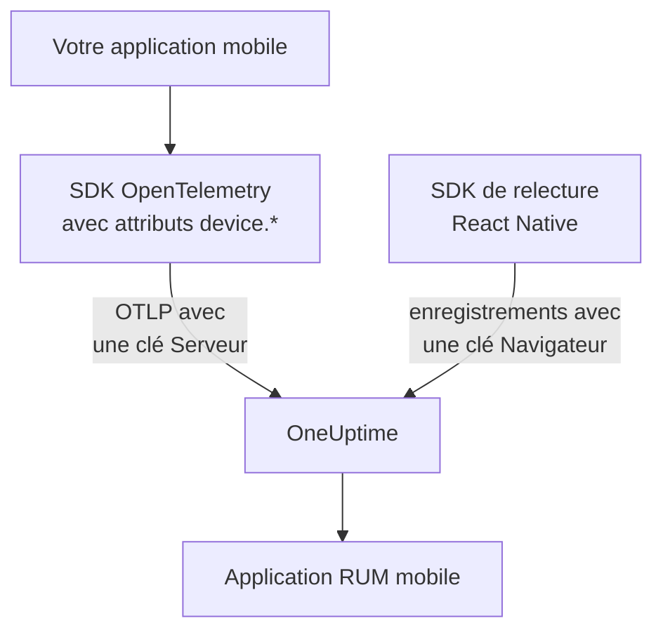

# Configuration mobile

Instrumentez une application Android, iOS ou React Native avec OpenTelemetry afin qu'elle se signale à OneUptime comme application RUM mobile. Toute autre plateforme dotée d'un SDK OpenTelemetry fonctionne de la même façon.

:::cards
- [Ce dont OneUptime a besoin](#ce-dont-oneuptime-a-besoin): Deux attributs de ressource, envoyés avec une clé Serveur.
- [Configurer votre plateforme](#configurer-votre-plateforme): Android, iOS, React Native et les autres.
- [Vérifier que tout arrive](#vérifier-que-tout-arrive): Tester la clé, puis trouver l'application.
- [Relecture de session sur mobile](#relecture-de-session-sur-mobile): Des enregistrements pour les applications React Native.
:::

## Fonctionnement

Votre application exporte l'OTLP directement vers OneUptime avec une clé d'ingestion **Serveur**. Ce sont les attributs `device.*` de sa ressource qui la classent comme RUM mobile plutôt que comme service backend.



## Ce dont OneUptime a besoin

Deux attributs de ressource, sur chaque lot que votre application exporte :

| Attribut | Ce que c'est |
| --- | --- |
| `service.name` | L'identité de l'application, par exemple `storefront-android`. |
| `device.id` ou `device.model.identifier` | Marque la télémétrie comme RUM mobile. `device.model.identifier` remplit aussi la page **Clients**. |

Sans attribut d'appareil, la télémétrie arrive quand même et vous pouvez l'interroger, mais elle est classée comme service backend au lieu d'une application RUM.

`device.manufacturer` marque aussi un lot comme mobile, mais seulement sur une ressource sans identité d'hôte, car l'inventaire d'un hôte s'en sert pour indiquer le fabricant d'une machine. Définissez aussi `device.id` ou `device.model.identifier`, comme le fait chaque recette ci-dessous, et cela ne compte jamais.

Faites de `device.id` un identifiant propre à l'installation, jamais un identifiant publicitaire ni rien d'autre qui identifie une personne. OneUptime ne le lit que pour reconnaître la télémétrie mobile.

## Avant de commencer

- Une application avec un SDK OpenTelemetry : le SDK OpenTelemetry Java ou OpenTelemetry Android, opentelemetry-swift, ou le SDK OpenTelemetry JavaScript pour React Native.
- Une clé d'ingestion **Serveur**, créée sous **Paramètres du projet → Télémétrie & APM → Clés d'ingestion** avec **Créer une clé d'ingestion**. Une clé **Navigateur** est refusée depuis une application mobile : elle est vérifiée par rapport à l'en-tête `Origin`, que les SDK mobiles n'envoient pas.
- Ces paramètres OTLP. Si vous hébergez OneUptime vous-même, remplacez `https://oneuptime.com` par votre propre hôte.

| Paramètre | Valeur |
| --- | --- |
| Point de terminaison OTLP | `https://oneuptime.com/otlp` |
| En-tête | `x-oneuptime-token: YOUR_TELEMETRY_INGESTION_TOKEN` |
| Traces | `POST https://oneuptime.com/otlp/v1/traces` |
| Métriques | `POST https://oneuptime.com/otlp/v1/metrics` |
| Journaux | `POST https://oneuptime.com/otlp/v1/logs` |

> [!WARNING]
> La clé est livrée dans votre application, et une application peut être décompressée : partez donc du principe que quelqu'un la copiera. Sur la page de la clé, définissez un **Pinned Service Name** pour qu'une copie ne puisse pas écrire sous les noms de vos services backend, ajoutez une **Requests Per Minute Limit** et une date **Expire le**, et renouvelez la clé à chaque version.

## Configurer votre plateforme

Les extraits montrent la forme de la configuration. Les SDK OpenTelemetry mobiles changent leurs API d'une version à l'autre : vérifiez les noms de méthodes sur la version que vous figez. Ce dont OneUptime a besoin ne change jamais : le point de terminaison, l'en-tête, `service.name` et un attribut `device.*`.

:::tabs
@tab Android
Utilisez le SDK OpenTelemetry Java et son exportateur OTLP, qui fonctionnent sur Android :

```kotlin title="app/build.gradle.kts"
dependencies {
    implementation(platform("io.opentelemetry:opentelemetry-bom:<latest>"))
    implementation("io.opentelemetry:opentelemetry-sdk")
    implementation("io.opentelemetry:opentelemetry-exporter-otlp")
}
```

```kotlin title="StorefrontApplication.kt"
import android.app.Application
import android.os.Build
import io.opentelemetry.exporter.otlp.http.trace.OtlpHttpSpanExporter
import io.opentelemetry.sdk.OpenTelemetrySdk
import io.opentelemetry.sdk.resources.Resource
import io.opentelemetry.sdk.trace.SdkTracerProvider
import io.opentelemetry.sdk.trace.export.BatchSpanProcessor

class StorefrontApplication : Application() {
    override fun onCreate() {
        super.onCreate()

        val resource = Resource.getDefault().toBuilder()
            .put("service.name", "storefront-android")
            .put("device.manufacturer", Build.MANUFACTURER)
            .put("device.model.identifier", Build.MODEL)
            .build()

        val exporter = OtlpHttpSpanExporter.builder()
            .setEndpoint("https://oneuptime.com/otlp/v1/traces")
            .addHeader("x-oneuptime-token", BuildConfig.ONEUPTIME_TOKEN)
            .build()

        OpenTelemetrySdk.builder()
            .setTracerProvider(
                SdkTracerProvider.builder()
                    .setResource(resource)
                    .addSpanProcessor(BatchSpanProcessor.builder(exporter).build())
                    .build()
            )
            .buildAndRegisterGlobal()
    }
}
```

L'agent [OpenTelemetry Android](https://github.com/open-telemetry/opentelemetry-android) ajoute par-dessus une instrumentation automatique et définit des attributs d'appareil sur sa propre ressource. Si vous l'utilisez, pointez son exportateur vers le même point de terminaison et le même en-tête, et vérifiez que `device.model.identifier` arrive bien sur la ressource dans votre version.
@tab iOS
Utilisez [opentelemetry-swift](https://github.com/open-telemetry/opentelemetry-swift) et définissez vous-même les attributs d'appareil : la ressource que chaque version ajoute d'elle-même a changé d'une version à l'autre.

```swift
let resource = Resource(attributes: [
    "service.name": .string("storefront-ios"),
    "device.model.identifier": .string(UIDevice.current.model),
    "device.manufacturer": .string("Apple"),
    "telemetry.sdk.language": .string("swift"),
])

let exporter = OtlpHttpTraceExporter(
    endpoint: URL(string: "https://oneuptime.com/otlp/v1/traces")!,
    config: OtlpConfiguration(
        headers: [("x-oneuptime-token", oneUptimeToken)]
    )
)

OpenTelemetry.registerTracerProvider(
    tracerProvider: TracerProviderBuilder()
        .with(resource: resource)
        .add(spanProcessor: BatchSpanProcessor(spanExporter: exporter))
        .build()
)
```

`UIDevice.current.model` donne un nom court comme `iPhone`, ce qui limite la page **Clients** à une ligne par type d'appareil.
@tab React Native
React Native exécute le SDK OpenTelemetry JavaScript : construisez donc le provider, l'exportateur OTLP et le processeur de lots comme dans [Configuration navigateur](/docs/rum/browser-setup), avec trois changements : envoyez avec une clé **Serveur**, retirez `browserDetector` et `DocumentLoadInstrumentation`, et définissez vous-même les attributs d'appareil.

```ts
import { Platform } from "react-native";
import * as Device from "expo-device"; // or react-native-device-info
import {
  defaultResource,
  resourceFromAttributes,
} from "@opentelemetry/resources";

const resource = defaultResource().merge(
  resourceFromAttributes({
    "service.name": "storefront-mobile",
    "device.manufacturer": Device.manufacturer ?? Platform.OS,
    "device.model.identifier":
      Device.modelId ?? Device.modelName ?? "unknown",
    "telemetry.sdk.language": "webjs",
  }),
);
```

`Device.modelId` n'est défini que sur iOS : Android se rabat donc sur `Device.modelName`.
@tab Autres plateformes
Flutter, Unity, .NET MAUI, un client embarqué ou votre propre écrivain OTLP fonctionnent tous, tant que la ressource porte `service.name` et un attribut `device.*`. Un SDK qui lit les variables d'environnement standard d'OpenTelemetry les prend telles quelles :

```bash
OTEL_EXPORTER_OTLP_ENDPOINT="https://oneuptime.com/otlp"
OTEL_EXPORTER_OTLP_HEADERS="x-oneuptime-token=YOUR_TELEMETRY_INGESTION_TOKEN"
OTEL_RESOURCE_ATTRIBUTES="service.name=storefront-mobile,device.manufacturer=Acme,device.model.identifier=AC-100"
```

Le SDK ajoute lui-même `/v1/traces`, `/v1/metrics` et `/v1/logs` au point de terminaison.
:::

## Vérifier que tout arrive

:::steps
### Tester la clé

Avant de parcourir les paramètres du SDK, demandez à OneUptime s'il accepte la clé :

```bash
curl -i https://oneuptime.com/otlp/v1/validate \
  -H "x-oneuptime-token: YOUR_TELEMETRY_INGESTION_TOKEN"
```

`200` avec `"valid": true` signifie que la clé est acceptée. Une clé Navigateur répond aussi `200`, mais son message indique qu'elle ne fonctionne que depuis un navigateur : une application mobile a besoin d'une clé Serveur. `401` signifie que la clé est inconnue, révoquée, désactivée ou expirée, et aucun paramètre du SDK n'y changera rien.

### Lancer l'application

Lancez l'application et utilisez-la un instant. Elle apparaît sous **Produits → Ressources → Surveillance des utilisateurs réels** dès son premier lot de télémétrie, nommée d'après son `service.name`.

### Ouvrir la page Clients

Ouvrez la page **Clients** de l'application : chaque modèle d'appareil issu de `device.model.identifier` y a une ligne. Si la page reste vide alors que **Traces** se remplit, les attributs d'appareil n'atteignent pas la ressource.
:::

## Relecture de session sur mobile

Les applications React Native peuvent enregistrer des sessions avec `@oneuptime/react-native-replay`. Il enregistre l'arbre de vues natif sous forme de maquette filaire, jamais de captures d'écran ni le texte affiché, et ses enregistrements s'ouvrent dans le même lecteur que ceux du web. Il envoie avec une clé **Navigateur** dont les **Origines autorisées** listent votre application sous la forme `app://` suivi de son ID d'application Android ou de son ID de bundle iOS : une clé distincte de la clé Serveur qu'utilise votre SDK OpenTelemetry. [Installer dans React Native](/docs/telemetry/session-replay#install-in-react-native) explique la marche à suivre.

Les applications Android et iOS natives, ainsi que les autres plateformes, n'ont pas d'enregistreur de session : leur page **Relecture de session** reste vide, tandis que les traces, journaux, métriques, exceptions et la page **Clients** fonctionnent normalement.

## Dépannage

:::details La vérification de la clé renvoie 401, ou la clé est refusée
Un `401` signifie que la clé est inconnue, révoquée, désactivée ou expirée : créez une clé Serveur et recompilez l'application avec elle.

Une clé Navigateur passe la vérification, mais chaque export depuis une application mobile est refusé avec un `422` qui indique `This request did not send an Origin header, so it cannot be checked against the allowed origins of this browser ingestion key. Use a server ingestion key for requests that are not sent by a browser.` Utilisez une clé **Serveur**.
:::

:::details L'application apparaît sous Services au lieu de Surveillance des utilisateurs réels
La ressource n'a ni `device.id` ni `device.model.identifier` : la télémétrie a donc été classée comme service backend. Définissez-les comme dans [Configurer votre plateforme](#configurer-votre-plateforme).

Le service déjà créé ne devient pas une application RUM : supprimez-le sous **Produits → Services** dès que la télémétrie RUM arrive.
:::

:::details La page Clients est vide
Les lignes de clients viennent uniquement de `device.model.identifier`. Un SDK qui ne définit que `device.id` ou `device.manufacturer` classe l'application comme RUM mobile, mais ne liste aucun client : définissez aussi `device.model.identifier`.
:::

:::details Le statut indique Déconnecté alors que l'application est utilisée
Le statut passe à **Déconnecté** après 15 minutes sans télémétrie. Si des personnes utilisent l'application :

- Un échantillonneur rejette peut-être tout : cherchez un échantillonneur always-off ou un taux très faible.
- L'application n'envoie peut-être de la télémétrie que pour des actions que personne n'a faites pendant ce temps.
- La clé a peut-être été révoquée, ou a expiré, depuis la version : testez-la comme dans [Vérifier que tout arrive](#vérifier-que-tout-arrive).
:::

## Prochaines étapes

:::cards
- [Relecture de session](/docs/telemetry/session-replay): Enregistrer les sessions React Native, à côté de leurs traces.
- [Gérer les applications](/docs/rum/applications): Noms, étiquettes, propriétaires et rétention.
- [OpenTelemetry](/docs/telemetry/open-telemetry): Les points de terminaison, limites et erreurs OTLP en détail.
- [Dépannage RUM](/docs/rum/troubleshooting): Chaque vérification, dans l'ordre où les problèmes surviennent d'habitude.
:::
